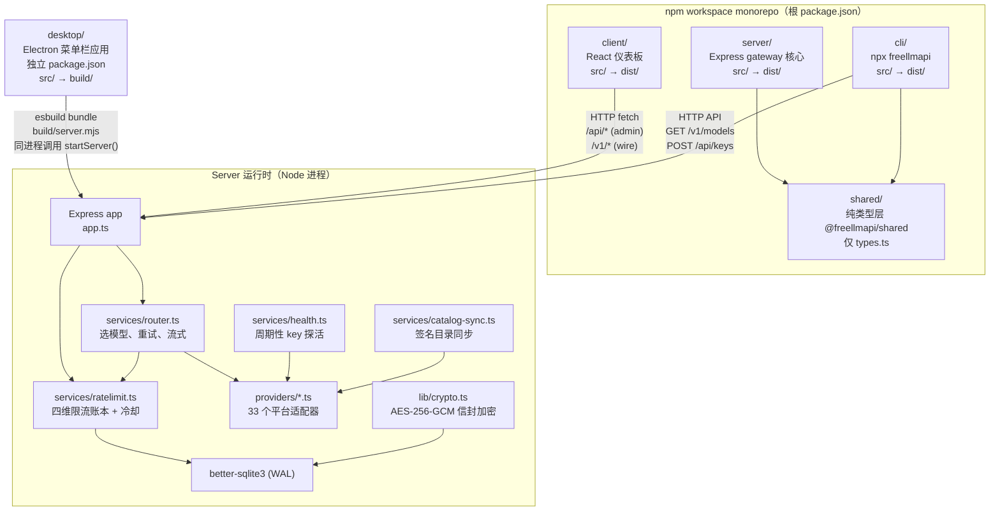
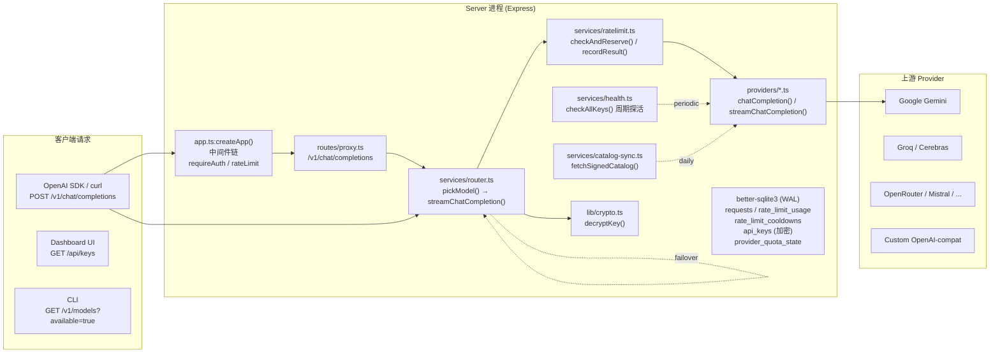

# 01 简单框架 —— 系统骨架

> 本篇为**第一层**：只答「做什么、由什么组成、请求怎么走」，不展开第四层细节。锚点记法见 [00-docs-style-guide.md](00-docs-style-guide.md)。

---

## 0 系统全景

FreeLLMAPI 是一个**本地优先**的 OpenAI-compatible LLM 路由器，把 60+ 个免费/付费 LLM 平台的免费额度聚合成单一 `/v1` 端点。核心能力：

- **统一入口**：`/v1/chat/completions`、`/v1/responses`、`/v1/embeddings`、`/v1/models`、`/v1/messages` (Anthropic)、Ollama `/api/*`
- **智能路由**：Thompson-sampling bandit 实时打分，按可靠性/速度/能力/配额余量选模型
- **多级限流**：RPM/RPD/TPM/TPD 四维 + provider 级总配额，持久化到 SQLite，支持冷却自动恢复
- **故障转移**：单请求最多 20 次重试，墙钟预算内自动切换到下一健康模型
- **单用户/本地优先**：无多租户，默认只绑定 `127.0.0.1`，Dashboard 受邮箱+密码保护

---

## 1 进程/模块拓扑



**关键架构决策**：
- **Desktop 不是另一个客户端**：通过 `desktop/scripts/bundle-server.mjs` 用 esbuild 把整个 server 打包成 `build/server.mjs`，在 Electron **主进程同一个进程里**直接 `import { startServer } from './server.mjs'` 并调用。`server-host.ts` 手工复制了 `server/src/index.ts` 的启动序列（见第 8 节）。
- **Desktop 端口 31415，Docker/server 端口 3001**。
- **CLI 纯客户端**：不 import server 代码，只通过 HTTP 与 gateway 通信。

---

## 2 四个 workspace + desktop 详细职责

| 组件 | 源码根 | 语言/框架 | 入口 | 产物 | 核心职责 |
|------|--------|-----------|------|------|----------|
| **shared** | `shared/` | TS (纯类型) | `types.ts` | 无 | 定义 `Platform` (60+ 平台联合)、`Model`、`ApiKey`、`ChatCompletion*`、`ProviderQuotaState` 等核心契约。被 server + cli 引用 |
| **server** | `server/src/` | TS + Express 5 | `index.ts` → `dist/index.js` | `dist/` | 核心网关：路由注册、Provider 适配、路由器、限流账本、健康检查、目录同步、SQLite 持久化、AES-256-GCM 加密、Dashboard REST API (`/api/*`) |
| **client** | `client/src/` | React 19 + Vite 8 + Tailwind 4 + shadcn/ui + TanStack Query | `main.tsx` → `index.html` | `dist/` | 单页管理面板：Keys 管理、Fallback 策略、Models 浏览、Analytics、Playground、Settings 等 |
| **cli** | `cli/src/` | TS (Node ESM) | `index.ts` → `dist/index.js` | `dist/` (发布到 npm) | 21 个 coding agent 的配置生成器 (`setup-claude` 等)、Keys 管理 (`keys add/list/remove/test`)、诊断 (`doctor`) |
| **desktop** | `desktop/src/` | Electron 38 + esbuild | `main.ts` → `build/main.mjs` | `build/` + `dist/` (dmg/nsis/AppImage) | 菜单栏应用：内嵌 server、Tray/Popover、Dashboard 窗口、自动更新、开机自启、文件日志 |

---

## 3 依赖关系与数据流

### 3.1 编译时依赖

```
shared (纯类型)
    ▲
    │ import @freellmapi/shared
    │
server  ◄── client (HTTP runtime, 无编译依赖)
    │
    ▼
cli (import @freellmapi/shared)
```

- **shared** 无外部依赖，只导出类型。
- **server** 依赖 `express@5`、`undici@6`、`better-sqlite3@12` (optional)、`zod@3`、`helmet@8`、`cors@2`、`compression@1`、`sharp@0.35` (图片压缩)、`multer@2` (文件上传)、`dotenv@17`、`ajv@8` (JSON Schema 校验)、`socks-proxy-agent@10`。
- **client** 依赖 `react@19`、`react-router-dom@7`、`@tanstack/react-query@5`、`@dnd-kit/*` (拖拽)、`recharts@3`、`lucide-react`、`highlight.js`、`react-markdown`、`tailwindcss@4`。
- **cli** 依赖 `jsonc-parser@3` (JSON merge)、`yaml@2` (YAML merge)。**无 better-sqlite3、无 express**。
- **desktop** 依赖 `electron@38`、`electron-updater@6`、`better-sqlite3@12` (原生模块，`electron-rebuild` 适配)。

### 3.2 运行时数据流



**主数据流（`POST /v1/chat/completions`）**：
1. `app.ts` 中间件：`requireAuth` (验证 `freellmapi-` Bearer)、`createProxyRateLimiter` (IP 级 RPM)
2. `routes/proxy.ts`：解析 body，规范化为内部 `ChatRequest`
3. `router.ts pickModel()`：从 `model-state.ts` 获取候选模型 → `scoring.ts` 打分 → 按优先级尝试
4. `ratelimit.ts checkAndReserve()`：四维计数器 + 冷却检查，通过才放行
5. `providers/<platform>.ts`：解密 key → 调用上游 SDK/HTTP → 返回流式/非流式响应
6. 成功：`ratelimit.ts recordResult()` 计入用量；失败：`ratelimit.ts recordFailure()` 触发冷却 → router 重试下一模型
7. 响应流式透传回客户端（SSE）

---

## 4 核心模块职责速查表

| 模块 | 文件 | 核心职责 | 关键导出 |
|------|------|----------|----------|
| **启动入口** | `server/src/index.ts` | 进程级初始化：日志脱敏、进程安全网、DB 初始化、配置加载、定时任务调度器、健康检查/目录同步/冷却探针/备份/自定义模型同步/内置模型发现/唤醒检测 | `main()` |
| **Express 装配** | `server/src/app.ts` | 注册 29 个路由、CORS/Helmet/CSP/压缩/静态资源、信任代理、错误处理 | `createApp(config)` |
| **主代理路由** | `server/src/routes/proxy.ts` | `/v1/chat/completions` `/v1/responses` `/v1/completions` `/v1/embeddings` 统一入口，请求规范化、流式透传、工具调用救援 | `proxyRouter` |
| **Anthropic 兼容** | `server/src/routes/anthropic.ts` | `/v1/messages` Anthropic 格式 → 内部格式 → router → 转回 Anthropic 流 | `anthropicRouter` |
| **路由器** | `server/src/services/router.ts` | 选模型、重试、流式管线、降级模式、工具能力过滤、TTFB 预算 | `Router` class, `pickModel()`, `streamChatCompletion()` |
| **限流账本** | `server/src/services/ratelimit.ts` | RPM/RPD/TPM/TPD 内存计数器 + SQLite 持久化、冷却管理、配额预测 | `RateLimiter` class, `checkAndReserve()`, `recordResult()`, `recordFailure()` |
| **Provider 基类** | `server/src/providers/base.ts` | 抽象 `Provider` 类：`chatCompletion()`、`streamChatCompletion()`、`listModels()`、`checkHealth()`、`getModelCapabilities()` | `Provider` abstract class, `ChatRequest`, `ChatResponse`, `StreamChunk` |
| **Provider 注册表** | `server/src/providers/index.ts` | 33 个平台实例化、按 platform 查找、健康检查分发、模型能力聚合 | `getProvider()`, `listProviders()`, `getAllModels()`, `checkAllKeys()` |
| **健康检查** | `server/src/services/health.ts` | 周期性探活 (5min + 抖动)、连续失败自动禁用、quota polling、provider 交错调度 | `startHealthChecker()`, `checkAllKeys()`, `checkKeyHealth()` |
| **目录同步** | `server/src/services/catalog-sync.ts` | 从 freellmapi.co 拉取签名目录、验证签名、入库、免费/付费分层 | `startCatalogSync()`, `syncCatalog()` |
| **加密** | `server/src/lib/crypto.ts` | AES-256-GCM 信封加密、统一 key 派生、key 轮换 | `encrypt()`, `decrypt()`, `initEncryptionKey()`, `rotateEncryptionKey()` |
| **配置** | `server/src/lib/config.ts` | 环境变量 → `Config` 对象、端口/主机/DB路径/限流/请求体大小/信任代理/CSP | `loadConfig()`, `Config` interface |
| **数据库** | `server/src/db/index.ts` | SQLite 连接 (WAL、busy_timeout=5s)、目录权限收敛、迁移运行、加密 key 初始化 | `initDb()`, `getDb()`, `connectDb()`, `runMigrationsSync()` |

---

## 5 关键配置与环境变量

| 环境变量 | 默认 | 作用 | 读取位置 |
|----------|------|------|----------|
| `PORT` | `3001` (server) / `31415` (desktop) | 监听端口 | `lib/config.ts:72` |
| `HOST` | `::` (dual-stack) | 监听地址 | `lib/config.ts:76` |
| `FREEAPI_DB_PATH` | `server/data/freeapi.db` | SQLite 文件路径 | `lib/config.ts:77`, `db/index.ts:28` |
| `DASHBOARD_ORIGINS` | `localhost:5173` 等 | CORS 允许源 | `lib/config.ts:78-81` |
| `CLIENT_DIST` | null | 静态资源目录 (生产用) | `lib/config.ts:82` |
| `PROXY_RATE_LIMIT_RPM` | `120` | 代理层 IP 级 RPM | `lib/config.ts:22-28` |
| `REQUEST_BODY_LIMIT_MB` | `25` | JSON body 上限 | `lib/config.ts:30-36` |
| `TRUST_PROXY` | `false` | Express trust proxy | `lib/config.ts:100-112` |
| `CSP_UPGRADE_INSECURE_REQUESTS` | auto | CSP upgrade-insecure-requests | `lib/config.ts:114-121` |
| `FREEAPI_DB_DIR_HARDENING` | auto | 数据目录权限收敛 | `db/index.ts:140-146` |
| `ENCRYPTION_KEY` | (首次生成) | AES-256-GCM 主密钥 | `lib/crypto.ts` |
| `NODE_ENV` | `development` | 影响迁移自动运行 | `lib/config.ts:85`, `db/index.ts:203` |

---

## 6 源码索引（文件:函数/类:绝对行号）

| 文件 | 关键符号 | 行号范围 |
|------|----------|----------|
| `server/src/index.ts` | `main()` | 31-145 |
| `server/src/app.ts` | `createApp()` | 99-382 |
| `server/src/routes/proxy.ts` | `proxyRouter` | 1-800+ |
| `server/src/routes/anthropic.ts` | `anthropicRouter` | 1-600+ |
| `server/src/services/router.ts` | `Router`, `pickModel()`, `streamChatCompletion()` | 1-1200+ |
| `server/src/services/ratelimit.ts` | `RateLimiter`, `checkAndReserve()`, `recordResult()` | 1-640+ |
| `server/src/providers/base.ts` | `Provider` abstract class | 1-250+ |
| `server/src/providers/index.ts` | `getProvider()`, `listProviders()` | 1-360+ |
| `server/src/services/health.ts` | `startHealthChecker()`, `checkAllKeys()` | 1-550+ |
| `server/src/services/catalog-sync.ts` | `startCatalogSync()`, `syncCatalog()` | 1-300+ |
| `server/src/lib/crypto.ts` | `encrypt()`, `decrypt()`, `initEncryptionKey()` | 1-200+ |
| `server/src/lib/config.ts` | `loadConfig()`, `Config` | 38-121 |
| `server/src/db/index.ts` | `initDb()`, `getDb()`, `connectDb()` | 197-251 |
| `server/src/db/migrations/20260101_000000_legacy_baseline.ts` | `createTables()` | 58-232 |
| `desktop/src/main.ts` | Electron main 入口 | 1-382 |
| `desktop/src/server-host.ts` | `startServer()` (镜像 server 启动) | 94-174 |
| `desktop/scripts/bundle-server.mjs` | esbuild bundle server | 13-31 |
| `cli/src/index.ts` | `main()` CLI 入口 | 455-492 |
| `cli/src/tools.ts` | 21 个 agent 的 `generate()` | 1037-1080 |
| `client/src/main.tsx` | React 入口 | 1-10 |
| `client/src/App.tsx` | 路由 + Provider 链 | 464-520 |

---

## 7 待深入主题（后续层覆盖）

- 第二层：一次真实 `POST /v1/chat/completions` 全链路走读（含脱敏参数/返回值）
- 第三层：逐跳拆解 + Mermaid 时序图
- 第四层 04：router / ratelimit / providers / health 的类关系与职责边界
- 第四层 05：`/v1/*` 与 `/api/*` 全接口清单 + Provider 契约 + CLI 契约
- 第四层 06：环境变量 → config → 声明式配置 → 热加载的完整数据流
- 第四层 07：SQLite schema、AES-256-GCM 加密、缓存、并发模型
- 第四层 08：`server/src/index.ts` main() 完整启动序列 + desktop 内嵌 bundle 的手工镜像
- 第四层 09：`__tests__` 结构、Dockerfile 三阶段构建、CI、desktop 打包