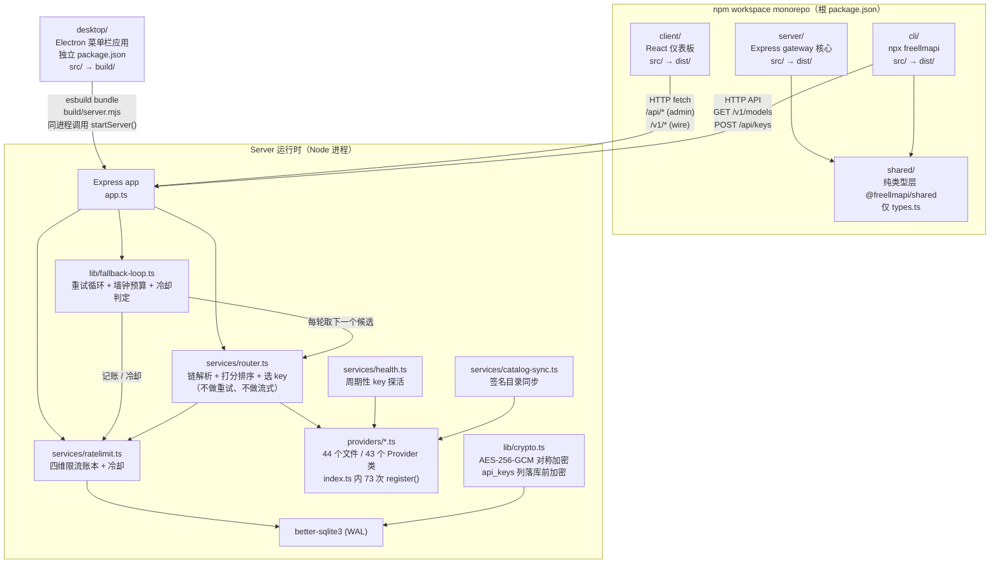
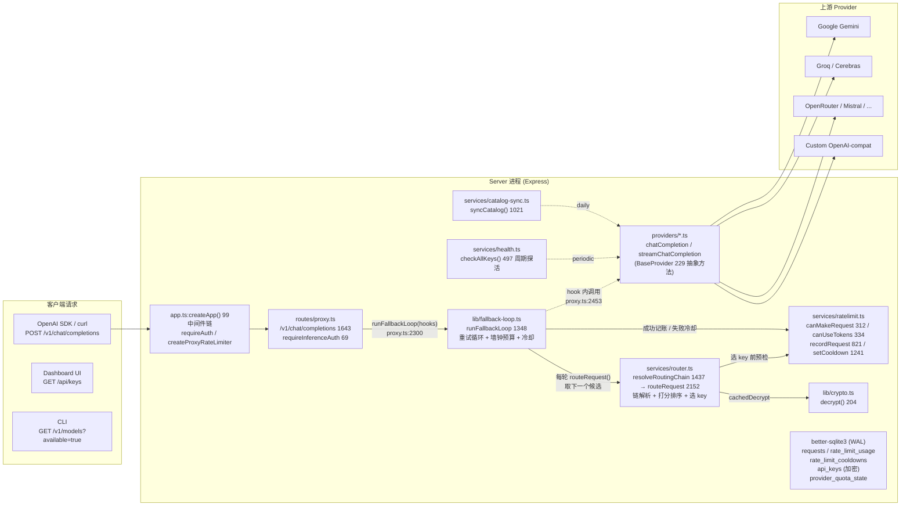

# 01 简单框架 —— 系统骨架

> 本篇为**第一层**：只答「做什么、由什么组成、请求怎么走」，不展开第四层细节。锚点记法见 [00-docs-style-guide.md](00-docs-style-guide.md)。

---

## 0 系统全景

FreeLLMAPI 是一个**本地优先**的 OpenAI-compatible LLM 路由器，把 **74 个平台标识**的免费/付费额度聚合成单一 `/v1` 端点。74 这个数的口径是 `shared/types.ts` 里 `export type Platform`（`Platform+0`=63，联合尾部 `| 'custom';`=266）的成员数 —— 用 python 逐行抽取以 `|` 开头的字面量后计数得到，含 `custom` 这个「任意 OpenAI-compatible 端点」占位平台，也含 `tavily`/`exa`/`firecrawl`/`linkup`/`parallel`/`serpsearch` 这组只服务 `/v1/search` 的搜索类平台。核心能力：

- **统一入口**：`/v1/chat/completions`、`/v1/responses`、`/v1/embeddings`、`/v1/models`、`/v1/messages` (Anthropic)、Ollama `/api/*`
- **智能路由**：Thompson-sampling bandit 实时打分，按可靠性/速度/能力/配额余量选模型
- **多级限流**：RPM/RPD/TPM/TPD 四维 + provider 级总配额，持久化到 SQLite，支持冷却自动恢复
- **故障转移**：单请求的回退循环最多 20 次尝试（`FALLBACK_MAX_RETRIES`=20，即首发 + 最多 19 次重试；`for (let attempt = 0; attempt < maxRetries; attempt++)`=lib/fallback-loop.ts:1407），墙钟预算内自动切换到下一健康模型
- **单用户/本地优先**：无多租户，Dashboard 受邮箱+密码保护。「本地优先」在不同部署形态里的绑定点不一样，三层要分开看：
  - **server 进程**：`HOST` 默认是 `loadConfig+0` 里的 `'::'`（`lib/config.ts:76`，双栈、所有网卡）；IPv6 不可用时 `index.ts` 的 `server.on('error')` 捕获 `EAFNOSUPPORT`/`EADDRNOTAVAIL` 再补一个 `0.0.0.0` 监听（`server.on('error')`+0=130，回退分支 135-141，handler 闭合 144）。
  - **desktop**：`desktop/src/main.ts:271` 的 `const host = cfg.lanAccess ? '0.0.0.0' : '127.0.0.1'` —— 只有勾了 LAN 访问才离开回环，这个默认与 server 的 `'::'` 无关。
  - **Docker**：容器内仍是 `'::'`，限制来自端口映射 `docker-compose.yml:25` 的 `"${HOST_BIND:-127.0.0.1}:${PORT:-3001}:3001"`。

---

## 1 进程/模块拓扑



**关键架构决策**：
- **Desktop 不是另一个客户端**：通过 `desktop/scripts/bundle-server.mjs` 用 esbuild 把整个 server 打包成 `build/server.mjs`，在 Electron **主进程同一个进程里**直接 `import { startServer } from './server.mjs'` 并调用。`server-host.ts` 手工复制了 `server/src/index.ts` 的启动序列（走读见 [08 篇](08-启动生命周期.md)）。
- **Desktop 端口 31415，Docker/server 端口 3001**。
- **CLI 纯客户端**：不 import server 代码，只通过 HTTP 与 gateway 通信。

---

## 2 四个 workspace + desktop 详细职责

| 组件 | 源码根 | 语言/框架 | 入口 | 产物 | 核心职责 |
|------|--------|-----------|------|------|----------|
| **shared** | `shared/` | TS (纯类型) | `types.ts` | 无 | 定义 `Platform`（74 个联合成员，`Platform+0`=63）、`Model`(279)、`ApiKey`(349)、`ChatCompletionRequest`(506)/`ChatCompletionResponse`(546)/`ChatCompletionChunk`(559)、`TokenUsage`(531)、`ProviderQuotaState`(634) 等核心契约。包名 `@freellmapi/shared`（`shared/package.json`），被 server、cli 引用；client 也有 4 个源文件 import 它（`components/keys/test-models-dialog.tsx`、`components/keys/add-model-dialog.tsx`、`lib/search.ts`、`lib/test-models.ts`），desktop 不在根 `package.json` 的 workspaces（`shared`/`server`/`client`/`cli`）里，也不引用它 |
| **server** | `server/src/` | TS + Express 5 | `index.ts` → `dist/index.js` | `dist/` | 核心网关：路由注册、Provider 适配、路由器、限流账本、健康检查、目录同步、SQLite 持久化、AES-256-GCM 加密、Dashboard REST API (`/api/*`) |
| **client** | `client/src/` | React 19 + Vite 8 + Tailwind 4 + shadcn/ui + TanStack Query | `main.tsx` → `index.html` | `dist/` | 单页管理面板：Keys 管理、Fallback 策略、Models 浏览、Analytics、Playground、Settings 等 |
| **cli** | `cli/src/` | TS (Node ESM) | `index.ts` → `dist/index.js` | `dist/` (发布到 npm) | 20 个 coding agent 的配置生成器 (`setup-claude` 等；计数口径是 `cli/src/tools.ts` 的 `metadata` 数组条目数，`grep -c "^  \['" cli/src/tools.ts` → 20)、Keys 管理 (`keys add/list/remove/test`)、诊断 (`doctor`) |
| **desktop** | `desktop/src/` | Electron 38 + esbuild | `main.ts` → `build/main.mjs` | `build/` + `dist/` (dmg/nsis/AppImage) | 菜单栏应用：内嵌 server、Tray/Popover、Dashboard 窗口、自动更新、开机自启、文件日志 |

---

## 3 依赖关系与数据流

### 3.1 编译时依赖

```
shared (纯类型)
    ▲
    │ import @freellmapi/shared
    │
server  ◄── client (HTTP runtime, 无编译依赖)
    │
    ▼
cli (import @freellmapi/shared)
```

- **shared** 无外部依赖，只导出类型。
- **server** 依赖 `express@5`、`undici@6`、`better-sqlite3@12` (optional)、`zod@3`、`helmet@8`、`cors@2`、`compression@1`、`sharp@0.35` (图片压缩)、`multer@2` (文件上传)、`dotenv@17`、`ajv@8` (JSON Schema 校验)、`socks-proxy-agent@10`。
- **client** 依赖 `react@19`、`react-router-dom@7`、`@tanstack/react-query@5`、`@dnd-kit/*` (拖拽)、`recharts@3`、`lucide-react`、`highlight.js`、`react-markdown`、`tailwindcss@4`。
- **cli** 依赖 `jsonc-parser@3` (JSON merge)、`yaml@2` (YAML merge)、`cross-spawn@7` (拉起 agent)。**无 better-sqlite3、无 express**。
- **desktop** 依赖 `electron@38`、`electron-updater@6`、`better-sqlite3@12` (原生模块，`electron-rebuild` 适配)。

### 3.2 运行时数据流



**主数据流（`POST /v1/chat/completions`）**：
1. `app.ts` 中间件：`createProxyRateLimiter`（`middleware/rateLimit.ts:34`）按 IP 做 RPM；`/v1` 上的挂载在 `app.ts:302`。请求级鉴权不在这里做，由路由自己的 `requireInferenceAuth`（`routes/proxy.ts:69`）+ `extractApiToken`（同文件 81）承担 —— 接受 OpenAI `Authorization: Bearer`、Anthropic `x-api-key`、Gemini `x-goog-api-key` 三种头，unified key 形如 `freellmapi-<48 hex>`（`db/index.ts:233`）。
2. `routes/proxy.ts`：`chatCompletionSchema.safeParse(req.body)`（schema 定义 602、调用 1656）做 wire 校验，再做 agent 容错归一化；传给 provider 的内部契约是 `shared/types.ts` 的 `ChatMessage[]`（489）加上 `providers/base.ts` 的 `CompletionOptions`（163），响应/分片类型是 `ChatCompletionResponse`（546）/ `ChatCompletionChunk`（559）/ `TokenUsage`（531）。
3. `proxy.ts` 把一次尝试的 hooks 交给 `runFallbackLoop`（`lib/fallback-loop.ts:1348`；`/chat/completions` 的调用点是 2300，另一个调用点 1366 属于 legacy `/completions`=1232），循环每轮调 `routeRequest()`（`services/router.ts:2152`）取下一个候选；候选链由 `resolveRoutingChain()`（1437）→ `getActiveChain()`（1328，按活动 profile 走 `profile_models` JOIN `models`，否则 `fallback_config` JOIN `models`，1330-1333 命中 `CHAIN_CACHE_TTL_MS`=1_000（1322）的短 TTL 缓存）得到，`scoring.ts` 的 Thompson 采样打分在 `scoreChainEntry()`（1091）里合成，`orderChain()`（1204）按策略排序。
4. `router.ts` 在 `selectKeyForModel()`（1582）里按固定顺序做限流预检（`ratelimit.ts` 全是纯函数导出，调用点在 router 内）：`isOnCooldown`=1660 → `canUseProvider`(ratelimit.ts:665)=1661 → `canUseProviderMinute`(689)=1665 → `canUseKeyConcurrency`(120)=1669 → `canMakeRequest`(312)=1670 → `canUseTokens`(334)=1671 → `canUseProviderTokens`(783)=1672 → `checkMonthlyBudget`(key-budget.ts:92)=1677；通过后 `cachedDecrypt`（1574，调用点 1681）→ `lib/crypto.ts:decrypt()`（204）解出明文 key 放进 `RouteResult.apiKey`（192）。
5. `providers/<platform>.ts`：`BaseProvider`（`base.ts:229`）的 `chatCompletion()`/`streamChatCompletion()` 由 hook 调用（`proxy.ts:2453`），打上游并返回流式/非流式响应。
6. 成功：`recordUpstreamSuccess()`（`lib/fallback-loop.ts:663`）→ `recordRequest`（`ratelimit.ts:821`）+ `recordTokens`（833）计入用量。失败：`recordRetryableFailure()`（`fallback-loop.ts:440`）/ `recordAuthFailure()`（651）→ `setCooldown()`（`ratelimit.ts:1241`）把该 model+key 关进冷却，循环再回第 3 步取下一个候选。
7. 响应流式透传回客户端（SSE）

---

## 4 核心模块职责速查表

| 模块 | 文件 | 核心职责 | 关键导出 |
|------|------|----------|----------|
| **启动入口** | `server/src/index.ts` | 进程级初始化：日志脱敏、进程安全网、DB 初始化、配置加载、定时任务调度器、健康检查/目录同步/冷却探针/备份/自定义模型同步/内置模型发现/唤醒检测 | `main()` |
| **Express 装配** | `server/src/app.ts` | 挂载 32 个 router（`grep -cE '^\s*app\.use\(.*Router' app.ts`；口径=以 `*Router` 为最后一个实参的 `app.use`，文件内 `app.use` 共 49 处，其余是 helmet/cors/json/rate-limiter/static/errorHandler 等中间件）、CORS/Helmet/CSP/压缩/静态资源、信任代理、错误处理 | `createApp(config)`=99 |
| **主代理路由** | `server/src/routes/proxy.ts` | OpenAI 兼容 wire 面（挂在 `/v1` 下，`app.ts:309`）：`/chat/completions`=1643、legacy `/completions`=1232、`/embeddings`=680、`/models`=317、`/rerank`=715、`/search`=755、`/decisions`=876、`/images/generations`=925、`/videos/generations`=963、`/audio/speech`=1019、`/audio/transcriptions`=1068；请求规范化、流式透传、工具调用救援。`/v1/responses` 不在此文件，由 `routes/responses.ts` 的 `responsesRouter.post('/responses')`=657 承担（`app.ts:313` 挂载），它复用本模块导出的 `extractApiToken`/`getRequestGroupId`/`logRequest`/`streamReasoningText` 等 helper（`responses.ts:24-32`） | `proxyRouter` |
| **Anthropic 兼容** | `server/src/routes/anthropic.ts` | `/v1/messages` Anthropic 格式 → 内部格式 → router → 转回 Anthropic 流 | `anthropicRouter` |
| **路由器** | `server/src/services/router.ts` | 函数式模块，无类。候选链解析（`resolveRoutingChain`=1437 → `getActiveChain`=1328）、按策略排序（`orderChain`=1204）、Thompson 采样打分合成（`scoreChainEntry`=1091，权重函数在 `scoring.ts`）、限流预检后选 key（`selectKeyForModel`=1582）、模型失败惩罚（`recordModelFailure`=285 加权记分，2 分钟衰减一档 `DECAY_INTERVAL_MS`=275）、降级模式下跳过探索（`routeRequest+26`=2178 读 `isDegraded()`）、工具/视觉/结构化输出能力过滤。重试循环与流式管线不在这里：前者是 `lib/fallback-loop.ts:runFallbackLoop`，后者在 `routes/proxy.ts` | `routeRequest()`=2152、`resolveRoutingChain()`=1437、`RouteResult`=188、`ChainRow`=153、`setRoutingStrategy()`=522、`setKeySelectionStrategy()`=598、`setCustomWeights()`=626 |
| **回退循环** | `server/src/lib/fallback-loop.ts` | 单请求的重试循环：`for (let attempt = 0; attempt < maxRetries; attempt++)`=1407，上限 `FALLBACK_MAX_RETRIES`=20 次尝试（`hooks.maxRetries` 可覆盖，1368）、墙钟预算 `DEFAULT_FALLBACK_TIME_BUDGET_MS`=45_000（172）、冷却时长决策、成功/失败记账 | `runFallbackLoop()`=1348、`newFallbackState()`=243、`recordRetryableFailure()`=440、`recordUpstreamSuccess()`=663、`recordAuthFailure()`=651、`cooldownDecisionForError()`=315 |
| **限流账本** | `server/src/services/ratelimit.ts` | 函数式模块，无类。RPM/RPD/TPM/TPD 内存滑窗 + SQLite 持久化（`rate_limit_usage`）、provider 级日/分钟总量与 token 上限、单 key 并发租约（lease）、冷却表与天花板 | `canMakeRequest()`=312、`canUseTokens()`=334、`recordRequest()`=821、`recordTokens()`=833、`setCooldown()`=1241、`isOnCooldown()`=1255、`getCooldownDecisionForLimit()`=1112、`getKeyConcurrencyLimit()`=98、`PAYMENT_REQUIRED_COOLDOWN_MS`=963 |
| **Provider 基类** | `server/src/providers/base.ts` | 抽象类 `BaseProvider`（`Struct：BaseProvider`=229）定义适配器契约：抽象成员 `platform`(230)、`name`(231)、`chatCompletion`(238)、`streamChatCompletion`(246)、`validateKey`(254)；可选钩子 `fetchQuota`(266)、`hasQuotaProbe`(274)、`supportsKeyValidation`(285)；受保护工具 `validationResult`、`fetchWithTimeout`(326)、SSE 相关。响应/分片类型不在此文件，来自 `shared/types.ts` | `BaseProvider`=229、`CompletionOptions`=163、`ProviderFetchOptions`=192、`SseStreamOptions`=210、`KeyValidationResult`=227、`ProviderHttpError`=19 |
| **Provider 注册表** | `server/src/providers/index.ts` | 73 次 `register()`（`grep -cE '^\s*register\(' index.ts` → 73；`register()`=47 只做 `providers.set(provider.platform, provider)`，表就是 `Map<Platform, BaseProvider>`=45）装载 73 个平台单例：33 次是 `register(new OpenAICompatProvider({...}))`（`grep -c '^register(new OpenAICompatProvider' index.ts` → 33），其余 40 次用平台专属类。`grep -c 'new OpenAICompatProvider' index.ts` → 34，多出的一次是 `resolveProvider()` 为 `custom` 现场实例化（640），不是注册项。74 个 `Platform` 成员里只有 `sambanova` 没有 provider 模块（V23 下线，`shared/types.ts:61-62` 注释），所以注册表恰好 73。`providers/*.ts` 共 44 个文件，`index.ts`/`base.ts`/`openai-compat.ts`/`search-only.ts` 是共用设施、其余 40 个一平台一文件；`grep -rhoE 'class [A-Za-z0-9_]+Provider' \| sort -u` 得 43 个类，其中 `BaseProvider`(229) 与 `SearchOnlyProvider`(search-only.ts:14) 是 `abstract`，41 个具体类。按 platform 查找与 `custom` 端点的运行时实例化在这里；健康检查分发在 `services/health.ts`，模型清单在 `models` 表 + `services/model-listing.ts`，均不由本文件承担 | `getProvider()`=626、`resolveProvider()`=636、`getAllProviders()`=650、`hasProvider()`=654 |
| **健康检查** | `server/src/services/health.ts` | 周期性探活 (5min + 抖动)、连续失败自动禁用、quota polling、provider 交错调度 | `startHealthChecker()`, `checkAllKeys()`, `checkKeyHealth()` |
| **目录同步** | `server/src/services/catalog-sync.ts` | 从 freellmapi.co 拉取签名目录、验证签名、入库、免费/付费分层 | `startCatalogSync()`, `syncCatalog()` |
| **加密** | `server/src/lib/crypto.ts` | AES-256-GCM 对称加解密（`ALGORITHM`=7）：模块级缓存的 32 字节 hex key，每次 `encrypt()` 生成独立 IV 与 authTag；key 来源优先级 `ENCRYPTION_KEY` env > DB 同目录 0600 的 `.encryption-key` 文件 > legacy `settings` 行（迁移后删除）> 现场生成（`initEncryptionKey`+0=94 上方的 jsdoc 86-93）。密钥轮换不是本模块的导出，而是脚本 `server/src/scripts/rotate-encryption-key.ts`（`server/package.json:16` 的 `npm run rotate-encryption-key`） | `encrypt()`=182、`decrypt()`=204、`initEncryptionKey()`=94、`encryptionKeyFingerprint()`=173、`isEncryptionKeyInitialized()`=178、`maskKey()`=227 |
| **配置** | `server/src/lib/config.ts` | 环境变量 → `Config` 对象、端口/主机/DB路径/限流/请求体大小/信任代理/CSP | `loadConfig()`, `Config` interface |
| **数据库** | `server/src/db/index.ts` | SQLite 连接（`:memory:` 之外开 `journal_mode = WAL`=82、`busy_timeout = 5000`=87）、数据目录权限收敛（决策 `shouldHardenDataDir`=122、env 三态 `parseDirHardeningOverride`=140、执行 `restrictDataDir`=153）、启动时调用迁移、统一 API key 读写。迁移执行器不在本文件的导出里：`runMigrationsSync` 定义在 `db/migrate/runner.ts:64`，`db/index.ts:6` import、`initDb` 内在 204 调用 | `initDb()`=197、`getDb()`=20、`connectDb()`=49、`getDefaultDbPath()`=27、`shouldHardenDataDir()`=122、`getUnifiedApiKey()`=225、`regenerateUnifiedKey()`=231、`getSetting()`=239、`setSetting()`=245 |

---

## 5 关键配置与环境变量

| 环境变量 | 默认 | 作用 | 读取位置 |
|----------|------|------|----------|
| `PORT` | `3001` (server) / `31415` (desktop) | 监听端口 | `lib/config.ts:72` |
| `HOST` | `::` (dual-stack) | 监听地址 | `lib/config.ts:76` |
| `FREEAPI_DB_PATH` | `server/data/freeapi.db` | SQLite 文件路径 | `lib/config.ts:77`, `db/index.ts:28` |
| `DASHBOARD_ORIGINS` | `[]`（逗号分隔） | 追加进 CORS 允许源。注意：`http://localhost:5173` / `127.0.0.1:5173` / `[::1]:5173` 这三个来自 `app.ts:51` 的 `DEFAULT_DASHBOARD_ORIGINS`，在 `app.ts:108-111` 与本变量**并集**，与 env 无关 | `lib/config.ts:78-81` |
| `CLIENT_DIST` | null | 静态资源目录 (生产用) | `lib/config.ts:82` |
| `PROXY_RATE_LIMIT_RPM` | `120` | 代理层 IP 级 RPM | `lib/config.ts:22-28` |
| `REQUEST_BODY_LIMIT_MB` | `25` | JSON body 上限 | `lib/config.ts:30-36` |
| `TRUST_PROXY` | `false` | Express trust proxy | `lib/config.ts:100-112` |
| `CSP_UPGRADE_INSECURE_REQUESTS` | auto | CSP upgrade-insecure-requests | `lib/config.ts:114-121` |
| `FREEAPI_DB_DIR_HARDENING` | 未设=按策略 | 数据目录权限收敛的三态开关（`1/true/yes` 强制开、`0/false/no` 强制关、其它按策略）。读值在 `parseDirHardeningOverride`=140-147，实际决策在 `shouldHardenDataDir`=122-136，执行 chmod 在 `restrictDataDir`=153-172 | `db/index.ts:140-147` |
| `ENCRYPTION_KEY` | (首次生成，落 0600 key 文件) | AES-256-GCM 主密钥（64 位 hex） | `lib/crypto.ts:18` `KEY_BYTES`/`:94` `initEncryptionKey` |
| `NODE_ENV` | `development` | 影响迁移自动运行 | `lib/config.ts:85`, `db/index.ts:203` |

---

## 6 源码索引（文件:函数/类:绝对行号）

| 文件 | 关键符号 | 行号范围 |
|------|----------|----------|
| `server/src/index.ts` | `main()` | 31-145 |
| `server/src/app.ts` | `createApp()` | 99-382 |
| `server/src/routes/proxy.ts` | `requireInferenceAuth()`:69, `extractApiToken()`:81, `chatCompletionSchema`:602, `proxyRouter.post('/models')`:317, `('/embeddings')`:680, `('/completions')`:1232, `('/chat/completions')`:1643 | 1-3102 |
| `server/src/routes/anthropic.ts` | `anthropicRouter.post('/messages')`:456, `('/messages/count_tokens')`:1125, `anthropicRouter.get('/models')`:1164 | 1-1194 |
| `server/src/services/router.ts` | `resolveRoutingChain()`:1437-1480, `routeRequest()`:2152-2381, `orderChain()`:1204, `scoreChainEntry()`:1091, `selectKeyForModel()`:1582 | 1-2518 |
| `server/src/lib/fallback-loop.ts` | `runFallbackLoop()`:1348-1365 (薄壳，实体 `runFallbackLoopAttempts()`:1367), `recordUpstreamSuccess()`:663, `recordRetryableFailure()`:440 | 1-1660 |
| `server/src/services/ratelimit.ts` | `canMakeRequest()`:312-332, `recordRequest()`:821-831, `setCooldown()`:1241-1253, `getKeyConcurrencyLimit()`:98-106 | 1-1576 |
| `server/src/providers/base.ts` | `BaseProvider` abstract class:229-525 | 1-525 |
| `server/src/providers/index.ts` | `getProvider()`:626-628, `resolveProvider()`:636-648, `getAllProviders()`:650-652, `hasProvider()`:654-656 | 1-656 |
| `server/src/services/health.ts` | `checkKeyHealth()`:246, `checkAllKeys()`:497, `startHealthChecker()`:617 | 1-645 |
| `server/src/services/catalog-sync.ts` | `syncCatalog()`:1021, `startCatalogSync()`:1215 | 1-1240 |
| `server/src/lib/crypto.ts` | `initEncryptionKey()`:94, `encrypt()`:182, `decrypt()`:204, `maskKey()`:227 | 1-231 |
| `server/src/lib/config.ts` | `Config`:38-68, `loadConfig()`:70-93, `parseTrustProxy()`:100-112 | 1-121 |
| `server/src/db/index.ts` | `getDb()`:20, `getDefaultDbPath()`:27, `connectDb()`:49, `initDb()`:197-223, `getUnifiedApiKey()`:225, `setSetting()`:245 | 1-251 |
| `server/src/db/migrations/20260101_000000_legacy_baseline.ts` | `createTables()` | 58-232 |
| `desktop/src/main.ts` | Electron main 入口 | 1-382 |
| `desktop/src/server-host.ts` | `startServer()` (镜像 server 启动) | 94-174 |
| `desktop/scripts/bundle-server.mjs` | esbuild bundle server | 13-31 |
| `cli/src/index.ts` | `main()` CLI 入口 | 455-492 |
| `cli/src/tools.ts` | 20 个 agent 的 `metadata` 条目 + `tools` 映射 | 1037-1058 (metadata)、1060-1080 (tools) |
| `client/src/main.tsx` | React 入口 | 1-10 |
| `client/src/App.tsx` | 路由 + Provider 链 | 464-520 |

---

## 7 待深入主题（后续层覆盖）

- 第二层：一次真实 `POST /v1/chat/completions` 全链路走读（含脱敏参数/返回值）
- 第三层：逐跳拆解 + Mermaid 时序图
- 第四层 04：router / fallback-loop / ratelimit / providers / health 的模块关系与职责边界
- 第四层 05：`/v1/*` 与 `/api/*` 全接口清单 + Provider 契约 + CLI 契约
- 第四层 06：环境变量 → config → 声明式配置 → 热加载的完整数据流
- 第四层 07：SQLite schema、AES-256-GCM 加密、缓存、并发模型
- 第四层 08：`server/src/index.ts` main() 完整启动序列 + desktop 内嵌 bundle 的手工镜像
- 第四层 09：`__tests__` 结构、Dockerfile 三阶段构建、CI、desktop 打包