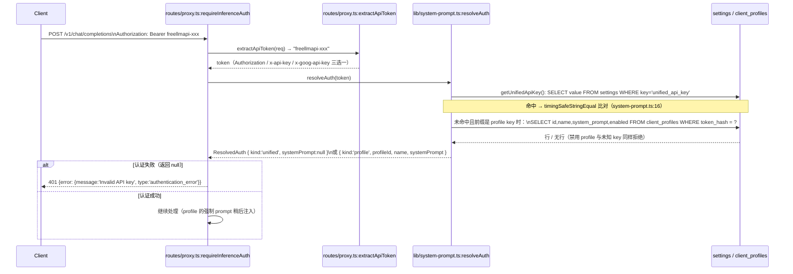
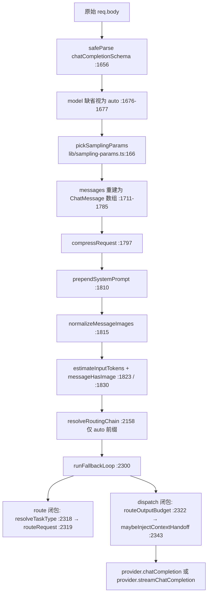
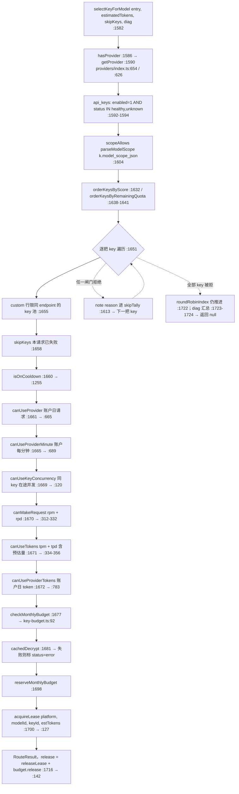
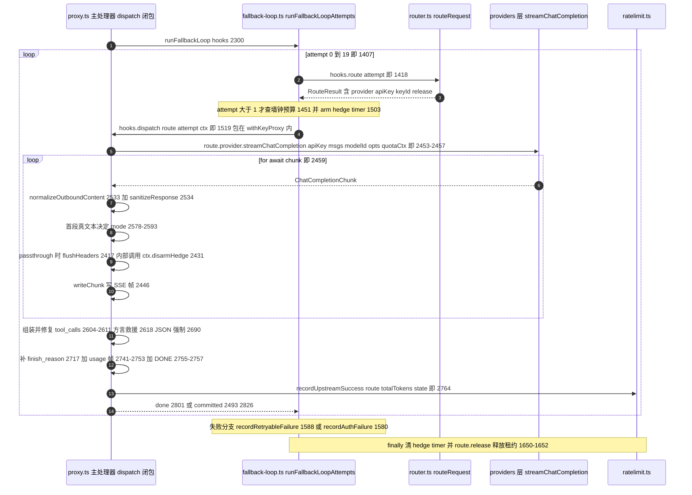
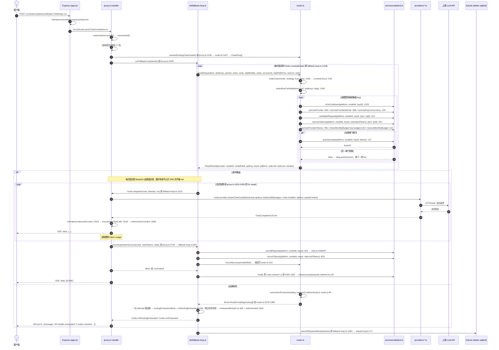

# 03 详细逐步说明 —— 主链路拆解

> 本篇为**第三层**：沿第二层链路逐跳拆解——谁调用谁、参数如何传、返回如何处理、状态如何变、错误如何传播。配 Mermaid 时序图。

---

## 0 概览：四大阶段


---

## 1 阶段 1：Express 中间件链（`app.ts:createApp()`）

### 1.1 中间件注册顺序（`app.ts:99-382`）

`createApp()` 按 Express 的注册顺序执行，下面每一行右边是 `app.ts` 的真实注册行。

```
Express app
  ├─ app.set('trust proxy', cfg.trustProxy)             # :107 必须先于 client-context 与限流（两者都解析客户端 IP）
  ├─ helmet({ contentSecurityPolicy, hsts: false,
  │           crossOriginOpenerPolicy: false, originAgentCluster: false })   # :130
  │   └─ CSP: default-src 'self'; script-src 'self' <INLINE_BOOTSTRAP_SHA>   # :133 / :140
  ├─ 逐请求补发 upgrade-insecure-requests / COOP / Origin-Agent-Cluster       # :163（只在 HTTPS 或可信源）
  ├─ cors({ origin: allowedCorsOrigins })               # :182 DEFAULT_DASHBOARD_ORIGINS + cfg.dashboardOrigins
  ├─ express.json({ limit: cfg.requestBodyLimitBytes })  # :198 仅 /v1、/v1beta、/mcp、/api/chat|generate|embed|embeddings；默认 25MB (lib/config.ts:20)
  ├─ express.json({ limit: '10mb' })                    # :202 其余路径；body-parser 跳过已解析的 body，两段互不重复
  ├─ clientContextMiddleware                            # :206 lib/client-context.ts：IP + User-Agent 存进 AsyncLocalStorage
  ├─ createProxyRateLimiter() + ollamaRouter            # :215-219 Ollama 仿真的固定 /api/* 路径
  ├─ createAdminRateLimiter() on '/api'                 # :232-233 必须留在 /api/auth 挂载之上
  ├─ '/api/auth' → authRouter                           # :238 setup/login/status 无需会话
  ├─ createAdminRateLimiter(EXPORT_RATE_LIMIT_RPM)      # :244 仅 /api/keys/export（会复验密码，是唯一可被爆破的后台接口）
  ├─ requireAuth + 各后台 router                          # :246-276 /api/keys、client-profiles、conversations、logs、models、
  │                                                     #        profiles、fallback、embeddings、media、search、decisions、
  │                                                     #        analytics、health、free-tier、settings、premium、backups、
  │                                                     #        cache、compression、update
  ├─ GET /api/ping（无鉴权）                              # :279
  ├─ '/v1' → docsRouter / providersRouter               # :287 / :293 有意挂在限流器之前：读文档与轮询状态不烧调用方额度
  ├─ '/v1/t/:token' → limiter :296 → urlTokenRouter :297  # URL token 面（客户端无法设 header 时用）
  ├─ '/v1' → createProxyRateLimiter(cfg.proxyRateLimitRpm) # :302 IP 级 RPM，先于任何推理路由
  │   ├─ '/v1' → anthropicRouter                         # :308 先于 OpenAI 路由器，才能对 GET /v1/models 做内容协商
  │   ├─ '/v1' → proxyRouter                             # :309 /v1/chat/completions
  │   ├─ '/v1' → moderationRouter                        # :311
  │   └─ '/v1' → responsesRouter                         # :313
  ├─ '/v1beta' → limiter :316 → geminiRouter :317        # Gemini 原生线
  ├─ '/mcp' → limiter :324 → mcpRouter :325              # MCP（Streamable HTTP）
  ├─ statusRouter                                        # :331 /livez、/readyz，静态块之前所以不会被 SPA 兜底吞掉
  ├─ errorHandler                                        # :334
  └─ 静态资源块（cfg.serveStaticAssets 为真时）            # :341
      ├─ compression()                                   # :351 挂在**所有 router 之后**：/v1 与 /api 的处理器在上游就结束响应，
      │                                                  #       于是 SSE 流不会被压缩中间件缓冲或重编码
      ├─ express.static(clientDist)                      # :352 带 hash 的 assets 一年 immutable，其余 no-cache
      └─ SPA fallback → sendFile(index.html)             # :368-378
```

### 1.2 `createProxyRateLimiter()` 细节（`middleware/rateLimit.ts:34-78`）

按 IP 的**固定窗口计数器**（不是滑动窗口）：状态是 `WindowState { count, resetAt }`（`middleware/rateLimit.ts:21-24`），到点整窗清零重数。

```typescript
// middleware/rateLimit.ts: createProxyRateLimiter（结构按源码）
export function createProxyRateLimiter(rpmLimit?: number) {
  const limit = rpmLimit !== undefined ? Math.floor(Math.max(0, rpmLimit)) : parseLimit(); // 默认 120 (:16)
  const windows = new Map<string, WindowState>();   // key: IP, value: { count, resetAt }

  return function proxyRateLimit(req, res, next) {
    if (limit === 0) { next(); return; }            // 0 = 完全关闭
    const now = Date.now();
    const ip = req.ip ?? req.socket.remoteAddress ?? 'unknown';  // 受 trust proxy 影响 (lib/config.ts:100)

    let state = windows.get(ip);
    if (!state || now >= state.resetAt) {           // 窗口过期 → 整窗重置
      state = { count: 0, resetAt: now + WINDOW_MS };  // WINDOW_MS = 60_000 (:15)
      windows.set(ip, state);
    }
    state.count += 1;                               // 先计数，再判定

    if (windows.size > MAX_TRACKED_IPS) {              // :54 上限 10_000 (:19)；机会式剪枝：遍历整张表删掉 now >= resetAt 的 IP
      for (const [key, value] of windows) if (now >= value.resetAt) windows.delete(key);
    }

    res.setHeader('X-RateLimit-Limit', String(limit));                    // :60
    res.setHeader('X-RateLimit-Remaining', String(Math.max(0, limit - state.count)));  // :61
    res.setHeader('X-RateLimit-Reset', String(Math.ceil(state.resetAt / 1000)));       // :62
    if (state.count > limit) {
      const retryAfter = Math.max(1, Math.ceil((state.resetAt - now) / 1000));
      res.setHeader('Retry-After', String(retryAfter));
      res.status(429).json({ error: { message: `Rate limit exceeded: more than ${limit} requests per minute. …`,
                                      type: 'rate_limit_error' } });   // :70
      return;
    }
    next();
  };
}
```

`createAdminRateLimiter()`（`:101-145`）是同一套窗口逻辑，只是默认额度 600 RPM（`ADMIN_DEFAULT_RPM`=91）且面向 `/api/*` 后台面。

---

## 2 阶段 2：请求规范化 + 认证（`proxy.ts` 主处理器）

### 2.1 认证流程



**关键函数**：

| 函数 | 文件:偏移 | 作用 |
|------|-----------|------|
| `extractApiToken()` | `routes/proxy.ts:81-92` | 从 `Authorization` / `x-api-key` / `x-goog-api-key` 提取 token（属 proxy 路由，不在 `lib/system-prompt.ts`） |
| `resolveAuth()` | `lib/system-prompt.ts:56-70` | 统一 key 走 `getUnifiedApiKey()`+`timingSafeStringEqual`；profile key 按 `hashClientProfileKey()`(`:35`) 的 SHA-256 摘要查 `client_profiles`，返回 `ResolvedAuth \| null` |
| `requireInferenceAuth()` | `routes/proxy.ts:69-76` | 组合上两个函数；失败自己写 401 并返回 `null`，调用方 `if (!auth) return` |
| `prependSystemPrompt()` | `lib/system-prompt.ts:79-82` | profile 的强制 system prompt 排在消息列表最前，调用方的 system 消息保留在其后 |

### 2.2 请求体规范化管线（按执行顺序）

`/v1/chat/completions` 处理器里**请求侧**的真实执行顺序；未标文件的行号都是 `routes/proxy.ts`。



**每步关键转换（请求侧）**：

| 步骤 | 函数 | 文件:偏移 | 输入 → 输出 |
|------|------|-----------|-------------|
| 1 | `pickSamplingParams()` | `lib/sampling-params.ts:166` | schema 解析后的 body → `ExtendedSamplingOptions`：丢弃 null 值、丢弃 `response_format:{type:'text'}`（显式发送会让部分 provider 回 400）、归一 `reasoning_effort`；对象形式 `reasoning.effort` 仅在扁平字段缺失时补上 |
| 2 | 消息重建（handler 内联，无独立函数） | `routes/proxy.ts:1711-1785` | zod 消息 → `ChatMessage[]`：无 `tool_calls` 的空 assistant content 收敛为 `""`、有 `tool_calls` 时保留 `null`；缺失的 tool_call id 合成 `call_auto_N` 并入队 `pendingToolCallIds`，供无 id 的 tool 消息按序配对；`function` 角色转 `tool`；`developer` 转 `system`；`reasoning_content` / `partial` / `thought_signature` 原样透传 |
| 3 | `normalizeMessageImages()` | `lib/image-normalize.ts:282` | 超阈值的 `data:` 图片就地降采样 + 重编码：默认阈值 1024KB、最长边 2048、质量 90（常量 `:37-39`，env 读取 `:134-140`，可被 `IMAGE_NORMALIZE_*` 覆盖）；没有候选图时不加载原生编解码模块 |
| 4 | `resolveTaskType()` | `lib/task-type.ts:96-104` | 返回 `code` / `chat` / `undefined` 三值之一：显式 header 优先，否则由 `deriveTaskType()`(`:79`) 从「带 tools」或「最后一条 user 文本命中代码标记」派生；`auto` 只在偏向 `code` 时返回值，其余情形返回 `undefined`，路由权重保持不变。**源码里没有 `analysis` / `creative` 这两档** |
| 5 | `resolveRoutingChain()` | `services/router.ts:1437-1480` | model 字符串 → `ResolvedChain {chain, strategyKey}`：缺省 / `auto` / 不带 `auto:` 前缀 → `activeChainOrThrow`；`auto:` + 全局排序轴 → `getChainByGlobalSort`；`auto:` + profile 名 → `getChainByProfileName` 再 `filter(e => e.enabled)`(`:1472`)，空链抛 400 |
| 6 | `maybeInjectContextHandoff()` | `services/context-handoff.ts:111` | 在 dispatch 内、发请求之前：会话记录的成功模型 ≠ 本次选中模型时，往**出站** messages 前端插入移交说明，返回 `{injected, messages, injectedTokens}`；`injectedTokens` 只计入流式侧的 token 记账 |

**响应侧三步**（同一处理器，但执行点在 §4/§6）：

| 步骤 | 函数 | 文件:偏移 | 输入 → 输出 |
|------|------|-----------|-------------|
| 7 | `normalizeOutboundContent()` | `lib/content.ts:129-143` | **出站**的数组 content → string：只看 `choices[].delta.content` 与 `choices[].message.content`，用 `contentToString` 收敛，`tool_calls` 等其余字段不动；就地修改并返回同一对象。流式逐帧调用点 `routes/proxy.ts:2533`，非流式在 `:2990` 与 `sanitizeResponse` 串联 |
| 8 | `rescueInlineToolCalls()` | `lib/tool-call-rescue.ts:217-246` | **出站** assistant 文本 → `RescueResult {detected, calls, cleanText}`：识别 4 种把工具调用写成正文的方言（token 标记、`<function=>` 标签、`<tool_call>` XML、整段命名工具的 JSON），且 calls 必须命中请求声明的工具名才成立；调用点在流式 `:2618`、非流式 `:2888` |
| 9 | `enforceJsonContent()` | `lib/structured-output.ts:58-77` | **出站**响应文本的 JSON 修复/校验，返回 `JsonEnforcement`（`:23-25`）：`{ok:true, content, healed}` 或 `{ok:false}`。trim 后能解析即通过；否则剥 ``` fence、再按「首个 `{`/`[` 到末个 `}`/`]`」取候选切片（长者优先，避免引用标记 `[1]` 顶掉真 payload）。**它不注入任何 system prompt**；调用点在流式 `:2690`、非流式 `:2916` |

---

## 3 阶段 3：路由决策 + 限流预检（`router.ts`）

### 3.1 `routeRequest()` 完整流程（`router.ts:2152-2381`）

`routeRequest` 的入参是一串位置参数（`:2152`）：`estimatedTokens, skipKeys, preferredModelDbId, requireVision, requireTools, skipModels, prefetchedChain, requireStructured, skipPlatforms, exactOutputReserve, task`。链本身由**表面**在请求开始时读一次（`routes/proxy.ts:2158` 调 `resolveRoutingChain`），再作为 `prefetchedChain` 传进来；每次失败重试都重新调用 `routeRequest`，把上一跳写进 `FallbackState` 的排除集合带回来。

```mermaid
sequenceDiagram
    participant loop as lib/fallback-loop.ts route 闭包
    participant router as services/router.ts:routeRequest
    participant scoring as services/scoring.ts
    participant db as SQLite models/profile_models/fallback_config
    participant key as services/router.ts:selectKeyForModel
    participant rl as services/ratelimit.ts

    loop->>router: routeRequest(est, skipKeys, pinned, vision, tools, skipModels, chain, structured, skipPlatforms, reserve, task)
    router->>router: effectiveRoutingStrategy :2155，非 priority 时 refreshStatsCache :2156
    router->>db: prefetchedChain ?? getActiveChain(db)，再 filter e.enabled :2158
    router->>scoring: orderChain chain, strategy, sampled, task :2160（每条做 reliability 抽样 + speed + intelligence + 两个护栏）
    scoring-->>router: ScoredEntry[]（combineScore :534）
    router->>router: 探索位提前 :2178-2209 / sticky-pin 提前或注入 :2212-2248
    router->>rl: usableKeyCountsByPlatform :2260 → 剔掉整平台无可用 key 的行 :2261-2263
    router->>router: 软排序：context margin 与工具拉黑排到队尾 :2292-2302

    loop 对 servingChain 每个模型（闸门见 :2310-2364）
        router->>key: selectKeyForModel entry, est, skipKeys, diag :2370
        key->>db: SELECT * FROM api_keys WHERE platform=? AND enabled=1 AND status IN ('healthy','unknown') :1592
        key->>rl: isOnCooldown :1660 / canUseProvider :1661 / canUseProviderMinute :1665
        key->>rl: canUseKeyConcurrency :1669 / canMakeRequest rpm+rpd :1670 / canUseTokens tpm+tpd :1671
        key->>rl: canUseProviderTokens :1672
        key->>key: checkMonthlyBudget :1677 → cachedDecrypt :1681 → reserveMonthlyBudget :1698
        key->>rl: acquireLease platform, modelId, keyId, estTokens :1700
        alt 有可用 key
            rl-->>key: leaseId
            key-->>router: RouteResult{provider, modelId, modelDbId, apiKey, keyId, platform, rpdLimit, tpdLimit, release}
            router-->>loop: 直接返回该 RouteResult :2371
        else 全部 key 被闸门拒
            key->>key: note(reason) 累计 skipTally :1610-1613，推进 roundRobinIndex :1722
            key-->>router: null → 试下一个模型
        end
    end

    alt 整条链没有一个候选
        router-->>loop: throw RouteError(summarizeExhaustion(diag…), 429, diagnostics) :2376-2380
    end
```

### 3.2 `resolveRoutingChain()` 候选构建（`router.ts:1437-1480`）

`resolveRoutingChain()` 只做**选链**：按请求的 model 字符串决定读哪一张链，返回 `ResolvedChain {chain, strategyKey}`。它唯一的过滤是 profile 分支的 `filter(e => e.enabled)`（`:1472`）；能力、限流、冷却都不在这里判（分别在 `routeRequest` 的模型级闸门和 `selectKeyForModel` 的 key 级闸门，见下面两组清单）。

**链行来源**（`ChainRow` = 链表的 `model_db_id/priority/enabled` 三列 JOIN `models` 的能力/额度列）：

| 入参形态 | 读什么 | 位置 |
|----------|--------|------|
| 缺省、`auto`、不带 `auto:` 前缀 | `activeChainOrThrow` → `getActiveChain`：活动 profile 存在时读 `profile_models JOIN models ON m.enabled=1 ORDER BY pm.priority ASC`，否则读 `fallback_config JOIN models ON m.enabled=1 ORDER BY fc.priority ASC`；结果按 `CHAIN_CACHE_TTL_MS` 缓存 | `getActiveChain`=1328-1361、`activeChainOrThrow`=1421 |
| `auto:` + 全局排序轴 | `getChainByGlobalSort`：以 `models` 为主表，`LEFT JOIN profile_models` 补 priority | `:1380-1420` |
| `auto:` + profile 名 | `getChainByProfileName`：`profiles` 按小写名查 id，再读该 profile 的 `profile_models`；查不到抛 400 | `:1363-1378` |

自定义 endpoint 不是独立的链表：它就是 `models` 里 `platform='custom'` 的行，用 `key_id` + `endpoint_scope`（该 endpoint 规范化的 base_url，catalog 行为 `''`）区分自己（迁移 `20260729_000001_custom_model_endpoint_identity.ts:12`、`:122`）。`services/model-state.ts` 管的是 `models` 行的 override 与目录墓碑，**没有 `resolveRoutingChain`**。

**模型级闸门**（`routeRequest`，按源码顺序）：

| 序 | 条件 | 位置 |
|----|------|------|
| 1 | `(prefetchedChain ?? getActiveChain(db)).filter(e => e.enabled)` | `router.ts:2158` |
| 2 | `orderChain(chain, strategy, true, task)` 打分排序（bandit 策略） | `:2160`，实现 `:1204` |
| 3 | 探索：`EXPLORE_CHANCE` 命中时把一个未测量模型提到最前，但候选必须先过下面这批闸门 | `:2178-2209` |
| 4 | sticky / 显式 pin：`preferredModelDbId` 移到最前；不在链里就从 `models` 注入一行（上游 EOL 墓碑行不注入） | `:2212-2248` |
| 5 | 该平台没有任何 enabled+healthy key 的行整批剔除（显式 pin 豁免），聚合成一条诊断行 | `:2260-2273` |
| 6 | 软排序：context margin 不满足的排到队尾；带 tools 时被工具能力拉黑的排到最后（都不出局） | `:2292-2302` |
| 7 | `skipModels.has(entry.model_db_id)` → 本次请求已排除该模型 | `:2310` |
| 8 | `skipPlatforms.has(entry.platform)` → 本次请求已排除该平台 | `:2317` |
| 9 | `requireVision && !entry.supports_vision` | `:2321` |
| 10 | `requireTools && !entry.supports_tools` | `:2328` |
| 11 | `requireStructured && platformDropsResponseFormat(entry.platform)` | `:2336` |
| 12 | `!fitsContextWindowStrict(entry.context_window, estimatedTokens)` | `:2349` |
| 13 | `entry.tpm_limit != null && estimatedTokens > entry.tpm_limit` | `:2364` |
| 14 | 交给 `selectKeyForModel(entry, estimatedTokens, skipKeys, diag)`；返回 null 就继续下一个模型 | `:2370` |

**key 级闸门**（`selectKeyForModel`，`router.ts:1582-1726`，顺序不可换）：

| 序 | 条件 / 动作 | 真实符号 | 位置 |
|----|-------------|----------|------|
| 0 | 该平台注册过 provider | `hasProvider`（`providers/index.ts:654`） | `:1586` |
| 0 | 取 enabled 且 `status IN ('healthy','unknown')` 的 key | SQL on `api_keys` | `:1592-1594` |
| 0 | 按 key 的 model scope 先丢掉不允许该模型的 key | `scopeAllows(parseModelScope(k.model_scope_json), …)` | `:1604` |
| 0 | key 行走的次序：有 per-key 统计则按分数排，否则 round-robin；再叠加剩余配额权重 | `orderKeysByScore` / `orderKeysByRemainingQuota` | `:1632` / `:1638-1641` |
| 1 | custom 行只接受同 endpoint 的 key 池 | `customEndpointKeyIds` | `:1655` |
| 2 | 本次请求已在这把 key 上失败过 | `skipKeys` | `:1658` |
| 3 | 不在冷却中 | `isOnCooldown`（`ratelimit.ts:1255`） | `:1660` |
| 4 | provider 账户日请求上限 | `canUseProvider`（`:665`） | `:1661` |
| 5 | provider 账户每分钟上限 | `canUseProviderMinute`（`:689`） | `:1665` |
| 6 | 同一把 key 的在途并发 | `canUseKeyConcurrency`（`:120`） | `:1669` |
| 7 | 该 model+key 的 rpm / rpd | `canMakeRequest`（`:312-332`） | `:1670` |
| 8 | 该 model+key 的 tpm / tpd，含本次预估 tokens | `canUseTokens`（`:334-356`） | `:1671` |
| 9 | provider 账户日 token 上限 | `canUseProviderTokens`（`:783`） | `:1672` |
| 10 | 当月预算是否还有余量 | `checkMonthlyBudget`（`services/key-budget.ts:92`） | `:1677` |
| 11 | 解密 key；失败则把该行标 `status='error'` 并换下一把 | `cachedDecrypt` | `:1681-1687` |
| 12 | 原子占住当月预算额度，占不到就换下一把 | `reserveMonthlyBudget` | `:1698` |
| 13 | 取在途租约（把这次请求计入 rpm/rpd/tpm/tpd 的 provisional） | `acquireLease`（`ratelimit.ts:127`） | `:1700` |
| 14 | 返回 `RouteResult`；`release()` = `releaseLease(leaseId)` + `budget.release()` | `releaseLease`（`:142`） | `:1701-1717`，`release` 在 `:1716` |

### 3.3 Bandit 打分：`scoring.ts:combineScore()`（`scoring.ts:534-541`）

```typescript
// 核心公式（scoring.ts:7-17 的模块注释）
/*
base = w_rel·reliability + w_speed·speed + w_intel·intelligence  (convex combination, ∈ [0,1])
effective = base × headroomFactor × rateLimitFactor
*/

// combineScore() 的真实实现（scoring.ts:534-541）：先把三轴按权重求和再除以权重和
// （调用方给的不是归一化向量就当场 renormalize，保证 base 不逃出 [0,1]），
// 最后 return base * inputs.headroom * inputs.rateLimit。
// 组装点在 router.ts:1105-1158：reliability/speed/intelligence 三条轴 + headroom
// 取两个护栏的**较小值**（不是乘积，:1147），最后再套一层
// applyModelWeightOverride()（每模型 env 权重覆盖，:1152-1155）。

// 各分量按源码：
// reliability = sampleBeta(alpha, beta)，alpha/beta 来自
//   reliabilityPosterior(successes, failures, community) = { alpha: max(0,succ)+community.succ+PRIOR_SUCCESS(=1),
//                                                           beta:  max(0,fail)+community.fail+PRIOR_FAILURE(=1) }
//   （scoring.ts:278-287；PRIOR_* 在 :264-265；抽样器 sampleBeta :513）
//   仪表盘展示用的确定性分数走 expectedReliability()（:290），不抽样。
// speed = speedScore(tokPerSec, ttfbMs)（:328-334）=
//   THROUGHPUT_WEIGHT(0.6)·(1 - e^(-tokPerSec/SPEED_SCALE_TOK_S(=60)))
// + TTFB_WEIGHT(0.4)·ttfbScore，其中 ttfbScore 在 ≤300ms 记满分、≥5000ms 记 0（:303-309）；
//   两个都无样本时返回 SPEED_PRIOR=0.6。observedSpeedRank()（:365）只是把这条 [0,1] 轴投影回
//   models.speed_rank 列，不参与打分公式。
// intelligence = intelligenceScore(intelligenceComposite(size_label, intelligence_rank), min, max)（:400-411）
//   composite = tierValue(size_label)*1000 - sqrt(max(1, intelligence_rank))*RANK_SCALE(=31) —— tier 严格压过 rank；
//   再在**本条链的 min/max 之间**做 min-max 归一到 [0,1]。不是 intelligenceRank/100。
// headroomFactor = headroomRamp(剩余比例)：剩余 ≥ rampStart 时取 1，之后线性降到 floor
//   （默认 HEADROOM_RAMP_START=0.2、HEADROOM_FLOOR=0.1，:421-422；可被 settings 覆盖，router.ts:376-391）。
//   两个表：monthly 用 headroomFactor(usedTokens, budgetTokens)（:431），
//   窗口用 rateWindowHeadroomFactor(usedFraction)（:469），router 取 min。
// rateLimitFactor = 1 - (p / MAX_PENALTY) * RATE_LIMIT_MAX_DAMP，
//   p = min(max(0, penalty), MAX_PENALTY)（scoring.ts:488-491，MAX_PENALTY=10、RATE_LIMIT_MAX_DAMP=0.6，:485-486）
//   —— 打满惩罚也只降到 0.4，永不清零，惩罚衰减后能自己爬回来。
//   penalty 来自内存表 rateLimitPenalties（router.ts:267-277）：每个 429 加 PENALTY_PER_429=3、
//   每次普通上游失败加 PENALTY_PER_FAIL=1，封顶 MAX_PENALTY=10，每 2 分钟衰减 1
//   （recordModelFailure :285 / recordRateLimitHit :303 / recordSuccess :310 / getPenalty :326-338）。
```

**预设权重**（`scoring.ts:49-59`）：

| 策略 | reliability | speed | intelligence | 适用场景 |
|------|-------------|-------|--------------|----------|
| `balanced` | 0.50 | 0.25 | 0.25 | 默认 |
| `smartest` | 0.35 | 0.10 | 0.55 | 追求智力 |
| `fastest` | 0.35 | 0.55 | 0.10 | 追求速度 |
| `reliable` | 0.70 | 0.15 | 0.15 | 追求稳定 |
| `custom` | 用户自定义 | 用户自定义 | 用户自定义 | 完全可控 |

**峰值时段调整**（`scoring.ts:181-199`）：
- `peakAdjustedWeights()` 将 `speed` 权重的 60% 转移到 `reliability`
- 仅对 `balanced`/`smartest` 生效（`fastest`/`reliable` 豁免）
- 时间窗口按 IANA timezone 判断（非服务器本地时间）

### 3.4 限流闸门与租约（编排点是 `router.ts:selectKeyForModel()`=1582-1726）

限流预检**不是** `services/ratelimit.ts` 里的单个函数：`ratelimit.ts` 只提供一个个布尔闸门，把它们按顺序串起来、并在最后取租约的是 `selectKeyForModel`。下图左侧是调用点行号（`router.ts`），右侧是闸门实现行号（`services/ratelimit.ts`，除注明者外）。



**关键点**：
- **在途用量**：`provisionalRequests`(`:163`) / `provisionalTokens`(`:172`) / `provisionalProviderRequests`(`:183`) / `provisionalProviderTokens`(`:187`) 把已持有的租约加进每个闸门的计数，关闭 check-then-act 竞态（块注释 `ratelimit.ts:151-194`）。租约在成功写账**之后**才释放，所以极短窗口内同一请求会被数两次，方向是少派发，不是超发；`LEASE_MAX_AGE_MS = 2*MINUTE`（`:76`）+ `pruneLeases`（`:78`）兜底回收泄漏的租约。
- **计数来源**：`requestCount`(`:286`) / `tokenCount`(`:299`) 先读 SQLite `rate_limit_usage`（`countPersistedRequests`=`:232`、`sumPersistedTokens`=`:253`），读不到才退回进程内的时间戳窗口（`memoryRequestCount`=`:274`、`memoryTokenCount`=`:280`）。日窗口以 UTC 零点为界（`msSinceUtcMidnight`=`:38`）。
- **并发上限**：`getKeyConcurrencyLimit`(`:98`) 读 `MAX_CONCURRENT_REQUESTS_PER_KEY_<PLATFORM>`，回退到 `MAX_CONCURRENT_REQUESTS_PER_KEY`；两者都没设就返回 `null`，即默认不限并发。
- **Provider 账户级**：三个 cap 来自 `getProviderDailyRequestCap`(`:595`) / `getProviderMinuteRequestCap`(`:606`) / `getProviderDailyTokenCap`(`:615`)；provider 上报的额度观测值落在 `provider_quota_state` 表（`services/provider-quota.ts:394` 写入），用于把「观测到的限制」折算成倍率（`multiplierFromQuotaRow`=`:698`）。
- **月度预算**：`checkMonthlyBudget`（`services/key-budget.ts:92`）只读判定，把当月已用量 + 本请求预估 + 进程内其他预留一起比上限；`reserveMonthlyBudget`（`:116`）成功时往进程内的 `activeReservations()` 加一条，返回 `{allowed:true, release}`，release 挂进 `route.release`。跨请求的累计由 `requests` 表上的触发器 `requests_key_monthly_usage` 写 `key_monthly_usage`（迁移 `20260914_000001_key_monthly_usage.ts:22-24`，条件 `key_id IS NOT NULL AND status='success'`）。
- **冷却判定**：`isOnCooldown`(`:1255`) 先读 `rate_limit_cooldowns` 的持久化到期时间（`persistedCooldownExpiry`=`:1170`），内存 map 只是缓存；写入走 `setCooldown`(`:1241`)。
- **冷却时长由谁定**：`getCooldownDecisionForLimit`（`services/ratelimit.ts:1112`，被 `lib/fallback-loop.ts:27` 的 import 列表引入），由 `cooldownDecisionForError()`（`fallback-loop.ts:315-341`）在失败记账时调用，阶梯见 §5.2。

---

## 4 阶段 4：Provider 调用 + 流式管线 + 记账

### 4.1 流式管线的分工：谁在循环、谁在产流、谁在提交

先破一个误解：**`services/router.ts` 里没有 generator**（`grep -c "streamChatCompletion" server/src/services/router.ts` → 0），也没有任何"核心流式循环"。一次流式请求由三个文件协作完成，接口是 `FallbackHooks`（`lib/fallback-loop.ts:1253-1338`）：

| 角色 | 实现位置 | 职责 |
|------|----------|------|
| 谁在循环 | `lib/fallback-loop.ts:runFallbackLoopAttempts()`=1367-1660（外层 `runFallbackLoop()`=1348-1365） | `for (attempt)` 走阶梯（上限 `FALLBACK_MAX_RETRIES`:69=20）、墙钟预算 + hedge timer、错误分类、失败记账、尝试轨迹。**它不认识 SSE，也不碰 `res`** |
| 谁在产流 | 抽象成员 `providers/base.ts:streamChatCompletion()`=246，实现如 `providers/google.ts:647-836` | `async *`，把上游私有协议（Gemini `streamGenerateContent?alt=sse`）转成统一的 `ChatCompletionChunk`（`shared/types.ts:559`）；只吐 chunk，不写客户端 |
| 谁在提交 | `routes/proxy.ts` chat/completions 的流式分支 `if (stream)`=2358-2833 | hold-window 判定 `mode`:2384、`flushHeaders()`:2417、`writeChunk()`:2446、终帧 finish_reason:2717、usage 注入:2741-2753、`data: [DONE]`:2755-2757、成功记账 `recordUpstreamSuccess()`:2764、返回 `'done'`:2801 或 `'committed'`:2493/2826 |
| 每轮重新选路 | `hooks.route`（`routes/proxy.ts:2307-2320`）→ `services/router.ts:routeRequest()`=2152-2381 | 每次尝试都带上当前的 `state.skipKeys / skipModels / skipPlatforms` 重新挑 key，返回 `RouteResult`（含 `apiKey`、`provider`、`release`） |

> 同一套分工在 `docs/adrian/topics/model调度算法.md` §5 有逐行版本（含五类 catch 分支与 `FallbackState` 字段），本篇只给主链视图。



**关键点**：
- **提交点只有一个**：`flushHeaders()`（`routes/proxy.ts:2417`）之前一切都还能悄悄换下一个候选，之后只能把这个流写完。首段真文本先把 `mode` 定下来（`'undecided'` → `'passthrough'` / `'dialect'` / `'json'`，:2578-2593），只有 `passthrough` 会立即 flush 并逐帧转发；`dialect` / `json` 全程 hold 到流结束，所以方言救援失败（:2620）与 JSON 强制失败（:2689-2698）仍然免费 failover。
- **`'done'` / `'committed'` 是 dispatch 的返回值契约**：循环在 `fallback-loop.ts:1634-1644` 校验，其他值直接 `onFatal`（适配器漏写 return 不会被当成静默成功）。`'committed'` 有三处来源：流内 `{"error":...}` 帧且 headers 已发（`proxy.ts:2493`）、headers 已发后中途炸（:2826）、提交前客户端挂断（:2655）。
- **hedge 只保护静默窗口**：`ctx.disarmHedge()` 就写在 `flushHeaders()` 内部（:2431）——字节一旦出去，取消只会截断健康响应，也换不来 failover；慢 ≠ stalled，只有 stalled 才值得杀。
- **租约生命周期归循环，不归表面**：`route.release?.()` 只出现在 `fallback-loop.ts:1650-1652` 的 `finally`，成功、认证轮换、可重试 continue、致命、熔断、契约违规六条出口都经过它；成功写账在 dispatch 内部先完成，所以持久计数落地之后 provisional 租约才消失（该 finally 的块注释见 `:1481-1486`）。
- **token 口径**：`recordUpstreamSuccess(route, totalTokens, state)`（:2764）取上游 usage，取不到才用 chars/4 估计（:2760-2763）；回给客户端的 usage 帧在上游从未发送时由网关合成，并显式打 `estimated: true`（:2741-2753），不会冒充上游账。
- **缓存与幂等各自只覆盖自己能覆盖的**：SSE 帧仅在本请求可缓存时才收集（:2401-2415，上限 `STREAM_CACHE_MAX_BYTES = 2 * 1024 * 1024`，`services/cache.ts:629`），成功且 finish 不是 `'length'` 才 `storeCachedStreamResponse`（:2773-2782）；`storeIdempotencyResult()`（:3016）只在非流分支调用，流式响应不进幂等表。

### 4.2 Provider 实现以 Google 为例（`providers/google.ts`）

```typescript
// providers/google.ts: 核心实现片段（streamChatCompletion = 647-836）
export class GoogleProvider extends BaseProvider {      // :553
  readonly platform = 'google' as const;                // :554
  readonly name = 'Google AI Studio';                   // :555

  async *streamChatCompletion(
    apiKey: string, messages: ChatMessage[], modelId: string,
    options?: CompletionOptions, quotaContext?: QuotaObservationContext,
  ): AsyncGenerator<ChatCompletionChunk> {              // :647-653
    // ① 请求侧映射：messages → Gemini contents + systemInstruction（模块级函数，不是成员方法）
    const translated = await toGeminiContents(messages);                       // :654，实现 :406
    const request = contentsForModel(modelId, translated.contents, translated.systemInstruction); // :655，实现 :180
    const tools = toGeminiTools(options?.tools);                               // :657，实现 :286
    const body: Record<string, unknown> = {                                    // :658-669
      contents: request.contents,
      generationConfig: {
        temperature: options?.temperature,
        topP: options?.top_p,
        maxOutputTokens: resolveMaxTokens(this.platform, options?.max_tokens, options?.contextBudget),
        stopSequences: toGeminiStopSequences(options?.stop),                    // 实现 :541
        ...toGeminiExtendedConfig(options),                                     // 实现 :253
      },
      tools,
      // functionCallingConfig 只在真有 function declarations 时合法：纯 grounding 请求必须省略（#59）
      toolConfig: hasFunctionDeclarations(tools) ? toGeminiToolConfig(options?.tool_choice) : undefined, // :309 / :313
    };
    if (request.systemInstruction) body.systemInstruction = request.systemInstruction;  // :670

    // ② 上游是一条 SSE 线：本适配器自己按行切帧、自己 JSON.parse
    const url = `${API_BASE}/models/${modelId}:streamGenerateContent?alt=sse`;  // :672
    const res = await this.fetchWithTimeout(url,                              // :673-679，实现 base.ts:326
      { method: 'POST', headers: { 'Content-Type': 'application/json', 'x-goog-api-key': apiKey },
        body: JSON.stringify(body) },
      options?.timeoutMs ?? this.timeoutMs, { signal: options?.signal });
    recordQuotaObservationsFromResponse(res, {                                   // :681-688
      platform: this.platform, keyId: quotaContext?.keyId,
      providerAccountId: quotaContext?.providerAccountId, modelId,
      quotaPoolKey: quotaContext?.quotaPoolKey, endpoint: 'chat/completions',
    });
    if (!res.ok) throw googleHttpError(res, await res.json().catch(() => ({})));  // :690-693，实现 :22
    const reader = res.body?.getReader();                                      // :695-696
    const decoder = new TextDecoder(); const id = this.makeId();                 // :698-699，makeId 在 base.ts:377

    // ③ 逐帧映射就在循环体内：Gemini 帧 → ChatCompletionChunk 的构造内联在下面三处 yield
    const inactivityTimeoutMs = streamStallTimeoutMs(this.platform);             // :711，实现 lib/provider-timeout.ts
    const firstByteMs = this.firstByteBudgetMs(options?.timeoutMs ?? this.timeoutMs, inactivityTimeoutMs);  // :712，实现 base.ts:422
    let awaitingFirstByte = true; let buffer = ''; let emittedFinish = false; let sawToolCalls = false;  // :700-713
    const seenToolCallKeys = new Set<string>();                                  // :704
    while (true) {
      const { done, value } = awaitingFirstByte                              // :717-719
        ? await this.readWithStallTimeout(() => reader.read(), firstByteMs, this.firstByteTimeoutMessage(firstByteMs))
        : await this.readWithStallTimeout(() => reader.read(), inactivityTimeoutMs);   // base.ts:392 / :429
      if (done) break;
      buffer += decoder.decode(value, { stream: true });                       // :723
      const lines = buffer.split('\n'); buffer = lines.pop() ?? '';             // :724-725
      for (const line of lines) {                                               // :727
        const trimmed = line.trim(); const raw = trimmed.slice(5).replace(/^ /, '');  // :728-731
        if (!trimmed || !trimmed.startsWith('data:')) continue;                 // :730
        if (raw === '[DONE]') {                                               // :732
          yield { id, object: 'chat.completion.chunk', created: Math.floor(Date.now() / 1000), model: modelId,
                  choices: [{ index: 0, delta: {}, finish_reason: sawToolCalls ? 'tool_calls' : 'stop' }] };  // :735-745
          return;                                                             // :747
        }
        const chunk = JSON.parse(raw) as GeminiResponse;                       // :755（单帧坏掉只 continue，不整条流 abort）
        const candidate = chunk.candidates?.[0]; const parts = candidate?.content?.parts ?? [];  // :759-760
        const text = extractText(parts);                                      // :762，实现 :523
        const reasoningContent = extractReasoningContent(parts);               // :763，实现 :532
        const toolCalls = extractToolCalls(parts).filter(call => {             // :764-769，实现 :495
          const key = `${call.id}:${call.function.name}:${call.function.arguments}`;  // 同一帧内重复出现的 tool call 只留一条
          if (seenToolCallKeys.has(key)) return false; seenToolCallKeys.add(key); return true;
        });
        yield { id, object: 'chat.completion.chunk', created: Math.floor(Date.now() / 1000), model: modelId,
                choices: [{ index: 0, finish_reason: null, delta: {   // :773-787，三个字段都只在有值时出现
                  ...(text ? { content: text } : {}),
                  ...(reasoningContent ? { reasoning_content: reasoningContent } : {}),
                  ...(toolCalls.length > 0 ? { tool_calls: toolCalls } : {}) } }] };
        if (candidate?.finishReason && !emittedFinish) {                       // :790
          yield { id, object: 'chat.completion.chunk', created: Math.floor(Date.now() / 1000), model: modelId,
                  choices: [{ index: 0, delta: {},
                   finish_reason: sawToolCalls ? 'tool_calls' : toGeminiFinishReason(candidate.finishReason) }] };  // :792-802，实现 :215
          return;                                                              // :803
        }
      }
    }
    // :807-815 的 finally 里 reader.cancel()：消费者半路放弃时也要关掉上游生成
    // :833-835 两条 return 都没走到 = 截断流，抛错交给 isStreamTruncatedError（lib/error-classify.ts:734）
  }
}
```

非流式 sibling 是 `chatCompletion()`=564-645（同一个 `toGeminiContents` + 同一个 body 组装，端点换成 `:generateContent`，`:614-644` 把 `usageMetadata` 折算成 `TokenUsage`）。

**所有 Provider 必须实现的契约**（`providers/base.ts:229-525`）：

```typescript
// providers/base.ts:229 起，抽象成员恰好五个
export abstract class BaseProvider {
  abstract readonly platform: Platform;        // :230
  abstract readonly name: string;              // :231
  keyless = false;                             // :236 免 key 免费层（如 Kilo 匿名网关）由子类置真

  abstract chatCompletion(                     // :238-244
    apiKey: string, messages: ChatMessage[], modelId: string,
    options?: CompletionOptions, quotaContext?: QuotaObservationContext,
  ): Promise<ChatCompletionResponse>;

  abstract streamChatCompletion(               // :246-252，参数顺序同上
    apiKey: string, messages: ChatMessage[], modelId: string,
    options?: CompletionOptions, quotaContext?: QuotaObservationContext,
  ): AsyncGenerator<ChatCompletionChunk>;

  abstract validateKey(                        // :254
    apiKey: string, quotaContext?: QuotaObservationContext,
  ): Promise<KeyValidationResult>;             // = boolean | { valid:false, error:string }（:221-227）

  // 三个可选能力：默认实现不联网、不改健康判定
  async fetchQuota(_apiKey: string, _quotaContext?: QuotaObservationContext): Promise<boolean> { return false; }  // :266-268
  get hasQuotaProbe(): boolean { return false; }          // :274-276，fetchQuota 被覆盖 ≠ 真有端点
  get supportsKeyValidation(): boolean { return true; }   // :285，禁止自动探活的 provider 置 false
}
```

基类另外只提供共享机制（`validationResult` :295、`fetchWithTimeout` :326、`makeId` :377、`readWithStallTimeout` :392、`firstByteBudgetMs` :422），不是必须实现的成员。

### 4.3 统一响应类型（`shared/types.ts`）

```typescript
// shared/types.ts: provider 与网关之间、以及对外的 wire 类型都是 OpenAI 形状本身
export interface TokenUsage {                    // :531-544
  prompt_tokens: number;
  completion_tokens: number;
  total_tokens: number;
  completion_tokens_details?: { reasoning_tokens?: number };
  prompt_tokens_details?: { cached_tokens?: number };
  estimated?: boolean;                           // 网关合成 usage 时置真，不冒充上游账（#1084）
}

export interface ChatCompletionResponse {        // :546-557
  id: string;
  object: 'chat.completion';
  created: number;
  model: string;
  choices: ChatCompletionChoice[];               // :522-529，{ index, message, finish_reason, logprobs? }
  usage: TokenUsage;
  _routed_via?: { platform: Platform; model: string };
}

export interface ChatCompletionChunk {           // :559-575
  id: string;
  object: 'chat.completion.chunk';
  created: number;
  model: string;
  choices: {
    index: number;
    delta: { role?: 'assistant'; content?: string; reasoning_content?: string; tool_calls?: ChatToolCall[] };
    finish_reason: string | null;
  }[];
  usage?: TokenUsage;
}
```

---

## 5 失败路径与 Fallback Loop（`lib/fallback-loop.ts`）

### 5.1 统一重试循环（`fallback-loop.ts:1367-1660`）

```mermaid
flowchart TD
    Attempt[尝试 N] --> Dispatch[dispatch route, attempt, ctx 即 fallback-loop.ts:1519 → provider.streamChatCompletion]
    Dispatch -->|成功| Success[recordUpstreamSuccess 663 → recordRequest 821 + recordTokens 833 + recordSuccess router.ts:310<br/>返回后由循环 finally 调 route.release 1650-1652 释放租约]
    Dispatch -->|错误| Classify[error-classify.ts 分类]
    
    Classify -->|客户端中断| Abort[isClientAbortError 1527 → 不记账、不冷却，写一行 requests status=canceled 后 return，finally 仍释放租约]
    Classify -->|401 无效 key| AuthFail[recordAuthFailure 651 → skipKeys + setCooldown model+key 5 分钟 + triggerKeyRevalidation 634]
    Classify -->|429 / 日额度| RateLimit[recordRetryableFailure 440 → setCooldown decision 535，无兄弟 key 时才 recordRateLimitHit 610]
    Classify -->|402 / suspended| AccountFail[recordRetryableFailure → benchKeyAcrossPlatform 580-590，source=credit]
    Classify -->|5xx/timeout/empty| Retryable[recordRetryableFailure → noteModelFailure 95 + 无兄弟 key 时才 recordModelFailure 612]
    Classify -->|context too large| ContextErr[recordRetryableFailure 的 512-514 分支：learnLimit + learnContextWindow 后 return，不进冷却、不加 penalty]
    Classify -->|400 bad request| ProviderErr[循环的致命分支 1622-1624 → onFatal 渲染 502]
    
    Retryable --> CheckBudget{墙钟预算<br/>getFallbackTimeBudgetMs()}
    AuthFail --> CheckBudget
    RateLimit --> CheckBudget
    AccountFail --> CheckBudget
    CheckBudget -->|未超| NextAttempt[尝试 N+1]
    CheckBudget -->|超了| Exhausted[RouteError: All models exhausted]
    NextAttempt --> Attempt
```

### 5.2 关键冷却策略（`ratelimit.ts` + `fallback-loop.ts`）

| 错误类型 | 冷却来源 | 时长 | 备注 |
|----------|----------|------|------|
| 429 (rate limit) | `getCooldownDecisionForLimit`（`ratelimit.ts:1112`）读 `err.retryAfterMs` 与本平台的 rpd/tpd 阶梯 | provider 给的 `Retry-After` 优先，否则按命中次数阶梯退避 | `CooldownSource='authoritative'`（`Retry-After` 真正决定到期）/ `'heuristic'`（自己的猜测），四个取值见 `:863` |
| 402 (payment required) | `getPaymentRequiredCooldownMs`=`capCooldownMs(PAYMENT_REQUIRED_COOLDOWN_MS)`（`:966` / `:925`） | `DAY`（`PAYMENT_REQUIRED_COOLDOWN_MS`=`:963`，受 `capCooldownMs` 上限收缩） | `source='credit'`；走 `benchKeyAcrossPlatform`（`fallback-loop.ts:590`）把这把 key 在该平台所有可路由模型上冷却，但**不**判死平台 |
| 403 (model forbidden) | `getModelForbiddenCooldownMs`（`:979`） | `DAY` = 24h（`MODEL_FORBIDDEN_COOLDOWN_MS`=`:976`） | `source='tier'`，模型级；账户 suspended 的 403 判在它之前，走 `credit`（`fallback-loop.ts:320`） |
| 401 (auth error) | `recordAuthFailure`（`fallback-loop.ts:651`） | 5min（`AUTH_FAILURE_COOLDOWN_MS`=`:627`） | 只冷却 model+key，`triggerKeyRevalidation`（`:634`）立刻起一次定向重验；**不**写模型 penalty、**不**学限额 |
| 5xx/timeout/empty stream | `cooldownDecisionForError`（`fallback-loop.ts:315-341`）落到 `heuristic` 分支 | 10min（`MODEL_FAILURE_COOLDOWN_MS`=`:88`） | `MODEL_FAILURE_COOLDOWN_MS` 跨 key 生效；`skipBench` 豁免在空补全连击 <3 次时生效（`:533`） |
| 模型连续失败 ≥3 次/15min | `noteModelFailure`（`fallback-loop.ts:95`，阈值 `MODEL_FAILURE_THRESHOLD`=3 `:87`、窗口 `MODEL_FAILURE_WINDOW_MS`=15min `:86`） | 10min | 覆盖该模型所有可路由 key；已有的更长 bench 绝不缩短（`:111-113`） |

### 5.3 墙钟预算（`fallback-loop.ts:159-197`）

- 默认 `45_000ms` (45s)，可通过 `FALLBACK_TIME_BUDGET_MS` env 或 `settings.fallback_time_budget_ms` 覆盖
- 第 0 次和第 1 次尝试**不受预算限制**（保证至少能重试一次）
- 第 2 次及以后：启动前检查 `elapsed < budget`，中途可通过 `abortInFlight` 中断

---

## 6 响应透传与后处理（`proxy.ts` 主处理器尾部）

### 6.1 SSE 格式化（`routes/proxy.ts:2358-2833`）

```typescript
// routes/proxy.ts: 流式分支的真实形状（generator 由 route.provider 产出，不经 router.ts）
const gen = route.provider.streamChatCompletion(                       // :2453-2457
  route.apiKey, outboundMessages, route.modelId,
  { temperature, max_tokens, top_p, stop, tools, tool_choice, parallel_tool_calls,
    stream_options: parsed.data.stream_options, ...samplingParams, contextBudget,
    // 客户端断开与 hedge 取消合成同一个信号（:2455 内联）
    signal: AbortSignal.any([clientAbort.signal, hedgeAbort.signal]) },
  quotaContextForRoute(route, 'chat/completions'),
);

for await (const chunk of gen) {                                       // :2459
  const anyChunk = { ...chunk, model: route.modelId };                 // :2470 模型名一律归一到本次路由到的模型
  if (anyChunk.usage) usageChunk = { ...anyChunk, choices: [], usage: anyChunk.usage };  // :2508 先扣下，结尾再吐
  normalizeOutboundContent(anyChunk);                                  // :2533
  sanitizeResponse(anyChunk);                                          // :2534
  // 首段真文本先定 mode（:2578-2593）：passthrough → flushHeaders()（:2417）后逐帧 writeChunk（:2446）；
  // dialect / json → 全程 hold 到流结束。writeChunk 内部先 collectFrame 再 res.write（:2446-2450）
  totalOutputTokens += Math.ceil((text.length + reasoning.length) / 4);  // :2565 计费口径是 chars/4
}

// 收尾顺序（同一个分支的尾部）
writeChunk(mkChunk({}, finish));                                       // :2717 补终帧的 finish_reason
writeChunk({ id, object: 'chat.completion.chunk', created, model, choices: [],
             usage: { prompt_tokens: estimatedPromptTokens, completion_tokens, total_tokens, estimated: true } });  // :2741-2753
const doneFrame = 'data: [DONE]\n\n'; collectFrame(doneFrame); res.write(doneFrame); res.end();  // :2755-2757
const totalTokens = upstreamUsage?.total_tokens ?? (inputTokens + outputTokens);  // :2760-2763 优先用上游 usage
recordUpstreamSuccess(route, totalTokens, state);                      // :2764
if (cacheKey && streamFrames && streamCacheable && finish !== 'length') {
  storeCachedStreamResponse(cacheKey, { frames: streamFrames, platform, modelId, keyId,
                                        promptTokens: inputTokens, completionTokens: outputTokens });  // :2773-2782
}
```

`withExecutionId()`（`routes/proxy.ts:125`）只作用在**缓存 / 幂等重放的 JSON 响应**上（`:2096` / `:2131`），流式分支不经过它；`storeIdempotencyResult()`（`services/idempotency.ts:127`，调用点 `:3016`）只在非流分支写幂等表。

### 6.2 请求日志持久化（`lib/request-log.ts`）

```typescript
// lib/fallback-loop.ts:1363，runFallbackLoop 的 finally 里——响应已经发给客户端，写库不在延迟路径上
persistRequestAttempts(trace);            // lib/request-log.ts:171，同步函数，入参是一个 RequestTrace
// trace.records: AttemptTraceRecord[]（lib/attempt-trace.ts:29-52）
//   { ordinal, platform, modelId, keyOrdinal, keyLabel, outcome, startOffsetMs, durationMs, errorSummary }
// trace.lastRequestRowId: 本次 trace 里最后一条 requests 行的 rowid，作为 request_attempts 的父行
```

---

## 7 Mermaid 完整时序图（端到端）



---

## 8 关键状态变更汇总表

| 环节 | 读取状态 | 写入状态 | 持久化 |
|------|----------|----------|--------|
| 认证 | `settings.unified_api_key` / `client_profiles` | — | 否 |
| 路由候选 | `models` / `fallback_config` / `profiles` / `api_keys(status/enabled)` | — | 否 |
| 限流预检 | 内存 `windows` + `leases` + `rate_limit_usage` 表 + `rate_limit_cooldowns` 表 + `provider_quota_state` | 内存 `windows` 计数、`leases` 新增 | 否 (预检只读内存，in-flight 计入 provisional) |
| Provider 调用 | `api_keys.encrypted_key` → `crypto.decrypt()` | — | 否 |
| 成功记账 | — | `rate_limit_usage` INSERT (request + tokens)、`rate_limit_cooldowns` 无变化、内存 `windows` 计数、`leases` 删除 | 是 (SQLite WAL) |
| 失败记账 | — | `rate_limit_cooldowns` INSERT/UPDATE (冷却)、`rate_limit_usage` 无变化、内存 `penalties` 加惩罚 | 是 (冷却表) |
| 模型惩罚 | 内存 `rateLimitPenalties` Map | 内存 `penalties` 加/减 | 否 (仅内存，重启丢失) |
| 请求日志 | — | `requests` 表 + `request_attempts` 表 | 是 |

---

## 9 源码索引（文件:函数/类:绝对行号）

| 文件 | 关键符号 | 行号范围 |
|------|----------|----------|
| `server/src/app.ts` | `createApp()` 中间件链 | 113-218 |
| `server/src/middleware/rateLimit.ts` | `createProxyRateLimiter()` | 34-78 |
| `server/src/lib/system-prompt.ts` | `resolveAuth()`, `extractApiToken()` | 56-70 |
| `server/src/routes/proxy.ts` | `requireInferenceAuth()` | 69-76 |
| `server/src/routes/proxy.ts` | 主处理器 (规范化管线) | 1643-3097 |
| `server/src/lib/content.ts` | `normalizeOutboundContent()` | 129-143 |
| `server/src/lib/image-normalize.ts` | `normalizeMessageImages()` | 282-320 |
| `server/src/lib/tool-call-rescue.ts` | `rescueInlineToolCalls()` | 217-246 |
| `server/src/lib/structured-output.ts` | `enforceJsonContent()` | 58-77 |
| `server/src/lib/sampling-params.ts` | `pickSamplingParams()` | 166-187 |
| `server/src/lib/task-type.ts` | `resolveTaskType()` | 96-104 |
| `server/src/services/context-handoff.ts` | `maybeInjectContextHandoff()` | 111-157 |
| `server/src/services/router.ts` | `routeRequest()` | 2152-2381 |
| `server/src/services/router.ts` | `resolveRoutingChain()` | 1437-1480 |
| `server/src/services/router.ts` | `selectKeyForModel()`（限流编排点） | 1582-1726 |
| `server/src/services/scoring.ts` | `combineScore()`, `reliabilityPosterior()` | 534-541 |
| `server/src/services/scoring.ts` | `peakAdjustedWeights()` | 181-199 |
| `server/src/services/ratelimit.ts` | `canMakeRequest()`, `canUseTokens()` | 312-332 / 334-356 |
| `server/src/services/ratelimit.ts` | `recordRequest()`, `recordTokens()` | 821-831 / 833-845 |
| `server/src/services/ratelimit.ts` | `isOnCooldown()` | 1255-1276 |
| `server/src/services/ratelimit.ts` | `acquireLease()`, `releaseLease()` | 127-144 |
| `server/src/lib/fallback-loop.ts` | `runFallbackLoop()` | 1348-1365 |
| `server/src/lib/fallback-loop.ts` | `noteModelFailure()`, `benchKeyAcrossPlatform()` | 95-157 |
| `server/src/lib/fallback-loop.ts` | `getFallbackTimeBudgetMs()` | 183-197 |
| `server/src/providers/base.ts` | `BaseProvider` abstract | 229-525 |
| `server/src/providers/google.ts` | `streamChatCompletion()` | 647-836 |
| `server/src/providers/index.ts` | `getProvider()` | 626-628 |
| `server/src/lib/crypto.ts` | `decrypt()` | 204-212 |
| `server/src/lib/request-log.ts` | `persistRequestAttempts()` | 171-188 |
| `server/src/services/model-state.ts` | `upsertModelOverrides()`, `recordCatalogModelTombstone()` | 279-330 / 199-219 |

---

## 10 待第四层展开的主题

- **04-核心模块与类关系**：Router（`services/router.ts`）/ RateLimit（`services/ratelimit.ts`）/ BaseProvider 家族（`providers/base.ts`）/ HealthService（`services/health.ts`）四个模块的类图、依赖注入、单例模式
- **05-API与接口设计**：`/v1/*` 完整 OpenAI/Anthropic/Gemini/Ollama 兼容清单 + `/api/*` Dashboard REST + CLI 契约
- **06-配置与数据流**：环境变量 → `loadConfig()` → `settings` 表 → 声明式配置热加载
- **07-状态存储与并发**：SQLite schema 详解、AES-256-GCM 加密细节、WAL 模式、busy_timeout、并发租约模型
- **08-启动生命周期**：`index.ts:main()` 完整序列 + `desktop/src/server-host.ts:startServer()` 镜像
- **09-测试与部署**：`__tests__` 结构、vitest 配置、Dockerfile 三阶段、desktop electron-builder、CI pipeline

---

> **下一层**：[04-核心模块与类关系.md](04-核心模块与类关系.md)