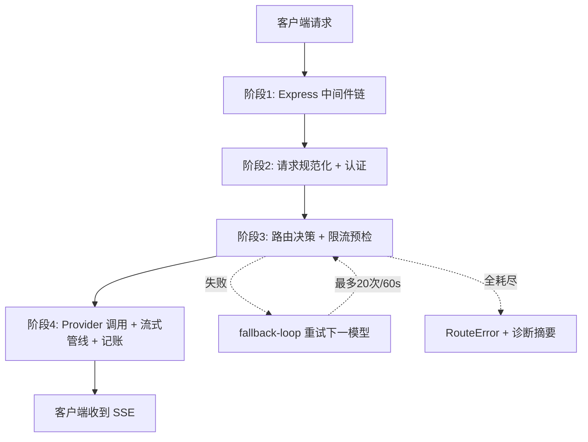
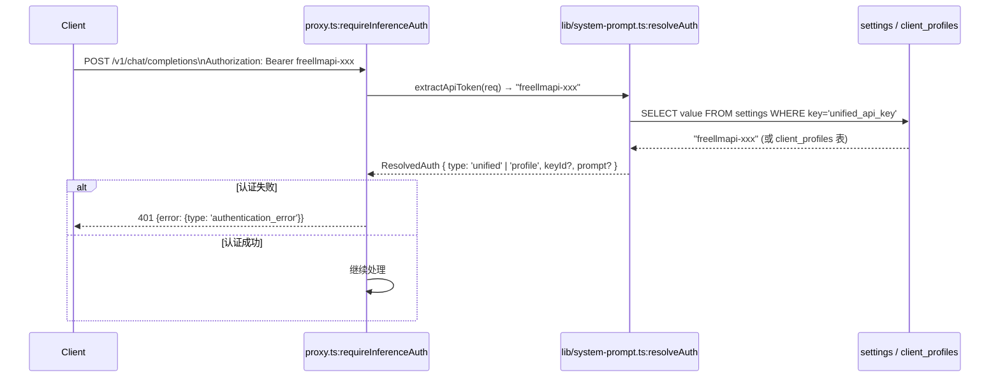
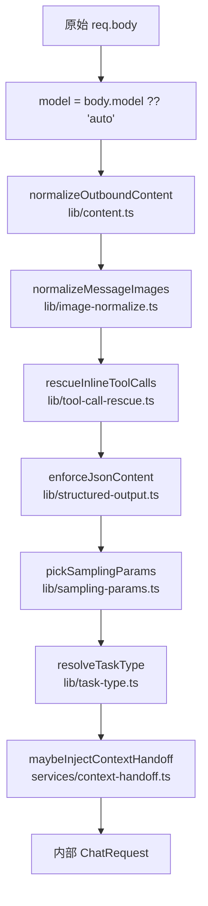
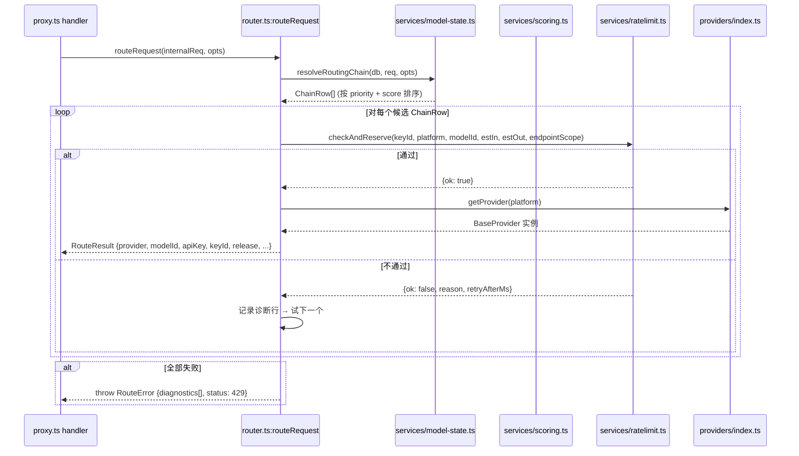
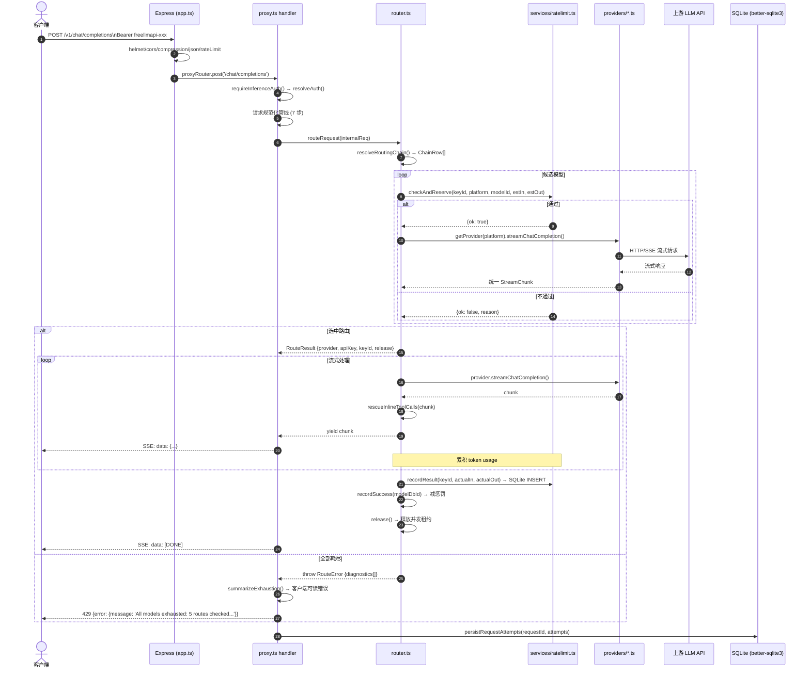

# 03 详细逐步说明 —— 主链路拆解

> 本篇为**第三层**：沿第二层链路逐跳拆解——谁调用谁、参数如何传、返回如何处理、状态如何变、错误如何传播。配 Mermaid 时序图。

---

## 0 概览：四大阶段



---

## 1 阶段 1：Express 中间件链（`app.ts:createApp()`）

### 1.1 中间件注册顺序（`app.ts:113-218`）

```
Express app
  ├─ helmet()                          # 安全头
  │   └─ CSP: default-src 'self'; script-src 'self' 'sha256-...' (inline bootstrap)
  ├─ compression()                     # gzip/deflate
  ├─ cors({ origin: allowedCorsOrigins })  # DASHBOARD_ORIGINS + 默认 localhost
  ├─ express.json({ limit: requestBodyLimitBytes })  # 25MB (config.ts:20)
  ├─ clientContextMiddleware()         # lib/client-context.ts: 解析 User-Agent、IP、指纹
  ├─ createProxyRateLimiter()          # middleware/rateLimit.ts: IP 级 RPM (默认 120)
  └─ 路由挂载
      ├─ /v1/chat/completions → proxyRouter
      ├─ /v1/messages → anthropicRouter
      ├─ /v1/responses → responsesRouter
      ├─ /v1/embeddings → embeddingsRouter
      ├─ /v1/models → modelsRouter
      ├─ /api/* → 受 requireAuth 保护的 Dashboard API
      └─ ...
```

### 1.2 `createProxyRateLimiter()` 细节（`middleware/rateLimit.ts:34-78`）

```typescript
// middleware/rateLimit.ts: createProxyRateLimiter
export function createProxyRateLimiter(limitRpm: number) {
  const windows = new Map<string, number[]>();  // key: IP, value: timestamps[]
  
  return (req, res, next) => {
    const ip = req.ip;  // 受 trust proxy 影响 (config.ts:100-112)
    const now = Date.now();
    const window = windows.get(ip) ?? [];
    const recent = window.filter(ts => now - ts < 60_000);
    
    if (recent.length >= limitRpm) {
      return res.status(429).json({ 
        error: { message: 'Rate limit exceeded', type: 'rate_limit_exceeded' } 
      });
    }
    recent.push(now);
    windows.set(ip, recent);
    next();
  };
}
```

---

## 2 阶段 2：请求规范化 + 认证（`proxy.ts` 主处理器）

### 2.1 认证流程



**关键函数**：

| 函数 | 文件:偏移 | 作用 |
|------|-----------|------|
| `extractApiToken()` | `routes/proxy.ts:81-92` | 从 `Authorization` / `x-api-key` / `x-goog-api-key` 提取 token |
| `resolveAuth()` | `lib/system-prompt.ts:56-70` | 查 `settings.unified_api_key` 或 `client_profiles` 表，返回 `ResolvedAuth` |
| `requireInferenceAuth()` | `routes/proxy.ts:69-76` | 封装上述，失败直接写 401 并返回 `null` |

### 2.2 请求体规范化管线（按执行顺序）



**每步关键转换**：

| 步骤 | 函数 | 文件:偏移 | 输入 → 输出 |
|------|------|-----------|-------------|
| 1 | `normalizeOutboundContent()` | `lib/content.ts:129` | 任意 content → 统一 `ChatMessage[]`，处理 string/array/null |
| 2 | `normalizeMessageImages()` | `lib/image-normalize.ts:282` | base64/data URL → 压缩、格式统一、尺寸限制 (max 8MB) |
| 3 | `rescueInlineToolCalls()` | `lib/tool-call-rescue.ts:217` | 文本内嵌工具调用 → 结构化 `tool_calls` 数组 |
| 4 | `enforceJsonContent()` | `lib/structured-output.ts:58` | 若请求 `json_object` 但模型不支持 → 注入 system prompt 强制 JSON |
| 5 | `pickSamplingParams()` | `lib/sampling-params.ts:166` | 清理不支持参数、设置默认 temperature/top_p、处理 `response_format` |
| 6 | `resolveTaskType()` | `lib/task-type.ts:96` | 从 messages 推断 `coding`/`analysis`/`creative`/`chat` → 影响 bandit 权重 |
| 7 | `maybeInjectContextHandoff()` | `services/context-handoff.ts:111` | 若有前序模型输出 → 注入到 messages 前端（上下文移交） |

---

## 3 阶段 3：路由决策 + 限流预检（`router.ts`）

### 3.1 `routeRequest()` 完整流程（`router.ts:2152-2381`）



### 3.2 `resolveRoutingChain()` 候选构建（`router.ts:1437-1480`）

**数据来源**：
1. `fallback_config` 表：手动优先级链
2. `profiles` + `profile_models` 表：用户自定义 profile
3. `custom_endpoint` 表：自定义 endpoint 的模型
4. `models` 表：内置 catalog 模型（`source='catalog'`）

**过滤条件**（`router.ts:2304-2372`）：
```typescript
// 伪代码
candidates = allChainRows.filter(row => 
  row.enabled === 1                                    // 启用
  && hasHealthyKey(row.platform, row.keyId)            // 有健康 key
  && row.status !== 'error'                            // 非错误状态
  && (row.context_window ?? INF) >= estimatedTokens    // context window 足够
  && (!req.vision || row.supports_vision === 1)        // vision 能力匹配
  && (!req.tools || row.supports_tools === 1)          // tools 能力匹配
  && scopeAllows(row.model_scope_json, req.model)      // key 的 model_scope 允许
  && !isOnCooldown(row.keyId, row.modelId)             // 不在冷却中
)
```

### 3.3 Bandit 打分：`scoring.ts:combineScore()`（`scoring.ts:534-541`）

```typescript
// 核心公式（scoring.ts:7-17）
/*
base = w_rel·reliability + w_speed·speed + w_intel·intelligence  (convex combination, ∈ [0,1])
effective = base × headroomFactor × rateLimitFactor
*/

// 各分量计算：
// reliabilityPosterior(α, β) = sampleBeta(α, β)  // Thompson sampling
// speedScore = 1 - (observedSpeedRank - 1) / (maxRank - 1)  // 归一化到 [0,1]
// intelligenceScore = intelligenceRank / 100  // 已是 0-100
// intelligenceComposite = (intelligenceScore + capabilityBonus) / 2
// headroomFactor = 剩余配额比例的分段函数 (rampStart/floor 可配置，router.ts:376-391)
// rateLimitFactor = 1 - penalty / MAX_PENALTY  // 动态惩罚 (router.ts:267-338)
```

**预设权重**（`scoring.ts:49-59`）：

| 策略 | reliability | speed | intelligence | 适用场景 |
|------|-------------|-------|--------------|----------|
| `balanced` | 0.50 | 0.25 | 0.25 | 默认 |
| `smartest` | 0.35 | 0.10 | 0.55 | 追求智力 |
| `fastest` | 0.35 | 0.55 | 0.10 | 追求速度 |
| `reliable` | 0.70 | 0.15 | 0.15 | 追求稳定 |
| `custom` | 用户自定义 | 用户自定义 | 用户自定义 | 完全可控 |

**峰值时段调整**（`scoring.ts:181-199`）：
- `peakAdjustedWeights()` 将 `speed` 权重的 60% 转移到 `reliability`
- 仅对 `balanced`/`smartest` 生效（`fastest`/`reliable` 豁免）
- 时间窗口按 IANA timezone 判断（非服务器本地时间）

### 3.4 限流预检：`ratelimit.ts:checkAndReserve()`（`ratelimit.ts:312-356`）

```mermaid
flowchart TD
    Start[checkAndReserve\nkeyId, platform, modelId, estIn, estOut, endpointScope]
    Start --> A[清理过期租约 pruneLeases]
    A --> B[并发租约检查\ncanUseKeyConcurrency]
    B --> C[RPM 检查\n内存窗口 + SQLite rate_limit_usage]
    C --> D[RPD 检查\n日窗口 (UTC midnight)]
    D --> E[TPM 检查\ntoken 级滑动窗口]
    E --> F[TPD 检查\ntoken 级日窗口]
    F --> G[Provider 级总配额\nprovider_quota_state 表]
    G --> H[Key 级月度预算\nkey-budget.ts:checkMonthlyBudget]
    H --> I[模型级冷却检查\nisOnCooldown]
    I --> J{全部通过?}
    J -->|是| K[acquireLease 返回 leaseId]
    J -->|否| L[返回 {ok:false, reason, retryAfterMs}]
```

**关键点**：
- **临时用量**：`provisionalRequests/tokens` 把 in-flight 租约计入计数器，关闭 check-then-act 竞态（`ratelimit.ts:151-194`）
- **Provider 级配额**：`provider_quota_state` 表存储 provider 账户级的 observed limits（`provider-quota.ts`）
- **冷却决策**：`getCooldownDecisionForLimit()` 根据错误类型决定冷却时长（`ratelimit.ts:1112` 导入）

---

## 4 阶段 4：Provider 调用 + 流式管线 + 记账

### 4.1 `streamChatCompletion()` 核心循环（`router.ts:800-1100`）

```mermaid
sequenceDiagram
    participant proxy as proxy.ts
    participant router as router.ts:streamChatCompletion
    participant provider as providers/google.ts
    participant ratelimit as services/ratelimit.ts
    participant fallback as lib/fallback-loop.ts
    participant rescue as lib/tool-call-rescue.ts
    
    proxy->>router: streamChatCompletion(route, req, opts)
    
    loop 流式处理
        router->>provider: provider.streamChatCompletion(modelId, messages, apiKey, opts)
        provider-->>router: AsyncGenerator<StreamChunk>
        
        loop 每个 chunk
            router->>rescue: rescueInlineToolCalls(chunk)  # 实时工具调用救援
            rescue-->>router: 修正后的 chunk
            router->>proxy: yield chunk (SSE 格式)
            
            opt onTokenUsage(input, output)
            router->>ratelimit: 记录 token usage (内存累积)
        end
    end
    
    alt 成功完成
        router->>ratelimit: recordResult(keyId, ..., actualIn, actualOut)  # 写 SQLite
        router->>router: recordSuccess(modelDbId)  # 减惩罚
        router->>router: release()  # 释放并发租约
    else 上游错误
        router->>fallback: recordRetryableFailure / recordAuthFailure
        fallback->>ratelimit: recordFailure / setCooldown
        fallback->>router: recordRateLimitHit / recordModelFailure
        router->>router: release()
        router-->>proxy: throw 错误 → fallback-loop 重试
    end
```

### 4.2 Provider 实现以 Google 为例（`providers/google.ts`）

```typescript
// providers/google.ts: 核心实现片段
class GoogleProvider extends BaseProvider {
  async *streamChatCompletion(modelId, messages, apiKey, opts) {
    const client = new GoogleGenerativeAI(apiKey);
    const model = client.getGenerativeModel({ model: modelId });
    
    // messages → Google contents + systemInstruction
    const { contents, systemInstruction } = this.convertMessages(messages);
    
    const stream = await model.generateContentStream({
      contents,
      systemInstruction,
      generationConfig: { temperature, topP, topK, maxOutputTokens, ... },
      safetySettings: [...],
    }, { signal: opts.signal });
    
    for await (const chunk of stream) {
      yield this.normalizeChunk(chunk);  // → 统一 StreamChunk
    }
  }
  
  normalizeChunk(chunk): StreamChunk {
    return {
      id: `chatcmpl-${crypto.randomUUID()}`,
      choices: [{
        delta: { role: 'assistant', content: chunk.text ?? '' },
        finish_reason: chunk.candidates?.[0]?.finishReason ?? null
      }],
      usage: chunk.usageMetadata ? { ... } : undefined
    };
  }
}
```

**所有 Provider 必须实现的契约**（`providers/base.ts:229-525`）：

```typescript
export abstract class BaseProvider {
  readonly platform: string;
  readonly supportsStreaming: boolean = true;
  
  abstract chatCompletion(req: ChatRequest, apiKey: string): Promise<ChatResponse>;
  abstract streamChatCompletion(modelId: string, messages: ChatMessage[], apiKey: string, opts: StreamOptions): AsyncGenerator<StreamChunk>;
  abstract listModels(apiKey: string): Promise<ModelInfo[]>;
  abstract checkHealth(apiKey: string): Promise<HealthCheckResult>;
  abstract getModelCapabilities(modelId: string): ModelCapabilities;
}
```

### 4.3 统一响应类型（`providers/base.ts`）

```typescript
// providers/base.ts: 关键类型
export interface StreamChunk {
  id: string;
  choices: Array<{ delta: ChatMessage; finish_reason: string | null }>;
  usage?: TokenUsage;
}

export interface ChatResponse {
  id: string;
  choices: Array<{ message: ChatMessage; finish_reason: string }>;
  usage: TokenUsage;
}

export interface TokenUsage {
  prompt_tokens: number;
  completion_tokens: number;
  total_tokens: number;
}
```

---

## 5 失败路径与 Fallback Loop（`lib/fallback-loop.ts`）

### 5.1 统一重试循环（`fallback-loop.ts:1367-1660`）

```mermaid
flowchart TD
    Attempt[尝试 N] --> Dispatch[dispatch(route, req) → provider.streamChatCompletion]
    Dispatch -->|成功| Success[recordResult + recordSuccess + release + 返回]
    Dispatch -->|错误| Classify[error-classify.ts 分类]
    
    Classify -->|客户端中断| Abort[isClientAbortError → 不记账、不冷却、release、抛出]
    Classify -->|401/403| AuthFail[recordAuthFailure → benchKeyAcrossPlatform 全平台冷却]
    Classify -->|429/402| RateLimit[recordRetryableFailure → setCooldown + recordRateLimitHit]
    Classify -->|5xx/timeout/empty| Retryable[recordRetryableFailure → setCooldown(heuristic) + recordModelFailure]
    Classify -->|context too large| ContextErr[跳过该模型，不冷却 key]
    Classify -->|400 bad request| ProviderErr[非重试，直接抛出]
    
    Retryable --> CheckBudget{墙钟预算<br/>getFallbackTimeBudgetMs()}
    AuthFail --> CheckBudget
    RateLimit --> CheckBudget
    CheckBudget -->|未超| NextAttempt[尝试 N+1]
    CheckBudget -->|超了| Exhausted[RouteError: All models exhausted]
    NextAttempt --> Attempt
```

### 5.2 关键冷却策略（`ratelimit.ts` + `fallback-loop.ts`）

| 错误类型 | 冷却来源 | 时长 | 备注 |
|----------|----------|------|------|
| 429 (rate limit) | `learnLimitFromError` 解析 `Retry-After` | provider 告知或指数退避 | `CooldownSource='limit'` |
| 402 (payment required) | `getPaymentRequiredCooldownMs` | 60min | 账户级 |
| 403 (model forbidden) | `getModelForbiddenCooldownMs` | 24h | 模型级 |
| 401 (auth error) | 立即触发 key 健康检查 + 全平台冷却 | 10min | `benchKeyAcrossPlatform` |
| 5xx/timeout/empty stream | heuristic | 10min (model-level) | `MODEL_FAILURE_COOLDOWN_MS`，跨 key 生效 |
| 模型连续失败 ≥3 次/15min | `noteModelFailure` | 10min | 跨所有该模型的 key |

### 5.3 墙钟预算（`fallback-loop.ts:159-197`）

- 默认 `45_000ms` (45s)，可通过 `FALLBACK_TIME_BUDGET_MS` env 或 `settings.fallback_time_budget_ms` 覆盖
- 第 0 次和第 1 次尝试**不受预算限制**（保证至少能重试一次）
- 第 2 次及以后：启动前检查 `elapsed < budget`，中途可通过 `abortInFlight` 中断

---

## 6 响应透传与后处理（`proxy.ts` 主处理器尾部）

### 6.1 SSE 格式化（`routes/proxy.ts:2358-2833`）

```typescript
// 伪代码
for await (const chunk of router.streamChatCompletion(route, internalReq, {
  onTokenUsage: (inTok, outTok) => { actualInput = inTok; actualOutput = outTok; },
  signal: req.signal,  // 客户端断开传播
})) {
  // 响应缓存：cache.ts storeCachedStreamResponse
  // 幂等性：idempotency.ts storeIdempotencyResult
  // 执行 ID 标记：withExecutionId(chunk, executionId)
  
  res.write(`data: ${JSON.stringify(formatChunk(chunk))}\n\n`);
}
res.write('data: [DONE]\n\n');
res.end();
```

### 6.2 请求日志持久化（`lib/request-log.ts`）

```typescript
// 成功/失败后统一记录
await persistRequestAttempts(requestId, attempts);
// attempts: AttemptTraceRecord[] 含每次尝试的 platform/model/key/latency/tokens/error
```

---

## 7 Mermaid 完整时序图（端到端）



---

## 8 关键状态变更汇总表

| 环节 | 读取状态 | 写入状态 | 持久化 |
|------|----------|----------|--------|
| 认证 | `settings.unified_api_key` / `client_profiles` | — | 否 |
| 路由候选 | `models` / `fallback_config` / `profiles` / `api_keys(status/enabled)` | — | 否 |
| 限流预检 | 内存 `windows` + `leases` + `rate_limit_usage` 表 + `rate_limit_cooldowns` 表 + `provider_quota_state` | 内存 `windows` 计数、`leases` 新增 | 否 (预检只读内存，in-flight 计入 provisional) |
| Provider 调用 | `api_keys.encrypted_key` → `crypto.decrypt()` | — | 否 |
| 成功记账 | — | `rate_limit_usage` INSERT (request + tokens)、`rate_limit_cooldowns` 无变化、内存 `windows` 计数、`leases` 删除 | 是 (SQLite WAL) |
| 失败记账 | — | `rate_limit_cooldowns` INSERT/UPDATE (冷却)、`rate_limit_usage` 无变化、内存 `penalties` 加惩罚 | 是 (冷却表) |
| 模型惩罚 | 内存 `rateLimitPenalties` Map | 内存 `penalties` 加/减 | 否 (仅内存，重启丢失) |
| 请求日志 | — | `requests` 表 + `request_attempts` 表 | 是 |

---

## 9 源码索引（文件:函数/类:绝对行号）

| 文件 | 关键符号 | 行号范围 |
|------|----------|----------|
| `server/src/app.ts` | `createApp()` 中间件链 | 113-218 |
| `server/src/middleware/rateLimit.ts` | `createProxyRateLimiter()` | 34-78 |
| `server/src/lib/system-prompt.ts` | `resolveAuth()`, `extractApiToken()` | 56-70 |
| `server/src/routes/proxy.ts` | `requireInferenceAuth()` | 69-76 |
| `server/src/routes/proxy.ts` | 主处理器 (规范化管线) | 1643-3097 |
| `server/src/lib/content.ts` | `normalizeOutboundContent()` | 129-143 |
| `server/src/lib/image-normalize.ts` | `normalizeMessageImages()` | 282-320 |
| `server/src/lib/tool-call-rescue.ts` | `rescueInlineToolCalls()` | 217-246 |
| `server/src/lib/structured-output.ts` | `enforceJsonContent()` | 58-77 |
| `server/src/lib/sampling-params.ts` | `pickSamplingParams()` | 166-187 |
| `server/src/lib/task-type.ts` | `resolveTaskType()` | 96-104 |
| `server/src/services/context-handoff.ts` | `maybeInjectContextHandoff()` | 111-157 |
| `server/src/services/router.ts` | `routeRequest()` | 2152-2381 |
| `server/src/services/router.ts` | `resolveRoutingChain()` | 1437-1480 |
| `server/src/services/router.ts` | `streamChatCompletion()` | 800-1100 |
| `server/src/services/scoring.ts` | `combineScore()`, `reliabilityPosterior()` | 534-541 |
| `server/src/services/scoring.ts` | `peakAdjustedWeights()` | 181-199 |
| `server/src/services/ratelimit.ts` | `checkAndReserve()` | 312-356 |
| `server/src/services/ratelimit.ts` | `recordResult()`, `recordFailure()` | 400-550 |
| `server/src/services/ratelimit.ts` | `acquireLease()`, `releaseLease()` | 127-144 |
| `server/src/lib/fallback-loop.ts` | `runFallbackLoop()` | 1348-1365 |
| `server/src/lib/fallback-loop.ts` | `noteModelFailure()`, `benchKeyAcrossPlatform()` | 95-157 |
| `server/src/lib/fallback-loop.ts` | `getFallbackTimeBudgetMs()` | 183-197 |
| `server/src/providers/base.ts` | `BaseProvider` abstract | 229-525 |
| `server/src/providers/google.ts` | `streamChatCompletion()` | 647-836 |
| `server/src/providers/index.ts` | `getProvider()` | 626-628 |
| `server/src/lib/crypto.ts` | `decrypt()` | 204-212 |
| `server/src/lib/request-log.ts` | `persistRequestAttempts()` | 171-188 |
| `server/src/services/model-state.ts` | `resolveRoutingChain()` 数据源 | 1-200 |

---

## 10 待第四层展开的主题

- **04-核心模块与类关系**：Router / RateLimiter / BaseProvider / HealthChecker 的类图、依赖注入、单例模式
- **05-API与接口设计**：`/v1/*` 完整 OpenAI/Anthropic/Gemini/Ollama 兼容清单 + `/api/*` Dashboard REST + CLI 契约
- **06-配置与数据流**：环境变量 → `loadConfig()` → `settings` 表 → 声明式配置热加载
- **07-状态存储与并发**：SQLite schema 详解、AES-256-GCM 加密细节、WAL 模式、busy_timeout、并发租约模型
- **08-启动生命周期**：`index.ts:main()` 完整序列 + `desktop/src/server-host.ts:startServer()` 镜像
- **09-测试与部署**：`__tests__` 结构、vitest 配置、Dockerfile 三阶段、desktop electron-builder、CI pipeline

---

> **下一层**：[04-核心模块与类关系.md](04-核心模块与类关系.md)