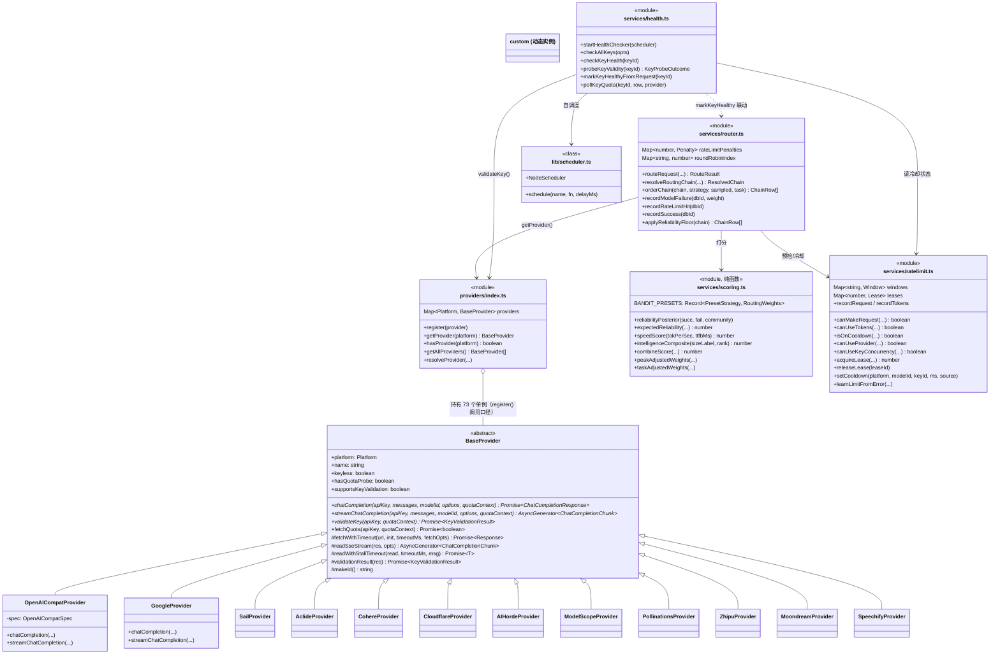

# 04 核心模块与类关系

> 第四层 · 第 1 篇。覆盖 server 端核心模块的类关系、职责边界、依赖注入方式与单例模式；兼述 client / cli / desktop 的模块结构。

---

## 0 一句话定位

系统的核心是四个协作模块：**Router**（选模型）、**RateLimit**（记账与冷却）、**BaseProvider 家族**（73 个上游适配器单例）、**HealthService**（周期性探活）。它们不是 OOP 意义上的"对象图"，而是**函数式模块 + 模块级单例状态**的组合——TypeScript/ESM 风格，靠 `getDb()` 单例和模块级 `Map` 承载状态。

provider 数量有四个互不等价的口径，本文逐处写明所用口径，全部是可复跑命令：`Platform` 联合 **74** 个成员（shared/types.ts:63，逐行解析 `| 'x'` 成员）、`providers/index.ts` 顶层 `register()` 调用 **73** 处（`grep -cE '^\s*register\(' server/src/providers/index.ts`，`register()` 即 `providers.set(platform, provider)`，一平台一单例）、`new OpenAICompatProvider` **34** 个（`grep -c 'new OpenAICompatProvider' server/src/providers/index.ts`）、`class *Provider` 定义 **43** 个（`grep -rhoE 'class [A-Za-z0-9_]+Provider' server/src/providers/*.ts | sort -u | wc -l`）。本文「适配器/单例个数」一律指 73 的 register() 口径。

---

## 1 类关系总图



---

## 2 BaseProvider 契约（`providers/base.ts`）

### 2.1 抽象方法（`Struct：BaseProvider` = base.ts:229-287，成员声明区）

| 方法 | 签名（base 偏移 +9~-16） | 必须/可选 | 说明 |
|------|--------------------------|-----------|------|
| `chatCompletion` | `(apiKey, messages, modelId, options?, quotaContext?) → Promise<ChatCompletionResponse>` | abstract（base.ts:238） | 非流式 |
| `streamChatCompletion` | 同上 → `AsyncGenerator<ChatCompletionChunk>` | abstract（base.ts:246） | 流式 |
| `validateKey` | `(apiKey, quotaContext?) → Promise<boolean \| KeyValidationFailure>` | abstract（base.ts:254） | 健康探测；可返回带 reason 的失败 |
| `fetchQuota` | `(apiKey, quotaContext?) → Promise<boolean>` | 可选覆盖 (#1403)（base.ts:266-268） | 配额探针，默认 return false，永不 throw |
| `hasQuotaProbe` | getter → boolean | 可选覆盖（base.ts:274-276） | `fetchQuota` 被覆盖不等于有真实端点（OpenAICompat 全部实例都覆盖了它），路由层判「无配额端点」必须用这个 |
| `supportsKeyValidation` | getter → boolean | 可选覆盖（base.ts:285-287，#1459） | 探活/cooldown-probe 是否允许对该 provider 调 `validateKey`；禁止自动化 key 校验的 provider 返回 false，其 key 改由 `markKeyHealthyFromRequest` 提升 |

抽象字段 `platform`/`name` 也是 abstract（base.ts:230/231），`keyless = false` 为普通字段（base.ts:236）。

### 2.2 基类提供的共享机制（子类直接复用）

| 机制 | 锚点 | 关键点 |
|------|------|--------|
| `Retry-After` 解析 | `parseRetryAfterMs +0~+9` (base.ts:35-44) | delta-seconds 或 HTTP-date，**封顶 24h**（`MAX_RETRY_AFTER_MS`，防恶意/畸形 header 把 key 永久 bench） |
| 错误体内嵌退避提示 | `parseStatedRetryMs +0~+15` (base.ts:111-132) | 三段式：结构化 `retryDelay/retryAfter` 字段 DFS（深度封顶 6）→ protobuf `"17s"` → 散文正则 `"try again in 7.66s"`；**Retry-After 头优先于 body** |
| `providerHttpError` | `+0~+6` (base.ts:152-158) | 统一构造携带 `status + retryAfterMs` 的错误对象，经基类继承供全部 73 个注册适配器共用（register() 调用口径，见 §0） |
| `fetchWithTimeout` | `+0~+49` (base.ts:326-375) | 双超时语义：`timeoutBounds:'headers'`（默认，头到达即解除——SSE 流合法地超过任何固定 deadline）vs `'request'`（非流式，body 读也纳入预算）；客户端断连信号**永不解除**，经 `AbortSignal.any` 合成 |
| SSE 读取 | `readSseStream +0~+4` / `readSseFrames` (base.ts:458-524) | 首字节预算 = `max(chatTimeout, stallTimeout)`（#584：NIM 类秒回头但 prefill 几分钟，慢≠卡死）；无 `[DONE]` 且无 `finish_reason` 的 EOF 判**截断**并抛可重试错误（此前静默当成功）；所有帧过 `<think>` 抽取器（DeepSeek 风格 reasoning 移到 `delta.reasoning_content`） |
| key 验证诊断 | `validationResult +0~+29` (base.ts:295-324) | 401/403 → 带 upstream message 的失败；**Cloudflare bot challenge（`cf-mitigated: challenge`）抛错而不是判 invalid**——不能因 IP/UA 问题禁用好 key (#1298) |

### 2.3 两类实现形态

**OpenAICompatProvider（数据驱动；`new OpenAICompatProvider` 共 34 个实例，口径 `grep -c 'new OpenAICompatProvider' server/src/providers/index.ts` → 34，含 `custom` 占位实例——custom 真实例由 `resolveProvider` 按 key 行的 base URL 临时构造）**（`providers/index.ts:57-68` 等）：

```typescript
// providers/index.ts 注册示例 —— 平台差异全部塞进 spec，不写子类
register(new OpenAICompatProvider({
  platform: 'nvidia',
  name: 'NVIDIA NIM',
  baseUrl: 'https://integrate.api.nvidia.com/v1',
  forceSingleToolCall: true,     // NIM 拒绝并行工具调用 (#255)
  timeoutMs: 180_000,            // 冷启动 prefill 分钟级；同时是流式首字节预算
  extraHeaders: {...},           // OpenRouter 的 HTTP-Referer/X-Title
  quotaProbe: {                  // #1403：声明式配额端点
    url: 'https://openrouter.ai/api/v1/key',
    metric: 'credits',
    limitFields: ['limit'],
    remainingFields: ['limit_remaining'],
  },
}));
```

**专有协议子类（协议形态不同才写类）**：`GoogleProvider`（Gemini contents/systemInstruction 格式，60s timeout）、`SailProvider`（`/v1/responses` 背景任务 + 轮询，终态对象翻译回 Chat Completions）、`CohereProvider`、`CloudflareProvider`、`AIHordeProvider`、`ModelScopeProvider`（需 Aliyun cn 绑定）、`PollinationsProvider`、`ZhipuProvider`、`MoondreamProvider`（视觉专用）、`SpeechifyProvider`（TTS）、以及 aclide/speka/typhoon/plugsky/inferbase/simplellm/llmtr/gizmo/blockrun/electronhub/experiential/router9/septor/clod/blaze/lucidity/airforce/dreamprompting/waterfall/logfare 等小网关。

**注册表注释里的纪律**（providers/index.ts:70-115）：新平台的**模型行一律放 hosted catalog（Oracle），绝不 seed 进 DB migration**——否则绕过 Premium-now/Free-after-30-days 分层门控，且未验证的模型 id 会作为默认值发布。

---

## 3 Router 模块（`services/router.ts`）

### 3.1 不是 class，是「模块级可变状态 + 纯函数群」

| 状态 | 类型 | 锚点 | 语义 |
|------|------|------|------|
| `rateLimitPenalties` | `Map<number, {count,lastHit,penalty}>` | `Const：rateLimitPenalties` (router.ts:269) | 模型级动态惩罚，纯内存、重启即失 |
| `roundRobinIndex` | `Map<string, number>` | router.ts:265 | 同平台多 key 轮转指针 |
| 策略持久化 | `settings` 表 14 个 `routing_*` key（口径：`grep -oE "'routing_[a-z_]+'" server/src/services/router.ts server/src/services/scoring.ts \| sed 's/.*://' \| sort -u \| wc -l` → 14，全部定义在 router.ts） | router.ts:367-484 | `routing_strategy`(367) / `routing_custom_weights`(368) / `routing_explore_enabled`(369) / `routing_peak_hours_adjust`(370) / `routing_peak_start_hour`(371) / `routing_peak_end_hour`(372) / `routing_peak_timezone`(373) / `routing_community_prior`(374) / `routing_community_prior_enabled`(375) / `routing_headroom_ramp_start`(380) / `routing_headroom_floor`(381) / `routing_min_reliability_floor`(417) / `routing_provider_moment_attribution`(447) / `routing_task_weight_share`(484) |

**惩罚参数**（router.ts:272-276）：
- `PENALTY_PER_429 = 3`、`PENALTY_PER_FAIL = 1`、`MAX_PENALTY = 10`
- 衰减：每 `DECAY_INTERVAL_MS = 2min` 减 `DECAY_AMOUNT = 1`；**惰性衰减**（`getPenalty` 只读不回写，避免每次路由都重置时钟）

### 3.2 `orderChain()`：两种排序模式（router.ts:1204-1272）

```
priority 模式（遗留手工链）:
  1. 按 raw priority 排序
  2. 密集重编号 1..N          ← 关键修复：否则 priority 间距 >10 时惩罚完全失效
  3. eff = rank + penalty     ← 1 个 penalty 就真的是「低一名」
  4. sort by (match_tier, eff, raw priority, 原序)

bandit 模式（默认 balanced）:
  1. weights = preset (+ peakAdjustedWeights + taskAdjustedWeights)
  2. chain = applyReliabilityFloor(chain)   ← 低于运营设定的可靠性下限先剔除
  3. score = scoreChainEntry(...) 每候选
  4. sort by (match_tier, score desc, raw priority)
```

**注释披露的历史 bug**（router.ts:1210-1237）：legacy 模式曾把 penalty 直接加到 raw priority 上，而 priority 可以是 10/20/30 稀疏编号（PUT /api/fallback 只验证 `z.number()`），penalty 封顶 10 ⇒ 一个每请求都 429 的模型可以永远钉在链头。修复=先密集重编号再加 penalty。

**`match_tier` 优先于分数**（router.ts:177-185 ChainRow 注释）：tier 是唯一不允许被 score 翻盘的排序输入——通过 group slug 自动派生命中的成员必须等所有正常候选耗尽才能服务，防止静默替换用户点名的模型。

**`sampled` 双形态**（router.ts:1197-1202）：线上路由用 Thompson 采样（每请求重抽=探索本身）；fusion 面板用确定性期望值（`sampled=false`），保证展示是策略的稳定反映而非每次抽卡。

### 3.3 可靠性下限（`applyReliabilityFloor` +0~+21, router.ts:1167-1189）

- 样本 < `EXPLORE_MIN_SAMPLES` 的模型**保留**（冷启动不能被判死）
- **安全阀**：floor 会清空整条链时，filter 整体跳过——「宁可可能不稳定也不无模型可用」

### 3.4 路由输出契约 `RouteResult`（router.ts:188-239）

关键字段设计（见注释）：
- `keyLabel`（#869）：只带人类 label，**绝不带 key id 或凭证**——failover ladder 展示用
- `proxyUrl?`：随 route 携带已解密的 key 级代理（#590）——`selectKeyForModel` 已读整行，省掉每 ATTEMPT 一次 SELECT+decrypt
- `release?: () => void`：**可选**且调用点全部写 `release?.()`——它在 `finally` 里，若是 test double 缺了它再抛 TypeError，会把可诊断的 429 替换成谜之 500
- `endpointScope`：两个 relay 各有一行同 model_id 时，失败归因 Retirement 信号必须落到**那一个 relay**（#651）

### 3.5 耗尽诊断（`RouteError.diagnostics` + `summarizeExhaustion`，router.ts:49-131）

路由放弃时逐模型记录「为什么不能服务」，聚合成 9 个桶（rate-limited / no usable key / prompt too large / lacks vision / lacks tools / drops response_format / failed earlier / unsupported / unavailable），**按可操作性排序**输出。keyless 跳过的模型单独计数，不算「检查过的路由」（否则虚增池子大小）。

---

## 4 RateLimit 模块（`services/ratelimit.ts`）

### 4.1 双层账本：内存滑动窗口 + SQLite 持久化

```
windows: Map<"platform:modelId:keyId:rpm|rpd|tpm|tpd", Window>   (ratelimit.ts:14)
  Window = { timestamps: number[], tokenCount, tokenTimestamps }  ← 内存热路径

rate_limit_usage 表 (kind='request'|'tokens', created_at_ms)      ← 重启后重建 / 审计
  剪枝: 每分钟一次 DELETE WHERE created_at_ms <= now-DAY
        (ratelimit.ts:196-230 —— 索引最左列是 platform，裸 created_at_ms 谓词
         是全表扫描，绝不能放进每次 insert 的热路径，所以节流)
```

### 4.2 租约（Lease）机制——check-then-act 竞态的封口（ratelimit.ts:50-194）

```
问题: routeRequest 同步返回，但 usage 在 await provider 之后才写
      ⇒ N 个并发请求全部读到同一个 pre-check、全部放行 ⇒ 集体击穿限额
解法: acquireLease() 在 dispatch 前登记在途请求
      所有 gate 把 provisional (in-flight) 计数叠加进检查
细节:
  - leases 只在内存（描述「本进程在途」，持久化无意义，重启归零是对的）
  - LEASE_MAX_AGE_MS = 2min 兜底：泄漏的租约会永远吃掉并发预算
  - 成功后 release 前有一次「双计」窗口（微秒级）——
    方向是少派发，对免费额度是安全侧
```

### 4.3 并发上限是 opt-in（ratelimit.ts:85-106）

`getKeyConcurrencyLimit()` 默认 `null`（不限）——多数免费层按分钟计量而非按并发计量，默认加帽会串行化所有 provider 造成真实吞吐损失；「这些 provider 的行为文档不足以给出一个正确的数字，错的默认比没有更糟」。env：`MAX_CONCURRENT_REQUESTS_PER_KEY_<PLATFORM>` / 全局回退。

### 4.4 冷却来源分级（`CooldownSource`，配合 fallback-loop 使用）

| source | 语义 | 谁能提前清除 |
|--------|------|--------------|
| `heuristic` | 本地失败 streak 推断 | cooldown-probe 可提前复验清除 |
| provider 明示（limit） | 尊重 provider reset 时间 | 不可提前 |
| 升级阶梯（如 403→24h） | 强信号 | 不可提前 |

`noteModelFailure`（fallback-loop.ts:95-117）明确「**永不缩短既有 bench**」——provider 明示的 reset 比本地启发式知道得多，覆盖它还会丢掉不可探测的 provenance。

---

## 5 Scoring 模块（`services/scoring.ts`）——纯函数层

设计宣言（scoring.ts:1-23 头注释）：拒绝旧版「概率 + 裸延迟 + 智力分」量纲不自洽的手工加成，改为**凸组合 + 乘性护栏**：

类型域要分清：`RoutingStrategy` 有七个取值——`priority` / `balanced` / `smartest` / `fastest` / `reliable` / `custom` / `decision`（scoring.ts:36，`decision` 是 #1354：由决策模型每请求在四个 preset 里挑一个）；`PresetStrategy` 只含四个 bandit preset（scoring.ts:39）；`BANDIT_PRESETS` 的类型是 `Record<PresetStrategy, RoutingWeights>`（scoring.ts:49），preset 与 strategy 不是同一个类型域。

```
base      = w_rel·reliability + w_speed·speed + w_intel·intelligence ∈ [0,1]
effective = base × headroomFactor × rateLimitFactor
```

| 分量 | 锚点 | 算法 |
|------|------|------|
| reliability | `reliabilityPosterior +0~+8` (scoring.ts:278-287) | Beta(α,β)，先验 `Beta(1,1)`=均匀；社区 prior 折入起点，本地样本越多自动稀释 prior |
| speed | `speedScore +0~+9` (scoring.ts:328-334) | 吞吐 `1-e^(-tok/s ÷ 60)`（饱和曲线：防一个极快小模型把大模型压成 0）× 0.6 + TTFB 线性坡度(300ms~5s) × 0.4；无样本给乐观先验 0.6 |
| 超时计入速度 | `TIMEOUT_LATENCY_CAP_MS` (scoring.ts:336-352) | 超时行按 wall-clock 延迟 + 0 输出计入速度窗（此前只喂 success 行，卡死一半调用的 relay 保持完美速度分 #619）；封顶 2min 防单条挂死支配 7 天窗口 |
| intelligence | `intelligenceComposite +0~+3` (scoring.ts:400-404) | `tier×1000 − √rank×31`：tier 严格分层，tier 内 rank 用平方根压缩使头部编辑可见（#673 线性 rank 被 min-max 归一化稀释到看不出来） |
| 未识别 tier | `TIER_VALUE` (scoring.ts:384-388) | 打分**垫底而非剔除**——custom 模型 seed 在 catalog 中位 tier（"unknown 是没意见，不是最差" #488） |

**两个可解释的「不动」设计**：
- `PEAK_EXEMPT_STRATEGIES = ['fastest','reliable']`（scoring.ts:104-121）：峰时调整会把 speed 的 60% 挪给 reliability；但这两个 preset 是轴的两端，挪了会「让 fastest 悄悄变成 noisy 版 reliable」。选豁免而非 clamp，保持每个 preset 身份不变。
- `TASK_EXEMPT_STRATEGIES = 上述 + 'custom'`（scoring.ts:209-220）：custom 是运营亲手推的滑块，每请求 header 无权挪它。
- 峰时小时用 **IANA tz** 经 `Intl` 解析，绝不用宿主 `getHours()`——容器常年 UTC，「峰时」会变成「构建镜像的时区」（scoring.ts:66-77）。

---

## 6 Health 模块（`services/health.ts`）

| 设计 | 锚点 | 语义 |
|------|------|------|
| 三态探活 | `KeyProbeOutcome = 'valid'\|'invalid'\|'error'` (health.ts:371) | 401/403=invalid：**只有这条路递增 `failureCount`**，累计 `CONSECUTIVE_FAILURES_TO_DISABLE`=3 次自动 `enabled=0`（`recordInvalidFailure` health.ts:157-174）；单次传输错误（DNS/超时/TLS）不写 status、不碰 `failureCount`；但连续传输失败计入内存 streak（`transportFailures` health.ts:92），达到 `HEALTH_TRANSPORT_PARK_AFTER`（`getTransportParkAfter` health.ts:88-89，默认 0=关闭，建议值 6≈30 分钟，health.ts:85）后 `recordTransportFailure`（health.ts:102-125）把 key park 成 `status='error'`（health.ts:115 的 UPDATE）——仍在每轮复探、任一请求成功即自愈，429 视为「provider 可达」并清零 streak（health.ts:354） |
| 429 特殊处理 | `recordValidationRateLimited` (health.ts:148) | 验证也被限流 ⇒ 一小时内跳过该 key 的重验 |
| probe 无副作用 | `probeKeyValidity` (health.ts:373-401) | 供 cooldown-probe 复用：不写 DB、不加失败计数 |
| 请求即健康证据 | `markKeyHealthyFromRequest` (health.ts:414-426) | 真实请求成功可把 error 态 key 提回 healthy，不用等 5min 周期 |
| provider 交错 | `interleaveByProvider` (health.ts:477-493) | 防同 provider 的 key 连续探测自触发限流；并发 worker pool 默认 8，带时间预算（pass 不超过半周期） |
| quota 轮询 | `pollKeyQuota` + `supportsQuotaPolling` (health.ts:200-228) | 只对实现了 fetchQuota 的 provider 做，15min 间隔 |

---

## 7 客户端侧模块结构（对照）

### 7.1 client（React 仪表板）

```
main.tsx ──► App.tsx (Provider 链: QueryClientProvider → I18nProvider → ThemeProvider → Router)
   │
   ├─ lib/api.ts        fetch 封装：401 只在 error.type==='authentication_error' 时清会话
   │                    （防止测坏 provider key 时把用户登出，api.ts:44-49）
   ├─ lib/toast.ts      自研 store；MutationCache 全局 onError→toast，页面 meta.silenceToast 选静默
   ├─ theme.tsx         light/dark/system 三态
   ├─ i18n/I18nProvider.tsx  按 locale 懒加载
   └─ pages/  KeysPage(5 tab + 34 子组件) / FallbackPage(拖拽表+策略+chain) / Models / Analytics / Playground ...
```

React Query `staleTime: 30_000` 而非 0——Models 页挂载约 13 个查询，0 会让每次切页全量重刷（App.tsx:55-62 注释）。

### 7.2 cli

`main()` 命令分发（cli/src/index.ts:455-492）→ `tools.ts` 20 个生成器函数 `function X(ctx: GenerateContext): Generation`（测量：`grep -cE '^function [A-Za-z]+\(_?ctx: GenerateContext\): Generation \{' cli/src/tools.ts` → 20）；生成器不逐个挂接口，而是作为 `metadata` 元组（tools.ts:1037-1058，20 行）的最后一个（第 9 项）元素注入，由 `export const tools = metadata.map(...)`（tools.ts:1060）映射成 `ToolDefinition.generate`，调用点 `index.ts:301` 的 `tool.generate(context)` → `config-files.ts:applyGeneratedFiles`（两阶段提交：先全部读+merge，再一次写入；写前 `.backup-{timestamp}`；sensitive 文件 0600）。双认证：`FREELLMAPI_API_KEY`（wire Bearer）vs `FREELLMAPI_DASHBOARD_TOKEN`（keys 管理 session）。

### 7.3 desktop

`main.ts`（382 行，单实例锁/Tray/Popover/更新）→ `server-host.ts:startServer()`（手工镜像 server 启动序列 + `server-host-boot.test.ts` 交叉校验防漂移）；`preload.ts` 用 MutationObserver 把 Dashboard 的 theme/lang 镜像回主进程。

---

## 8 已知风险 / 待拍板（评审清单）

| # | 级别 | 描述 | 锚点 |
|---|------|------|------|
| 1 | 风险 | 模型惩罚 `rateLimitPenalties` 纯内存，重启即清 ⇒ 刚重启的实例会重新踩一遍已知劣迹模型 | `Const：rateLimitPenalties` router.ts:269 |
| 2 | 风险 | `windows` 与 SQLite 存在双写不一致窗口：`recordUsage` 返回 false（DB 挂）时靠内存窗口兜底，但内存不持久化 | `recordUsage +0~+21` ratelimit.ts:208-230 |
| 3 | 设计特性 | 并发上限默认关闭——保守选择，注释明确「错的默认比没有更糟」 | ratelimit.ts:85-106 |
| 4 | 设计特性 | priority 模式「先重编号再加 penalty」改变了历史排序语义（对间距 ≤10 的链等价） | orderChain router.ts:1204-1243 |
| 5 | 待拍板 | 头注释声称的「冷却跨重启持久」依赖 DB 行不清理；`cleanupExpiredCooldowns` 只在 boot 跑一次 | server/src/index.ts:57-65 |

---

## 9 源码索引

| 文件 | 符号 | 行号 |
|------|------|------|
| server/src/providers/base.ts | `BaseProvider`（成员声明区） | 229-287 |
| server/src/providers/base.ts | `parseRetryAfterMs` / `parseStatedRetryMs` / `providerHttpError` | 35-158 |
| server/src/providers/base.ts | `fetchWithTimeout` / `readSseStream` / `readSseFrames` | 326-524 |
| server/src/providers/index.ts | `register(...)` ×73（register() 调用口径，见 §0） | 54-620 |
| server/src/services/router.ts | `RouteError` / `summarizeExhaustion` | 49-131 |
| server/src/services/router.ts | `ChainRow` / `RouteResult` | 153-239 |
| server/src/services/router.ts | 惩罚群 `recordModelFailure` 等 | 265-364 |
| server/src/services/router.ts | `applyReliabilityFloor` / `orderChain` | 1167-1272 |
| server/src/services/ratelimit.ts | `Window` / `windows` | 7-25 |
| server/src/services/ratelimit.ts | Lease 群 | 50-194 |
| server/src/services/ratelimit.ts | `recordUsage` | 208-230 |
| server/src/services/scoring.ts | 头注释（凸组合宣言） | 1-23 |
| server/src/services/scoring.ts | `BANDIT_PRESETS` / peak / task 调整 | 49-259 |
| server/src/services/scoring.ts | `reliabilityPosterior` / `speedScore` / `intelligenceComposite` | 278-404 |
| server/src/services/health.ts | `checkKeyHealth` / `probeKeyValidity` / `interleaveByProvider` / `runHealthPass` | 246-606 |
| server/src/lib/fallback-loop.ts | `noteModelFailure` / `benchKeyAcrossPlatform` | 86-157 |