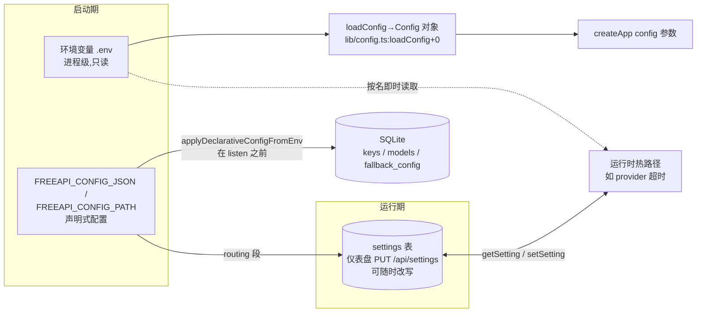

# 06 · 配置与数据流

> 本篇回答一个问题：**一个配置值要怎么才能真的生效？** freellmapi 的配置不是一层，而是四层来源、两种生命周期（启动期一次 vs 运行期热改），外加一套「配错了不崩、只警告」的降级哲学。读完本篇你应能回答：改了环境变量为什么不生效、仪表盘上改的开关存在哪、以及声明式 JSON 配置在启动序列里的位置。

---

## 1. 四层配置来源总览



| 层 | 载体 | 生命周期 | 典型内容 |
|---|---|---|---|
| ① 环境变量（经 `loadConfig`） | `Config` 对象 | 启动时固定 | PORT、HOST、FREEAPI_DB_PATH、REQUEST_BODY_LIMIT_MB、TRUST_PROXY |
| ② 环境变量（按名即时读） | `process.env.X` 散落在调用点 | 每次读取时生效（改 env 需重启进程，但没有集中快照） | PROVIDER_TIMEOUT_\<PLATFORM\>、MAX_CONCURRENT_REQUESTS_PER_KEY |
| ③ settings 表 | SQLite `settings(key,value)` | 运行期热改，仪表盘即改即用 | 路由策略、fallback 时间预算、代理设置、enable_mcp |
| ④ 声明式配置 | `FREEAPI_CONFIG_JSON`/`_PATH` | 启动时一次性「翻译」进 ②③④ 之外的 DB | keys、models、fallback 链、routing、admin、license |

关键区分：**①②是「部署层」，③是「运营层」**。声明式配置（④）的设计意图是让一次 `docker run` 就带着完整可用配置启动——它自己不是一层新的存储，而是启动时在 DB 与 settings 表上执行一遍「有人手工配置过」的动作。

---

## 2. 第①层：loadConfig 与 Config 对象

`server/src/lib/config.ts` 的 `loadConfig` 函数只做一件事：把进程环境读成一个不可变对象，交给 `createApp`。

```
Config：port, host, dbPath, dashboardOrigins, clientDist,
        proxyRateLimitRpm, requestBodyLimitBytes, nodeEnv,
        serveStaticAssets, trustProxy, cspUpgradeInsecureRequests
```

逐字段（均在 `loadConfig+0~+22` 区间内）：

| 字段 | 环境变量 | 默认 | 备注 |
|---|---|---|---|
| `port` | `PORT` | `3001` | desktop 内嵌版用 31415（见 08 篇） |
| `host` | `HOST` | `'::'` 双栈 | IPv6 不可用时 index.ts 捕获 EAFNOSUPPORT 退回 `0.0.0.0`（#180） |
| `dbPath` | `FREEAPI_DB_PATH` | `null`→内部默认 | 空串按未设置处理（`trim() || null`） |
| `dashboardOrigins` | `DASHBOARD_ORIGINS` | `[]` | 逗号分隔，CORS/CSRF 白名单 |
| `proxyRateLimitRpm` | `PROXY_RATE_LIMIT_RPM` | `120` | 入站总限流；`parseRateLimitRpm+0` 对 NaN/负数静默回退默认 |
| `requestBodyLimitBytes` | `REQUEST_BODY_LIMIT_MB` | 25MB | 注释给出完整论证：观测到 11.85MB 真实回放请求 + 图像内联膨胀约 33%（`DEFAULT_REQUEST_BODY_LIMIT_MB+0` 上方整段注释） |
| `trustProxy` | `TRUST_PROXY` | `false` | `parseTrustProxy+0`：`true`/数字（跳数）/CIDR 列表三态语义（#1024） |
| `cspUpgradeInsecureRequests` | `CSP_UPGRADE_INSECURE_REQUESTS` | `undefined`=自动 | 三态：仅在请求经 TLS 或 XFP=https 时发指令（#682）；`false` 让 HTTP 局域网安装能渲染仪表盘 |

两个值得记住的细节：
- **解析失败一律回退默认，不抛错**。所有 `parse*` 函数都是「坏值 → 默认值」，配错 env 的后果是静默用默认，而不是启动失败。
- **tri-state（三态）模式**反复出现：`undefined` 表示「自动/维持原样」，`true/false` 才是显式覆盖。`CSP_UPGRADE_INSECURE_REQUESTS` 与声明式配置里 `routing` 段「省略则不动持久值」是同一个设计语言。

---

## 3. 第②层：按名即时读的环境变量（平台级旋钮）

这一层不走 `Config` 对象，而是在调用点每次读 `process.env`。集中在超时/并发族：

| 变量 | 读取点 | 语义 |
|---|---|---|
| `PROVIDER_TIMEOUT_<PLATFORM>` | `lib/provider-timeout.ts:providerTimeoutMs+0` | 覆盖该平台注册时的 chat 超时；`0`=禁用；坏值忽略回落 |
| `PROVIDER_STREAM_STALL_TIMEOUT_MS` | `streamStallTimeoutMs+0`（同文件） | 全局流中断 watchdog，默认 90s，`0` 禁用 |
| `PROVIDER_STREAM_STALL_TIMEOUT_<PLATFORM>` | 同上，先查平台级 | 平台级赢全局、全局赢默认（#584） |
| `MAX_CONCURRENT_REQUESTS_PER_KEY[_<PLATFORM>]` | `services/ratelimit.ts:getKeyConcurrency+0` 附近 | 单 key 并发上限，opt-in，默认关 |
| `MODEL_ROUTING_OVERRIDES` | `services/model-weight-overrides.ts` | JSON 对象 `{modelId: weight}`，启动时校验并警告 |

平台名规则：`providerTimeoutEnvName+0` 把 platform 大写并把非 `[A-Z0-9]` 换成 `_`（如 `nvidia` → `PROVIDER_TIMEOUT_NVIDIA`）。

优先级链实例（流式首字节，#584 之后）：

```
PROVIDER_STREAM_STALL_TIMEOUT_<PLATFORM>   ← 最Specific
  > PROVIDER_STREAM_STALL_TIMEOUT_MS
  > 内置 90s
PROVIDER_TIMEOUT_<PLATFORM>
  > 注册时 spec.timeoutMs（如 google 60s、nvidia 180s）
  > fetchWithTimeout 调用点默认 15s
```

`fetchWithTimeout`（`providers/base.ts:fetchWithTimeout+0`）的签名默认参数 `providerTimeoutMs(this.platform, 15000)` 就是这条链的落点——适配器不显式传超时，env 覆盖照样生效。

---

## 4. 第③层：settings 表 —— 运行期唯一的「活配置」

存储极简：`settings(key TEXT PRIMARY KEY, value TEXT)`。读写走 `db/index.ts:getSetting+0 / setSetting+0`，值永远是字符串，布尔用 `'1'/'0'`，数字用 `Number(raw)` 解析。

谁在写它：
- 仪表盘 `routes/settings.ts` 的 GET/PUT（代理设置、MCP 开关、embedding 默认族、claude 别名等）；
- `services/router.ts` 的 `setRoutingStrategy / setCustomWeights / setKeySelectionStrategy`（声明式配置和仪表盘共用）；
- `applyDeclarativeConfig` 本身（routing 段）。

谁在读它（热路径）：`getFallbackTimeBudgetMs`、`getTaskWeightShare`、`getMinReliabilityFloor`、`getHeadroomThresholds`、代理恢复 `restoreProxySettings` 等。

### 4.1 三源优先级范式

`lib/fallback-loop.ts:getFallbackTimeBudgetMs+0~+13` 是全项目优先级写法的样板，注释自己点破了规则（`DEFAULT_FALLBACK_TIME_BUDGET_MS+0` 上方）：

> Precedence mirrors the response cache: the settings-table value wins when present (runtime-tunable), then the env var, then the default.

```ts
const candidates = [stored, process.env.FALLBACK_TIME_BUDGET_MS];  // settings 先
for (const raw of candidates) { …Number(raw) 有效(≥0)即返回… }
return DEFAULT_FALLBACK_TIME_BUDGET_MS;  // 45_000
```

三个防御细节值得抄：
1. `getSetting` 包在 try 里——**DB 未就绪时绝不从代理热路径抛出**；
2. 空串跳过（区分「没配」与「配了空」时选前者）；
3. `0` 是合法值（语义为「禁用预算」），所以判据是 `n >= 0` 而非 truthy。

### 4.2 启动回流：restoreProxySettings

settings 表里的代理配置（`proxy_url` / `proxy_mode` / `fetch_relay_token` / `proxy_enabled` / `proxy_bypass`）在启动时由 `lib/proxy.ts:restoreProxySettings+0` 一次性读回内存（`applyProxyUrl+0` 起五个 apply）。这是「持久层→内存层」回流的标准形状：**读一次、缓存在模块变量、热路径不查库**；`proxy_enabled !== '0'` 表示默认开启（缺行=开）。

---

## 5. 第④层：声明式配置（FREEAPI_CONFIG_JSON / PATH）

### 5.1 入口与时机

```
readConfigFromEnv+0：FREEAPI_CONFIG_JSON(内联) > FREEAPI_CONFIG_PATH(文件) > null
applyDeclarativeConfigFromEnv+（文件尾部导出）：读 → zod 解析 → applyDeclarativeConfig
```

调用点在 `index.ts` 主序列里、`initDb` 之后、**HTTP listener 之前**——这个位置是有意的（见 5.3 admin 段）。JSON 解析失败或 schema 校验失败会**阻止启动**（fail-fast），但单条目级别的坏值只降级为 warning（#600）。

### 5.2 Schema 逐段

根 schema `declarativeConfigSchema+0` 带 `.strict()`：**未知顶层键直接拒绝**，防止拼写错误（`key` 写成 `keys` 之类）静默丢配置。

| 段 | 类型 | 落到哪 | 注意点 |
|---|---|---|---|
| `admin` | `{email, password≥8}` | `createUser` | **仅当 users 表为空**才创建；已有人则降为 warning——永远不能接管已占用的安装 |
| `license` | `string≥8` | 后台激活（`validateLicenseKey`） | 结果里 `license:true` 只表示「已交给后台」 |
| `keys[]` | `{platform, key?, label?, baseUrl?, enabled?}` | `api_keys`（AES-256-GCM 加密存储） | `key` 可缺省=匿名/免费平台占位 |
| `customProviders[]` | `{baseUrl, apiKey?, label?, models[]}` | 自定义平台 + 模型行 | `models` 支持 `modelEntrySchema+0` 的**字符串简写或对象全写** union |
| `models[]` | `{platform, modelId, endpoint?, …ranks/limits}` | `models` 行 upsert | `endpoint` 字段解决同一 modelId 多个自定义端点的歧义（#651）；catalog 平台忽略之 |
| `fallback[]` | `{platform, modelId, endpoint?, priority?, enabled?}` | `fallback_config` 链 | 顺序即路由候选顺序（priority 策略下） |
| `routing` | `{strategy, weights?, keySelectionStrategy?}` | settings 表 | `strategy` 六枚举；**省略 `keySelectionStrategy` 表示「不动持久值」**（#919）——注意这是「配置一次」语义而非持续对账 |

`applyDeclarativeConfig` 的返回值 `DeclarativeConfigResult+0` 同时是一份部署报告：`applied, source, admin, license, keys, customModels, models, fallback, routing, warnings[]`。`warnings` 是 per-entry skip 清单（坏 key、未知 platform 等），设计原则写在注释里：**一条坏数据不该毁掉整个部署**。

### 5.3 admin 段为什么能「关闭一个安全窗口」

`adminSchema+0` 上方的注释是全文最精彩的安全设计说明：首启时若无人配置账号，服务器会生成一次性 setup code 并短暂开放匿名 `POST /api/auth/setup`。因为声明式配置在 listener 之前执行，`admin` 段的存在让 setup code **根本不会被铸造**（`userCount()>0` 分支进不去）——窗口不是被缩短了，是被消除了。

### 5.4 与 Oracle catalog 的边界

自定义模型进 DB 时由 `customModelSeed`（`services/custom-model-seed.ts`）补默认档位（intelligence 用 catalog 中位 tier，#488——「未知」不是「最差」）；catalog 管理的模型走 `upsertModelOverrides` 只写 override，避免与 hosted catalog 同步（`catalog-sync.ts`）打架，后者见 07 篇数据流。

---

## 6. 配置健康自检：两个 drift 警告

freellmapi 把「配置可能过时」当作一类值得在启动日志里喊出来的问题：

1. **`warnOnEnvDrift`（`lib/env-drift.ts+0`）**：启动时把 `.env` 与 `.env.example` 做双向 diff——「example 里有、.env 里缺」报 missing defaults，「.env 里有、example 里完全没有」报 unknown keys（白名单 `KNOWN_UNDOCUMENTED_ENV+0` + 两条正则豁免内部旋钮）。**只警告，启动继续**。判据是名字集合，不比值。
2. **`warnOnRoutingOverrideDrift`（`services/model-weight-overrides.ts+0`）**：`MODEL_ROUTING_OVERRIDES` 存在时校验 JSON 形状、拒坏值、列出未知模型名——同样是警告而非崩溃。

这构成一条一致的哲学：**部署层配错 → fail-fast（schema .strict）；运营层配错 → 降级+warning；一致性漂移 → 只提醒**。

---

## 7. 开关总表（速查）

「我想调 X，该改哪里」：

| 想调的东西 | 改哪里 | 生效方式 |
|---|---|---|
| 监听端口/主机/DB 路径 | env（`loadConfig`） | 重启 |
| 入站总限流 RPM | `PROXY_RATE_LIMIT_RPM` | 重启 |
| 请求体上限 | `REQUEST_BODY_LIMIT_MB` | 重启 |
| 某平台超时/流 stall 预算 | `PROVIDER_TIMEOUT_*` / `PROVIDER_STREAM_STALL_TIMEOUT_*` | 每次读取，进程内改 env 即生效（通常仍需重启才改到 env） |
| 路由策略/权重 | 仪表盘 → settings 表；或声明式 `routing`（仅首装） | 即用 / 重启 |
| fallback 时间预算 | settings 表 `fallback_time_budget_ms`（优先）或 env | 即用 |
| 可靠性下限、task 权重偏移 | settings 表 | 即用 |
| API key、模型链、回退链 | 仪表盘，或声明式 `keys/models/fallback` | 即用 / 启动时写入 |
| 出站代理 | 仪表盘 → settings → `restoreProxySettings` | 即用（写时同步 apply） |

---

## 8. 风险与待补

| 级别 | 事项 |
|---|---|
| P2 | `.strict()` 只约束声明式 JSON 根对象；env 层无等价机制，靠 drift 警告兜底 |
| P2 | 声明式 `routing` 是「启动时应用一次」而非持续对账：之后仪表盘改了策略，重启会被 JSON 里的值**再次覆盖**——版本控制式配置与运营式热改之间没有 reconciler，以 JSON 为准 |
| 待补 | `license` 段后台激活的完整回调链（`validateLicenseKey`→`syncCatalog`）细节归 07 篇数据流，本篇未展开 |
| 待补 | `FREEAPI_ENV_PATH`（drift 检查的 .env 定位覆盖）在实际部署里的使用频率 |

---

## 源码索引（绝对行号，以当前 checkout 为准）

- `server/src/lib/config.ts` — 1-20 `DEFAULT_RPM`/`DEFAULT_REQUEST_BODY_LIMIT_MB`；22-36 `parseRateLimitRpm`/`parseRequestBodyLimitBytes`；38-68 `Config`；70-93 `loadConfig`；100-112 `parseTrustProxy`；114-121 `parseCspUpgradeInsecureRequests`
- `server/src/lib/env-drift.ts` — 11-26 白名单与豁免正则；65-76 `compareEnvText`；108-130 `checkEnvDrift`/`warnOnEnvDrift`
- `server/src/lib/fallback-loop.ts` — 159-181 预算注释与常量；183-197 `getFallbackTimeBudgetMs`
- `server/src/lib/proxy.ts` — 392-396 `restoreProxySettings` 五个 apply
- `server/src/lib/provider-timeout.ts` — 1-70 env 名派生与两级读取
- `server/src/providers/base.ts` — 326-333 `fetchWithTimeout` 默认超时链落点
- `server/src/services/ratelimit.ts` — 95-100 key 并发 env 读取
- `server/src/services/model-weight-overrides.ts` — 119-185 `warnOnRoutingOverrideDrift`
- `server/src/services/declarative-config.ts` — 25-54 model/key/customProvider schema；56-85 `modelSchema`/`fallbackEntrySchema`；93-96 `adminSchema`；98-118 `declarativeConfigSchema`；122-136 `DeclarativeConfigResult`；151-159 `readConfigFromEnv`；466 `applyDeclarativeConfig`；569 `applyDeclarativeConfigFromEnv`
- `server/src/db/index.ts` — `getSetting`/`setSetting`
- `server/src/routes/settings.ts` — 199-220 settings GET 读法示例

---

上一篇 → [05-API与接口设计](./05-API与接口设计.md) ｜ 下一篇 → [07-状态存储与并发](./07-状态存储与并发.md) ｜ [返回索引](./README.md)
