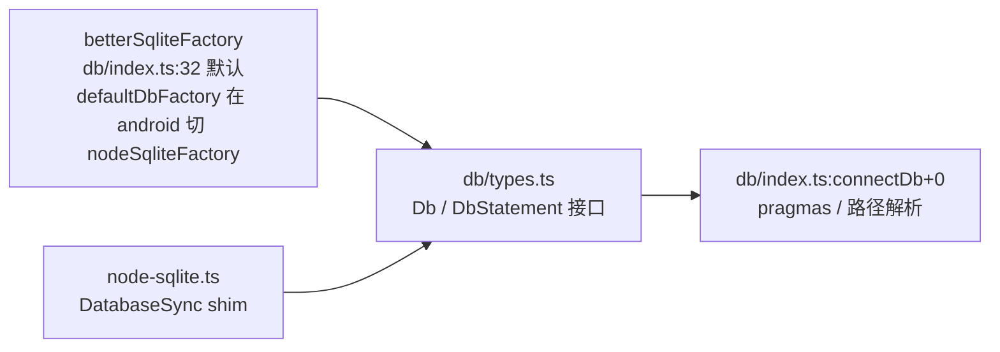
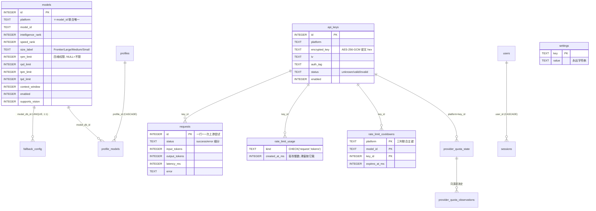
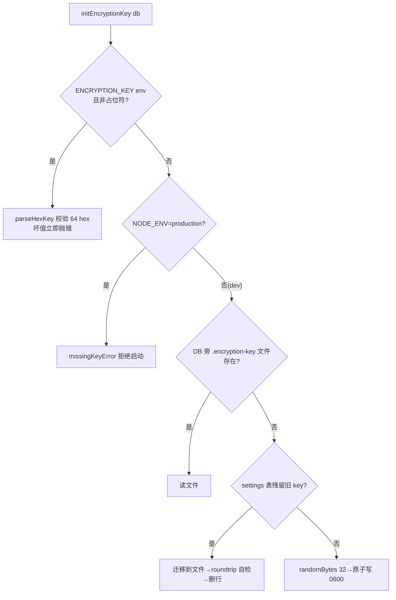

# 07 · 状态存储与并发

> 整个系统的持久层只有一个 SQLite 文件，但围绕它有四套精心设计的机制：驱动抽象（桌面/Android 也能跑）、信封加密（key 绝不裸存）、单调递增的迁移器、以及「内存滑窗 + DB 记账」的双层限流状态。本篇逐一拆开。

---

## 1. 连接层：一个 Db 接口，两种驱动



- **默认驱动**是 `better-sqlite3`（同步 API，无回调地狱，单进程吞吐足够）。`db/index.ts:31-38` 的工厂用 `createRequire` 懒加载，装不上时报错文案直接给出出路：「Reinstall dependencies, or use Node.js 22.13+ on Android/Termux」。
- **`db/node-sqlite.ts`** 是为 Android/Termux 写的 shim：`DatabaseSync` 的 `run()` 返回 `{changes, lastInsertRowid}` 可能是 `bigint`，shim 统一转 `number` 并拒绝非安全整数（`numberResult+0`）；接口对齐后上层代码对两种驱动无感。
- **Pragmas**（`connectDb+0` 附近，db/index.ts:82-87）：
  - `journal_mode = WAL`（内存库跳过）——读不阻塞写、写不阻塞读，让后台 job（备份泵、analytics 聚合）与代理热路径共存；
  - `busy_timeout = 5000`——写锁冲突等 5 秒而不是立刻 `SQLITE_BUSY`。这两个 pragma 合起来就是本项目的全部「并发策略」：**没有连接池，没有异步 ORM，单文件 + WAL + 忙等**。

## 2. 表结构总览

基线由 `migrations/20260101_000000_legacy_baseline.ts:createTables+0~+174`（=58-232）一次建齐 13 张表（models/api_keys/requests/rate_limit_usage/rate_limit_cooldowns/fallback_config/profiles/profile_models/settings/users/sessions/provider_quota_state/provider_quota_observations）；迁移目录现有 44 个 .ts（含基线，即 43 个增量，`ls server/src/db/migrations/*.ts | wc -l` → 44），增量只做增补。核心关系：



几点读表纪律：

- **`requests` 是「尝试级」而非「请求级」**：fallback 循环每换一次模型/key 就多一行（另有 `request_attempts` 迁移补充逐跳轨迹），analytics 的可靠性统计直接按它聚合，`requested_model` 列保留用户原始意图（见 03 篇失败分类）。
- **`rate_limit_cooldowns` 用三列联合主键**而非自增 id——同一 (platform, model_id, key_id) 只可能有一个未来冷却，setCooldown 天然是 upsert。
- **`fallback_config.model_db_id UNIQUE`**：回退链是「每个模型一行」的表，priority 排序，不是数组。
- 后置迁移加的表里对路由重要的：`quirks`/`quirk_targets`（平台怪癖注册）、`embedding_models`/`media_models`（三类端点各自的模型表）、`response_cache`、`backups`、`idempotency_claims`、`playground_conversations`、`server_logs`、`client_profiles`。

## 3. 迁移器：单调、可查、基线不可逆

`db/migrate/runner.ts` 是一个极简自研迁移器：

```
migrations(id, filename UNIQUE, applied_at)   ← 追踪表，CREATE_MIGRATIONS_TABLE_SQL+0
runPendingMigrations：按文件名排序，跳过已记录者，逐条 up()
runMigrations / runMigrationsSync：异步与同步两套入口（desktop 内嵌用同步）
```

- **文件名即版本号**（`20260930_000001_custom_endpoint_group_label.ts` 式命名），无 schema 版本号语义。
- **基线不可逆**：`legacy_baseline.ts` 的 down 直接 `throw new Error('Legacy baseline is irreversible - restore from backup')`（第 55 行）——项目对「回滚」的态度是恢复备份而不是跑 down。
- **dev 与 prod 行为不同**（`initDb+0`，db/index.ts:197）：只有 `process.env.NODE_ENV !== 'development'`（+6，=203）才在启动时 `runMigrationsSync(db, 'up')`（+7，=204）自动补齐迁移；开发环境**不**跑迁移，只探测 `sqlite_master` 里有没有 `migrations` 表，缺表就 `console.error` 提示 `npm run db:migration:up` 后 `process.exit(1)`（+9~+21，=206-218）——新迁移必须先显式执行再重启，防止 dev 半迁移状态悄悄生效。
- **一条硬纪律**（`db/migrations/20260101_000000_legacy_baseline.ts:36-43` 头部注释）：**V25 之后模型数据迁移禁止入库**。新的免费模型行只能进 hosted catalog（Oracle），经 `catalog-sync` 落到各安装；把模型行写死进迁移会绕过 catalog 的商业资格门控（Premium-now / Free-after-30-days）。这是「schema 迁移」与「数据迁移」被刻意分家的实例。

## 4. 信封加密：api_keys 行的三件套

`api_keys` 表没有 `key` 列，只有 `encrypted_key / iv / auth_tag` 三列——每行独立加密（每行随机 16 字节 IV），这是教科书式的 envelope 形状。实现在 `lib/crypto.ts`：



值得精读的设计决策（都来自源码注释）：

1. **key 文件不进 DB**（`KEY_FILE_NAME+0` 上方注释）：旧版把 dev key 存 `settings` 行，「拷走 DB 的人就同时拷走了解密它的 key」——at-rest 加密归零。现在 key 与密文分离且 0600。
2. **长度校验前置**（`KEY_BYTES+0` 注释）：截断的短 key 过去会在第一次 encrypt 时抛出 node:crypto 的天书错误；现在 `parseHexKey+0` 立即给出可执行的报错（附生成命令）。
3. **auth tag 钉死 16 字节**（`AUTH_TAG_BYTES+0` 注释）：不钉的话，能改 DB 行的人可以塞 4 字节 tag，把伪造的成本从 GCM 降到 2^32 穷举。
4. **key 指纹**（`encryptionKeyFingerprint+0`）：sha256 截 64 bit，写进备份 dump 头部，恢复前先比对——不是安全机制（防不了蓄意），是防「拿错备份 restore 出一堆解不开的行」的事故。
5. **maskKey 纪律**（`maskKey+0` 上方长注释）：旧实现 `'****' + key.slice(-4)` 对 ≤4 字符的 key 等于原样回显。现在 <5 字符全遮、≤8 字符只露尾 2 位——短凭据（代理密码、本地 Ollama token）真实存在。

内存/匿名 DB（测试）没有目录可放 key 文件，保留 legacy settings 表行为（`keyFilePathFor+0` 返回 null 的分支）——**降级路径明确标注了适用边界**。

## 5. 限流状态：内存滑窗为主，DB 为账本

04 篇讲过算法，这里讲**状态到底放在哪**（`services/ratelimit.ts`）：

| 状态 | 载体 | 为什么 |
|---|---|---|
| 当前滑窗计数（RPM/TPM 秒级） | 模块级 `windows: Map` | 每请求都读，DB 往返不起 |
| in-flight 租约 | `leases: Map`（`LEASE_MAX_AGE_MS+0`=2min 防泄漏） | 关「检查后扣减」竞态：预留占住并发位 |
| 历史用量（RPD/TPD 重启后仍要成立） | `rate_limit_usage` 表 | 日级额度必须活过进程 |
| 冷却 | `rate_limit_cooldowns` 表 + 内存缓存 | 重启不能洗白一个刚 429 的 key |

两处竞态闭合的写法值得记：
- **provisional usage**（`ratelimit.ts` 「Provisional usage」段，=151~194）：纯内存、不落行——`provisionalRequests`(=163)/`provisionalTokens`(=172)/`provisionalProviderRequests`(=183)/`provisionalProviderTokens`(=187) 直接遍历 `leases` Map 求在途预留的和，叠加进各闸门（`canMakeRequest`/`canUseTokens` 等）看到的计数。段注释点明动机：`routeRequest` 是同步的而实账要等 provider 返回后才写，不数租约的话 N 个并发请求读同一份预检、全部放行再集体撞 429。`rate_limit_usage` 表的 `kind('request'|'tokens')` 行只承载实账（`recordRequest`=821/`recordTokens`=833 写入）。
- **usage 修剪节流**：全表 prune 带索引支撑（`idx_rate_limit_usage_lookup+0`，即 §2 的五列复合索引），且 prune 本身按时间节流——避免每次记账都扫表。

## 6. 备份与恢复

`services/backups.ts` + 启动时的 `restoreDbBackupIfNeeded`（08 篇时序图里有它的位置）：

- **`backups` 表自己就是备份索引**（注释在 `isInternalTable+0`（=67）上方）：dump 时经 `isInternalTable`(=67-69) 排除 `migrations`/`backups`/`sqlite_*`——备份套备份会无限膨胀；另有用途不同的 `EXCLUDED_TABLES`(=62，users/sessions/url_tokens)把凭据类表挡在 dump 之外（55-61 的理由注释：dump 是要被下载、转邮、丢云盘的明文文件，绝不能带密码哈希和会话 token；`settings` 刻意**不**排除——统一 key、路由策略正是操作员期待恢复回来的东西）。
- **恢复有安全阀**：dump 头部表清单命中 `EXCLUDED_TABLES`（users/sessions/url_tokens，经 `isExcludedTable`=71）或 SQL 文本命中 `EXCLUDED_STATEMENT_RE`(=401) 兜底，直接拒绝（判定在 451-457，抛错文案第 454 行）——备份文件是攻击面，「恢复一个篡改过的备份」不能变成提权路径。注意 `api_keys` 不在排除名单，照常 dump/restore，但 restore 前先过 key 指纹门（438-449：备份头 `keyFingerprint` 与服务端当前 ENCRYPTION_KEY 不一致就 409 拒绝，防止载入一批解不开密的 provider key）。
- 两个后台 job：**`startDbBackupPump`**（lib/db-backup.ts:263，消费备份队列落盘/外送，外送目标读 `FREEAPI_DB_BACKUP_TARGET`=24）与 **`startBackupScheduler+0`**（services/backups.ts:524，按最小间隔自动备份，目录在 DB 同级的 `backups/`）；两者都在 `server/src/index.ts` 的 onReady 里启动（=87-88）。
- WAL 的另一重意义在这里：备份期间主库可继续写。

## 7. 数据目录加固（FREEAPI_DB_DIR_HARDENING）

`db/index.ts:shouldHardenDataDir+0` 的规则是「**by construction**」：与其猜测目录属主是不是敏感，不如只在「目录是本次启动自己创建的」时收紧权限；`restrictDataDir+0 / restrictDbFilePermissions+0` 把 DB 文件与目录 chmod 到仅属主可读写。tri-state env 覆盖（开/关/自动）让容器化部署（卷属主由外部管理）能显式关掉它。

## 8. 风险与待补

| 级别 | 事项 |
|---|---|
| P1 | 全部写路径共用一条同步连接：任何慢查询（大 analytics）都会与代理热路径抢同一把写锁，目前靠 WAL + busy_timeout=5000 兜底，没有语句级超时——已有 `analytics_latency_percentile_index` 这类迁移在补索引，但「一条恶意大 GROUP BY」仍是理论面 |
| P2 | dev key 自动生成的分支在生产永远走不到（env 缺失即拒启），但 `NODE_ENV` 忘设的部署会静默拿到 dev 语义 |
| 待补 | `quirks`/`quirk_targets` 的具体注册数据由 catalog 下发还是本地可编辑，本篇未验证 |
| 待补 | `idempotency_claims` 的清理周期（迁移文件名只见日期不见 TTL 逻辑） |

---

## 源码索引（绝对行号，以当前 checkout 为准）

- `server/src/db/types.ts` — `Db`/`DbStatement` 接口
- `server/src/db/index.ts` — 31-38 默认工厂与报错；82 `journal_mode=WAL`；87 `busy_timeout=5000`；`connectDb`/`initDb`/`shouldHardenDataDir`/`restrictDataDir`/`getSetting`/`setSetting`
- `server/src/db/node-sqlite.ts` — 1-36 shim 头部与 `loadNodeSqlite`；`numberResult` bigint 守卫
- `server/src/db/migrate/runner.ts` — 35-41 追踪表；43-82 `runMigrations`/`runMigrationsSync`
- `server/src/db/migrations/20260101_000000_legacy_baseline.ts` — 55 down 抛错；58-232 `createTables` 13 表 + 索引；1964/2032/2074/2083 后置表段
- `server/src/db/migrations/` — 44 个 .ts = 基线 + 43 个增量（`20260627_000001_custom_provider_modalities.ts` … 最新 `20261017_233153_request_failure_attribution.ts`；`ls server/src/db/migrations/*.ts | wc -l` → 44）
- `server/src/lib/crypto.ts` — 7-27 算法/常量/key 文件理由；29-37 `parseHexKey`；45-56 dev-fallback 边界；63-84 `keyFilePathFor`/`writeKeyFileAtomic`；94-153 `initEncryptionKey` 四级优先；173-176 `encryptionKeyFingerprint`；182-212 `encrypt`/`decrypt`/`AUTH_TAG_BYTES`；227-231 `maskKey`
- `server/src/services/ratelimit.ts` — 14 `windows: Map` / 69 `leases: Map`；`LEASE_MAX_AGE_MS`=76；provisional 租约求加和段=151~194（`provisionalRequests`=163 等）；`recordRequest`=821/`recordTokens`=833；prune 节流注释 195-202
- `server/src/services/backups.ts` — 20-28 调度参数；62 `EXCLUDED_TABLES`（users/sessions/url_tokens，理由注释 55-61）；64-69 `isInternalTable`；304 `backups` 行写入；401 `EXCLUDED_STATEMENT_RE`；438-449 key 指纹门；451-457 恢复安全阀（抛错文案 454）；524 `startBackupScheduler`
- `server/src/lib/db-backup.ts` — 24 `FREEAPI_DB_BACKUP_TARGET`；263 `startDbBackupPump`
- `server/src/index.ts` — `restoreDbBackupIfNeeded` → `initDb` → `applyDeclarativeConfigFromEnv` 顺序；onReady 中 `startDbBackupPump`(87)/`startBackupScheduler`(88) 启动

---

上一篇 → [06-配置与数据流](./06-配置与数据流.md) ｜ 下一篇 → [08-启动生命周期](./08-启动生命周期.md) ｜ [返回索引](./README.md)
