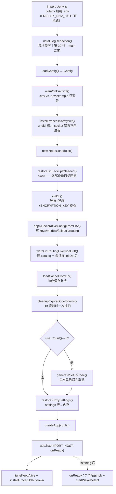
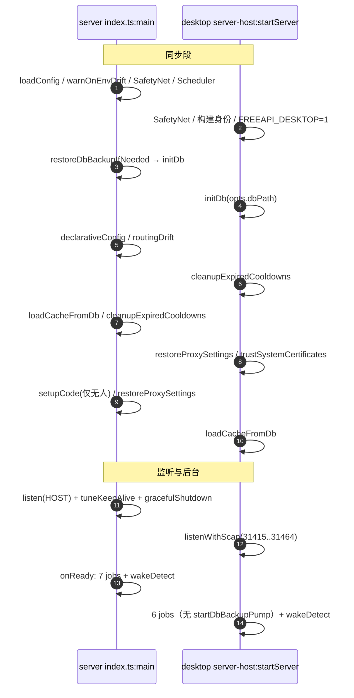

# 08 · 启动生命周期

> 一个进程从 `node dist/index.js` 到「能接 /v1 请求」之间有 14 步，freellmapi 把每一步的顺序都当成了契约——先加密再落库、先配置再监听、先清账再开闸。而 desktop 版因为没有 `index.ts` 可跑，把这 14 步**手抄了一遍**，并用一个测试盯着这份抄写不走样。本篇讲的就是这两份启动序列。

---

## 1. server 端主序列



（骨架：`index.ts:main+0~+113`）

### 每步为什么在这个位置

| 步骤 | 锚点 | 顺序理由 |
|---|---|---|
| `installLogRedaction` | `main+0` 之前的模块顶层（26-29 行注释） | 「先于任何其他语句运行，没有一个 provider key 能到达 stdout」——用户会把日志贴进 bug report。放在模块作用域而非 main 内，是为了连启动期日志一起遮 |
| `env.js` | `index.ts:1` | `dotenv.config({path: FREEAPI_ENV_PATH ?? ../../.env})`，文件不存在静默 no-op——embedder（desktop）可以把 .env 指到任何地方或不指 |
| `restoreDbBackupIfNeeded` 在 `initDb` 前 | `main+11~+16` | 它操作的是**文件**（把远端备份拉回本地路径），必须在任何人打开 DB 之前 |
| `applyDeclarativeConfigFromEnv` 在 `initDb` 后 | `main+17` | 它写 DB；它在 listener 前 ⇒ `admin` 段消除匿名 setup 窗口（06 篇 §5.3） |
| `warnOnRoutingOverrideDrift` 在 `initDb` 后 | 49 行注释 | 「unknown-model half reads the catalog」——校验要查 models 表 |
| `loadCacheFromDb` | `main+21~+24` | 响应缓存跨重启复活（daily quota-reset 重跑模式）；best-effort，DB 挂了缓存就是空的，与从前一致 |
| `cleanupExpiredCooldowns` | `main+26~+34` 注释 | 冷却行是懒清（`isOnCooldown` 按路由查），没人再问的路由（退役模型、删掉的 key）永留表里拖慢 rollup ⇒ 趁 DB 安静启动时扫一次 |
| `generateSetupCode` 仅 `userCount()==0` | `main+36~+41` | 首启加固：loopback 浏览器可免码完成 setup，远程调用必须带码；每次重启重铸 |
| `restoreProxySettings` | `main+43~+45` | settings 表就绪后才有得读；env `PROXY_URL` 若设置仍然赢 |

### 监听与两个「活着」的机制

```
app.listen → onReady(host)：
  startHealthChecker / startCatalogSync / startCooldownProbe /
  startDbBackupPump / startBackupScheduler / startCustomModelSync /
  startBuiltinModelDiscovery        ← 全部吃 scheduler
  startWakeDetect({onWake})          ← flushProxyCache + checkAllKeys({force:true})
```

- **keep-alive 调参**（`tuneKeepAlive+0`，114-120 行注释）：`keepAliveTimeout=75s`、`headersTimeout=76s`。Node 默认 5s 而 Caddy/nginx 以 30-60s 复用上游空闲连接，于是代理把请求写进一个刚被本机关闭的 socket，用户看到 502 "connection reset by peer"。规则：**空闲 socket 必须比任何前置代理的连接池寿命更长**；headersTimeout 必须大于 keepAliveTimeout，否则下个请求的 header 还在飞就被掐。
- **IPv6 降级**（`server.on('error')+0`，130-141 行）：默认 `'::'` 双栈 bind 在 `ipv6.disable=1` 的内核上抛 EAFNOSUPPORT/EADDRNOTAVAIL——**仅当用户没有显式设 HOST** 时重试 `0.0.0.0`；显式 HOST 绑不上保持 fail-fast。
- **fail-fast 总闸**（`main().catch+0`，147-154 行注释）：启动失败（典型：生产缺 ENCRYPTION_KEY）必须非零退出，而不是留一个「半初始化、永远不监听」的进程——那种静默状态在客户端表现为 "Can't reach the server"。
- **wake 恢复**（`startWakeDetect` 调用点，92-97 行注释）：主机睡眠期间 timer 和 keep-alive socket 全冻结，醒后头几个请求会踩死连接和睡眠前的 key 状态 ⇒ 唤醒（wall-clock 漂移 >30s 或 SIGCONT/SIGUSR1/2）即清代理连接池 + 强制重探所有 key（force 跳过新鲜度豁免与平台间隔）。

## 2. desktop：手抄的镜像序列

desktop 不跑 `index.ts`——esbuild 把 server 源码整个打进 `build/server.mjs`，主进程经 `desktop/src/server-host.ts:startServer+0~+79` 直接调用 server 内部。**db 单例活在 bundle 里**，所以任何有状态的东西（auth bootstrap、getDb）只能从 server-host 导出，主 bundle 绝不能自己 import server/src（会拿到第二份空副本，见文件头注释 1-8 行）。

镜像与原版的一致性由 `desktop/src/__tests__/server-host-boot.test.ts` 保证：它把 `startServer` 的调用清单与 `server/src/index.ts` 源码**交叉比对**（189-219 行，正则派生必需步骤、逐一 `toContain`），往 index.ts 加一步而没同步抄进 desktop，会让 desktop 测试变红；163-182 行另有一条 `expect(calls).toEqual([...])` 全序列断言，钉住整条镜像的顺序。注释点名了这条纪律换来的教训：`startBackupScheduler` 曾被漏掉——Backups 页面存了一个永远不会触发的排程（#949）。

### 故意不镜像的四组

| 不镜像 | 原因（89-93 行注释） |
|---|---|
| `restoreDbBackupIfNeeded` / `startDbBackupPump` | 纯 env 驱动（`FREEAPI_DB_BACKUP_*`），打包应用不继承 shell 环境 |
| `applyDeclarativeConfigFromEnv` | 同上——没人给桌面 app 注 `FREEAPI_CONFIG_JSON` |
| `warnOnEnvDrift` / `warnOnRoutingOverrideDrift` | 同上，且警告无人可看 |
| `generateSetupCode` | desktop 自己铸 machine user（见下），setup 窗口不存在 |

### desktop 特有的五件事

1. **`process.env.FREEAPI_DESKTOP = '1'`**（121-127 行注释，#786）：桌面版密码是随机生成、永不显示的，key 揭示/导出若要求重验密码会把用户锁死 ⇒ 服务端对**仅 loopback 来源**的这两个端点跳过重验；开了 LAN 访问时绑 0.0.0.0，远程查看者仍须输密码。
2. **`trustSystemCertificates+0`**（57-80 行，#1373）：杀毒软件/企业 TLS 巡检用系统商店里的根证书重签流量，Node 自带根列表不认，所有 provider 调用裸报 "fetch failed"。desktop 把 OS 证书商店并进默认根列表（Node < 22.19 无此 API 则静默保持默认）。server 镜像维持 Node 默认，可用 `NODE_USE_SYSTEM_CA=1` 手动开启。
3. **构建身份回灌**（106-119 行）：esbuild `define` 只改写逐字的 `process.env.X` 成员表达式，而 `routes/update.ts` 经普通 env 对象引用读值 ⇒ 打包后更新检查拿到 `{sha: null, installation: 'unknown'}` 报 'unsupported'。`startServer` 把 define 内联的字面量再抄回真实 `process.env`。
4. **`listenWithScan+0`**（182-193 行）：从 `preferredPort`（31415）起扫 50 个端口，EADDRINUSE 或任何错误都换下一个；全满才抛。server 版是「绑不上就死」，desktop 是「绕着绑」——面向的是用户机器上不可控的端口占用。
5. **`ensureSessionToken+0`**（176-180 行）：仪表盘窗口以一个隐藏 machine user（`desktop@localhost`，随机 48-hex 密码）登录——session 直接对 DB 铸造，不经任何登录 UI。

另外两处顺序注释同样值得记：`installLogRedaction` 必须在 main.ts 的 `installFileLogger` **之后**跑（95-102 行），让遮红笔的 wrapper 位于最外层、落到磁盘的日志也是洗过的（这个 tap 同时是仪表盘 Logs 页在 desktop 上的唯一数据源，#993）；`loadCacheFromDb` 在 desktop 更关键——桌面 app 重启频率远高于服务器，不复活缓存等于缓存永不热。

## 3. 两份序列并排



差异归一成一句话：**desktop = server − 所有 env 驱动的部署机制 + 打包应用特有的三件事（端口扫描、machine user、系统证书）**。

## 4. 风险与待补

| 级别 | 事项 |
|---|---|
| P1 | 镜像架构本身：顺序与完整性各靠一半——全序列断言 `expect(calls).toEqual([...])`（测试 163-182 行）能抓住 desktop 侧任何一步挪位（如 loadCacheFromDb 挪到 listen 后即红），但它是**手写的字面量**；从 index.ts 源码派生的那半边（189-219 行）用正则只抓 `install|start|cleanup|restore|load` 前缀的调用名、且只做 `toContain` 存在性检查。于是 `index.ts` 单方面调整步骤顺序时两半都不会红，顺序一致性仍靠人工同步；前缀正则罩不住的调用名（`initDb`、`createApp`、`generateSetupCode`）也只活在字面量清单里 |
| P2 | `tryListen+0` 对非 EADDRINUSE 错误也 `resolve(null)` 继续扫——bind 权限类错误会表现为「扫满 50 个端口后报 no free port」，掩盖真实原因 |
| 待补 | main.ts 侧何时调用 `startServer`、文件日志器 `installFileLogger` 的完整链路（Electron 主进程本篇只读了 server-host 一层） |

---

## 源码索引（绝对行号，以当前 checkout 为准）

- `server/src/env.ts` — 1-10 dotenv 加载与 `FREEAPI_ENV_PATH`
- `server/src/index.ts` — 29 模块顶层 redaction；31-47 config/drift/safetynet/backup-restore/initDb；48-55 declarative/routing-drift/cache；57-72 cooldown 清理+setup code；74-78 proxy 回流+createApp；80-112 onReady 七 job+wake；114-127 tuneKeepAlive；129 graceful shutdown；130-144 IPv6 降级与 fail-fast；147-154 main().catch
- `desktop/src/server-host.ts` — 1-29 bundle 边界注释与 imports；37-43 outboundProxyUrl/backupBeforeUpdate；57-80 `trustSystemCertificates`；82-93 镜像纪律与不镜像清单；94-174 `startServer`；176-180 `ensureSessionToken`；182-204 `listenWithScan`/`tryListen`
- `desktop/src/__tests__/server-host-boot.test.ts` — 序列交叉比对测试

---

上一篇 → [07-状态存储与并发](./07-状态存储与并发.md) ｜ 下一篇 → [09-测试与部署](./09-测试与部署.md) ｜ [返回索引](./README.md)
