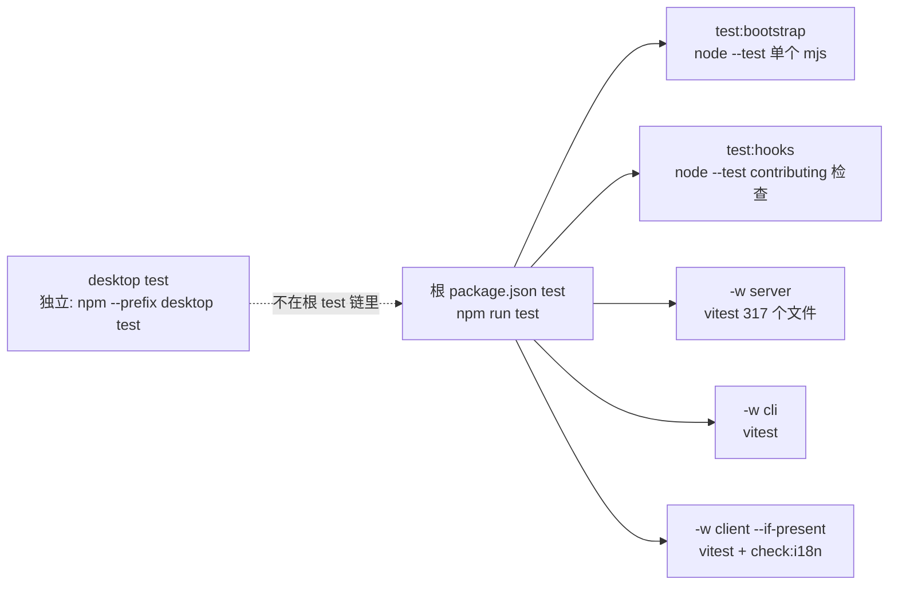
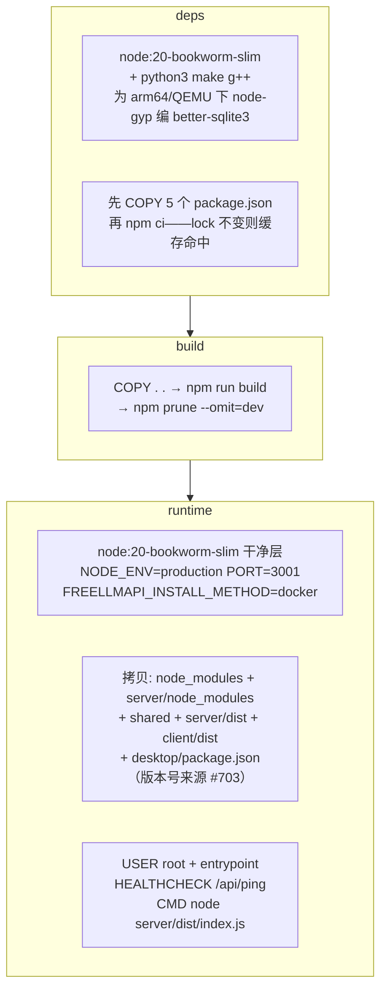

# 09 · 测试与部署

> 本篇覆盖两块「源码之外但由源码决定」的地图：四工作区 + desktop 各自的测试怎么跑、为什么那样跑；以及一份 Dockerfile / entrypoint / compose 如何把「单文件 SQLite 网关」部署到从 Raspberry Pi 到 Railway 的各种环境。这两个目录里的注释密度不亚于 server 源码本身——大量注释直接记录了曾经的部署事故。

---

## 1. 测试版图



| 工作区 | 命令 | runner | 规模与形态 |
|---|---|---|---|
| server | `vitest run --pool=forks --fileParallelism=false`（server/package.json:10） | vitest，node 环境 | `src/__tests__/` 下 **317 个 .test.ts**，按 `db / fixtures / helpers / integration / lib / providers / routes / scripts / services` 九个子目录镜像源码结构 |
| client | `vitest run && npm run check:i18n`（client/package.json:10） | vitest（jsdom 组件测试） | 测试文件**与组件同目录**（`components/keys/*.test.tsx` 等），命名 `组件名.切面.test.tsx`；i18n 校验脚本作为测试链的一环 |
| cli | `vitest run` | vitest | 6 个 .test.ts 与源码并排（`src/*.test.ts`），含配置生成器的快照测试 |
| desktop | `vitest run` | vitest | `src/__tests__/` 12 个文件，全是「打包/平台」切面：`server-host-boot`（启动序列交叉比对，08 篇）、`system-certificates`、`tray-platform`、`updater-artifact-names`、`linux-chrome-sandbox-packaging`… |
| shared | 无测试 | — | 纯类型（01 篇），类型检查即它的「测试」 |
| 根 | `test:bootstrap` / `test:hooks` | **`node --test`**（不是 vitest） | 测的是部署脚本本身：`scripts/dev-bootstrap.test.mjs` 和 `.claude/hooks/contributing-check.test.mjs`——连贡献流程检查都有回归测试 |

### 为什么 server 是 forks + 禁并行

`--pool=forks`：每个测试文件跑在**独立子进程**。根因是架构本身——server 全项目重度使用**模块级单例**（db 单例、ratelimit 的 windows Map、proxy 的内存配置、log redaction wrapper、`cachedKey`），worker 线程共享不了进程隔离的状态，fork 隔离则每文件拿到干净单例。`--fileParallelism=false` 再退一步：文件之间串行，杜绝并发写同一临时 DB / 同一 env 的干扰。**这是用测试拓扑给「模块单例满天飞」的架构兜底**——代价是 317 个文件的墙钟时间，换来的是每个文件里 `process.env.X = …` 随便改（本篇 grep 记录里大量测试直接删/设 env，正是这种自由）。

vitest 配置本体极薄（server/vitest.config.ts:1-17）：`include` 只认 `src/__tests__/**`；coverage 默认关（`COVERAGE=1` 开，v8 provider），且**排除 `db/migrate/**`、`scripts/**`、`index.ts`**——迁移器和启动入口被显式承认为「不适合单测的层」。

### 测试即部署契约

desktop 的 `server-host-boot.test.ts` 是全套测试里定位最特殊的一个：它不比行为，**比对文本**——把 `startServer` 的启动调用清单与 `server/src/index.ts` 源码交叉核对（08 篇 §2），使「server 加了启动步骤而 desktop 忘抄」直接红。同类思路还有 `cli` 的快照测试（21 个 agent 配置生成器的输出形状）和 client 的 `check:i18n` 声明式双端校验（i18n skill 场景同款）。

## 2. Docker 镜像：三段式与每一段的理由



（`Dockerfile` 全文件；注释密度极高，以下几条注释就是「事故记录」）

| 决策 | 注释里的原因 |
|---|---|
| deps 段装编译工具链 | slim 镜像上 arm64/QEMU 无 better-sqlite3 预编译二进制，必须 node-gyp 现编——工具链**只活在 build 段**，runtime 拿的是编好的 node_modules |
| 单独 COPY `server/node_modules` | npm 会把某些生产依赖嵌在工作区而不是提升（undici 在 `server/node_modules`）；漏拷它的镜像里 **HTTP(S) 代理 dispatcher 加载失败、所有请求静默直连**（#550） |
| 拷贝 `desktop/package.json` | 仪表盘显示的 release 版本活在这里（server/package.json 跟的是 workspace 版本）——400 字节清单换「容器能报出自己的版本」（#703） |
| `ARG FREELLMAPI_COMMIT_SHA` 放最后一个 runtime 层 | SHA 每个 commit 都变；放在 COPY 之上会让每次构建把所有缓存层全部失效 |
| **故意不声明 VOLUME** | 声明了会在每个未覆盖的容器上创建**匿名卷**：Railway/Render/Coolify/Dokploy 要么拒收镜像、要么每次重部署静默发一个空卷（数据没了），且声明还会遮蔽同路径 bind mount。持久化是部署方的事：compose 映射命名卷 `freellmapi-data`，裸 `docker run` 自己 `-v` |
| HEALTHCHECK 打 `/api/ping` | 30s 间隔 / 15s start_period——也是 compose 里同款 |

## 3. entrypoint：为 PaaS 的 root 属主卷而生的三行逻辑

`docker-entrypoint.sh` 只做一件事并在完成后让位：以 root 进来时，对 `/app/server/data`（以及 `FREEAPI_DB_PATH`/`FREEAPI_DB_BACKUP_PATH` 的所在目录，单挂载 PaaS 会把它们指到外面）做**best-effort chown 到 node**，然后 `exec setpriv --reuid=node … "$@"`。

四个细节全是防御：
- **chown 失败继续启动**：`--cap-drop=CHOWN` 或 CIFS/NFS 固定属主的挂载上 chown 合法地失败——「不能让入口脚本为一个 app 自己会报的写错误抢答」；
- **属主已是 node 就跳过递归**：大树上 `chown -R` 就是这个入口的全部启动成本；
- **`setpriv` 而非 `su`/`gosu`**：util-linux 自带必在，且 `exec` 保持 **node 是 PID 1**——信号（SIGTERM→graceful shutdown，08 篇）能直达 server；
- 非 root 进来时原样 `exec "$@"`，脚本对 `docker exec` 场景零侵入。

镜像因此以 `USER root` 交付（compose/Dockerfile 注释言明）：权限收窄发生在 entrypoint，而不是镜像层——顺序反了 PaaS 就起不来。

## 4. compose：默认关在门后 + opt-in 自更新

`docker-compose.yml` 两个服务：

1. **freellmapi**：
   - `ports: "${HOST_BIND:-127.0.0.1}:${PORT:-3001}:3001"`——**默认绑 localhost**，注释直白：「FreeLLMAPI 是单用户的，不许暴露到公网」；LAN 使用要显式 `HOST_BIND=0.0.0.0`。
   - `extra_hosts: host.docker.internal:host-gateway`——Linux 纯 Docker 没有这条解析，文档推荐的 `PROXY_URL=http://host.docker.internal:7890`（让网关走宿主机代理）会直接 NXDOMAIN。
   - 两个 watchtower label（enable + scope=freellmapi）：**双 label 才更新**，既躲开别的栈自己的 Watchtower，也让这个 Watchtower 碰不到别人的容器。
2. **watchtower（profiles: autoupdate，默认不启动）**：maintained fork（nickfedor），只开 token 保护的 HTTP update 端点、**无定时、无发布端口、需要 docker socket（注释明说这是 root-equivalent，不接受就别开 profile）**。仪表盘「Update now」经 `FREELLMAPI_SELF_UPDATE_URL=http://watchtower:8080` 调用它，拉新镜像后以同卷同配置重建自己。

## 5. desktop 打包链

`desktop/package.json` scripts 定义的流水线（15-25 行）：

```
bundle:server   scripts/bundle-server.mjs → build/server.mjs（ESM，仅 better-sqlite3 external；
                顺带用 esbuild define 内联 FREELLMAPI_COMMIT_SHA/INSTALL_METHOD，08 篇 §2.3）
build:main      esbuild main.ts → build/main.mjs（external: electron, electron-updater, ./server.mjs）
build:preload   esbuild → CJS（.cjs）——preload 必须是 cjs 格式
stage:client    把 client/dist 复制进打包资源
dist[:mac:x64|win|linux]  build:all + stage + electron-builder，全部 --publish never
rebuild:native  electron-rebuild -f -w better-sqlite3——electron 的 ABI ≠ node 的 ABI，
                这个原生模块每次 Electron 升级都要重编
```

`dev` = `build:all && electron .`——desktop 没有热更新开发环，改 server 代码也要重新 bundle。CI/发布矩阵由根 scripts 转发：`desktop:dist`（mac arm64）/ `:mac:x64` / `:win` / `:linux`（根 package.json 19-24 行）。

## 6. 根脚本总览

| 脚本 | 干什么 |
|---|---|
| `dev` / `dev:lan` | `concurrently --kill-others-on-fail` 起 server(`tsx watch`) + client(`vite`)——**没有 docker 的开发路径**；lan 版给 client 加 `--host` |
| `build` | server → cli → client 三个 tsc/vite 构建（desktop 不在内，它是独立发布物） |
| `test` | bootstrap + hooks + server + cli + client(--if-present)，**串行** |
| `test:migrations` | 单独跑迁移测试（server 工作区） |
| `db:migration:up/down/fresh/status` | 迁移 CLI 的四路转发（`db/migrate/cli.ts`） |
| `lint` | 只 lint server 与 cli——client/desktop 的静态检查挂在 tsc/vite 构建里 |

## 7. 风险与待补

| 级别 | 事项 |
|---|---|
| P1 | server 测试串行是正确性换墙钟：CI 时长随 317 个文件线性涨，任何「提速并行化」的尝试都会先撞上模块单例共享问题 |
| P2 | 镜像以 root 交付依赖 entrypoint 降权——**有人绕过 entrypoint 直接 `docker run --entrypoint node` 就会以 root 跑**（compose 没这个覆盖，文档路径安全） |
| P2 | watchtower profile 需要 docker socket，注释已声明 root-equivalent 风险，但 profile 一旦手滑常开（`--profile` 加进默认命令），风险面从「点 Update now 时」变成「always」 |
| 待补 | GitHub Actions 工作流的矩阵（.github/workflows 本篇未读）；`scripts/dev-bootstrap.sh/.ps1` 给裸机用户的引导内容 |
| 待补 | CI 里 `COVERAGE=1` 是否启用、阈值门禁是否存在 |

---

## 源码索引（绝对行号，以当前 checkout 为准）

- `package.json`（根）— scripts 块：dev/dev:lan、test 链、build、desktop:*、db:migration:*
- `Dockerfile` — 1-20 deps 段与工具链注释；22-29 build 段；31-63 runtime 拷贝清单（550/703 注释）；65-75 entrypoint 与 USER root 注释；77-80 COMMIT_SHA 层位注释；82-90 VOLUME 不声明注释与 HEALTHCHECK；94 CMD
- `docker-entrypoint.sh` — 全文件（ensure_owned、setpriv exec）
- `docker-compose.yml` — freellmapi 服务（HOST_BIND 注释、extra_hosts、双 label）；watchtower 服务与 profiles；named volume
- `server/vitest.config.ts` — 1-17
- `server/package.json` — 7-10（dev/build/test 脚本）
- `client/package.json` — 10 test；`cli/package.json` — 55；`desktop/package.json` — 13-25 打包链
- `server/src/__tests__/` — 317 个文件，9 个子目录；`desktop/src/__tests__/` — 12 个文件（含 `server-host-boot.test.ts`）；`cli/src/*.test.ts` — 6 个；`client/src/**/*.test.tsx` — 与组件同目录
- `scripts/dev-bootstrap.test.mjs`、`.claude/hooks/contributing-check.test.mjs` — node --test 的两个非 vitest 目标

---

上一篇 → [08-启动生命周期](./08-启动生命周期.md) ｜ 下一篇 → [10-函数级走读-路由限流与回退](./10-函数级走读-路由限流与回退.md) ｜ [返回索引](./README.md)
