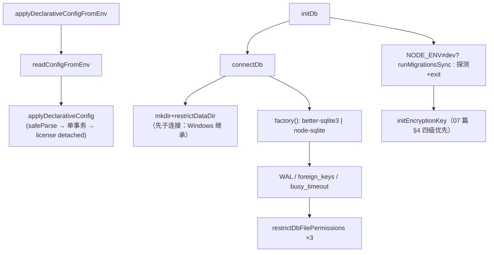

# 12 · 函数级走读：存储、配置与请求入口

> 「函数级走读」系列的第三篇：DB 连接与初始化链（`connectDb → initDb → initEncryptionKey`）、声明式配置落库链（`applyDeclarativeConfig*`），以及整条链路真正的入口——`POST /v1/chat/completions` 处理器。加密函数（`encrypt/decrypt/initEncryptionKey`）的函数级拆解见 07 篇 §4，本篇只讲它们在初始化链上的挂点。

---

## 1. `connectDb` — 打开一个文件之前先决定它的权限（db/index.ts:49）

```ts
export function connectDb(
  dbPath?: string,
  opts?: { ensureDir?: boolean; factory?: DbFactory },
): Db
```

分步（`connectDb+9~+43`）：

1. **+10~+13 解析**：`dbPath ?? getDefaultDbPath()`（即 `server/data/freeapi.db`，`DB_PATH+0`）；`ensureDir` 默认 true；factory 默认 `defaultDbFactory()`（按平台选 better-sqlite3 / node-sqlite——Android/Termux 走后者）。
2. **+15~+30 目录先行**（非内存库且 ensureDir）：不存在则 `mkdirSync(recursive)` 并记下 `created`；**`restrictDataDir` 在建立连接之前跑**。+25~+28 注释给出顺序理由：Windows 上权限是**继承**来的，先收紧目录，DB 文件「出生即受保护」，而不是先以父目录 ACL 存在几秒钟。
3. **+32~+40 pragmas**：`journal_mode=WAL`（内存库跳过）→ `foreign_keys=ON`（默认关是 SQLite 的历史包袱，本项目 profiles→profile_models 的 CASCADE 全靠它）→ `busy_timeout=5000`（+35~+37 注释：仪表盘与代理热路径并发写，无 busy_timeout 时写竞态的输家立刻 SQLITE_BUSY 请求失败；5s 远大于任何一次本地写）。
4. **+41 文件级 chmod**：`restrictDbFilePermissions(resolvedPath)`（主文件 +  `-wal`/`-shm` 三目标，此时 sidecar 多半不存在，见 §3）。

**返回**：模块级单例 `db`；`getDb+0` 只是它的带断言 getter（未初始化即抛「先 initDb」）。

## 2. `initDb` — 迁移策略按 NODE_ENV 分叉（db/index.ts:197）

```ts
export function initDb(dbPath?, opts?): Db   // 内部: connectDb + 迁移 + 加密 key
```

1. **+4~+15**：非 development ⇒ `runMigrationsSync(db, 'up')`——生产**自动补迁移**（迁移清单已编入 bundle，同步执行因为启动本来就是同步的）。development ⇒ **不跑迁移**，只探测 `sqlite_master` 里有没有 `migrations` 表；没有就打一段可直接照抄的指示（`npm run db:migration:up`）然后 `process.exit(1)`。理由（07 篇 §3）：dev 里新建迁移文件应经显式命令进入，防止「顺手改了个没验证的迁移」在每次重启静默生效。
2. **+23**：`if (!isEncryptionKeyInitialized()) initEncryptionKey(db)`——07 篇 §4 的四级 key 优先链在这挂上。**必须在迁移之后**：它读写 `settings` 表（legacy 分支），表得先存在。

## 3. `shouldHardenDataDir` — 「ownership by construction」（db/index.ts:122）

```ts
export function shouldHardenDataDir(dataDir: string, created: boolean,
                                    platform = process.platform): boolean
```

要解决的问题（+1~+19 头注释，本篇最该记住的一段）：WAL 的 `-wal`/`-shm` sidecar **首次写时才创建、干净关闭时删除**——启动时对它们 chmod 是徒劳，只能罩住整个目录；但目录是共享状态，`FREEAPI_DB_PATH=/tmp/freeapi.db` 绝不能 chmod 0700 `/tmp`。

判定三态（按序短路）：
1. `parseDirHardeningOverride+0`：env 三态（`1/0` 强制，未设走策略）；
2. `created === true` ⇒ 硬化——「一分钟前还不存在的目录里不可能有别人的东西」；
3. 目录 === 内置默认 `server/data` ⇒ 硬化。**case 3 是给存量安装的**：老部署已有该目录，只认 case 2 会硬化所有新装、静默跳过所有升级。路径比较在 win32 上 `toLowerCase()`（+31~+34：大小写不敏感文件系统，否则 `C:\App\Data` 认不出是默认目录）。

**默认策略是「在对的地方默认开」而不是纯 flag**——注释原话：「需要有人记得申请才生效的加固，和没人注意到已经停止运行的加固是同一类失败」。`restrictDataDir+0` 对「不硬化」的情形**只警告一次**（`warnedUnhardenedDataDir` 闩，测试频繁重连不会刷屏）；`restrictDbFilePermissions+0` 三目标 best-effort，失败只 warn 不阻断启动——但**必须说出来**（+10~+12：没人能看见失败的加固 = 没人知道它不存在）。

## 4. `runMigrationsSync` / `runPendingMigrationsSync`（db/migrate/runner.ts:64）

```ts
runMigrationsSync(db, direction='up'): void
// 内部: initializeMigrationTracking → getDefaultMigrationRecords → runPendingMigrationsSync
```

- `initializeMigrationTracking+0`：`CREATE TABLE IF NOT EXISTS migrations(id, filename UNIQUE, applied_at)`。
- 记录集来自 `defaults.ts` 的**显式 import 清单**（不是 fs 扫描）——生产 bundle 里没目录可扫，「编译进来的」即「全部的」；`getMigrationRecords+0`（异步版）才支持 `migrationsDir` 文件扫描（dev/CLI 用 `.ts` 扩展）。
- pending 判定 = `filename NOT IN (SELECT filename FROM migrations)`，按文件名升序逐条 `up()`，**每条成功即 INSERT 一行**；无包裹事务跨多条（每条迁移自洽，回滚语义 = 恢复备份，基线 down 直接 throw）。
- `direction='down'` 只回最后一条（`runLatestDownMigrationSync`）。

**调用点**：`initDb`（同步版）、`db/migrate/cli.ts`（异步版 + status）、测试 helpers。

## 5. `applyDeclarativeConfig` — 一个事务、四类降级（declarative-config.ts:466）

```ts
export function applyDeclarativeConfig(input: unknown, source = 'inline')
  : DeclarativeConfigResult
```

分步（`applyDeclarativeConfig+0~+70`）：

1. **+1~+4 fail-fast**：`declarativeConfigSchema.safeParse`（`.strict()`，06 篇 §5.2）；失败 ⇒ 抛错**带全路径**（`keys.0.platform: …`），错误即部署文档。这一抛会经 `main().catch` 变成非零退出。
2. **+20 `db.transaction(() => {…})`**：六段全在**一个同步事务**里——better-sqlite3 的 transaction 是同步函数包裹，任何一段抛错整体回滚，不会留下「keys 进了一半」的启动。
3. 段内语义：
   - `admin`（+22~+30）：`userCount()===0` 才 `createUser`；否则 **push warning 并继续**（06 篇 §5.3 的窗口消除）。
   - `keys`（+31~+39）：`missingKeyWarning` 先验平台已注册——坏条目 skip 不 fail（#600）；`upsertApiKey` 内部走 07 篇 §4 的 encrypt 三件套。
   - `customProviders` / `models`（+40~+46）：`registerCustomProvider` 返回模型数（模型行经 `customModelSeed` 补档，#488）；`upsertModel` 对 catalog 管理的模型只写 override（`upsertModelOverrides`），不碰 catalog 真相。
   - `fallback`（+47~+49）：`applyFallback` 缺省 priority 用 `i+1`（+460 可见）——**数组顺序就是链顺序**。
   - `routing`（+50~+57）：`setCustomWeights` 先于 `setRoutingStrategy`，`keySelectionStrategy` 省略即不动（06 篇 §5.2 表）。
4. **+62~+68 license 出事务**：`void activateConfiguredLicense(key)`——注释明说「网络 I/O 没有资格出现在同步 DB apply 里」：慢的许可服务**不得拖启动**，fire-and-forget + 内部全捕获。

`activateConfiguredLicense+0~+21` 的幂等三段：与存库 key 相同 ⇒ 触网前短路；服务不可达（null）⇒ warning + key 不入库（与仪表盘 POST /api/premium/key 同一契约）；验证通过 ⇒ `setSetting` + `refreshLicenseStatus` + `void syncCatalog(true)`（升级秒级可见，syncCatalog 自带 catch-all）。

`applyDeclarativeConfigFromEnv+0`（569）只是「readConfigFromEnv → 调用 → 打一行统计日志」；无配置时返回 `applied:false` 的全零结果——启动序列里这一步永远不会是障碍。

## 6. `POST /v1/chat/completions` 处理器 — 入口流水线（routes/proxy.ts:1643）

`async (req, res) => {…}`（匿名，1643 起 ~500 行）。它是 05 篇「七个 wire 面共享 fallback-loop」中最大一面的函数级展开。阶段按源码注释即得：

```
① 认证  ② zod 校验  ③ 旋钮归一  ④ 消息归一  ⑤ 压缩+注入
   ⑥ 估算与闸门  ⑦ 预算护栏  ⑧ 断连/中止布线  ⑨ fusion 分支
   ⑩ 响应缓存  ⑪ sticky/pin 解析  ⑫ runFallbackLoop 挂载
```

逐阶段函数级要点（`handler 内 1643~3097`）：

1. **① `requireInferenceAuth+0`**（69）：统一三种头（Bearer / x-api-key / `x-goog-api-key`，05 篇）；**loopback 也要认证**（+8~+10：浏览器能敲 localhost，socket 位置不是授权边界）；返回值携带 client-profile 的 server-enforced systemPrompt（#411）。
2. **② safeParse**（1656~1674）：拒绝时把 zod issues 拼成**路径限定**摘要（`messages.1.content: Invalid input`，前 5 条）+ 服务端 warn——+10~+13 注释：这类 400 从不进 request log，#200 曾因此近乎不可调试。响应带 `execution_id`。
3. **③ 旋钮归一**（1681~1696，#200「agent-tolerant」）：`max_tokens<=0` → unset（多家客户端用它表示「不限」）；`max_completion_tokens` 别名；`tool_choice:'any'` → `'required'`；tools 的 `type` 缺省回填 `'function'`；`pickSamplingParams` 把扩展采样参数一次性打包（后续所有 dispatch 含 fusion fan-out 共用同一份 spread）。
4. **④ 消息归一**（1695~1785）：本函数最长的一段，核心是**工具调用配对状态机** `takeToolCallId+0`（1702）：
   - assistant 带 tool_calls ⇒ 每个 id（给定的或合成的 `call_auto_N`）入队 `pendingToolCallIds`；无 tool_calls 且 content 空 ⇒ 强转 `""`（严格上游不收 null-content 的 assistant 轮，#165）；`content:null` **与** tool_calls 同时存在是合法 OpenAI 形状，保留。
   - tool 消息缺 `tool_call_id` ⇒ 按队列**顺序**认领最早未答的 id——匹配 Gemini 系 agent「一轮一调用」的现实输出（#200）。
   - `role:'function'` 遗留形状 ⇒ 转 tool 消息同样顺序配对；`'developer'` ⇒ `'system'`。
   - 思考痕迹原样回带（`reasoning_content`，#255：DeepSeek thinking 模型拒绝丢掉它的后续轮，别的 provider 忽略未知字段）；Moonshot `partial` 标志透传到 provider 层再决定剥不剥（#1038）。
5. **⑤ 压缩与注入的顺序契约**（1786~1810）：`compressRequest`（`x-freellm-compress` 头驱动，Anthropic 式 cache 断点感知——`cacheControlPrefixLength` 从最后一个含 `cache_control` 的块截断压缩）；然后 **`prependSystemPrompt` 在压缩之后、列表最前**——profile 强制提示「不会被压缩掉，且压过调用方自带的 system 让它盖不回来」；每 profile 恒定 ⇒ provider 侧缓存前缀稳定。
6. **⑥ 估算与闸门**（1812~1869）：图像先降尺度（阈值化，进估算**之前**——路由按降完的尺寸判断）；`estimateTokens` ~4char/token 启发式（非流式事后用 provider 真 usage 对账）；带图 ⇒ `requireVision`，无可用视觉模型**前置拒绝**而不是留给耗尽路径；带 tools ⇒ `requireTools`。
7. **⑦ 预算护栏**（1870~1883）：`request_max_tokens_budget` 设置项把「未设 max_tokens」的钳到预算余量——与 ③ 的 `<=0 → unset` 是一对。
8. **⑧ 断连双路**（1884~1902）：`res.on('close')` 置旗标（循环**下一次迭代前**停）+ AbortController（**在飞那次**的上游请求也取消，经 `CompletionOptions.signal` 进 11 篇 §1 的合成 signal）；controller 在 fusion 分支**之前**声明——fusion 也用同一个。
9. **⑨⑩⑪**：fusion 虚拟模型走 panel 扇出（`services/fusion.ts`，本篇不展开）；opt-in 精确响应缓存（canonical key，流式也参与，2034~2101）；per-request idempotency dedup（2102）；`getSessionKey`+`getStickyModel`（260/273：`x-session-id` 头或首消息哈希派生键）——**显式 `model` 字段 pin 优先，sticky 只在没发 model 时兜底**（2191~2194）；上下文 handoff 仅 auto 路由适用（2162）。
10. **⑫ 挂载**：把 ①-⑪ 的产物包成 `FallbackHooks`（`route = () => routeRequest(...)`、`dispatch` 内调 provider、`abortInFlight`、`clientGone`）交给 `runFallbackLoop`（10 篇 §7）——从这里开始，本篇与 10 篇在 `routeRequest` 处接头。

**为什么值得逐阶段读**：⑦⑧⑨⑩⑪ 的顺序**不可重排**，每一处都有注释钉住（压缩↔注入、降尺度↔估算、controller 声明位、pin↔sticky 优先级）。改这个函数的任何一步，先找到它头上的编号注释。

## 7. 初始化链全景（本篇 §1-§5 接线）



## 8. 风险与待补

| 级别 | 事项 |
|---|---|
| P1 | `applyDeclarativeConfig` 的六段只在大事务里包 DB 写；`createUser`（bcrypt）与 `validateLicenseKey` 之外若再有段引入网络调用，会破坏「同步 apply」的启动时限契约——扩展 schema 时需保持 license 式「事务外 detached」形状 |
| P2 | dev 分支只探测 `migrations` 表**存在**，不比对 pending 清单——`npm run db:migration:up` 跑过一半崩掉，dev 启动不会提醒（CLI status 才有全貌） |
| 待补 | `compressRequest` 的压缩算法与 cache 断点语义（lib/request-compression.ts，本篇只按调用契约描述） |
| 待补 | `getStickyModel/setStickyModel` 的内存结构（session→model 的 TTL 与清理，routes/proxy.ts:273~313） |

---

## 源码索引（绝对行号，以当前 checkout 为准）

- `server/src/db/index.ts` — 14-16 常量；20-29 `getDb`/`getDefaultDbPath`；32-47 驱动工厂与平台选择；49-93 `connectDb`；95-136 `shouldHardenDataDir` 与注释；137-147 `parseDirHardeningOverride`；153-195 `restrictDataDir`/`restrictDbFilePermissions`；197-223 `initDb`；225-251 unified key 与 `getSetting/setSetting`
- `server/src/db/migrate/runner.ts` — 35-41 追踪表；43-82 双入口；`runPendingMigrationsSync`；`defaults.ts` 显式清单
- `server/src/services/declarative-config.ts` — 25-136 schema（06 篇）；151-159 `readConfigFromEnv`；185-464 upsert 辅助（`upsertApiKey`/`registerCustomProvider`/`upsertModel`/`applyFallback`，460 附近 `applyFallback` 尾部 priority 缺省）；466-537 `applyDeclarativeConfig`；545-567 `activateConfiguredLicense`；569-582 `applyDeclarativeConfigFromEnv`
- `server/src/routes/proxy.ts` — 53/69/105/260/273/290 辅助函数；1643 起 `POST /chat/completions`：1644-1674 auth+validate；1681-1696 旋钮；1695-1785 消息归一+`takeToolCallId`；1786-1810 压缩+注入；1812-1869 估算与闸门；1870-1902 预算与断连；1903+ fusion；2034-2101 缓存；2162-2270 sticky/pin/handoff
- `server/src/lib/crypto.ts` — `initEncryptionKey`（07 篇 §4 已函数级展开）

---

上一篇 → [11-函数级走读-Provider与流式](./11-函数级走读-Provider与流式.md) ｜ [返回索引](./README.md)
