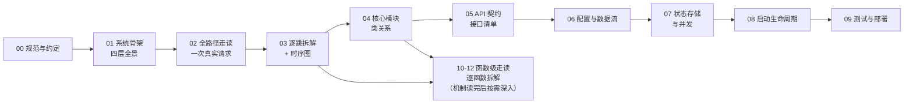
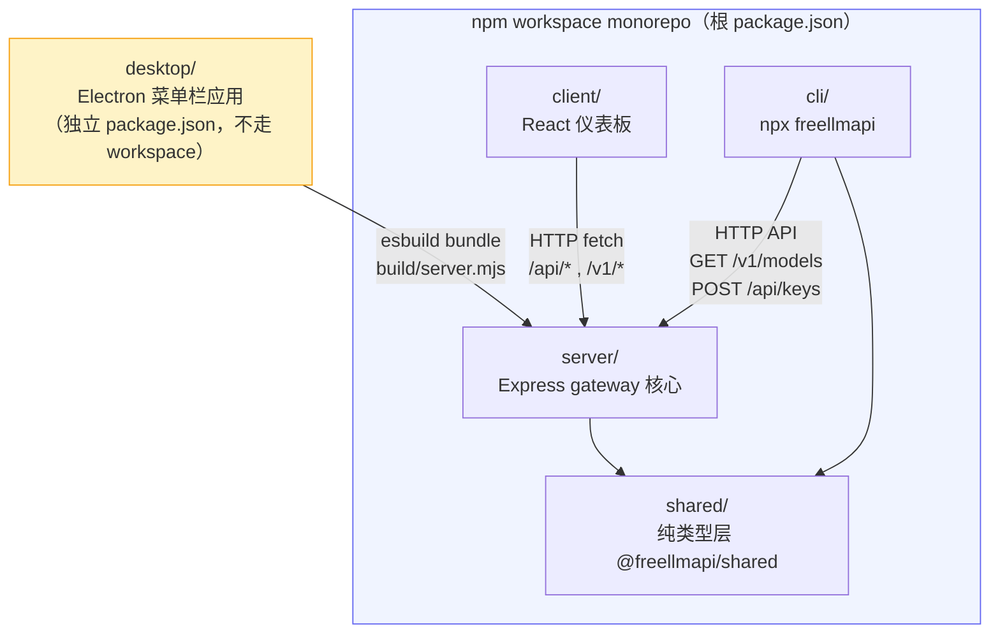

# FreeLLMAPI 源码阅读库

> 从源码出发，按四层递进理解 FreeLLMAPI 全部四个 workspace（`server` / `client` / `cli` / `shared`）以及独立 `desktop` Electron 应用。
>
> 阅读顺序见下方 Mermaid 学习路径。每篇文档的锚点一律用「符号 + 偏移」记法，不用裸行号。

## 文档索引

| # | 文件 | 层 | 内容 |
|---|------|----|------|
| 00 | [00-docs-style-guide.md](00-docs-style-guide.md) | 规范 | 锚点记法、事实红线、引用约定 |
| 01 | [01-简单框架-系统骨架.md](01-简单框架-系统骨架.md) | 一 | 四个 workspace + desktop 的进程/模块/依赖/主数据流 |
| 02 | [02-简单例子-全路径走读.md](02-简单例子-全路径走读.md) | 二 | 一次真实的 `POST /v1/chat/completions` 从客户端到上游 provider 的全链路 |
| 03 | [03-详细逐步说明-主链路拆解.md](03-详细逐步说明-主链路拆解.md) | 三 | 上述链路的逐跳拆解 + Mermaid 时序图 |
| 04 | [04-核心模块与类关系.md](04-核心模块与类关系.md) | 四 | router / ratelimit / providers / health 的类关系与职责边界 |
| 05 | [05-API与接口设计.md](05-API与接口设计.md) | 四 | `/v1/*` 与 `/api/*` 全接口清单 + Provider 契约 + CLI 契约 |
| 06 | [06-配置与数据流.md](06-配置与数据流.md) | 四 | 环境变量 → config → 声明式配置 → 热加载的完整数据流 |
| 07 | [07-状态存储与并发.md](07-状态存储与并发.md) | 四 | SQLite schema、AES-256-GCM 加密、缓存、并发模型 |
| 08 | [08-启动生命周期.md](08-启动生命周期.md) | 四 | `server/src/index.ts` main() 完整启动序列 + desktop 内嵌 bundle 的手工镜像 |
| 09 | [09-测试与部署.md](09-测试与部署.md) | 四 | `__tests__` 结构、Dockerfile 三阶段构建、CI、desktop 打包 |
| 10 | [10-函数级走读-路由限流与回退.md](10-函数级走读-路由限流与回退.md) | 四·函数级 | `routeRequest`/`orderChain`/`scoreChainEntry`/`selectKeyForModel`/限流闸门/`runFallbackLoop`/`recordRetryableFailure` 逐函数拆解 |
| 11 | [11-函数级走读-Provider与流式.md](11-函数级走读-Provider与流式.md) | 四·函数级 | `fetchWithTimeout`/`readSseStream`/`chatCompletion`/`streamChatCompletion`/`validateKey`/`fetchQuota` 逐函数拆解 |
| 12 | [12-函数级走读-存储配置与请求入口.md](12-函数级走读-存储配置与请求入口.md) | 四·函数级 | `connectDb`/`initDb`/迁移器/`applyDeclarativeConfig`/`POST /v1/chat/completions` 处理器流水线逐函数拆解 |

## Mermaid 学习路径

> 10-12 是第四层的「函数级补齐」：04-09 讲到机制与关系即止，这三个系列按函数逐个拆签名、内部分步与关键代码。读某个模块卡住时，从这里进。

## 四个 workspace 与 desktop 的关系

## 事实红线

1. 所有事实（接口有无、缓存有无、字段类型、默认值、联动条件）必须经 Grep / Read 查证。无法证实的显式写「当前源码无法确定」。
2. 源码锚点用「符号 + 偏移」，不用裸行号。文末附「文件:函数:绝对行号」索引便于跳转复核。
3. 每篇 ≥ 1 张图（ASCII / Mermaid）。
4. 实测数据标注来源与日期；未实测写「未实测，待补」。
5. 未逐行阅读的反射/生成/内部实现，显式标注「未读取，不臆测」。