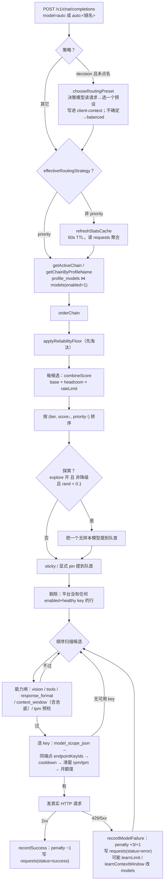
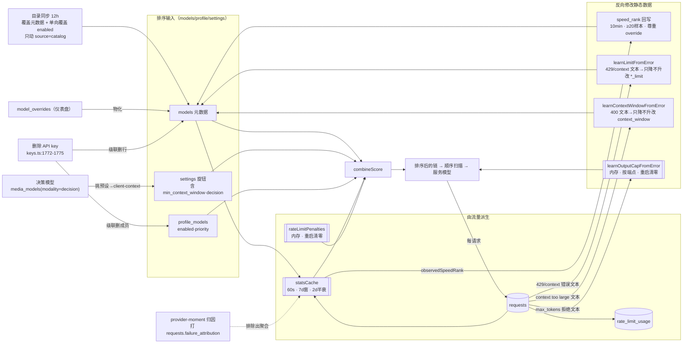

# 主题：model 的调度算法

> 一次 `auto` 请求进来，网关**凭什么**在几百个模型里挑中某一个；以及喂给这个判断的每一项数据**从哪来、谁在写、多久变一次、变了会不会被重启抹掉**。
>
> 与既有文档的分工：`../sourceReader/10-函数级走读-路由限流与回退.md` 是**按函数**拆（`routeRequest` / `orderChain` / `scoreChainEntry` / `selectKeyForModel` 的逐行读法）；`docs/en/architecture/01-routing-and-bandit-scoring.md` 是**按产品机制**讲。本篇是**按数据流**讲 —— 把"算法的输入"当作主角，因为线上排查时真正卡住人的从来不是公式，而是"这个数是从哪张表来的、它现在还是不是新的"。
>
> 记法沿用 `../sourceReader/00-docs-style-guide.md`：正文用「符号 + 偏移」，§10 给绝对行号。所有行号以当前 checkout（`main` @ `dece8084`，2026-10-19 拉取）为准。本机运行的网关是 `/Applications/FreeLLMAPI.app` v0.16.3（asar 构建于 10-18 21:45），与本篇源码**同一版本**，行号可直接对照实际行为。

---

## 1. 一页骨架

调度 = **一次排序 + 一次顺序扫描**。排序决定"先看谁"，扫描决定"能不能真用"。两者用的数据完全不同，这是理解全部麻烦的起点。

```
                     ┌──────────────── 排序阶段（决定顺序）────────────────┐
 候选集 profile_models ─┐
 元数据 models.*        ├─→ orderChain ─→ 打分 ─→ 排序后的链
 settings 权重          │       ↑
 requests 实测统计 ─────┘   内存 penalty ──┘（乘数，不在 DB 里）
                                    │
                                    ▼
                     ┌──────────────── 扫描阶段（决定成败）────────────────┐
 api_keys（scope/status/endpoint）  ─┐
 rate_limit_cooldowns（DB）           ├─→ 逐个候选 selectKeyForModel + 硬闸
 rate_limit_usage / key_monthly_usage │
 models 的 *_limit / context_window  ─┘
                                    │
                                    ▼
                          第一个全过的候选 = 本次服务的模型
```

排序之前还有一道**策略选择**：`balanced`/`smartest`/`fastest`/`reliable` 直接用固定权重打分，`priority` 根本不打分（纯人工序 + penalty），`custom` 用运营设定的权重向量，`decision`（#1354）则先让一个"决策模型"读完本次请求、从四个预设里替这一次请求挑一个，再走对应的 bandit 打分。

Mermaid 版的完整流水线：



---

## 2. 数据从哪张表来：调度用到的表结构

调度只读这几张表，先把它们的形状和"谁写谁"钉死。所有时间列都是 **UTC**（本机本地为 UTC+8）。

### 2.1 `models` —— 候选的元数据与两道开关之一

`legacy_baseline` 建表，后续靠 `ALTER TABLE ADD COLUMN` 与一次整表重建逐步长成现在的样子：

| 列 | 类型 / 默认 | 调度里的角色 | 主要写入者 |
|---|---|---|---|
| `id` | INTEGER PK AUTOINCREMENT | `model_db_id`，penalty / 统计聚合的键 | 自增 |
| `platform` | TEXT NOT NULL | 平台名；custom 端点恒为 `'custom'` | 录入 / 目录 |
| `model_id` | TEXT NOT NULL | 上游模型 id；**改它会换统计键、清空实测样本**（§5.3） | 录入 / 目录 |
| `display_name` | TEXT NOT NULL | 展示，不参与打分 | 目录 / override |
| `intelligence_rank` | INTEGER NOT NULL | 智能轴输入（同档位内决胜） | 目录(12h) / 人工 |
| `speed_rank` | INTEGER NOT NULL | **输出，不是输入**：打分从不读它（§3.2、§5.5） | 实测回写 + 目录 |
| `size_label` | TEXT DEFAULT '' | 智能轴的档位（Frontier/Large/Medium/Small） | 目录 / 人工 |
| `rpm_limit`/`rpd_limit`/`tpm_limit`/`tpd_limit` | INTEGER NULL | 窗口 headroom 与硬闸的限额 | 目录 / **错误反向学习**(§5.4a) |
| `monthly_token_budget` | TEXT DEFAULT '' | 月度 headroom 的分母；custom 行为空 → 该护栏永不生效 | 目录 / 人工 |
| `context_window` | INTEGER NULL | 上下文硬闸 + **池底**的输入；NULL=未知，永不被池底过滤 | 目录 / **学习**(§5.4b) |
| `enabled` | INTEGER DEFAULT 1 | **开关①**（全目录级）：链 SQL 的 `m.enabled=1` 硬条件 | 目录(单向,§5.6) / 人工 |
| `supports_vision`/`supports_tools` | INTEGER DEFAULT 0 | 能力闸输入 | 目录 / 人工 |
| `key_id` | INTEGER NULL | 绑定的端点 key；**删 key 会级联删本行**（§5.8） | 录入 |
| `endpoint_scope` | TEXT DEFAULT '' | 端点身份（归一化 base_url）；目录行恒 `''`，custom 行按端点分行（#651） | 录入 |
| `source` | TEXT DEFAULT 'catalog' | **免疫标记**：`'user'` 的行躲开目录写、prune、上游退役（§5.6） | 录入 / 目录认领 |

唯一键 `(platform, model_id, endpoint_scope)`（旧为 `(platform, model_id)`，#651 重建为带端点的三元组）。`intelligence_rank` / `speed_rank` 是 NOT NULL 且无默认，所以任何 INSERT 必须给值。

> `match_tier`（§3.1 的档位硬门）**不是 `models` 的列**，是 `ChainRow` 在解析 slug 回退时临时算出的字段，普通链里恒为 0。

### 2.2 候选集三表：`profiles` / `profile_models` / `fallback_config`

| 表 | 关键列 | 角色 |
|---|---|---|
| `profiles` | `id`, `name`, `auto_include_new_models`（DEFAULT 1） | 一条链。`active_profile_id` 指向它 |
| `profile_models` | `profile_id`→profiles, `model_db_id`→models **ON DELETE CASCADE**, `priority`, `enabled` | **开关②**（链内级，代码读作 `e.enabled`）；唯一键 `(profile_id, model_db_id)` |
| `fallback_config` | `model_db_id`→models, `priority`, `enabled` | 没有 profile 的旧装用的全局回退链（同样 ON DELETE CASCADE） |

`profile_models` 的 `model_db_id` 外键带 `ON DELETE CASCADE`，配合服务启动时的 `db.pragma('foreign_keys = ON')`（`db/index.ts:83`），删 `models` 行会连带删掉它在每条链里的成员关系。**`sqlite3` CLI 默认 `foreign_keys=OFF`**，手工删父行会留下孤儿链行 —— 这是排查时反复踩的坑。

### 2.3 `requests` —— 打分的唯一原始来源

| 列 | 调度里的角色 |
|---|---|
| `platform`, `model_id` | 与 `endpoint_scope` 组成 `modelStatsKey`（§5.3） |
| `key_id` | in-model 选 key 的 per-key 聚合（#580） |
| `status` | `'canceled'` 的行**整条排除**出统计（客户端挂断不改变可靠性） |
| `input_tokens`/`output_tokens` | speed 轴（吞吐）、月度已用 token |
| `latency_ms` | speed 轴的吞吐分母；超时行的 `latency_ms` 被 `TIMEOUT_LATENCY_CAP_MS=120000` 截顶后计入 |
| `ttfb_ms` | speed 轴的延迟分量 |
| `failure_attribution` | **新（#1347）**：`'provider_moment'` 标记"这是提供商那一阵子的问题，不是模型的"，开启归因后这类行从所有聚合里排除（§5.9）；NULL = 未归因（默认与历史行），保持旧打分行为 |
| `request_type` | DEFAULT 'chat'；embedding/key 校验也写这张表，但**统计聚合不按它过滤**，只有月度额度卡聚合过滤 chat |

### 2.4 护栏两表

| 表 | 关键列 | 角色 |
|---|---|---|
| `rate_limit_cooldowns` | PK `(platform, model_id, key_id)`, `expires_at_ms`, `source`(heuristic/authoritative/credit/tier), `set_at_ms` | 扫描阶段 `isOnCooldown` 读它；**被冷却跳过的候选不留 `request_attempts`** |
| `rate_limit_usage` | `platform/model_id/key_id`, `kind`('request'/'tokens'), `tokens`, `created_at_ms` | 滑窗 rpm/rpd/tpm/tpd 利用率 → 窗口 headroom |
| `key_monthly_usage` | PK `(key_id, month)`, `requests`, `tokens` | per-key 月度上限的另一套账（SQLite 触发器自增，与 headroom 的 `monthly_token_budget` 无关） |

### 2.5 `settings` —— 一个 key 一行，运营旋钮全在这

见 §2.6 表。`value TEXT NOT NULL`，主键 `key`。调度相关的旋钮几乎都落在这里，这是"同一份代码在不同实例上表现完全不同"的根因。

### 2.6 决策模型的两处存储（#1354，新）

决策模型不进 `models`，而是 `media_models` 里 `modality = 'decision'` 的行，由目录的 `decisionModels` 注册表维护，和 search engine 同构：

| 表 | 关键列 | 角色 |
|---|---|---|
| `media_models`（`modality='decision'`） | `platform`, `model_id`, `priority`, `enabled`, `meta_json`（存 `contextWindow`/`premiumSince`） | 决策模型清单。`listDecisionModels` 按 `priority,id` 排序，`enabled` 是它自己的开关 |
| `decision_requests`（新迁移 `20261016_000001`） | `model_id`, `platform`, `key_id`, `status`('ok'/'error'), `latency_ms`, `question_count`, `input_tokens`, `client_agent`, `error` | 每次决策调用的日志。**独立成表而非塞进 `requests`**：决策没有 completion token，单列才不会污染聊天成功率与分析 |

决策模型**复用用户已有的平台 key**（Cloudflare Workers AI、OpenRouter、BeatAPI、APINEX），没有独立的 key 要加；`runDecision` 在 `decision_requests` 上记账，冷却写进同一张 `rate_limit_cooldowns`。它**不参与聊天路由本身** —— 只有当策略是 `decision` 时，请求前才会调它一次来挑预设。

---

## 2.7 运营旋钮速查（`settings`）

| key | 作用 | 默认 |
|---|---|---|
| `routing_strategy` | `priority` / `balanced` / `smartest` / `fastest` / `reliable` / `custom` / `decision` | `balanced` |
| `routing_custom_weights` | `custom` 策略的三维权重向量 | 无则回落到 `balanced` 预设 |
| `routing_decision_model` | `decision` 用哪个决策模型（`'auto'` = 第一个可用的，跳过 BeatAPI） | `'auto'` |
| `routing_decision_min_probability` | 决策模型 top 概率低于此值 → 按 `balanced` 走 | `0.5` |
| `routing_explore_enabled` | 冷启动探索开关 | 关 |
| `routing_min_reliability_floor` | 可靠性地板，低于它直接从候选里**删除** | 关（=0） |
| `routing_provider_moment_attribution` | **新**：开启"提供商瞬时失败归因"，把 429/5xx/超时/传输类失败从模型账本里剔除（§5.9） | 关 |
| `min_context_window` | **新（#1445）**：路由池下限 `off`/`32k`/`128k`/`512k`/`1m`（或裸整数），低于它的窗口**整模型出局** | off |
| `routing_peak_hours_adjust` + `_start_hour`/`_end_hour`/`_timezone` | 高峰时段权重偏移 | 关 |
| `routing_task_weight_share` | 任务类型（code/chat）在速度/智能间挪权重 | `TASK_WEIGHT_SHARE` |
| `routing_headroom_ramp_start` / `routing_headroom_floor` | 两条 headroom 护栏的斜坡 | `0.2` / `0.1` |
| `active_profile_id` | `auto`（不带名字）用哪条链 | — |
| `community_reliability_priors` | 社区先验映射（JSON） | 关时不参与 |

`routing_strategy` 经 `PUT /api/fallback/routing` 改（同时收 `decisionModel`/`decisionMinProbability`）；`min_context_window` 经 `GET/PUT /api/settings/min-context-window` 改。

### 候选集：链从哪来

`getActiveChain` 只在 `profile_models ⋈ models` 上做 JOIN，且 **`m.enabled = 1` 是 SQL 层的硬条件**。一个模型有**两个**独立开关，任一关掉它就不可能进候选：

- `models.enabled` —— 全目录级，关掉等于这个模型不存在；目录同步会单向覆盖它（§5.6）。
- `profile_models.enabled` / `fallback_config.enabled` —— 链内级，代码里读作 `e.enabled`，在 `routeRequest` 用 `.filter(e => e.enabled)` 二次过滤。

链的来源取决于请求怎么写 `model`：

| 请求里的 `model` | 取链函数 | 备注 |
|---|---|---|
| `auto` | `getActiveChain` | 走 `settings.active_profile_id` 指向的 profile；没有 profile 的旧装退到 `fallback_config` |
| `auto:<名字>` | `getChainByProfileName` | 大小写不敏感按 `profiles.name` 找 |
| `auto:smart` 之类的全局轴 | `getChainByGlobalSort` | **忽略链的顺序但保留链的开关**，把整个目录当候选；`smart/fast/cheap/reliable/balanced` 映射到策略名 |

链缓存只有 **1 秒**（`CHAIN_CACHE_TTL_MS`），所以仪表盘上开关模型最多 1 秒后生效 —— 排查"我明明启用了为什么没生效"时不要怀疑这一层。

### 元数据物化：`model_overrides` 不进链 SQL

**链 SQL 完全不 JOIN `model_overrides`**（只选 `m.*`）。仪表盘上改的"显示名 / 智能排名 / 速度标签 / 限额"先落到 `model_overrides.overrides_json`（`upsertModelOverrides`），再由 `applyModelOverrides` 用一条 `UPDATE models SET …` **物化回 `models` 行**。路由器读的是物化后的 `models`。

两个后果：

1. 若某条路径只写了 override 而没跑物化，路由器看到的仍是旧值 —— 排查时**必须看 `models` 表，不能看 `model_overrides`**。
2. override 按 `(platform, model_id)` 键，而 custom 端点模型按 `endpoint_scope` 分行 —— relay 模型的行拿不到 catalog 式 override（`writeObservedSpeedRanks` 注释明确写了这个不对称，每个中继各得一份观测排名）。

`models` 元数据列的写入者分四类：

| 写入者 | 性质 |
|---|---|
| 迁移脚本 / 用户录入 / 端点发现 | 一次性或人工 |
| 目录同步 | 每 12h，除元数据外还单向写 `enabled`（§5.6） |
| **测量回写** | `speed_rank`（§5.5） |
| **错误反向学习** | `*_limit`、`context_window`，只降不升（§5.4） |
| **删 key 级联** | 直接 `DELETE` 整行（§5.8） |

---

## 3. 打分逻辑

### 3.1 双模式：什么时候根本没有打分

`orderChain` 第一件事是问策略：

- **`priority` → 不走打分**，`weightsFor` 返回 `null`，进人工序分支。这个分支有个容易看漏的设计：它**先按 `priority` 排出名次、把名次重新编号成 1..N、再往名次上加 penalty**（`rank + 1 + getPenalty(...)`）。原因：原始 `priority` 可能是 1..N 的密集编号，也可能是 10/20/30 的人工间隔（`PUT /api/fallback` 把它当裸 `z.number()` 原样存），还可能因为关掉中间模型挖出巨大空洞 —— 直接把 penalty 加在原始 priority 上，penalty 常常**完全无效**（"一个每次都 429 的模型永远钉在队首"）。密集重编号之后，"1 个 penalty"才真的等于"退后 1 位"。
- **其余（bandit）→ 走打分**，人工 `priority` 降级成**打平时的决胜键**（排序键的最后一项）。⚠️ 这是线上最常见的误判来源：运营在链里把某模型拖到 priority 3，在 `balanced` 下**几乎不产生任何效果**。

`decision` 策略不在这里出现 —— 它在进入 `orderChain` 之前就已经把 `effectiveRoutingStrategy()` 解析成了四个预设之一（§4.0），到打分这一步和手选预设没有任何区别。

### 3.2 三条轴 + 两个乘数

打分入口 `scoreChainEntry`，最终合成 `combineScore`：

```
score = base × headroom × rateLimit

base = ( w_rel·reliability + w_speed·speed + w_intelligence·intelligence ) / Σw
```

**注意 headroom 和 rateLimit 是乘数、不是轴**，`Σw` 只归一化三条轴。只算 `base` 就下结论，会和实际差一个档次。

预设权重 `BANDIT_PRESETS`：

| 策略 | reliability | speed | intelligence |
|---|---|---|---|
| `balanced` | 0.50 | 0.25 | 0.25 |
| `smartest` | 0.35 | 0.10 | 0.55 |
| `fastest` | 0.35 | 0.55 | 0.10 |
| `reliable` | 0.70 | 0.15 | 0.15 |

#### 轴 1 · reliability：Beta 后验，**每次请求重新抽卡**

```
alpha = 本地成功数(衰减加权) + 社区成功先验 + PRIOR_SUCCESS(1)
beta  = 本地失败数          + 社区失败先验 + PRIOR_FAILURE(1)
```

路由用 `sampleBeta(alpha, beta)` 而不是期望值 —— Thompson 采样，**同一份数据连续两次请求可以给出不同顺序**。仪表盘/融合面板用 `expectedReliability`（`sampled=false`），所以面板上的排序看起来比实际路由"稳"。

衰减加权来自 `requests`：`decayWeight(ageDays) = 0.5^(ageDays/2)`（半衰期 `HALF_LIFE_DAYS = 2`），只统计 **7 天窗口**（`WINDOW_MS`）内的行，且 `status='canceled'` 的行**整条被排除**；开启归因后 `failure_attribution='provider_moment'` 的行同样被排除（§5.9）。

社区先验 `activeCommunityPrior` 读 `settings.community_reliability_priors`，本地样本攒多了会自动稀释它。

#### 轴 2 · speed：**只用实测**，`speed_rank` 列不参与

```
speedScore(tokPerSec, avgTtfbMs)：
  若 tokPerSec<=0 且 avgTtfbMs==null → SPEED_PRIOR = 0.6   ← 无样本的乐观先验
  否则 0.6·(1 − e^(−tokPerSec/60)) + 0.4·(5000 − ttfb)/4700
```

三个必须记住的推论：

1. **`models.speed_rank` 对 bandit 打分完全无效。** 读它的只有展示和"按速度排序"视图预设（`routes/fallback.ts` 的 `speed: 'm.speed_rank ASC'`），打分路径一次都没读。想靠改 `speed_rank` 影响调度 = 白做。
2. **超时被计入速度分母。** `addBucket` 把 `timeout_lat` 同时加进吞吐分母 `wLat` 和 `wTtfbSum`：一个总超时的模型不能因为"成功样本很少"而保住漂亮的速度数字。
3. **`avgTtfbMs` 只要有一个非空样本，就把 0.6 先验顶掉。** 于是"1 个 token 输出 + 2 秒延迟"这种人造请求会把速度轴从 0.6 打到 0.23 量级（见 §6 实测）。

#### 轴 3 · intelligence：档位优先，排名只作同档决胜

```
composite = TIER_VALUE[size_label]·1000 − √max(1, intelligence_rank)·31
intelligence = (composite − 全链最小) / (全链最大 − 全链最小)
```

`TIER_VALUE = {Frontier:4, Large:3, Medium:2, Small:1}`、`RANK_SCALE = 31`。min/max 在**当前这条链内**算，所以它是**相对量**：往链里加一个 Frontier/41 的模型，会把所有 Medium 模型压到 0；换一条链，同一个模型的智能分就不一样。链里只有一个档位时返回 1。

`√rank·31` 的量级决定了跨档永远赢：档位差 1000 而排名修正最大只有几百。**只有同档位内 `intelligence_rank` 才真正起作用。**

#### 乘数 1 · headroom：两条护栏取**较差**的那个

```
headroom = min(monthlyHeadroom, windowHeadroom)      ← 不是相乘
```

不相乘的理由：相乘会把"两头都紧"的模型压到 floor²，让运营设的 floor 不再是它字面的意思。

- `monthlyHeadroom`：`parseBudget(monthly_token_budget) × max(1, 该平台 enabled+healthy key 数)` 对比本月已用 token。budget 为 0/NULL 时直接返回 1（"没有意见"）—— custom 端点模型 `monthly_token_budget` 为空，所以月度护栏对它们永远不参与。key 数按 5 秒缓存。
- `windowHeadroom`：由 `rate_limit_usage` 滑窗驱动的 rpm/rpd/tpm/tpd 利用率，走同一条斜坡 `headroomRamp`。模型不声明任何窗口限额 → `usedFraction = null` → 护栏没有意见。

#### 乘数 2 · rateLimit：内存里的 429 penalty

`rateLimitFactor(penalty) = 1 − (min(penalty,10)/10)·0.6`，即最多扣掉 60% 的得分、永不完全排除。penalty 来自内存表，见 §5.1。

#### 收尾：env 级 veto

`applyModelWeightOverride` 允许用 `MODEL_ROUTING_OVERRIDES` 把某个 `model_id` 的得分乘一个系数；被乘 0 的模型明确不配拿探索位。

---

## 4. 排序之前与之后：五道加工

### 4.0 决策路由（`decision` 策略，#1354）

只在策略 = `decision` 且请求**没有点名模型**时触发，发生在聊天表面、进入 `routeRequest` 之前：

```
applyDecisionRouting(messages, {pinned}) 
  → chooseRoutingPreset：把"系统提示开头(≤400字) + 最后一条用户消息(≤1600字)"喂给决策模型
    → 决策模型从 smartest/fastest/balanced/reliable 四选一，带概率
  → 结果写进 client-context 的 routingStrategy
  → 之后 routeRequest 调 effectiveRoutingStrategy() 读到它，按该预设打分
```

任何"不确定"都回落 `balanced`：top 概率低于 `routing_decision_min_probability`（默认 0.5）、决策超过 `DECISION_TIMEOUT_MS=1500`、没有可用决策模型/key、调用失败。`pick.source` 记录到底走了哪条（`decision`/`cache`/`low_confidence`/`timeout`/`unavailable`/`error`），通过 `X-FreeLLM-Routing-Strategy` 响应头回吐给客户端（回退时带 `; fallback=…`）。

**关键性质**：预设选择只给**这一个请求**重新配权，所有能力闸、keep-trying 回退链、扫描阶段的硬闸一律不变。`auto` 时跳过 BeatAPI（它免费档 1 次/分钟，跟不上每次聊天轮）。一个用户轮只决策一次：答案按"问它的文本"做 sha256 缓存，TTL 30 分钟、上限 500 条，且缓存键**含 `minProbability`** —— 否则一次低置信 Balanced 会在阈值被调低后仍被复用，正好抵消调低阈值的目的。

> `decision` 策略**在链外**的展示/融合/后台路径上等同 `balanced`（`weightsWithPeak` 把非请求作用域的 `decision` 映射回 `balanced`）。

### 排序之后的四道加工

`routeRequest` 拿到 `sortedChain` 后依次做四件事，顺序很重要：

**① 可靠性地板（在打分之前）** —— `applyReliabilityFloor` 在 `orderChain` 内部、算 min/max 之前就把"样本够且可靠性低于地板"的候选**整条删掉**。样本数 `< EXPLORE_MIN_SAMPLES(5)` 时无条件保留，所以地板只惩罚"试过且证明差"的模型。安全阀：删空了就当作没删。

**② 探索（冷启动解药）** —— 四重门：非 `priority` 策略 **且** `routing_explore_enabled` **且** 不在降级模式 **且** `Math.random() < EXPLORE_CHANCE(0.1)`。命中时任取一个"样本数 < 5"的无测量模型提到队首。

> **这条开关是冷启动死锁的唯一出口。** 关掉它，一个从未成功服务过的模型只能靠先验（rel 0.5 / speed 0.6）竞争，在 `balanced` 下打不过任何有成功样本的对手 → 永远不被尝试 → 永远没有样本。

探索候选会**镜像主循环的所有能力闸**（skipModels / skipPlatforms / vision / tools / tool-bench / response_format / context window+池底 / tpm 预检），因为把一个服务不了本次请求的模型提到队首只会让它一眨眼又被跳过。

**③ sticky session 与显式 pin** —— `preferredModelDbId`（会话粘性或客户端点名）无条件提到队首；若它**不在当前链里**，则从 `models` 现读一行（带 `m.enabled = 1` 条件）注入队首。点名模型能绕过链成员关系，但绕不过 `models.enabled`。注入前有一道 `retiredUpstream` 判定：若该 `(platform, model_id)` 在目录墓碑表里且 `source === 'upstream_eol'`（上游已 410 退役），**注入被拒绝**，请求顺延到链里其余候选或正常耗尽 —— 因为设计上 `models.enabled` 对退役模型仍保持 1（行留着给历史统计），pin 路径是拦住它的唯一地方；反过来用户手动删除产生的墓碑（`source` 非 `upstream_eol`）**仍可**被 pin 找回（用户点名比早先的删除是更新意图）。

**④ 平台无 key 预剔除** —— 剔除"平台没有任何 enabled+healthy key"的行：它们永远不可能产出路由，却每请求都要走一遍、还会往"已耗尽"摘要里垫一行无关数字。显式 pin 豁免（`isRoutable` 对 `model_db_id === preferredModelDbId` 放行）。

**降级模式** `isDegraded()` 是全局态，由健康 provider 比例进出（含 `DEGRADED_EXIT_GRACE_MS` 宽限），影响探索（跳过）与失败处理。

---

## 5. 数据源是怎么变的：反向写回回路

"逻辑"读一遍就会；线上难的是**这些数会被谁在什么时候改掉**。

### 5.1 penalty —— 内存态，重启即清零

`rateLimitPenalties: Map<model_db_id, {count, lastHit, penalty}>`，纯进程内存：

| 事件 | 变化 |
|---|---|
| 上游 429 / 402 | `penalty += 3`（`PENALTY_PER_429`） |
| 其它上游失败（5xx / 超时 / 空补全） | `penalty += 1`（`PENALTY_PER_FAIL`） |
| 一次成功 | `penalty −= 1`，归零则删条目 |
| 时间 | 每过 2 分钟视作 `−1`（惰性：只在 `getPenalty`/新失败时结算） |
| **进程重启** | **全部丢失** |

`MAX_PENALTY=10` 封顶。两个排查要点：**(a)** 它是 `model_db_id` 键，改模型 id/重录会换键；**(b)** 它在内存里，`sqlite3` 读不到，只能靠行为反推 —— 这一条本篇 §6 就踩了。**开启归因后，429/5xx/超时/传输类失败不再加 penalty**（§5.9），penalty 的来源收窄到模型自身问题与额度/404 类。

### 5.2 冷却 —— 落在表里，四种来源

`rate_limit_cooldowns(platform, model_id, key_id, expires_at_ms, source)`，`source` ∈ `heuristic`（猜的时长）/ `authoritative`（provider 明确说了何时恢复，如"日配额 UTC 零点重置"）/ `credit`（余额类）/ `tier`。清理点：过期即删、删除 key 时连带删、批量清理。

> 关键不对称：**被冷却跳过的候选不会留下 `request_attempts` 行**（扫描在发 HTTP 之前就 `continue`，`selectKeyForModel` 里 `note('cooldown')`）。所以只看尝试轨迹，无法区分"它排在后面"和"它被整个跳过"。这是本篇最容易导致误诊的一个陷阱。

### 5.3 实测统计 —— 每请求一行，60 秒聚合一次

`logRequest` 往 `requests` INSERT 一行（platform/model_id/key_id/status/tokens/latency/ttfb/requested_model/served_model/failure_attribution…）；这条行是 reliability / speed / headroom 三条链路的**唯一原始来源**。注意 key 校验与 embedding 请求也写同一张表，但 `refreshStatsCache` 不按 `request_type` 过滤，只有月度额度聚合过滤 chat。

`statsCache` 刷新时机：`routeRequest` 在**非 `priority` 策略**时才 `refreshStatsCache(db)`，该函数自带 60 秒 TTL。`priority` 模式完全不刷缓存 —— 因为它不打分。

聚合键是 `modelStatsKey(platform, model_id, endpoint_scope)`，**custom 模型带端点**。含义：**改一个 custom 模型的 `model_id`，它的实测样本立刻全部归零**（不是清空，是换键、旧样本读不到）。

### 5.4 错误反向学习：三个「只降不升」的回路

上游拒绝请求时，网关会把错误文本里报出的真实上限**学着记下来**。三条独立回路，寿命各不相同 —— 搞混它们会得出"改了没生效 / 莫名其妙被限了"的错误结论。

**(a) 速率与 token 限额 → 落 `models` 的 `*_limit` 列**

`learnLimitFromError`：从错误文本里正则抠出 `limit: 12,345` 这样的数字，按轴（rpm/rpd/tpm/tpd）判类，然后

```sql
UPDATE models SET ${col} = ? WHERE id = ? AND (${col} IS NULL OR ${col} > ?)
```

**只填空、只调低，永不调高**。列名走白名单，无注入面。调用点：`fallback-loop.ts` 的 context-too-large 分支和 429/402 分支。后果：一次 429 可能**永久**（直到下次目录同步或手改）改掉库里某模型的 rpm/tpm，进而改变窗口 headroom 与硬闸。

**(b) 上下文窗口 → 落 `models.context_window`**

`learnContextWindowFromError`：用锚定在真实 provider 文案上的正则（OpenAI/OpenRouter/vLLM 的 "maximum context length is N tokens"、Mistral、Anthropic 的 "prompt is too long: A > B maximum"、Google）抠出窗口，执行与 (a) 同构的 UPDATE。低于 `MIN_LEARNED_CONTEXT_WINDOW = 1024` 的读数丢弃（误读成小窗口会把模型从几乎所有请求里摘掉）。触发点：`isContextTooLargeError` 分支**同时**调 (a) 和 (b)，然后 `return false`（不进冷却、不加 penalty —— "太大"是对**请求**的判断不是对**模型健康**的判断）。

> 这条回路直接接上 §4 的上下文硬闸：`context_window` 是**候选资格**输入（`fitsContextWindow`），所以一次 400 之后模型可能从"每次都被跳过"变成"提前就被剔除"。排查"模型突然不参与路由了"时，`SELECT id, context_window FROM models` 是必查项；catalog 行的学习值会在下次目录同步被覆盖回去（§5.6），而 custom 端点行不在目录里，学到的窗口**持久**。

**(c) 输出上限 → 只在内存，按端点**

`lib/output-cap.ts`：`learned = new Map<string, number>()`，键是 `capKey(platform, modelId, endpointScope)` —— **按端点而非按模型**，因为所有 custom 中继共享平台 `'custom'`，从 A 中继学来的上限若套到 B 中继上会静默截断 B 的回复（#1532）。`parseMaxTokensCeiling` 要求参数名与上限短语**同时**出现且在同一子句内；`MIN_LEARNED_OUTPUT_CAP = 1024` 以下不采纳，**最低读数获胜**。`learnOutputCapFromError` 只在 status ∈ {0, 400, 422} 时学习。

消费点：`routeOutputBudget` 把它作为 `contextBudget` 传给各 adapter 的 `resolveMaxTokens`，于是客户端的 `max_tokens` 被**夹到**该上限。失败处理方向与直觉相反：

```ts
const capBefore = learnedOutputCap(...);
const ceiling = learnOutputCapFromError(route, err);
if (ceiling != null) {
  if (capBefore == null || ceiling < capBefore) state.skipKeys.delete(`${platform}:${modelId}:${keyId}`); // 该路线重新可用
  else state.skipModels.add(route.modelDbId);                                                                // 夹过了仍被拒 → 本次出局
  return false;                                                                                             // 不进冷却、不加 penalty
}
```

即**首次学到（或学到更低）上限时把该 key 从 `skipKeys` 摘出来**，因为下一次尝试会被夹到上限、同一条路线立刻恢复可用；只有"旧上限已生效却仍被拒"才 `skipModels.add`。

⚠️ **与 (a)(b) 的本质区别**：(c) **重启即忘**（"A restart forgets the ceilings; the first request after it pays one failover hop to relearn each one"），而且 `sqlite3` 读不到。

### 5.5 `speed_rank` 回写 —— 把测量结果固化进静态列

`writeObservedSpeedRanks` 由 `refreshStatsCache` 尾部按 **10 分钟**节流调用，条件：该 `(platform, model_id)` **没有**用户设过 `speedRank` override；`speedSamples ≥ SPEED_RANK_MIN_SAMPLES(20)`（`speedSamples = 成功数 + 超时数`）。写入 `UPDATE models SET speed_rank = ?`，值取 `observedSpeedRank(speedScore(...))`。**这是一条单向的观测固化：不影响打分（§3.2 推论 1），只影响展示与"按速度排序"，但会让目录数字随流量变化** —— 不要把 `speed_rank` 误当输入。

### 5.6 目录同步 —— 每 12 小时覆盖元数据，并单向覆盖 `enabled`

`SYNC_INTERVAL_MS = 12h`（"twice daily"），会 `UPDATE models` / `INSERT` 新模型 / 把行认领为 `source='catalog'`。它覆盖 `intelligence_rank` / `size_label` / 限额 / `context_window` 等元数据 —— 于是**手工改的元数据最长期望值是 12 小时**，除非它同时被写成 `model_overrides`（override 会被重新物化回来）。`CATALOG_SYNC_DISABLED=1` 可整条关掉。

> 同一时间性结论适用于 §5.4(a)(b) 学到的限额与上下文窗口 —— **但只对"目录拥有"的行成立**：`applyCatalog` 无条件写入这些列，`source='catalog'` 行上学到的保守值最迟 12 小时被上游 advertise 值覆盖回去；`source='user'` 的行直接 `continue`（手工添加撞名时"用户行赢"），custom 端点行也不在目录里。**对 custom 端点模型来说 (a)(b) 学到的值是持久的**，只有 (c) 输出上限随重启丢失。

⚠️ **同一段 `updateModel` 还覆盖 `enabled`，而且不对称**。赋值列表里有 `enabled = @enabled`，它的值现算，注释写着 "Catalog disable wins (dead upstream); local disable also wins."：

```ts
const enabled = m.enabled ? row.enabled : 0;   // catalog-sync.ts（chat 路径）
```

拆开是**两个方向不对称**：

- 目录说**禁用** → 无条件刷 0。在仪表盘或用 SQL 把 `models.enabled` 打开，**撑不过下一次 apply**（12h 轮询、任何一次重启的 re-apply、或手动同步）。
- 目录说**启用** → 只是"保留行现值"，**不会**把 0 抬回 1。所以一次目录判死在代码层面是**棘轮**：后续目录重新收录也不自动复活，只能手动 `UPDATE models SET enabled = 1`。

**这个三元式在同一份文件里出现七处** —— media `:569`、chat `:627`、video `:663`、embedding `:704`（变量名 `e.enabled`）、decision `:736`、transcription `:765`、search `:804`，六类模态共用一条规则，所以被目录"顺手判死"的不止聊天模型（`media_models` 的 decision/embedding/transcription 行、`embedding_models` 同理）。

**影响面是整平台**：一次 `applyCatalog` 可以同时把某 `platform` 的所有行刷 0，于是**手工维护的链被清空**，报出来的错和"你自己把链开关关掉"一模一样（`Profile 'x' has no enabled models`），但**修法完全不同**。排查口诀：复算 router 可见数用的是 `pm.enabled = 1 AND m.enabled = 1` 的合取，**先看是哪一侧归零** —— 链开关（`profile_models.enabled`）同步永远不碰，模型开关（`models.enabled`）同步会碰。

本机实测时间线（UTC，2026-10-16）：

| 时刻 | 事件 |
|---|---|
| `10-16 12:08:09` | applied `v2026.10.16.7388413c: 1027 updated` —— 该文档 12 条 volcengine 全 `enabled:false`，12 行被刷 0 |
| `10-16 12:08:31` | `Profile 'volcengine' has no enabled models` 重新出现，故障已从链开关搬到 `models.enabled` |

上游侧旁证：Ark 对其中 id 返回 `404 The model or endpoint doubao-seed-1.6 does not exist…`，只有 `doubao-seed-evolving` 返回过 200 —— **目录的判死不是本机误读**，所以"顺手把它打开"是在跟真实上游状态作对。复核别用记忆：`datetime(catalog_last_sync_ms/1000,'unixepoch')` 对日志里的 `applied` 行，`enabled` 判定直接读 `settings.catalog_applied_json`。

**如果确实要保留一条被判死的 leg**（链里唯一能服务的那个 id 恰好被目录判死），唯一持久的办法是换身份而不是翻开关：

```sql
UPDATE models SET source='user', enabled=1 WHERE id = <model_db_id>;
```

`source='user'` 之后这一行同时躲开三处：目录写（`continue`）、目录 prune（只删 `source='catalog'`）、上游退役（`retireCatalogModelUpstream` 只对 `isCatalogManagedModel` 的行生效）。代价是它的 `context_window` / 限额 / 排名从此冻结，学习值也不再被目录纠正。

> ❌ 反面做法：**在模型页删掉再重加**。删除会落一条 `catalog_model_tombstones`（默认 `source='user'`），而 catalog-sync 对墓碑**整条 `continue`** —— 那才是真不可逆，连上游以后重新开放都回不来。手加同名模型也会撞上 `(platform, model_id, endpoint_scope)` 的 409。

### 5.7 月度口径 —— 没有定时器

本月已用 token 靠 SQL 表达式 `datetime('now','start of month')` 界定，**跨月是"隐式重置"**：不存在任何清零任务。per-key 月度上限是另一套系统（`key_monthly_usage` + SQLite 触发器），与仪表盘额度卡无关。

### 5.8 删除 API key —— 会连带删掉模型行与链条目

这是**唯一会删除 `models` 行**的运营动作，也是候选集最容易"整行消失"的原因。`routes/keys.ts` 的删除路由分两段：

| 段 | 删除范围 |
|---|---|
| custom 端点 | 先 `recordCustomModelTombstone`（防下轮同步注册回来），再 `DELETE FROM fallback_config / models / embedding_models / media_models WHERE platform='custom' AND key_id=?`；最后一个 custom key 被删时整体清扫 `key_id IS NULL` 的遗留行 |
| 任意平台 | `keys.ts:1772-1775`：`DELETE FROM fallback_config WHERE model_db_id IN (SELECT id FROM models WHERE key_id = ?)` + `DELETE FROM models WHERE key_id = ?` + embedding/media 同键行（#1516） |

共享的目录行（`key_id IS NULL`）不受影响；目录 prune 也只动 `key_id IS NULL`。

链条目（`profile_models`）**不需要显式删**：`model_db_id … ON DELETE CASCADE` + 服务端 `foreign_keys = ON`，删 `models` 行会连带删掉它在每条链里的成员关系（§2.2 的 CLI 陷阱同样适用）。

> 对本机直接含义：custom 模型绑在某个 endpoint key 上。**在仪表盘删那把 key = 删掉这个模型行 + 它在每条链里的成员关系 + 它的全部实测样本随 `model_id` 一起消失**，而且墓碑会阻止目录同步重新注册它。链里"模型凭空不见了"时，先查 `SELECT * FROM models WHERE id=?`，再查 key 是否被删过。

### 5.9 provider-moment 失败归因（`#1347`，新）

一个 opt-in 开关 `routing_provider_moment_attribution`（env `ROUTER_PROVIDER_MOMENT_ATTRIBUTION` 优先于 settings）。开启后，一次失败尝试若其成因是"提供商的那一阵子"—— 429 / 5xx / 降级部署 / 超时 / 传输中断（含流被 reset、SSE 截断）/ 无结构化状态却写着 "rate limit" —— 就满足 `isProviderMomentFailure`，于是：

- 写 `requests` 时给该行打 `failure_attribution = 'provider_moment'`；
- `refreshStatsCache` 的聚合 SQL 追加 `AND failure_attribution <> 'provider_moment'`，把这些行从 reliability/speed/timeout 全部聚合里剔除；
- `fallback-loop` 跳过 `noteModelFailure` 与 `recordRateLimitHit/recordModelFailure` —— **penalty 不加**。

**但冷却阶梯不动**：key 该冷却还冷却。语义就是"这一下是提供商的分钟问题，仍然据此躲开这把 key，但不记在模型头上"，这样一次慢分钟不再把一个健康模型从路由里拖下去。

> 默认关，且 `isProviderMomentFailure` **故意不收**：auth(401/403)、quota(402)、model-not-found(404/410)、context-too-large、空补全、model-scoped 400 —— 这些保留各自既有的 key/模型级处理。

---

## 6. 实测：一次"改了元数据却不生效"的完整取证

> 来源：本机 macOS 桌面实例 `~/Library/Application Support/FreeLLMAPI/freeapi.db`，2026-10-16，链 `sense`（`profiles.id=4`）。除注明外均为只读查询；两次写入（1 条 `UPDATE models`、1 条 `DELETE`）已备份并 `PRAGMA integrity_check = ok`。

被调度的四个启用成员及其打分输入：

| model_db_id | platform · model_id | size_label | intel_rank | priority | 实测 rel | 实测 speed | 智能轴 | **base** |
|---|---|---|---|---|---|---|---|---|
| 334 | xkiro · sensenova/sensenova-6.8-flash-lite | Large | 65 | 2 | 冷却中（到 10-17 00:00 UTC） | — | 1.000 | — |
| **1133** | custom · sensenova-6.8-flash-lite | Large | 65 | 3 | 0.333 | **0.600**（先验） | 1.000 | **0.567** |
| 1128 | custom · deepseek-flash | Medium | 81 | 631 | 0.556 | 0.600 | 0.000 | 0.428 |
| 1131 | custom · glm-5.2 | Medium | 81 | 634 | 0.500 | 0.177 | 0.000 | 0.294 |

三个从这次实测里得到的结论：

1. **`priority` 在 `balanced` 下是装饰。** 1133 排 1128 前面靠的是 base 0.567 vs 0.428（智能轴 1.0 vs 0），不是 priority 3 vs 631。把 1133 改成 priority 1 不改变任何东西；把它的 `size_label` 从 Medium 调到 Large 才是有效改动。
2. **`glm-5.2` 的 0.177 是真实测量**：`requests` 里它的成功样本 TTFB 平均 12.4 s。在 `balanced` 下这个速度数字让它的 base 只有 0.294，**结构性地不会被选中** —— 链里挂着它，实际是摆设。
3. **短请求会污染速度轴。** 用 `max_tokens=1` 探测时，`requests` 攒下 `output_tokens=1 / latency_ms≈2000` 的成功行，聚合出 `tokPerSec ≈ 0.4`，`speedScore` **不再走先验分支**，实测把速度从 0.600 压到 **0.234**；10 次成功同时把可靠性从 0.333 抬到 0.846。两效应叠加后 base 反而升到 0.732。也就是说：**用短请求"验证路由"会同时改坏两条轴，而且改好的那条让你误判验证有效。** 清理办法是删掉那些人造 `requests` 行（`request_attempts` 是 `ON DELETE CASCADE`，但 CLI 默认 `foreign_keys=OFF`，不自开会让 attempt 变孤儿）。

同一轮踩到的取证陷阱（列进 §7）：一次 `max_tokens=1` 探测第一次落到 deepseek（429），第二次才落到 sensenova —— 当时 `rate_limit_cooldowns` 里 1133 的 heuristic 条目还有 16 秒才过期，而这条**在轨迹里完全没有痕迹**；同时内存 `rateLimitPenalties` 给它 +3 → `rateLimitFactor = 1 − 3/10×0.6 = 0.82`，把 0.567 压成 0.465，刚好抹平领先。这两个原因都不在 DB 里可查，只看表会得出"改动没生效"的错误结论。

---

## 7. 陷阱清单（都是本篇查证过的，不是通用告诫）

1. **在 bandit 策略下改 `priority` 无效** —— 它只是排序键里的最后一个决胜项。
2. **改 `speed_rank` 对调度无效** —— 打分从不读它；它是**输出**（§5.5），不是输入。
3. **智能轴是链内相对值** —— min-max 在当前链里算。换链、加/减一个 Frontier 模型，都会改变你模型的智能分。
4. **`orderChain` 的 `tier` 是 `match_tier`，不是 `size_label`** —— 非 slug 回退解析时恒为 0。把"档位硬门"理解成 `size_label` 会得出错误的支配性结论。
5. **改 custom 模型的 `model_id` 会重置它的实测样本**（统计键含 model_id + endpoint_scope，§5.3）。
6. **`model_overrides` 不进链 SQL** —— 路由器读 `models`；override 必须先被物化（§2.7）。
7. **两个乘数别漏** —— `base × headroom × rateLimit`，只算 base 会差 18%（penalty 3）甚至更多。
8. **penalty 与探索开关都不在你能直接读的地方** —— 前者是内存 Map，后者是 `settings`；行为异常时先想这两处。
9. **`routing_explore_enabled = 0` 造成冷启动死锁** —— 无样本 → 只有先验 → 打不过有样本的对手 → 不被尝试 → 无样本。
10. **被跳过的候选不留 `request_attempts`** —— 轨迹不能证明顺序，只能证明"发生过什么"。
11. **失败请求也计入额度与统计** —— `requests` 聚合不按 `status` 过滤（canceled、以及开启归因后的 provider_moment 除外），仪表盘"已用"含失败请求。
12. **`custom-key-mismatch` 会被 UI 说成"不可用"** —— 它在 `fallback-loop` 归入 `'config'`（→ 503），但 `summarizeExhaustion` 的分桶列表里没有它的分支（`no usable key configured` 只匹配 `no enabled+healthy key|no usable key|decrypt-error`），于是掉进最后的 `else bump('unavailable')`，文案变成"请添加更多 API key"，而真相是"你已有的 key 被 `model_scope_json` 挡掉了"。**（判定为产品缺陷，当前仍未修复。）**
13. **12 小时的目录同步覆盖的不只是元数据，还覆盖 `enabled`，而且是单向的**（§5.6）—— `m.enabled ? row.enabled : 0`：**目录标禁 → 该行必被刷 0，手改打开也撑不过下一次 apply；目录标启 → 只保留行现值，不会把 0 抬回 1**。于是一次目录判死是棘轮。这一切只发生在**目录拥有**的行上：`source='user'` 与 custom 端点行永远不会被同步写。要保留一条被判死但确实能服务的 leg 是**改 source，不是翻开关**。
14. **客户端点名（pin）不能捞出上游已退役的模型** —— 墓碑 `source === 'upstream_eol'` 时注入被拒（§4 ③）。用 `model=<具体 id>` 打一个 410 退役模型会直接顺延到链的其余部分。**排查"点名却不服务"时先看墓碑表**（`getCatalogModelTombstone`）。
15. **删一把 API key 会删掉模型行、链条目和它们的全部实测样本** —— `keys.ts:1772-1775`（任意平台的 `key_id` 绑定行，#1516）。这是唯一让候选集"整行消失"的运营动作（§5.8）。
16. **输出上限的学习值既不在 DB、也不在 `models`** —— 它是 `lib/output-cap.ts` 的内存 Map，按 `(platform, model_id, endpoint_scope)` 键，**重启清零**（§5.4c）。同一个模型经不同中继各有一份上限，所以"这个模型被截断了但库里没记录"是正常状态。
17. **`min_context_window` 是池级硬门，不是请求级**（#1445）—— `fitsContextWindow`/`fitsContextWindowStrict` 都会先过 `passesContextWindowFloor`：窗口低于运营设定的预设（如 `128k`）的模型**从每条链里整个出局**，与本次请求大小无关；窗口 NULL（未知）永远放行。排查"某小窗口模型死活不被选中"时，先 `SELECT value FROM settings WHERE key='min_context_window'` 看是不是池底设高了。
18. **开启 `decision` 策略不等于"按请求换算法"** —— 它只换预设权重向量（§4.0），能力闸和回退链不变；任何不确定（超时、低置信、无 key）一律 `balanced`。判断它有没有真在决策，看响应头 `X-FreeLLM-Routing-Strategy` 的 `fallback=` 尾巴。
19. **provider-moment 归因会"洗掉"模型账本但不洗冷却**（§5.9）—— 开了它，429/5xx/超时不再加 penalty、不进 reliability，但 key 照样冷却。看到"模型明明一直 429 却没被 penalize"先确认这个开关。

---

## 8. 一图记住"谁能改谁的数"



---

## 9. 风险与待补

- **未实测**：`priority` 策略下 penalty 的密集重编号效果（§3.1）只在源码层验证，本机一直跑 `balanced`。
- **未实测**：`routing_min_reliability_floor`、peak-hours 调整、`routing_task_weight_share` 的实际影响 —— 本机 `SELECT key,value FROM settings WHERE key LIKE 'routing_%'` 只有 `routing_strategy=balanced` / `routing_explore_enabled=0` / `routing_min_reliability_floor=0` 三行。
- **未实测**：§5.6 的"启用方向不复活"（`m.enabled ? row.enabled : 0` 里的 `row.enabled` 分支）目前只是源码结论 —— 本机还没有"目录先判死、后来重新收录"的样本。验证方法一句：`SELECT enabled FROM models WHERE platform='volcengine'`，看它是否仍停在 0。
- **未实测（新代码）**：`decision` 策略、`min_context_window` 池底、`provider_moment` 归因三条新路径本机均未启用也未触发 —— 决策模型表里有 7 行但 `routing_strategy` 仍是 `balanced`；`min_context_window` 未设（=off）；`requests.failure_attribution` 全为 NULL（归因未开）。结论**全部来自源码 + 上游测试**（`__tests__/services/learn-context-window.test.ts`、`__tests__/lib/output-cap.test.ts`、decision 路由相关测试），未在本机复现。
- **运行版本 = 源码版本**：本机进程 v0.16.3（asar 10-18 21:45），`capKey(platform, modelId, endpointScope)` 三参数版已在 asar 中命中，输出上限确实**按端点**键。若以后 `git pull` 到更新的 `main`，记得运行中的 app 不会自动跟随 —— 要生效需重装/重启应用。
- **未读取，不臆测**：`providers/*.ts` 内每个 provider 上报配额/冷却时长的解析细节；`degradation.ts` 的健康快照采样周期与阈值常数；`services/search.ts`（web-search 工具链路）与本篇调度的关系。
- **无法从外部验证的一层**：仪表盘 `/api/*` 只认 `sessions.token_hash`（`middleware/requireAuth.ts`），明文 token 不可恢复；`statsCache` / `rateLimitPenalties` / `output-cap.learned` / decision-pick 缓存是进程内存，**只能靠行为或数据库派生量反推**。验证调度请用 `/v1` + `settings.unified_api_key`（明文，`model` 传 `auto:<链名>`），别去动 `api_keys.encrypted_key`。

---

## 10. 源码索引（绝对行号，checkout `dece8084`）

```
server/src/services/router.ts:269              rateLimitPenalties Map（内存）
server/src/services/router.ts:272-276          PENALTY_PER_429=3 / PENALTY_PER_FAIL=1 / MAX_PENALTY=10 / DECAY 2min
server/src/services/router.ts:285-336          recordModelFailure / recordRateLimitHit / recordSuccess / getPenalty
server/src/services/router.ts:84-115           summarizeExhaustion 分桶（缺 custom-key-mismatch）
server/src/services/router.ts:447-478          PROVIDER_MOMENT_ATTRIBUTION_KEY / isProviderMomentAttributionEnabled / failureAttributionFor（#1347 新）
server/src/services/router.ts:509-513          EXPLORE_CHANCE=0.1 / EXPLORE_MIN_SAMPLES=5 / VALID_STRATEGIES(含 decision)
server/src/services/router.ts:516-526          getRoutingStrategy / setRoutingStrategy
server/src/services/router.ts:546 / 610        getPeakHoursConfig / getCustomWeights
server/src/services/router.ts:733              activeCommunityPrior
server/src/services/router.ts:752-770          weightsWithPeak（decision→balanced）/ effectiveRoutingStrategy（读 client-context）/ weightsFor
server/src/services/router.ts:787-789          WINDOW_MS=7d / HALF_LIFE_DAYS=2 / CACHE_TTL_MS=60s
server/src/services/router.ts:825              decayWeight
server/src/services/router.ts:848-985          refreshStatsCache（864 pmExcluded、877-879 buckets SQL、902-903 addBucket、985 尾部节流回写）
server/src/services/router.ts:1011-1055        SPEED_RANK_MIN_SAMPLES=20 / 10min 节流 / writeObservedSpeedRanks
server/src/services/router.ts:1073-1088        usableKeyCountsByPlatform（5s TTL）
server/src/services/router.ts:1091-1160        scoreChainEntry（三轴 + 两乘数 + env veto；sampleBeta 1108、headroom min 1147、combineScore 1154）
server/src/services/router.ts:1167-1202        applyReliabilityFloor
server/src/services/router.ts:1204-1275        orderChain（1208 priority 密集重编号分支 / 1249 任务偏移 / 1258 地板 / 1270 排序）
server/src/services/router.ts:1322-1410        CHAIN_CACHE_TTL_MS=1s / getActiveChain / getChainByProfileName / getChainByGlobalSort
server/src/services/router.ts:1430 / 1474      "has no enabled models"（profile 激活 / auto:<name> 空链）
server/src/services/router.ts:1582-1677        selectKeyForModel 扫描（1655 custom-key-mismatch / 1660 cooldown note）
server/src/services/router.ts:1859-1896        CONTEXT_WINDOW_SAFETY_FACTOR / fitsContextWindowStrict / fitsContextWindow（均过 passesContextWindowFloor）
server/src/services/router.ts:1905-1922        rowFitsRequestSize / pinnedModelFitsRequestSize
server/src/services/router.ts:2152-2262        routeRequest（2156 刷统计 / 2158 enabled 过滤 / 2160 orderChain / 2178 探索 / 2212-2247 sticky+pin+retiredUpstream / 2261-2262 平台无 key 预剔除）
server/src/services/scoring.ts:36 / 39          RoutingStrategy（含 decision）/ PresetStrategy
server/src/services/scoring.ts:49-54           BANDIT_PRESETS
server/src/services/scoring.ts:264-295         PRIOR_SUCCESS/FAILURE / reliabilityPosterior / expectedReliability
server/src/services/scoring.ts:309-330         SPEED_PRIOR=0.6 / throughputScore / speedScore
server/src/services/scoring.ts:352             TIMEOUT_LATENCY_CAP_MS=120000
server/src/services/scoring.ts:384-410         TIER_VALUE / RANK_SCALE=31 / intelligenceComposite / intelligenceScore
server/src/services/scoring.ts:421-441         HEADROOM_FLOOR=0.1 / RAMP_START=0.2 / headroomFactor / headroomRamp
server/src/services/scoring.ts:486-490         RATE_LIMIT_MAX_DAMP=0.6 / rateLimitFactor
server/src/services/scoring.ts:534-540         combineScore（base × headroom × rateLimit）
server/src/services/ratelimit.ts:1484-1516     parseProviderLimit / LIMIT_COLUMN / learnLimitFromError（1516 = UPDATE *_limit）
server/src/services/ratelimit.ts:1533-1572     CONTEXT_WINDOW_PATTERNS / MIN_LEARNED_CONTEXT_WINDOW / learnContextWindowFromError（#1479）
server/src/services/ratelimit.ts               rate_limit_usage 写入 / 冷却写入与清理（source ∈ heuristic|authoritative|credit|tier）
server/src/lib/output-cap.ts:24-91             learned Map（内存）/ MIN_LEARNED_OUTPUT_CAP=1024 / capKey(按 endpoint_scope) / parseMaxTokensCeiling / learnOutputCapFromError(status∈{0,400,422}) / learnedOutputCap / routeOutputBudget
server/src/lib/min-context-window.ts:15-54     #1445 新：MIN_CONTEXT_WINDOW_SETTING='min_context_window' / PRESETS(32k/128k/512k/1m) / minContextWindowFloor / passesContextWindowFloor
server/src/lib/client-context.ts               routingStrategy 字段 + setRequestRoutingStrategy（#1354 新）
server/src/lib/error-classify.ts:428           isProviderMomentFailure（#1347 新）
server/src/lib/request-log.ts:77-124           logRequest INSERT（含 failure_attribution 参数）
server/src/services/routing-decision.ts:20-259 #1354 新：DECISION_PRESETS / DECISION_TIMEOUT_MS=1500 / DEFAULT_MIN_PROBABILITY=0.5 / chooseRoutingPreset / applyDecisionRouting / routingStrategyHeader / getDecisionRoutingStatus（缓存键含 minProbability）
server/src/services/decision.ts:32-460         #1354 新：DECISION_MODALITY='decision' / runDecision / listDecisionModels / decision_requests 写入 / 平台 adapter(apinex/beatapi/cloudflare/openrouter)
server/src/services/model-state.ts:140/167/232/279/353/367  isCatalogManagedModel / getCatalogModelTombstone / retireCatalogModelUpstream / upsertModelOverrides / modelsWithOverriddenField / applyModelOverrides
server/src/services/catalog-sync.ts:56         SYNC_INTERVAL_MS=12h
server/src/services/catalog-sync.ts:474-484    updateModel / adoptModel(source='catalog') / insertModel
server/src/services/catalog-sync.ts:569/627/663/704/736/765/804  七处 `enabled = m.enabled ? row.enabled : 0`（media/chat/video/embedding/decision/transcription/search，§5.6）
server/src/services/catalog-sync.ts:604        source='user' 行「用户赢」跳过；:716 decisionModels 循环
server/src/services/catalog-sync.ts:1217       CATALOG_SYNC_DISABLED
server/src/lib/fallback-loop.ts:95             noteModelFailure
server/src/lib/fallback-loop.ts:512-513        context_too_large 分支同时学 *_limit 与 context_window
server/src/lib/fallback-loop.ts:523-529        max_tokens 上限：首次学到→摘 skipKeys；已生效仍被拒→skipModels
server/src/lib/fallback-loop.ts:597-615        #1347：providerMoment 为真则跳过 noteModelFailure / penalty；仍 learnLimit
server/src/lib/fallback-loop.ts:1143           custom-key-mismatch 归类 'config'
server/src/services/degradation.ts:59-153      DEGRADED_EXIT_GRACE_MS / isDegraded
server/src/lib/task-type.ts:66-96              parseTaskTypeHeader / deriveTaskType / resolveTaskType
server/src/routes/proxy.ts:2297-2319           applyDecisionRouting → X-FreeLLM-Routing-Strategy 头 → resolveTaskType → routeRequest
server/src/routes/anthropic.ts:678 / responses.ts:1169  另两条聊天表面的 decision 接入点
server/src/routes/fallback.ts:34/98/124        GET/PUT /routing（含 decision 设置）
server/src/routes/fallback.ts:61               strategy z.enum（含 'decision'）
server/src/routes/fallback.ts:412              sort preset：speed → m.speed_rank ASC
server/src/routes/settings.ts:298/318          GET/PUT /settings/min-context-window
server/src/routes/models.ts:141/156/349        手工新增 / 409 唯一键 / 删除落 catalog_model_tombstones
server/src/routes/keys.ts:1745-1775            删 key：custom 墓碑+级联，任意平台 key_id 绑定行级联（#1516）
server/src/middleware/requireAuth.ts           /api 会话鉴权（只认 token_hash）
server/src/db/index.ts:83 / 225-229            PRAGMA foreign_keys=ON / getUnifiedApiKey（/v1 凭据）
server/src/db/migrations/20260101_000000_legacy_baseline.ts  models/api_keys/requests/profiles/profile_models/fallback_config/settings/media_models 初值
server/src/db/migrations/20260627_000002_catalog_model_state.ts  catalog_model_tombstones / model_overrides
server/src/db/migrations/20260726_000002_request_attempts.ts  request_attempts（ON DELETE CASCADE）
server/src/db/migrations/20260729_000001_custom_model_endpoint_identity.ts  models 重建加 endpoint_scope，唯一键升到三元组（#651）
server/src/db/migrations/20260914_000001_key_monthly_usage.ts  key_monthly_usage + 触发器
server/src/db/migrations/20261016_000001_decision_requests.ts  新：decision_requests 表
server/src/db/migrations/20261017_233153_request_failure_attribution.ts  新：requests ADD COLUMN failure_attribution
```
