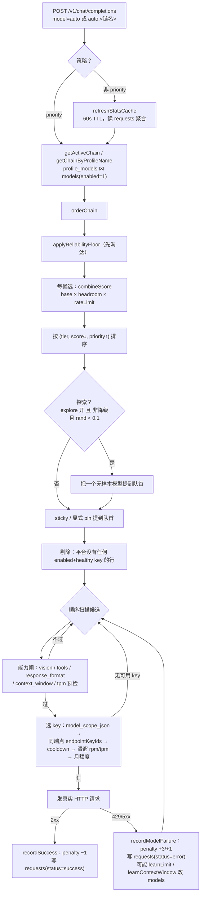
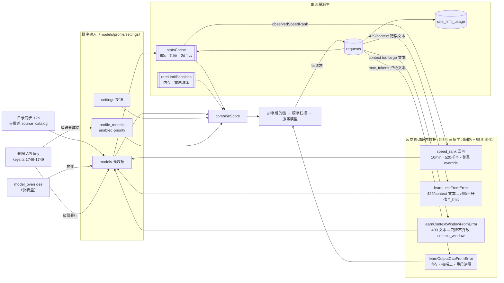

# 主题：model 的调度算法

> 一次 `auto` 请求进来，网关**凭什么**在几百个模型里挑中某一个；以及喂给这个判断的每一项数据**从哪来、谁在写、多久变一次、变了会不会被重启抹掉**。
>
> 与既有文档的分工：`../sourceReader/10-函数级走读-路由限流与回退.md` 是**按函数**拆（`routeRequest` / `orderChain` / `scoreChainEntry` / `selectKeyForModel` 的逐行读法）；`docs/en/architecture/01-routing-and-bandit-scoring.md` 是**按产品机制**讲。本篇是**按数据流**讲 —— 把"算法的输入"当作主角，因为线上排查时真正卡住人的从来不是公式，而是"这个数是从哪张表来的、它现在还是不是新的"。
>
> 记法沿用 `../sourceReader/00-docs-style-guide.md`：正文用「符号 + 偏移」，文末给绝对行号。所有行号以当前 checkout（`main` @ `1dbc878c`，2026-10-16 拉取）为准。
>
> **本次 pull 对本篇的三处影响**（逐一回读源码确认，不是机械加偏移）：① `routeRequest` 之后的行号整体 +15，且**显式 pin 的注入条件变了**（§4③）；② 错误反向学习家族**新增了 `context_window`**，并新增了内存态的**每端点输出上限**（§5.4）；③ 删除 API key 现在会**级联删除该 key 绑定的 `models` 行与链条目**（§5.8）—— 对本机的 custom 端点模型（如 `model_db_id=1133` 绑在 key 58 上）是实质风险。`scoring.ts`、`model-state.ts`、`request-log.ts`、`degradation.ts`、`task-type.ts` 与 1844 行之前的 `router.ts` 未被改动。

---

## 1. 一页骨架

调度 = **一次排序 + 一次顺序扫描**。排序决定"先看谁"，扫描决定"能不能真用"。两者用的数据完全不同，这是理解全部麻烦的起点。

```
                     ┌──────────────── 排序阶段（决定顺序）────────────────┐
 候选集 profile_models ─┐
 元数据 models.*        ├─→ orderChain ─→ 打分 ─→ 排序后的链
 settings 权重          │       ↑
 requests 实测统计 ─────┘   内存 penalty ──┘（乘数，不在 DB 里）
                                    │
                                    ▼
                     ┌──────────────── 扫描阶段（决定成败）────────────────┐
 api_keys（scope/status/endpoint）  ─┐
 rate_limit_cooldowns（DB）           ├─→ 逐个候选 selectKeyForModel + 硬闸
 rate_limit_usage / key_monthly_usage │
 models 的 *_limit / context_window  ─┘
                                    │
                                    ▼
                          第一个全过的候选 = 本次服务的模型
```

Mermaid 版的完整流水线：



---

## 2. 五类数据源，各自的位置与寿命

| # | 数据源 | 物理位置 | 谁写它 | 多久变一次 | 进程重启后 |
|---|--------|----------|--------|------------|------------|
| 1 | 候选集与人工顺序 | `profiles` / `profile_models` / `fallback_config` | 仪表盘 模型页、链编辑、声明式配置 | 人改即变 | 保留 |
| 2 | 模型静态元数据 | `models` 各列 | 迁移脚本、目录同步(12h)、用户录入、`model_overrides` 物化、**错误反向学习**、**删 key 级联删除** | 12h + 事件驱动 | 保留 |
| 3 | 实测统计 | 原始在 `requests`；**打分用内存聚合** `statsCache` | `request-log.ts` 每请求一行；`refreshStatsCache` 每 60s 重算 | 60s | 原始保留，聚合立刻重建 |
| 4 | 护栏状态 | 见 §5，**一半在内存、一半在表** | 每次失败/成功即时更新 | 每请求 | ⚠️ 内存那半**全丢** |
| 5 | 运营旋钮 | `settings` 表若干 key | 仪表盘 / `PUT /api/fallback/routing` / CLI | 人改即变 | 保留 |

### 2.1 候选集：链从哪来

`getActiveChain` 只在 `profile_models ⋈ models` 上做 JOIN，且 **`m.enabled = 1` 是 SQL 层的硬条件**（`router.ts` 的 `getActiveChain+8~+19`）。也就是说一个模型有**两个**独立开关，任一关掉它就不可能进候选：

- `models.enabled` —— 全目录级，关掉等于这个模型不存在；
- `profile_models.enabled` / `fallback_config.enabled` —— 链内级，代码里读作 `e.enabled`，在 `routeRequest+6`（`router.ts:2100`）用 `.filter(e => e.enabled)` 二次过滤。

链的来源有三种，取决于请求怎么写 `model`：

| 请求里的 `model` | 取链函数 | 备注 |
|---|---|---|
| `auto` | `getActiveChain`（`router.ts:1268`） | 走 `settings.active_profile_id` 指向的 profile；没有 profile 的旧装退到 `fallback_config` |
| `auto:<名字>` | `getChainByProfileName`（`router.ts:1303`） | 大小写不敏感按 `profiles.name` 找 |
| `auto:smart` 之类的全局轴 | `getChainByGlobalSort`（`router.ts:1320`） | **忽略链的顺序但保留链的开关**，把整个目录当候选；`smart/fast/cheap/reliable/balanced` 映射到策略名 |

链缓存只有 **1 秒**（`CHAIN_CACHE_TTL_MS`，`router.ts:1262`），所以仪表盘上开关模型最多 1 秒后生效 —— 排查"我明明启用了为什么没生效"时不要怀疑这一层。

### 2.2 元数据：`models` 列 + `model_overrides` 物化

关键事实，容易踩：**链 SQL 完全不 JOIN `model_overrides`**（`router.ts:1276-1286` 只选 `m.*`）。仪表盘上改的"显示名 / 智能排名 / 速度标签 / 限额"先落到 `model_overrides.overrides_json`（`model-state.ts:upsertModelOverrides`，写库在 `:329-332`），再由 `applyModelOverrides`（`model-state.ts:372-391`）用一条 `UPDATE models SET …` **物化回 `models` 行**。路由器读的是物化后的 `models`。

这带来两个直接后果：

1. 若某条路径只写了 override 而没跑物化，路由器看到的仍是旧值 —— 排查时**必须看 `models` 表，不能看 `model_overrides`**。
2. override 是**按 `(platform, model_id)` 键**的，而 custom 端点模型是**按端点**分行的（`endpoint_scope`）。注释在 `writeObservedSpeedRanks+12~+16`（`router.ts:977-980`）明确写了这个不对称：relay 模型的行拿不到 catalog 式 override。

`models` 元数据列的写入者共 8 处，按性质分三类：

| 写入者 | 位置 | 性质 |
|---|---|---|
| 迁移脚本 | `db/migrations/20260101_000000_legacy_baseline.ts` 等 | 一次性，含 `intelligence_rank` 播种 |
| 目录同步 | `catalog-sync.ts:393`（UPDATE）/`:403`（INSERT）/`:401`（`source='catalog'`） | 每 12h，`SYNC_INTERVAL_MS`（`catalog-sync.ts:56`）；`CATALOG_SYNC_DISABLED=1` 可关（`:1081`）；**除元数据外还写 `enabled`**，且方向单向（`:544`，见 §5.6） |
| 用户/发现 | `routes/models.ts:156`、`custom-model-register.ts:113`、`builtin-model-discovery.ts:180`、`declarative-config.ts:276/390` | 手工录入与端点探测 |
| **测量回写** | `router.ts:973`（`speed_rank`） | 见 §5.5 |
| **错误反向学习** | `ratelimit.ts:1513`（`*_limit`）、`ratelimit.ts:1569`（`context_window`） | 见 §5.4，只降不升 |
| **删 key 级联** | `keys.ts:1746-1749`（`DELETE FROM models WHERE key_id = ?`） | 见 §5.8，**会删掉整行** |
| 覆盖物化 | `model-state.ts:388` | 见上 |
| 定价 | `db/model-pricing.ts:214` | 不参与打分 |

### 2.3 运营旋钮（`settings`）

调度算法的行为几乎全部可由 `settings` 单行改写，这是"同一份代码在不同实例上表现完全不同"的原因：

| key | 作用 | 默认 |
|---|---|---|
| `routing_strategy` | `priority` / `balanced` / `smartest` / `fastest` / `reliable` / `custom` | `balanced` |
| `routing_custom_weights` | `custom` 策略的三维权重向量 | 无则回落到 `balanced` 预设（`router.ts:582`） |
| `routing_explore_enabled` | 冷启动探索开关 | 关 |
| `routing_min_reliability_floor` | 可靠性地板，低于它直接从候选里**删除** | 关 |
| `routing_peak_hours_adjust` + `_start_hour`/`_end_hour`/`_timezone` | 高峰时段权重偏移 | 关（`router.ts:510`） |
| `routing_task_weight_share` | 任务类型（code/chat）在速度/智能间挪多少权重 | `TASK_WEIGHT_SHARE` |
| `routing_headroom_ramp_start` / `routing_headroom_floor` | 两条 headroom 护栏的斜坡 | `0.2` / `0.1`（`scoring.ts:416-417`） |
| `active_profile_id` | `auto`（不带名字）用哪条链 | — |
| `community_reliability_priors` | 社区先验映射（JSON） | 关时不参与 |

---

## 3. 打分逻辑

### 3.1 双模式：什么时候根本没有打分

`orderChain`（`router.ts:1144`）第一件事是问策略：

- **`priority` → 不走打分**，`weightsFor` 返回 `null`，进 `router.ts:1178-1183` 的人工序分支。这个分支有个容易看漏的设计：它**先按 `priority` 排出名次、把名次重新编号成 1..N、再往名次上加 penalty**（`rank + 1 + getPenalty(...)`）。原因写在 `router.ts:1160-1170`：原始 `priority` 可能是 1..N 的密集编号，也可能是 10/20/30 的人工间隔，还可能因为关掉中间模型挖出巨大的空洞 —— 直接把 penalty 加在原始 priority 上，penalty 常常**完全无效**（"一个每次都 429 的模型永远钉在队首"）。密集重编号之后，"1 个 penalty"才真的等于"退后 1 位"。
- **其余（bandit）→ 走打分**，人工 `priority` 降级成**打平时的决胜键**（`router.ts:1210` 的最后一个 `||`）。⚠️ 这是线上最常见的误判来源：运营在链里把某模型拖到 priority 3，在 `balanced` 下**几乎不产生任何效果**。

### 3.2 三条轴 + 两个乘数

打分入口 `scoreChainEntry`（`router.ts:1031`），最终合成 `combineScore`（`scoring.ts:529-536`）：

```
score = base × headroom × rateLimit

base = ( w_rel·reliability + w_speed·speed + w_intelligence·intelligence ) / Σw
```

**注意 headroom 和 rateLimit 是乘数、不是轴**，`Σw` 只归一化三条轴。很多人（包括我上一次写这段时）只算 `base` 就下结论，结果和实际差一个档次。

预设权重在 `scoring.ts:44-54`：

| 策略 | reliability | speed | intelligence |
|---|---|---|---|
| `balanced` | 0.50 | 0.25 | 0.25 |
| `smartest` | 0.35 | 0.10 | 0.55 |
| `fastest` | 0.35 | 0.55 | 0.10 |
| `reliable` | 0.70 | 0.15 | 0.15 |

#### 轴 1 · reliability：Beta 后验，**每次请求重新抽卡**

```
alpha = 本地成功数(衰减加权) + 社区成功先验 + PRIOR_SUCCESS(1)
beta  = 本地失败数          + 社区失败先验 + PRIOR_FAILURE(1)
```

常数在 `scoring.ts:259-260`，后验在 `:273-282`。路由用 `sampleBeta(alpha, beta)`（`router.ts:1048`）而不是期望值 —— 这是 Thompson 采样，**同一份数据连续两次请求可以给出不同顺序**。仪表盘/融合面板用 `expectedReliability`（`scoring.ts:285-292`，`sampled=false`），所以面板上的排序看起来比实际路由"稳"。

衰减加权来自 `requests`：`decayWeight(ageDays) = 0.5^(ageDays/2)`（`router.ts:772-774`，半衰期 `HALF_LIFE_DAYS = 2`，`:735`），只统计 **7 天窗口**（`WINDOW_MS`，`:734`）内的行，且 `status='canceled'` 的行**整条被排除**（`router.ts:819`）—— 客户端挂断不改变模型可靠性。

社区先验 `activeCommunityPrior`（`router.ts:692-696`）读 `settings.community_reliability_priors`，由 `setCommunityPriors`（`:700-705`）整体替换；本地样本攒多了会自动稀释它（注释在 `scoring.ts:262-267`）。

#### 轴 2 · speed：**只用实测**，`speed_rank` 列不参与

```
speedScore(tokPerSec, avgTtfbMs)：
  若 tokPerSec<=0 且 avgTtfbMs==null → SPEED_PRIOR = 0.6   ← 无样本的乐观先验
  否则 0.6·(1 − e^(−tokPerSec/60)) + 0.4·(5000 − ttfb)/4700
```

常数 `SPEED_SCALE_TOK_S=60` / `TTFB_BEST_MS=300` / `TTFB_WORST_MS=5000` / 0.6-0.4 混合在 `scoring.ts:298-302`，函数在 `:323-330`，先验 `SPEED_PRIOR` 在 `:304`。

三个必须记住的推论：

1. **`models.speed_rank` 对 bandit 打分完全无效。** 读它的只有展示和"按速度排序"这个视图预设（`routes/fallback.ts:401`、`routes/profiles.ts:386`），打分路径一次都没读。想靠改 `speed_rank` 影响调度 = 白做。
2. **超时被计入速度分母。** `addBucket` 把 `timeout_lat` 同时加进 `wLat`（吞吐分母）和 `wTtfbSum`（`router.ts:842-844`），设计意图写在 `:829-834`：一个总超时的模型不能因为"成功样本很少"而保住漂亮的速度数字。
3. **`avgTtfbMs` 只要有一个非空样本，就把 0.6 先验顶掉。** 于是"1 个 token 输出 + 2 秒延迟"这种人造请求会把速度轴从 0.6 打到 0.23 量级（见 §6 实测）。

#### 轴 3 · intelligence：档位优先，排名只作同档决胜

```
composite = TIER_VALUE[size_label]·1000 − √max(1, intelligence_rank)·31
intelligence = (composite − 全链最小) / (全链最大 − 全链最小)
```

`TIER_VALUE = {Frontier:4, Large:3, Medium:2, Small:1}`（`scoring.ts:379`）、`RANK_SCALE = 31`（`:393`）、复合值 `:395-398`、min-max `:403+`。min/max 在**当前这条链内**算（`router.ts:1200-1202`），所以它是**相对量**：往链里加一个 Frontier/41 的模型，会把所有 Medium 模型压到 0；换一条链，同一个模型的智能分就不一样。`max <= min` 时（链里只有一个档位）返回 1（`scoring.ts:403` 之后）。

`√rank·31` 的量级决定了跨档永远赢：Medium/1 的 composite ≈ 1969，Large/1000 ≈ 2000 附近 —— 档位差 1000 而排名修正最大只有几百。**只有同档位内 `intelligence_rank` 才真正起作用。**

#### 乘数 1 · headroom：两条护栏取**较差**的那个

```
headroom = min(monthlyHeadroom, windowHeadroom)      ← 不是相乘
```

见 `router.ts:1087`，不相乘的理由写在 `:1082-1086`（相乘会把"两头都紧"的模型压到 floor²，让运营设的 floor 不再是它字面的意思）。

- `monthlyHeadroom`：`parseBudget(monthly_token_budget) × max(1, 该平台 enabled+healthy key 数)` 对比本月已用 token。`headroomFactor` 在 `scoring.ts:426-429`，**budget 为 0/NULL 时直接返回 1（"没有意见"）** —— 这一点对 custom 端点模型很关键：它们的 `monthly_token_budget` 是空的，所以月度护栏永远不参与。key 数按 5 秒缓存（`KEY_COUNTS_TTL_MS`，`router.ts:1013-1028`），聚合口径见 `usableKeyCountsByPlatform`。
- `windowHeadroom`：由 `rate_limit_usage` 滑窗驱动的 rpm/rpd/tpm/tpd 利用率（`scoreChainEntry+44~+50`，`router.ts:1074-1080`），走**同一条斜坡** `headroomRamp`（`scoring.ts:436-443`）。模型不声明任何窗口限额 → `usedFraction = null` → 护栏没有意见。

#### 乘数 2 · rateLimit：内存里的 429 penalty

`rateLimitFactor(penalty) = 1 − (min(penalty,10)/10)·0.6`（`scoring.ts:483-486`），即最多扣掉 60% 的得分、永不完全排除。penalty 来自内存表，见 §5.1。

#### 收尾：env 级 veto

`applyModelWeightOverride`（`router.ts:1093-1096`）允许用 `MODEL_ROUTING_OVERRIDES` 把某个 `model_id` 的得分乘一个系数；被乘 0 的模型明确不配拿探索位（`router.ts:2123-2126`）。

---

## 4. 排序之后、发请求之前的四道加工

`routeRequest`（`router.ts:2094`）拿到 `sortedChain` 后依次做四件事，顺序很重要：

**① 可靠性地板（在打分之前）** —— `applyReliabilityFloor`（`router.ts:1107-1129`）在 `orderChain` 内部、算 min/max 之前就把"样本够且可靠性低于地板"的候选**整条删掉**（`:1198`）。样本数 `< EXPLORE_MIN_SAMPLES(5)` 时无条件保留（`:1116-1119`），所以地板只惩罚"试过且证明差"的模型。它还有安全阀：删空了就当作没删（`:1128`）。

**② 探索（冷启动解药）** —— `router.ts:2120` 的四重门：非 `priority` 策略 **且** `routing_explore_enabled` **且** 不在降级模式 **且** `Math.random() < EXPLORE_CHANCE(0.1)`（`:468`）。命中时任取一个"样本数 < 5"的无测量模型提到队首（`:2143-2149`）。

> **这条开关是冷启动死锁的唯一出口。** 关掉它，一个从未成功服务过的模型只能靠先验（rel 0.5 / speed 0.6）竞争，在 `balanced` 下打不过任何有成功样本的对手 → 永远不被尝试 → 永远没有样本。实测见 §6。
>
> 探索候选会**镜像主循环的所有能力闸**（`:2131-2141`：skipModels / skipPlatforms / vision / tools / tool-bench / response_format / context window / tpm 预检），因为把一个服务不了本次请求的模型提到队首只会让它一眨眼又被跳过。

**③ sticky session 与显式 pin** —— `preferredModelDbId`（会话粘性或客户端点名）无条件提到队首（`router.ts:2154-2160`）；若它**不在当前链里**，则从 `models` 现读一行注入队首（`:2165-2188`）。也就是说点名模型能绕过链成员关系，但绕不过 `models.enabled`。

> ⚠️ **本条在 `1dbc878c` 收紧了**：注入前多了一道 `retiredUpstream` 判定（`:2183-2186`）—— 若该 `(platform, model_id)` 在目录墓碑表里且 `source === 'upstream_eol'`（上游已 410 退役，见 #634），**注入被拒绝**，请求顺延到链里其余候选或正常耗尽。设计上 `models.enabled` 仍保持 1（行留着给历史统计），所以这是 pin 路径**唯一**能拦住退役模型的地方；反过来，用户在仪表盘手动删除产生的墓碑（`source` 非 `upstream_eol`）**仍然可以**被 pin 找回（注释：用户点名比他早先的删除是更新意图）。墓碑读取函数 `getCatalogModelTombstone`（`model-state.ts:172`）。

**④ 平台无 key 预剔除** —— `router.ts:2192-2205` 的注释记录了一个真实的观测偏差：在干净实例上 36 个候选里有 **14 个**的平台根本没有 enabled+healthy 的 key，它们永远不可能产出路由，却每请求都要走一遍、还会往"已耗尽"摘要里垫一行无关数字（报成"37 routes checked"而实际只有 22 个候选）。显式 pin 豁免（`isRoutable` 的 `e.model_db_id === preferredModelDbId` 分支）。

**降级模式** `isDegraded()`（`services/degradation.ts:153`）是全局态，由健康 provider 比例进出（进入条件与 `DEGRADED_EXIT_GRACE_MS` 宽限在 `:130-150`），影响探索（跳过）与失败处理。

---

## 5. 数据源是怎么变的：八条写回回路

"逻辑"读一遍就会；线上难的是**这些数会被谁在什么时候改掉**。

### 5.1 penalty —— 内存态，重启即清零

`rateLimitPenalties: Map<model_db_id, {count, lastHit, penalty}>`，纯进程内存：

| 事件 | 变化 | 位置 |
|---|---|---|
| 上游 429 / 402 | `penalty += 3`（`PENALTY_PER_429`） | `recordRateLimitHit` → `recordModelFailure`，`router.ts:301-303` |
| 其它上游失败（5xx / 超时 / 空补全） | `penalty += 1`（`PENALTY_PER_FAIL`） | `router.ts:283-295` |
| 一次成功 | `penalty −= 1`，归零则删条目 | `router.ts:308-316` |
| 时间 | 每过 2 分钟视作 `−1`（惰性：只在 `getPenalty`/新失败时结算） | `DECAY_INTERVAL_MS`/`DECAY_AMOUNT`，`router.ts:272-274`；`getPenalty` `:324-336` |
| **进程重启** | **全部丢失** | — |

`MAX_PENALTY=10` 封顶（`:272`）。两个排查要点：**(a)** 它是 `model_db_id` 键，改模型 id/重录会换键；**(b)** 它在内存里，`sqlite3` 读不到，只能靠行为反推 —— 这一条本篇 §6 就踩了。

### 5.2 冷却 —— 落在表里，三种来源

`rate_limit_cooldowns(platform, model_id, key_id, expires_at_ms, source)`，写入在 `ratelimit.ts:1194`。`source` 有 `authoritative`（provider 明确说了什么时候恢复，例如"日配额 UTC 零点重置"）、`heuristic`（我们猜的时长）、`credit`（余额类）。清理点：过期即删（`:1226`）、删除 key 时连带删（`:1332`）、批量清理（`:1361-1363`）。

> 关键不对称：**被冷却跳过的候选不会留下 `request_attempts` 行**（扫描在发 HTTP 之前就 `continue`，见 `router.ts:1600` 的 `note('cooldown')`）。所以只看尝试轨迹，你无法区分"它排在后面"和"它被整个跳过"。这是本篇最容易导致误诊的一个陷阱。

### 5.3 实测统计 —— 每请求一行，60 秒聚合一次

`request-log.ts:117` 的 INSERT 落 `requests(platform, model_id, key_id, status, input_tokens, output_tokens, latency_ms, error, ttfb_ms, requested_model, served_model, …)`；这条行是 reliability / speed / headroom 三条链路的**唯一原始来源**。注意 `keys.ts:1200` 和 `embeddings.ts:370` 也会往同一张表写（key 校验与 embedding 请求），但 `refreshStatsCache` 不按 `request_type` 过滤，只有月度额度聚合过滤 `chat`（`routes/fallback.ts` 的 `/token-usage`）。

`statsCache` 的刷新时机：`routeRequest+4`（`router.ts:2098`）在**非 `priority` 策略**时才 `refreshStatsCache(db)`，而该函数自带 60 秒 TTL（`CACHE_TTL_MS`，`router.ts:736`；`refreshStatsCache+1~+2`）。`priority` 模式完全不刷缓存 —— 因为它不打分。

聚合键是 `modelStatsKey(platform, model_id, endpoint_scope)`，**custom 模型带端点**（`router.ts:765-767` 注释、`:852-859`）。含义：**改一个 custom 模型的 `model_id`，它的实测样本立刻全部归零**（不是清空，是换键、旧样本读不到）。

### 5.4 错误反向学习：三个「只降不升」的回路

上游拒绝请求时，网关会把错误文本里报出的真实上限**学着记下来**。这是三条独立回路，寿命各不相同 —— 搞混它们会得出"改了没生效 / 莫名其妙被限了"的错误结论。

**(a) 速率与 token 限额 → 落 `models` 的 `*_limit` 列**

`learnLimitFromError`（`ratelimit.ts:1507-1517`）：从错误文本里正则抠出 `limit: 12,345` 这样的数字（`parseProviderLimit` `:1481-1491`），按 `LIMIT_AXIS_PATTERNS` 判轴（rpm / rpd / tpm / tpd），然后

```sql
UPDATE models SET ${col} = ? WHERE id = ? AND (${col} IS NULL OR ${col} > ?)
```

**只填空、只调低，永不调高**（设计说明在 `:1500-1505`）。列名走白名单（`LIMIT_COLUMN` `:1495-1497`），所以模板串没有注入面。调用点两处：`fallback-loop.ts:511`（context-too-large 分支）和 `:605`（429/402 分支）。后果：一次 429 可能**永久**（直到下次目录同步或你手改）改掉库里某个模型的 rpm/tpm 限额，进而改变窗口 headroom 与硬闸判定。仪表盘上"这个限额我怎么没设过"的答案往往就在这里。

**(b) 上下文窗口 → 落 `models.context_window`（本次 pull 新增，#1479）**

`learnContextWindowFromError`（`ratelimit.ts:1564-1572`）用四条**锚定在真实 provider 文案上**的正则（`CONTEXT_WINDOW_PATTERNS` `:1530-1539`，分别对应 OpenAI/OpenRouter/vLLM 的 "maximum context length is N tokens"、Mistral、Anthropic 的 "prompt is too long: A tokens > B maximum"、Google）抠出窗口，再执行与 (a) 同构的 UPDATE：

```sql
UPDATE models SET context_window = ? WHERE id = ? AND (context_window IS NULL OR context_window > ?)
```

低于 `MIN_LEARNED_CONTEXT_WINDOW = 1024`（`:1542`）的读数被丢弃 —— 误读成小窗口会把模型从几乎所有请求里摘掉。触发点 `fallback-loop.ts:510-512`：`isContextTooLargeError` 分支**同时**调 (a) 和 (b)，然后 `return false`（不进冷却、不加 penalty —— "太大"是对**请求**的判断不是对**模型健康**的判断，注释在 `:504-509`）。

> 这条回路的意义直接接上了 §3.2 的上下文硬闸：`context_window` 是**候选资格**的输入（`fitsContextWindow`），所以一次 400 之后，模型可能从"每次都被跳过"变成"提前就被剔除"。排查"模型突然不参与路由了"时，`SELECT id, context_window FROM models` 是必查项；被学习压低后的值会在下次目录同步时被上游 advertise 的元数据覆盖回去（§5.6），也就是说对 `source='catalog'` 的行它是**临时**的 —— 而 custom 端点行不在目录里，学到的窗口是**持久**的。

**(c) 输出上限 → 只在内存，按端点**

`lib/output-cap.ts`：`learned = new Map<string, number>()`（`:24`），键是 `modelStatsKey(platform, model_id, endpoint_scope)`（`:43-45`）—— **按端点而非按模型**，因为所有 custom 中继共享平台 `'custom'`，从 A 中继学来的上限若套到 B 中继上会静默截断 B 的回复（#1532）。⚠️ **这一条只对源码成立，本机运行的 0.15.0 构建仍是按模型键**（见 §9 的版本口径实测）—— 有多个 custom 中继时，这是实际会咬到你的差异。`parseMaxTokensCeiling`（`:51-61`）要求参数名与上限短语**同时**出现且在同一子句内（60 字符、不含 `.`/`;`），`MIN_LEARNED_OUTPUT_CAP = 1024` 以下不采纳（`:41`），**最低读数获胜**。`learnOutputCapFromError`（`:63-72`）只在 status ∈ {0, 400, 422} 时学习。

消费点：`routeOutputBudget`（`:81`）把它作为 `contextBudget` 传给各 adapter 的 `resolveMaxTokens`，于是客户端（Claude Code 要 128000、Open WebUI 要 65536）的 `max_tokens` 被**夹到**该上限。失败处理在 `fallback-loop.ts:522-530`，方向与直觉相反：

```ts
const capBefore = learnedOutputCap(route.platform, route.modelId, route.endpointScope);
const ceiling = learnOutputCapFromError(route, err);
if (ceiling != null) {
  if (capBefore == null || ceiling < capBefore) {
    state.skipKeys.delete(`${route.platform}:${route.modelId}:${route.keyId}`);  // 这条路线重新可用
  } else {
    state.skipModels.add(route.modelDbId);                                       // 夹过了仍被拒 → 本次请求出局
  }
  return false;                                                                  // 不进冷却、不加 penalty
}
```

即**首次学到（或学到更低）上限时把该 key 从 `skipKeys` 里摘出来**，因为下一次尝试会被夹到上限、同一条路线立刻恢复可用；只有"旧上限已经生效却仍被拒"才 `skipModels.add`。注释在 `:515-521`。

⚠️ **与 (a)(b) 的本质区别**：(c) **重启即忘**（文件头注释："A restart forgets the ceilings; the first request after it pays one failover hop to relearn each one"），而且**sqlite3 读不到**。§5.1 的 penalty 是同一类麻烦，(c) 是第三种。

### 5.5 `speed_rank` 回写 —— 把测量结果固化进静态列

`writeObservedSpeedRanks`（`router.ts:966-992`）由 `refreshStatsCache` 尾部按 **10 分钟**节流调用（`SPEED_RANK_WRITE_INTERVAL_MS`，`:952`；调用点 `:922-923`），条件：

- 该 `(platform, model_id)` **没有**用户设过 `speedRank` override（`modelsWithOverriddenField`，`model-state.ts:359-370`）；
- `speedSamples ≥ SPEED_RANK_MIN_SAMPLES(20)`（`:951`；`speedSamples = 成功数 + 超时数`，见 `:894`，注释在 `:748` 说明为什么用它而不是总样本数当门槛）。

写入 `UPDATE models SET speed_rank = ?`（`:973`），值取 `observedSpeedRank(speedScore(...))`。**这是一条单向的观测固化：它不影响打分（§3.2 推论 1），只影响展示与"按速度排序"，但会让目录数字随你的流量变化** —— 读源码时不要把 `speed_rank` 误当输入。

### 5.6 目录同步 —— 每 12 小时覆盖元数据，也会覆盖 `enabled`

`SYNC_INTERVAL_MS = 12h`（`catalog-sync.ts:56`，注释"twice daily"），会 `UPDATE models`（`:393`）、`INSERT` 新模型（`:403`）、把行认领为 `source='catalog'`（`:401`）。它覆盖 `intelligence_rank` / `size_label` / 限额等元数据 —— 于是出现一个时间性陷阱：**你手工改的元数据，最长期望值是 12 小时**，除非它同时被写成 `model_overrides`（override 会被重新物化回来）。另外 `CATALOG_SYNC_DISABLED=1` 可整条关掉（`:1081-1082`）。

> 同一时间性结论适用于 §5.4(a)(b) 学到的限额与上下文窗口 —— **但只对"目录拥有"的行成立**。`applyCatalogInner` 的 `updateModel`（`catalog-sync.ts:545`）无条件写入 `rpm/rpd/tpm/tpd/context_window/size_label/intelligence_rank`，所以 `source='catalog'` 的行上学到的保守值最迟 12 小时被上游 advertise 值覆盖回去；而 `source='user'` 的行在 `:521` 直接 `continue`（手工添加的模型撞名时"用户行赢"），custom 端点行也不在目录里。**对本机 `model_db_id=1133`（`platform='custom'`）来说，(a)(b) 学到的值是持久的**，只有 (c) 输出上限会随重启丢失。
>
> 于是"上周还路由得到，这周这个模型总被剔除"有两种相反的解释：catalog 行的学习值被覆盖 → 闸门**放开**；或上游把窗口撑大/压小 → 闸门**改变**。两者都要重新 `SELECT context_window, tpm_limit FROM models` 而不是回忆旧值。

⚠️ **同一句 `updateModel` 还覆盖 `enabled`，而且是不对称的** —— 这是本篇初稿的遗漏，`2026-10-16` 在本机咬到了人。`updateModel`（`catalog-sync.ts:393-400`）的赋值列表里除了元数据还有 `enabled = @enabled`（`:398`），而它的值在 `:543-545` 现算，注释直接写着 "Catalog disable wins (dead upstream); local disable also wins."：

```ts
const enabled = m.enabled ? row.enabled : 0;   // catalog-sync.ts:544
```

拆开看是**两个方向不对称**：

- 目录说**禁用** → 无条件刷 0。你在仪表盘上、或用 SQL 把 `models.enabled` 打开，**撑不过下一次 apply**（12h 轮询、任何一次重启的 `reapplyCachedCatalog`、或手动 `POST /api/premium/sync`）。
- 目录说**启用** → 只是"保留行现值"，**不会**把 0 抬回 1。所以一次目录判死在代码层面是**棘轮**：后续目录重新收录该模型也不会自动复活，只能手动 `UPDATE models SET enabled = 1`。（这半句是从这两行读出来的结论，**本机尚未实测** —— 现行目录 `v2026.10.18.cbb31395` 仍把这批模型标 `enabled:false`，没有"重新开放"的样本可验。）

**同一份文件里有六处这个三元式** —— chat `:544`、media `:486`、video `:580`、embedding `:621`（变量名是 `e.enabled`，形状相同）、transcription `:650`、search `:689`，五类模态共用一条规则，所以被目录"顺手判死"的不止聊天模型（`media_models` / `embedding_models` 的 `enabled` 同理）。

**影响面是整平台**：一次 `applyCatalog` 可以同时把某个 `platform` 的所有行刷 0，于是**手工维护的链被清空**，报出来的错和"你自己把链开关关掉"一模一样（`router.ts:1412-1417` 的 `Profile 'x' has no enabled models`），但**修法完全不同**。排查口诀：复算 router 可见数用的是 `pm.enabled = 1 AND m.enabled = 1` 的合取（§3.1 的 JOIN），**先看是哪一侧归零** —— 链开关（`profile_models.enabled`）同步永远不碰，模型开关（`models.enabled`）同步会碰。

本机时间线（UTC，`logs/freeapi.log` + `settings`，全部实测）：

| 时刻 | 事件 |
|---|---|
| `10-16 08:29` | `Profile 'volcengine' has no enabled models` —— 起因是 `profile_models.enabled` 被误关，与目录无关 |
| `10-16 08:54:46` | 修好链开关后 `/v1 auto:volcengine` 打通，`doubao-seed-evolving` 200 —— 当时 12 行 `models.enabled` 全为 1 |
| `10-16 12:07:57` | 应用重启，re-apply 缓存里的 `v2026.10.15.c2791367`（该文档没有判死这批模型，所以刷完仍是 1） |
| `10-16 12:08:09` | **applied `v2026.10.16.7388413c: 1027 updated, 0 new, 0 removed`** —— 该文档 12 条 volcengine 全 `enabled:false`，12 行被刷 0 |
| `10-16 12:08:31` | 同一句话重新出现，但故障已经从链开关搬到 `models.enabled` |

上游侧的旁证在同一份日志里：Ark 对其中的 id 返回 `404 The model or endpoint doubao-seed-1.6 does not exist or you do not have access to it`，只有 `doubao-seed-evolving` 返回过 200 —— **目录的判死不是本机误读**，所以"顺手把它打开"是在跟真实上游状态作对。复核这两个数不要用记忆：`datetime(catalog_last_sync_ms/1000,'unixepoch')` 对日志里的 `applied` 行，`enabled` 判定直接读 `settings.catalog_applied_json`。

**如果确实要保留一条被判死的 leg**（例如链里唯一能服务的那个 id 恰好是目录判死的），唯一持久的办法是换身份而不是翻开关：

```sql
UPDATE models SET source='user', enabled=1 WHERE id = <model_db_id>;
```

`source='user'` 之后，这一行同时躲开三处：目录写（`:521` `continue`）、目录 prune（只删 `source='catalog'`）、上游退役（`model-retirement.ts:85-87` 只对 `isCatalogManagedModel` 的行生效）。代价是它的 `context_window` / 限额 / 排名从此冻结，`_limit` 的学习值也不再被目录纠正。

> ❌ 反面做法：**在模型页删掉再重加**。删除会落一条 `catalog_model_tombstones`（`routes/models.ts:349`，`recordCatalogModelTombstone` 默认 `source='user'`，`model-state.ts:211`），而 `catalog-sync.ts:502` 对墓碑**整条 `continue`** —— 那才是真不可逆，连上游以后重新开放都回不来。手加同名模型也会撞上 `:136-143` 的 409（同一 `platform + model_id + endpoint_scope` 只允许一行）。

### 5.7 月度口径 —— 没有定时器

本月已用 token 靠 SQL 表达式 `datetime('now','start of month')` 界定（聚合见 `router.ts:873-879`），**跨月是"隐式重置"**：不存在任何清零任务。per-key 的月度上限是另一套系统（`key_monthly_usage` + SQLite 触发器），与仪表盘额度卡无关。

### 5.8 删除 API key —— 会连带删掉模型行与链条目（本次 pull 扩大范围）

这是**唯一会删除 `models` 行**的运营动作，也是候选集最容易"整行消失"的原因。`routes/keys.ts` 的删除路由分两段：

| 段 | 位置 | 删除范围 |
|---|---|---|
| custom 端点 | `keys.ts:1712-1723` | 先 `recordCustomModelTombstone`（#926，防止下轮同步把它们注册回来），再 `DELETE FROM fallback_config / models / embedding_models / media_models WHERE platform='custom' AND key_id=?` |
| 最后一个 custom key | `keys.ts:1724-1729` | `key_id IS NULL` 的历史遗留 custom 行整体清扫（#189） |
| **任意平台** | `keys.ts:1746-1749` | **#1516 新增**：`DELETE FROM fallback_config WHERE model_db_id IN (SELECT id FROM models WHERE key_id = ?)` + `DELETE FROM models WHERE key_id = ?` + embedding/media 同键行 |

共享的目录行（`key_id IS NULL`）不受影响；目录同步的 prune 也只动 `key_id IS NULL`，所以标准平台上被 `key_id` 钉住的行以前是**没人回收的孤儿**（#1516 修的就是这个）。

链条目（`profile_models`）**不需要显式删**：该表的 `model_db_id REFERENCES models(id) ON DELETE CASCADE`（`db/migrations/20260101_000000_legacy_baseline.ts:149`），而服务连接打开时 `db.pragma('foreign_keys = ON')`（`db/index.ts:83`），所以删 `models` 行会连带删掉它在每条链里的成员关系。**注意这跟 `sqlite3` CLI 相反** —— CLI 默认 `foreign_keys=OFF`，手工删父行会留下孤儿（§6 踩过；`request_attempts` 同理）。

> 对本机的直接含义：`model_db_id=1133`（`custom/sensenova-6.8-flash-lite`）绑在 key 58 的 `endpoint_scope` 上。**在仪表盘删那把 key = 删掉这个模型行 + 它在每条链里的成员关系 + 它的全部实测样本随 `model_id` 一起消失**，而且墓碑会阻止目录同步重新注册它（§5.3 的"改 `model_id` 重置样本"只是软删除，这一条是硬删除）。链里"模型凭空不见了"时，先查 `SELECT * FROM models WHERE id=?`，再查 key 是否被删过。

---

## 6. 实测：一次"改了元数据却不生效"的完整取证

> 来源：本机 macOS 桌面实例 `~/Library/Application Support/FreeLLMAPI/freeapi.db`，2026-10-16，链 `sense`（`profiles.id=4`）。除注明外均为只读查询；两次写入（1 条 `UPDATE models`、1 条 `DELETE`）已备份（`freeapi.db.bak-20261016-141222`）并 `PRAGMA integrity_check = ok`。

被调度的四个启用成员及其打分输入：

| model_db_id | platform · model_id | size_label | intel_rank | priority | 实测 rel | 实测 speed | 智能轴 | **base** |
|---|---|---|---|---|---|---|---|---|
| 334 | xkiro · sensenova/sensenova-6.8-flash-lite | Large | 65 | 2 | 冷却中（到 10-17 00:00 UTC） | — | 1.000 | — |
| **1133** | custom · sensenova-6.8-flash-lite | Large | 65 | 3 | 0.333 | **0.600**（先验） | 1.000 | **0.567** |
| 1128 | custom · deepseek-flash | Medium | 81 | 631 | 0.556 | 0.600 | 0.000 | 0.428 |
| 1131 | custom · glm-5.2 | Medium | 81 | 634 | 0.500 | 0.177 | 0.000 | 0.294 |

三个从这次实测里得到的结论：

1. **`priority` 在 `balanced` 下是装饰。** 1133 排 1128 前面靠的是 base 0.567 vs 0.428（智能轴 1.0 vs 0），不是 priority 3 vs 631。把 1133 改成 priority 1 不改变任何东西；把它的 `size_label` 从 Medium 调到 Large 才是有效改动 —— 而这**不需要改代码，只需要同档位里它已经是最大 composite**。
2. **`glm-5.2` 的 0.177 是真实测量**：`requests` 里它的成功样本 TTFB 平均 12.4 s（2 个样本，`succ_ttfb_sum 24807 / cnt 2`）。在 `balanced` 下这个速度数字让它的 base 只有 0.294，**结构性地不会被选中** —— 链里挂着它，实际是摆设。
3. **短请求会污染速度轴。** 用 `max_tokens=1` 探测时，`requests` 里攒下 `output_tokens=1 / latency_ms≈2000` 的成功行，聚合出 `tokPerSec ≈ 0.4`，`speedScore` 于是**不再走先验分支**（`scoring.ts:324`），实测把速度从 0.600 压到 **0.234**；10 次成功同时把可靠性从 0.333 抬到 0.846。两个效应叠加后 base 反而升到 0.732。也就是说：**用短请求"验证路由"会同时改坏两条轴，而且改好的那条让你误判验证有效。** 清理办法是删掉那些人造 `requests` 行（`request_attempts` 是 `ON DELETE CASCADE`，但 CLI 默认 `PRAGMA foreign_keys=OFF`，不自开会让 attempt 变孤儿）。

同一轮里踩到的取证陷阱，值得单独列进 §7：一次 `max_tokens=1` 的探测第一次落到 deepseek（429，341 ms），第二次才落到 sensenova —— 当时 `rate_limit_cooldowns` 里 1133 的 heuristic 条目还有 16 秒才过期，而这条**在轨迹里完全没有痕迹**；同时 `rateLimitPenalties`（内存）给它 +3 → `rateLimitFactor = 1 − 3/10×0.6 = 0.82`，把 0.567 压成 0.465，刚好抹平领先。这两个原因都不在 DB 里可查，只看表会得出"改动没生效"的错误结论。

---

## 7. 陷阱清单（都是本篇查证过的，不是通用告诫）

1. **在 bandit 策略下改 `priority` 无效** —— 它只是 `router.ts:1210` 排序键里的最后一个决胜项。
2. **改 `speed_rank` 对调度无效** —— 打分从不读它；它是**输出**（§5.5），不是输入。
3. **智能轴是链内相对值** —— min-max 在当前链里算（`router.ts:1200-1202`）。换链、加/减一个 Frontier 模型，都会改变你模型的智能分。
4. **`orderChain` 的 `tier` 是 `match_tier`，不是 `size_label`** —— `router.ts:1148`，非 slug 回退解析时恒为 0。把"档位硬门"理解成 `size_label` 会得出错误的支配性结论。
5. **改 custom 模型的 `model_id` 会重置它的实测样本**（统计键含 model_id + endpoint_scope，§5.3）。
6. **`model_overrides` 不进链 SQL** —— 路由器读 `models`；override 必须先被物化（§2.2）。
7. **两个乘数别漏** —— `base × headroom × rateLimit`（`scoring.ts:529-536`），只算 base 会差 18%（penalty 3）甚至更多。
8. **penalty 与探索开关都不在你能直接读的地方** —— 前者是内存 Map，后者是 `settings`；行为异常时先想这两处。
9. **`routing_explore_enabled = 0` 造成冷启动死锁** —— 无样本 → 只有先验 → 打不过有样本的对手 → 不被尝试 → 无样本。
10. **被跳过的候选不留 `request_attempts`** —— 轨迹不能证明顺序，只能证明"发生过什么"。
11. **失败请求也计入额度与统计** —— `requests` 聚合不按 `status` 过滤（canceled 除外），仪表盘"已用"含失败请求。
12. **`custom-key-mismatch` 会被 UI 说成"不可用"** —— 它在 `fallback-loop.ts:1133` 归入 `'config'`（→ 503），但 `summarizeExhaustion` 的分桶列表（`router.ts:104-112`）里没有它（该列表的 `no usable key configured` 分支只匹配 `no enabled+healthy key|no usable key|decrypt-error`），于是掉进最后的 `else bump('unavailable')`，文案变成"3 unavailable, 请添加更多 API key"，而真相是"你已有的 key 被 `model_scope_json` 挡掉了"。诊断行的产生点在 `router.ts:1595`。**（我判定为产品缺陷；`1dbc878c` 仍未修复，尚未向上游提 issue。）**
13. **12 小时的目录同步覆盖的不只是元数据，还覆盖 `enabled`，而且是单向的**（§5.6）—— `catalog-sync.ts:544` 的 `m.enabled ? row.enabled : 0`：**目录标禁 → 该行必被刷 0，你手改打开也撑不过下一次 apply；目录标启 → 只保留行现值，不会把 0 抬回 1**。于是一次目录判死在代码层面是棘轮，后续目录重新收录也不自动复活（此半句未实测）。这一切只发生在**目录拥有**的行上：`source='user'` 与 custom 端点行永远不会被同步写（`:521` / `:496`），所以"要保留一条被判死但确实能服务的 leg"是**改 source，不是翻开关**（见 §5.6 末尾的 SQL 与其代价）。
14. **客户端点名（pin）不再能捞出上游已退役的模型** —— `router.ts:2183-2186`：墓碑 `source === 'upstream_eol'` 时注入被拒。这是本次 pull 的行为变化；如果你用 `model=<具体 id>` 打一个 410 退役模型，过去会被强行注入并失败，现在直接顺延到链的其余部分。**排查"点名却不服务"时先看墓碑表**（`getCatalogModelTombstone`，`model-state.ts:172`）。
15. **删一把 API key 会删掉模型行、链条目和它们的全部实测样本** —— `keys.ts:1746-1749`（本次 pull 扩大到任意平台的 `key_id` 绑定行，#1516）。这是唯一让候选集"整行消失"的运营动作（§5.8）。
16. **输出上限的学习值既不在 DB、也不在 `models`** —— 它是 `lib/output-cap.ts` 的内存 Map，按 `(platform, model_id, endpoint_scope)` 键，**重启清零**（§5.4c）。同一个模型经不同中继各有一份上限，所以"这个模型被截断了但库里没记录"是正常状态。

---

## 8. 一图记住"谁能改谁的数"



---

## 9. 风险与待补

- **未实测**：`priority` 策略下 penalty 的密集重编号效果（§3.1）只在源码层验证，本机一直跑 `balanced`。
- **未实测**：`routing_min_reliability_floor`、peak-hours 调整、`routing_task_weight_share` 的实际影响 —— 本机这些设置全为默认（关），`SELECT key,value FROM settings WHERE key LIKE 'routing_%'` 只有 `routing_strategy` / `routing_explore_enabled` / `routing_min_reliability_floor` 三行。
- **⚠️ 版本口径（已实测，2026-10-16）**：本篇行号基于源码 checkout `1dbc878c`，但**本机运行的网关不是这份树** —— 进程是 `/Applications/FreeLLMAPI.app`（`--freeapi-version=0.15.0`，10-16 08:33 启动），服务端代码从 `Contents/Resources/app.asar`（构建于 10-15 22:23）加载，工作树里连 `server/dist` 都不存在。**所以 `git pull` 不会改变运行中的路由行为**，要生效必须重装/重启应用。用 `grep -a` 直接在该 asar 里探测新代码的特征串，逐条确认本机进程实际执行哪一版：

  | 本篇描述 | asar 命中 | 运行实例是否已生效 |
  |---|---|---|
  | §4③ pin 的 `upstream_eol` 否决 | `retiredUpstream` ×3、`upstream_eol` ×7 | ✅ 已生效 |
  | §5.4(b) `learnContextWindowFromError` | 命中 ×3 | ✅ 已生效 |
  | §5.8 删 key 级联 `DELETE FROM models WHERE key_id = ?` | 命中 ×1 | ✅ 已生效 |
  | §5.6 目录禁用获胜 `const enabled = m.enabled ? row.enabled : 0` | 命中 ×6，与源码一一对应：chat `:544`、media `:486`、video `:580`、embedding `:621`、transcription `:650`、search `:689` —— **五类模态共用同一条规则** | ✅ 已生效，且**本机实际被它咬过**：10-16 12:08:09Z 应用 `v2026.10.16.7388413c` 时 12 行 volcengine 全被刷 `enabled=0`（`logs/freeapi.log` + `settings.catalog_applied_json` 双向核对） |
  | §5.4(c) 输出上限**按端点**键（#1532） | `function capKey(platform, modelId, endpointScope…)` **未命中**，仓库版是 3 参数 | ❌ 运行实例仍是**按模型**键（#1532 之前的版本）—— 多中继场景下 A 中继学到的上限会截断 B 中继的回复，且不会被重启清除以外的方式纠正 |

  末行是本篇唯一已确认"源码 ≠ 本机行为"的地方：§5.4(c) 的"按端点而非按模型"只对 `1dbc878c` 成立，对当前运行的 0.15.0 **不成立**。
- **未实测（本次 pull 新增的三条）**：`learnContextWindowFromError` 与 `learnOutputCapFromError` 在本机**没有观察到触发记录** —— §6 的 sense 链全是自定义中继，返回的错误里没有 "maximum context length" / "max_tokens … must be ≤ N" 这类文案；pin 的 `upstream_eol` 否决同理未实测。三条的结论**全部来自源码 + 上游测试**（`server/src/__tests__/services/learn-context-window.test.ts`、`__tests__/lib/output-cap.test.ts`），未在本机复现。
- **未实测**：§5.6 的"启用方向不复活"（`m.enabled ? row.enabled : 0` 里的 `row.enabled` 分支）目前只是源码结论 —— 本机还没有"目录先判死、后来重新收录"的样本（10-16 判死 doubao 的那批，到 10-19 的 `v2026.10.18.cbb31395` 仍是 `enabled:false`）。若哪天出现这种目录，验证方法就一句：`SELECT enabled FROM models WHERE platform='volcengine'`，看它是否仍停在 0。
- **未读取，不臆测**：`providers/*.ts` 内每个 provider 自己上报配额/冷却时长的解析细节；`degradation.ts` 的健康快照采样周期与阈值常数；新增的 `services/search.ts`（691 行，web-search 工具链路）与本篇的调度关系。
- **无法从外部验证的一层**：仪表盘 `/api/*` 只认 `sessions.token_hash`（`middleware/requireAuth.ts:8-18`），明文 token 不可恢复；`statsCache` / `rateLimitPenalties` / `output-cap.learned` 是进程内存，**只能靠行为或数据库派生量反推**。验证调度请用 `/v1` + `settings.unified_api_key`（明文，`db/index.ts:225-229`，`model` 传 `auto:<链名>`），别去动 `api_keys.encrypted_key`。

---

## 源码索引（绝对行号，checkout `1dbc878c`）

```
server/src/services/router.ts:270-274        PENALTY_PER_429=3 / PENALTY_PER_FAIL=1 / MAX_PENALTY=10 / DECAY 2min
server/src/services/router.ts:283-316        recordModelFailure / recordRateLimitHit / recordSuccess
server/src/services/router.ts:324-336        getPenalty（惰性结算衰减）
server/src/services/router.ts:100-112        summarizeExhaustion 分桶（缺 custom-key-mismatch）
server/src/services/router.ts:368-371        peak-hours 的 4 个 settings key
server/src/services/router.ts:378-388        headroom 阈值的 settings key 与读取
server/src/services/router.ts:468-471        EXPLORE_CHANCE=0.1 / EXPLORE_MIN_SAMPLES=5
server/src/services/router.ts:505-515 / 520-534 getPeakHoursConfig / setPeakHoursConfig（默认关）
server/src/services/router.ts:569-582        getCustomWeights（无配置回落 balanced）
server/src/services/router.ts:692-705        activeCommunityPrior / setCommunityPriors
server/src/services/router.ts:711-717        weightsWithPeak / weightsFor（priority→null）
server/src/services/router.ts:734-736        WINDOW_MS=7d / HALF_LIFE_DAYS=2 / CACHE_TTL_MS=60s
server/src/services/router.ts:748            speedSamples 作为回写门槛的理由
server/src/services/router.ts:765-774        modelStatsKey 语义 / decayWeight
server/src/services/router.ts:795-902        refreshStatsCache：buckets SQL、addBucket、timeout 计入 TTFB/分母
server/src/services/router.ts:852-859        custom 端点 scope 归属（key_id → endpoint_scope）
server/src/services/router.ts:873-884        本月已用 token 聚合（start of month）
server/src/services/router.ts:919-923        refreshStatsCache 尾部节流调用回写
server/src/services/router.ts:951-952        SPEED_RANK_MIN_SAMPLES=20 / 10min 节流
server/src/services/router.ts:966-992        writeObservedSpeedRanks（973 = UPDATE models SET speed_rank）
server/src/services/router.ts:1013-1029      usableKeyCountsByPlatform（5s TTL）
server/src/services/router.ts:1031-1098      scoreChainEntry（三轴 + 两乘数 + env veto）
server/src/services/router.ts:1107-1129      applyReliabilityFloor
server/src/services/router.ts:1144-1212      orderChain（1148 tier / 1178-1183 priority 分支 / 1192-1195 任务偏移 / 1198 地板 / 1200-1204 归一化 / 1206-1211 排序）
server/src/services/router.ts:1262-1351      CHAIN_CACHE_TTL_MS=1s / getActiveChain / getChainByProfileName / getChainByGlobalSort
server/src/services/router.ts:1522-1610      selectKeyForModel 扫描（1544 model_scope / 1595 custom-key-mismatch / 1600 冷却）
server/src/services/router.ts:1811-1822      fitsContextWindowStrict / fitsContextWindow
server/src/services/router.ts:1844-1866      rowFitsRequestSize / pinnedModelFitsRequestSize（本次 pull 新增）
server/src/services/router.ts:2094-2205      routeRequest（2098 刷统计 / 2100 enabled 过滤 / 2120-2149 探索 / 2154-2188 sticky+pin，2183-2186 upstream_eol 否决 / 2192-2205 平台无 key 预剔除）
server/src/services/scoring.ts:44-54         BANDIT_PRESETS
server/src/services/scoring.ts:259-292       PRIOR_SUCCESS/FAILURE / reliabilityPosterior / expectedReliability
server/src/services/scoring.ts:298-330       速度常数 / SPEED_PRIOR=0.6 / throughputScore / speedScore
server/src/services/scoring.ts:379-410       TIER_VALUE / RANK_SCALE=31 / intelligenceComposite / intelligenceScore
server/src/services/scoring.ts:416-443       HEADROOM_FLOOR=0.1 / RAMP_START=0.2 / headroomFactor / headroomRamp
server/src/services/scoring.ts:470-486       clampUnit / MAX_PENALTY / RATE_LIMIT_MAX_DAMP=0.6 / rateLimitFactor
server/src/services/scoring.ts:516-536       ScoreInputs / combineScore（base × headroom × rateLimit）
server/src/services/ratelimit.ts:218         rate_limit_usage 写入
server/src/services/ratelimit.ts:1109-1226   getCooldownDecisionForLimit / 冷却写入与清理
server/src/services/ratelimit.ts:1332-1363   删 key 时清理 / 批量清理
server/src/services/ratelimit.ts:1481-1517   parseProviderLimit / LIMIT_COLUMN / learnLimitFromError（1513 = UPDATE *_limit）
server/src/services/ratelimit.ts:1519-1573   CONTEXT_WINDOW_PATTERNS / MIN_LEARNED_CONTEXT_WINDOW / parseProviderContextWindow / learnContextWindowFromError（1569 = UPDATE context_window）【#1479，本次 pull 新增】
server/src/lib/output-cap.ts:24-45           learned Map（内存）/ MAX_TOKENS_PARAM / CEILING_PHRASE / MIN_LEARNED_OUTPUT_CAP=1024 / capKey（按 endpoint_scope）
server/src/lib/output-cap.ts:51-72           parseMaxTokensCeiling / learnOutputCapFromError（status ∈ {0,400,422}）
server/src/lib/output-cap.ts:74-91           learnedOutputCap / routeOutputBudget / resetLearnedOutputCaps【#1532 按端点化】
server/src/services/model-state.ts:172       getCatalogModelTombstone（pin 注入否决读取的墓碑）
server/src/services/model-state.ts:93-96     routableContextWindow
server/src/services/model-state.ts:284-332   upsertModelOverrides
server/src/services/model-state.ts:359-399   modelsWithOverriddenField / applyModelOverrides / applyAllModelOverrides
server/src/services/catalog-sync.ts:56       SYNC_INTERVAL_MS=12h
server/src/services/catalog-sync.ts:392-403  目录同步对 models 的 UPDATE/adopt/INSERT 语句
server/src/services/catalog-sync.ts:496/521  custom 平台跳过 / source='user' 行「用户赢」跳过
server/src/services/catalog-sync.ts:542-553  updateModel/insertModel 调用点；:544 是 `enabled = m.enabled ? row.enabled : 0`（目录禁用获胜，§5.6）；另接 refreshModelOverrideBaselines + applyModelOverrides
server/src/services/catalog-sync.ts:1081-1082 CATALOG_SYNC_DISABLED
server/src/services/custom-model-register.ts:113  custom 模型注册（目录中位数播种）
server/src/services/builtin-model-discovery.ts:180  发现路径写入 models
server/src/services/degradation.ts:130-160   降级进入/退出与 isDegraded
server/src/lib/request-log.ts:117            requests 行写入（打分的唯一原始来源）
server/src/lib/task-type.ts:70-100           parseTaskTypeHeader / deriveTaskType / resolveTaskType
server/src/lib/fallback-loop.ts:251          MODEL_NOT_FOUND_PLATFORM_LIMIT=3
server/src/lib/fallback-loop.ts:461          endpointScope 行豁免平台级级联
server/src/lib/fallback-loop.ts:504-513      context_too_large：不调冷却/penalty，同时学 *_limit 与 context_window
server/src/lib/fallback-loop.ts:515-530      max_tokens 上限：首次学到→摘 skipKeys；已生效仍被拒→skipModels
server/src/lib/fallback-loop.ts:605          429/402 分支调用 learnLimitFromError
server/src/lib/fallback-loop.ts:992-997      everyAttempt('model_not_found') → 404
server/src/lib/fallback-loop.ts:1133         custom-key-mismatch 归类 'config'
server/src/routes/proxy.ts:67-89             requireInferenceAuth / extractApiToken
server/src/routes/proxy.ts:2233-2234         resolveTaskType → routeRequest 调用点
server/src/routes/fallback.ts:152-157        链视图 SELECT（带 overrides_json）
server/src/routes/fallback.ts:401            sort preset：speed → m.speed_rank ASC
server/src/routes/fallback.ts:451-545        /token-usage（额度卡）
server/src/routes/models.ts:156-170          手工新增模型
server/src/routes/models.ts:295-326          PATCH：写 models + upsertModelOverrides + 停用联动
server/src/routes/keys.ts:1200               key 校验也写 requests
server/src/routes/keys.ts:1712-1729          删 custom 端点 key：墓碑 + 级联删该端点行（#212/#189/#926）
server/src/routes/keys.ts:1746-1749          删任意 key：级联删 fallback_config / models / embedding_models / media_models（#1516，本次 pull 新增）
server/src/routes/keys.ts:1879-1884          model_scope_json 的唯一写点（「模型范围」，空数组存 NULL）
server/src/services/embeddings.ts:370        embedding 请求写 requests
server/src/middleware/requireAuth.ts:8-18    /api 会话鉴权（只认 token_hash）
server/src/db/index.ts:83                    PRAGMA foreign_keys = ON（级联删除的前提）
server/src/db/index.ts:225-229               getUnifiedApiKey（/v1 凭据，明文于 settings）
server/src/db/migrations/20260101_000000_legacy_baseline.ts  元数据的初值来源
```
