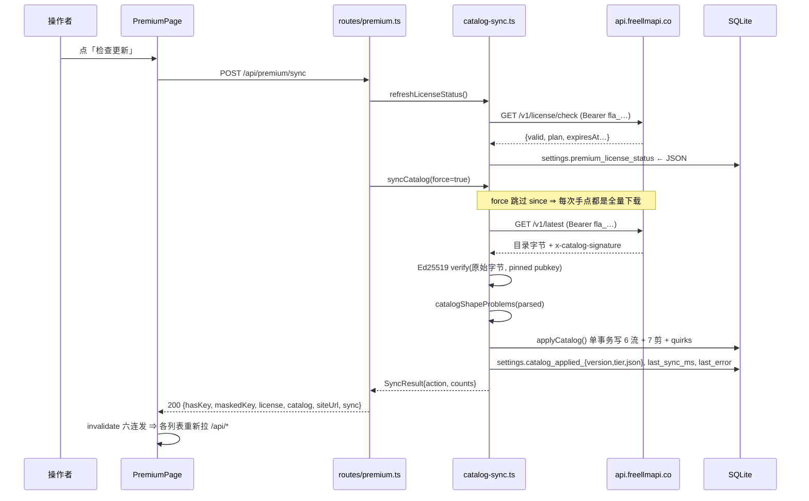
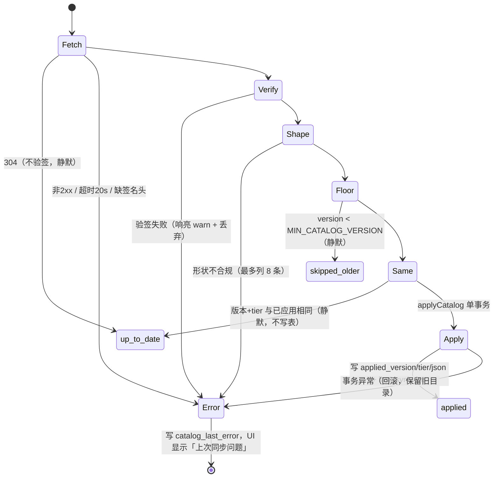

# 主题：Premium 的「检查更新」到底做了什么 —— 目录同步的存储、结构与运行影响

> 桌面版 **高级版（Premium）** 页面右上角那颗「检查更新」按钮，背后是一次 **签名目录同步（catalog sync）**：它把远端整份模型目录拉下来、验签、拆进本地 SQLite 的七八张表，并在之后每次启动时从缓存重放一遍。本篇只回答四个问题，且每个答案都落到具体存储位置、字段、行号与本机实测数字：
>
> 1. **同步下来的内容在本机存放在哪里？**（§2）
> 2. **里面的数据结构是怎么样的？**（§3）
> 3. **同步更新了哪些内容？**（§4）
> 4. **对 APP 运行有哪些影响？**（§5）——也就是「点了按钮之后到底发生了什么、改变了什么、什么时候生效」。
>
> **与既有文档的分工**：`../../en/architecture/05-catalog-sync.md`（及 `docs/zh-cn/architecture/05-catalog-sync.md`）是按产品机制写的 deep-dive，偏「规则清单」；`../sourceReader/12-函数级走读-存储配置与请求入口.md` 是按函数拆的读法；`model调度算法.md` 讲目录写完之后**谁在消费这些表**。本篇按**数据落地的物理顺序**讲：一次 HTTP 往返 → 一行 settings → 七张表 → 运行时读取链。三者的出入（含 05 文档需要修的三处）见 §9。
>
> **版本与记法**：正文一律 `文件:行号`，绝对行号以工作树 `adrian`@`c45fa7ef`（2026-10-28 同步）为准。本机运行的网关是 `/Applications/FreeLLMAPI.app` v0.16.11（`app.asar` 构建于 10-27 12:19），**与工作树不是同一份代码**；凡是「只有旧构建才会这样」的观察，正文里单独标注。实测全部为**只读**：`sqlite3 -readonly`、日志 grep、`grep -a` 打 asar，日期 2026-10-28，实例是桌面版默认数据目录（§2.4）。

---

## 0. 四问速答

| 问题 | 一句话答案 | 证据 |
|---|---|---|
| 存在哪里 | **不落文件**。整份已验签的 JSON 当作**一个字符串**塞进 `settings` 表 `key='catalog_applied_json'` 那一行（本机 1,318,951 字节 ≈ 1.3 MB），再由它拆成关系表；行位置随部署形态变，桌面版是 `~/Library/Application Support/FreeLLMAPI/freeapi.db` | [catalog-sync.ts:1111](file:///Users/vincent/workspace/16_AI/freellmapi/server/src/services/catalog-sync.ts#L1111)、§2.4 实测 |
| 什么结构 | 顶层 12 个 key：`version/generatedAt/tier` + 6 个注册表（`models/embeddings/transcriptionModels/videoModels/searchEngines/decisionModels`）+ `quirks`；另有 `counts/platforms/models[].quirks` 三处**客户端根本不读**。校验由 `catalogShapeProblems` 逐字段做，一次最多报 8 条 | [catalog-sync.ts:235-268](file:///Users/vincent/workspace/16_AI/freellmapi/server/src/services/catalog-sync.ts#L235)、§3 |
| 更新什么 | 六条写入流（chat / 生成式媒体 / 视频 / 搜索 / 决策 / 嵌入）+ 按模态分七类裁剪 + `quirks` 全量替换 + `fallback_config`/`profile_models` 补不变式；本机一次同步典型是 **1042 updated / 0 new / 0 removed / 34 skipped** | [catalog-sync.ts:504-1051](file:///Users/vincent/workspace/16_AI/freellmapi/server/src/services/catalog-sync.ts#L504)、§4.4 实测 |
| 运行影响 | 生效靠**各缓存自己过期**，没有任何事件总线：链缓存 1s、密钥计数/窗口用量/配额 5s、打分统计 60s。真正危险的是**每次启动 migration 与缓存重放的拉锯**，以及 `CATALOG_SYNC_DISABLED=1` 会把重放一起关掉 | [router.ts:1321-1332](file:///Users/vincent/workspace/16_AI/freellmapi/server/src/services/router.ts#L1321)、[catalog-sync.ts:1252-1266](file:///Users/vincent/workspace/16_AI/freellmapi/server/src/services/catalog-sync.ts#L1252)、§5 |

---

## 1. 一颗按钮的完整时序

按钮本身没有任何业务逻辑，只是把 mutation 打到一个 POST 上（中文文案 `premium.checkForUpdates` = 「检查更新」，[en.json:1049](file:///Users/vincent/workspace/16_AI/freellmapi/client/src/i18n/locales/en.json#L1049)）：

```
<PremiumPage> 按钮     onClick → syncNow.mutate()          PremiumPage.tsx:90
   └ 文案在 pending 时切成「同步中…」                        PremiumPage.tsx:92
POST /api/premium/sync                                        premium.ts:87
   ├ await refreshLicenseStatus()          ← 先验 license     premium.ts:88 → catalog-sync.ts:1164
   ├ await syncCatalog(true)               ← force=true！     premium.ts:89 → catalog-sync.ts:1058
   └ res.json({ ...statusPayload(), sync })  ← 恒 200         premium.ts:90
onSuccess → invalidate() 六连发                               PremiumPage.tsx:33-40
   ['premium'] ['models'] ['fallback'] ['embeddings'] ['media'] ['search-engines']
```



四个值得单独钉住的细节：

1. **`force=true` 让「检查更新」永远比自动同步更贵。** 定时轮询走 `syncCatalog()`（无参），带上 `?since=<appliedVersion>`，服务端没新版就打回 304（[catalog-sync.ts:1067](file:///Users/vincent/workspace/16_AI/freellmapi/server/src/services/catalog-sync.ts#L1067)、`:1071`）；手动点与加/删 license key 走 `force=true`，`since` 被跳过，**每次都把整份 1.3 MB 文档拉下来并走完验签**，哪怕版本没变——然后 `sameAsApplied` 命中（`:1102`），一行数据都不改，只在日志里留不下任何痕迹。
2. **同步失败不是 HTTP 错误。** `syncCatalog` 把所有异常吞在自己的 `try/catch` 里并返回 `{ok:false, action:'error', detail}`（`:1126-1130`），路由照样 `res.json(...)` 回 200。前端全局只有 `mutationCache.onError` 会弹 toast（[App.tsx:64-68](file:///Users/vincent/workspace/16_AI/freellmapi/client/src/App.tsx#L64)），**200 不弹**；失败的唯一出口是面板上那行「上次同步问题：{error}」，因为 `catalog_last_error` 被写进了 settings。
3. **验签覆盖的是原始字节，不是解析后的对象。** `crypto.verify(null, bytes, …)` 里的 `bytes` 就是 `res.arrayBuffer()`，之后才 `JSON.parse`（`:1080-1084`）。所以「CDN 被投毒 / 中间人改包」与「签名不匹配」是同一道闸门挡掉的，而 `since` 的 304 分支**根本不走验签**（在 `:1071` 就返回了）——它信的是 HTTP 缓存语义，不是密码学。
4. **`RefreshCw` 图标转起来 ≠ 正在写库。** `syncNow.isPending` 只覆盖那一次 fetch；写库、写 settings 全在服务端 await 里，前端看不到中间态。本机时间戳能反推出顺序：`premium_license_status.checkedAtMs` = 15:21:07、`catalog_last_sync_ms` = 15:21:09（同一次手点，相隔 2.3 s）。

除了按钮，同步还有四个触发点：

| 触发点 | 调用 | force | 代码 |
|---|---|---|---|
| 进程就绪后 10 s | `scheduler.after(BOOT_DELAY_MS, run)` | 否 | [catalog-sync.ts:1263](file:///Users/vincent/workspace/16_AI/freellmapi/server/src/services/catalog-sync.ts#L1263) |
| 之后每 12 h | `scheduler.every(SYNC_INTERVAL_MS, run)` | 否 | `:1265` |
| 点「检查更新」 | `syncCatalog(true)` | **是** | [premium.ts:89](file:///Users/vincent/workspace/16_AI/freellmapi/server/src/routes/premium.ts#L89) |
| 激活 / 移除 key | `syncCatalog(true)` | **是**（tier 会变而 version 不变） | `premium.ts:72`、`:81` |
| 声明式配置里的 `license:` | `activateConfiguredLicense()` 末尾 `void syncCatalog(true)` | **是** | [declarative-config.ts:562](file:///Users/vincent/workspace/16_AI/freellmapi/server/src/services/declarative-config.ts#L562) |

`run()` 里两个调用都是 `void`（`:1260-1262`），且 `NodeScheduler.every` 就是裸 `setInterval` + `void fn()`（[scheduler.ts](file:///Users/vincent/workspace/16_AI/freellmapi/server/src/lib/scheduler.ts)），**没有防重入**：上一轮没跑完，下一轮照发。安全性完全靠「12 h ≫ 20 s fetch 超时」与两个函数各自的 catch-all。

---

## 2. 存在哪里

### 2.1 三层存储，没有第四层

```
                    ┌──────────────────────────────────────────────────┐
远端 api.freellmapi.co │ GET /v1/latest + x-catalog-signature             │
                    └───────────────┬──────────────────────────────────┘
                                    │ Ed25519 验签通过后才继续
                                    ▼
   第①层  原样字节（唯一副本，不落地成文件）
        settings(key='catalog_applied_json', value=<整份 JSON 文本>)
                                    │ 拆表
                                    ▼
   第②层  关系表（真正被路由读的东西）
        models / media_models / embedding_models
        quirks + quirk_targets / fallback_config / profile_models
        （+ 参与裁决的 catalog_model_tombstones / model_overrides）
                                    │
                                    ▼
   第③层  元数据与账本（只给 UI 和「下次拉什么」用）
        settings: catalog_applied_version / catalog_applied_tier
                  catalog_last_sync_ms / catalog_last_error
                  premium_license_key / premium_license_status
```

这三层都在**同一个 SQLite 文件**里，`settings` 是一张 `key TEXT PRIMARY KEY, value TEXT NOT NULL` 的普通 KV 表（[20260101_000000_legacy_baseline.ts:196](file:///Users/vincent/workspace/16_AI/freellmapi/server/src/db/migrations/20260101_000000_legacy_baseline.ts#L196)）。**全仓没有任何 `fs.writeFile` 把目录写成 .json**——写文件的只有发布者侧的导出脚本（§3.5）。

### 2.2 第①层：整份文档就是 1.3 MB 的一行

[catalog-sync.ts:1107-1111](file:///Users/vincent/workspace/16_AI/freellmapi/server/src/services/catalog-sync.ts#L1107) 存的是 `bytes.toString('utf8')`，也就是**验签过的那串原始字节**，注释把信任模型讲得很清楚：能篡改这一行的攻击者本来就能直接改 `models` 表，所以缓存不额外增加攻击面。它有两个读者：

| 读者 | 干什么 | 位置 |
|---|---|---|
| `reapplyCachedCatalog()` | 每次启动同步重放，无需网络 | `:1230` |
| `appliedCatalogPlatforms()` | 目录管了哪些平台，供内置模型发现让路 | `:466` |
| `cachedCatalogDefaults()` | 仪表盘改模型时，取「目录默认值」当 override 基线 | [model-state.ts:93-111](file:///Users/vincent/workspace/16_AI/freellmapi/server/src/services/model-state.ts#L93) |
| 迁移 `20260726_000003` | 一次性回填 `models.source` 的归属判定 | [该文件:53](file:///Users/vincent/workspace/16_AI/freellmapi/server/src/db/migrations/20260726_000003_model_source_provenance.ts#L53) |

代价也随之而来：`appliedCatalogPlatforms` 每次调用**都要把整行读出来**再和内存里缓存的 `raw` 做字符串比较（`:466-479`）；1.3 MB 的行比较是每次数毫秒的内存操作，而它落在 `startBuiltinModelDiscovery` 的路径上（[builtin-model-discovery.ts:84](file:///Users/vincent/workspace/16_AI/freellmapi/server/src/services/builtin-model-discovery.ts#L84)）。这是「目录即单一事实源」设计换来的固定税，源码里没做长度分桶或版本号旁路。

### 2.3 第②③层：谁写谁、放什么

| 存储对象 | 写入者 | 本机实测（2026-10-19） |
|---|---|---|
| `settings.catalog_applied_json` | `:1111`，仅在真正 apply 时更新 | 1,318,951 字节 |
| `settings.catalog_applied_version` | `:1105` | `2026.10.18.cbb31395`（19 字符，日期+提交短哈希） |
| `settings.catalog_applied_tier` | `:1106` | `live` |
| `settings.catalog_last_sync_ms` | `:1072/1097/1118/1123` 四条成功路径都写 | `1792394469406` = 2026-10-19 15:21:09 CST |
| `settings.catalog_last_error` | 成功清空、失败写 message（`:1129`） | 空串 |
| `settings.premium_license_key` | `premium.ts:70`（`setSetting`），**明文存**；对外只露 `maskedKey`（前 7 + 后 4，`premium.ts:17-21`） | 36 字符（`fla_` + 32），本篇不复述其值 |
| `settings.premium_license_status` | `:1175`，整份 `LicenseStatus` JSON | `{"valid":true,"plan":"annual","status":"active","expiresAt":"2027-10-12T00:25:12.000Z","cancelAtPeriodEnd":false,"checkedAtMs":1792394467594}` |
| `models` | `insertModel`/`updateModel`（`:511-528`） | 1034 行 = 952 `catalog` + 64 `discovered` + 18 `user` |
| `media_models` | 4 条注册表共用（`:531-553`） | audio 16 / decision 7 / image 12 / search 6 / transcription 8 / video 3 |
| `embedding_models` | `:557-571` | 52 行 |
| `quirks` / `quirk_targets` | 全量替换（`:1033-1045`） | 93 / 129 行 |
| `fallback_config` | 补缺失行（`:855-864`） | 1034 行（每模型一行，不变式成立） |
| `profile_models` | `ensureAllModelsInProfiles`（`:865`） | 2712 行 / 4 条链 |
| `catalog_model_tombstones` | **不由 sync 写**，由仪表盘删除与上游 410 退役写（[model-state.ts:199-245](file:///Users/vincent/workspace/16_AI/freellmapi/server/src/services/model-state.ts#L199)） | 7 行，全部 `source='upstream_eol'`、platform=`xkiro` |
| `model_overrides` | **不由 sync 写**，sync 只刷新其基线并重放（`:852`） | **0 行**（见 §4.3） |

### 2.4 物理位置随部署形态变（桌面版绕不过 `FREEAPI_DB_PATH`）

| 形态 | 数据库路径 | 关键代码 |
|---|---|---|
| 桌面版 macOS | `~/Library/Application Support/FreeLLMAPI/freeapi.db` | `app.setName('FreeLLMAPI')` + `setPath('userData', appData/FreeLLMAPI)`（[main.ts:21-22](file:///Users/vincent/workspace/16_AI/freellmapi/desktop/src/main.ts#L21)），`dbPath = path.join(app.getPath('userData'),'freeapi.db')`（[main.ts:258](file:///Users/vincent/workspace/16_AI/freellmapi/desktop/src/main.ts#L258)）→ `initDb(opts.dbPath)`（[server-host.ts:132](file:///Users/vincent/workspace/16_AI/freellmapi/desktop/src/server-host.ts#L132)） |
| standalone server（dev/生产同） | `server/data/freeapi.db`，或 `FREEAPI_DB_PATH` | `DB_PATH = path.resolve(__dirname,'../../data/freeapi.db')`（[db/index.ts:14-15](file:///Users/vincent/workspace/16_AI/freellmapi/server/src/db/index.ts#L14)）——**基于模块自身位置，不是 cwd**，`tsx src/index.ts` 与 `node dist/index.js` 落点一致 |
| Docker | `/app/server/data/freeapi.db`，named volume `freellmapi-data` 挂在该目录 | [Dockerfile:55](file:///Users/vincent/workspace/16_AI/freellmapi/Dockerfile#L55)、[docker-compose.yml:26-27](file:///Users/vincent/workspace/16_AI/freellmapi/docker-compose.yml#L26) |
| CLI | **不落任何目录数据**：CLI 只走 HTTP 指向已运行的网关（`FREELLMAPI_URL`，默认 `http://localhost:3001`） | [cli/src/index.ts:53](file:///Users/vincent/workspace/16_AI/freellmapi/cli/src/index.ts#L52) |

三条容易踩的优先级与副作用：

- **显式 `dbPath` 压过环境变量**：`connectDb` 用 `dbPath ?? getDefaultDbPath()`（[db/index.ts:59](file:///Users/vincent/workspace/16_AI/freellmapi/server/src/db/index.ts#L59)），而 `getDefaultDbPath()` 才读 `FREEAPI_DB_PATH`（`:27-29`）。桌面版永远传显式路径，所以**给桌面版设 `FREEAPI_DB_PATH` 无效**。
- 同目录伴生文件：`-wal`/`-shm`（WAL 模式在 `:82` 打开，本机 WAL 4.9 MB）、`.encryption-key`（上游 provider key 的 AES-GCM 主密钥，与目录无关；[lib/crypto.ts:27,63-68](file:///Users/vincent/workspace/16_AI/freellmapi/server/src/lib/crypto.ts#L27)）、`backups/`、`logs/freeapi.log`（桌面版轮转到 `freeapi.log.1`）。
- 目录/文件权限加固只在「自己刚建的目录」或「内置默认数据目录」生效，`FREEAPI_DB_PATH` 指到 `/tmp` 之类不会连坐 chmod（[db/index.ts:101-147](file:///Users/vincent/workspace/16_AI/freellmapi/server/src/db/index.ts#L101)）。

### 2.5 可 grep 的第三种记录：日志

`SyncResult.counts` **不落库**（只在返回体里），唯一的持久化出口是 `console.log`（[catalog-sync.ts:1112-1117](file:///Users/vincent/workspace/16_AI/freellmapi/server/src/services/catalog-sync.ts#L1112)）。本机日志（2026-10-19 只读 grep）：

```
2026-10-15T23:44:09Z applied live v2026.10.15.c2791367: 1016 updated, 4 new, 0 removed, 93 quirks, 27 skipped (unknown platform)
2026-10-16T12:07:57Z re-applied cached live v2026.10.15.c2791367 after boot
2026-10-16T12:08:09Z applied live v2026.10.16.7388413c: 1027 updated, 0 new, 0 removed, 93 quirks, 20 skipped (unknown platform)
2026-10-18T00:08:00Z [warn] catalog payload has unexpected shape
2026-10-18T12:08:01Z applied live v2026.10.18.ca0ff03c: 1027 updated, 11 new, 0 removed, 93 quirks, 21 skipped (unknown platform)
2026-10-18T23:49:30Z re-applied cached live v2026.10.18.ca0ff03c after boot
2026-10-18T23:49:43Z applied live v2026.10.18.cbb31395: 1042 updated, 0 new, 0 removed, 93 quirks, 34 skipped (unknown platform)
2026-10-19T01:51:45Z re-applied cached live v2026.10.18.cbb31395 after boot
```

从这 8 行能直接读出四件事：**每次启动必重放缓存**；重放后约 12-13 s（= `BOOT_DELAY_MS` 10 s + 网络）才可能有一次真 apply；典型一次是**几乎全表 UPDATE、几乎零增删**；`up_to_date` 与 `skipped_older` 两条路径**一行日志都不打**（`:1071-1075`、`:1094-1100`），所以本机 15:21:09 那次手点（settings 有 `last_sync_ms`，日志无对应行）只能是 `up_to_date`——版本仍是 `2026.10.18.cbb31395`。

另：`2026-10-18T00:08` 那条 shape 报错**没有** `: <具体问题列表>` 后缀，而工作树 `:1090` 与当前 asar 都带（`grep -ac catalogShapeProblems app.asar` = 3）。同一份日志里 10-18 21:43Z 与 10-19 01:51Z 各有一次 `[updater] … before installing v0.16.x`，所以那条来自升级前的旧构建，不能拿它当 HEAD 的行为。

---

## 3. 数据结构

### 3.1 顶层：12 个 key，其中 3 处客户端根本不读

本机已应用的 live 文档实测顶层顺序：

```
version, generatedAt, tier, counts, platforms,
models, quirks, embeddings, transcriptionModels,
videoModels, searchEngines, decisionModels
```

| key | 类型 | 客户端是否消费 | 说明 |
|---|---|---|---|
| `version` | string | ✅ 写 `catalog_applied_version`，并参与**字符串**比较 `< MIN_CATALOG_VERSION` | `2026.10.18.cbb31395` 这种「日期+短哈希」能比，是因为前缀定宽补零；发布侧 `dateVersion()` 也是 `YYYY.MM.DD` 定宽（[export-catalog.ts:37-42](file:///Users/vincent/workspace/16_AI/freellmapi/server/src/scripts/export-catalog.ts#L37)） |
| `generatedAt` | ISO string | ❌ 只进日志与导出，路由不读 | `2026-10-18T17:31:43.488Z` |
| `tier` | `'live'`\|`'monthly'` | ✅ 写 `catalog_applied_tier`，UI 绿点由它决定 | 本机 `live` |
| `counts` | object | ❌ 网关侧**无读取方** | 本机 12 个计数（`platforms/models/enabledModels/embeddings/enabledEmbeddings/transcriptionModels/videoModels/quirks/searchEngines/enabledSearchEngines/decisionModels/enabledDecisionModels`）；唯一读它的是发布脚本自己打日志（[export-catalog.ts:143-145](file:///Users/vincent/workspace/16_AI/freellmapi/server/src/scripts/export-catalog.ts#L143)） |
| `platforms` | `[{id,name}]`（本机 69 条） | ❌ **全仓无读取方** | 展示名由本地 provider 注册表提供 |
| `models` | array（本机 988） | ✅ | text 952 / image 15 / audio 21 |
| `embeddings` | array（59） | ✅ 可选 | |
| `transcriptionModels` | array（12） | ✅ 可选 | |
| `videoModels` | array（4） | ✅ 可选 | |
| `searchEngines` | array（6） | ✅ 可选 | |
| `decisionModels` | array（7） | ✅ 可选 | |
| `quirks` | array（93） | ✅ 全量替换两张表 | |
| `managedPlatforms` | array\<string\> | ✅ 可选，**本机这份没有** | 目录「占了坑但这条 tier 不给行」的平台名单，用来封住内置发现 |

`models[]` 每行还带一个内联 `quirks` 数组（本机 988 行里 **975 行有这个字段、其中 804 行非空**，其余 13 行连字段都不带），而 `CatalogModel` 接口（[catalog-sync.ts:133-156](file:///Users/vincent/workspace/16_AI/freellmapi/server/src/services/catalog-sync.ts#L133)）里**没有这个字段**，apply 路径也不读它（`:648-660` 的 `fields` 里没有 `quirks`）——告警只从顶层 `quirks` + `quirk_targets` 的 GLOB 选择器来。这三处冗余（`counts`/`platforms`/内联 `quirks`）是发布侧把「产品」和「传输格式」合成一份的残留，`catalogShapeProblems` 是**白名单校验**（只查它认识的字段），多余字段一律放行。

### 3.2 `models[]` → `models` 表

本机一条真实记录（截自 `catalog_applied_json`）：

```json
{"platform":"google","modelId":"gemini-3.5-flash","displayName":"Gemini 3.5 Flash",
 "intelligenceRank":41,"speedRank":5,"sizeLabel":"Frontier",
 "limits":{"rpm":10,"rpd":20,"tpm":250000,"tpd":null},
 "monthlyTokenBudget":"~3M","contextWindow":1048576,
 "enabled":true,"supportsVision":true,"supportsTools":true, "quirks":[…]}
```

| 目录字段 | 落到哪 | 转换 |
|---|---|---|
| `platform` + `modelId` | `models.platform` + `models.model_id` | 定位键（SELECT 用 `WHERE platform=? AND model_id=?`，`:510`） |
| `displayName` `intelligenceRank` `speedRank` `sizeLabel` | 同名列 | 直存 |
| `limits.rpm/rpd/tpm/tpd` | `rpm_limit` `rpd_limit` `tpm_limit` `tpd_limit` | 拆四列，`null` 原样存 NULL |
| `monthlyTokenBudget` `contextWindow` | 同名列 | 预算是**字符串**（`"~3M"`），不是数字 |
| `supportsVision` `supportsTools` `enabled` | INTEGER 0/1 | `m.supportsVision ? 1 : 0`（`:659`） |
| `modality` | **不落 `models`** | 值为 `image`/`audio` 时整条改道 `media_models`（`:585-614`） |
| `mediaNote` | `media_models.quota_label` | 缺省存 `''` |
| `requestStyle` | `media_models.meta_json` 的 `{"requestStyle":…}` | 没有就存 NULL，让 adapter 用默认 |
| 内联 `quirks` | — | 丢弃 |

`models.source` 由代码写死 `'catalog'`（`insertModel` 语句 `:521-528`，字面量在 `:527`；认领 discovered 走 `adoptModel`，语句在 `:520`、调用在 `:647`），目录永远不可能把一行改成 `'user'`。

### 3.3 其余五张注册表 → 两张表

```
                       ┌───────────────────────────────┐
models[] modality=image│audio ──────────▶              │
videoModels[]   (video)──────────────────▶  media_models │
searchEngines[] (search) ────────────────▶  按 (platform, │
decisionModels[](decision) ─────────────▶  model_id) 定位│
transcriptionModels[](transcription) ────▶              │
                       └───────────────────────────────┘
embeddings[] ──────────────────────────▶ embedding_models
```

| 来源 | `media_models.model_id` 存什么 | `priority` 从哪来 | `meta_json` 装什么 |
|---|---|---|---|
| `models[]`(image/audio) | `modelId` | `intelligenceRank ?? 0`（`:601`） | 仅 `requestStyle` |
| `videoModels[]` | `modelId` | `priority` | 仅 `providerModelId` |
| `searchEngines[]` | **`engineId`**（不是 modelId，`:745`） | `priority` | `creditsPerQuery`/`features{news,answer,fullContent}`/`premiumSince` |
| `decisionModels[]` | `modelId` | `priority` | `contextWindow`/`premiumSince` |
| `transcriptionModels[]` | `modelId` | `priority` | `subtitleFormats`/`maxBytes`/`requestStyle` |

`embeddings[]` 的字段最规整：`family/platform/modelId/displayName/dimensions/maxInputTokens/priority/enabled/quotaLabel` 一一对到 `embedding_models` 列（`:557-571`）。目录里额外有 `premiumSince`，**列里没有**，直接丢。

`quirks` 的结构与语义（`:88-94` + [legacy_baseline.ts:2115-2131](file:///Users/vincent/workspace/16_AI/freellmapi/server/src/db/migrations/20260101_000000_legacy_baseline.ts#L2115)）：一条 quirk = `slug/title/body/severity`，靠 `targets[]` 的**选择器**作用到模型，两个字段任一为 `null` 即通配：

```
platform=null, glob=null      → 全局提示
platform=set,  glob=null      → 该平台所有模型
platform=set,  glob=set       → 该平台下 model_id GLOB 命中的（GLOB，不是 LIKE）
platform=null, glob=set       → 跨平台按 id 家族命中
```

### 3.4 结构契约在哪里强制执行

`catalogShapeProblems`（`:288-372`）与 `isCatalog`（`:413-415`）是同一个判断的两种输出，注释要求二者同步维护。要点：

- 必填：`version` 是 string、`tier` ∈ {live,monthly}、`models` 与 `quirks` 是数组；否则整包拒收。
- **两种 null 语义是两族函数**：`optStr/optNum` 只接受「字段不存在」（`quotaLabel: null` 算形状错误），`nulStr/nulNum` 连显式 `null` 也接受（`maxBytes: null` 合法）——`:304-311` 的注释明说这是在复刻改写前的 `&&` 长链，不是新设计。
- `models[]` 每行只查 6 项（platform/modelId/displayName 是 string、enabled 是 boolean、requestStyle 是 nulStr、`limits` 存在且是 object），**不查** `intelligenceRank/contextWindow/…`。所以一条缺 `contextWindow` 的行能通过校验、然后往 NOT NULL 列写 `undefined`——这一层交给 SQLite 报错、再由 `syncCatalog` 的 catch 变成 `last_error`。
- 报错上限 `CAP = 8`（`:290`），一条坏行即否决整包，防的是垃圾 body 把 warning 撑成兆级日志。

### 3.5 上游：这份文档是怎么造出来的

本仓有个**发布侧**导出脚本 [export-catalog.ts](file:///Users/vincent/workspace/16_AI/freellmapi/server/src/scripts/export-catalog.ts)，它的取数口径值得注意：`SELECT … FROM models ORDER BY intelligence_rank, platform, model_id` + `resolveQuirksByModel/listQuirkDefinitions`，注释写「单一事实源管线，从网关自己用的那个 SQLite 直接导出，所以发布的目录不可能与实际服务的漂移」。

两点边界（避免误读）：

1. 该脚本只产出 `version/generatedAt/tier/counts/platforms/models/quirks` **七个 key**，且给 `models[]` 附上内联 `quirks`（[export-catalog.ts:114](file:///Users/vincent/workspace/16_AI/freellmapi/server/src/scripts/export-catalog.ts#L114)）——**不产出** 5 个新注册表和 `managedPlatforms`。本机 live 文档却带着它们，说明线上这份不是本脚本产物。
2. 脚本注释指向同级的 `../../catalog` 仓（签名在 `catalog/src/scripts/sign-catalog.ts`，「对精确字节签名」），而该目录在本机**不存在**、也不在工作区内。所以「`counts`/`platforms`/内联 `quirks` 到底谁在用、`version` 的短哈希后缀是谁加的」——**当前工作区无法确定**，本篇不作断言。

---

## 4. 同步更新了哪些内容

### 4.1 一个事务里的六条写入流

`applyCatalog` 把整段包成**单个事务**（`:481-488`，#1047），`applyCatalogInner` 按顺序跑：

| # | 流 | 定位键 | 门禁（不过就 `skippedUnknownPlatform++`） | 代码 |
|---|---|---|---|---|
| 1 | chat：`models[]` 中 `modality` 缺省或 `text` | `(platform, model_id)` | `platform!=='custom' && hasProvider(platform)` | `:582-675` |
| 2 | 生成式媒体：`models[]` 中 `image`/`audio` | `media_models(platform, model_id)` | `MEDIA_PLATFORMS` | `:586-614` |
| 3 | 视频：`videoModels[]` | 同上 | `VIDEO_PLATFORMS` | `:680-708` |
| 4 | 搜索：`searchEngines[]`（键取 `engineId`） | 同上 | `SEARCH_ENGINE_PLATFORMS` | `:714-749` |
| 5 | 决策：`decisionModels[]` | 同上 | `DECISION_PLATFORMS` | `:753-781` |
| 6 | 嵌入：`embeddings[]` | `embedding_models(platform, model_id)` | `EMBEDDING_PLATFORMS` | `:785-815` |

（`transcriptionModels[]` 逻辑同 3-5，门禁 `TRANSCRIPTION_PLATFORMS`，另走 `updateTranscription/insertTranscription` 把 `modality` 写死成 `'transcription'`，`:821-849`。）

紧接着是不变式补齐与七类裁剪：

```
:851  deleteTombstonedCatalogModels   只删 kind 匹配且 source='user' 的墓碑行
:852  applyAllModelOverrides          把用户的字段级 override 重放回去
:855-864                              给缺行的模型补 fallback_config（priority 追加到链尾）
:865  ensureAllModelsInProfiles       按 auto_include_new_models=1 的链回填 profile_models
:875-893                              剪：source='catalog' 且本目录不再列出的 chat 行（先删 fallback 再删 models）
:902-911  剪：#1348 目录一旦接管某平台，该平台所有 source='discovered' 行删除
:917-924  剪：#1516 key_id 指向已不存在 api_keys 的孤儿行（models/embedding/media 三表）
:935-945  剪：media_models 里 image/audio（**允许列表**，不是「除了 transcription 全剪」）
:949-991  剪：video / search / decision，各自要求本目录带上了对应快照 key
:996-1007  剪：transcription，同上
:1014-1030  剪：embedding，且要求 `embeddings.length > 0`（空数组=「这份目录不管嵌入」）
:1032-1046 quirks：DELETE quirk_targets → DELETE quirks → 逐条重插（纯内容，全量替换）
```

`videoModels/searchEngines/decisionModels/transcriptionModels/embeddings` 都是**可选全量快照**：老目录不带这个 key，就完全不动这一类行；带了就把「没列出的」剪掉。`:928-934` 的注释专门警告：把媒体那条裁剪条件从允许列表放宽成 `!=`，会让一次老目录同步把全部 video 行静默删光。

### 4.2 冲突裁决：谁赢

| 情形 | 结果 | 代码 |
|---|---|---|
| 目录 `enabled=false` | **强制关**（上游已死），无视本地开 | `:664` `const enabled = m.enabled ? row.enabled : 0` |
| 目录 `enabled=true`、本地关着 | **保持关**（读的是当前行的值） | 同一行 |
| `models.source='user'` 撞键 | **整条跳过**：不更新、不认领、也不在裁剪候选里（裁剪只认 `source='catalog'`） | `:641`、`:881` |
| `models.source='discovered'` 撞键 | **被目录认领**：`adoptModel` 改写成 `'catalog'`，元数据被目录覆盖 | `:647` |
| 用户在仪表盘删过（`user` 墓碑） | 永远不写回，且 `:851` 把已复活的行再删掉 | `:622` + [model-state.ts:190-197](file:///Users/vincent/workspace/16_AI/freellmapi/server/src/services/model-state.ts#L190) |
| 上游 410/EOL 自动退役（`upstream_eol` 墓碑） | 行**保留只关**；目录若仍列出**且 enabled** 就复活 | `:630` + [model-state.ts:232-267](file:///Users/vincent/workspace/16_AI/freellmapi/server/src/services/model-state.ts#L232) |
| 用户改过某字段（`model_overrides`） | 目录先写、再把 override 盖回去；同时刷新 override 里记的基线 | `:666-667`、`:852` |
| 目录里有、本地 provider 没有 | 跳过并计数，等应用更新后自然出现 | `:616-621` |

`enabled` 这一行是整套「本地意志优先」的机制核心：**它不靠记录，靠读改写**。所以「关掉一个模型」这个动作，在库里根本不留痕。

### 4.3 一个容易被误解的实现细节：`enabled` 不进 overrides

仪表盘 PATCH 的字段级 override 白名单是 12 项，**不含 `enabled`**（[routes/models.ts:299-308](file:///Users/vincent/workspace/16_AI/freellmapi/server/src/routes/models.ts#L299)）；关模型走的是直接 `UPDATE models SET enabled=0` + 把 `profile_models`/`fallback_config` 一并置 0（`:277`、`:311-322`）。这解释了本机看似矛盾的一组数字：

```
model_overrides 行数 = 0
但 models 里有 3 行 source='catalog' 且 enabled=0，而目录把它们的 enabled 写成 true：
  openrouter:nvidia/nemotron-3-ultra-550b-a55b:free
  nvidia:google/gemma-4-31b-it
  llm7:minimax-m2.7
```

即：本地禁用靠 §4.2 的读改写存活，**不需要也不产生** override 行；`model_overrides` 只服务于「改名 / 改限额 / 改能力位」这类字段级覆盖。

### 4.4 本机实测：目录 988 行，落库少了 36 行，差额 100% 可解释

按 §4.1 的门禁逐条数（脚本比对 `catalog_applied_json` 与工作树 HEAD 的六个平台集合常量：[media.ts:27-40](file:///Users/vincent/workspace/16_AI/freellmapi/server/src/services/media.ts#L27)、[embeddings.ts:112-124](file:///Users/vincent/workspace/16_AI/freellmapi/server/src/services/embeddings.ts#L112)、[search.ts:474](file:///Users/vincent/workspace/16_AI/freellmapi/server/src/services/search.ts#L474)、[decision.ts:274](file:///Users/vincent/workspace/16_AI/freellmapi/server/src/services/decision.ts#L274)）：

| 注册表 | 目录行数 | 门禁外（被 skip） | 应落库 | 本机该表实测 |
|---|---|---|---|---|
| `models[]` text | 952 | 0（逐条核对：952 条全部存在于 `models`） | 952 | 952（`source='catalog'`） |
| `models[]` image | 15 | 3：agnes×2、ovh×1 | 12 | `media_models` image **12** |
| `models[]` audio | 21 | 5：groq×2、cohere×2、mistral×1 | 16 | audio **16** |
| `videoModels` | 4 | 1：agnes | 3 | video **3** |
| `transcriptionModels` | 12 | 4：cohere、mistral、ovh×2 | 8 | transcription **8** |
| `searchEngines` | 6 | 0 | 6 | search **6** |
| `decisionModels` | 7 | 0 | 7 | decision **7** |
| `embeddings` | 59 | 7：mistral×2、pinecone×2、ovh×3 | 52 | `embedding_models` **52** |

八格全对平，说明本机**没有**因为墓碑、认领或裁剪产生额外差额；这些行的消失唯一原因是「这个二进制没有对应平台的 adapter」。日志里 `34 skipped (unknown platform)` 与本表的 20 条媒体/嵌入差额的差异，来自不同版本的目录内容与不同构建的 provider 集合，不能直接相减比对（未逐条核对，标注为未验证）。

顺带钉一个数字口径：`counts.updated` **不是**「chat 模型数」，而是六条流全部 UPDATE 的行数之和（本机最新一次 1042 updated），所以一次同步写上千行是常态，不是异常。

---

## 5. 对 APP 运行的影响

### 5.1 生效延迟：没有事件总线，全靠各缓存自己过期

`catalog-sync.ts` 全文不 `emit`、不 `EventEmitter`，也不调用任何 `invalidate*()`；它对「别人」的通知只有事务内的两次直调（`:852` overrides、`:865` profile 回填）。前端那六连发 invalidate 是**浏览器侧 react-query 的事**，对服务端内存态毫无作用。真实生效延迟来自：

| 缓存 | 读什么 | TTL | 位置 |
|---|---|---|---|
| `chainCache` | `models ⋈ profile_models / fallback_config`——**聊天链的唯一取数路径** | **1 s** | [router.ts:1321-1332](file:///Users/vincent/workspace/16_AI/freellmapi/server/src/services/router.ts#L1321) |
| `keyCountsCache` | `api_keys` 平台计数 | 5 s | router.ts:1073-1088 |
| `windowUsageSnapshot` | `rate_limit_usage` + keys | 5 s | [ratelimit.ts:397-474](file:///Users/vincent/workspace/16_AI/freellmapi/server/src/services/ratelimit.ts#L397) |
| headroom | provider 配额余量 | 5 s | [provider-quota.ts:487-512](file:///Users/vincent/workspace/16_AI/freellmapi/server/src/services/provider-quota.ts#L487) |
| `statsCache` / `keyStatsCache` | `requests` 衰减统计（不是目录表，但限额变化会影响 headroom 分母） | 60 s | router.ts:789,821-849 |
| `appliedPlatformsCache` | `catalog_applied_json` 的平台集合 | 无 TTL，按整行字符串等值比较失效 | `:457-479` |
| settings（tier/version/lastError/license 状态） | `getSetting` | **无缓存**，每次一条 SQL | [db/index.ts:239-243](file:///Users/vincent/workspace/16_AI/freellmapi/server/src/db/index.ts#L239) |

结论：**同步写完 ≈ 1 秒后聊天请求就用上新链**，个别护栏口径最多 5 秒，打分统计最多 60 秒。按 model id 直接解析的请求（`routes/proxy.ts:1322-1326` 这类）每请求直查，即时生效。

### 5.2 每次启动的拉锯：migration 铺地板 ↔ 缓存重放抹平

```
initDb → runMigrationsSync(按 filename 记账，未跑过的才跑)
   ↓     （新装/升级会一次跑完全部 baseline，含 migrateModelsV1..V24 的 INSERT OR IGNORE）
listen 成功 → onReady:
   startHealthChecker → startCatalogSync:
        ①（同进程、同步）reapplyCachedCatalog()   :1258 → :1229
        ② after 10s / every 12h: refreshLicenseStatus + syncCatalog
```

`reapplyCachedCatalog` 存在的理由写在它自己的注释里（`:1213-1228`）：boot 期间 migration 会把**出厂地板**重新铺回来（catalog 已删掉的基线模型会被 `INSERT OR IGNORE` 复活），而 10 秒后的网络同步多半打回 304、**不会** apply，于是必须用本地缓存把目录权威重新压回去；这也顺带做到**离线可复现**。三个边界：

- 缓存文档不存在但有 `applied_version`（升级前的老装）→ **删掉 version**，逼下一次轮询走全量（`:1233-1235`）。
- 缓存文档形状不合法或版本低于地板 → 直接放弃重放，等下次网络同步（`:1239`）。
- 重放**故意**带着「这不是新证据」的身份：`catalogBringsNewEvidence()`（`:500-502`）在重放时为 false，因此重放**不会**撤销启动期间发生的上游 410 退役。本机那 7 条 `xkiro` 的 `upstream_eol` 墓碑与此一致，但也恰好无法证伪——目录把同名模型写的是 `enabled=false`，`:630` 的 `if (m.enabled && newEvidence)` 本来就不进（**该分支未实测，仅源码推断**）。

⚠️ 需要纠正 `05-catalog-sync.md` §5 的表述（原文「Migrations run on every boot and re-assert the bundled baseline」）：**runner 按文件名记账，同一文件不会重跑**（[runner.ts:153-171](file:///Users/vincent/workspace/16_AI/freellmapi/server/src/db/migrate/runner.ts#L153)）。漂移真正的来源是**应用升级带进新迁移文件**——本机 `migrations` 表给了硬证据：`20261016_000001_decision_requests` 等**三个**文件的 `applied_at` 都是 `2026-10-18 23:49:30`（= `[updater] … before installing v0.16.0` 后那次重启，同一秒紧接一条 `re-applied cached … after boot`），`20261017_233153_request_failure_attribution` 的 `applied_at` 是 `2026-10-19 01:51:45`（= 装 v0.16.3 后 5 秒的那次重启，同样同秒重放）。也就是说**「migration 铺地板」和「缓存重放抹平」只在升级那一次启动里同场出现**，顺序是 migration 在前、重放在后。

### 5.3 写放大：为什么 apply 必须是单事务

`:481-488` 的注释记录了事故原型：几百条语句在 WAL 下各自 commit+fsync、且跑在事件循环上，导致 12 小时一次的同步能把**所有在途请求**（含一个只查 3 条 SQL 的 profile-activate POST）冻住几分钟。所以 §4.1 那一大段是**一次提交**：外部要么看到旧目录要么看到新目录，中途崩溃整体回滚（settings 的三条 applied_* 在事务返回之后才写，`:1104-1111`，因此不会出现「表改了一半但 version 已更新」）。代价反过来是：一次 apply 持锁写上千行，`busy_timeout=5000`（[db/index.ts:87](file:///Users/vincent/workspace/16_AI/freellmapi/server/src/db/index.ts#L87)）内抢不到锁的并发写会失败。

### 5.4 免费与 Premium 的差别只在服务端给哪一份

本地代码**不做任何 tier 判断**：`syncCatalog` 只是「有 key 就 `Authorization: Bearer`，没有就不带」（`:1064-1084`）。差异全在 `/v1/latest` 返回的那份文档里——本机 live 文档 988 条 `models[]`，其中 5 个新注册表带 `premiumSince` 字段（如 `searchEngines[].premiumSince = 2026-09-12`），README 口径是「模型进入 live 后 30 天才进月度快照，免费装当前落后约 303 个模型」（[README.md:243-246](file:///Users/vincent/workspace/16_AI/freellmapi/README.md#L243)）。**30 天这道门不在本仓**，未实测。

因此「点一次检查更新」对两档的意义不同：免费装拿到的是月度快照（12 h 一轮，绝大多数轮次都是 304，一月才真换一次版），付费装拿到的是近乎逐日更新的 live——本机日志里 `v2026.10.14 / .15 / .16 / .18` 各有一次 apply。UI 上唯一可见的区别是那颗绿点（`appliedTier === 'live'`，[PremiumPage.tsx:83](file:///Users/vincent/workspace/16_AI/freellmapi/client/src/pages/PremiumPage.tsx#L83)）和版本徽标；`appliedVersion` 为空时显示「内置」，即「还没应用过任何目录，用的全是出厂 migration 地板」。

### 5.5 网络与隐私：一次同步往外发什么

| 外发 | 内容 |
|---|---|
| `GET /v1/latest` | 只有 `Authorization: Bearer fla_…`（明文 key）与可选 `?since=`；无提示词、无 completion、无 provider key（README:262-263 同口径） |
| `GET /v1/license/check` | 同上，只为拿 license 状态 |
| `POST /v1/portal` | key（开 Stripe 账单门户） |
| `POST /v1/license/activate` | key 明文（激活时） |

信任根是钉死的 Ed25519 公钥（`:47-50`），私钥据注释「从未离开目录主机」。自建目录可用 `CATALOG_BASE_URL` + `CATALOG_PUBKEY` 同时替换（`:70`、`:73-76`；`CATALOG_PUBKEY` 里的换行要写成字面 `\n`，代码用 `replace(/\\n/g,'\n')` 还原）。⚠️ 这三个变量**不在 `.env.example`** 里，只被 [env-drift.ts:16-18](file:///Users/vincent/workspace/16_AI/freellmapi/server/src/lib/env-drift.ts#L16) 登记为「已知未文档化」——别指望 `--env` 校验帮你发现拼写错误。

### 5.6 失败面与可见症状



对运行的影响有明确边界：**任何失败都保留上一份目录**，不会清空、不会降级；`last_error` 只是字符串，不参与路由决策。要特别注意 `skipped_older`：当**新装/升级后的地板比月度快照新**时，免费装会连续几天每次同步都「拿到一份但拒绝应用」，症状是版本号长期显示「内置」而日志一个字都不打（`:1094-1100` 无 log）。

### 5.7 关掉它

`CATALOG_SYNC_DISABLED === '1'` 时 `startCatalogSync` **在最开头就 return**（`:1254-1257`），而 `reapplyCachedCatalog()` 在它**之后**（`:1258`）。也就是说这个开关关掉的不只是网络轮询，还有关机后重启时的目录重放——长期开着它，DB 会随每次升级的新 baseline 慢慢漂回出厂态。判定是严格 `=== '1'`，写 `true` 无效。另外 `stopCatalogSync()`（`:1268-1277`）只撤 timer，没有 HTTP 入口暴露它。

### 5.8 目录与本地自动发现的领地划分

`managedPlatforms` + `catalogPlatforms()`（`:445-455`）合起来定义「这个平台归目录管」：任一注册表里有它一行（**哪怕 `enabled=false`**——`:894-901` 的注释写得很直白：「a disabled row is still an audit verdict」），或它只出现在 `managedPlatforms` 名单里（`:260-265`：这类平台被**故意**保持零行）。`:461-465` 进一步定性：「是**审计过的目录**、不是上游 `/models` 列表，决定什么东西能被路由」。`appliedCatalogPlatforms` 把集合交给内置模型发现（[builtin-model-discovery.ts:84](file:///Users/vincent/workspace/16_AI/freellmapi/server/src/services/builtin-model-discovery.ts#L84)），后果是：**上游 `/models` 列出来的东西不能自己进链**，只能是 `source='discovered'` 的临时补丁，且目录一接管就被 §4.1 的 `:865-874` 清掉。排查「某平台明明有免费模型却进不了链」时，先看的是这份缓存的平台集合，而不是 provider 的 models 接口。

---

## 6. 别和 Settings 里那颗「Check for updates」混

`settings.checkForUpdates`（en.json:154，与 premium 同名不同 key）走的是**另一条完全不同的路**：`/api/update/release`（[routes/update.ts:584](file:///Users/vincent/workspace/16_AI/freellmapi/server/src/routes/update.ts#L584)）、`/check`（`:601`）、`/status`（`:635`）、`/apply`（`:664`），由 [app.ts:284](file:///Users/vincent/workspace/16_AI/freellmapi/server/src/app.ts#L284) 挂载；对端是 **GitHub**（`api.github.com/repos/…/compare/<sha>...<target>`，失败回退 `commits/main.atom`），产出的是「有没有新版本安装包」，**一个模型行都不写**；开关是 `settings.update_check_enabled`（本机 = `1`），入口是导航栏的更新药丸——药丸只发 `OPEN_UPDATES_EVENT`（[App.tsx:246-252](file:///Users/vincent/workspace/16_AI/freellmapi/client/src/App.tsx#L246)），真正渲染面板的是 `UpdatesDialog`（`:404`）。区分口诀：**改数据的是 Premium，改二进制的是 Settings。**

---

## 7. 排查手册（全部只读）

```bash
DB="$HOME/Library/Application Support/FreeLLMAPI/freeapi.db"   # 桌面版；standalone 见 §2.4
L="$HOME/Library/Application Support/FreeLLMAPI/logs"

# ① 现在应用的是哪份目录、什么时候、有没有报错
sqlite3 -readonly "$DB" "select key,value from settings
  where key in ('catalog_applied_version','catalog_applied_tier','catalog_last_sync_ms','catalog_last_error');"

# ② 缓存文档多大、结构是否还认得
sqlite3 -readonly "$DB" "select length(value) from settings where key='catalog_applied_json';"

# ③ 目录写了多少行、来源结构如何（本地意志的三种留痕）
sqlite3 -readonly "$DB" "select source,count(*) from models group by source;"
sqlite3 -readonly "$DB" "select modality,count(*) from media_models group by modality;"
sqlite3 -readonly "$DB" "select kind,platform,model_id,source,reason from catalog_model_tombstones;"
sqlite3 -readonly "$DB" "select count(*) from model_overrides;"

# ④ 历次同步的真实计数（settings 不存 SyncResult，只有日志有）
grep -h "catalog-sync" "$L"/freeapi.log* | tail -30

# ⑤ 运行版本是否含某个新代码（不要假设工作树 == 线上）
grep -ac -- "catalogShapeProblems" /Applications/FreeLLMAPI.app/Contents/Resources/app.asar
```

想把某个模型「钉」在目录之上：字段级用 `model_overrides`（走仪表盘 PATCH，别手写 SQL，基线由 `refreshModelOverrideBaselines` 维护）；整体不要就用 `user` 墓碑（在仪表盘删除它），**`source='user'` 的行目录永不碰**。备份要用 `sqlite3 "$DB" ".backup '目标'"`，别 `cp`（WAL 还没合并）。

---

## 8. 陷阱清单

1. **「检查更新」不看有没有新版**：`force=true` 跳过 `since`，每次手点都是 1.3 MB 全量下载 + 验签，只是版本相同时不落库、不打日志（`:1067`、`:1102`）。
2. **点了按钮不代表成功或失败会被告诉你**：所有同步异常都以 200 返回，全局 toast 只监听 mutation 错误；唯一出口是 `catalog_last_error` 渲染的那行小字。
3. **`up_to_date` / `skipped_older` 完全静默**：想在日志里数同步次数会漏掉大半，得看 `catalog_last_sync_ms`。
4. **`counts.updated` ≈ 上千是常态**：它是六条流 UPDATE 行数之和，不是「异常大规模改写」。
5. **一次 apply 是单个长事务**：中途并发写要抢 `busy_timeout=5000`；历史上正是这个设计缺失把网关冻了几分钟（#1047）。
6. **目录的 `enabled=true` 从不复活你关掉的模型，`false` 一定关掉你开着的**：而且这个「本地禁用」不留任何 override 记录，纯靠 `:664` 读改写。
7. **`upstream_eol` 墓碑 ≠ 删除**：行留着、只关，且重启后可能因重放被重新打开——目录把它写成 `enabled=true` 时才会，而这需要 `newEvidence`（`:630`、`catalogBringsNewEvidence`）。
8. **`CATALOG_SYNC_DISABLED=1` 连「离线重放缓存」一起关掉**，不只是关网络；长跑会让 DB 漂回出厂地板。而且值必须**恰好是 `'1'`**。
9. **`source='discovered'` 是租来的**：目录一旦提到该平台，这些行整批删除（`:902-911`）；手工加的平台请走 custom / `source='user'`。
10. **版本比较是字符串比较**：`catalog.version < MIN_CATALOG_VERSION`（`:1094`）靠 `YYYY.MM.DD` 定宽补零成立；发布侧格式一变就会静默判成「过旧」。
11. **1.3 MB 的 settings 行是热读对象**：`appliedCatalogPlatforms` 每次调用都把整行读出来做字符串等值比对；`cachedCatalogDefaults` 在仪表盘每次带 `baselineRow` 的 PATCH 里 `JSON.parse` 一整份。
12. **目录里的 `counts`/`platforms`/`models[].quirks` 三处是死数据**：网关代码一个都不读（`counts` 只被发布脚本自己的日志行读，[export-catalog.ts:143-145](file:///Users/vincent/workspace/16_AI/freellmapi/server/src/scripts/export-catalog.ts#L143)），别按它们判断同步结果——要数同步结果就看关系表或日志。
13. **`quirks` 表在 HEAD 没有任何展示出口**：唯一的读取 helper 只被发布脚本调用（§9），README/UI 文案里的「quirk 修复」当前只体现为限额与开关的变化。
14. **桌面版 `FREEAPI_DB_PATH` 无效**：显式 `dbPath` 优先（`db/index.ts:59`）。
15. **工作树 ≠ 运行版本**：本机 `app.asar` 已含 #1566 详细报错，而 10-18 00:08Z 的日志行还是旧串；任何用源码行号解释线上行为的结论，都要先做 §7⑤ 的 grep。

---

## 9. 与既有文档的三处出入（建议回改 `docs/{en,zh-cn}/architecture/05-catalog-sync.md`）

| 位置 | 原文 | 工作树 HEAD 实际 |
|---|---|---|
| 05 §8 | 「Dashboard surfaces blockers/warnings for affected models」 | `resolveQuirksByModel` / `listQuirkDefinitions` 的调用方只有 `server/src/scripts/export-catalog.ts:85-86` 与单测；`server/src/routes/` 无一处读 `quirks`，`client/src` 全库 grep `quirk` 只命中 i18n 文案与一条注释。**未找到仪表盘展示路径。** |
| 05 §2 | `Catalog` 接口只列 6 个顶层 key | 类型里其实有 `videoModels/searchEngines/decisionModels/managedPlatforms`（`:251-266`），且真实文档还多出 `counts/platforms/models[].quirks`（§3.1）。 |
| 05 §5 | 「Migrations run on every boot」 | 迁移按 filename 记账，同一文件不重跑；重跑来源是升级引入新迁移文件（§5.2）。 |

---

## 10. 源码索引（绝对行号）

| 文件 | 符号 | 行 |
|---|---|---|
| `client/src/pages/PremiumPage.tsx` | `invalidate` / `syncNow` / 按钮 | 33 / 57 / 90-93 |
| `client/src/hooks/use-premium.ts` | `CatalogSyncState` / `usePremium` | 14 / 30-40 |
| `client/src/i18n/locales/en.json` | `premium.checkForUpdates` | 1049 |
| `client/src/App.tsx` | `mutationCache.onError` / `OPEN_UPDATES_EVENT` | 64-68 / 246-252 |
| `server/src/routes/premium.ts` | `statusPayload` / `POST /key` / `DELETE /key` / `POST /sync` / `POST /portal` | 22 / 45 / 76 / 86 / 97 |
| `server/src/app.ts` | `/api/premium`、`/api/update` 挂载 | 269 / 276 |
| `server/src/services/catalog-sync.ts` | `DEFAULT_BASE_URL` / `PINNED_CATALOG_PUBKEY` / `MIN_CATALOG_VERSION` / 周期常量 / settings 键 | 42 / 47 / 54 / 56-58 / 61-67 |
| 同上 | `catalogBaseUrl` / `catalogPublicKey` / `LicenseStatus` | 69 / 73 / 78 |
| 同上 | `CatalogQuirk`/`CatalogModel`/`CatalogEmbedding`/`CatalogTranscriptionModel`/`CatalogVideoModel`/`CatalogSearchEngine`/`CatalogDecisionModel`/`Catalog`/`SyncResult` | 88 / 96 / 121 / 133 / 151 / 165 / 182 / 198 / 233 |
| 同上 | `catalogShapeProblems` / `isCatalog` / `catalogPlatforms` / `appliedCatalogPlatforms` | 251 / 376 / 408 / 429 |
| 同上 | `applyCatalog` / `catalogBringsNewEvidence` / `applyCatalogInner` | 444 / 463 / 467 |
| 同上 | 六条写入流起点 | 545 / 549 / 643 / 677 / 716 / 748 / 784 |
| 同上 | 裁决点：`user` 跳过 / `discovered` 认领 / `enabled` 读改写 / 上游退役复活 | 604 / 610 / 627 / 593 |
| 同上 | 补齐与裁剪：墓碑删除 / overrides / fallback / profiles / chat 剪 / discovered 剪 / 孤儿剪 / 媒体剪 / quirks 替换 | 814 / 815 / 818 / 828 / 838 / 865 / 880 / 898 / 995 |
| 同上 | `syncCatalog` / `validateLicenseKey` / `refreshLicenseStatus` / `getCachedLicenseStatus` / `getSyncState` / `reapplyCachedCatalog` / `startCatalogSync` / `stopCatalogSync` | 1021 / 1112 / 1127 / 1148 / 1166 / 1192 / 1215 / 1231 |
| `server/src/services/model-state.ts` | `cachedCatalogDefaults` / `refreshModelOverrideBaselines` / 墓碑族 / `upsertModelOverrides` / `applyModelOverrides` / `deleteTombstonedCatalogModels` | 93 / 114 / 159-277 / 279 / 367 / 399 |
| `server/src/services/profile-models.ts` | `ensureAllModelsInProfiles` | 35 |
| `server/src/services/builtin-model-discovery.ts` | `appliedCatalogPlatforms` 消费点 | 84 |
| `server/src/services/router.ts` | `chainCache` / `getActiveChain` | 1321 / 1328 |
| `server/src/services/declarative-config.ts` | `activateConfiguredLicense` | 544-566 |
| `server/src/db/index.ts` | `DB_PATH` / `getDefaultDbPath` / `connectDb` / `initDb` / `getSetting` | 14 / 27 / 50 / 197 / 239 |
| `server/src/db/migrate/runner.ts` | `runPendingMigrationsSync` | 153 |
| `server/src/db/migrations/20260101_000000_legacy_baseline.ts` | `models` / `settings` / `fallback_config` / `embedding_models` / `media_models` / `quirks` | 60 / 155 / 125 / 1964 / 2032 / 2074 |
| `server/src/db/migrations/20260627_000002_catalog_model_state.ts` | `catalog_model_tombstones` / `model_overrides` | 5 / 13 |
| `server/src/db/migrations/20260726_000003_model_source_provenance.ts` | `models.source` 回填 | 30-66 |
| `server/src/scripts/export-catalog.ts` | `main()` 取数（`FROM models` 在 `:80`）→ `fs.writeFileSync`（`:141`） | 63-141 |
| `server/src/routes/update.ts` | `/release` `/check` `/status` `/apply` | 584 / 601 / 635 / 664 |
| `desktop/src/main.ts` / `desktop/src/server-host.ts` | userData 与 dbPath / `initDb` + `startCatalogSync` | 21-22, 258 / 128, 152 |
| `server/src/lib/scheduler.ts` | `NodeScheduler.every/after` | 1-16 |
| `server/src/lib/env-drift.ts` | 三个未文档化 CATALOG_* 变量 | 16-18 |
