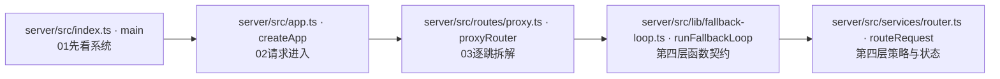

# 00 规范与定位约定

> 层级：阅读规则。核对日期：2026-11-23。源码基准：本地 `adrian` / `3212ac11`。
> 本轮是文档更新，不代表已安装的桌面程序已升级，也不代表远端没有新提交。

## 1. 先选阅读深度

| 你现在的问题 | 应读层级 | 该层必须讲清 | 不该混入的内容 |
|---|---|---|---|
| 这个系统由什么组成 | 第一层：01 | 进程、模块职责、输入输出、主数据流 | 全部异常分支和长函数实现 |
| 能否跟着一条请求走通 | 第二层：02 | 最小输入、实际调用顺序、可检查的输出 | 同时展开所有协议和失败重试 |
| 中间到底发生了什么 | 第三层：03 | 参数搬运、状态变化、错误传播、调用时序 | 只有函数名、没有过程 |
| 我要排错或修改实现 | 第四层：04起 | 函数契约、分支、依赖、并发、配置、测试 | 把文件名出现过当作已经讲完 |



图表示阅读顺序；运行时调用关系见01、03。文档标题对应读法，方框同时标明真实源码入口，避免把教学图误认成进程拓扑。

## 2. 源码定位：先找名字，再数偏移

### 2.1 统一格式

| 场景 | 正文写法 | 含义 |
|---|---|---|
| 函数定义 | `server/src/services/router.ts` · `routeRequest+0` | 先找到函数定义所在行 |
| 函数内部 | `server/src/services/router.ts` · `routeRequest+8~+13` | 从定义行向下8至13行 |
| 类方法 | `server/src/providers/base.ts` · `BaseProvider.fetchWithTimeout+0` | 类名不可省，以免撞到其它适配器的同名方法 |
| 路由匿名处理器 | `server/src/routes/proxy.ts` · `proxyRouter.post('/chat/completions')+9` | 从真实注册表达式首行计数，不虚构命名函数 |
| 类型或常量 | `server/src/lib/fallback-loop.ts` · `FALLBACK_MAX_RETRIES+0` | 常量声明也能用语法树定位 |
| 调用关系 | 调用方的定位 → 被调用方的定位 | 同时给双方；不能把调用行当定义行 |
| 非代码配置 | 文件路径＋JSON/YAML键路径 | 例如根package.json的`workspaces`，不硬造函数 |

偏移计算公式：**目标行 − 符号起始行**。`+0`不是函数体的第一条语句，而是定义/注册语句的开始。

源码索引只写“文件 → 符号”，不固化行号。函数内部改动也会使偏移漂移，因此符号记法不是免维护保证。

### 2.2 可直接执行的定位工具

从仓库根目录运行，需Python 3.10及以上、Node.js与本仓库已安装的TypeScript依赖；不需要启动网关。

```bash
python3 docs/sourceReader/.progress/sr_tools.py locate routeRequest
python3 docs/sourceReader/.progress/sr_tools.py outline server/src/services/router.ts --top
python3 docs/sourceReader/.progress/sr_tools.py offset server/src/services/router.ts routeRequest
python3 docs/sourceReader/.progress/sr_tools.py verify docs/sourceReader
python3 -B docs/sourceReader/.progress/test_sr_tools.py
```

| 命令 | 什么时候用 | 输出与边界 |
|---|---|---|
| `locate` | 知道名字、不知道文件 | 优先生产源码；仅无生产命中时返回测试/脚本 |
| `outline` | 大文件不知道从哪读 | 符号、起止行、类型及现有注释首行；`--top`只看顶层 |
| `offset` | 已知文件与完整符号 | 返回定义起止行，读者据此计算正文偏移 |
| `verify` | 文档改完后 | 核对统一格式符号、偏移范围、文件链接、Markdown锚点 |
| `verify --strict` | 收尾排查路径 | 将疑似失效路径也记为错误；仍需人工判读 |

工具源文件：[sr_tools.py](.progress/sr_tools.py)、[sr_symbols.cjs](.progress/sr_symbols.cjs)；测试：[test_sr_tools.py](.progress/test_sr_tools.py)。TypeScript语法树负责定位，Python负责文档检查。只扫描Git跟踪的生产/测试源码；新增未跟踪源码可显式传给`outline`。

### 2.3 校验通过不等于内容正确

| 能机械检查 | 必须回源码人工检查 |
|---|---|
| 文件是否存在 | 文件承担的职责是否真的如此 |
| 符号是否在指定文件 | 写的是定义、调用还是测试替身 |
| 偏移是否落在该符号内部 | 该偏移是否正好对应所讲逻辑 |
| 链接与标题锚点是否存在 | 目标章节是否回答了引用处的问题 |
| 有无围栏、图块 | 图上的方向与分支是否真实、能否正确渲染 |

旧格式不会自动被当作统一格式通过。必须先迁移、再核对；不能用“检查到0个引用”冒充“全部引用正确”。

## 3. 函数级章节怎样写

每个关键函数至少回答下列问题。

1. **为什么有它**：删掉它会缺哪道处理，不先抛缩写。
2. **谁调用它**：真实入口、调用条件和上下游符号。
3. **输入是什么**：字段、默认值、空值、单位；位置参数按真实顺序。
4. **输出是什么**：返回值由谁消费；是否可能抛错或提前结束。
5. **内部如何做**：按源码顺序逐步拆，不用“处理一下”代替算法。
6. **会改变什么**：数据库、内存、网络、文件、计时器以及清理责任。
7. **分支与限制**：正常、边界、错误、何时不该使用。
8. **如何验证**：测试或只读证据；没有运行就明确标注。

关键调用优先用下表，而不是让读者在段落中找人名。

| 调用方 | 被调用方 | 触发与输入 | 返回与消费 | 错误与状态副作用 |
|---|---|---|---|---|
| `runFallbackLoop` | `runFallbackLoopAttempts` | 收到协议处理器提供的hooks | 等待内部尝试流程结束 | 外层finally负责保存尝试追踪；各轮资源释放由内层负责 |

这条关系对应`server/src/lib/fallback-loop.ts` · `runFallbackLoop+11~+15`，不是伪造的接口示例。

## 4. 事实、图表与运行数据的红线

- 代码与旧文档冲突时以当前实现为准；注释也要和代码对照。
- 正文使用中文；真实文件、函数、字段、协议名称保留原名，首次出现给人话解释。
- 每篇至少一张图；调用顺序用时序图，多表数据关系用ER图，状态切换用状态图。
- 不拿示意代码替代完整关键逻辑；示意代码明确标注不是可执行实现。
- 实例观察必须写实例、日期、只读方法；历史数字不是当前数字。
- 不公开密钥、会话凭证、完整敏感日志；示例凭证通过环境变量读取。
- 未逐行读取的生成代码、第三方内部实现写“未读取，不臆测”。

只用四个不确定性标记。

| 标记 | 用途 | 不能偷换成 |
|---|---|---|
| `[源码未确认]` | 尚无足够源码证据 | 仓库里一定没有 |
| `[源码未找到]` | 已查完整相关范围仍无实现 | 搜一次关键词没命中 |
| `[推断]` | 有证据支撑的解释 | 源码明确保证 |
| `[待运行验证]` | 必须依靠运行环境检验 | 已实际测试通过 |

## 5. 工作区与运行程序必须分开

| 对象 | 本轮确认方式 | 不可混淆的事项 |
|---|---|---|
| 工作区源码 | Git HEAD及实际文件 | 是本文代码结论的基准 |
| 编译产物 | 需要单独核对构建来源 | 文档改动不更新产物 |
| 已安装桌面程序 | 需要单独核对安装版本与包内容 | 不能用工作区HEAD推断它的实现 |
| 运行数据库与内存 | 带日期、实例的只读观察 | 源码默认值不等于实例当前值 |

## 6. 维护入口与导航

- [总索引](README.md)：阅读顺序与本轮完成状态。
- [第一层：系统骨架](01-简单框架-系统骨架.md)。
- [本轮执行规范](.progress/UPDATE-SPEC.md)：范围、已确认勘误和校验口径。
- [英文架构目录](../en/architecture/00-high-level-index.md)：既有产品机制材料，引用前仍要核对其源码基准。

## 7. 文末术语解释

| 术语 | 人话解释 | 在本文里的用途与边界 |
|---|---|---|
| HEAD | Git目前指向的提交 | 锁定代码快照，不代表运行程序版本 |
| workspace | 同一仓库里由根包管理器一起管理的子包 | 根配置列了四个；desktop另有自己的包配置 |
| 符号 | 源码中可定位的名字，如函数、类、类型 | 同名不等于同一实现，所以同时写文件和作用域 |
| 偏移 | 从定义起点向下数多少行 | 避免文件前半部增加内容就让所有定位失效 |
| AST／语法树 | 编译器把源码拆成有结构的节点 | 用来识别函数边界，不是理解业务正确性的证明 |
| 契约 | 调用双方对输入、输出与行为的约定 | 不只包含类型，还包括谁负责释放资源 |
| 副作用 | 函数返回值之外产生的变化 | 例如写库、发请求、扣预算、注册定时器 |
| hooks／回调集合 | 调用方交给公共流程的一组可调用函数 | 协议处理器用它告诉回退循环如何选路和发请求 |
| 负向对照 | 故意放入错误，确认检查器能抓到 | 防止测试总是成功却没有真正检查目标 |
| Mermaid／ASCII图 | 文本形式的图 | 前者需渲染器，后者用字符直接显示结构 |
