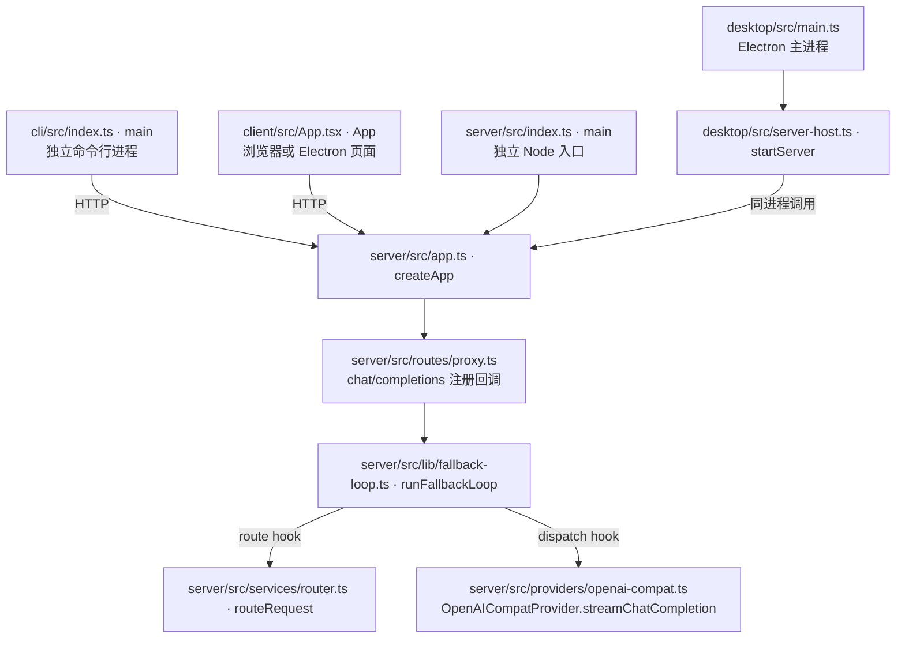
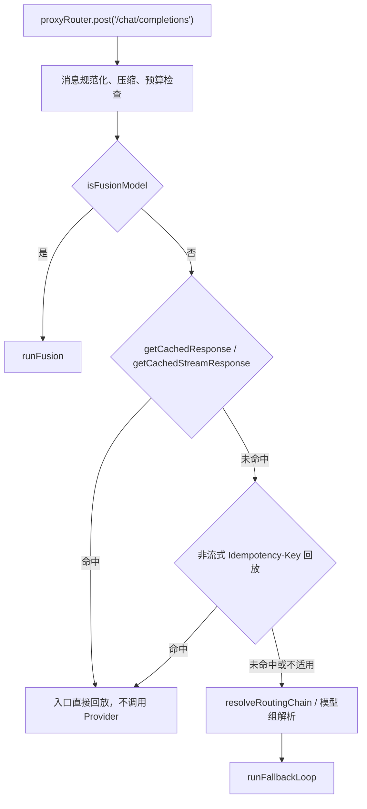

# 01 简单框架 —— 系统骨架

> 第一层只回答：它做什么、由谁组成、一次请求经过谁。函数内部步骤放在 [02 最小例子](02-简单例子-全路径走读.md)、[03 主链路拆解](03-详细逐步说明-主链路拆解.md) 和第四层。
>
> 源码基准：本地 `adrian` / `823c496b`；核对日期：2026-11-08。本篇描述工作区源码，不代表已安装程序或某个运行实例。定位规则见 [00 规范](00-docs-style-guide.md)。

## 0 先用一句人话理解

FreeLLMAPI 是放在调用工具与模型服务商之间的网关：**调用工具只对接一个入口，网关替它找当前能用的模型和凭证，把不同上游的回答整理后送回来。**

可以把它想成带调度台的转接站，而不是模型本身：

```text
你的应用 / 编码工具 / 仪表盘
        │  一套请求格式与网关凭证
        ▼
FreeLLMAPI
  看懂请求 → 确定候选范围 → 找可用模型和 key → 请求上游
        │                              │
        │                       尚可重试的失败 → 换候选
        ▼                              │
  整理结果、记录用量 ←──────────────────┘
        │
        ▼
调用工具收到 JSON 或 SSE 流
```

需要先分清三件事：

| 看起来相近的说法 | 实际含义 | 不代表什么 |
|---|---|---|
| 代码认识一个平台 | `Platform` 中存在平台标识 | 不代表该平台现在能调用 |
| 注册了 Provider | 代码知道如何向这个平台发请求 | 不代表实例里有可用 key 或剩余额度 |
| 模型出现在目录里 | 系统保存了模型资料 | 不代表模型、链、key、能力和配额检查都能通过 |

当前静态复计：`shared/types.ts` 的 `Platform` 有 **84** 个成员；`server/src/providers/index.ts` 有 **83** 次顶层 `register()` 调用，其中 **33** 次直接创建 `OpenAICompatProvider`。这三个数的口径不同，不能统称为“84 个可用模型”。本次没有调用上游验证可用数量。

注册读取与自定义端点的区别见 `server/src/providers/index.ts` · `getProvider+0`、`server/src/providers/index.ts` · `resolveProvider+0`；真正选择可调用凭证的入口见 `server/src/services/router.ts` · `selectKeyForModel+0`。

## 1 五个部分分别管什么

根 `package.json` 的 `workspaces` 是 `shared`、`server`、`client`、`cli`；`desktop` 有自己的包定义，不在这个数组里。

| 部分 | 输入 | 输出 | 主要职责 | 不负责什么 |
|---|---|---|---|---|
| `shared/` | 开发期的类型引用 | 请求、响应、模型等 TypeScript 契约 | 让不同模块说同一种字段语言 | 不发 HTTP 请求，不运行模型 |
| `server/` | 推理请求、管理请求、后台任务 | 上游调用、API 响应、数据库状态 | 鉴权、路由、配额、适配、日志和管理接口 | 不绘制浏览器页面 |
| `client/` | 浏览器操作和接口返回值 | 仪表盘画面与后续请求 | 配置 key、模型、回退链，查看日志和试用模型 | 不直接读取 SQLite |
| `cli/` | 命令行参数、网关信息 | 工具配置、诊断结果、启动的子进程 | 接入编码工具、查询模型、管理 key、启动工具 | 不是内嵌 server 的另一种启动方式 |
| `desktop/` | 桌面配置、系统事件和用户操作 | 内嵌网关、托盘、窗口、更新行为 | 把 server 与管理页面包装成桌面应用 | 不等于另写一套路由算法 |

### 1.1 进程关系，不要和目录关系混在一起



这里的两个 server 启动入口是**不同部署形态的选择**，不是要求同时启动两个服务。

- 独立 server 由 `server/src/index.ts` · `main+0` 装配。
- 桌面端将 server 打包进桌面产物，由 `desktop/src/server-host.ts` · `startServer+0` 在 Electron 主进程内启动；它不是另起一个外部 server 子进程。
- 页面使用标准 `BrowserRouter`，路由表在 `client/src/App.tsx` · `App+0~+56`；不是靠一个全局变量模拟所有页面切换。
- CLI 的命令分发在 `cli/src/index.ts` · `main+0`。启动编码工具是另一个方向的子进程调用，不能与 desktop 内嵌 server 混淆。

### 1.2 “本地优先”不等于所有形态默认只听本机

| 部署形态 | 默认端口 | 默认监听或发布范围 | 证据与影响 |
|---|---|---|---|
| 独立 server | `3001` | `HOST` 未设置时为 `::` | `server/src/lib/config.ts` · `loadConfig+2~+6`；监听全部网卡，不能据“本地优先”推断仅回环 |
| Desktop | 首选 `31415` | 未启用 LAN 时为 `127.0.0.1`，启用后为 `0.0.0.0` | `desktop/src/main.ts` 的 `DEFAULT_PORT` 与 `app.whenReady` 回调；端口占用时由 `listenWithScan` 扫描后续端口 |
| Compose | 宿主默认 `3001` | 默认发布到宿主 `127.0.0.1` | `docker-compose.yml` 的 `services.freellmapi.ports`；这是端口映射限制，不是把容器内 `HOST` 改成回环 |

独立 server 只有在未显式设置 `HOST` 且 IPv6 监听报指定错误时，才补一次 IPv4 监听；见 `server/src/index.ts` · `main+100~+112`。桌面端实际端口以启动结果为准，不应永远硬写 `31415`；见 `desktop/src/server-host.ts` · `listenWithScan+0`。

## 2 一次聊天请求的责任交接

本节只看普通 Chat Completions 链路。缓存命中、Fusion、多协议转换属于分支，不要强行画成每次都会经过。

| 步骤 | 谁接手 | 输入 → 输出 | 这一步的责任 |
|---|---|---|---|
| 1 装配与入口保护 | `createApp` | HTTP 请求 → 对应路由 | 挂载安全中间件、请求体解析、IP 限流和各协议入口 |
| 2 解释请求 | Chat 注册回调 | 原始 body → 规范化消息与选项 | 鉴权、格式校验、消息兼容、压缩、系统提示词、图片归一、预算判断 |
| 3 确定候选范围 | `resolveRoutingChain` 及请求入口分支 | `model`、当前配置 → 候选链与策略 | 区分自动路由、命名链、模型组和明确模型选择 |
| 4 安排尝试 | `runFallbackLoop` → `runFallbackLoopAttempts` | hooks 与请求状态 → 多次尝试或终止 | 管总尝试次数、时间预算、失败分类、退出和租约释放 |
| 5 选择下一条路 | `routeRequest` → `selectKeyForModel` | 候选链、能力要求、估算量、跳过集合 → `RouteResult` | 排序并检查上下文、能力、key、冷却、额度和并发 |
| 6 真正调用模型 | 入口的 `dispatch` → Provider | 消息、选项、明文凭证 → 响应或分片 | 适配上游格式、发请求、读上游结果 |
| 7 向客户端交付 | 入口的流式或非流式分支 | 上游结果 → 对外结果与用量记录 | 整理工具调用和内容、输出、记账、写日志 |

对应锚点：

- 装配：`server/src/app.ts` · `createApp+0`。
- 请求处理：`server/src/routes/proxy.ts` · `proxyRouter.post('/chat/completions')+9~+245`。
- 候选链：`server/src/services/router.ts` · `resolveRoutingChain+0`。
- 外层追踪包装：`server/src/lib/fallback-loop.ts` · `runFallbackLoop+0`。
- 真正循环：`server/src/lib/fallback-loop.ts` · `runFallbackLoopAttempts+40~+286`。
- 选路与选凭证：`server/src/services/router.ts` · `routeRequest+0`、`server/src/services/router.ts` · `selectKeyForModel+0`。
- 成功账本：`server/src/lib/fallback-loop.ts` · `recordUpstreamSuccess+0`。

### 2.1 三条边界最容易看错

**路由器不是重试循环。** `routeRequest` 负责“给我下一条可用路线”；它不负责读取 SSE，也不包住整个重试生命周期。

**Provider 不是最终响应的唯一写入者。** Provider 产出内部响应或分片，Chat 入口还会整理字段、处理工具调用、统一对外模型标识并写响应。

**重试并不是把所有事情原样再做一次。** 输入处理在循环之前完成；每次重新选路时携带本请求已失败的 key、模型和平台集合。首次请求、第一次重试与后续尝试也不是完全相同的时间预算规则。

## 3 正常路径外，还有哪些捷径与出口



| 分支 | 何时发生 | 新手需要记住的结果 |
|---|---|---|
| 能力或预算不满足 | 路由前的图片、工具或 token 预算检查失败 | 可以直接返回错误，并非每个错误都尝试上游 |
| Fusion | 请求虚拟 Fusion 模型 | 进入多模型机制，不走本篇普通回退链的完整后半段 |
| 响应缓存 | 开关、温度条件和缓存 key 都满足且命中 | 流式与非流式各有命中存储；不能说流式一律绕过缓存 |
| 幂等回放 | 非流式请求复用已保存的 `Idempotency-Key` | 可回放原响应；相同 key 对不同内容返回冲突 |
| 客户端断开 | 响应连接提前关闭 | 取消在途调用，不按普通上游故障处罚 |
| 流已提交后出错 | 正文或保活帧已开始写出 | 不能再伪装成一个全新的正常响应，需按流内错误收尾 |

缓存与幂等分支的真实代码见 `server/src/routes/proxy.ts` · `proxyRouter.post('/chat/completions')+404~+511`。同一文件旧注释仍称“streaming always bypasses”，但下面已有流式缓存命中分支；**此处以分支代码而非旧注释为准**。

流式提交与保活的证据见 `server/src/routes/proxy.ts` · `proxyRouter.post('/chat/completions')+796~+848`；具体时序放在 [03 篇](03-详细逐步说明-主链路拆解.md)。

## 4 系统状态放在哪、由谁使用

先记住“目录、凭证、账本、临时尝试”是四种不同状态，不要把一个列表里的绿色状态理解成所有层都通过了。

| 状态类别 | 已核实的读写入口 | 为什么需要它 |
|---|---|---|
| 模型与链 | `getActiveChain` 读取 `models`、`profile_models` 或 `fallback_config` | 决定允许哪些模型参加候选 |
| 凭证状态 | `selectKeyForModel` 读取 `api_keys` 并筛掉禁用或不可用状态 | 有模型不代表有可使用的凭证 |
| 限额与冷却 | `selectKeyForModel` 调用各个限额、冷却检查函数 | 有凭证不代表此刻还能再发请求 |
| 请求级跳过集合 | `newFallbackState` 创建；失败分支更新 | 同一次请求不要反复撞向已经失败的路线 |
| 并发与月度预留 | `selectKeyForModel` 通过全部门槛后取得预留，返回 `release` | 在请求完成前占住资源，避免并发超卖 |
| 响应与会话状态 | Chat 入口查询缓存、会话粘性与交接信息 | 减少重复调用，保持连续对话的一致性 |

证据：`server/src/services/router.ts` · `getActiveChain+0`、`server/src/services/router.ts` · `selectKeyForModel+10~+135`、`server/src/lib/fallback-loop.ts` · `newFallbackState+0`。

重要的是最后一段资源所有权：`RouteResult.release` 由选路时构造，循环的 `finally` 调用它。成功、可重试失败、终止返回都不能把已取得的并发名额遗忘在内存中。见 `server/src/lib/fallback-loop.ts` · `runFallbackLoopAttempts+283~+286`。

## 5 启动后并不只是等请求

独立 server 的 `main` 在初始化数据库、配置和代理之后创建应用；监听成功的 `onReady` 再启动后台任务。桌面入口有对应的手工装配，因此改启动行为时必须比较两处，不能假定改一处自动传播。

| 已核实的启动调用 | 人话解释 | 独立 server 的入口 |
|---|---|---|
| `startHealthChecker` | 定期检查凭证健康 | `main` 内的 `onReady` |
| `startCatalogSync` | 同步模型目录 | 同上 |
| `startCooldownProbe`、`startModelProbe` | 探测冷却恢复与模型状态 | 同上 |
| `startDbBackupPump`、`startBackupScheduler` | 启动数据库备份相关任务 | 同上 |
| `startCustomModelSync`、`startBuiltinModelDiscovery` | 维护自定义和内置平台模型发现 | 同上 |
| `startWakeDetect` | 机器唤醒后刷新代理缓存并触发检查 | 同上 |

证据：`server/src/index.ts` · `main+49~+82`、`desktop/src/server-host.ts` · `startServer+56~+79`。本节只确认启动调用，不据此臆测每项任务的完整调度策略；生命周期细节见 [08 篇](08-启动生命周期.md)。

## 6 第一轮排查与阅读地图

| 想回答的问题 | 先看哪里 | 下一步 |
|---|---|---|
| 请求为何没进入推理处理器 | `server/src/app.ts` · `createApp+0` | 看挂载路径、中间件顺序和鉴权，不先怀疑模型 |
| 为什么这个模型没被选中 | `server/src/services/router.ts` · `routeRequest+0` | 再看 `selectKeyForModel` 的各个门槛 |
| 为什么只试了几次就停 | `server/src/lib/fallback-loop.ts` · `runFallbackLoopAttempts+0` | 区分次数、预算、路由耗尽、断连和已提交响应 |
| 上游实际收到什么 | 对应 Provider 的 `chatCompletion` 或 `streamChatCompletion` | 对照内部消息与最终序列化的 body |
| 为什么页面正常但 CLI 不通 | `cli/src/index.ts` · `main+0` | 核对 base URL、推理凭证和所选模型；别将管理会话当推理凭证 |
| 改了仓库为何桌面行为没变 | `desktop/src/server-host.ts` · `startServer+0` | 区分源码、构建产物、已安装应用和实际进程 |

进一步阅读：[02 最小例子](02-简单例子-全路径走读.md) → [03 主链路](03-详细逐步说明-主链路拆解.md) → [04 模块关系](04-核心模块与类关系.md) → [10 路由与回退函数](10-函数级走读-路由限流与回退.md)。API、配置、状态、部署分别见 [05](05-API与接口设计.md)、[06](06-配置与数据流.md)、[07](07-状态存储与并发.md)、[09](09-测试与部署.md)。

## 7 术语解释

| 术语 | 人话解释 | 在本项目里的边界 |
|---|---|---|
| 网关 | 应用与上游之间的统一门口 | 它调度模型，不是模型本体 |
| Provider | 知道怎么和某个上游说话的适配器 | 注册了适配器不等于配置好了 key |
| Workspace | 同一仓库内由根 npm 配置管理的包 | Desktop 是独立包，不在根 workspaces 数组里 |
| 契约 | 大家约好的字段、类型和返回形式 | TypeScript 类型不能替代外部请求的运行时校验 |
| 候选链 | 本请求允许逐个考虑的模型集合 | 候选仍要通过能力、配额和 key 检查 |
| 凭证 / key | 调用某项服务的身份材料 | 网关推理 key 与上游 provider key 是两层不同凭证 |
| 故障转移 / fallback | 一条路线失败后，按规则尝试另一条 | 响应已开始输出时不能无限制换路 |
| SSE | 一个 HTTP 响应内陆续发送事件文本 | 保活注释也是写出的字节，不只是正文才算输出 |
| 租约 / lease | 临时占用的并发名额 | 不论成功还是失败，结束时都要释放 |
| 幂等回放 | 相同操作标识再次请求时复用原结果 | 不是任何相似问题都共用回答的语义缓存 |
| 回环地址 | 只让本机程序连接的地址 | `127.0.0.1` 与监听全部网卡的 `0.0.0.0`、`::` 不同 |
| 运行实例 | 真正正在服务的进程及其数据 | 不能用工作区 HEAD 推断它已经运行新代码 |

[返回总索引](README.md) · [下一篇：最小成功例子](02-简单例子-全路径走读.md)
