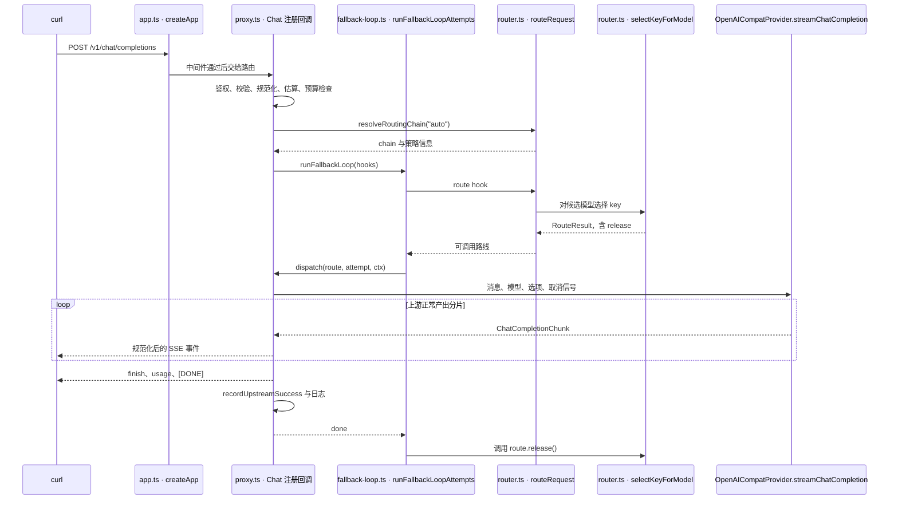

# 02 简单例子 —— 全路径走读

> 第二层：只沿一条普通文本聊天的成功路径，看到请求如何变成上游调用，再变成客户端收到的 SSE。异常、工具和多模型分支放到 [03 篇](03-详细逐步说明-主链路拆解.md)。
>
> 基准：本地 `adrian` / `ed38ed46`；2026-11-23。[待运行验证] 本轮没有向运行实例或上游发送此请求；以下是基于真实处理器的可执行命令模板与源码推演，不是生产响应实录。

## 0 我们要走通的最小场景

问题很简单：**客户端问一句话，网关从当前候选链找一条可用路线，上游正常输出文字，客户端收到完整结果。**

为了不同时学习所有分支，本例限定：

| 条件 | 为什么这样选 |
|---|---|
| `model: "auto"` | 交给当前配置的自动候选链，不假定某个历史模型还在线 |
| 一个 `user` 文本消息 | 不引入图片归一、历史工具消息配对 |
| `stream: true` | 能看清“生成器产出分片”和“网关写给客户端”不是同一步 |
| 不传 `tools`、`response_format`、会话标识 | 不进入工具格式修复、强制 JSON 或显式会话示例 |
| `X-FreeLLM-Cache: off` | 保证不因缓存命中而跳过上游 |
| 使用实例的 unified key | 不额外注入 client-profile 专属系统提示词 |
| 当前链至少一条路线通过全部门槛 | “模型存在”本身不足以保证成功 |

为了具体展示上游适配，本篇读取 `OpenAICompatProvider.streamChatCompletion`。**`auto` 不保证选中这种适配器**；下面的成功路径假定本次确实选到它。若选到 Google 等专用适配器，公共调度路径不变，上游序列化段应换读对应 Provider，不要把本篇的上游 body 套上去。

### 0.1 可执行请求

先在自己的终端安全设置 `FREELLM_API_KEY`。不要把真实 key 写入文档、Git 或共享截图。默认地址用于独立 server；桌面模式把 `FREELLM_BASE_URL` 设置为实际显示的地址与端口。

```bash
: "${FREELLM_API_KEY:?请先设置本实例的推理 API key}"
FREELLM_BASE_URL="${FREELLM_BASE_URL:-http://127.0.0.1:3001}"
curl --no-buffer --silent --show-error \
  "${FREELLM_BASE_URL%/}/v1/chat/completions" \
  -H "Authorization: Bearer ${FREELLM_API_KEY}" \
  -H 'Content-Type: application/json' \
  -H 'X-FreeLLM-Cache: off' \
  --data-binary '{"model":"auto","messages":[{"role":"user","content":"请用一句中文说明你能提供什么帮助。"}],"stream":true}'
```

执行此命令会真实调用模型并消耗额度；本轮文档更新未执行它。`--no-buffer` 只让 curl 尽快显示接收到的字节，不会让上游模型生成得更快。

`off` 的读取证据：`server/src/services/cache.ts` · `parseCacheDirective+0~+10`、`server/src/services/cache.ts` · `cacheActive+0~+4`。

## 1 先看完整调用图



图中把 `resolveRoutingChain` 画在 `router.ts` 模块一侧；它发生在回退循环前，不是每次 `routeRequest` 都重新执行这个解析过程。

## 2 第一步：Express 把请求交给正确处理器

`server/src/app.ts` · `createApp+0` 已在服务启动时完成注册。本请求经过安全中间件、JSON 解析、客户端上下文和 `/v1` IP 限流，再进入 Chat 路由。

| 位置 | 本例发生什么 | 源码锚点 |
|---|---|---|
| Host 检查 | 根据配置判断请求 Host 是否允许 | `server/src/app.ts` · `createApp+15` |
| JSON 请求体解析 | `/v1` 使用推理请求体上限，不是管理接口的固定 10 MB 上限 | `server/src/app.ts` · `createApp+106~+110` |
| 客户端上下文 | 为后续处理建立请求来源信息 | `server/src/app.ts` · `createApp+114` |
| `/v1` 限流 | 先检查调用方 IP 请求速率 | `server/src/app.ts` · `createApp+210` |
| Chat 路由挂载 | `proxyRouter` 挂到 `/v1` 下 | `server/src/app.ts` · `createApp+217` |

静态文件压缩中间件位于 API 路由和错误处理之后，不能把它画成每条 SSE 必经的压缩层。证据：`server/src/app.ts` · `createApp+242~+286`。

## 3 第二步：确认调用者，再整理输入

### 3.1 两层凭证不要拿反

`requireInferenceAuth` 取出请求中的网关 key，交给 `resolveAuth` 判断。成功后返回 `ResolvedAuth`；这里拿到的**不是**稍后发给上游的 provider key。

```text
Authorization: Bearer 网关 key
        │
        ▼
extractApiToken → resolveAuth → 允许调用此网关
                                      │
                      稍后 selectKeyForModel 再选上游 key
```

真实函数见 `server/src/routes/proxy.ts` · `requireInferenceAuth+0~+7`、`server/src/routes/proxy.ts` · `extractApiToken+0~+11`、`server/src/lib/system-prompt.ts` · `resolveAuth+0~+14`。

### 3.2 输入按什么顺序变化

本例只有普通文本，许多兼容分支只是检查后放行。但先后顺序仍然重要。

| 次序 | 处理 | 本例结果 | 源码锚点 |
|---|---|---|---|
| 1 | `chatCompletionSchema.safeParse` | 得到符合入口约定的字段 | `server/src/routes/proxy.ts` · `proxyRouter.post('/chat/completions')+13` |
| 2 | 解析模型别名、采样字段、工具定义 | `auto` 进入自动路由语义；没有工具 | `server/src/routes/proxy.ts` · `proxyRouter.post('/chat/completions')+33~+55` |
| 3 | 将消息转换成内部 `ChatMessage[]` | 本例保留一个 user 文本消息 | `server/src/routes/proxy.ts` · `proxyRouter.post('/chat/completions')+73~+147` |
| 4 | `compressRequest` | 按压缩配置处理，结果写回 `messages` | `server/src/routes/proxy.ts` · `proxyRouter.post('/chat/completions')+159~+165` |
| 5 | `prependSystemPrompt` | unified key 不追加专属提示词 | `server/src/routes/proxy.ts` · `proxyRouter.post('/chat/completions')+172` |
| 6 | `normalizeMessageImages` | 本例没有图片，不产生图片变换 | `server/src/routes/proxy.ts` · `proxyRouter.post('/chat/completions')+177` |
| 7 | 估算输入、计算输出预留 | 为选路准备估算总量 | `server/src/routes/proxy.ts` · `proxyRouter.post('/chat/completions')+185~+212` |
| 8 | `applyTokenBudget` | 满足请求预算后继续；未传输出上限时可能被配置封顶 | `server/src/routes/proxy.ts` · `proxyRouter.post('/chat/completions')+237~+245` |

`applyTokenBudget` 不负责截断消息。`normalizeOutboundContent`、内联工具调用救援、JSON 输出校验也不是这张输入表里的前三步；它们主要处理**上游返回的内容**。旧版把输入与输出处理混排，读源码时应以这张表的顺序为准。

## 4 第三步：确定候选链，然后选模型和 key

### 4.1 候选链是一张“允许考虑谁”的名单

本例 `model: "auto"` 触发 `resolveRoutingChain`。默认活动链由 `getActiveChain` 获取：活动 profile 对应 `profile_models`，否则从 `fallback_config` 读取，都会与 `models` 联结。

- 调用点：`server/src/routes/proxy.ts` · `proxyRouter.post('/chat/completions')+522~+525`。
- 定义：`server/src/services/router.ts` · `resolveRoutingChain+0`、`server/src/services/router.ts` · `getActiveChain+0`。

名单只定义范围，不是“直接选第一行”的承诺。策略排序、能力、上下文和凭证门槛还在后面。

### 4.2 谁把名单变成一条真正能调用的路线

Chat 入口创建 `newFallbackState`，把 `route` 与 `dispatch` 两个回调交给 `runFallbackLoop`。外层负责追踪保存，内层 `runFallbackLoopAttempts` 才执行尝试循环。

本例首轮：

```text
runFallbackLoop
  → runFallbackLoopAttempts
    → hooks.route
      → fallbackRoutingTokens：得到本轮路由估算量
      → resolveTaskType：普通无代码文本的 auto 推断不强制加权
      → routeRequest：排序并挑候选模型
        → selectKeyForModel：挑可用 key，取得预留
    ← RouteResult
    → hooks.dispatch：真正发请求
```

调用锚点：`server/src/routes/proxy.ts` · `proxyRouter.post('/chat/completions')+656~+694`；循环锚点：`server/src/lib/fallback-loop.ts` · `runFallbackLoop+0`、`server/src/lib/fallback-loop.ts` · `runFallbackLoopAttempts+40~+67`。

当前 `routeRequest` 的最后一个参数是 `strategyOverride?: PresetStrategy`，不能漏掉它来解释命名策略为什么没有落到全局默认值。其完整定义见 `server/src/services/router.ts` · `routeRequest+0`；第三层会分组解释全部参数。

### 4.3 本例如何通过选 key 门槛

这里不列失败策略，只看一把 key 成功通过的顺序：

| 关卡 | 通过表示什么 |
|---|---|
| Provider 已注册 | 知道如何发上游请求 |
| key 启用、状态为 healthy 或 unknown、scope 允许 | 这把 key 可作为本模型候选 |
| 自定义端点归属匹配 | 不会把另一个端点的凭证拿来调用 |
| 本请求未跳过、未冷却 | 没有已知需要避开的失败状态 |
| 账号日额度、分钟额度、key 并发 | 平台级和并发层允许继续 |
| 模型请求额度和 token 额度 | 模型级配额也能装下本请求 |
| 账号 token 与月度预算 | 更外层的预算没有拦截 |
| 解密、解析 Provider、预留月度预算和租约 | 得到可实际调用且占好名额的路线 |

源码：`server/src/services/router.ts` · `selectKeyForModel+4~+135`。单纯“检查通过”与随后“取得预留”是两步，不能把一个布尔检查描述成已经扣掉实际用量。

### 4.4 `RouteResult` 中哪些字段马上会用到

| 字段 | 来源或含义 | 下一位消费者 |
|---|---|---|
| `provider` | 已解析的适配器实例 | `dispatch` 调用其流式方法 |
| `modelId` | 上游模型标识 | 上游 body 及对外模型字段 |
| `apiKey` | 选中 key 解密后的值 | Provider 的鉴权头；不能写入文档样例 |
| `keyId`、`modelDbId`、`platform` | 本地状态关联标识 | 配额观察、记账和日志 |
| `proxyUrl` | 这把 key 专属的代理配置 | `withKeyProxy` 为本次派发提供上下文 |
| `contextWindow` | 模型的上下文大小 | 计算本轮调用预算 |
| `release` | 释放租约与月度预留的闭包 | 回退循环的 `finally` |

构造位置：`server/src/services/router.ts` · `selectKeyForModel+119~+135`。这里不伪造具体模型名、数据库 ID 或剩余额度来冒充运行实例。

## 5 第四步：Provider 向上游发一次真实请求

本例选到的 `OpenAICompatProvider.streamChatCompletion` 是异步生成器：它不是一次返回全部答案，而是边读取上游边 `yield` 分片。

| 输入 | 如何使用 |
|---|---|
| `apiKey` | 生成上游鉴权头，不是原始网关 key |
| `messages` | 经 `messagesForPlatform` 转为该平台需要的消息形式 |
| `modelId` | 写进上游请求体的 `model` |
| `options` | 采样、输出限制、流选项与取消信号 |
| `quotaContext` | 关联上游响应头中的配额观测 |

成功时按顺序执行：

1. `samplingForModel` 计算模型适用的采样参数。
2. `fetchWithTimeout` 向该实例 `baseUrl` 下的 `/chat/completions` 发 POST，请求体带 `stream: true`。
3. `recordQuotaObservationsFromResponse` 处理配额观察信息。
4. HTTP 正常时，把响应交给 `readSseStream`。
5. `guardInBandCreditsError` 包装流，之后 `yield` 内部 `ChatCompletionChunk`。

证据：`server/src/providers/openai-compat.ts` · `OpenAICompatProvider.streamChatCompletion+0~+8`（薄包装，真实生成体在 `streamChatCompletionInternal+0~+76`）。本篇只看正常分支，HTTP 错误、工具调用救援与首字节超时留到第四层。

## 6 第五步：网关把分片交给客户端

### 6.1 分片不是收到就全部原样写出

入口用 `for await` 消费生成器，记下上游模型、usage、结束原因、工具片段和正文。对外 `model` 字段按选中的路线统一；正文经过归一化和响应清理。

本例没有工具和强制 JSON：第一次普通正文出现时进入 `passthrough`，执行 `flushHeaders`，把暂存的前导帧与正文写出去，后续正文陆续写出。

证据：`server/src/routes/proxy.ts` · `proxyRouter.post('/chat/completions')+857~+994`。保活开启时可能在正文前先写 `: keepalive`，这不是模型回答；详细提交边界见第三层。

### 6.2 如何判断真的结束

```text
data: 一个合法 JSON 分片
空行

data: 后续 JSON 分片
空行

data: 含 finish_reason 的结束分片
空行

data: 用量分片（具体来源取决于上游）
空行

data: [DONE]
空行
```

以上是**报文结构说明**，不是实际返回文本；真实的 `id`、`model`、内容、分片数量和 usage 由运行时决定。不能把 HTTP 200 或第一个分片当作完整成功。

普通成功收尾的代码：`server/src/routes/proxy.ts` · `proxyRouter.post('/chat/completions')+1107~+1162`。

## 7 第六步：把成功写到账本，并归还临时名额

| 时间点 | 动作 | 为什么不能混为一谈 |
|---|---|---|
| 上游流读取中 | 累计或保存 usage | 这时尚不能保证整次调用完整成功 |
| 正常收尾 | 优先使用上游 usage；缺失时按入口估算补记 | 估算值不能描述成提供商精确账单 |
| 成功完成后 | `recordUpstreamSuccess` | 写请求量/token，用成功清掉相关失败状态 |
| `dispatch` 返回 | 返回 `'done'` | 告诉循环响应已经完成，不要再尝试 |
| `finally` | 调用 `route.release` | 归还并发名额和月度预留，不等于删除已记录用量 |

证据：`server/src/routes/proxy.ts` · `proxyRouter.post('/chat/completions')+1164~+1205`、`server/src/lib/fallback-loop.ts` · `recordUpstreamSuccess+0~+26`、`server/src/lib/fallback-loop.ts` · `runFallbackLoopAttempts+281~+286`。

本例关闭响应缓存，因此不会把成功结果存入响应缓存；成功后的粘性记录、日志等仍按各自条件执行，不因缓存关闭而整体停用。

## 8 自己复核这条路径的检查清单

- [ ] 确认连接的是目标实例，不把独立 server 的 `3001` 与桌面实际端口混用。
- [ ] 确认用的是推理 key，不是 Dashboard 登录密码或上游 provider key。
- [ ] 候选模型和 key 可用，预算与并发允许本次调用。
- [ ] 请求带 `X-FreeLLM-Cache: off`，排除缓存直接回放。
- [ ] 客户端持续读取到流正常结束，而不是只看 HTTP 状态。
- [ ] 核对实际返回的模型和路由信息，不预设 `auto` 必选某个模型。
- [ ] 需要复查代码时，用 `sr_tools.py offset` 获取当前定义行，不照搬旧绝对行号。

本轮只完成源码路径核实，以上运行检查没有勾选，不以推演代替实测。

## 9 术语解释

| 术语 | 通俗解释 | 本例对应位置 |
|---|---|---|
| Chat Completions | 输入一组消息，让模型补出回答的接口 | `/v1/chat/completions` |
| unified key | 调用当前网关的统一凭证 | `requireInferenceAuth` |
| scope | 凭证允许调用的模型范围 | `selectKeyForModel` 的候选过滤 |
| hook / 回调 | 循环先约好接口，由具体路由提供动作 | `route` 选路，`dispatch` 派发 |
| 异步生成器 | 等待外部数据时暂停，有数据时逐份交出 | Provider 的 `streamChatCompletion` |
| delta | 这一次新增加的内容，而不是全部历史答案 | SSE JSON 的 `choices[].delta` |
| passthrough | 当前流不再整段暂存，逐片向下游发送 | 普通文本分支；仍可能做字段归一 |
| usage | 输入、输出等 token 用量 | 有上游实值则优先使用，否则入口估算 |
| 预留 | 在请求完成前先占资源，防止并发抢过头 | 月度预算与 lease |
| `[DONE]` | OpenAI 风格流的终止标记 | 在正常收尾处写出；仍需检查之前有无错误帧 |

[返回系统骨架](01-简单框架-系统骨架.md) · [下一篇：主链路逐跳拆解](03-详细逐步说明-主链路拆解.md) · [总索引](README.md)
