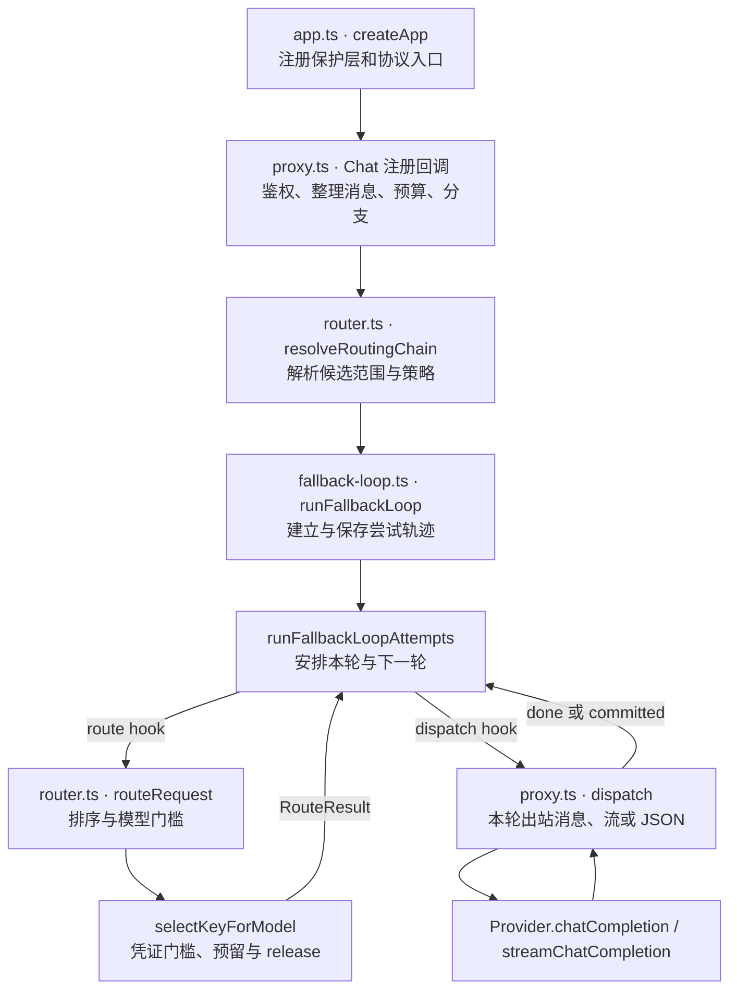
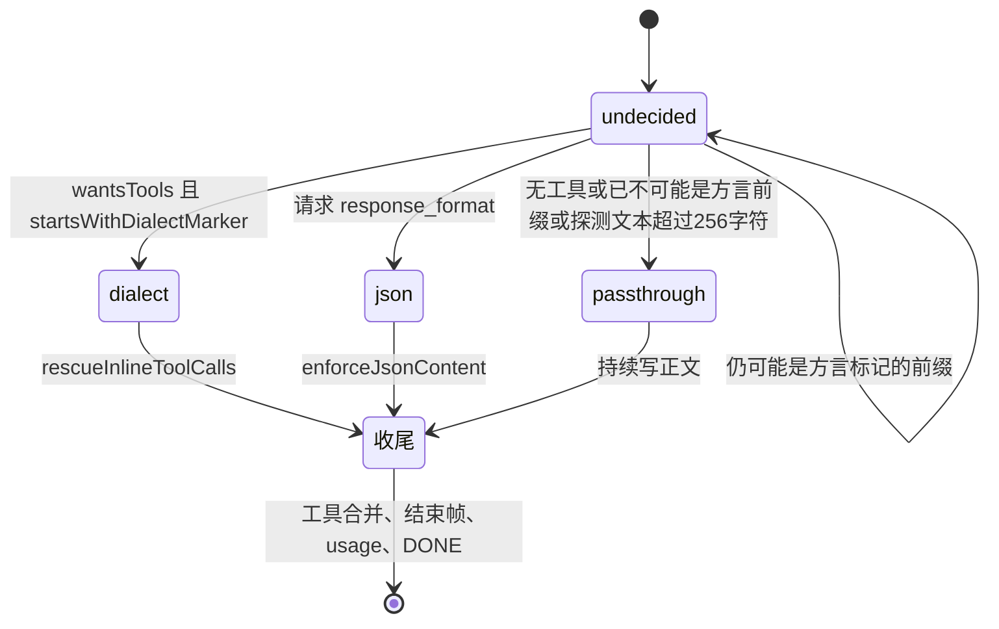

# 03 详细逐步说明 —— 主链路拆解

> 第三层沿 [02 的普通 Chat Completions 请求](02-简单例子-全路径走读.md)，逐步解释参数、状态、分支与错误。不是把“收请求→调模型”换一种说法，而是回答每个交接点到底拿到了什么。
>
> 基准：本地 `adrian` / `ed38ed46`；核对日期：2026-11-27。本文为静态源码核对；[待运行验证] 不含本轮实例请求、上游计费或性能实测。

## 0 先把职责拆开



**不要把函数名当作职责的全部。** `runFallbackLoop` 自身没有那个 `for`；`routeRequest` 不读取 SSE；Provider 不直接向 Express 的 `res` 写回答。

| 层次 | 函数或回调 | 返回的东西 | 状态由谁继续处理 |
|---|---|---|---|
| 请求层 | Chat 注册回调 | 最终 HTTP 响应 | 客户端读取 |
| 选链 | `resolveRoutingChain` | `ResolvedChain` | 请求层保留，并传给每次选路 |
| 选路 | `routeRequest` | `RouteResult` | `dispatch` 消费，循环最终释放 |
| 调上游 | `chatCompletion` | `Promise<ChatCompletionResponse>` | 非流式入口后处理 |
| 调上游流 | `streamChatCompletion` | `AsyncGenerator<ChatCompletionChunk>` | 流式入口逐帧消费 |
| 一次派发 | `dispatch` | `'done'` 或 `'committed'`，也可能抛错 | 循环决定结束或分类处理 |

入口锚点：`server/src/routes/proxy.ts` · `proxyRouter.post('/chat/completions')+0`。循环包装与实体分别是 `server/src/lib/fallback-loop.ts` · `runFallbackLoop+0`、`server/src/lib/fallback-loop.ts` · `runFallbackLoopAttempts+0`。

## 1 请求还没碰到模型，先经过哪些门

### 1.1 `createApp`：顺序会改变保护范围

| 注册顺序 | 真实动作 | 为什么必须分清 |
|---|---|---|
| 1 | 设置 `trust proxy`，挂 Host 检查 | 影响后续来源判定；Host 限制需结合配置，不能说默认限制所有外部域名 |
| 2 | Helmet、逐请求安全头、CORS | 管浏览器与 HTTP 安全边界，不是模型权限 |
| 3 | 推理路径大 JSON 上限，随后其余路径 10 MB 上限 | 超大请求可能在进入处理器前就被拒绝 |
| 4 | `clientContextMiddleware` | 给后续代码提供来源上下文 |
| 5 | Ollama 专用路径、后台限流、后台鉴权与管理路由 | `/api` 不只有一种认证语义 |
| 6 | 文档/Provider 只读入口、URL-token 入口 | 不全都与普通推理共享相同挂载次序 |
| 7 | `/v1` IP 限流，再挂 Anthropic、OpenAI、moderation、Responses | Anthropic 挂在 OpenAI 前面，模型列表有内容协商需要 |
| 8 | Gemini、MCP、状态路由、错误处理 | 是其他协议/健康入口，不是 Chat 内部分支 |
| 9 | 静态资源压缩、静态文件、SPA 回落 | 位于 API 之后，不把聊天 SSE 包进静态压缩链 |

源码：`server/src/app.ts` · `createApp+8~+114`、`server/src/app.ts` · `createApp+123~+242`、`server/src/app.ts` · `createApp+249~+286`。

### 1.2 `createProxyRateLimiter`：它数的是调用方 IP，不是上游 key

输入是可选 `rpmLimit`；输出是 Express 中间件。每个工厂实例持有自己的 `Map<IP, WindowState>`。

1. `limit === 0` 时直接 `next()`。
2. 根据 `req.ip`，否则 socket 地址，找到窗口。
3. 首次访问或窗口到期：重建 `count=0`、`resetAt=now+60_000`。
4. 先增加 `count`，再填 `X-RateLimit-*` 响应头。
5. `count > limit` 时回 429 与 `Retry-After`；否则交给下一层。
6. IP 表超过阈值时清理**过期条目**，不是承诺将总条目数硬裁到阈值。

证据：`server/src/middleware/rateLimit.ts` · `createProxyRateLimiter+0~+44`。这是**固定窗口**，不是稍后上游配额账本的所有计数规则。后台的对应工厂见 `server/src/middleware/rateLimit.ts` · `createAdminRateLimiter+0`。

边界例子：额度为 2 的窗口里，第 1、2 个请求通过，第 3 个请求被拒；到期后重新开窗。这里的 2 是说明算法的输入，不是项目默认配置。

## 2 鉴权与请求规范化：一次做完，不在每轮失败后重做

### 2.1 三个认证函数如何接力

| 调用方与符号 | 被调用方与符号 | 输入 → 返回 | 错误或副作用 |
|---|---|---|---|
| Chat 注册回调 | `requireInferenceAuth` | `req,res` → `ResolvedAuth` 或 `null` | `null` 时处理器直接退出 |
| `requireInferenceAuth` | `extractApiToken` | HTTP 头 → token 或 `undefined` | 优先 Bearer，其次 `x-api-key`，再 `x-goog-api-key` |
| `requireInferenceAuth` | `resolveAuth` | token → unified/profile 身份 | 无效、未知或禁用 profile 返回 `null` |
| `requireInferenceAuth` 自身 | Express `res` | 认证失败 → 401 JSON | 由它写错误，不要再写第二份响应 |

锚点：`server/src/routes/proxy.ts` · `requireInferenceAuth+0`、`server/src/routes/proxy.ts` · `extractApiToken+0`、`server/src/lib/system-prompt.ts` · `resolveAuth+0`。

`resolveAuth` 先比较 unified key；profile key 按摘要查询 `client_profiles`，返回 profile 的提示词。**提示词排第一是消息顺序约定，不是能够数学保证模型永远不会违背它的安全边界。** 真实插入操作见 `server/src/lib/system-prompt.ts` · `prependSystemPrompt+0~+3`。

### 2.2 输入处理表：条件、产物、失败出口

以下偏移均相对 Chat 注册回调，不把内联代码伪装成独立函数。

| 顺序 | 操作 | 输入 → 输出 | 关键边界 | 锚点 |
|---|---|---|---|---|
| 1 | `chatCompletionSchema.safeParse` | body → 已解析字段 | 失败回 400，并整理有限条校验信息 | `server/src/routes/proxy.ts` · `proxyRouter.post('/chat/completions')+13~+31` |
| 2 | 别名与选项归一 | 模型字符串、采样、工具选项 → 内部选项 | `max_tokens` 与 `max_completion_tokens` 在此归并；`tool_choice:any` 兼容为 `required` | `server/src/routes/proxy.ts` · `proxyRouter.post('/chat/completions')+33~+55` |
| 3 | 消息重建 | 各种 role/content/tool 历史 → `ChatMessage[]` | 缺调用 ID 补合成值；`function` 转 `tool`，`developer` 转 `system`；有 tool_calls 时允许 content 为 null | `server/src/routes/proxy.ts` · `proxyRouter.post('/chat/completions')+62~+147` |
| 4 | 压缩与缓存前缀处理 | messages、tools、缓存前缀 → 压缩结果 | 替换 messages，并设置 `X-FreeLLM-Compress` | `server/src/routes/proxy.ts` · `proxyRouter.post('/chat/completions')+149~+165` |
| 5 | 注入 profile 系统提示词 | 压缩后消息 → 前置提示词的消息 | 在压缩之后，所以不会被这一轮压缩移除 | `server/src/routes/proxy.ts` · `proxyRouter.post('/chat/completions')+172` |
| 6 | 图片归一 | 内联图片 → 处理后的图片块 | 在估算与选路前完成；本篇不展开图片编解码 | `server/src/routes/proxy.ts` · `proxyRouter.post('/chat/completions')+177` |
| 7 | 估算与能力预检 | 输入、工具、图片 → 估算值与能力要求 | 没有可用视觉/工具模型时提前回 422 | `server/src/routes/proxy.ts` · `proxyRouter.post('/chat/completions')+185~+230` |
| 8 | 请求级预算 | 估算输入及图片、请求输出上限 → 拒绝或输出限制 | 拒绝回 413；不是裁剪 messages | `server/src/routes/proxy.ts` · `proxyRouter.post('/chat/completions')+237~+245` |
| 9 | 客户端断连控制器 | 提前关闭连接 → `clientGone`、取消信号 | 正常 `writableEnded` 不算断连 | `server/src/routes/proxy.ts` · `proxyRouter.post('/chat/completions')+255~+263` |

### 2.3 三个 token 数不是同一个数

```text
估算输入 + 图片成本 + 路由输出预留
                  │
                  └── 用于候选模型与配额门槛

估算输入 + 图片成本 + 客户端请求的输出上限
                  │
                  └── applyTokenBudget 检查整次请求护栏

选中模型剩余上下文 与 已学习输出上限
                  │
                  └── routeOutputBudget → Provider 本轮 contextBudget
```

| 函数/值 | 精确职责 | 不能据此推断 |
|---|---|---|
| `routingReserveTokens` / `outputReserve` | 限制选路时为输出保留的量，避免巨大 `max_tokens` 饿死整个候选池 | 不等于最后真正发出的输出上限 |
| `applyTokenBudget` | 预算关闭则不改；估算输入加显式输出超过预算则拒绝；未给输出上限则取剩余量并受内部上限约束 | 不会自动删历史消息 |
| `fallbackRoutingTokens` | 取本地估算、上游报告总量、上游报告输入加输出预留三者最大值 | 后续较小报告不会降低本次估算 |
| `routeOutputBudget` | 用选中路线的上下文余量与已学习输出上限取限制 | 当前调用只传 `estimatedInputTokens`，不是上面含图片和交接的完整路由估算 |

锚点：`server/src/lib/guardrails.ts` · `applyTokenBudget+0~+12`、`server/src/lib/fallback-loop.ts` · `fallbackRoutingTokens+0~+6`、`server/src/lib/output-cap.ts` · `routeOutputBudget+0~+8`、`server/src/routes/proxy.ts` · `proxyRouter.post('/chat/completions')+687~+695`。

[推断] 修改图片、工具或交接的估算口径时，应分别核对这三处，不能只改一个名叫 tokens 的变量就声称全部生效。

## 3 不是所有请求都会进入普通回退循环

| 顺序 | 分支 | 输入与结果 | 源码锚点 |
|---|---|---|---|
| 1 | Fusion | 虚拟模型命中后交给 `runFusion`，分支完成后返回 | `server/src/routes/proxy.ts` · `proxyRouter.post('/chat/completions')+272~+393` |
| 2 | 响应缓存 | 根据规范化后的消息和选项计算 key；流与 JSON 分别查询 | `server/src/routes/proxy.ts` · `proxyRouter.post('/chat/completions')+404~+465` |
| 3 | 幂等回放 | 仅非流式读取 `Idempotency-Key`；命中回放，内容冲突回 409 | `server/src/routes/proxy.ts` · `proxyRouter.post('/chat/completions')+475~+511` |
| 4 | 自动链、会话与模型选择 | 建立范围、会话 key、偏好路线 | `server/src/routes/proxy.ts` · `proxyRouter.post('/chat/completions')+516~+643` |
| 5 | 决策路由 | 将本轮是否 pinned、策略、取消信号交给 `applyDecisionRouting` | `server/src/routes/proxy.ts` · `proxyRouter.post('/chat/completions')+670~+671` |
| 6 | 普通回退 | 将状态及 hooks 交给循环 | `server/src/routes/proxy.ts` · `proxyRouter.post('/chat/completions')+673` |

缓存命中不记作本次上游用量；但不要扩大成“该 HTTP 请求完全没有任何其他状态变化”：请求的前置规范化与相应检查已经发生。

### 3.1 `resolveRoutingChain` 的三个产物

| 产物 | 谁需要它 | 用途 |
|---|---|---|
| `chain` | `routeRequest` 的 `prefetchedChain` | 限定候选范围 |
| `strategyKey` | 会话相关处理 | 将不同策略的粘性记录区分开 |
| 可选 `strategyOverride` | `routeRequest` 的最后一个参数 | 让别名要求的策略实际参与排序，而非只换一个显示名称 |

输入没有值、为 `auto` 或空后缀时返回活动链；已知全局排序别名走 `getChainByGlobalSort`，返回覆盖策略；其他 `auto:` 后缀走命名 profile。命名 profile 不存在或没有启用模型会抛带 400 状态的错误。

证据：`server/src/services/router.ts` · `resolveRoutingChain+0~+49`。函数自身也能接受非 `auto:` 字符串并回活动链，但 Chat 入口不会因此把所有显式模型字符串都当自动请求；要同时看调用点。

### 3.2 显式模型、模型组与粘性不是同一种“固定”

| 请求形态 | 当前 Chat 入口行为 | 范围约束 |
|---|---|---|
| Claude 别名已有 tier 候选 | `groupChain=aliasTierChain` | 在 tier 池内选择，粘性也需是池中成员 |
| `auto` 系列 | 解析链，再尝试有效的粘性偏好 | 优先项仍需过能力和配额门槛 |
| 开启统一模型且命中组 | 解析组成员，得到 `groupChain` | 严格只遍历该组候选；只接受组内粘性 |
| 传统单行显式模型 | 查启用的 `models` 行并设 `preferredModel` | 是优先/注入逻辑，不能等同于严格模型组限制 |
| 模型未找到或禁用 | 回 404 | 不悄悄把未知名称当成功自动请求 |
| 组内模型存在但无可配置路线 | 按启用状态区分 503 与 404 | “没有可用 provider”与“模型禁用”不同 |

证据：`server/src/routes/proxy.ts` · `proxyRouter.post('/chat/completions')+570~+643`。传统优先项在 `server/src/services/router.ts` · `routeRequest+65~+101` 被前置或注入；已标为上游退役的模型不因该注入分支而恢复。

## 4 `routeRequest`：十二个参数怎样传过来

真实定义：`server/src/services/router.ts` · `routeRequest+0`；真实调用：`server/src/routes/proxy.ts` · `proxyRouter.post('/chat/completions')+692`。

| 顺序 | 参数 | Chat 来源 | 它改变什么 |
|---|---|---|---|
| 1 | `estimatedTokens` | `fallbackRoutingTokens` 加可能的交接预留 | 上下文和配额尺寸门槛 |
| 2 | `skipKeys` | 本请求状态，空集合转 `undefined` | 避免已失败的 model+key 组合 |
| 3 | `preferredModelDbId` | 显式模型或有效粘性项 | 前置候选或允许的注入 |
| 4 | `requireVision` | `hasImage` | 排除不能看图的模型 |
| 5 | `requireTools` | `wantsTools` | 排除未声明工具能力的模型 |
| 6 | `skipModels` | 本请求模型跳过集合 | 同模型换 key 也不再尝试 |
| 7 | `prefetchedChain` | `groupChain ?? resolvedChain?.chain` | 组链优先，否则已解析链 |
| 8 | `requireStructured` | 是否存在 `response_format` | 过滤会丢弃该参数的平台 |
| 9 | `skipPlatforms` | 本请求平台跳过集合 | 整个平台的模型都避开 |
| 10 | `exactOutputReserve` | `outputReserve` | 上下文安全余量计算中区分输出预留 |
| 11 | `task` | `resolveTaskType` | 软性调整打分偏好，不代替能力过滤 |
| 12 | `strategyOverride` | `resolvedChain?.strategyOverride` | 优先于本轮的默认路由策略 |

`resolveTaskType` 返回 `code`、`chat` 或 `undefined`。显式头优先；自动推断只有发现代码倾向才返回 `code`，普通聊天返回 `undefined` 保持策略权重。不存在旧文档所说的 `analysis`、`creative` 档位。见 `server/src/lib/task-type.ts` · `resolveTaskType+0~+8`。

### 4.1 模型选择的真实步骤

1. 取 `strategyOverride ?? effectiveRoutingStrategy()`，非手动优先级策略刷新统计缓存。
2. 从预取链或活动链取启用项，交给 `orderChain`。
3. 条件满足时把一个未充分采样、且能满足本请求基本门槛的模型提到前面；降级模式不做该探索。
4. 前置或注入 `preferredModelDbId`。
5. 聚合剔除整个平台没有可用 key 的模型；显式优先项保留单独诊断机会。
6. 将不满足上下文安全余量的项移后；工具能力曾被实际拒绝的项也可移后。**移后不等于删除。**
7. 遍历时依次检查本请求跳过集合、视觉、工具、结构化参数、原始上下文容量和 TPM。
8. 调 `selectKeyForModel`；有结果立即返回，没有则下一模型。
9. 最终没有路线：抛带诊断信息的 `RouteError`。外层还会按耗尽原因决定对外错误，不能据内部一个状态值断言所有耗尽最终都是 429。

锚点：`server/src/services/router.ts` · `routeRequest+8~+234`。

### 4.2 打分只是排序的一部分，不是唯一的准入判据

```text
可靠性、速度、智能程度
       │  加权平均
       ▼
基础分 × min(月度余量系数, 窗口余量系数) × 限流惩罚系数
       │
       ▼
applyModelWeightOverride → 当前模型分数
       │
       ▼
之后仍要过能力、上下文、凭证、额度等硬门槛
```

`combineScore` 先除以权重和，再乘两个护栏系数；不是把 headroom 当作第四个加权分量。`scoreChainEntry` 的月度与窗口余量取**较小值**，不是相乘；请求选路可以抽样可靠性，展示分数则使用期望值。

证据：`server/src/services/scoring.ts` · `combineScore+0~+7`、`server/src/services/router.ts` · `scoreChainEntry+9~+66`。各分量和预设权重细节放在 [10 路由函数](10-函数级走读-路由限流与回退.md) 与 [调度专题](../topics/model调度算法.md)，本节不把排序近似成“最大速度胜出”。

## 5 `selectKeyForModel`：检查、排序、解密、预留

函数输入是一个模型链项、估算 token、请求级跳过 key 集合和可选诊断数组；输出是可调用 `RouteResult` 或 `null`。

### 5.1 按源码顺序逐关说明

| 阶段 | 调用/判断 | 不通过后怎么办 | 锚点 |
|---|---|---|---|
| Provider 注册 | `hasProvider`、`getProvider` | 返回 null，留诊断 | `server/src/services/router.ts` · `selectKeyForModel+4~+8` |
| 凭证候选 | `api_keys` 启用且 healthy/unknown；再用 scope 过滤 | 候选为空时返回 null | `server/src/services/router.ts` · `selectKeyForModel+10~+26` |
| key 排序 | per-key 分数或轮转；适用时叠加剩余配额权重 | 不是在这里扣用量 | `server/src/services/router.ts` · `selectKeyForModel+45~+59` |
| 端点归属 | custom 模型只在所属 endpoint 的 key 池里选 | 记 `custom-key-mismatch` 后换 key | `server/src/services/router.ts` · `selectKeyForModel+65~+73` |
| 跳过与冷却 | `skipKeys`、`isOnCooldown` | 换 key | `server/src/services/router.ts` · `selectKeyForModel+75~+78` |
| 账号请求额度 | `canUseProvider`、`canUseProviderMinute` | 换 key | `server/src/services/router.ts` · `selectKeyForModel+79~+83` |
| 并发名额 | `canUseKeyConcurrency` | 换 key | `server/src/services/router.ts` · `selectKeyForModel+87` |
| 模型配额 | `canMakeRequest`、`canUseTokens` | 换 key | `server/src/services/router.ts` · `selectKeyForModel+88~+89` |
| 账号 token 与月度预算 | `canUseProviderTokens`、`checkMonthlyBudget` | 换 key | `server/src/services/router.ts` · `selectKeyForModel+90~+95` |
| 凭证解密 | `cachedDecrypt` | 解密失败写 key 状态 error，再换 key | `server/src/services/router.ts` · `selectKeyForModel+97~+104` |
| 解析真实 Provider | custom 用该 key 的 base URL，内置用注册实例 | 无实例则换 key | `server/src/services/router.ts` · `selectKeyForModel+107~+110` |
| 真正取得预留 | `reserveMonthlyBudget`，再 `acquireLease` | 月度预留失败则换 key | `server/src/services/router.ts` · `selectKeyForModel+115~+118` |
| 返回与释放契约 | 构造 `RouteResult`，`release` 调两个释放动作 | 由循环 finally 负责调用 | `server/src/services/router.ts` · `selectKeyForModel+119~+135` |

所有 key 都失败时，轮转游标仍推进，并把 `skipTally` 合成为诊断；见 `server/src/services/router.ts` · `selectKeyForModel+140~+144`。因此 `null` 是“这个模型此刻没有可派发 key”，不是“整个请求立刻失败”。

### 5.2 为什么有异步调用还要预留

```text
请求 A：检查额度 → 取得 lease → 等上游
请求 B：检查额度（看到 A 的 lease）→ 决定还能否派发
请求 A：成功记实账 → finally 释放 lease
```

没有预留时，两次并发都可能在上游返回前读到同一份旧用量。`acquireLease` 放进进程内 Map，`provisionalRequests`、`provisionalTokens` 等把它计入门槛；释放只删除预留，不撤销成功账。

证据：`server/src/services/ratelimit.ts` · `acquireLease+0~+11`、`server/src/services/ratelimit.ts` · `provisionalRequests+0~+7`、`server/src/services/ratelimit.ts` · `provisionalTokens+0~+7`、`server/src/services/ratelimit.ts` · `releaseLease+0~+2`。

这是进程内在途保护，不能据此推断多个独立 server 进程共享同一张内存 Map。key 并发上限默认不设，配置读取见 `server/src/services/ratelimit.ts` · `getKeyConcurrencyLimit+0~+8`。

## 6 `runFallbackLoopAttempts`：一次尝试如何活、如何死

### 6.1 外壳与循环体的差别

`runFallbackLoop` 建立追踪上下文，等待 `runFallbackLoopAttempts`，最后 `persistRequestAttempts`。内层循环才负责选路、派发、判断下一次尝试。

| 内层动作 | 参数与结果 | 状态/副作用 | 锚点 |
|---|---|---|---|
| 初始化 | hooks 次数、时间预算、attemptLog | 记录起始时间、key 匿名序号、熔断状态 | `server/src/lib/fallback-loop.ts` · `runFallbackLoopAttempts+1~+38` |
| 下一轮前检查断连 | `attempt > 0 && clientGone` | 直接停止，不对已断 socket 再写耗尽响应 | `server/src/lib/fallback-loop.ts` · `runFallbackLoopAttempts+40~+47` |
| `hooks.route` | attempt → RouteResult 或抛错 | 选路失败与派发失败分开处理 | `server/src/lib/fallback-loop.ts` · `runFallbackLoopAttempts+49~+71` |
| 选路后预算检查 | 当前 endpoint 与从循环开始计时的耗时 | 后续尝试可被拒绝；仍经过 release | `server/src/lib/fallback-loop.ts` · `runFallbackLoopAttempts+73~+90` |
| 建立 hedge | 剩余预算 → abortInFlight 定时器 | 第三次及以后，且 hook 存在才启用 | `server/src/lib/fallback-loop.ts` · `runFallbackLoopAttempts+130~+144` |
| 派发 | `withKeyProxy` 包住 `hooks.dispatch` | 专属代理只作用于本轮调用上下文 | `server/src/lib/fallback-loop.ts` · `runFallbackLoopAttempts+145~+152` |
| 验证返回契约 | 只允许 done/committed | 非法返回走 onFatal，不当成正常成功或自动重试 | `server/src/lib/fallback-loop.ts` · `runFallbackLoopAttempts+267~+279` |
| 清理 | `finally` | 清 hedge 定时器并 `route.release?.()` | `server/src/lib/fallback-loop.ts` · `runFallbackLoopAttempts+283~+286` |

### 6.2 “20 次、45 秒”不能直接当 SLA

- Chat 将 `MAX_RETRIES=20` 传入；循环条件是 `attempt < maxRetries`，所以是**最多 20 次尝试，包含首发**，不是首发再加 20 次。
- 基础时间预算默认 45,000 ms；有效数据库设置优先，其次环境变量，再默认值；0 关闭该预算。
- 首发 `attempt=0` 和第一次重试 `attempt=1` 豁免的是**回退墙钟预算**，不是所有 Provider 超时和客户端取消。
- 从 `attempt=2` 开始，先选路线，再按该 endpoint 得到本轮预算；时钟仍从循环进入时开始，不是每轮重新赠送完整时长。
- 一旦入口认为已经开始交付，`disarmHedge` 停止回退静默定时器；Provider 读流停顿与客户端取消仍是另两套机制。

证据：`server/src/lib/fallback-loop.ts` · `getFallbackTimeBudgetMs+0~+14`、`server/src/lib/fallback-loop.ts` · `runFallbackLoopAttempts+79~+90`、`server/src/lib/fallback-loop.ts` · `runFallbackLoopAttempts+130~+144`。

说明性算例：基础预算 45 秒，首发 50 秒后失败，第一次重试仍可运行；不是在第 45 秒必然强制结束整个 HTTP 请求。这个例子解释控制流，不是一次测得的耗时。

### 6.3 错误分类顺序与出口

| 捕获到的情况 | 循环动作 | 是否尝试下一轮 |
|---|---|---|
| 标记为客户端取消 | 写 canceled 记录和 client_abort 轨迹，不冷却、不罚上游 | 否 |
| 标记为 hedge 取消 | 回 timedOut 耗尽；按本轮静默占预算的比例决定是否处罚路线 | 否 |
| key 认证错误 | `recordAuthFailure`；记录 auth 尝试，检查熔断 | 未熔断时继续 |
| 可重试错误 | `recordRetryableFailure`；记录分类与跳过状态，检查熔断 | 未熔断时继续 |
| 其他错误 | `onFatal` | 否 |
| done / committed | 记录终止轨迹 | 否 |

证据：`server/src/lib/fallback-loop.ts` · `runFallbackLoopAttempts+160~+256`。

`committed` 不是“模型成功”的别名：它也用于已输出后的流错误，以及特定提交前断连出口。它告诉循环不要再生成另一份响应，成功与否看具体入口日志。

### 6.4 `recordRetryableFailure` 不等于“一失败就冷却十分钟”

| 错误语义 | 请求内处理 | 跨请求处理 |
|---|---|---|
| 模型不存在、模型无权限、上下文超大或明确要求跳过模型 | 加入 `skipModels` | 退役证据等机制按各自条件处理 |
| 普通可重试失败 | 加入 `skipKeys` | 后续分支决定冷却，不是固定时长 |
| 平台级故障 | 加入 `skipPlatforms` | 请求级跳过本身不永久禁用平台 |
| 上下文太大 | 学习上游尺寸，跳过本模型 | 学习容量/限额后提前返回，不按模型健康故障冷却 |
| 新学到输出上限 | 可移除刚加入的 skipKey 以再试同路线 | 记录输出 cap；已应用仍失败则跳过模型 |
| `skipBench` 豁免仍有效 | 按已有跳过状态换路 | 不走后面的冷却与模型处罚 |
| 402 余额不足 | 该 key 跨模型避开 | 同一平台其他 key 仍可用；不等于整个平台余额都空 |
| 账号 suspended | 本请求跳过平台 | 给该 key 的平台模型范围设置冷却 |
| 普通健康处罚 | 按归因开关和兄弟 key 判断 | 不应将所有失败都无条件叠加模型 penalty |

证据：`server/src/lib/fallback-loop.ts` · `recordRetryableFailure+0~+180`。返回值 `true` 表示仍处于 skipBench 豁免，而不是“这次请求成功”；调用方据此避免把该失败计入熔断。

认证错误另走 `server/src/lib/fallback-loop.ts` · `recordAuthFailure+0~+4`：跳过本 model+key，设认证冷却，触发有去重窗口的定向健康复验，不学模型限额、不罚模型分数。

冷却决策入口 `server/src/lib/fallback-loop.ts` · `cooldownDecisionForError+0~+26` 区分余额、账号冻结、模型权限、日额度与一般限额；Google 日额度还要考虑 Pacific 重置时点。不要把所有 403 或所有 timeout 归为同一档。

## 7 `dispatch`：每条路线有自己的出站副本

| 步骤 | 输入 → 输出 | 为什么在每次派发里做 |
|---|---|---|
| `routeOutputBudget` | 当前路线与输入估算 → `contextBudget` | 不同模型窗口、输出 cap 不同 |
| `modelKey` | platform + modelId | 会话交接和推理内容记忆按模型区分 |
| `maybeInjectContextHandoff` | 原始内部消息、会话、选中模型 → 出站消息 | 选好模型后才知道有没有换模型 |
| `rememberedReasoningFor` / `restoreSessionReasoning` | 会话与模型记录 → 需要的历史推理字段 | 恢复只作用于出站副本，不污染缓存 key 和原始消息记录 |
| Provider 调用 | 出站消息、选项、组合取消信号、quotaContext | 真正执行上游协议 |

证据：`server/src/routes/proxy.ts` · `proxyRouter.post('/chat/completions')+694~+729`。这里解释调用契约，不把会话摘要和推理恢复当作每次都发生的无条件操作。

Provider 层以第二篇的 OpenAI-compatible 实现为准；Google 有自己的 contents/systemInstruction 和 Gemini 分片映射，不能认为所有 Provider 都只改 base URL。具体实现入口见 `server/src/providers/openai-compat.ts` · `OpenAICompatProvider.streamChatCompletion+0` 与 `server/src/providers/google.ts` · `GoogleProvider.streamChatCompletion+0`，协议内部详见 [11 篇](11-函数级走读-Provider与流式.md)。

## 8 流式状态机：不是“收到什么就转发什么”

### 8.1 几个变量各管一件事

| 状态 | 含义 | 不要误读为 |
|---|---|---|
| `mode` | 内容走 undecided、passthrough、dialect 还是 json | 是否已发出 HTTP 字节 |
| `headerSent` | 入口已执行内容放行逻辑 | 只有它为 true 才可能有任何网络输出 |
| `headersSentEarly` | `sendSseHeaders` 已建立 SSE 头状态 | 与 `headerSent` 完全相同 |
| `heldText` | 尚待判定/救援/JSON 校验的正文 | 全部上游原始帧 |
| `preamble` | 先暂存的角色/推理等前导帧 | 工具调用直接透传队列 |
| `toolCallAcc` | 按索引累积工具名、ID、参数片段 | 已经验证成功的完整工具调用 |
| `usageChunk` | 留待收尾的上游用量信息 | 本地估算 token |
| `ttfbMs` | 首个正文或推理内容到达入口的耗时 | 客户端一定已经收到首个字节的时间 |

定义与写入见 `server/src/routes/proxy.ts` · `proxyRouter.post('/chat/completions')+748~+835`、`server/src/routes/proxy.ts` · `proxyRouter.post('/chat/completions')+935~+960`。

### 8.2 正文模式如何确定



逻辑在 `server/src/routes/proxy.ts` · `proxyRouter.post('/chat/completions')+975~+995`。`dialect` 判定优先于 `json`；不能把顺序交换后仍称为同一条链路。

### 8.3 两种提前交付使“尚无正文”不再等于“还能隐形换路”

| 触发 | 具体行为 | 是否保留不可见换路能力 |
|---|---|---|
| 普通正文确定为 passthrough | `flushHeaders`，放出前导帧，写正文 | 已交付后不再保留 |
| 仅有推理内容持续到阈值 | 非 response_format 请求在收到推理帧时检查 15 秒条件，再 `flushHeaders` | 此后错误走流内收尾；不是一个独立 15 秒强制触发定时器 |
| 配置 `STREAM_KEEPALIVE_MS` | `sendSseHeaders`，停 hedge，写 `: keepalive` | 即使 `headerSent` 仍 false，也已不能隐形换路 |
| JSON/方言模式只暂存且没有发生上述提交 | 收尾前保持内容不写出 | 此时抛错才有机会交给循环换路 |

证据：`server/src/routes/proxy.ts` · `proxyRouter.post('/chat/completions')+796~+848`、`server/src/routes/proxy.ts` · `proxyRouter.post('/chat/completions')+943~+960`。

`streamKeepaliveMs` 默认返回 0；无效值关闭，正数最少 1000 ms；`startStreamKeepalive` 返回停止函数，在结束或 callback 抛错时清理计时器。见 `server/src/lib/stream-keepalive.ts` · `streamKeepaliveMs+0~+6`、`server/src/lib/stream-keepalive.ts` · `startStreamKeepalive+0~+20`。

**已纠正的旧文档结论**：不是“唯一提交点是 flushHeaders”，也不是“JSON 模式永远可免费 failover”。开启 keepalive 是以这次尝试的不可见切换能力换取客户端不因静默而断连；这个取舍必须写明。

### 8.4 流结束时还有一轮完整性处理

| 顺序 | 处理 | 失败/边界 |
|---|---|---|
| 1 | 合并工具调用片段，补缺 ID，按 schema 修复参数 | 仍不是合法 JSON 或缺名称的项被过滤 |
| 2 | 对方言文本调用 `rescueInlineToolCalls` | 被识别但无法解析时抛错；是否换路由当前提交状态决定 |
| 3 | 可选工具参数校验 | 只在非 passthrough 且存在完整调用时执行 |
| 4 | 特定无内容断连出口 | 返回 committed，避免把用户中断当空回答处罚 |
| 5 | 空回答与上游分类词检查 | 无可交付正文/工具可失败；length 情况可能带 skipBench |
| 6 | JSON 修复/检查 | 截断或不遵守格式时带 skipBench、skipModelForRequest 抛错 |
| 7 | 放行缓冲正文与工具调用 | 工具调用完成后按 tool_calls 结束；其他情况保留适用的上游结束原因 |
| 8 | 输出 usage、DONE、结束响应 | 用量缺失时补 estimated:true 的估算帧 |
| 9 | 成功记账、缓存条件写入、粘性与日志 | length 回答不存响应缓存 |

证据：`server/src/routes/proxy.ts` · `proxyRouter.post('/chat/completions')+1003~+1205`。

### 8.5 抛错以后，是换路还是错误帧

```mermaid
flowchart TD
    error["proxy.ts · 流式 catch"] --> client{"isClientAbortError"}
    client -->|是| outer["抛给 runFallbackLoopAttempts<br/>客户端取消分支"]
    client -->|否| sent{"headerSent 或 headersSentEarly"}
    sent -->|否| retry["继续抛出<br/>由循环分类，未必一定可重试"]
    sent -->|是| end["写 stream_error 与 DONE<br/>结束响应，返回 committed"]
    retry --> cleanup["finally: keepaliveStop"]
    end --> cleanup
    outer --> cleanup
```

证据：`server/src/routes/proxy.ts` · `proxyRouter.post('/chat/completions')+1206~+1245`。收到 `[DONE]` 只能说明这条流结束，不能盖过前面已经出现的 `stream_error`。

## 9 非流式与流式的共同点、不同点

| 方面 | 流式 | 非流式 |
|---|---|---|
| Provider 返回 | 异步生成器，逐片读取 | 一次 `ChatCompletionResponse` |
| 工具与 JSON 校验 | 放行前可以失败；放行后受提交边界限制 | 写 JSON 响应前完成修复/校验 |
| usage | 抓取上游用量，缺失则补估算帧 | 使用响应 usage；缺失则补估算字段 |
| 响应缓存 | 收集符合条件的 SSE 帧，完整成功才存 | 符合条件且非 length 才存 JSON |
| 幂等结果 | 不写 Idempotency-Key 结果 | 符合条件且非 length 才写 |
| 客户端收到部分结果 | 可能 | 正常 JSON 路径不分片交付 |
| 成功写账位置 | 流正常收尾后 | 校验通过后、调用 `res.json` 前 |

非流式顺序锚点：`server/src/routes/proxy.ts` · `proxyRouter.post('/chat/completions')+1247~+1469`。当前非流式 usage 缺失时，输入回退使用 `estimatedInputTokens`；流式的估算输入还加图片与交接成本。因此不能笼统写“两条路径估算口径完全相同”。

## 10 日志、状态与资源的最后交接

### 10.1 成功不是只加一个计数器

`recordUpstreamSuccess` 写请求数与 token，记录成功，清空空回答/截断/模型失败状态，并把 key 从旧的临时错误状态恢复为健康；带工具的成功还可确认本请求先前被其他模型拒绝的工具能力问题。

锚点：`server/src/lib/fallback-loop.ts` · `recordUpstreamSuccess+0~+26`。

### 10.2 状态生命周期表

| 状态 | 建立/读取者 | 修改者 | 结束方式 |
|---|---|---|---|
| `FallbackState` 跳过集合 | `newFallbackState` | 失败分类函数 | 本请求结束后不再使用 |
| 上游尺寸观测 | `recordRetryableFailure` | 取最大值更新 | 供本请求后续 `fallbackRoutingTokens` |
| 并发租约 | `selectKeyForModel` 调 `acquireLease` | 在途计数读取 | 循环 finally 调 release |
| 月度预留 | `reserveMonthlyBudget` | 月度门槛读取 | 同一个 release 闭包归还 |
| SSE 前导与正文缓冲 | dispatch 的局部状态 | 消费分片和收尾 | 每次尝试独立，不混入下一模型 |
| 失败/成功请求日志 | Chat 的日志 hooks 与终止分支 | `logRequest` | 保存为请求记录，不等于配额计数 |
| 尝试轨迹 | `runFallbackLoop` 的 trace | 每轮终止/失败时追加 | 外层 finally 调 `persistRequestAttempts` |

`persistRequestAttempts` 没有轨迹或没有父请求行时直接返回；有父行时事务插入尝试记录，写入失败只记录错误。它是**同步数据库操作**，不能因位于外层 finally 就称为后台队列。证据：`server/src/lib/request-log.ts` · `persistRequestAttempts+0~+17`。

## 11 改这条链路前的复核清单

| 要改什么 | 必须一起核对 | 最容易造成的假成功 |
|---|---|---|
| 增加路由参数 | 请求入口、routeRequest 签名、别名解析返回值 | 字段解析了，却没传到排序 |
| 改输入估算 | 路由估算、请求护栏、每轮输出 cap、最终记账 | 一个通了，其他口径仍旧 |
| 改工具调用 | 请求归一、累积器、救援、修复、校验、finish_reason | 有文字却没有结构化 tool_calls |
| 改流超时 | Provider 请求头时限、首读、停顿、hedge、客户端取消 | 把一种时限关掉误认为全部无限 |
| 改保活 | headersSentEarly、catch、JSON/方言 hold、停止定时器 | 还没正文就以为能无感换模型 |
| 改失败分类 | skipKeys/Models/Platforms、冷却、模型处罚、熔断 | 错 key 被误罚成整模型或整平台失效 |
| 改成功出口 | 记账、缓存、粘性、日志、release | 客户端已看到回答，但名额泄漏或缓存了截断结果 |

本篇说明的是这一个 Chat 主链路，不替代 Responses、Anthropic、Gemini、Ollama 的独立入口核对。复用同一个循环并不意味着各入口的参数、提交时机和结果映射完全一致。

## 12 术语解释

| 术语 | 通俗解释 | 本文中的关键限制 |
|---|---|---|
| 规范化 | 将不同客户端的等价写法整理成一种内部形式 | 输入规范化与输出清理是两个方向 |
| 位置参数 | 按第几个位置决定意义的参数 | routeRequest 最后一个策略参数漏传也可能不报类型错误 |
| 软偏好 | 尽量先选谁 | 后移候选不代表禁用 |
| 硬门槛 | 不满足就不能选 | 能力、原始上下文容量、key 配额等 |
| Thompson sampling | 根据历史证据随机抽一个可信度分数来探索 | 每次排序可变，页面分数不必等于本次抽样 |
| headroom | 距离额度见底还剩多少空间 | 月度与窗口约束取更紧的一项 |
| skip 集合 | 本次请求暂时不再尝试谁 | 不直接等于永久禁用或数据库冷却 |
| hedge | 为后续尝试静默期设置的预算中断定时器 | 这里不是同时发两份完整请求竞速 |
| 提交 / commit | 入口已经开始交付，不能再换成一份全新响应 | keepalive 也会产生这个约束 |
| 方言 / dialect | 上游把工具调用写成非标准文本标记 | 需要救援为客户端能识别的结构 |
| 熔断 | 连续失败达到配置阈值后提前停止 | 某些豁免失败不计入该计数 |
| 副作用 | 函数除返回值外造成的状态变化 | 冷却、日志、预留、粘性都属于副作用 |
| 请求轨迹 | 一次请求各次尝试的记录 | 父请求日志和尝试子记录不是同一个计数 |
| SLA | 对外承诺的服务时间或质量指标 | 本文的 45 秒预算不是完整请求的 SLA |

[上一篇：最小例子](02-简单例子-全路径走读.md) · [下一层：模块关系](04-核心模块与类关系.md) · [函数层：路由与回退](10-函数级走读-路由限流与回退.md) · [总索引](README.md)
