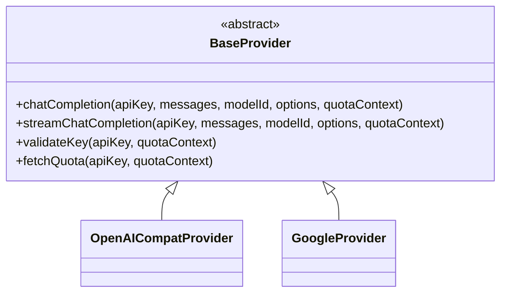
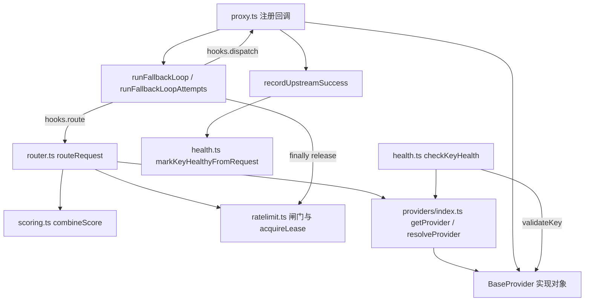
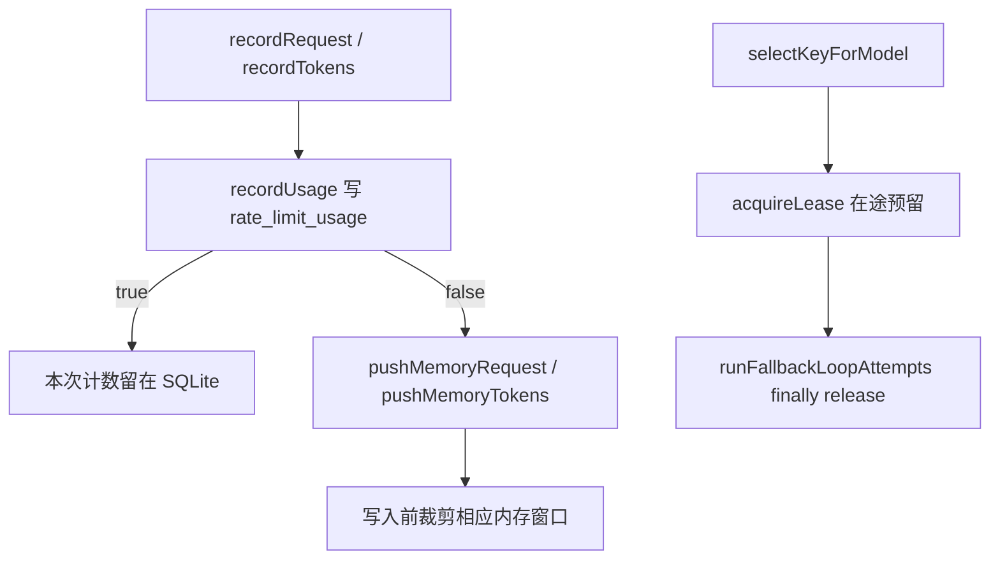
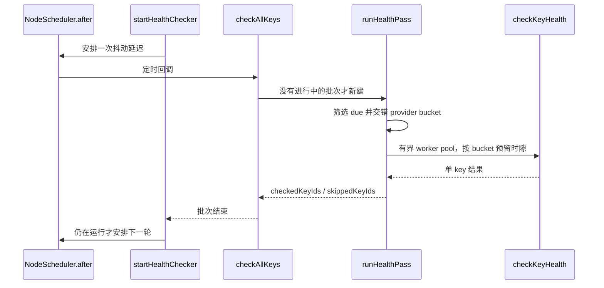

# 04 核心模块与类关系

> 第四层 · 模块关系。源码基准 `ed38ed46`，核对日期 2026-11-23。前置阅读：[03 主链路](03-详细逐步说明-主链路拆解.md)。本篇核实静态实现，不声称运行实例已经执行这些路径。

## 0 先用人话划清职责

一次请求像一次派单：`router.ts` 选候选和凭证，`ratelimit.ts` 判断现在还能不能派，Provider 实际联系上游，`fallback-loop.ts` 处理失败与换路，`health.ts` 在真实请求之外复查凭证。**评分、限额、健康、回退不是同一套状态，也不是一个大类的方法。**

| 模块 | 接收什么 | 交出什么 | 不负责什么 |
|---|---|---|---|
| `server/src/services/router.ts` | 请求能力要求、候选链、跳过集合、token 估算 | `RouteResult` 或带诊断的异常 | 不读取上游响应正文 |
| `server/src/services/scoring.ts` | 计数、速度、等级、权重、容量余量 | 分数或调整后的权重 | 不自行查询数据库、发网络请求 |
| `server/src/services/ratelimit.ts` | 平台、模型、key、限额、时间、用量 | 放行判断、租约、冷却状态 | 不翻译模型协议 |
| `server/src/providers/index.ts` | 平台与可选自定义 base URL | Provider 对象或 `undefined` | 不保证该平台已配置可用 key |
| `server/src/providers/base.ts` 与具体适配器 | 上游 key、内部消息、模型与选项 | 完整响应或分片迭代器 | 不选择下一条回退路线 |
| `server/src/lib/fallback-loop.ts` | 入口提供的 hooks、请求内状态 | 驱动派发、归因、停止、清理 | 不替每种协议生成最终响应格式 |
| `server/src/services/health.ts` | key ID、探测选项、调度器 | 健康判定、数据库更新、检查结果 | 健康不等于一定有模型额度 |

源码入口分别为 `server/src/services/router.ts` · `routeRequest+0`、`server/src/services/scoring.ts` · `combineScore+0`、`server/src/services/ratelimit.ts` · `acquireLease+0`、`server/src/providers/index.ts` · `resolveProvider+0`、`server/src/lib/fallback-loop.ts` · `runFallbackLoop+0`、`server/src/services/health.ts` · `checkKeyHealth+0`。

### 0.1 数量不能混着说

本轮在工作区按 TypeScript AST 静态计数，不是运行实例统计：

| 口径 | 数量 | 准确含义 |
|---|---|---|
| `Platform` 联合成员 | 84 | 类型允许的平台标识数 |
| 注册文件顶层 `register(...)` 调用 | 83 | 源码注册调用数，不是模型数 |
| 上述调用直接构造 `OpenAICompatProvider` | 33 | 包括 custom 占位注册 |
| 注册文件所有 `new OpenAICompatProvider` 表达式 | 34 | 还包括 `resolveProvider` 中运行时构造 custom 的表达式；不是固定 34 个活实例 |

定位：`shared/types.ts` · `Platform+0`；`server/src/providers/index.ts` · `register+0~+2`、`server/src/providers/index.ts` · `resolveProvider+0~+12`。旧文混用 74、73、34 等数字，并把构造表达式数量当实例数量；本表替代该口径。没有把 Provider 类数量用作支持能力的证明。

## 1 真实关系：类只占一部分



这里只画已沿调用链读取的两种实现，不把所有名字塞进图里假装已逐类核实。具体实现分别见 `server/src/providers/openai-compat.ts` · `OpenAICompatProvider.streamChatCompletion+0~+8`（委托 `streamChatCompletionInternal+0~+76`）、`server/src/providers/google.ts` · `GoogleProvider.streamChatCompletion+0~+134`。



图中成功记账从入口连出：在 Chat 入口中真正调用 `recordUpstreamSuccess` 的是 `dispatch` 回调，不是通用循环无条件替它执行。证据：`server/src/routes/proxy.ts` · `proxyRouter.post('/chat/completions')+1168`、`server/src/routes/proxy.ts` · `proxyRouter.post('/chat/completions')+1383`。其他入口不能因为复用循环就被认定已经自动完成成功记账。

## 2 Provider 注册表：从平台标识到真正发请求的对象

### 2.1 四个小函数的契约

| 函数 | 输入 → 返回 | 内部分步与边界 | 状态副作用 |
|---|---|---|---|
| `register` | Provider → 无返回值 | 以 `provider.platform` 为 Map 键；同键再 set 会覆盖 | 更新模块级注册表 |
| `getProvider` | Platform → 对象或 `undefined` | 直接 `providers.get` | 无新增实例 |
| `hasProvider` | Platform → boolean | 只问 Map 有没有该键 | 不检查 DB、额度、健康 |
| `getAllProviders` | 无 → Provider 数组 | 把 Map values 转为新数组 | 数组里的 Provider 仍是原对象 |
| `resolveProvider` | Platform、baseUrl → 对象或 `undefined` | custom 先 trim，空则无结果；非空新建兼容适配器；内置平台直接取 Map | custom 每次调用构造新对象 |

锚点：`server/src/providers/index.ts` · `register+0~+2`、`server/src/providers/index.ts` · `getProvider+0~+2`、`server/src/providers/index.ts` · `hasProvider+0~+2`、`server/src/providers/index.ts` · `getAllProviders+0~+2`、`server/src/providers/index.ts` · `resolveProvider+0~+12`。

custom 构造使用 `CUSTOM_PROVIDER_TIMEOUT_MS = 120000`。这只是该实现的超时参数，不保证一整个多次回退请求 120 秒内完成，也不是所有平台的默认值。

### 2.2 为什么注册了还可能不能服务

```text
hasProvider(platform) = true
  只是适配器存在
      ↓
selectKeyForModel 读取 enabled 且 healthy/unknown 的 key
      ↓
按 scope、冷却、配额、并发、token、月预算逐关检查
      ↓
custom 还要用该 key 行的 base_url 构造真实适配器
      ↓
最终才能拿到 RouteResult
```

证据：`server/src/services/router.ts` · `selectKeyForModel+0~+144`。因此，添加一个注册项、插入一个模型行、配置一把 key 是不同动作，任意一个都不是“已成功服务”的证据。

## 3 BaseProvider：必选方法、能力开关和共享工具

### 3.1 契约与三个不同的能力开关

| 成员 | 输入/输出或默认值 | 消费者要注意 |
|---|---|---|
| `platform` / `name` | 抽象只读字段 | 用于平台身份与显示，不是模型 ID |
| `keyless` | 默认 false | 无 key 平台仍可用哨兵 key 行进入统一路由；不能直接跳过所有 key 逻辑 |
| `chatCompletion` | key、消息、模型、可选 options/quotaContext → Promise 响应 | 一次返回完整结果 |
| `streamChatCompletion` | 同上 → AsyncGenerator 分片 | 正在迭代时也可能抛错，不仅创建迭代器时 |
| `validateKey` | key、quotaContext → boolean 或带诊断的验证结果 | 返回 false 和抛传输异常不是同一语义 |
| `fetchQuota` | 默认返回 false，不发请求 | true 表示记录了配额观察，不表示 key 一定健康 |
| `hasQuotaProbe` | 默认 false | 判断是否有实际配额端点，不能只比较 fetchQuota 方法是否被覆盖 |
| `supportsKeyValidation` | 默认 true | false 时自动、手动健康检查都不应发验证探针 |
| `supportsKeyPolling` | 默认 true | false 禁止周期性重复验证；不等于完全禁止手动验证 |

锚点：`server/src/providers/base.ts` · `BaseProvider+0~+71`。旧文缺少 `supportsKeyPolling`，容易把“不可轮询”与“完全不可验证”混成一个开关。

### 3.2 共享工具解决哪些问题

| 函数 | 分步行为 | 关键边界 |
|---|---|---|
| `validationResult` | 非 401/403 直接 true；挑战页抛异常；否则解析错误正文并返回 valid:false | 不是对任意 HTTP 响应的完整成功检查；具体适配器仍须正确处理其他状态 |
| `fetchWithTimeout` | 建超时 AbortController；合成调用方信号；调用 proxyFetch；按超时模式清理计时器 | 默认只约束等响应头；request 模式保留 deadline 覆盖正文；它本身不解析正文、不判断 HTTP ok |
| `readWithStallTimeout` | read 与超时 Promise 竞速，最后清计时器 | 超时自身不取消底层 read，读流拥有者负责取消 |
| `firstByteBudgetMs` | 两个预算均正时取 max，否则返回 0 | 0 表示这层不设限；不是无条件 max |
| `readSseStream` | 把 readSseFrames 交给思考标签转换器 | 返回统一 chunk 形态 |
| `readSseFrames` | 读字节、增量解码、按换行取 data、JSON.parse、yield；finally 取消 reader | 坏 JSON 行跳过；无 DONE/finish 的 EOF 抛截断；首读返回心跳也会消耗“首读阶段” |

锚点：`server/src/providers/base.ts` · `BaseProvider.validationResult+0~+29`、`server/src/providers/base.ts` · `BaseProvider.fetchWithTimeout+0~+49`、`server/src/providers/base.ts` · `BaseProvider.readWithStallTimeout+0~+16`、`server/src/providers/base.ts` · `BaseProvider.firstByteBudgetMs+0~+3`、`server/src/providers/base.ts` · `BaseProvider.readSseStream+0~+5`、`server/src/providers/base.ts` · `BaseProvider.readSseFrames+0~+59`。专门的逐函数深潜见 [11 Provider 与流式](11-函数级走读-Provider与流式.md)。

`fetchWithTimeout` 的取消契约也不能缩写成“任何传入信号都合并”：`fetchOpts.signal` 参与合成；当已有这些合成信号时，`init.signal` 不会再加入。调用方应使用约定的 `fetchOpts.signal`。

## 4 Router 与 Scoring：策略、排序、选 key 分三层

### 4.1 `orderChain` 是排序，不是派发

| 分支 | 内部分步 | 返回与副作用 |
|---|---|---|
| 没有权重的 priority 路径 | 原 priority 排序 → 密集排名 1..N → 加 penalty → 按 tier、有效排名、原 priority、原序排序 | 返回新数组；getPenalty 可能删除归零记录 |
| 有权重路径 | 取得权重 → 可选任务偏置 → 可靠性下限 → 计算链内智力范围、key 数、余量配置 → scoreChainEntry → 按 tier、score 降序、priority 排序 | 返回新数组；会读配置、统计与数据库，不能称为纯函数 |

源码：`server/src/services/router.ts` · `orderChain+0~+68`。

- `match_tier` 优先于分数，不能靠高分把较弱匹配层提前。
- `sampled=true` 是在线抽样排序；`false` 用期望值便于稳定展示；priority 不受该参数影响。
- 密集排名让 penalty 表示“后移几名”。旧文说它与所有 priority 间距 ≤10 的旧行为等价，没有代码依据；只有特定编号形态才可能等价。

### 4.2 `applyReliabilityFloor` 的安全阀

输入候选链，先读 floor；没配置直接返回。逐模型读取端点隔离的统计，样本太少保留；样本足够才用期望可靠性与 floor 比较。如果会把所有候选都清空，则返回原链。

证据：`server/src/services/router.ts` · `applyReliabilityFloor+0~+22`。它是有安全阀的筛选，不是“低于阈值永远不能被选中”的硬约束。

### 4.3 分数怎么组成

```text
alpha = max(本地成功数, 0) + 社区成功先验 + 1
beta  = max(本地失败数, 0) + 社区失败先验 + 1
期望可靠性 = alpha / (alpha + beta)

base = (wRel × reliability + wSpeed × speed + wIntel × intelligence)
       / (wRel + wSpeed + wIntel，和为0时用1)
final = base × headroom × rateLimit
```

实际在线可靠性还可从 Beta 分布抽样，不总取期望；模型分数覆写由 `scoreChainEntry` 再处理。余量使用月度/窗口两者的最小值，不是把两者连乘。证据：`server/src/services/scoring.ts` · `reliabilityPosterior+0~+9`、`server/src/services/scoring.ts` · `expectedReliability+0~+7`、`server/src/services/scoring.ts` · `combineScore+0~+7`；`server/src/services/router.ts` · `scoreChainEntry+0~+67`。

| 预设 | reliability | speed | intelligence |
|---|---|---|---|
| balanced | 0.5 | 0.25 | 0.25 |
| smartest | 0.35 | 0.1 | 0.55 |
| fastest | 0.35 | 0.55 | 0.1 |
| reliable | 0.7 | 0.15 | 0.15 |

证据：`server/src/services/scoring.ts` · `BANDIT_PRESETS+0~+10`。`RoutingStrategy` 有 priority、四个 preset、custom、decision；`PresetStrategy` 只有四个 preset；`KeySelectionStrategy` 的 auto/least-remaining 是另一个维度。切 key 策略不应被理解成切模型评分策略。

| 分量/调整 | 函数级规则与边界 | 锚点 |
|---|---|---|
| speed | 无吞吐且无 TTFB 才给 0.6；只有一轴可用时用该轴；两轴都有才按 0.6/0.4 合成 | `server/src/services/scoring.ts` · `speedScore+0~+6` |
| 吞吐 | 正值用 `1-exp(-tokPerSec/60)`，非正为 0 | `server/src/services/scoring.ts` · `throughputScore+0~+3` |
| TTFB | ≤300ms 为 1，≥5000ms 为 0，中间线性下降 | `server/src/services/scoring.ts` · `ttfbScore+0~+4` |
| intelligence | `tier*1000-sqrt(max(1,rank))*31`，未知 tier=0；这不是直接排除未知模型 | `server/src/services/scoring.ts` · `intelligenceComposite+0~+4`、`server/src/services/scoring.ts` · `tierValue+0~+2` |
| 峰时配置 | 默认关闭，时间窗口默认 18–6、UTC；fastest/reliable 豁免 | `server/src/services/scoring.ts` · `DEFAULT_PEAK_HOURS+0~+5`、`server/src/services/scoring.ts` · `PEAK_EXEMPT_STRATEGIES+0` |
| 任务调整 | code 把部分 speed 移给 intelligence；chat 反向；share≤0 不调；豁免策略不调 | `server/src/services/scoring.ts` · `taskAdjustedWeights+0~+32` |

### 4.4 动态处罚不是永久降级

- `recordModelFailure`：已有记录先按两分钟一步衰减，再增加次数、更新时间、加权处罚并封顶 10；新记录按传入 weight 建立。普通调用默认 +1。
- `recordRateLimitHit`：转调上个函数，权重 +3。
- `recordSuccess`：已有 penalty 减 1，到 0 删记录。
- `getPenalty`：计算当前衰减值，不重写 lastHit 或非零 penalty；**但衰减到 0 时会删 Map 项**。注释称 pure read，正文必须以实际 delete 为准。

证据：`server/src/services/router.ts` · `recordModelFailure+0~+12`、`server/src/services/router.ts` · `recordRateLimitHit+0~+2`、`server/src/services/router.ts` · `recordSuccess+0~+8`、`server/src/services/router.ts` · `getPenalty+0~+12`。这些是内存状态，不能按数据库里的旧请求行推导出当前精确 penalty。

### 4.5 `RouteResult` 是带资源清理义务的返回值

`selectKeyForModel` 在返回前已解密凭证、解析 custom Provider、预留月预算并取得租约。调用者既拿到发请求的材料，也接过“最终必须释放”的义务。

| 字段 | 消费方式 | 容易误读的边界 |
|---|---|---|
| `provider`、`apiKey`、`modelId` | 传给 dispatch 发上游请求 | `apiKey` 是上游 key，不是客户端网关凭证 |
| `modelDbId`、`keyId` | 内部记账、健康与处罚定位 | 不应将整个 RouteResult 原样返回客户端 |
| `keyLabel` | 脱离凭证内容的显示标签 | 不代表整个 RouteResult 不含敏感信息 |
| `endpointScope` | 同 model ID 在不同 relay 的身份隔离 | 不能只按 platform+modelId 合并所有自定义端点状态 |
| `proxyUrl` | 在 withKeyProxy 范围内使用 | 已解密的代理资料，不是公开元数据 |
| `release` | 通用循环 finally 调用 | 类型可选，生产真实路线应正常提供清理；不能因可选就省略资源管理 |

证据：`server/src/services/router.ts` · `selectKeyForModel+99~+135`；`server/src/lib/fallback-loop.ts` · `runFallbackLoopAttempts+283~+286`。

耗尽时 `summarizeExhaustion` 把诊断汇总成九类可操作原因；被预先排除的无 key 平台另计，不冒充“已经检查过的路线”。这里的 keylessSkipped 是“没配置 key 而跳过”，不要与 `BaseProvider.keyless` 的免 key 能力混淆。定位：`server/src/services/router.ts` · `summarizeExhaustion+0~+47`。

## 5 RateLimit：持久化计数优先、内存兜底、租约另算

### 5.1 不是每次请求都“双写内存与数据库”



- `recordUsage` 先 insert，再按一分钟间隔清理一天前记录；`withDb` 捕获异常，返回 false。
- `recordRequest` 仅 false 时写 rpm/rpd 内存窗口；之后清除空限额命中与冷却命中计数。
- `recordTokens` 仅 false 时写 tpm/tpd 内存窗口。
- DB 计数函数按各自时间下界过滤，不必等物理清理才排除过期用量。

证据：`server/src/services/ratelimit.ts` · `recordUsage+0~+22`、`server/src/services/ratelimit.ts` · `recordRequest+0~+10`、`server/src/services/ratelimit.ts` · `recordTokens+0~+12`、`server/src/services/ratelimit.ts` · `countPersistedRequests+0~+19`。旧文将内存数组称为始终维护的“热账本”不准确。

### 5.2 租约为什么与完成用量分开

| 函数 | 输入 → 输出 | 内部分步 | 副作用/边界 |
|---|---|---|---|
| `getKeyConcurrencyLimit` | platform → 正整数或 null | 平台专属 env 优先全局；非法/空值得到 null | 默认不限；专属值存在但非法时不会再去读全局值 |
| `inFlightForKey` | platform/key/time → 数量 | 剪过期租约，再跨该 key 所有模型计数 | 查询也会剪枝 |
| `acquireLease` | platform/model/key/tokens/time → lease ID | 剪枝、增 ID、写 Map | 进程内预留，不是跨进程锁 |
| `releaseLease` | lease ID → 无返回值 | Map.delete | 可重复释放 |

锚点：`server/src/services/ratelimit.ts` · `getKeyConcurrencyLimit+0~+8`、`server/src/services/ratelimit.ts` · `inFlightForKey+0~+7`、`server/src/services/ratelimit.ts` · `acquireLease+0~+11`、`server/src/services/ratelimit.ts` · `releaseLease+0~+2`。

请求使用量在成功后才写；同步选路期间先登记 lease，下一请求就能看到在途占用。这样缩小“检查时都没满，真正发出时却一起超额”的窗口。但租约有按平台计算的剪枝上限 `leaseMaxAgeMs(platform)`（不设固定常量），不会跟随正文持续续租；超过该上限的长流，后续查询可能已经不计该租约。**这是源码边界，不可宣称对任意长请求都完整覆盖并发。**证据：`server/src/services/ratelimit.ts` · `leaseMaxAgeMs+0`、`server/src/services/ratelimit.ts` · `pruneLeases+0~+5`。

### 5.3 冷却必须连同“依据是什么”一起保存

| `CooldownSource` | 含义 | 为什么不能一律用 key 探活解禁 |
|---|---|---|
| heuristic | 本地猜测的暂时故障或惩罚 | 这类才适合提前验证恢复 |
| authoritative | 上游明确 Retry-After 或日重置 | 本地不应提前推翻上游时间 |
| credit | 余额不足 | key 有效不证明已充值 |
| tier | 套餐无模型权限 | key 有效不证明已升级 |

类型依据：`server/src/services/ratelimit.ts` · `CooldownSource+0`。旧文把“升级阶梯”独立列成不可探测的来源不准确，阶梯本身不是该类型的第五种取值。

`setCooldown` 写内存到期时间，并尝试持久化 source/setAt/expiry；`isOnCooldown` 优先读持久化结果，再看内存；命中已过期记录会按需删除。`cleanupExpiredCooldowns` 批量清理的也只是已过期项，不会把活跃冷却全部清空。证据：`server/src/services/ratelimit.ts` · `setCooldown+0~+12`、`server/src/services/ratelimit.ts` · `isOnCooldown+0~+21`、`server/src/services/ratelimit.ts` · `cleanupExpiredCooldowns+0~+12`。

## 6 Health：检查、探问、真实成功三种证据

### 6.1 `checkKeyHealth` 的返回与状态写入

输入 key ID，返回 `KeyStatus`。主要步骤：

1. 查 key 行；不存在或无法解析 Provider，返回 error，没有完成验证。
2. `supportsKeyValidation=false`：不发探针，按需清旧错误，返回原 status。
3. 解密 key，在该 key 的代理上下文内调 `validateKey`，传 `origin: health`。
4. 解析 boolean 或 `{valid,error}`，写 healthy/invalid、错误、检查时间；只有成功更新最近健康时间。
5. 成功清失败/传输/验证限流计数，触发符合条件的内置模型发现；配额探针仅在支持且到期时另发。
6. invalid 记录确认失败次数，到阈值 3 将 enabled 置 0。
7. 抛异常走传输分支：429 记录验证退避并清传输 streak；其他错误可按 opt-in 阈值停用路由资格；始终写诊断与检查时间。

证据：`server/src/services/health.ts` · `checkKeyHealth+0~+119`、`server/src/services/health.ts` · `recordInvalidFailure+0~+17`、`server/src/services/health.ts` · `recordTransportFailure+0~+23`。

| 证据 | status / enabled 变化 | 计数 |
|---|---|---|
| 明确 valid | status=healthy | 清确认失败与传输 streak |
| 明确 invalid | status=invalid；累计三次确认失败后 enabled=0 | 增加确认失败计数 |
| 普通传输异常，停用功能未开或未达阈值 | status 保留，enabled 不变 | 仅启用功能时累积传输 streak |
| 传输异常达 opt-in 阈值 | 只把 enabled 且 healthy/unknown 的 key 改 error | 不写 invalid、不改 enabled |
| 验证本身收到 429 | status 通常保留，写检查诊断 | 不算凭证 invalid，记录探测退避 |

注意：`failureCount` 是内存计数；传输异常分支不增加也不清除它，因此“连续三次”不是“三个调度周期不管结果都算一次”。重启会丢失这些内存计数。

### 6.2 `probeKeyValidity` 不做健康服务的记账

它只查 enabled key、检查两种验证开关、解密并经 key 代理调用 validateKey，返回 valid/invalid/error。不写本函数的健康状态、检查时间或失败计数。**不能扩展为“绝无副作用”**：它会发网络请求，而且所调 Provider 的配额观察等内部行为要另外核实。

证据：`server/src/services/health.ts` · `probeKeyValidity+0~+31`。检查到不支持验证或不支持轮询，返回 error 表示无法得出本次验证结论，不是确认 key 无效。

### 6.3 `markKeyHealthyFromRequest` 的恢复边界

真实成功后节流写 `last_healthy_at`；只把 error/unknown 提升到 healthy，清对应错误和内存失败计数。**不会把 invalid 强改 healthy，也不把 enabled=0 改回 1。**函数捕获自身异常，不让健康记账毁掉已经成功的响应。证据：`server/src/services/health.ts` · `markKeyHealthyFromRequest+0~+24`。

## 7 健康调度与配额轮询：避免后台自己制造故障

### 7.1 一轮全量检查的函数接力



| 函数 | 输入输出 | 核心步骤与副作用 |
|---|---|---|
| `checkAllKeys` | options → 批次 Promise | 有进行中 Promise 就复用；finally 清 guard；完成后触发降级状态更新；强制调用也不会另起重叠批次 |
| `providerBucket` | key 行 → string | platform 与 base_url 分桶；不同 custom relay 不混为同一桶 |
| `interleaveByProvider` | rows、分桶函数 → 新队列 | 每桶取第一项，再每桶第二项，直到取完；不修改原行对象 |
| `runHealthPass` | options → 两个 ID 数组 | DB 查 enabled → due 筛选 → 交错 → 算间隔 → worker pool → 等全部完成 |
| `startHealthChecker` | Scheduler → void | 防重复启动；after 定时；上一批完成才安排下一批 |
| `stopHealthChecker` | 无 → void | 关闭运行标记并取消已安排 timer；不主动 abort 已发出的 key 探针 |

证据：`server/src/services/health.ts` · `checkAllKeys+0~+13`、`server/src/services/health.ts` · `providerBucket+0~+2`、`server/src/services/health.ts` · `interleaveByProvider+0~+16`、`server/src/services/health.ts` · `runHealthPass+0~+104`、`server/src/services/health.ts` · `startHealthChecker+0~+20`、`server/src/services/health.ts` · `stopHealthChecker+0~+6`。

调度接口真实方法为 `every(ms,fn,opts?)` 与 `after(ms,fn)`，都返回取消函数；不存在旧图里的 `schedule(name,fn,delayMs)`。`NodeScheduler` 不替任务自动捕获 Promise 异常，健康模块在自己的回调中捕获。定位：`server/src/lib/scheduler.ts` · `Scheduler+0~+3`、`server/src/lib/scheduler.ts` · `NodeScheduler+0~+10`。

### 7.2 这些开关究竟何时生效

| 项目 | 默认/合法边界 | 读取时机与作用 |
|---|---|---|
| `HEALTH_CHECK_INTERVAL_MS` | 300000ms；有效正整数且≥60000 | 模块加载时固定，下一轮再加 ±20% 抖动 |
| `HEALTH_CHECK_CONCURRENCY` | 8；非法或非正回默认 | 每轮读取，限制 worker 数 |
| `HEALTH_CHECK_MIN_SPACING_MS` | 1000ms；非法或非正回默认 | 每轮读取，同 bucket 探针之间安排间隔 |
| `HEALTH_CHECK_RATE_LIMIT_SKIP_MS` | 1 小时；非法或非正回默认 | 非 force 批次跳过近期验证 429 |
| `HEALTH_TRANSPORT_PARK_AFTER` | 0=关闭；正整数表示连续传输失败阈值 | 每次记录传输错误时读取；6只是建议值，不是默认 |
| `supportsKeyPolling=false` | Provider 能力，不是 env | 自动轮次仅初查，error 最快一小时复问；manual 可绕过该轮询过滤 |
| `force` | options，默认未开 | 跳过通常的近期/429节流，并把间隔设 0；不能绕过自动批次的不可轮询规则 |
| `manual` | options，默认未开 | 绕过不可轮询过滤；不能绕过 checkKeyHealth 的禁止验证开关 |

证据：`server/src/services/health.ts` · `getCheckIntervalMs+0~+3`、`server/src/services/health.ts` · `getHealthCheckConcurrency+0~+2`、`server/src/services/health.ts` · `getMinSpacingMs+0~+2`、`server/src/services/health.ts` · `getValidationRateLimitSkipMs+0~+2`、`server/src/services/health.ts` · `getTransportParkAfter+0~+2`、`server/src/services/health.ts` · `runHealthPass+15~+61`。

**半周期预算不是整轮硬超时。** `HEALTH_PASS_TIME_BUDGET_MS=CHECK_INTERVAL_MS/2` 只参与压缩每桶间隔，worker 仍逐项 await check，最后 Promise.all。若上游逐个耗时很长，整轮仍可超过半周期甚至基础间隔；下一轮在本轮完成后才计时。旧注释和旧文的“pass 不超过半周期”都强于实际实现。

### 7.3 配额观察不改健康判定

`quotaPollDue` 查该 key 最新 `source='quota_api'` 观察时间；没有、时间无法解析或距今≥15分钟才到期。`pollKeyQuota` 解密并经 key 代理调用 fetchQuota，异常返回 false。`maybePollKeyQuota` 另外要求 key enabled、Provider 支持、到期，才调用真正探针。

证据：`server/src/services/health.ts` · `quotaPollDue+0~+10`、`server/src/services/health.ts` · `pollKeyQuota+0~+20`、`server/src/services/health.ts` · `supportsQuotaPolling+0~+2`、`server/src/services/health.ts` · `maybePollKeyQuota+0~+12`。15分钟节流依赖已落库观察，不是请求发出即持有的互斥锁；没有观察的失败探针不能凭此表保证15分钟内绝不再发。

## 8 client、CLI、desktop 与后端的接口边界

| 层 | 已核实的函数链 | 不能混为一谈的地方 |
|---|---|---|
| client | App 的 queryClient → apiFetch → HTTP → server | UI 缓存不是服务端模型回答缓存 |
| CLI | setup → catalogs/resolvePinnedModel → tool.generate → applyGeneratedFiles | 生成配置不是已经验证上游成功；写用户文件的动作有单独边界 |
| CLI 子进程 | runChild → spawn → exit/error 清监听器 | SIGINT 由前台子进程自行处理；SIGTERM 转发；不是 HTTP 回退 |
| desktop | main → server-host.startServer → createApp/listen 与后台任务 | 内嵌 server 和独立 server 两套启动入口；不是另起 node 子进程 |

锚点：`client/src/App.tsx` · `queryClient+0~+16`；`client/src/lib/api.ts` · `apiFetch+0~+57`；`cli/src/index.ts` · `setup+0~+38`、`cli/src/index.ts` · `runChild+0~+26`；`desktop/src/server-host.ts` · `startServer+0~+81`。

两个容易影响排障的前端契约：

1. queryClient 默认 staleTime 30秒，mutation 失败统一 toast，可用 meta.silenceToast 静默；不能理解成“30秒内绝不会请求”，主动失效与独立轮询仍是别的触发源。
2. apiFetch 只有收到 **401 且 error.type=authentication_error** 才清 dashboard token 并发退出事件；上游 key 检查报401不应把用户踢出仪表盘。204 返回 undefined，成功但非 JSON 给明确代理/静态站错误提示。

这三层的页面/命令/IPC 全量细节属于已批准的 13–15 补齐范围；本节没有将它们标成已逐函数全覆盖。

## 9 改动检查表与已确认边界

| 要改哪里 | 必须同时检查 | 理由 |
|---|---|---|
| Provider 验证方法 | 三个能力 getter、health、cooldown-probe 调用条件 | 有探针不代表允许定期发探针 |
| key 选择 | 月预算预留、lease、release 调用点 | 选中路线已经占资源，异常也要释放 |
| 分数/priority | match_tier、sampled 展示、密集排名、策略域 | 排序与用户点名意图有不同优先级 |
| 限流写入 | DB失败返回、内存兜底、恢复后的计数读取 | 内存不是持续完整副本 |
| 健康并发/间隔 | 同桶预留发生在 await 之前、整轮 guard | 防两个 worker 拿到同一时隙或多个批次重叠 |
| 冷却清理 | source 与到期时间、活跃行保留 | 清过期行不等于清全部禁用状态 |

| 性质 | 已确认边界 | 处理建议 |
|---|---|---|
| 风险边界 | lease 两分钟后可被剪枝，长流不会自动续租 | 改并发保护前用长流用例验证，不能只测短请求 |
| 实现边界 | 健康半周期预算只约束排队间隔 | 监控实际批次耗时，别按常量推断硬 deadline |
| 设计特性 | penalty、失败计数、在途租约为进程内状态 | 重启和多进程场景不能假定这些状态共享 |
| 文档纠正 | getPenalty 归零时删项；probeKeyValidity 会发网络 | 不再将两者无条件称为无副作用纯读 |
| 文档纠正 | 活跃冷却可持久化，过期另有惰性删除 | “只在 boot 批量清理”本身不是持久化失效 |

以上仅更新说明，没有修改应用源码或代用户调整策略。

## 10 源码索引与术语

| 关注点 | 源码符号 |
|---|---|
| 注册/动态 custom | `server/src/providers/index.ts` · `resolveProvider+0` |
| Provider 契约 | `server/src/providers/base.ts` · `BaseProvider+0` |
| 排序/选 key | `server/src/services/router.ts` · `orderChain+0`、`server/src/services/router.ts` · `selectKeyForModel+0` |
| 评分数学 | `server/src/services/scoring.ts` · `combineScore+0` |
| 完成用量/在途占用 | `server/src/services/ratelimit.ts` · `recordRequest+0`、`server/src/services/ratelimit.ts` · `acquireLease+0` |
| 健康判定/调度 | `server/src/services/health.ts` · `checkKeyHealth+0`、`server/src/services/health.ts` · `runHealthPass+0` |
| 调度器抽象 | `server/src/lib/scheduler.ts` · `Scheduler+0` |

| 术语 | 通俗解释 |
|---|---|
| 单例 | 多处取得同一个对象；custom 动态构造不属于这个口径 |
| 契约 | 调用双方约定的输入、返回、错误和清理义务 |
| getter | 像读字段一样调用的取值方法，如 hasQuotaProbe |
| 纯函数 | 结果只由输入决定，且不修改外部状态；有数据库读取或 Map 删除就不能简单归入此类 |
| lease / 租约 | 请求还没结束时临时占一个名额，结束释放或超龄剪除 |
| penalty | 暂时让模型更不容易被选中的处罚，不等于永久删除模型 |
| headroom | 限额还剩多少空间对应的打分系数 |
| Beta / Thompson sampling | 用成功失败形成可信度分布，再抽样排序，给未充分尝试的模型机会 |
| bucket | 为同一平台/端点归成一组，方便错开探针 |
| worker pool | 只有固定数量的工作者并行处理一列任务，不一次启动所有任务 |
| jitter / 抖动 | 每轮时间略随机，避免多实例总在同一秒一起探测 |
| authoritative | 上游明确给出的限制依据，不是网关自行估计 |
| origin | 配额观察里标记本次请求来自健康检查还是其他用途 |
| 预留与完成记账 | 前者描述还在做，后者记录做完用了多少，两者生命周期不同 |

[上一篇：主链路](03-详细逐步说明-主链路拆解.md) · [下一篇：API 与接口](05-API与接口设计.md) · [深入：路由限流与回退](10-函数级走读-路由限流与回退.md)
