# 05 API 与接口设计

> 第四层 · 接口契约。源码基准 `ed38ed46`，核对日期 2026-11-23。前置阅读：[04 核心模块与类关系](04-核心模块与类关系.md)。本篇只讲"门口"：请求从哪进、谁放行、清单有哪些、错误长什么样。协议转换的内部实现、认证攻防细节、管理面业务逻辑分别在后续篇章（16 多协议入口、19 认证与安全、18 模型与端点管理）展开，本篇不越层重复。

## 0 先用人话讲清楚

这套服务只有一个 Express 进程，但开了六个"门脸"，每个门脸认不同的凭证：

| 门脸 | 路径 | 给谁用 | 认什么 |
|---|---|---|---|
| OpenAI 兼容面 | `/v1/*` | 绝大多数 AI 客户端 | unified key 或 client-profile key |
| Gemini 原生面 | `/v1beta/*` | Gemini CLI 及同系客户端 | 同上，额外容忍 `?key=` |
| Ollama 仿真面 | `/api/tags` 等 7 条精确路径 | 本机 Ollama 客户端 | 默认关闭；三种模式三种认法 |
| MCP 面 | `/mcp` | 说 MCP 协议的 agent | unified key（仅 POST 鉴权） |
| 管理面 | `/api/*`（除 Ollama 7 条） | 仪表盘浏览器 | 登录会话 token |
| 运维探针面 | `/livez`、`/readyz`、`/api/ping` | 负载均衡、容器编排 | 不认凭证 |

**最重要的边界**：unified key 只能开推理的门，开不了管理面；登录会话只能开管理面，不能当推理 key 用。两套凭证在源码里是完全不同的校验函数，不存在"一个 token 走天下"。

## 1 挂载顺序全景：顺序即语义

Express 按注册顺序执行中间件，所以挂载顺序本身就是安全设计的一部分。以下每个节点都能在 `server/src/app.ts` · `createApp+0` 的函数体内找到对应注册行。

```mermaid
flowchart TD
    REQ["请求进入 createApp"] --> BODY["两级 JSON 限额<br/>wire 面默认 25MB，其余 10MB"]
    BODY --> CTX["clientContextMiddleware<br/>记录 IP + User-Agent"]
    CTX --> OLL["Ollama 7 条精确路径<br/>先过 createProxyRateLimiter"]
    OLL --> OLLR["ollamaRouter"]
    OLLR --> ADMIN["/api 统一 createAdminRateLimiter"]
    ADMIN --> AUTH["/api/auth → authRouter<br/>唯一免 requireAuth 的 router"]
    AUTH --> EXPORT["/api/keys/export 额外 10/min 限流"]
    EXPORT --> GUARDED["20 个 router<br/>每个都挂 requireAuth"]
    GUARDED --> PING["GET /api/ping 免鉴权"]
    PING --> DOCS["/v1 docsRouter + providersRouter<br/>故意在限流器之前"]
    DOCS --> URLT["/v1/t/:token 独立限流 + urlTokenRouter"]
    URLT --> V1L["/v1 createProxyRateLimiter"]
    V1L --> ANTH["anthropicRouter 先于 proxyRouter<br/>靠 anthropic-version 头协商 /v1/models"]
    ANTH --> PROXY["proxyRouter → moderationRouter → responsesRouter"]
    PROXY --> GEM["/v1beta 限流 + geminiRouter"]
    GEM --> MCP["/mcp 限流 + mcpRouter"]
    MCP --> STATUS["statusRouter: /livez /readyz"]
    STATUS --> ERR["errorHandler"]
    ERR --> STATIC["静态文件 + SPA fallback<br/>API 前缀不走 fallback"]
```



顺序里藏着五条容易踩反的规则：

| 规则 | 源码位置 | 为什么是这个顺序 |
|---|---|---|
| admin 限流器必须在 authRouter 之前 | `server/src/app.ts` · `createApp+140~+146` | 注册晚了的话 login 会先被 authRouter 应答结束，限流器永远轮不到——密码暴破就没了上限 |
| Ollama 挂载在 admin 门之前 | `server/src/app.ts` · `createApp+123~+127` | 真 Ollama 客户端不用 dashboard 会话；它自带 proxy 限流器 |
| docs/providers 在 /v1 限流器之前 | `server/src/app.ts` · `createApp+195~+201` | 状态轮询和文档查看不消耗调用方的请求预算 |
| anthropicRouter 在 proxyRouter 之前 | `server/src/app.ts` · `createApp+216~+217` | 同一个 `GET /v1/models` 要靠 `anthropic-version` 头决定返回哪种形状；Anthropic 不拥有的路径原样放行 |
| livez/readyz 在静态 fallback 之前 | `server/src/app.ts` · `createApp+239` | 否则探针会拿到 index.html 而不是 JSON |

一个 `POST /v1/chat/completions` 实际穿过的前置关卡（ASCII 时序，省略不拥有该路径的 router）：

```
client ──> express.json(25MB 档)          app.ts · createApp+106~+109
       ──> clientContextMiddleware       app.ts · createApp+114
       ──> /v1 proxy 限流器              app.ts · createApp+210
       ──> anthropicRouter（不匹配，放行） app.ts · createApp+216
       ──> proxyRouter 注册的处理函数     proxy.ts · proxyRouter.post('/chat/completions')+0
             └─> requireInferenceAuth    proxy.ts · requireInferenceAuth+0
                   └─> resolveAuth       lib/system-prompt.ts · resolveAuth+0
```

## 2 总量口径：201 个注册是怎么数出来的

本轮用仓库自带 TypeScript 解析器做 AST 静态计数（工具：`docs/sourceReader/.progress/sr_symbols.cjs`），只计 `get/post/put/patch/delete/head/options/all` 方法注册表达式，按表达式名全匹配过滤——`proxyRouter.post(...).res.on('close')` 这类嵌套事件回调**不是** HTTP 注册，不计入。

| 表面 | 注册数 | 构成 |
|---|---|---|
| `/api` 管理面（受保护） | 148 | 20 个 router，每个挂载时都带 `requireAuth` |
| `/api/auth` | 10 | 登录/ setup /桌面会话等，见 §10 |
| `GET /api/ping` | 1 | 内联注册，免鉴权但在 admin 限流器之后 |
| `/v1` | 25 | docs 2 + providers 2 + anthropic 3 + proxy 16 + moderation 1 + responses 1 |
| `/v1beta` | 5 | geminiRouter |
| Ollama 精确路径（根挂载） | 7 | ollamaRouter，路径自带 `/api/` 前缀 |
| `/mcp` | 3 | POST/GET/DELETE 各一 |
| 根级探针 | 2 | `/livez`、`/readyz` |
| **合计** | **201** | 不含静态文件与 SPA fallback |

两个口径提醒：数组路径（如 `proxyRouter.get(['/models/:id', '/models/*rest'])`）算 **1 个注册、2 条 URL 形态**；`/decisions` 与 `/systemone` 共享同一个命名 handler，但算 2 个注册。旧文的"21 个 router/20 个受保护"口径已作废：受保护 router 是 20 个，另有 auth router 与内联 ping，合计 22 个挂载单元。

## 3 认证矩阵：五种凭证各开哪扇门

| 凭证 | 怎么携带 | 校验函数 | 能开 | 明确不能开 |
|---|---|---|---|---|
| dashboard 会话 | `Authorization: Bearer` 或 `x-dashboard-token` | `server/src/middleware/requireAuth.ts` · `requireAuth+0` | 20 个管理 router | 一切推理面 |
| unified key | Bearer / `x-api-key` / `x-goog-api-key` | `server/src/lib/system-prompt.ts` · `resolveAuth+0` | 推理面全部 + `/v1/usage` + `/v1/providers` | 管理面 |
| client-profile key（`sk-cp-`） | 同上 | 同上 | 推理面（注入该 profile 的 system prompt） | `/v1/usage`、`/v1/providers`、`/v1/quota-forecast`、管理面 |
| URL token | URL 路径段 `/v1/t/:token/...` | `server/src/services/url-tokens.ts` · `validateUrlToken+0` | proxy/responses/ollama 三个 router 的推理路径 | `/v1/usage`（显式 403）、管理面 |
| 无凭证 | — | — | docs、livez/readyz、ping、auth 的 bootstrap 子集 | 其余全部 |

### 3.1 `resolveAuth`：推理凭证的唯一分拣口

- 职责：把客户端 token 分拣成 unified 或 profile 两种身份。
- 调用方：`requireInferenceAuth`、Gemini/Ollama/Anthropic/MCP 各 router 的 authenticate、moderation。
- 输入：token 字符串；输出：`ResolvedAuth`（unified 时 systemPrompt 为 null；profile 时带 profileId/name/systemPrompt）或 null。
- 分步（`server/src/lib/system-prompt.ts` · `resolveAuth+0~+14`）：先用 `timingSafeStringEqual` 比 unified key——命中即返回 unified；不是 `sk-cp-` 前缀直接拒；按 token 的 SHA-256 hash 查 `client_profiles` 表，disabled 与不存在同样拒（不泄露"有没有这个 profile"）；空 prompt 归一成 null。
- 异常与副作用：只读数据库，无写入；比较走 HMAC 摘要后 `timingSafeEqual`，不做逐字节短路比较（`server/src/lib/system-prompt.ts` · `timingSafeStringEqual+0`）。

### 3.2 `extractApiToken` 与 `requireInferenceAuth`

`server/src/routes/proxy.ts` · `extractApiToken+0`：按 Bearer → `x-api-key` → `x-goog-api-key` 的顺序取第一个非空值。**query 凭证不在这里**——`?key=` 只有 Gemini router 自己容忍（§5）。

`server/src/routes/proxy.ts` · `requireInferenceAuth+0`：组合 extractApiToken + resolveAuth，失败写 401 并返回 null，调用方直接 return。它是 proxy router 内所有推理端点的统一第一道门。

## 4 `/v1` OpenAI 兼容面：25 个注册全清单

| # | 方法与路径 | 注册锚点 | 鉴权 | 一句话契约 |
|---|---|---|---|---|
| 1 | GET `/v1/openapi.json` | `server/src/routes/docs.ts` · `docsRouter.get('/openapi.json')+0` | 无 | 静态 spec，`Cache-Control: public, max-age=3600` |
| 2 | GET `/v1/docs` | `server/src/routes/docs.ts` · `docsRouter.get('/docs')+0` | 无 | 同上缓存策略的查看器 |
| 3 | GET `/v1/providers` | `server/src/routes/status.ts` · `providersRouter.get('/providers')+0` | 仅 unified | 每上游 key 数/冷却/余量聚合 |
| 4 | GET `/v1/quota-forecast` | `server/src/routes/status.ts` · `providersRouter.get('/quota-forecast')+0` | 仅 unified | 配额预测 pools |
| 5 | POST `/v1/messages` | `server/src/routes/anthropic.ts` · `anthropicRouter.post('/messages')+0` | 推理凭证 | Anthropic Messages 形状 |
| 6 | POST `/v1/messages/count_tokens` | `server/src/routes/anthropic.ts` · `anthropicRouter.post('/messages/count_tokens')+0` | 推理凭证 | 本地估算，不请求上游 |
| 7 | GET `/v1/models`（带 `anthropic-version`） | `server/src/routes/anthropic.ts` · `anthropicRouter.get('/models')+0` | 推理凭证 | Anthropic 形状；无该头则放行给 proxy |
| 8 | GET `/v1/models` | `server/src/routes/proxy.ts` · `proxyRouter.get('/models')+0` | 推理凭证 | 支持 `available/connected/ready` 别名过滤 |
| 9 | GET `/v1/models/:id`（含多段 `*rest`） | `server/src/routes/proxy.ts` · `proxyRouter.get(['/models/:id', '/models/*rest'])+0` | 推理凭证 | 单模型查询；空或超 300 字符 404 |
| 10 | GET `/v1/usage` | `server/src/routes/proxy.ts` · `proxyRouter.get('/usage')+0` | **仅 unified** | 全安装月度账本；URL token 与 profile 都 403 |
| 11 | POST `/v1/embeddings` | `server/src/routes/proxy.ts` · `proxyRouter.post('/embeddings')+0` | 推理凭证 | 向量嵌入 |
| 12 | POST `/v1/rerank` | `server/src/routes/proxy.ts` · `proxyRouter.post('/rerank')+0` | 推理凭证 | 重排序 |
| 13 | POST `/v1/search` | `server/src/routes/proxy.ts` · `proxyRouter.post('/search')+0` | 推理凭证 | 网页搜索 |
| 14 | GET `/v1/search/engines` | `server/src/routes/proxy.ts` · `proxyRouter.get('/search/engines')+0` | 推理凭证 | 可用搜索引擎清单 |
| 15 | POST `/v1/decisions` | `server/src/routes/proxy.ts` · `proxyRouter.post('/decisions')+0` | 推理凭证 | 结构化决策，handler 为 `handleDecision` |
| 16 | POST `/v1/systemone` | `server/src/routes/proxy.ts` · `proxyRouter.post('/systemone')+0` | 推理凭证 | 与 `/decisions` 同一个 handler |
| 17 | GET `/v1/decisions/models` | `server/src/routes/proxy.ts` · `proxyRouter.get('/decisions/models')+0` | 推理凭证 | 决策模型清单 |
| 18 | POST `/v1/images/generations` | `server/src/routes/proxy.ts` · `proxyRouter.post('/images/generations')+0` | 推理凭证 | 图像生成，n≤4 |
| 19 | POST `/v1/videos/generations` | `server/src/routes/proxy.ts` · `proxyRouter.post('/videos/generations')+0` | 推理凭证 | 视频生成，duration 1–120 秒 |
| 20 | POST `/v1/audio/speech` | `server/src/routes/proxy.ts` · `proxyRouter.post('/audio/speech')+0` | 推理凭证 | TTS，返回原始音频字节 |
| 21 | POST `/v1/audio/transcriptions` | `server/src/routes/proxy.ts` · `proxyRouter.post('/audio/transcriptions')+0` | 推理凭证 | STT，multipart 单文件 ≤25MiB |
| 22 | POST `/v1/completions` | `server/src/routes/proxy.ts` · `proxyRouter.post('/completions')+0` | 推理凭证 | 旧式补全 |
| 23 | POST `/v1/chat/completions` | `server/src/routes/proxy.ts` · `proxyRouter.post('/chat/completions')+0` | 推理凭证 | 主链路，见 [03](03-详细逐步说明-主链路拆解.md) |
| 24 | POST `/v1/moderations` | `server/src/routes/moderation.ts` · `moderationRouter.post('/moderations')+0` | 推理凭证 | 内容审查 shim；不使用 profile prompt |
| 25 | POST `/v1/responses` | `server/src/routes/responses.ts` · `responsesRouter.post('/responses')+0` | 推理凭证 | Codex 需要的 Responses API |

### 4.1 重点函数走读

**`proxyRouter.get('/usage')` —— 三道门的全安装账本。** `server/src/routes/proxy.ts` · `proxyRouter.get('/usage')+6~+15`：第一道先查 `urlTokenAuthenticated` 标志，是则 403 `permission_error`——因为 URL token 请求已被注入 unified key（§9），不查这个标志就等于把账本开放给可分享的 token；第二道 `requireInferenceAuth`；第三道拒绝非 unified（profile key 也 403）。全过之后才查 `key_monthly_usage` 表，返回 month/resetsAt/requests/tokens/byPlatform/byKey。副作用：只读。

**`handleDecision` —— 决策端点的统一 handler。** `server/src/routes/proxy.ts` · `handleDecision+0`：鉴权 → zod 校验（questions 与 fields 互斥，fields 要求 string state）→ 挂客户端断连 abort → `runDecision`。成功返回 object/model/provider/answers/usage；`DecisionError` 用它自带的 status，其余 502；429 带 `Retry-After`。错误 type 按 status 映射：400→invalid_request_error、429→rate_limit_error、其余→server_error。

**`proxyRouter.post('/audio/transcriptions')` —— 先鉴权再收文件。** `server/src/routes/proxy.ts` · `proxyRouter.post('/audio/transcriptions')+0`：auth 通过后才进 multer memoryStorage 单文件解析，上限 `MAX_TRANSCRIPTION_BYTES` = 25MiB，超限 413 `file_too_large`；model 必填；format 支持 json/text/verbose_json/vtt，**srt 显式 400 `unsupported_format`**（不是 silently 不支持）；temperature 限 0–1。

**`inferenceBudgetCode` 与 `mediaErrorType`。** `server/src/routes/proxy.ts` · `inferenceBudgetCode+0`：429 的机器可读 code——有 retryAfterMs 优先用它，否则 quota_exceeded 用 `secondsUntilNextMonth`。`server/src/routes/proxy.ts` · `mediaErrorType+0`：400/413→invalid_request_error，401→authentication_error，429→rate_limit_error，其余→server_error。**429 不是只有一种含义**： RPM 撞墙、月度配额耗尽、上游限额透传都会是 429，靠 code 与 Retry-After 区分。

## 5 `/v1beta` Gemini 原生面：5 个注册

| 方法与路径 | 注册锚点 | 契约 |
|---|---|---|
| GET `/v1beta/models` | `server/src/routes/gemini.ts` · `geminiRouter.get('/models')+0` | 模型清单，Google 形状 |
| GET `/v1beta/models/{name}`（正则） | `server/src/routes/gemini.ts` · `geminiRouter.get(/^\/models\/(.+)$/)+0` | 单模型 |
| POST `...:generateContent`（正则） | `server/src/routes/gemini.ts` · `geminiRouter.post(/^\/models\/(.+):generateContent$/)+0` | 委托 `handleGenerate` |
| POST `...:streamGenerateContent`（正则） | `server/src/routes/gemini.ts` · `geminiRouter.post(/^\/models\/(.+):streamGenerateContent$/)+0` | 同上，`?alt=sse` 决定流式 |
| POST `...:countTokens`（正则） | `server/src/routes/gemini.ts` · `geminiRouter.post(/^\/models\/(.+):countTokens$/)+0` | 本地 `estimateGeminiTokens`，不联网 |

`server/src/routes/gemini.ts` · `authenticate+0~+14`：先取 `?key=`（有则 console.warn 提醒 URL 泄露风险），`extractApiToken(req) ?? queryKey` 送 `resolveAuth`；失败 401，包络是 Google 风格 `{error:{code,message,status:'UNAUTHENTICATED'}}`（`server/src/routes/gemini.ts` · `sendError+0`）。**query 凭证只在这个 router 存在**，proxy 面不认。

`server/src/routes/gemini.ts` · `handleGenerate+0`：auth → 解析 → 从路径正则取 action/model → `runInboundChat`，maxTokens 默认 8192，`streamWire(alt==='sse')` 决定 SSE 还是一次性 JSON。

## 6 Ollama 仿真面：7 个注册，默认整面关闭

| 方法与路径 | 注册锚点 |
|---|---|
| GET `/api/tags` | `server/src/routes/ollama.ts` · `ollamaRouter.get('/api/tags')+0` |
| GET `/api/version` | `server/src/routes/ollama.ts` · `ollamaRouter.get('/api/version')+0` |
| POST `/api/show` | `server/src/routes/ollama.ts` · `ollamaRouter.post('/api/show')+0` |
| POST `/api/chat` | `server/src/routes/ollama.ts` · `ollamaRouter.post('/api/chat')+0` |
| POST `/api/generate` | `server/src/routes/ollama.ts` · `ollamaRouter.post('/api/generate')+0` |
| POST `/api/embed` | `server/src/routes/ollama.ts` · `ollamaRouter.post('/api/embed')+0` |
| POST `/api/embeddings`（legacy） | `server/src/routes/ollama.ts` · `ollamaRouter.post('/api/embeddings')+0` |

门控函数 `server/src/routes/ollama.ts` · `authorize+0~+22`，按模式分叉（`server/src/routes/ollama.ts` · `getOllamaEmulationMode+0`，settings 键 `ollama_emulation`，默认 `off`）：

| 模式 | 行为 | 失败响应 |
|---|---|---|
| `off`（默认） | 整面拒绝 | 404 `{error:'Ollama emulation is disabled'}` |
| `open-loopback` | 只放行本机 | 非本机 403 `{error:'...only accepts connections from this machine'}` |
| `key-required` | 只认 unified key | 401 `{error:'Invalid API key'}` |

两个细节：URL token 请求在 authorize 第一行直接放行（`urlTokenAuthenticated` 标志）；`isLoopback`（`server/src/routes/ollama.ts` · `isLoopback+0`）是 `server/src/lib/loopback.ts` · `isLoopbackRequest+0` 的一行委托；判定逻辑不只看 socket——socket 是 loopback 后，还要 `x-forwarded-for` 最右一跳（`forwardedPeerAddress+0`）为空或本身是 loopback，防止本机反代把远程请求"洗"成本机。

legacy `/api/embeddings` 有 fallthrough：持有效 dashboard 会话的请求 `next()` 交给后面的管理面 embeddings router；持过期 dashboard token 且非 key-required 模式则 401。这是 Ollama 面唯一与管理面共享的路径。

## 7 `/mcp` 面：3 个注册 + 13 个工具

| 方法 | 注册锚点 | 行为 |
|---|---|---|
| POST `/mcp` | `server/src/routes/mcp.ts` · `mcpRouter.post('/')+0` | 唯一鉴权的动词：`server/src/routes/mcp.ts` · `authenticate+0` 校验推理凭证 |
| GET `/mcp` | `server/src/routes/mcp.ts` · `mcpRouter.get('/')+0` | enable 门后直接 405，**不调 authenticate** |
| DELETE `/mcp` | `server/src/routes/mcp.ts` · `mcpRouter.delete('/')+0` | 同上 405 |

router 级 enable 门在所有动词之前：MCP 未启用时整面 404，启用状态由 settings 的 enable-mcp 开关控制（§11）。协议版本 `PROTOCOL_VERSION = '2025-06-18'`（`server/src/routes/mcp.ts` · `PROTOCOL_VERSION+0`），无状态 Streamable HTTP。

工具清单固定在 `server/src/routes/mcp.ts` · `TOOLS+0`（13 个）。**不是纯内省**——含两个写动作：

| 工具 | 干什么 | 副作用标注 |
|---|---|---|
| `ask_freellmapi` | 向网关提一个问题 | openWorldHint（会触上游） |
| `healthcheck` | 健康摘要 | 只读 |
| `list_models` | 模型清单 | 只读 |
| `provider_health` | 上游健康 | 只读 |
| `usage_summary` | 用量摘要 | 只读 |
| `routing_info` | 当前路由策略 | 只读 |
| `set_routing_strategy` | **改路由策略** | readOnlyHint=false（写） |
| `cache_stats` | 缓存统计 | 只读 |
| `web_search` | 网页搜索 | openWorldHint（会触上游） |
| `compression_stats` | 压缩统计 | 只读 |
| `provider_list` | Provider 清单 | 只读 |
| `clear_cache` | **清空响应缓存** | destructiveHint=true |
| `quota_outlook` | 配额展望 | 只读 |

## 8 公开探针与文档面

**`GET /livez`**（`server/src/routes/status.ts` · `statusRouter.get('/livez')+0`）：DB 可达且加密密钥可用才 200；新增 `stored_keys_decryptable` 字段**只报告不否决**——已存 key 解不开时仍回 200，避免配错加密密钥导致容器无限重启。

**`GET /readyz`**（`server/src/routes/status.ts` · `statusRouter.get('/readyz')+0`）：DB 可达后数 `enabled=1 AND status IN ('healthy','unknown')` 的 distinct platform，>0 即 200 `ready_upstreams`；否则按"没配 key / 都在冷却 / 都不健康"给不同原因。**它不实际选模型、不检查每个配额**——ready 不等于每个模型此刻都能服务。

**`GET /api/ping`**（`server/src/app.ts` · `createApp+187~+189`）：内联注册，返回 `{status:'ok',timestamp}`；免鉴权但在 admin 限流器之后。

## 9 URL token：无 header 客户端的委托通道

给"无法设置请求头"的客户端（手机 widget、队友的简易脚本）用的可单独撤销 token。

**验证函数** `server/src/services/url-tokens.ts` · `validateUrlToken+1~+16`：空 token 拒；裸 unified key 拒（防止把主 key 贴进 URL，还会 console.warn）；按 SHA-256 hash 查 `url_tokens` 表中未撤销的行；命中则更新 `last_used_at` 后放行。**没有过期时间校验**——旧文"短期 token"的说法不成立，撤销是唯一的失效手段（`server/src/services/url-tokens.ts` · `revokeUrlToken+0`）。

**委托 middleware**（`server/src/routes/url-tokens.ts` · `urlTokenRouter+0` 之后的 `.use`，第 11–35 行）：验证通过后把 `Authorization` 改写为 `Bearer <unified key>` 并置 `urlTokenAuthenticated=true`，然后依次委托 `proxyRouter`、`responsesRouter`、`ollamaRouter` 三个 router——**不只 proxy**。下游凡是"仅 unified 可读"的端点（如 `/v1/usage`）必须显式检查这个标志并拒绝，否则可分享 token 就读到了全安装账本。

管理入口在 settings router：`GET/POST /api/settings/url-tokens`、`DELETE /api/settings/url-tokens/:id`（§11），全部在 dashboard 会话门后。

## 10 `/api/auth` 登录面：10 个注册

| 方法与路径 | 注册锚点 | 契约要点 |
|---|---|---|
| GET `/status` | `server/src/routes/auth.ts` · `authRouter.get('/status')+0` | needsSetup/authenticated/email/desktop |
| POST `/desktop-session` | `server/src/routes/auth.ts` · `authRouter.post('/desktop-session')+0` | 四重守卫全过才发桌面会话 token，否则 403 |
| POST `/setup` | `server/src/routes/auth.ts` · `authRouter.post('/setup')+0` | 已有用户 409；远程必须 setup code；成功 201 发会话 |
| POST `/login` | `server/src/routes/auth.ts` · `authRouter.post('/login')+0` | 锁定 429+Retry-After；失败统一 401 不区分原因 |
| POST `/logout` | `server/src/routes/auth.ts` · `authRouter.post('/logout')+0` | 直接删 bearer 对应会话，不先验证 |
| GET `/me` | `server/src/routes/auth.ts` · `authRouter.get('/me')+0` | 会话无效 401 |
| POST `/change-email` | `server/src/routes/auth.ts` · `authRouter.post('/change-email')+0` | 要当前密码；连错 3 次删会话；邮箱占用 409 |
| POST `/change-password` | `server/src/routes/auth.ts` · `authRouter.post('/change-password')+0` | 同上密码门槛 |
| POST `/forgot-password` | `server/src/routes/auth.ts` · `authRouter.post('/forgot-password')+0` | 无账号也 200；10 秒间隔 429 |
| POST `/reset-password` | `server/src/routes/auth.ts` · `authRouter.post('/reset-password')+0` | code 不符 403；成功直接发新会话 |

桌面会话守卫 `server/src/routes/auth.ts` · `desktopSignInAllowed+0`：`FREEAPI_DESKTOP=1` + `isLoopbackRemote` + Host 在 `LOCAL_HOSTNAMES` + 非 cross-site，四个条件缺一不可。`isLoopbackRemote`（`server/src/routes/auth.ts` · `isLoopbackRemote+0`）与 Ollama 的 isLoopback 一样检查 x-forwarded-for 首跳。

**免外层 requireAuth ≠ 匿名**：这个 router 内部每个 handler 自己决定要不要会话（me/change-* 要，login/setup 不要）。它只是没在挂载点统一加门。

## 11 管理面：20 个受保护 router，148 个注册

全部挂载形态为 `app.use('/api/<名>', requireAuth, <router>)`（`server/src/app.ts` · `createApp+154~+184`）。下表"联网"指 handler 会主动发上游/外部请求，不是指它返回网络数据。

| router（挂载点） | 注册数 | 路径清单 | 联网.handler |
|---|---|---|---|
| keys（/api/keys） | 16 | GET /providers、GET /、POST /、POST /custom、POST /custom/probe、POST /custom/discover-models、POST /discovered-models、POST /import、POST /preview、POST /import-selected、GET /export、POST /:id/reveal、PATCH /:id、PATCH /platform/:platform、DELETE /:id、DELETE /:id/cooldowns | custom/probe、custom/discover-models |
| client-profiles | 5 | GET /、POST /、PATCH /:id、POST /:id/rotate、DELETE /:id | 无 |
| conversations | 5 | GET /、GET /:id、POST /、PUT /:id、DELETE /:id | 无 |
| logs | 2 | GET /、POST /clear | 无 |
| models | 6 | GET /、POST /、PATCH /:id、DELETE /:id、DELETE /custom/:id、POST /:id/test | /:id/test |
| profiles | 10 | GET /、GET /active、POST /active、GET /:id/models、POST /、PUT /:id、PUT /:id/reorder、POST /:id/reset、DELETE /:id、POST /:id/sort/:preset | 无 |
| fallback | 10 | GET /、PUT /、GET /routing、PUT /routing、GET /penalty-inspector、DELETE /penalty-inspector、POST /sort/:preset、GET /token-usage、GET /rate-limit-usage、GET /quota-forecast | 无（只读已存观察） |
| embeddings | 5 | GET /、PUT /、GET /usage、POST /custom、DELETE /custom/:id | POST /custom（维度探测） |
| media | 5 | GET /、GET /usage、POST /custom、PUT /:id、DELETE /custom/:id | 无 |
| search | 3 | GET /engines、PATCH /engines/:id、POST /engines/:id/test | /engines/:id/test |
| decisions | 3 | GET /models、PATCH /models/:id、POST /try | POST /try |
| analytics | 11 | GET /search、/summary、/by-model、/by-platform、/by-client、/by-key、/timeline、/error-distribution、/errors、/requests、/requests/:id | 无 |
| health | 5 | GET /、POST /check/:keyId、POST /check-all、POST /quota/:keyId、POST /probe-models | 四个 POST 全部 |
| free-tier | 1 | GET / | 无 |
| settings | 39 | 见 §11.2 分组表 | POST /proxy/test |
| premium | 5 | GET /、POST /key、DELETE /key、POST /sync、POST /portal | key/sync/portal（license 服务） |
| backups | 8 | GET /tables、GET /schedule、PUT /schedule、GET /、POST /、GET /:id/download、POST /:id/restore、DELETE /:id | 无 |
| cache | 3 | GET /stats、PUT /config、DELETE / | 无 |
| compression | 2 | GET /stats、POST /preview | 无 |
| update | 4 | GET /release、GET /check、GET /status、POST /apply | release/check/apply（更新服务） |

### 11.1 高风险与高价值 handler 走读

**keys 导出/明文的二次验密。** `server/src/routes/keys.ts` · `skipsReauth+0`：仅当 `FREEAPI_DESKTOP=1` 且 socket 是 loopback 才跳过——**注意它不像 auth.ts 的 `isLoopbackRemote` 那样再查 x-forwarded-for**，两处判定口径不同。`GET /api/keys/export` 与 `POST /api/keys/:id/reveal` 都要求 `x-reauth-password` 头并通过 `verifyCredentials`，否则 403。export 支持 json/env/csv 三种格式，只导 healthy key，解密后还要过 `isExportableKey` 过滤；csv 对 label/base_url 做公式注入防护。export 路径在 admin 限流之外再叠 `EXPORT_RATE_LIMIT_RPM = 10` 的独立桶（`server/src/app.ts` · `createApp+152`）。

**keys 新增不联网验证。** `server/src/routes/keys.ts` · `keysRouter.post('/')+26~+70`：keyless provider（Kilo、OVH、AI Horde 等）无 key 时存 sentinel 并复用已有行而不是堆重复；给了真 key 则就地升级 anonymous 行。插入后状态是 `unknown`，**不同步探测上游**；目录无模型的平台触发后台 `triggerBuiltinModelDiscovery`。响应只回 maskedKey。

**models 测试的真请求与节流。** `server/src/routes/models.ts` · `modelsRouter.post('/:id/test')+13~+24`：内存 Map 节流 5 秒（`MODEL_TEST_THROTTLE_MS`），撞节流 429+Retry-After。然后 `routePinnedModel` 锁定该模型走与推理相同的选 key/配额门，`chatCompletion` 发一条 `'ping'`（max_tokens=4，15 秒超时），**真实计费请求**。成功失败都写 requests 日志（source 标记 `model-test`）并结算月度账本；空补全算 `success:false` 但仍记账；finally 里 `route.release?.()` 释放租约。

**models 改与删的联动。** `server/src/routes/models.ts` · `modelsRouter.patch('/:id')+49~+61`：目录管理的模型改字段时同步写 `model_overrides`（回到目录默认值的 override 会被识别清除）；禁用模型联动禁用所有 profile 里的它并清融合配置。`server/src/routes/models.ts` · `modelsRouter.delete('/:id')+14~+27`：目录模型写 tombstone（防目录同步复活），custom 模型写 custom tombstone（防 custom 同步复活），删 fallback/profile 关联，最后清理无引用的 custom key。

**fallback 两个写入口。** `server/src/routes/fallback.ts` · `fallbackRouter.put('/routing')+6~+16`：先存 weights 再翻 strategy，保证新模式立刻读到 intended 向量；全零向量由 setCustomWeights 抛错变 400。`server/src/routes/fallback.ts` · `fallbackRouter.put('/')+10~+37`：写当前活动链——有 active profile 时对 `profile_models` 做 UPSERT（不存在即插入），没有则 UPDATE 全局 `fallback_config`；客户端快照里的陈旧 modelDbId 被 `knownModelIds` 过滤跳过而不是外键报错。`DELETE /penalty-inspector` 是一次性解除全部冷却/惩罚/连失败的逃生门。

**embeddings 与 media 的 custom 注册差异。** `server/src/routes/embeddings.ts` · `embeddingsRouter.post('/custom')+31~+40`：**先联网** `probeEmbeddingDimensions` 探维度，失败 relay 上游 status；事务内冲突以 `upstream_error` 返回（刻意不用 authentication_error，避免仪表盘把 401 误读成"会话过期"而踢用户下线）。`server/src/routes/media.ts` · `mediaRouter.post('/custom')+0`：**不联网**，直接事务 upsert；modality 枚举 image/audio/transcription/search（**不含 video**）。两者共用 `resolveCustomEndpointKey`：同端点新 key 是追加凭证而非替换。

**conversations 的 2MB 硬顶。** `server/src/routes/conversations.ts` · `serialiseMessages+0~+15`：序列化后超 `MAX_MESSAGES_BYTES`（2MiB）回 413 `conversation_too_large`，宁可拒写也不静默截断历史。GET / 只回摘要（`json_array_length` 数消息，不出正文）；PUT /:id 单语句全量更新，缺省字段保留原值，改名不会把正文冲掉。

**logs 的游标契约。** `server/src/routes/logs.ts` · `logsRouter.get('/')+32~+45`：返回 `{entries,nextId,counts}`；`nextId` 是存储层最大 id 而非本次返回的最大 id——全部匹配都被过滤掉的轮询也能推进游标，不会反复扫同一段尾巴。未知 level 显式 400 而不是静默忽略。

**client-profiles 的 key 只出一次。** `server/src/routes/client-profiles.ts` · `clientProfilesRouter.post('/')+14~+15`：完整 `sk-cp-` key 仅在 create 与 rotate 的响应里出现一次；列表只给 maskedKey（从加密副本解密渲染，鉴权路径只存 hash）。prompt 上限 32000 字符，PATCH 里 null 清空、缺省不动。

**settings 的代理与主 key。** `server/src/routes/settings.ts` · `settingsRouter.put('/proxy')+43~+50`：fetchRelayToken 只写不回（响应只给 `fetchRelayTokenConfigured` 布尔）；每个字段独立 apply，立即生效。`GET /api/settings/api-key` 在会话门后直接返回明文 unified key；`POST /api/settings/api-key/regenerate` 轮换。`POST /api/settings/proxy/test` 是联网探测。

**health 的四个 POST 全联网。** `server/src/routes/health.ts`：`POST /check/:keyId` → checkKeyHealth；`POST /check-all` → checkAllKeys({force:true,manual:true})；`POST /quota/:keyId` → pollKeyQuota；`POST /probe-models` → runModelProbePass。GET / 才是纯 DB 聚合。

**premium 的 license 生命周期。** `server/src/routes/premium.ts` · `premiumRouter.post('/key')+0`：先 `validateLicenseKey` 联网校验，合法才落库 + refresh + 立即 syncCatalog；DELETE /key 只删本地两个 setting 并后台回落免费目录；POST /portal 向 license 服务换 Stripe Billing Portal URL。

**backups 的严格 id 与路径门。** `server/src/routes/backups.ts` · `parseId+0`：只认纯数字（防 `12/../../etc` 被 parseInt 洗成 12）；PUT /schedule 先 `assertBackupPathAllowed` 再写；POST /:id/restore 返回 `{success,backup,snapshot}`。

**cache 与 compression 的轻口。** cache：PUT /config 只收 boolean/null（null 清 setting 回 env 默认），DELETE / 清空返回 cleared 数。compression：POST /preview 支持 messages / body.messages / 字符串 body 三种输入，`recordStats:false` 试算不进统计。

**update 的工厂 router。** `server/src/routes/update.ts` · `createUpdateRouter+0`：工厂内局部变量叫 `router`，导出 `updateRouter = createUpdateRouter()`。POST /apply 不满足 self-update 条件回 409 `not_configured`；满足则向 selfUpdateUrl 发 async 更新请求，成功 202 `{started:true}`。

### 11.2 settings 39 个注册分组

| 组 | 路径 | 读/写 |
|---|---|---|
| 版本与更新检查 | GET /version、GET/PUT /update-check | 读/写 |
| 功能开关 | GET/PUT /compression、/unify、/fusion、/enable-mcp | 读/写 |
| 协议映射 | GET/PUT /anthropic-map、/gemini-map | 读/写 |
| 客户端兼容 | GET/PUT /agent-compatibility | 读/写 |
| URL token | GET/POST /url-tokens、DELETE /url-tokens/:id | 读/写 |
| 推理护栏 | GET/PUT /output-limit、/min-context-window、/headroom、/task-weight-share、/min-reliability-floor、/provider-moment-attribution；GET/PUT /guardrails | 读/写 |
| 主 key | GET /api-key、POST /api-key/regenerate | 读/写 |
| 出站代理 | GET/PUT /proxy、POST /proxy/test | 读/写/联网探测 |

## 12 错误包络：分协议，不是统一格式

旧文"全 wire 统一错误包络"不成立。各面保持各自协议的形状：

| 面 | 形状 | 证据 |
|---|---|---|
| OpenAI /v1 | `{error:{message,type,...}}`，type 如 invalid_request_error/rate_limit_error | `server/src/routes/proxy.ts` · `mediaErrorType+0` |
| Anthropic | `{type:'error',error:{type,message}}` | `server/src/routes/anthropic.ts` · `sendError+0` |
| Gemini | `{error:{code,message,status}}`，status 如 UNAUTHENTICATED | `server/src/routes/gemini.ts` · `sendError+0` |
| Ollama | `{error:'纯字符串'}` | `server/src/routes/ollama.ts` · `authorize+0` |
| 管理面 /api | 多数 `{error:{message}}`，部分带 type | 各 router |
| MCP | JSON-RPC 错误 | `server/src/routes/mcp.ts` · `mcpRouter.post('/')+0` |

**兜底 errorHandler**（`server/src/middleware/errorHandler.ts` · `errorHandler+0`）：headersSent 则 next(err)；`entity.too.large`/413 归一为 413 `request_too_large`，且 /v1、/v1beta、/mcp 前缀（`INFERENCE_PATH_PREFIXES`）会记一条 payload-too-large 日志；其余错误 production 且 status≥500 时 message 固定 `Internal server error`，否则透传 err.message。**不能据此宣称"所有错误文本都经过消毒"**——各 router 自己 res.json 的错误不经此函数。

## 13 响应头契约

| 头 | 谁写 | 含义 |
|---|---|---|
| `X-RateLimit-Limit/Remaining/Reset` | 两个限流器 | 固定 60 秒窗口的配额快照 |
| `Retry-After` | 限流 429、登录锁定、模型测试节流、决策 429 | 秒数；客户端应等这么久再试 |
| `X-Request-ID` | responses router | 请求追踪 id |
| `X-Provider`、`X-Model` | 视频/音频等媒体端点 | 实际服务的上游与模型 |
| `Cache-Control: no-store` | 视频等媒体响应 | 不缓存生成物 |
| `Cache-Control: public, max-age=3600` | docs router | 文档与 spec 可缓存一小时 |

限流器细节：`server/src/middleware/rateLimit.ts` · `createProxyRateLimiter+0` 默认 120/min（`PROXY_RATE_LIMIT_RPM` 可调，0 关闭）；`createAdminRateLimiter+0` 默认 600/min（`ADMIN_RATE_LIMIT_RPM`）。两者按 req.ip/socket 记固定窗口，最多跟踪 10000 个 IP，过期项机会式清理。

## 14 CLI 契约：21 个工具

`cli/src/tools.ts` · `metadata+0` 固定 21 行，`cli/src/tools.ts` · `tools+0` 映射成 ToolDefinition，`getTool+0` 按 id 查。旧文 20/21 的矛盾以此表为准：**21 个**。

| 维度 | 分布 |
|---|---|
| 配置方式 | 19 个 file（直接写配置）+ 2 个 guide（cursor、generic，只输出指引） |
| 协议 | claude=Anthropic Messages；codex=OpenAI Responses；qwen=OpenAI or Gemini；其余 18 个=OpenAI Chat |
| baseUrl 形态 | claude 用 root（不带 /v1）；其余全部 `/v1` |
| 类别 | agent 5 个（goose/dsh/openclaw/hermes/generic），code 16 个 |

21 个 id：claude、codex、cline、continue、aider、opencode、goose、qwen、roo、kilo、crush、dsh、mimo、atomcode、openclaw、hermes、pi、reasonix、zcode、cursor、generic。

入口函数：`cli/src/index.ts` · `parseArgs+0` 解析命令行，`setup+0` 生成配置，`main+0` 总编排。CLI 如何消费本网关的模型清单与 key，见后续 14 篇（CLI）。

## 15 本篇对旧文的勘误

| 旧文说法 | 核实结果 |
|---|---|
| 挂载图行号（clientContext :206 等） | 全部漂移；现行为 clientContext :214，且本篇改用符号+偏移，不再写裸行号 |
| 漏 GET /v1/models/:id 与 GET /v1/usage | 已补入 §4 #9/#10 |
| Anthropic count_tokens 在 :1134 | 现注册于 `anthropicRouter.post('/messages/count_tokens')+0` |
| "21 router/20 受保护" | 受保护 router 20 个 + auth router + 内联 ping；全应用 201 个 HTTP 方法注册 |
| "错误包络全 wire 统一" | 分协议五种形状，见 §12 |
| "URL token 是短期 token、只媒体" | 无 TTL；委托 proxy/responses/ollama 三 router；usage 显式 403 |
| "MCP 13 个纯内省工具" | 含 set_routing_strategy（写）与 clear_cache（destructive）；GET/DELETE 不鉴权直接 405 |
| "readyz 检查上游可服务" | 只数 enabled 且 healthy/unknown 的平台数，不选模型不查全部配额 |
| livez 成功体无新字段 | 新增 stored_keys_decryptable，false 也 200 |
| "429 就是 exhausted" | 429 至少三种来源，靠 code/Retry-After 区分 |
| CLI 工具 20/21 矛盾 | 21，见 §14 |
| 旧 :212 表格反引号裸竖线 | 本篇所有表格内代码段无裸竖线 |

## 16 源码索引

挂载与中间件：
- `server/src/app.ts` · `createApp+0` —— 全部挂载顺序
- `server/src/middleware/requireAuth.ts` · `requireAuth+0` —— 管理面门
- `server/src/middleware/rateLimit.ts` · `createProxyRateLimiter+0`、`createAdminRateLimiter+0`
- `server/src/middleware/errorHandler.ts` · `errorHandler+0`、`INFERENCE_PATH_PREFIXES+0`

推理面：
- `server/src/routes/proxy.ts` · `requireInferenceAuth+0`、`extractApiToken+0`、`isAutoModel+0`、`handleDecision+0`、`inferenceBudgetCode+0`、`mediaErrorType+0`
- `server/src/lib/system-prompt.ts` · `resolveAuth+0`、`timingSafeStringEqual+0`、`prependSystemPrompt+0`
- `server/src/routes/gemini.ts` · `authenticate+0`、`sendError+0`、`handleGenerate+0`
- `server/src/routes/ollama.ts` · `getOllamaEmulationMode+0`、`isLoopback+0`、`authorize+0`
- `server/src/lib/loopback.ts` · `isLoopbackAddress+0`、`forwardedPeerAddress+0`、`isLoopbackRequest+0`
- `server/src/routes/anthropic.ts` · `sendError+0`、`authenticate+0`
- `server/src/routes/responses.ts` · `handleResponses+0`
- `server/src/routes/mcp.ts` · `TOOLS+0`、`PROTOCOL_VERSION+0`、`authenticate+0`
- `server/src/routes/status.ts` · `statusRouter.get('/livez')+0`、`statusRouter.get('/readyz')+0`

URL token 与登录：
- `server/src/routes/url-tokens.ts` · `urlTokenRouter+0`
- `server/src/services/url-tokens.ts` · `validateUrlToken+0`、`mintUrlToken+0`、`revokeUrlToken+0`、`hashToken+0`
- `server/src/routes/auth.ts` · `desktopSignInAllowed+0`、`isLoopbackRemote+0`、`isLockedOut+0`、`recordFailure+0`

管理面（本篇走读过的）：
- `server/src/routes/keys.ts` · `skipsReauth+0`、`keysRouter.post('/')+0`、`keysRouter.get('/export')+0`、`keysRouter.post('/:id/reveal')+0`
- `server/src/routes/models.ts` · `modelsRouter.post('/:id/test')+0`、`modelsRouter.patch('/:id')+0`、`modelsRouter.delete('/:id')+0`、`MODEL_TEST_THROTTLE_MS+0`
- `server/src/routes/fallback.ts` · `fallbackRouter.put('/routing')+0`、`fallbackRouter.put('/')+0`、`knownModelIds+0`
- `server/src/routes/embeddings.ts` · `embeddingsRouter.post('/custom')+0`
- `server/src/routes/media.ts` · `mediaRouter.post('/custom')+0`
- `server/src/routes/conversations.ts` · `serialiseMessages+0`、`MAX_MESSAGES_BYTES+0`
- `server/src/routes/logs.ts` · `logsRouter.get('/')+0`
- `server/src/routes/client-profiles.ts` · `clientProfilesRouter.post('/')+0`
- `server/src/routes/settings.ts` · `settingsRouter.put('/proxy')+0`、`settingsRouter.post('/proxy/test')+0`
- `server/src/routes/premium.ts` · `premiumRouter.post('/key')+0`
- `server/src/routes/backups.ts` · `parseId+0`
- `server/src/routes/update.ts` · `createUpdateRouter+0`

CLI：
- `cli/src/tools.ts` · `metadata+0`、`tools+0`、`getTool+0`
- `cli/src/index.ts` · `parseArgs+0`、`setup+0`、`main+0`

## 17 导航

- 上一篇：[04 核心模块与类关系](04-核心模块与类关系.md)
- 下一篇：[06 配置与数据流](06-配置与数据流.md)
- 主链路细节：[03 详细逐步说明](03-详细逐步说明-主链路拆解.md)
- 路由 internals：[10 函数级走读-路由限流与回退](10-函数级走读-路由限流与回退.md)
- 专题：[model调度算法](../topics/model调度算法.md)、[premium目录同步](../topics/premium目录同步.md)
- 返回：[README](README.md)

## 18 术语表

| 术语 | 意思 | 在本项目中的用途与边界 |
|---|---|---|
| router | Express 的路由分组对象 | 一个文件导出一个 router，app.ts 决定挂在哪个路径、加什么门；router 自己不管挂载点 |
| 注册（registration） | 一次 `router.get/post(...)` 调用 | 本篇的计数单位；数组路径算 1 次注册但可匹配多条 URL |
| wire 面 | 客户端 SDK 直接说的协议表面 | /v1、/v1beta、Ollama、MCP；与管理面相对 |
| unified key | 全安装唯一的推理主 key | 能开所有推理门和账本；不能开管理面 |
| client-profile key | `sk-cp-` 前缀的按客户端分发 key | 只开推理门，附带注入 system prompt；读不了全安装账本 |
| URL token | 路径段携带的可撤销 token | 给无 header 客户端；无 TTL，撤销即失效；被注入 unified key 但账本类端点显式拒绝 |
| dashboard 会话 | 登录后发的 opaque token | 只开管理面；Bearer 或 x-dashboard-token 携带 |
| SSE | Server-Sent Events，服务器单向推流 | 流式响应的 wire 格式；Gemini 用 `?alt=sse` 协商 |
| MCP | Model Context Protocol | agent 与工具服务间的协议；本服务以无状态 Streamable HTTP 实现 |
| tombstone | "已删除"标记记录 | 防止目录/ custom 同步把用户删掉的模型复活 |
| override | 用户对目录模型字段的覆盖 | 存 model_overrides；回到目录默认值时清除，目录同步不被覆盖顶掉 |
| fallthrough | 中间件/handler 调 next() 放行 | Anthropic 不拥有的路径、legacy embeddings 的会话分支都靠它 |
| 固定窗口限流 | 按 60 秒窗口计数的限流 | 实现简单但窗口边界可双倍突发；不是滑动窗口 |
| Retry-After | 429/401 等响应里的等待秒数 | 客户端应遵守；来源有限流、锁定、节流、配额四种 |
| AST 静态计数 | 用 TypeScript 解析器数源码结构 | 本篇 201 的口径；不是运行实例的路由表 dump |