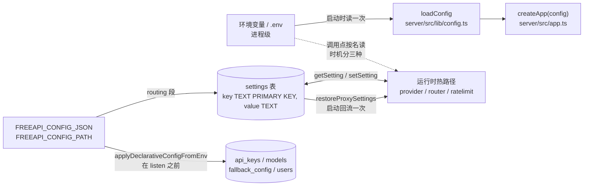
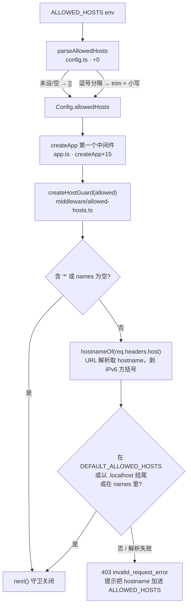

# 06 配置与数据流

> 第四层 · 配置契约。源码基准 `823c496b19f1551f373a364219d86c673391c4c5`，核对日期 2026-11-08。前置阅读：[05 API 与接口设计](05-API与接口设计.md)。本篇回答一个问题：**一个配置值要怎么才能真的生效？** 答案取决于三件事——谁读它、什么时候读、读到坏值怎么办。启动生命周期全序列见 [08 启动生命周期](08-启动生命周期.md)，settings 各分组的接口语义见 05 篇第 11 节，本篇只讲"值的来源与生效时机"。

## 0 先用人话讲清楚

把配置想成家里的四种开关：

| 比喻 | 对应层 | 特点 |
|---|---|---|
| 装修时埋进墙里的线路 | ① `loadConfig` 读成的 `Config` 对象 | 开工（进程启动）时定死，之后不动 |
| 每个电器自己的旋钮 | ② 调用点直接读 `process.env.X` | 没有集中快照；**什么时候拧有效，取决于电器什么时候看旋钮** |
| 墙上的智能开关面板 | ③ SQLite `settings` 表 | 随时按、立刻生效，仪表盘就是面板 |
| 交房时的一次性精装清单 | ④ `FREEAPI_CONFIG_JSON` / `_PATH` | 只在启动时"替你把面板按一遍、把钥匙插一遍"，之后不再对账 |

最容易踩的坑不是"配错了"，而是**"配对了但读的时机不对"**：改了 `PROVIDER_TIMEOUT_NVIDIA` 却没重启，对绝大多数内置平台完全无效——因为那个值在模块加载时就被抄进了 provider 实例的字段里。第 3.1 节把三种读取时机列成表，这是本篇最该记住的一张表。

另一条贯穿全项目的设计语言：**部署层配错 → 阻止启动；运营层配错 → 降级 + 警告；一致性漂移 → 只提醒**。第 5.2 节与第 6 节分别给出这两类的逐分支证据。

## 1 四层配置来源总览



| 层 | 载体 | 生命周期 | 典型内容 | 读取入口 |
|---|---|---|---|---|
| ① 环境变量（经 `loadConfig`） | `Config` 对象（12 字段） | 启动时固定，传给 `createApp` | PORT、HOST、FREEAPI_DB_PATH、REQUEST_BODY_LIMIT_MB、TRUST_PROXY、ALLOWED_HOSTS | `server/src/lib/config.ts` · `loadConfig+0` |
| ② 环境变量（按名读） | 散落在调用点的 `process.env.X` | **三种时机**：模块加载常量 / 构造时 / 每次调用 | PROVIDER_TIMEOUT_\*、PROVIDER_STREAM_STALL_TIMEOUT_\*、MAX_CONCURRENT_REQUESTS_PER_KEY\* | `server/src/lib/provider-timeout.ts` · `providerTimeoutMs+0`、`streamStallTimeoutMs+0` |
| ③ settings 表 | SQLite `settings(key,value)` | 运行期热改，即改即用 | 路由策略与权重、fallback 时间预算、代理五件套、ollama_emulation | `server/src/db/index.ts` · `getSetting+0` / `setSetting+0` |
| ④ 声明式配置 | `FREEAPI_CONFIG_JSON` / `FREEAPI_CONFIG_PATH` | 启动时一次性写入 ③ 与业务表 | admin、license、keys、customProviders、models、fallback、routing | `server/src/services/declarative-config.ts` · `applyDeclarativeConfigFromEnv+0` |

关键区分：**①② 是"部署层"（谁装机谁负责），③ 是"运营层"（谁用谁负责）**。④ 不是一种新存储，而是"启动时假装有人手工配置过一遍"——它把值写进 `api_keys`、`models`、`fallback_config`、`users` 和 `settings` 表，写完就退场。

## 2 第①层：loadConfig 与 Config 对象

### 2.1 十二字段逐条

`server/src/lib/config.ts` · `loadConfig+0`（函数体就是一个对象字面量，`+1~+23`）把进程环境读成一个对象交给 `createApp`。字段声明在 `Config+0`（接口，含逐字段注释）。

| 字段 | 环境变量 | 默认值 | 偏移 | 备注 |
|---|---|---|---|---|
| `port` | `PORT` | `3001` | `loadConfig+2` | 类型是 `number \| string`，listen 时才 `Number(PORT)`；desktop 内嵌版用 31415（见 08 篇） |
| `host` | `HOST` | `'::'` 双栈 | `loadConfig+6` | IPv6 不可用时 `index.ts` 捕获后退回 `0.0.0.0`（#180） |
| `dbPath` | `FREEAPI_DB_PATH` | `null` → 内部默认 | `loadConfig+7` | 空串按未设置处理：trim 后为空即 `null` |
| `dashboardOrigins` | `DASHBOARD_ORIGINS` | `[]` | `loadConfig+8~+11` | 逗号分隔 → trim → 过滤空串；与内置默认源合并成 CORS 白名单 |
| `clientDist` | `CLIENT_DIST` | `null` | `loadConfig+12` | 前端静态产物目录；`null` 时由 app 自行推断 |
| `proxyRateLimitRpm` | `PROXY_RATE_LIMIT_RPM` | `120` | `loadConfig+13` | 入站总限流；`parseRateLimitRpm+0` 对 NaN / 负数静默回退默认，正数向下取整 |
| `requestBodyLimitBytes` | `REQUEST_BODY_LIMIT_MB` | 25MB | `loadConfig+14` | `parseRequestBodyLimitBytes+0`：`<1` 或非有限值回退 25MB，否则按整 MB 换算 |
| `nodeEnv` | `NODE_ENV` | `'development'` | `loadConfig+15` | 影响日志与错误细节暴露程度 |
| `serveStaticAssets` | 无 | 恒 `true` | `loadConfig+16` | **不是 env 旋钮**，是写死的字段；想关只能改代码 |
| `trustProxy` | `TRUST_PROXY` | `false` | `loadConfig+17` | 四态语义，见 2.2 |
| `cspUpgradeInsecureRequests` | `CSP_UPGRADE_INSECURE_REQUESTS` | `undefined` = 自动 | `loadConfig+21` | 三态；`false` 让 HTTP 局域网安装能渲染仪表盘（#682） |
| `allowedHosts` | `ALLOWED_HOSTS` | `[]` = 守卫关闭 | `loadConfig+22` | **本次同步新增字段**（#1637），见 2.3 |

`DEFAULT_REQUEST_BODY_LIMIT_MB+0` 上方那段注释（`server/src/lib/config.ts` 第 3–19 行）是全项目最长的"为什么是这个数"论证，值得完整理解：

- 视觉请求把图片内联成 base64，比原始字节膨胀约 33%；`google.ts` 单图上限 8MB → base64 约 10.7MB；
- 历史回放会把多张图叠在一起，**实测观测到 11.85MB 的真实请求**；
- `express.json` 会把整个 body 缓冲进内存（解析期间瞬时 2–3 倍），所以这个数同时是"小内存主机的单请求峰值上限"；
- 超过上限的请求在路由前就 413，**不落回退、不写分析行**，所以它必须高于预期最大载荷；
- 25MB 是平衡点： clears 11.85MB 回放还有余量，同时让 Pi / 512MB VPS 上"几个并发最大 body"仍能装进 RAM；
- 入站图像归一化在解析后立刻把载荷缩小约 6–10 倍，所以稳态远低于此。

### 2.2 四个 parse 函数的坏值策略

**共同原则：解析失败一律回退默认，不抛错。** 配错 env 的后果是"静默用默认"，而不是启动失败。这跟第④层声明式配置的 fail-fast 形成鲜明对比（见 5.2）。

| 函数 | 判据 | 坏值怎么办 |
|---|---|---|
| `parseRateLimitRpm+0` | `Number.isFinite(n) && n >= 0` | 回退 `DEFAULT_RPM`（120）；`0` 合法，语义是"不限流" |
| `parseRequestBodyLimitBytes+0` | `Number.isFinite(n) && n >= 1` | 回退 25MB；注意这里是 `>=1` 不是 `>=0`，**0 不是合法值** |
| `parseTrustProxy+0` | 见下方四态 | 无法识别时按 CSV 处理，空列表回退 `false` |
| `parseCspUpgradeInsecureRequests+0` | 只认 true/1/yes 与 false/0/no | **其它任何值都回退 `undefined`（自动）**，不报错 |
| `parseAllowedHosts+0` | 非空即 split | 不做合法性校验；坏 hostname 只是永远匹配不上，等于把自己锁在外面 |

`parseTrustProxy+0` 的四态（#1024）是最容易配错的一个：

```
TRUST_PROXY 未设 / 空 / false / no   → false   不信转发头（直连调用方无法伪造 IP）
TRUST_PROXY=true / yes              → true    信所有代理（Express 会带安全警告）
TRUST_PROXY=1（任意正整数）          → 1       从 socket peer 往里数 1 跳＝"前面有一个代理"
TRUST_PROXY=0                       → false   0 跳等于不信（不是"信全部"）
TRUST_PROXY=10.0.0.1,192.168.0.0/16 → string[] 只信这些地址/CIDR
```

**`TRUST_PROXY=1` 不等于 `true`**——这是 Express 的惯用法，也是注释里专门点破的一句。它必须在 `clientContext` 与限流中间件之前设置（`server/src/app.ts` · `createApp+8` 处 `app.set('trust proxy', cfg.trustProxy)`），因为两者都要解析客户端 IP。

**三态（tri-state）模式**在本项目反复出现：`undefined` 表示"自动 / 维持原样"，`true`/`false` 才是显式覆盖。`CSP_UPGRADE_INSECURE_REQUESTS` 与声明式 `routing.weights`"省略即不动持久值"是同一个设计语言。

### 2.3 新增字段 allowedHosts：从 env 到 403 的完整链路

这是本次同步发现旧版完全缺失的一条链路（#1637，DNS 重绑定防护）。

**为什么需要它**：Docker Compose 默认把服务发布在 `127.0.0.1`，这挡住了局域网，但**挡不住浏览器**。攻击者控制的域名可以在会话中途把 DNS 解析改成 `127.0.0.1`（rebinding），然后发出"同源"请求，到达时 `Host: attacker.example`。认证覆盖了 `/v1` 和管理 API，但**未认证路由（登录、状态探针、首启 setup）和登录表单本身**照样能被这样够到。



| 环节 | 锚点 | 行为要点 |
|---|---|---|
| 解析 | `server/src/lib/config.ts` · `parseAllowedHosts+0` | 未设或空 → `[]`；否则逗号分隔、trim、**小写化**、过滤空串 |
| 挂载位置 | `server/src/app.ts` · `createApp+15` | **第一个中间件**，在 helmet、CORS、body 解析、认证、路由之前——它的全部价值就是"在碰到任何状态或凭证之前先回答" |
| 关闭判据 | `server/src/middleware/allowed-hosts.ts` · `createHostGuard+14` | `wildcard \|\| names.size === 0` 即 `next()`；所以**默认不设就是关闭** |
| 永远放行 | `createHostGuard+8~+11` 的 `isAllowedHost` | `DEFAULT_ALLOWED_HOSTS`（`localhost`/`127.0.0.1`/`::1`）+ 任何 `.localhost` 后缀 +  operator 列出的名字 |
| 取 hostname | `server/src/middleware/allowed-hosts.ts` · `hostnameOf+0` | 用 `new URL('http://' + header).hostname` 统一处理 `host`、`host:port`、`[::1]:3001`；WHATWG URL 会保留 IPv6 方括号，所以再剥一层 |
| 拒绝 | `createHostGuard+22~+35` | 403 + `{error:{message,type:'invalid_request_error'}}`，消息里直接告诉用户怎么修 |

三个必须讲清的边界：

1. **只比 hostname，绝不比 port**。Compose 会自由 remap 外层端口（`127.0.0.1:${HOST_PORT:-3001}:3001`），而重绑定威胁跟端口无关。
2. **不支持 `*.example.com` 这种子域通配**。`isAllowedHost` 只做 `names.has(host)` 精确匹配；唯一的通配是裸 `*`（含义是"整个守卫关掉"）。要服务多个子域就得逐个列名。
3. **opt-in 是有意的**。注释明说：如果默认就只允许 loopback，升级会把每一个局域网 / Docker 网络 / desktop-LAN / 反向代理安装全部锁死。所以宁可默认关闭，让 operator 自己决定。

## 3 第②层：按名读的环境变量

### 3.1 三种读取时机（旧版最容易讲错的地方）

旧版把这一层统一描述成"每次读取，进程内改 env 即生效"。**这对 chat 超时是错的**。同样是 `PROVIDER_TIMEOUT_<PLATFORM>`，落在不同适配器上时机完全不同：

| 时机 | 含义 | 改 env 后要重启吗 | 实例锚点 |
|---|---|---|---|
| **模块加载常量** | import 该文件时就算好，存成模块级 `const` | **要**（最早固化） | `server/src/providers/cloudflare.ts` · `CHAT_TIMEOUT_MS+0`；`server/src/providers/aihorde.ts` · `HORDE_TIMEOUT_MS+0` |
| **构造时** | `register(new XxxProvider(...))` 在 `server/src/providers/index.ts` 顶层执行，构造函数把值抄进 `this.timeoutMs` | **要**（内置平台等同进程启动） | `server/src/providers/openai-compat.ts` · `OpenAICompatProvider+38`；`server/src/providers/google.ts` · `GoogleProvider+8`；`server/src/providers/sail.ts` · `SailProvider+8` |
| **每次调用** | 在请求路径上现读 `process.env` | 不用（但通常仍需重启才能改到进程的 env） | `server/src/providers/base.ts` · `BaseProvider.fetchWithTimeout+5`（默认参数）、`BaseProvider.readSseFrames+18`；`server/src/providers/llmtr.ts`、`server/src/providers/jamai.ts`、`server/src/providers/speka.ts`、`server/src/providers/moondream.ts`、`server/src/providers/typhoon.ts`、`server/src/providers/aclide.ts` 的调用点 |

`server/src/lib/provider-timeout.ts` 头部注释自己点明了这条规则：

> Values are read when the provider is constructed — for the built-in platforms that means process start, so a change requires a restart.

而 `streamStallTimeoutMs+0` 的文档注释明确写着 "Resolved per call so tests can vary the env"——**流 stall 预算才是真正每次读取的那个**。两者不能混为一谈。

具体到 OpenAI 兼容适配器（内置平台的绝大多数），偏移从类声明行起算：

```ts
// server/src/providers/openai-compat.ts · OpenAICompatProvider+38（构造函数体内）
this.timeoutMs = providerTimeoutMs(opts.platform, opts.timeoutMs ?? 60_000);
```

注意这里的兜底是 **60s**，不是 15s。15s 只是 `fetchWithTimeout` 自己的默认参数兜底（适配器完全不传超时时才用到）。注册时显式给的值举例：

| 平台 | 注册时给的 timeoutMs | 锚点 | 为什么是这个数 |
|---|---|---|---|
| google | `60_000` | `server/src/providers/index.ts` 第 63 行 `register(new GoogleProvider(...))` | 构造函数兜底本是 15000，注册显式抬到 60s |
| nvidia | `180_000` | `server/src/providers/index.ts` 第 188–194 行的 `register(new OpenAICompatProvider(...))` | 注释：NIM 立刻发 SSE 头，然后对 100k token 提示词 prefill 几分钟；**这个值同时兼作流式首字节宽限预算**（#584） |
| zhipu | `60_000` | `server/src/providers/index.ts` 第 258 行 | 同 google |
| custom 端点 | `CUSTOM_PROVIDER_TIMEOUT_MS` = `120000` | `server/src/providers/index.ts` · `CUSTOM_PROVIDER_TIMEOUT_MS+0` | 用户自建端点统一 120s |

### 3.2 超时与 stall 的优先级链

```
【chat / 请求超时】
PROVIDER_TIMEOUT_<PLATFORM>            ← env 覆盖（#547）
  > 注册时 opts.timeoutMs              ← 如 nvidia 180s、google 60s、custom 120s
  > 适配器构造兜底                      ← openai-compat 60s、google 15s
  > fetchWithTimeout 默认参数 15s       ← 仅当调用点完全不传超时

【流中断 watchdog（mid-stream inactivity）】
PROVIDER_STREAM_STALL_TIMEOUT_<PLATFORM>   ← 平台级（#584）
  > PROVIDER_STREAM_STALL_TIMEOUT_MS       ← 全局
  > DEFAULT_STREAM_STALL_TIMEOUT_MS = 90s  ← 内置

【流式首字节宽限（first read）】
firstByteBudgetMs(chatTimeoutMs, stallTimeoutMs)
  = 任一侧 <= 0 → 0（完全不设限，客户端 signal 仍拥有"没人在听"的终止权）
  = 否则 max(chatTimeoutMs, stallTimeoutMs)
```

env 名派生规则：`providerTimeoutEnvName+0` 与 `streamStallTimeoutEnvName+0` 都把 platform 大写、把非 `[A-Z0-9]` 字符换成 `_`（`nvidia` → `PROVIDER_TIMEOUT_NVIDIA`）。

坏值处理集中在 `parseTimeoutEnv+0`：

| 输入 | 行为 |
|---|---|
| 未设 / 空串 | 用默认值，不吭声 |
| 非整数 / 负数 | `warnOnce+0` 打一条警告（每个变量名只打一次），回退默认 |
| `0` | **合法**，语义是"禁用这个超时"；调用方必须跳过 abort timer，绝不能 `setTimeout(0)` |
| `0 < n < 1000` | 合法但额外警告："不到一秒，这个 provider 的几乎每个请求都会 abort，你是不是想写秒？" |

`warnOnce+0` 用一个模块级 `Set<string>` 去重，`resetTimeoutWarnings+0` 是测试钩子（清空已警告集合）。

### 3.3 首字节宽限：为什么 stall 预算不该管首字节

这是 #584 的核心修正，也是 `provider-timeout.ts` 头部注释最后一段讲的事：

- **修正前**：90s 的 stall 预算同时约束了"第一个字节"。NVIDIA NIM 会立刻发 SSE 头（所以请求超时计时器已经停了），然后 prefill 100k token 提示词好几分钟——健康的长 prefill 被当成"流卡死"在 90s 杀掉。
- **修正后**：`readSseFrames` 区分两次 read。第一次用 `firstByteMs`（来自 chat 超时，以 stall 预算为下限），之后每次用 `inactivityTimeoutMs`。

| 步骤 | 锚点 | 说明 |
|---|---|---|
| 取 stall 预算 | `server/src/providers/base.ts` · `BaseProvider.readSseFrames+13` | `opts?.stallTimeoutMs ?? streamStallTimeoutMs(this.platform)`——**每次调用现读 env** |
| 取 chat 预算 | `BaseProvider.readSseFrames+18` | `opts?.firstByteTimeoutMs ?? providerTimeoutMs(this.platform, 15000)`；适配器通常把自己给 `fetchWithTimeout` 的同一个值传进来 |
| 合成首读预算 | `BaseProvider.readSseFrames+19` → `BaseProvider.firstByteBudgetMs+0` | `max` 而非 `min`：保证短 chat 超时的平台不会得到比 #584 之前**更严**的首读 |
| 分流两次 read | `BaseProvider.readSseFrames+28~+31` | `awaitingFirstByte` 为真时用 `firstByteMs` 并附专门的错误文案，之后用 `inactivityTimeoutMs`；置位发生在 await 之后 |
| 区分错误文案 | `BaseProvider.firstByteTimeoutMessage+0` | `"... no first byte within Nms (first-byte timeout)"`，让 attempt-trace 的 `error_summary` 能把"慢 prefill"和"死流"分开 |

**一个必须说清的边界**：这个预算约束的是 `reader.read()` 的**首次返回**，不是"首个有效 token"。上游只要发任何字节（包括 SSE 注释、空 data 行）就算首读成功，之后切换到 stall 预算。所以它不能用来保证"模型多久开始吐字"。

### 3.4 单 key 并发上限：opt-in，默认不设

有些免费档按凭证计并发而不是按分钟计，同一把 key 上的并行流会互相 429。但大多数平台不是这样，默认设上限会把每个 provider 串行化、损失真实吞吐——所以这是 **opt-in**。

| 函数 | 锚点 | 行为 |
|---|---|---|
| `getKeyConcurrencyLimit` | `server/src/services/ratelimit.ts` · `getKeyConcurrencyLimit+0` | 先读 `MAX_CONCURRENT_REQUESTS_PER_KEY_<PLATFORM>`（platform 只大写，**不做非字母数字替换**，与超时 env 名规则不同），回落 `MAX_CONCURRENT_REQUESTS_PER_KEY`；必须是正整数，否则返回 `null` |
| `inFlightForKey` | `inFlightForKey+0` | 先 `pruneLeases+0` 剪掉过期租约，再线性数 `leases` 里 platform+keyId 匹配的条目 |
| `canUseKeyConcurrency` | `canUseKeyConcurrency+0` | `limit === null` 直接 `true`（默认无上限）；否则 `inFlightForKey < limit` |

源码注释明确拒绝内置每平台默认表：

> There is deliberately no built-in per-platform table: the providers that behave this way are not documented well enough to assert a number for them here, and a wrong default is worse than none.

租约本身的老化上限不是固定值，而是按平台算出的 `leaseMaxAgeMs(platform)+0` = `max(LEASE_BACKSTOP_FLOOR_MS(30 分钟), providerTimeout×2 + LEASE_BACKSTOP_MARGIN_MS(2 分钟))`；provider timeout 为 0 时取正无穷（永不老化）。由 `pruneLeases+0` 在每次计数/获取时惰性清理。**没有持续续租**：一条超过该上限的长流会被剪掉，之后不再计入该 key 的在飞数。并发上限与租约状态机的完整语义见 [07 状态存储与并发](07-状态存储与并发.md)。

## 4 第③层：settings 表 —— 运行期唯一的"活配置"

### 4.1 读写原语

存储极简：`settings(key TEXT PRIMARY KEY, value TEXT)`。值永远是字符串，布尔用 `'1'/'0'`，数字用 `Number(raw)` 解析。

| 原语 | 锚点 | 实现 |
|---|---|---|
| 读 | `server/src/db/index.ts` · `getSetting+0` | `SELECT value FROM settings WHERE key = ?`，返回 `row?.value`（缺行 = `undefined`） |
| 写 | `setSetting+0` | `INSERT ... ON CONFLICT(key) DO UPDATE SET value = excluded.value`（upsert） |

谁在写它：仪表盘 `server/src/routes/settings.ts` 的各 PUT（39 个注册，分组见 05 篇）、`server/src/services/router.ts` 的 `setRoutingStrategy+0` / `setCustomWeights+0` / `setKeySelectionStrategy+0`（声明式配置与仪表盘共用同一组 setter）、以及 `applyDeclarativeConfig` 的 routing 段。

谁在读它（热路径）：`getFallbackTimeBudgetMs`、`getTaskWeightShare`、`getMinReliabilityFloor`、`getHeadroomThresholds`、`restoreProxySettings` 等。

一个典型读法样本（`server/src/routes/settings.ts` · `settingsRouter.get('/agent-compatibility')+0`）：

```ts
res.json({
  ollamaEmulation: getOllamaEmulationMode(),
  exposeClaudeDiscoveryAliases: getSetting('expose_cc_discovery_aliases') === '1',
});
```

对应的 PUT（`settingsRouter.put('/agent-compatibility')+0`）先用 `.strict()` 的 zod schema 校验，然后 **`if (parsed.data.x)` / `if (... !== undefined)` 逐字段独立写**——省略的字段不动持久值。注意两个字段的判据不同：枚举用 truthy（所以空串会被跳过），布尔用 `!== undefined`（所以 `false` 能真的写进去）。这是"三态"语言在接口层的体现。

### 4.2 三源优先级范式

`server/src/lib/fallback-loop.ts` · `getFallbackTimeBudgetMs+0~+13` 是全项目优先级写法的样板。`DEFAULT_FALLBACK_TIME_BUDGET_MS+0` 上方的注释自己点破了规则：

> Precedence mirrors the response cache: the settings-table value wins when present (runtime-tunable), then the env var, then the default.

```ts
let stored: string | undefined;
try { stored = getSetting(FALLBACK_TIME_BUDGET_SETTING); }
catch { stored = undefined; }              // DB 未就绪，绝不在代理热路径抛错
const candidates = [stored, process.env.FALLBACK_TIME_BUDGET_MS];   // settings 先
for (const raw of candidates) {
  if (raw === undefined || raw.trim() === '') continue;
  const n = Number(raw);
  if (Number.isFinite(n) && n >= 0) return n;
}
return DEFAULT_FALLBACK_TIME_BUDGET_MS;    // 45_000
```

三个防御细节值得抄：

1. `getSetting` 包在 try 里——**DB 未就绪时绝不从代理热路径抛出**；
2. 空串跳过（在"没配"与"配了空"之间选前者）；
3. `0` 是合法值（语义为"禁用预算"），所以判据是 `n >= 0` 而非 truthy。

同一段注释还澄清了预算的语义边界（对读 [10 函数级走读-路由限流与回退](10-函数级走读-路由限流与回退.md) 很关键）：

- 预算在**每次重试开始前**检查，不是整轮的硬 deadline；
- **首次尝试永远跑，第一次重试也永远跑**——当 attempt 0 单独吃掉整个预算时（慢失败模型），拒绝 attempt 1 会让"最需要回退的请求"结构性地无法回退（#751）。预算只拦 attempt ≥ 2；
- 成功的端点 TTFB 历史可以把配置的基础预算放宽；
- `0` 完全禁用预算。

同区还有两个与预算联动的常量，旧版未收录：

| 常量 | 锚点 | 值与作用 |
|---|---|---|
| `REASONING_HOLD_MAX_MS` | `server/src/lib/fallback-loop.ts` · `REASONING_HOLD_MAX_MS+0` | `15_000`（#1642）。流式面把"只有 reasoning 的输出"暂不提交，好让死掉的尝试隐形回退；但客户端在此期间听不到任何字节，带空闲 watchdog 的客户端（Claude Code）会挂断。一旦某次尝试已经 reasoning 这么久，就证明它活着——于是提交（ headers、status、本次尝试的 `X-Routed-Via`）并保持流有声；之后再失败就走该面正常的流中错误路径 |
| `HEDGE_BENCH_MIN_SILENT_FRACTION` | `HEDGE_BENCH_MIN_SILENT_FRACTION+0` | `0.75`。被 abort 的尝试必须已经沉默了预算的这个比例，hedge abort 才算"provider 健康问题"而非运气差。用比例而非固定值，是因为**预算本身就是声明的耐心**——抬高 `FALLBACK_TIME_BUDGET_MS` 应该同步抬高证据门槛 |

### 4.3 启动回流：restoreProxySettings

settings 表里的代理五件套在启动时一次性读回内存：

| 顺序 | 调用 | settings key | 缺行时的默认 |
|---|---|---|---|
| 1 | `applyProxyUrl` | `proxy_url` | `''` |
| 2 | `applyProxyMode` | `proxy_mode` | `'forward'` |
| 3 | `applyFetchRelayToken(decodeFetchRelayToken(...))` | `fetch_relay_token` | `''` |
| 4 | `applyProxyEnabled` | `proxy_enabled` | `!== '0'` → **默认开启**（缺行 = 开） |
| 5 | `applyProxyBypass` | `proxy_bypass` | `''` |

锚点：`server/src/lib/proxy.ts` · `restoreProxySettings+0~+5`。这是"持久层 → 内存层"回流的标准形状：**读一次、缓存在模块变量、热路径不查库**。

函数上方注释记录了一个真实事故（#949），也是为什么这个函数必须被两处调用：

> The standalone server does this in index.ts after initDb; the desktop embedder (desktop/src/server-host.ts) builds the app without index.ts and must call this itself — otherwise the URL saved by PUT /api/settings/proxy sits in the DB but the process starts with an empty proxy and every outbound request goes direct until the user re-saves the setting.

即：**独立 server 走 `index.ts`，desktop 内嵌版不走 `index.ts`，必须自己调**。注释还声明它幂等、可重复调用。写时同步 apply 的路径见 `server/src/routes/settings.ts` · `settingsRouter.put('/proxy')+0`（其中 `fetch_relay_token` 只写不回显）。

## 5 第④层：声明式配置（FREEAPI_CONFIG_JSON / PATH）

### 5.1 入口与启动序列位置

```
readConfigFromEnv+0
  ├─ FREEAPI_CONFIG_JSON（内联，trim 后非空即用）  → JSON.parse
  ├─ FREEAPI_CONFIG_PATH（文件路径）              → readFileSync + JSON.parse
  └─ 都没有                                       → null

applyDeclarativeConfigFromEnv+0
  ├─ loaded 为 null → 返回 applied:false 的空报告，什么都不做
  └─ 否则 → applyDeclarativeConfig(value, source) → console.log 一行部署摘要
```

锚点：`server/src/services/declarative-config.ts` · `readConfigFromEnv+0`、`applyDeclarativeConfigFromEnv+0`。**内联优先于文件**，两者都设时文件被忽略。

调用位置在 `server/src/index.ts` · `main+0` 的主序列里，这个位置是有意的：

```
main+0
 +1   loadConfig()                     ← 第①层快照
 +3   warnOnEnvDrift()                  ← 漂移检查，在 DB 之前（只读两个文本文件）
 +7   installProcessSafetyNet()
 +9   new NodeScheduler()
 +11~+15 restoreDbBackupIfNeeded(...)   ← 有 dbPath 走一路，没有走另一路
 +16  initDb(config.dbPath ?? undefined)
 +17  applyDeclarativeConfigFromEnv()   ← 第④层：DB 已就绪，listener 还没开
 +19  warnOnRoutingOverrideDrift()      ← 必须在 initDb 之后：unknown-model 那半要读 catalog
 +24  loadCacheFromDb()
 +31  cleanupExpiredCooldowns()
 +39  if (userCount() === 0) generateSetupCode()   ← admin 段已建账号时这里进不去
 +45  restoreProxySettings()           ← 第③层回流
 +47  createApp(config)
 +96  app.listen(...)                  ← 到这里才对外开口
```

（偏移以 `main` 声明行为 `+0`；`app.listen` 在 `server/src/index.ts` 第 128 行。）

**`initDb` 之后、`listen` 之前**这个夹缝是 5.4 那个安全窗口的全部来源。

### 5.2 失败与降级的分界（逐分支）

不是一句"坏值只 warning"能概括的，必须按分支看：

| 分支 | 锚点 | 行为 |
|---|---|---|
| JSON 文本解析不动 | `readConfigFromEnv+2` / `+5`（两处 `JSON.parse` 都是裸调用） | SyntaxError 直接冒泡出 `applyDeclarativeConfigFromEnv` → `main().catch` 打日志后 `process.exit(1)` —— **阻止启动** |
| zod schema 不过（含 `.strict()` 的未知顶层键） | `applyDeclarativeConfig+1~+4`：`throw new Error('invalid declarative config: …')` | **阻止启动** |
| 交易内结构性坏值：未知 platform | `upsertApiKey+6`：`unknown provider platform: X` | `throw` → 整个 `db.transaction` 回滚后冒泡 —— **阻止启动** |
| 交易内结构性坏值：非 keyless 平台却没 key | `upsertApiKey+8`：`key is required for X` | 同上（但注意 5.2 末尾的"前置筛子"） |
| 交易内结构性坏值：custom 缺 baseUrl | `upsertApiKey+13`：`baseUrl is required for custom keys` | 同上 |
| 交易内结构性坏值：endpoint 不匹配 / 歧义 | `resolveDeclaredModel+14`、`+20`、`+24`（三处 throw） | 同上 |
| `keys[]` 条目缺 key 且该平台非 keyless | 判定在 `missingKeyWarning+0`；循环在 `applyDeclarativeConfig+31`，`+34~+36` 做 `warnings.push` + `console.warn` + `continue` | **降级：跳过这一条**，其余照常 apply |
| `admin` 段但 users 表已非空 | `applyDeclarativeConfig+25~+28`（else 分支；`+22` 判 `userCount() === 0`，`+23~+24` 是创建成功路径） | **降级：跳过 + warning** `admin: a dashboard account already exists — entry ignored` |
| `fallback[]` 条目解析不到模型行 | `applyFallback+5`：`if (!row) return;`（上一行 `+4` 的 `resolveDeclaredModel` 仍可能抛错） | **降级：静默跳过**，只体现为 `result.fallback` 计数少一，**不进 warnings** |
| `license` 段 | `applyDeclarativeConfig+66~+69`：`+67` 置 `result.license = true`，`+68` `void activateConfiguredLicense(...)` | 脱离启动路径，见 5.5 |

**"缺 key"为什么有两条路径？** 因为 `missingKeyWarning+0` 是交易**之前**的筛子：它先 `resolveProvider(platform)`，只有"provider 存在且非 keyless 且没给 key"才返回警告字符串。被它拦下的条目根本进不到 `upsertApiKey+8` 那句 throw。而 `upsertApiKey+8` 仍然是必要的兜底——它处理的是筛子放过去但 `keyToStore` 仍为空的情况（`input.key?.trim() || (provider?.keyless ? 'no-key' : '')`）。

`missingKeyWarning` 上方注释（`server/src/services/declarative-config.ts` 第 166–171 行）记录了这条降级分支的由来（#600）：

> When a platform stops being keyless (pollinations lost `keyless: true` in #573), a legacy declarative config still carries an entry with no `key` — applyDeclarativeConfigFromEnv() runs in main(), so throwing here used to brick the whole install at startup.

平台专属的修复提示放在 `MISSING_KEY_HINTS+0`（目前只有 pollinations 一条，指向 enter.pollinations.ai）；其余平台用通用文案。

所以 `result.warnings` **只有两类来源**（全文件 `warnings.push` 仅 2 处：`applyDeclarativeConfig+27` 与 `+34`）：admin 已被占用、keys 缺 key。**"一条坏数据不该毁掉整个部署"这条原则只覆盖上面这几条降级分支**；未知 platform、endpoint 歧义这类"结构性错误"仍然 fail-fast。

### 5.3 Schema 逐段

根 schema `declarativeConfigSchema+0` 带 `.strict()`：**未知顶层键直接拒绝**，防止拼写错误（把 `keys` 写成 `key` 之类）静默丢配置。

| 段 | 类型 | 落到哪 | 注意点 |
|---|---|---|---|
| `admin` | `{email: z.string().email(), password: min(8)}` | `createUser` | **仅当 users 表为空**才创建；已有人则降为 warning——永远不能接管已占用的安装。最小值与 `server/src/routes/auth.ts` 的注册 schema 对齐 |
| `license` | `string.min(8)` | 后台激活 | 与仪表盘 `POST /api/premium/key` 同一个长度门；结果里 `license:true` 只表示"已交给后台" |
| `keys[]` | `keySchema+0`：`{platform, key?, label?, baseUrl?, enabled?}` | `api_keys`（AES-256-GCM 加密） | `key` 可缺省 = keyless 平台占位（存 `'no-key'`）；`enabled === false` 才写 0，其余一律 1 |
| `customProviders[]` | `customProviderSchema+0`：`{baseUrl, apiKey?, label?, models[]}` | 自定义平台 key + 模型行 | `models` 支持 `modelEntrySchema+0` 的**字符串简写或对象全写** union，由 `normalizeModelEntry+0` 归一 |
| `models[]` | `modelSchema+0`：`{platform, modelId, endpoint?, …ranks/limits}` | `models` 行 upsert | `endpoint` 解决同一 modelId 落在多个自定义端点上的歧义（#651）；catalog 平台忽略之 |
| `fallback[]` | `fallbackEntrySchema+0`：`{platform, modelId, endpoint?, priority?, enabled?}` | `fallback_config` 链 | `priority` 省略时用**数组下标 +1**；`enabled === false` 才写 0 |
| `routing` | `{strategy, weights?, keySelectionStrategy?}` | settings 表 | 见下方专段 |

`routing` 段三个字段（`declarativeConfigSchema+9~+18`）：

| 字段 | 约束 | 省略时 |
|---|---|---|
| `strategy` | `z.enum`，**7 个成员**：`priority`/`balanced`/`smartest`/`fastest`/`reliable`/`custom`/`decision` | **必填**（routing 出现时） |
| `weights` | `{reliability, speed, intelligence}` 三个 `z.number().nonnegative()` | 不动持久值 |
| `keySelectionStrategy` | `z.enum(['auto','least-remaining'])` | 不动持久值（#919） |

`keySelectionStrategy` 与 `strategy` **正交**：前者决定"伸手拿平台的哪把 key"，后者决定"给模型排序"。注释专门写了这句，避免读者以为它是第八种策略。

应用顺序（`applyDeclarativeConfig+51~+57`）：先 `setCustomWeights`（`server/src/services/router.ts` · `setCustomWeights+0`），再 `setRoutingStrategy`（`setRoutingStrategy+0`），最后按需 `setKeySelectionStrategy`（`setKeySelectionStrategy+0`），然后置 `result.routing = true`。**这是"启动时配置一次"语义，不是持续对账**——之后仪表盘改了策略，重启会被 JSON 里的值再次覆盖（见第 8 节 P2）。

`upsertApiKey+0` 的匹配键也值得记：custom 平台按 `base_url` 找 existing（`+14`），内置平台按 `platform + label + base_url IS NULL` 找（`+30`）。命中就 UPDATE 并把 `status` 重置为 `'unknown'`，不命中就 INSERT（同样 `'unknown'`）。**声明式配置不会替你验证 key**，它只负责写进去。

返回值 `DeclarativeConfigResult+0` 同时是一份部署报告：`applied, source?, admin, license, keys, customModels, models, fallback, routing, warnings[]`。`applyDeclarativeConfigFromEnv+6~+11` 把它拼成一行 `console.log`，包括"N entries skipped"。

### 5.4 admin 段为什么能"消除一个安全窗口"

`adminSchema+0` 上方的注释（第 88–92 行）是全文最精彩的安全设计说明：

> since declarative config is applied before the HTTP listener starts, an `admin` entry closes the unauthenticated POST /api/auth/setup window entirely (no setup code is even minted). Once an account exists the entry degrades to a warning, so config can never take over a claimed install.

首启时若无人配置账号，`main+39` 的 `if (userCount() === 0) generateSetupCode()` 会铸造一次性 setup code 并短暂开放匿名 `POST /api/auth/setup`。因为声明式配置在 `main+17` 就建好了账号，`main+39` 的条件进不去——**窗口不是被缩短了，是被消除了**。

认证与首启加固的完整攻防见 19 认证与安全（待补篇目，见 README 状态列）。

### 5.5 license 段：脱离启动路径的后台激活

`applyDeclarativeConfig+62~+65` 的注释解释了为什么它不在交易里：

> License activation needs the license service — network I/O has no place in the synchronous DB apply. It runs detached so a slow or unreachable service never delays boot.

`activateConfiguredLicense+0` 的完整分支：

| 步骤 | 偏移 | 行为 |
|---|---|---|
| trim | `+1` | 去掉首尾空白 |
| **幂等短路** | `+3` | `getSetting(SETTING_LICENSE_KEY) === trimmed` 就直接 return——**同一把 key 重启不再联网** |
| 联网校验 | `+4` | `await validateLicenseKey(trimmed)` |
| 连不上 | `+5~+8` | `result === null` → `console.warn('could not reach the license service — key left unconfigured')`，return |
| 被拒 | `+9~+12` | `!result.valid` → warn 带上 `result.reason ?? 'invalid'`，return |
| 落库 | `+13` | `setSetting(SETTING_LICENSE_KEY, trimmed)` |
| 刷新状态 | `+14` | `await refreshLicenseStatus()` |
| 立刻同步目录 | `+17` | `void syncCatalog(true)`——live-tier 同步马上开始，让升级"几秒内可见"；它自己的 catch-all 负责记失败 |
| 任何异常 | `+19~+21` | 整个 try 的 catch 只 `console.warn`，**settings 保持原样** |

所以 `result.license = true` 的准确含义是"已交给后台"，**不是"已激活"**。三种失败都不写 `warnings`、不影响启动。Premium 目录同步的完整数据流见专题 [premium目录同步](../topics/premium目录同步.md)。

### 5.6 与 catalog 的边界：customModelSeed

自定义模型进 DB 时由 `server/src/services/custom-model-seed.ts` · `customModelSeed+0` 补默认档位。旧版把它概括成"intelligence 用 catalog 中位 tier"，**不够准确**：它是三个轴各自取中位数。

文件头注释（第 4–23 行）讲了 #488 的由来：用户自建端点没有 catalog 元数据（没人基准测试过" whatever bynara.id 今天在代理什么"）。旧默认值用**地板**回答——`size_label='Custom'`（不是合法 tier，所以 `intelligenceComposite` 给它打分低于每个真实模型）加 rank 50，bandit 的 intelligence 轴顺理成章给它 0。于是除 Manual 外每种路由策略都完全忽略这个端点，正是 #488 的投诉："所有 custom provider 加的模型默认权重都一样……这让它们在路由策略下字面意义上不可用"。

修正后的原则一句话：**"未知"不是"最差"，是"没有意见"**。

| 环节 | 锚点 | 行为 |
|---|---|---|
| 取样 | `customModelSeed+1~+5` | `SELECT size_label, intelligence_rank, speed_rank FROM models WHERE platform != 'custom'`——**排除 custom 行**，否则种子会朝 previously seeded 的 custom 模型漂移 |
| 空 catalog | `customModelSeed+7` | 返回 `FALLBACK_CUSTOM_SEED+0` = `{sizeLabel:'Medium', intelligenceRank:50, speedRank:50}`（新装 / catalog 被清空时） |
| tier 轴 | `customModelSeed+9~+10` | 先过滤出 `size_label in TIER_VALUE` 的行（router 不认识的 label 忽略），再 `lowerMedian(tierValue)` |
| intelligence / speed 轴 | `customModelSeed+11~+12` | 各自 `lowerMedian` |
| 逐轴兜底 | `customModelSeed+15~+17` | 某轴算不出来就单独退回 `FALLBACK_CUSTOM_SEED` 的对应值 |
| 下中位数 | `lowerMedian+0` | 偶数样本取**两个中间值里较小的那个**，"种子 never over-claims a tier the catalog only half supports" |

两个边界：它**只读 operator 本地的 models 表**，不读远端 catalog、不刷新任何东西；operator 之后手工调过的 rank，**重新注册模型不会被重写**。

catalog 管理的模型走另一条路：`upsertModelOverrides` 只写 override，避免与 hosted catalog 同步（`server/src/services/catalog-sync.ts`）打架。override 与 tombstone 的完整语义见 05 篇第 11 节与 18 模型与端点管理（待补篇目）。

## 6 配置健康自检：两个 drift 警告

freellmapi 把"配置可能过时"当作一类值得在启动日志里喊出来的问题——但**只喊，不拦**。

### 6.1 warnOnEnvDrift：名字集合的双向 diff

| 环节 | 锚点 | 行为 |
|---|---|---|
| 定位文件 | `server/src/lib/env-drift.ts` · `defaultEnvDriftPaths+0` | `.env` 路径可被 `FREEAPI_ENV_PATH` 覆盖；`.env.example` 固定在 `REPO_ROOT`（由 `import.meta.url` 往上三级推算） |
| 提取名字 | `parseEnvNames+0` | 两条正则：`ACTIVE_ENV_RE`（可选 `export` 前缀 + 大写名 + `=`）与 `COMMENTED_ENV_RE`（`#` 注释掉的同款）。**只取名字，绝不比值** |
| 双向比较 | `compareEnvText+0` | `missingDocumentedDefaults` = example 里**未注释**的默认项但 .env 里没有；`unknownKeys` = .env 里有但 example 里（**含注释行**）完全没有、且不在豁免名单里的 |
| 豁免 | `isKnownUndocumentedEnv+0` | `KNOWN_UNDOCUMENTED_ENV+0`（9 个名字：NODE_ENV、DEV_MODE、FREELLMAPI_DIR、PROXY_URL、CATALOG_BASE_URL、CATALOG_PUBKEY、CATALOG_SYNC_DISABLED、FREEAPI_DB_BACKUP_TARGET、PREMIUM_SITE_URL）+ `KNOWN_UNDOCUMENTED_PATTERNS+0`（2 条正则：`PROVIDER_DAILY_REQUEST_CAP_*`、`PROVIDER_TIMEOUT_*`） |
| 读不到文件 | `checkEnvDrift+5` / `+12~+14` | 任一文件不存在 → 返回 `null`；读异常也 catch 成 `null`。**绝不因为检查本身失败而影响启动** |
| 输出 | `formatEnvDriftReport+0` → `warnOnEnvDrift+0` | 首行固定带 `Startup continues.`；两个列表各用 `compactList+0` 截断到 8 个 + "+N more"；最后一行提醒下次改配置时对照 example |

调用时机是 `main+3`，**在 `initDb` 之前**——它只需要两个文本文件，不需要 DB。

### 6.2 warnOnRoutingOverrideDrift：三段独立判定

`server/src/services/model-weight-overrides.ts` · `warnOnRoutingOverrideDrift+0` 校验 `MODEL_ROUTING_OVERRIDES`（JSON 对象 `{modelId: multiplier}`）。调用时机是 `main+19`，**在 `initDb` 与声明式配置之后**（`index.ts` 第 50 行注释：unknown-model 那半要读 catalog）。

| 段 | 偏移 | 判据与行为 |
|---|---|---|
| 未设 | `+3~+4` | `undefined` 或空串 → 返回 `null`，完全不检查 |
| JSON 坏 | `+9~+18` | `JSON.parse` 抛错 → `drift.malformed = true`，warn "被整体忽略"，**立即 return** |
| 形状坏 | `+19~+26` | 不是对象 / 是 null / 是数组 → 同样 malformed + 整体忽略 + return |
| 值坏 | `+28~+36` | 用 `parseModelWeightOverrides+0` 拿到 accepted 集合，逐条对比：空 modelId 跳过；不在 accepted 里的进 `rejectedValues` 并 warn "不是 [0, 2] 里的有限乘数" |
| 模型名未知 | `+38~+63` | **门控在 `getSetting(CATALOG_LAST_SYNC_SETTING)` 上**：只有完成过一次目录同步才查 `SELECT DISTINCT model_id FROM models`；命不中的进 `unknownModels` 并 warn |
| DB 读不到 | `+59~+62` | catch 住，跳过存在性检查，**值那半的报告仍然有用** |

"未知模型名"那半为什么要门控？函数上方注释（第 110–117 行）给了一个 very specific 的理由：

> on a first run the models table holds only what the migrations seeded (110 rows) against a real catalog of ~460: every override naming one of the ~350 not in the seed would be reported as bogus on exactly the boot an operator is most likely to be reading. A warning that cries wolf on its first outing teaches people to skip the line that would have caught the real typo.

**第一次出场就喊狼来了的警告，会教会人们跳过那条本来能抓住真拼写错误的行。** 所以它宁可闭嘴，等到自己能说对为止。 malformed-JSON 与 bad-multiplier 那两半不需要 catalog，永远运行。

warn 文案本身也是一份小型说明书：override **只匹配 model_id**，不带 platform 限定，**精确且大小写敏感**；"一个被挡在你没有 key 的 provider 后面的模型，会在你加上那把 key 之后出现"。

### 6.3 白名单的覆盖缺口（本次实测发现）

`KNOWN_UNDOCUMENTED_PATTERNS` 只豁免了 `PROVIDER_TIMEOUT_*`，**没有豁免 `PROVIDER_STREAM_STALL_TIMEOUT_*`**；而 `.env.example` 里只注释示例了 `_MS` 与 `_OLLAMA` 两个具体名字。同时 `MAX_CONCURRENT_REQUESTS_PER_KEY` 族在 `.env.example` 里完全不存在。

用真实的 `compareEnvText` 对真实 `.env.example` 逐个喂候选名（只读计算，未启动服务、未改任何文件），结果：

| 候选 env 名 | 判定 | 说明 |
|---|---|---|
| `MAX_CONCURRENT_REQUESTS_PER_KEY` | **REPORTED-UNKNOWN** | 3.4 节 documented 的合法旋钮，会被报"unrecognised key" |
| `MAX_CONCURRENT_REQUESTS_PER_KEY_NVIDIA` | **REPORTED-UNKNOWN** | 同上，平台级变体 |
| `PROVIDER_STREAM_STALL_TIMEOUT_NVIDIA` | **REPORTED-UNKNOWN** | #584 的平台级变体；只有 `_OLLAMA` 恰好在 example 里被示例过 |
| `PROVIDER_STREAM_STALL_TIMEOUT_MS` | quiet | example 第 160 行有注释示例 |
| `PROVIDER_STREAM_STALL_TIMEOUT_OLLAMA` | quiet | example 第 166 行有注释示例 |
| `PROVIDER_TIMEOUT_NVIDIA` | quiet | 命中豁免正则 |
| `ALLOWED_HOSTS` | quiet | example 第 431 行有注释示例 |
| `FALLBACK_TIME_BUDGET_MS` | quiet | example 里有 |

后果只是**启动日志里多一条假警告**（`Startup continues.`），不影响任何功能。但它正好踩中 6.2 那段注释担心的事：假警告会稀释真警告的价值。修法见第 8 节。

## 7 开关总表（速查）

"我想调 X，该改哪里、什么时候生效"：

| 想调的东西 | 改哪里 | 生效方式 | 锚点 |
|---|---|---|---|
| 监听端口 / 主机 / DB 路径 | env（`PORT`/`HOST`/`FREEAPI_DB_PATH`） | **重启** | `loadConfig+2`/`+6`/`+7` |
| 入站总限流 RPM | `PROXY_RATE_LIMIT_RPM` | **重启** | `parseRateLimitRpm+0` |
| 请求体上限 | `REQUEST_BODY_LIMIT_MB` | **重启** | `parseRequestBodyLimitBytes+0` |
| 是否信转发头 | `TRUST_PROXY` | **重启** | `parseTrustProxy+0` |
| CSP 强制 HTTPS 升级 | `CSP_UPGRADE_INSECURE_REQUESTS` | **重启** | `parseCspUpgradeInsecureRequests+0` |
| Host 头白名单（DNS 重绑定防护） | `ALLOWED_HOSTS` | **重启** | `parseAllowedHosts+0` → `createHostGuard+0` |
| 某平台 chat 超时 | `PROVIDER_TIMEOUT_<PLATFORM>` | **绝大多数内置平台需重启**（模块加载常量或构造时固化）；少数在调用点读的适配器每次现读 | 见 3.1 三种时机表 |
| 流中断 watchdog | `PROVIDER_STREAM_STALL_TIMEOUT_MS` / `_<PLATFORM>` | **每次调用现读** | `streamStallTimeoutMs+0` → `BaseProvider.readSseFrames+13` |
| 单 key 并发上限 | `MAX_CONCURRENT_REQUESTS_PER_KEY[_<PLATFORM>]` | **每次调用现读** | `getKeyConcurrencyLimit+0` |
| 模型权重乘数 | `MODEL_ROUTING_OVERRIDES` | 启动时校验；路由热路径按名读 | `warnOnRoutingOverrideDrift+0` |
| 路由策略 / 三轴权重 | 仪表盘 → settings；或声明式 `routing` | 即用 / **每次启动重放一遍**（不是只在首装生效） | `setRoutingStrategy+0`、`setCustomWeights+0` |
| 选 key 策略 | 仪表盘；或声明式 `routing.keySelectionStrategy` | 即用 / 启动重放；省略即不动 | `setKeySelectionStrategy+0` |
| fallback 时间预算 | settings `fallback_time_budget_ms`（优先）或 `FALLBACK_TIME_BUDGET_MS` | **即用**（每次现读 settings） | `getFallbackTimeBudgetMs+0` |
| 可靠性下限 / task 权重偏移 / headroom 阈值 | settings 表 | 即用 | `getMinReliabilityFloor+0`、`getTaskWeightShare+0`、`getHeadroomThresholds+0` |
| API key / 模型档位 / 回退链 | 仪表盘，或声明式 `keys`/`models`/`fallback` | 即用 / 启动时写入 | `upsertApiKey+0`、`upsertModel+0`、`applyFallback+0` |
| 出站代理五件套 | 仪表盘 → settings → 启动回流 | 即用（写时同步 apply）；重启靠 `restoreProxySettings` | `settingsRouter.put('/proxy')+0`、`restoreProxySettings+0` |
| Ollama 仿真模式 / Claude 发现别名 | 仪表盘 `agent-compatibility` | 即用 | `settingsRouter.put('/agent-compatibility')+0` |
| Premium license | 仪表盘，或声明式 `license` | 即用 / 启动后台激活（同 key 幂等短路） | `activateConfiguredLicense+0` |
| `.env` 文件位置（仅影响 drift 检查） | `FREEAPI_ENV_PATH` | 重启 | `defaultEnvDriftPaths+0` |

## 8 风险与待补

| 级别 | 事项 | 证据锚点 |
|---|---|---|
| P2 | `.strict()` 只约束声明式 JSON 根对象；**env 层无等价机制**，拼错的 env 名只会被 drift 警告提一句（而且如果它恰好不在 example 里才提） | `declarativeConfigSchema+20`（`.strict()`）、`compareEnvText+0` |
| P2 | 声明式 `routing` 是"启动时应用一次"而非持续对账：之后仪表盘改了策略，**重启会被 JSON 里的值再次覆盖**。版本控制式配置与运营式热改之间没有 reconciler，以 JSON 为准 | `applyDeclarativeConfig+51~+57` |
| P3 | drift 白名单覆盖不全：`MAX_CONCURRENT_REQUESTS_PER_KEY[_*]` 与 `PROVIDER_STREAM_STALL_TIMEOUT_<除 OLLAMA 外的平台>` 是合法旋钮却会被报 unrecognised key（6.3 已实测）。最小修法是把这两族加进 `KNOWN_UNDOCUMENTED_PATTERNS`，或在 `.env.example` 补注释示例 | `KNOWN_UNDOCUMENTED_PATTERNS+0`、`compareEnvText+0` |
| P3 | `createHostGuard` 的 JSDoc 有一句语法破损的话（"`*.example.com` entries match any single-label subdomain wildcard is NOT supported"）。**行为以代码为准：只有精确匹配，不支持子域通配**；文档措辞待修 | `server/src/middleware/allowed-hosts.ts` · `createHostGuard+0` 上方注释、`isAllowedHost` |
| P3 | `serveStaticAssets` 恒 `true` 且无 env 开关，出现在 `Config` 里容易被误认为可配 | `loadConfig+16` |
| 待补 | `FREEAPI_ENV_PATH` 在实际部署里的使用频率（代码支持，但无实例数据） | `defaultEnvDriftPaths+0` |
| 待补 | 声明式 `models[]` 的 `upsertModel+0` 逐字段落库规则（`columnMap` 覆盖哪些列、哪些字段只在创建时写）本篇只给了入口，完整字段表归 18 模型与端点管理（待补篇目） | `upsertModel+0`、`modelPatchFromInput+0` |

## 9 本次同步纠正的旧版描述

| 旧版说法 | 核实结果 | 证据 |
|---|---|---|
| `Config` 有 11 个字段，无 `allowedHosts` | **12 个字段**，新增 `allowedHosts`（#1637），并有一条完整的 env → 中间件 → 403 链路 | `Config+0`、`loadConfig+22`、`createHostGuard+0` |
| "某平台超时 / 流 stall 预算：每次读取，进程内改 env 即生效" | **对 chat 超时不成立**。三种读取时机；内置平台绝大多数在模块加载/构造时固化，改 env 必须重启。只有 stall 预算与并发上限是每次现读 | `server/src/lib/provider-timeout.ts` 头部注释、`server/src/providers/openai-compat.ts` · `OpenAICompatProvider+38`、`server/src/providers/cloudflare.ts` · `CHAT_TIMEOUT_MS+0` |
| `loadConfig` 在 70–93 行 | 已漂移到 **78–102**；`parseTrustProxy` 122–134、`parseCspUpgradeInsecureRequests` 136–143 | 本次逐行核对 |
| `getFallbackTimeBudgetMs` 在 183–197 | 已漂移到 **192–206**；常量区新增 `REASONING_HOLD_MAX_MS`（#1642）与 `HEDGE_BENCH_MIN_SILENT_FRACTION` | `getFallbackTimeBudgetMs+0` |
| `restoreProxySettings` 在 392–396 | 已漂移到 **391–397**；且旧版漏了"desktop 内嵌版必须自己调"这条事故背景（#949） | `restoreProxySettings+0` 上方注释 |
| `fetchWithTimeout` 默认超时链落点在 326–333 | 已漂移到 **339–344**；另需区分 `BaseProvider.readSseFrames+18` 的首字节兜底也是 15s | `BaseProvider.fetchWithTimeout+5` |
| customModelSeed "intelligence 用 catalog 中位 tier" | 不准确：**三个轴各自取下中位数**，排除 custom 行，空 catalog 退 `FALLBACK_CUSTOM_SEED`，逐轴独立兜底 | `customModelSeed+0`、`lowerMedian+0` |
| 第④层"翻译进 ②③④ 之外的 DB" | 表述混乱：它写的是**业务表（api_keys/models/fallback_config/users）与 ③ settings 表**，不写 ①② | `applyDeclarativeConfig+20~+58` |
| license 段只说"后台激活，失败只 warn" | 漏了**幂等短路**（同 key 重启不联网）与成功后 `void syncCatalog(true)` 立刻起 live-tier 同步 | `activateConfiguredLicense+3`、`+17` |
| 两个 drift 警告"只警告，启动继续" | 结论对，但漏了**白名单覆盖缺口**（6.3 实测三个合法旋钮被误报）与 `warnOnRoutingOverrideDrift` 的 **catalog 同步门控** | `KNOWN_UNDOCUMENTED_PATTERNS+0`、`warnOnRoutingOverrideDrift+43` |
| 表格里的 `trim() \|\| null` 裸竖线 | 结构缺陷：会把表格切成多列。本版改为文字描述 | 旧版第 56 行 |

## 10 源码索引

只给"符号 → 文件"映射与函数内偏移，绝对行号会随重构漂移，请用 `.progress/sr_tools.py offset FILE SYM` 实时取。

配置第①层：
- `server/src/lib/config.ts` · `DEFAULT_RPM+0`
- `server/src/lib/config.ts` · `DEFAULT_REQUEST_BODY_LIMIT_MB+0`
- `server/src/lib/config.ts` · `parseRateLimitRpm+0`
- `server/src/lib/config.ts` · `parseRequestBodyLimitBytes+0`
- `server/src/lib/config.ts` · `Config+0`
- `server/src/lib/config.ts` · `loadConfig+0`
- `server/src/lib/config.ts` · `parseAllowedHosts+0`
- `server/src/lib/config.ts` · `parseTrustProxy+0`
- `server/src/lib/config.ts` · `parseCspUpgradeInsecureRequests+0`
- `server/src/middleware/allowed-hosts.ts` · `DEFAULT_ALLOWED_HOSTS+0`
- `server/src/middleware/allowed-hosts.ts` · `hostnameOf+0`
- `server/src/middleware/allowed-hosts.ts` · `createHostGuard+0`
- `server/src/app.ts` · `createApp+8`
- `server/src/app.ts` · `createApp+15`

配置第②层：
- `server/src/lib/provider-timeout.ts` · `warnOnce+0`
- `server/src/lib/provider-timeout.ts` · `parseTimeoutEnv+0`
- `server/src/lib/provider-timeout.ts` · `providerTimeoutEnvName+0`
- `server/src/lib/provider-timeout.ts` · `providerTimeoutMs+0`
- `server/src/lib/provider-timeout.ts` · `DEFAULT_STREAM_STALL_TIMEOUT_MS+0`
- `server/src/lib/provider-timeout.ts` · `streamStallTimeoutEnvName+0`
- `server/src/lib/provider-timeout.ts` · `streamStallTimeoutMs+0`
- `server/src/lib/provider-timeout.ts` · `resetTimeoutWarnings+0`
- `server/src/providers/base.ts` · `BaseProvider.fetchWithTimeout+0`
- `server/src/providers/base.ts` · `BaseProvider.firstByteBudgetMs+0`
- `server/src/providers/base.ts` · `BaseProvider.firstByteTimeoutMessage+0`
- `server/src/providers/base.ts` · `BaseProvider.readSseFrames+0`
- `server/src/providers/openai-compat.ts` · `OpenAICompatProvider+38`
- `server/src/providers/google.ts` · `GoogleProvider+8`
- `server/src/providers/sail.ts` · `SailProvider+8`
- `server/src/providers/cloudflare.ts` · `CHAT_TIMEOUT_MS+0`
- `server/src/providers/aihorde.ts` · `HORDE_TIMEOUT_MS+0`
- `server/src/providers/index.ts` · `CUSTOM_PROVIDER_TIMEOUT_MS+0`
- `server/src/services/ratelimit.ts` · `leaseMaxAgeMs+0`、`LEASE_BACKSTOP_FLOOR_MS+0`、`LEASE_BACKSTOP_MARGIN_MS+0`
- `server/src/services/ratelimit.ts` · `pruneLeases+0`
- `server/src/services/ratelimit.ts` · `getKeyConcurrencyLimit+0`
- `server/src/services/ratelimit.ts` · `inFlightForKey+0`
- `server/src/services/ratelimit.ts` · `canUseKeyConcurrency+0`

配置第③层：
- `server/src/db/index.ts` · `getSetting+0`
- `server/src/db/index.ts` · `setSetting+0`
- `server/src/lib/fallback-loop.ts` · `DEFAULT_FALLBACK_TIME_BUDGET_MS+0`
- `server/src/lib/fallback-loop.ts` · `REASONING_HOLD_MAX_MS+0`
- `server/src/lib/fallback-loop.ts` · `HEDGE_BENCH_MIN_SILENT_FRACTION+0`
- `server/src/lib/fallback-loop.ts` · `FALLBACK_TIME_BUDGET_SETTING+0`
- `server/src/lib/fallback-loop.ts` · `getFallbackTimeBudgetMs+0`
- `server/src/lib/proxy.ts` · `restoreProxySettings+0`
- `server/src/services/router.ts` · `getHeadroomThresholds+0`
- `server/src/services/router.ts` · `getMinReliabilityFloor+0`
- `server/src/services/router.ts` · `getTaskWeightShare+0`
- `server/src/services/router.ts` · `setRoutingStrategy+0`
- `server/src/services/router.ts` · `setKeySelectionStrategy+0`
- `server/src/services/router.ts` · `setCustomWeights+0`
- `server/src/routes/settings.ts` · `settingsRouter.get('/agent-compatibility')+0`
- `server/src/routes/settings.ts` · `settingsRouter.put('/agent-compatibility')+0`
- `server/src/routes/settings.ts` · `settingsRouter.put('/proxy')+0`

配置第④层：
- `server/src/services/declarative-config.ts` · `modelEntrySchema+0`
- `server/src/services/declarative-config.ts` · `keySchema+0`
- `server/src/services/declarative-config.ts` · `customProviderSchema+0`
- `server/src/services/declarative-config.ts` · `modelSchema+0`
- `server/src/services/declarative-config.ts` · `fallbackEntrySchema+0`
- `server/src/services/declarative-config.ts` · `adminSchema+0`
- `server/src/services/declarative-config.ts` · `declarativeConfigSchema+0`
- `server/src/services/declarative-config.ts` · `DeclarativeConfigResult+0`
- `server/src/services/declarative-config.ts` · `readConfigFromEnv+0`
- `server/src/services/declarative-config.ts` · `MISSING_KEY_HINTS+0`
- `server/src/services/declarative-config.ts` · `missingKeyWarning+0`
- `server/src/services/declarative-config.ts` · `upsertApiKey+0`
- `server/src/services/declarative-config.ts` · `normalizeModelEntry+0`
- `server/src/services/declarative-config.ts` · `ensureFallbackRow+0`
- `server/src/services/declarative-config.ts` · `registerCustomProvider+0`
- `server/src/services/declarative-config.ts` · `modelPatchFromInput+0`
- `server/src/services/declarative-config.ts` · `resolveDeclaredModel+0`
- `server/src/services/declarative-config.ts` · `upsertModel+0`
- `server/src/services/declarative-config.ts` · `applyFallback+0`
- `server/src/services/declarative-config.ts` · `applyDeclarativeConfig+0`
- `server/src/services/declarative-config.ts` · `activateConfiguredLicense+0`
- `server/src/services/declarative-config.ts` · `applyDeclarativeConfigFromEnv+0`
- `server/src/services/custom-model-seed.ts` · `CustomModelSeed+0`
- `server/src/services/custom-model-seed.ts` · `FALLBACK_CUSTOM_SEED+0`
- `server/src/services/custom-model-seed.ts` · `lowerMedian+0`
- `server/src/services/custom-model-seed.ts` · `customModelSeed+0`
- `server/src/index.ts` · `main+0`

漂移自检：
- `server/src/lib/env-drift.ts` · `KNOWN_UNDOCUMENTED_ENV+0`
- `server/src/lib/env-drift.ts` · `KNOWN_UNDOCUMENTED_PATTERNS+0`
- `server/src/lib/env-drift.ts` · `defaultEnvDriftPaths+0`
- `server/src/lib/env-drift.ts` · `parseEnvNames+0`
- `server/src/lib/env-drift.ts` · `isKnownUndocumentedEnv+0`
- `server/src/lib/env-drift.ts` · `compareEnvText+0`
- `server/src/lib/env-drift.ts` · `compactList+0`
- `server/src/lib/env-drift.ts` · `formatEnvDriftReport+0`
- `server/src/lib/env-drift.ts` · `checkEnvDrift+0`
- `server/src/lib/env-drift.ts` · `warnOnEnvDrift+0`
- `server/src/services/model-weight-overrides.ts` · `warnOnRoutingOverrideDrift+0`
- `server/src/services/model-weight-overrides.ts` · `parseModelWeightOverrides+0`
## 11 导航

- 上一篇：[05 API 与接口设计](05-API与接口设计.md)
- 下一篇：[07 状态存储与并发](07-状态存储与并发.md)
- 启动全序列：[08 启动生命周期](08-启动生命周期.md)
- 预算与回退 internals：[10 函数级走读-路由限流与回退](10-函数级走读-路由限流与回退.md)
- 超时与 SSE internals：[11 函数级走读-Provider与流式](11-函数级走读-Provider与流式.md)
- 专题：[model调度算法](../topics/model调度算法.md)、[premium目录同步](../topics/premium目录同步.md)
- 返回：[README](README.md)

## 12 术语表

| 术语 | 意思 | 在本项目中的用途与边界 |
|---|---|---|
| 部署层 / 运营层 | 谁负责这个配置值 | ①② 由装机的人负责（env），③ 由使用的人负责（仪表盘）；④ 是部署层替运营层按一遍面板 |
| tri-state（三态） | `undefined` / `true` / `false` 三种取值 | `undefined` = 自动或维持原样，不是"假"；CSP 升级指令与声明式 routing 省略字段都用它 |
| fail-fast | 一发现错误就立刻终止 | 声明式 JSON 的 schema 不过、未知 platform、endpoint 歧义都阻止启动 |
| 降级（degrade） | 坏数据跳过但其余继续 | 只有缺 key 的 keys 条目与被占用的 admin 段进 `warnings[]` |
| drift（漂移） | 配置与文档/目录不一致 | 两个启动警告只比名字集合与模型名，不比值、不拦启动 |
| DNS rebinding | 攻击者域名中途解析到 127.0.0.1 | 让浏览器发出"同源"请求够到未认证路由；`ALLOWED_HOSTS` 是 opt-in 防线 |
| Host 头 | HTTP 请求里声明目标主机名的头 | 守卫只比 hostname 不比 port；双 Host 头由 Node 解析器先 400 |
| trust proxy | Express 是否信 `X-Forwarded-*` | `1` 是"前面有一跳代理"，不是"信全部"；影响限流与日志里的客户端 IP |
| stall watchdog | 流中途多久没字节就放弃 | 默认 90s，`0` 禁用；**不约束首字节**（#584 之后） |
| 首字节宽限 | 第一次 `reader.read()` 的预算 | `max(chat超时, stall预算)`；任一侧 `0` 则完全不限。约束的是首次 read 返回，不是首个有效 token |
| prefill | 模型处理提示词、还没开始吐字的阶段 | NIM 会先发 SSE 头再 prefill 几分钟，这是首字节宽限存在的理由 |
| 租约（lease） | 一次在飞请求占用的并发名额 | 2 分钟老化、惰性剪枝、无续租；长流会被剪掉后不再计数 |
| opt-in | 默认不启用，要显式配 | 单 key 并发上限与 Host 守卫都是；理由都是"错的默认比没有默认更糟" |
| settings 表 | `settings(key TEXT PRIMARY KEY, value TEXT)` | 运行期唯一的活配置；值全是字符串，布尔 `'1'/'0'` |
| 三源优先级 | settings > env > 内置默认 | `getFallbackTimeBudgetMs` 是样板；settings 读取包 try，DB 未就绪不抛 |
| 声明式配置 | 用一份 JSON 描述完整安装 | 启动时一次性写进业务表与 settings；不是持续对账，重启会重放 |
| `.strict()` | zod 拒绝未知键 | 只用在声明式 JSON 根对象与部分 settings PUT body；env 层没有等价物 |
| 幂等短路 | 同样的输入第二次不再做副作用 | `activateConfiguredLicense` 对已存的同一把 key 直接 return，不联网 |
| 下中位数 | 偶数样本取两个中间值里较小的 | `lowerMedian`：种子宁可低估也不 over-claim catalog 只 half-support 的 tier |
| override | 用户对 catalog 模型字段的覆盖 | 与 custom 模型直接写 models 行不同；避免与 hosted catalog 同步打架 |
| upsert | 有则更新无则插入 | `setSetting` 用 `ON CONFLICT DO UPDATE`；`upsertApiKey` 用先 SELECT 再分支 |