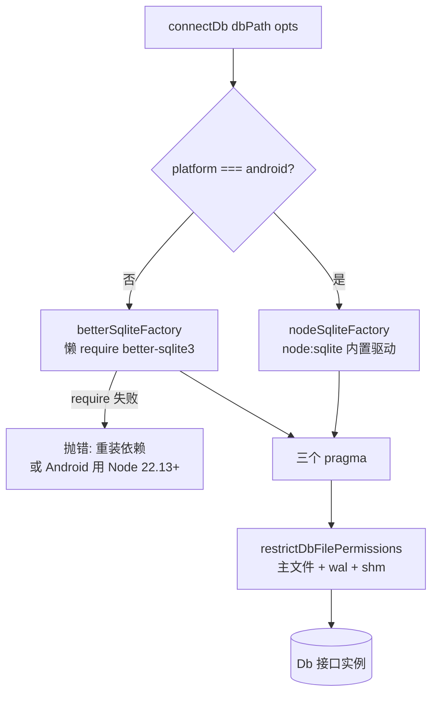
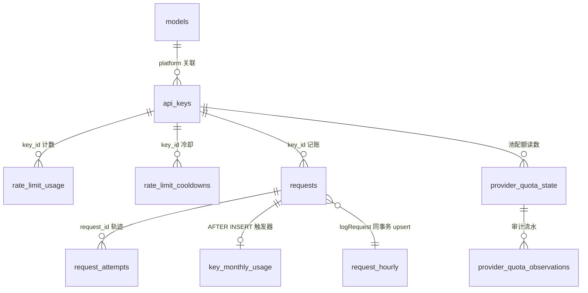
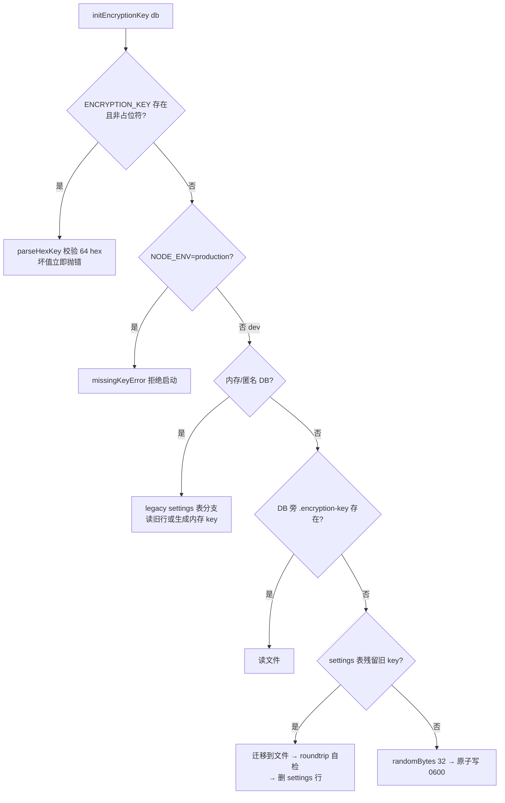
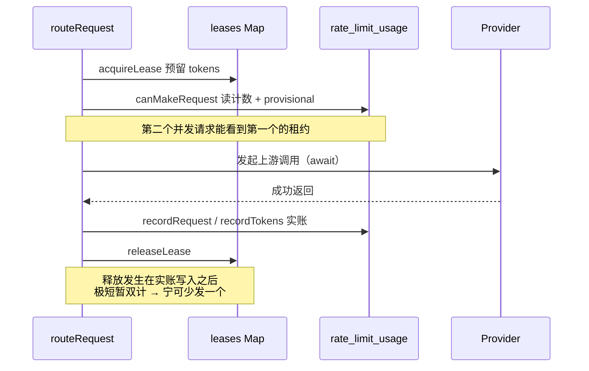

# 07 · 状态存储与并发

> 基准提交：`ed38ed46`（adrian 分支）｜核对日期：2026-11-27
> 范围：`server/src/db/**`、`server/src/lib/crypto.ts`、`server/src/lib/file-permissions.ts`、`server/src/lib/db-backup.ts`、`server/src/lib/request-log.ts`、`server/src/services/ratelimit.ts`、`server/src/services/backups.ts`、`server/src/services/request-retention.ts`、`server/src/services/idempotency.ts`
> 定位记法：`完整路径` · `符号+偏移`（+0 = 声明行）。正文锚点可机检；行号仅出现在文末源码索引。

## 0 人话定位

这一篇回答三个问题：**数据到底放在哪、谁在什么时候读写、坏了会怎样**。

把服务器想成一家只有一个柜员的银行：所有存取款都排队经过同一个窗口（一条同步 SQLite 连接），柜台上摊着几本必须随时翻的便签（内存 Map），柜台后面的档案柜里放着正式账本（SQLite 表），每天打烊后要清理过期单据（保留期修剪），并且定期把账本复印一份锁进保险箱（备份）。

| 你关心的事 | 答案在哪节 |
|---|---|
| 重启后什么还在、什么丢了 | §5 载体总表（「重启存活」列） |
| 为什么并发请求不会一起撞限额 | §5.2 租约与 provisional usage |
| 数据库坏了，代理还能不能跑 | §5.3 DB 优先、内存兜底 |
| 哪些表会被自动删数据、删多少 | §6 保留期总表 |
| 备份里有什么、没有什么 | §7.1 排除名单 |
| 恢复备份会不会把账号搞坏 | §7.3 六道门 |
| 数据库文件别的本地用户能不能读 | §8 加固 |

边界澄清：本篇只讲**状态的存储与生命周期**。请求怎么选模型、怎么重试是 03/10 篇的事；配置四层来源是 06 篇的事；本篇会引用它们的结论但不重复展开。

## 1 连接层：一条同步连接，三个 pragma

### 1.1 Db 接口与两个驱动

`server/src/db/types.ts` · `Db+0`（7-23）定义了服务里唯一允许出现的数据库形状：`prepare / exec / transaction / pragma` 四个方法，外加可选的 `name / memory / close`。`DbFactory+0`（27）是「给路径、还连接」的工厂签名。业务代码永远只面对这个接口，不直接 import 驱动——这是两个驱动能共存的前提。



| 驱动 | 何时用 | 关键实现 | 与 better-sqlite3 的差异 |
|---|---|---|---|
| better-sqlite3 | 默认（桌面/服务器） | `server/src/db/index.ts` · `betterSqliteFactory+0`（32-43）：`runtimeRequire` 懒加载，缺包时报可执行的错误（「Reinstall dependencies, or use Node.js 22.13+ on Android/Termux.」） | 原生模块，事务/pragma 由库提供 |
| node:sqlite | `process.platform === 'android'`（Termux 等没有预编译二进制的平台） | `server/src/db/node-sqlite.ts` · `nodeSqliteFactory+0`（66-115） | 自己实现嵌套事务：最外层 `BEGIN/COMMIT/ROLLBACK`，内层 `SAVEPOINT`（+15~+40）；**回调返回 thenable 直接抛错**（+23~+25，事务必须同步）；`pragma` 转成 `PRAGMA …` 查询（+11） |

`defaultDbFactory+0`（`server/src/db/index.ts` 45-47）就一行三目：android 走 shim，其余走 better-sqlite3。

shim 还有一个容易忽略的守卫：`numberResult+0`（`server/src/db/node-sqlite.ts` 38-44）把 node:sqlite 返回的 bigint 折成 number，**超出 JS 安全整数范围就抛错**，而不是静默截断——账本里的 rowid 不会悄悄变错。

### 1.2 connectDb 的执行顺序

`server/src/db/index.ts` · `connectDb+0`（49-93），逐步：

| 步 | 行 | 做什么 | 为什么在这个位置 |
|---|---|---|---|
| 1 | +10~+11 | 解析路径（参数 > `FREEAPI_DB_PATH` > 默认 `server/data/freeapi.db`），判定 `:memory:` | `getDefaultDbPath+0`（27-29） |
| 2 | +19~+30 | `ensureDir`（默认 true）时建目录，**先 `restrictDataDir` 再开连接** | 注释 +26~+28：Windows 的 ACL 是继承的，先收紧目录，DB 文件「出生即受保护」 |
| 3 | +32 | `factory(resolvedPath)` 拿到连接 | — |
| 4 | +33 | `journal_mode = WAL`（仅非内存库） | 备份/读报表时主库可继续写 |
| 5 | +34 | `foreign_keys = ON` | 外键约束生效；恢复备份时要临时关掉（§7.3） |
| 6 | +38 | `busy_timeout = 5000` | 注释 +35~+37：仪表盘与代理热路径并发写，没有 busy timeout 时输家立刻吃 `SQLITE_BUSY`，请求直接失败 |
| 7 | +40 | `restrictDbFilePermissions`（主文件 + `-wal` + `-shm` 三目标） | sidecar 在首次写时才出现，此刻多半只 chmod 到主文件，目录兜底其余 |

**三个 pragma 就是全部连接级并发策略**（旧版只写了两个，漏了 `foreign_keys`）。没有连接池、没有语句级超时；并发正确性靠「同步单连接 + busy_timeout + 事务」，而不是靠锁调度。

### 1.3 单例与初始化

- `getDb+0`（`server/src/db/index.ts` 20-25）：模块级 `let db`，未初始化直接抛「Call initDb() or connectDb() first」。全进程共用这一条连接——所有写路径（代理记账、仪表盘保存、后台 job）排同一个队。
- `initDb+0`（197-234）在 connectDb 之上做四件事：非 dev 跑 `runMigrationsSync`；dev 只探测 `migrations` 表是否存在，缺了就打印 `npm run db:migration:up` 提示并 `process.exit(1)`；**带守卫地**初始化加密 key（`if (!isEncryptionKeyInitialized()) initEncryptionKey(db)`，+23）；跑密钥自检探针（§4.3）。

## 2 表清单：36 张业务表怎么分组

全库迁移共建出 **36 张业务表**（`grep CREATE TABLE` 去重实测；本轮新增 `embedding_models`（embedding 限流/input_type/source 归属）与 `user_oidc_identities`（OIDC 登录身份）），另有迁移器自建的 `migrations` 追踪表（§3）。核对方法：所有 `DROP TABLE` 都只出现在各迁移的 `down()` 里（回滚用）；唯一在 `up()` 里删表的是 `20260729_000001_custom_model_endpoint_identity.ts`——它重建 `models` 表换主键结构（+94 起），数据保留。所以 36 张全部存活。

| 组 | 表 | 一句话职责 |
|---|---|---|
| 路由与模型 | `models`、`api_keys`、`profiles`、`profile_models`、`fallback_config` | 选谁、用哪把 key、按什么链回退 |
| 用量账本 | `requests`、`request_hourly`、`request_attempts`、`key_monthly_usage`、`rate_limit_usage`、`rate_limit_cooldowns` | 每次请求的明细/小时聚合/逐尝试轨迹/月度台账/限流计数/冷却 |
| 配额 | `provider_quota_state`、`provider_quota_observations` | 池级配额当前读数 + 只增审计流水 |
| 缓存与幂等 | `response_cache`、`idempotency_claims` | 流式/非流式响应缓存、Idempotency-Key 重放 |
| 目录与发现 | `embedding_models`、`media_models`、`model_probe_status`、`quirks`、`quirk_targets` | 嵌入/媒体模型目录、探测状态、平台怪癖内容 |
| 日志 | `server_logs`、`search_requests`、`decision_requests`、`client_profiles` | warn/error 持久化、搜索尝试、决策模型尝试、客户端画像 |
| 身份 | `users`、`sessions`、`url_tokens` | 仪表盘账号/会话/URL token（备份排除，§7.1） |
| 运维 | `settings`、`backups`、`playground_conversations` | KV 配置、备份索引、playground 会话 |
| 目录状态 | `model_overrides`、`catalog_model_tombstones`、`custom_model_tombstones` | 目录覆盖与墓碑（catalog-sync 写） |

核心关系（只画与本篇状态直接相关的边）：



注意 `key_monthly_usage` 不是普通外键关系：它由 `requests` 上的 **AFTER INSERT 触发器**维护（§6.3），这是本篇最重要的「隐式写入」之一。

## 3 迁移器：静态 import 清单，不是目录扫描

### 3.1 两条路径

| 路径 | 入口 | 迁移从哪来 |
|---|---|---|
| 生产/启动 | `server/src/db/migrate/runner.ts` · `runMigrationsSync+0`（64-82） | `server/src/db/migrate/defaults.ts` · `DEFAULT_MIGRATIONS+0`（108 起）：**56 个静态 import**，编译期就定死 |
| CLI/测试 | `runMigrations+0`（43-62，async） | `getMigrationFilenames+0`（220-230）扫目录 + `loadMigrationModule+0`（232-252）动态 import；校验模块必须同时导出 `up/down`（+12~+14） |

为什么生产不走目录扫描：打包后的应用没有源码目录可扫；静态清单让「装了哪些迁移」成为编译产物的一部分，不依赖文件系统布局。`getMigrationFileExtension+0`（262-265）按 `import.meta.url` 后缀决定找 `.ts` 还是 `.js`，同一份 runner 源码/产物两用。

**实测（2026-11-27，基准 ed38ed46）：`server/src/db/migrations/*.ts` 共 56 个文件 = 1 个基线 + 55 个增量；`defaults.ts` 恰好 56 个 import、56 个清单条目**（两处计数一致；上一版写 52、更早写 47/44 均为过期数）。本轮新增增量：`20261117_000001_embedding_rate_limits`（embedding_models 加 per-model 限流列）、`20261117_000002_custom_embedding_input_type`（embedding_models 加 `input_type`）、`20261118_000001_embedding_source_provenance`（embedding_models 加 `source` 归属）、`20261124_000001_oidc_identities`（新建 `user_oidc_identities` 表 + users/sessions 加本地密码与 auth_source 列）。本轮新增增量：`20261028_000001_custom_media_endpoint_identity`（media_models 重建）、`20261104_000001_cloudflare_neuron_usage`、`20261105_000001_key_verification_basis`（api_keys 加 verification_basis）、`20261111_000001_model_monthly_usage`、`20261111_000002_profile_routing_strategy`（profiles 加 routing_strategy）。

### 3.2 每个迁移一个事务

`runPendingMigrations+0`（`server/src/db/migrate/runner.ts` 106-125）的循环体：

1. `applied.has(filename)` → 跳过（+8）；
2. 加载模块；
3. `db.transaction(() => { migration.up(db); INSERT INTO migrations(filename) })`（+11~+14）——**schema 变更与「已应用」记录同事务**，中途失败两者一起回滚，不会出现「表建了但账本没记」的半状态；
4. 成功后更新内存 applied 集合（+17）。

追踪表由 `CREATE_MIGRATIONS_TABLE_SQL+0`（35-41）建立：`id / filename UNIQUE / applied_at`。`schemaVersion`（备份头部用，§7.2）读的就是这张表的行数与最新文件名。

### 3.3 基线与「V25 之后禁止模型数据迁移」

`server/src/db/migrations/20260101_000000_legacy_baseline.ts`（2364 行）：

- `up+0`（48）：`createTables`（13 张核心表）→ V1~V25 共 25 轮模型数据迁移 → `applyModelPricing` → 嵌入/媒体/quirks 种子 → `ensureUnifiedKey` → `migrateProfilesInit`；文件后段还有 4 张后置表（`embedding_models` 2017、`media_models` 2085、`quirks` 2127、`quirk_targets` 2136）。
- `down+0`（95-97）：**直接抛错**「Legacy baseline is irreversible - restore from backup」——基线不可回滚，唯一退路是恢复备份。
- **硬纪律**（`up+29~+36`，即 77-84 行注释）：V25 是最后一个模型数据迁移。此后模型/限额**数据**只经 hosted catalog → catalog-sync 下发；把模型行写进迁移等于绕过 Premium 门控（免费用户在下次升级时直接拿到付费期模型）。迁移从今往后只做 schema/族规则/provider 管线/quirk 种子修正。这是「schema 迁移」与「数据迁移」刻意分家的实例，详见 premium目录同步专题。

## 4 信封加密与启动期密钥自检

### 4.1 api_keys 行的三件套

`api_keys` 表没有明文 key 列，只有 `encrypted_key / iv / auth_tag`——每行独立加密（每行随机 16 字节 IV），教科书式 envelope 形状。实现在 `server/src/lib/crypto.ts`：



`initEncryptionKey+0`（94-153）按上图走四级优先。值得精读的设计决策（都来自源码注释）：

| # | 决策 | 锚点 | 一句话理由 |
|---|---|---|---|
| 1 | key 文件不进 DB | `KEY_FILE_NAME+0`（27，注释 22-26） | 旧版把 dev key 存 `settings` 行，「拷走 DB 的人就同时拷走了解密它的 key」——at-rest 加密归零 |
| 2 | 长度校验前置 | `KEY_BYTES+0`（18，注释 11-17）、`parseHexKey+0`（29-37） | 截断的短 key 过去在第一次 encrypt 时抛 node:crypto 天书；现在立即给可执行报错（附生成命令） |
| 3 | auth tag 钉死 16 字节 | `AUTH_TAG_BYTES+0`（202，注释 198-201） | RFC 5116 允许 4-16 字节 tag；不钉的话，能改 DB 行的人可塞 4 字节 tag，把伪造成本从 GCM 降到 2^32 穷举 |
| 4 | key 指纹 | `encryptionKeyFingerprint+0`（173-176） | sha256 截 64 bit 写进备份头部；不是安全机制（防不了蓄意），是防「拿错备份 restore 出一堆解不开的行」的事故 |
| 5 | maskKey 纪律 | `maskKey+0`（262-266，注释 249-261） | 旧实现 `'****'+slice(-4)` 对 ≤4 字符 key 等于原样回显；现在 <5 全遮、≤8 只露尾 2 位——短凭据（代理密码、本地 Ollama token）真实存在 |
| 6 | 原子写 + 先收紧再改名 | `writeKeyFileAtomic+0`（75-84） | 临时文件随机后缀、`restrictToOwner` 在 rename **之前**，避免 key 文件有过哪怕一瞬的宽权限 |

边界：内存/匿名 DB（测试）没有目录放 key 文件，`keyFilePathFor+0`（63-68）返回 null，保留 legacy settings 行为——降级路径明确标注了适用边界。生产缺 `ENCRYPTION_KEY` 一律拒启（`isDevFallbackAllowed+0` 45-47 只认 `NODE_ENV !== 'production'`）。

### 4.2 加密原语

- `encrypt+0`（182-196）：aes-256-gcm，每行 `randomBytes(16)` IV，返回 `{encrypted, iv, authTag}`。
- `decrypt+0`（204-212）：`createDecipheriv` 显式 `{ authTagLength: AUTH_TAG_BYTES }`，tag 不符直接抛「Unsupported state or unable to authenticate data」。

### 4.3 启动期密钥自检（新增，旧版完全缺失）

key 与 DB 来自不同安装（比如 appdata 被整个拷走、或换机器只带了 DB）时，过去要等第一个请求失败才暴露。现在启动时就探：

| 环节 | 锚点 | 行为 |
|---|---|---|
| 探针 | `server/src/lib/crypto.ts` · `probeStoredSecrets+0`（231-247） | SELECT 一行非空密文 LIMIT 1，试 decrypt：成功 true / 失败 false / 无表无行未初始化 null |
| 启动接线 | `server/src/db/index.ts` · `initDb+25`（222） | `keyStoreDecryptable = probeStoredSecrets(db)`；false 时打长错误日志：「The database and the key file … came from different installs — restore the key that belongs to this database」 |
| 对外可见 | `server/src/db/index.ts` · `isKeyStoreDecryptable+0`（244-246） | health/status 端点读它，key mismatch 不再表现为「一个接一个 provider 神秘失败」 |

注意 `initDb+23`（220）的守卫：`if (!isEncryptionKeyInitialized())`——重复 initDb（测试、桌面内嵌重启）不会重新生成 key。

## 5 限流状态：DB 为主、内存兜底、租约补缝

### 5.1 载体总表（先纠正旧版的方向性错误）

**旧版说「当前滑窗计数放内存 Map，因为每请求都读、DB 往返不起」——方向反了。** 现行实现里每次闸门检查都直查 SQLite（`countPersistedRequests+0` 232-251 就是一条 `SELECT COUNT(*)`，无缓存），内存窗口**只在 DB 查询失败时**才被读到。内存是降级模式，不是主路径。

| 状态 | 载体 | 重启存活 | 锚点（`server/src/services/ratelimit.ts`） |
|---|---|---|---|
| RPM/RPD/TPM/TPD 实账计数 | `rate_limit_usage` 表（kind='request'/'tokens'） | ✅ | `recordUsage+0`（208-230）写入 |
| 同上，DB 故障时的降级副本 | 模块级 `windows: Map`（key=`platform:model:key:type`） | ❌ | `windows+0`（14）、`pushMemoryRequest+0`（810）、`pushMemoryTokens+0`（816） |
| 在途预留（关竞态） | `leases: Map` | ❌（注释明说重启归零是正确的） | `leases+0`（70）、`leaseMaxAgeMs+0`（92）=按平台计算 |
| 冷却到期时间 | `rate_limit_cooldowns` 表 **+** `cooldowns: Map` 镜像 | ✅（表） | `setCooldown+0`（1242）、`isOnCooldown+0`（1256） |
| 冷却升级阶梯（24h 内第几次） | `cooldownHits: Map`（纯内存） | ❌（注释：重启后重新升级是可接受的） | `cooldownHits+0`（878）、`COOLDOWN_DURATIONS+0`（880）=[2m,10m,1h,1d] |
| 学到的真实限额/上下文窗口 | `models` 表列（rpm/rpd/tpm/tpd/context_window） | ✅ | `learnLimitFromError+0`（1526-1537） |
| 路由护栏用的窗口利用率快照 | 模块级缓存，TTL 5s | ❌ | `WINDOW_USAGE_TTL_MS+0`（397）、`buildWindowUsageSnapshot+0`（408） |

### 5.2 租约：关掉「检查后扣减」竞态

段注释（151-161）把动机说得很直白：`routeRequest` 是同步的，而实账要等 provider 返回后才写；不数在途请求的话，N 个并发请求读同一份预检、全部放行，然后集体撞 429。



- 四个求和函数纯内存、不落行：`provisionalRequests+0`（163）、`provisionalTokens+0`（172）、`provisionalProviderRequests+0`（183，委托 `inFlightForKey`）、`provisionalProviderTokens+0`（187）。
- `pruneLeases+0`（98-103）惰性老化：超过 `leaseMaxAgeMs(platform)` 的租约视为泄漏丢弃。**没有续租**——一个跑超过该上限的流式请求，其租约会被剪掉，此后它不再占并发位（对免费档是偏宽松的方向）。上限按平台算：`max(LEASE_BACKSTOP_FLOOR_MS（30min）, providerTimeout×2 + LEASE_BACKSTOP_MARGIN_MS（2min）)`，provider timeout 为 0 时取正无穷；floor 抬到 30 分钟是为长推理流（如 AMD Radeon 600s timeout）不被提前剪掉。
- 段注释还承认一个刻意的不精确：租约在实账写入**之后**才释放，完成的请求会被短暂双计——「errs toward under-dispatching by one」，对免费档是安全方向，持续微秒级。

### 5.3 闸门怎么读数：DB 优先，内存兜底

- `requestCount+0`（286-297）/ `tokenCount+0`（299-310）：先 `countPersistedRequests` / `sumPersistedTokens`（都是 `withDb` 包着的 SQL）；**返回 undefined（DB 拒绝回答）才落到 `memoryRequestCount` / `memoryTokenCount`**。
- `withDb+0`（42-48）是整套降级机制的枢纽：catch 一切异常返回 undefined，**DB 故障永不上抛到代理热路径**。
- `canMakeRequest+0`（312-332）：在途租约同时计入分钟窗和日窗（+7~+8 注释：租约意味着请求正在发生，属于这一分钟也属于今天）；`canUseTokens+0`（334-356）：`已用 + 在途 + 本次估算 > 上限` 才拒。
- 写入侧对称：`recordRequest+0`（822-832）/ `recordTokens+0`（834-846）先 `recordUsage` 落 DB，**只有落库失败才 push 内存窗口**。`pushMemoryRequest+0`（810-814）push 前先 prune——注释 800-809 讲了修复前的泄漏：健康服务器上没人读内存数组，而修剪只发生在读路径，于是每个请求泄漏一个时间戳直到进程结束；现在「只在持久化失败时记内存 + push 时修剪」，长时间 DB 故障也不会把内存窗撑爆。

### 5.4 记账行的修剪节流

`recordUsage+0`（208-230）返回 boolean（「行真的进 DB 了吗」，调用方据此决定内存兜底）。INSERT 之后按 `USAGE_PRUNE_INTERVAL_MS+0`（203）=1min 节流执行 `DELETE … created_at_ms <= now-DAY`。注释 196-202 解释为什么必须节流：表上唯一索引是五列复合 `idx_rate_limit_usage_lookup(platform, model_id, key_id, kind, created_at_ms)`，裸 `created_at_ms <= ?` 用不上它，prune 是全表扫——放进每次 INSERT 等于把全表扫放上热路径。保留一天、查询各自带时间过滤，让过期行多躺一分钟没有代价。`now < lastUsagePruneMs` 分支（+13~+15 注释）覆盖时钟回拨（NTP/休眠恢复），否则一次向前跳变会把 prune 永久卡死。

### 5.5 冷却：来源决定能不能被探测唤醒

`CooldownSource+0`（864）四个值，注释 851-863 是理解冷却恢复 job 的钥匙：

| source | 含义 | 会被 cooldown-probe 提前唤醒吗 |
|---|---|---|
| `heuristic` | 我们自己悲观估计的禁闭（瞬态 90s、升级阶梯、auth 失败、空响应） | ✅ 常比真实故障活得久，值得探 |
| `authoritative` | provider 明说的重试时间（Retry-After、日配额重置） | ❌ 是事实不是猜测 |
| `credit` | 402 余额耗尽 | ❌ key 验证通过不代表充值了 |
| `tier` | 403 模型不在档位 | ❌ key 能验证而模型照样被 gate |

读写方向：**DB 是权威**。`isOnCooldown+0`（1256-1270）先查 `persistedCooldownExpiry`：过期则删内存+删行返回 false；未过期则**用 DB 值刷新内存**再返回 true。`setCooldown+0`（1242-1254）双写（Map + `persistCooldown+0` 1188 的 upsert）。`cleanupExpiredCooldowns+0`（1228-1240）在启动时全量扫一次（index.ts 调用）：否则过期是纯惰性的，模型退役/key 删除留下的死行永远没人收。

另有操作员天花板 `COOLDOWN_CEILING_KEY+0`（897）=`routing_cooldown_ceiling_ms`（注释 887-896，#952/#1049）：只封顶**我们的猜测**，从不缩短 provider 明说的时间；未设=阶梯照旧顶到一天。

### 5.6 学到的限额写回 models 表

`learnLimitFromError+0`（1526-1537）：从错误文案解析出真实限额后 `UPDATE models SET col=? WHERE id=? AND (col IS NULL OR col > ?)`——**只降不升**的单调收紧。上下文窗口同理（1615 行同款 UPDATE），配 `MIN_LEARNED_CONTEXT_WINDOW+0`（1562）=1024 防误读、`UNKNOWN_WINDOW_FRACTION+0`（1567）=0.9 在 provider 没报数时按请求大小的九成记。这些列属于 `models` 行，**下次 catalog-sync 覆盖该行时会被目录值冲掉**——学习成果与目录权威之间的张力是设计现状（§9）。

### 5.7 路由护栏的 5 秒快照（与硬闸门完全分离）

硬闸门（§5.3）每次读活计数；路由打分还需要一个**分级**读数（「这个模型烧掉日配额几成了」），用于在撞限之前就把流量引开（#899）。成本约束写在注释 358-371：每链每请求都跑，朴素形状是每模型×key 四次 COUNT。解法：

- `buildWindowUsageSnapshot+0`（408-458）：**一条 GROUP BY 扫描** rate_limit_usage 出四个窗口的用量，再读一遍 api_keys 建「合格 key」映射（enabled + healthy/unknown + scope 允许，镜像 selectKeyForModel 的判定）；
- `getWindowUsageSnapshot+0`（460-474）：TTL `WINDOW_USAGE_TTL_MS+0`（397）=5s，且 **Db 句柄是缓存身份的一部分**（+6 注释：重连/restore 后不能拿别的库的数字）；
- `invalidateWindowUsage+0`（478-480）：测试用强制失效；生产靠 TTL；
- `keyWindowPressure+0`（485 起）：一个 key 被多个窗口计量时取**最坏**比值——先撞哪个窗就按哪个算。

注释 393-396 明确安全边界：快照只喂护栏，硬闸门不受影响，「nothing here can let a request through a real limit」。

## 6 保留期与修剪：谁在删数据、删多少（旧版完全缺失）

### 6.1 六类数据的保留策略总表

实现集中在 `server/src/services/request-retention.ts`。所有 env 旋钮共用 `readNonNegativeInt+0`（53-60）：**0 = 关掉那一半**（天数 0 不按龄删，行数 0 不按量删）。

| 数据 | 默认天数 | 默认行数上限 | env 天数 / 行数 | 修剪时机 |
|---|---|---|---|---|
| `requests` 明细 | 90 | 100,000 | `REQUEST_ANALYTICS_RETENTION_DAYS` / `REQUEST_ANALYTICS_MAX_ROWS` | 60s 门 |
| `request_hourly` 聚合 | 与 requests 同天数 | 无 | 同上（共用） | 每天一次 |
| `server_logs` | 7 | 50,000 | `SERVER_LOGS_RETENTION_DAYS` / `SERVER_LOGS_MAX_ROWS` | 60s 门 |
| `provider_quota_observations` | 7 | 50,000 | `QUOTA_OBSERVATIONS_RETENTION_DAYS` / `QUOTA_OBSERVATIONS_MAX_ROWS` | 每天一次，预算内分块 |
| `search_requests` | 90 | 100,000 | `SEARCH_LOGS_RETENTION_DAYS` / `SEARCH_LOGS_MAX_ROWS` | 60s 门 |
| `decision_requests` | 90 | 100,000 | `DECISION_LOGS_RETENTION_DAYS` / `DECISION_LOGS_MAX_ROWS` | 60s 门 |
| `idempotency_claims` / `response_cache` / `sessions` | 各自 TTL（claims 默认 24h，见 `server/src/services/idempotency.ts` · `idempotencyTtlMs+0` 40-42） | 无 | 无 | 60s 门，按 `expires_at_ms` |

常量锚点：`DEFAULT_RETENTION_DAYS+0`（4）、`DEFAULT_MAX_ROWS+0`（5）、`DEFAULT_SERVER_LOGS_RETENTION_DAYS+0`（18）、`DEFAULT_QUOTA_OBSERVATIONS_RETENTION_DAYS+0`（27）、`DEFAULT_SEARCH_RETENTION_DAYS+0`（33）、`DEFAULT_DECISION_RETENTION_DAYS+0`（39）。配置读取函数：`getRequestAnalyticsRetentionConfig+0`（66）、`getServerLogRetentionConfig+0`（80）、`getQuotaObservationRetentionConfig+0`（93）、`getSearchLogRetentionConfig+0`（106）、`getDecisionLogRetentionConfig+0`（119）。

两个值得记住的「为什么」：

- **聚合与明细同天数**（注释 7-12）：`request_hourly` 是窗口总量的真相源，比明细删得早会悄悄缩短 UI 最宽范围——硬编码 30d 曾在仪表盘长出 90d tab 后犯过这个错。
- **配额观察流水只留一周**（注释 20-26，#1675）：没人读比每池最新一行更旧的数据，而忙碌安装一天写 ~15k 行、一个月 470k 行、raw_json 占 ~130MB。

### 6.2 触发点与执行顺序

修剪**不是独立后台 job**，而是挂在记账路径上：`server/src/lib/request-log.ts` · `logRequest+79`（160）在记账事务提交后同步调 `pruneRequestAnalytics({ db })`。`pruneRequestAnalytics+0`（`server/src/services/request-retention.ts` 358-440）内部用模块级 `nextPruneAtMs` 做 60s 门（+8~+11），所以热路径上绝大多数调用只是一次时间比较。

一次真正执行的顺序：

| 步 | 行 | 动作 |
|---|---|---|
| 1 | +17~+20 | requests 按龄删（`created_at < cutoff`） |
| 2 | +22~+31 | requests 按量删：`ORDER BY created_at DESC LIMIT -1 OFFSET maxRows` 子查询选 id——保留最新 N 行 |
| 3 | +35 | `pruneServerLogs` |
| 4 | +40 | `pruneExpiredClaims`（三张 TTL 表） |
| 5 | +42~+44 | `pruneSearchLogs`、`pruneDecisionLogs` |
| 6 | +54~+58 | 配额观察：日门；**没删完则下个 60s tick 继续**（预算制，见下） |
| 7 | +60~+79 | request_hourly：日门 + 表存在守卫；cutoff 向下取整到小时（`slice(0,13)+':00:00'`），与读取窗口边界对齐 |

分块预算（注释 126-131 + `QUOTA_OBSERVATIONS_PRUNE_CHUNK+0` 132）：老安装第一次清扫可能面对几十万行，单条 DELETE 曾把事件循环卡 ~4.5s；现在每块 5,000 行、按墙钟预算截断，删不完下一 tick 接着删而不是等明天。

### 6.3 两个隐式写入：月度台账与过期清扫

**`key_monthly_usage` 台账 + 触发器**（`server/src/db/migrations/20260914_000001_key_monthly_usage.ts`）：

- 迁移头注释（3 行）一句话点题：「A durable ledger: pruning analytics must never reopen a spent monthly cap.」——明细会被 §6.1 修剪，月度上限不能因此复活。
- `up+9~+16`（13-20）：从存量 requests 回填（只算 success、按月 GROUP BY、ON CONFLICT DO NOTHING）。
- `up+18~+29`（22-33）：`AFTER INSERT ON requests` 触发器 `requests_key_monthly_usage`，条件 `key_id 非空 AND status='success'`，对 `(key_id, month)` 做 requests+1 / tokens 累加 upsert。**每次成功记账自动维护，业务代码零参与**。
- 恢复备份时要临时拆掉这个触发器再重建（§7.3），否则重放历史 requests 会把月度用量重复计一遍。

**`pruneExpiredClaims+0`（271-281）为什么必须存在**（注释 245-269 是完整的事故复盘）：

- `storeIdempotencyResult` 只删**同一个 key hash** 的过期行，而客户端每请求发新 UUID——hash 永不重复的行带着完整响应 JSON 永远躺在库里；
- `response_cache` 过去只在启动时扫一次，长驻进程两次重启之间持续积累；
- `sessions` 更隐蔽：validateSession 只在该 token **再次被出示**时删它，而过期 token 定义上不会再被出示；桌面端每次打开仪表盘铸一个新 session（30 天 TTL），等于每开一次漏一行。
- 三张表都按 `expires_at_ms <= now` 删；claims/cache 有该列索引（范围走索引），sessions 没有但最多几百行，注释明说可接受。

这同时解决了旧版两个「待补」：idempotency_claims 的清理周期 = **60s 门 + 24h TTL**；不再是有迁移无 TTL 逻辑的悬案。

## 7 备份与恢复

### 7.1 dump 里有什么、没有什么

`server/src/services/backups.ts` · `EXCLUDED_TABLES+0`（81）= `users / sessions / url_tokens`。理由注释（74-80）：dump 是要被下载、转邮、丢云盘的**明文**文件，绝不能带密码哈希和会话 token；恢复也不能复活已删账号/已撤销会话（或把当前操作员登出）。`settings` 刻意**不**排除——统一 key、路由策略正是操作员期待恢复回来的东西。

另一层 `isInternalTable+0`（86-88）：`migrations / backups / sqlite_*` 不进 dump——`backups` 表自己是备份索引，备份套备份会无限膨胀；`migrations` 是 schema 账本，restore 是**核对**它而不是覆盖它。`listTables+0`（99-102）= 全部表减去这两层。

### 7.2 dump 头部与创建流程

头部由 `renderHeader+0`（213-224）生成，`parseHeader+0`（231-245）解析（缺字段/坏格式直接 400）：

| 字段 | 来源 | restore 时的用途 |
|---|---|---|
| `format` | `DUMP_FORMAT+0`（34）=1 | 不认识就 409 |
| `schema` | `schemaVersion+0`（196-200）：「N migrations, latest 文件名」 | 与当前库不一致 409（dump 只带行不带 schema 演化） |
| `key-fingerprint` | `currentKeyFingerprint+0`（202-204），无 key 时 'none' | 与当前 ENCRYPTION_KEY 指纹不一致 409 |
| `tables` | 本次 dump 的表清单 | 命中排除名单 → 400 |
| `excluded by policy` | 排除名单展示 | 仅信息 |

`createBackup+0`（295-336）流程：请求表过滤到可用表（空=全量）→ 文件名 `前缀-时间戳-随机6hex.sql`（前缀按 source：scheduled→auto-backup、manual→backup、其余原样）→ `sqliteDump+0`（281-289：头部 + 每表 CREATE + INSERT）→ **mode 0600 写入 + `restrictToOwner`**（+23~+24）→ INSERT `backups` 索引行 → `pruneAutoDumps`（见下）。

四个来源 `BACKUP_SOURCES+0`（36）：`manual / scheduled / pre-restore / pre-update`。自动保留上限（#1675）：`AUTO_DUMP_SOURCES+0`（22）只含 `scheduled + pre-update`，`DEFAULT_AUTO_DUMP_RETENTION+0`（21）=10，env `AUTO_BACKUP_DUMP_RETENTION`（`getAutoDumpRetention+0` 24-30，0=全留）。`pruneAutoDumps+0`（353-378）注释 338-352 讲清边界：**manual 是操作员意图、pre-restore 是恢复的唯一Undo，两者永不自动删**；删除复用 deleteBackup 的路径复查（行指向数据目录外就不碰文件只删索引行）。

### 7.3 restoreBackup：六道门 + 一个事务 + 触发器手术

`restoreBackup+0`（482-572），按顺序：

| 门 | 行 | 拒绝条件 → 状态码 |
|---|---|---|
| 1 文件存在 | +3~+5 | 文件丢了 → 404 |
| 2 格式 | +10~+12 | format 不认识 → 409 |
| 3 schema 版本 | +17~+24 | 备份与当前库迁移状态不同 → 409 |
| 4 key 指纹 | +30~+37 | ENCRYPTION_KEY 不同 → 409（否则载入一批解不开的 provider key，错误在几层之外才爆） |
| 5 排除名单 | +39~+45 | 头部 tables 命中 users/sessions/url_tokens，**或** SQL 文本命中 `EXCLUDED_STATEMENT_RE+0`（471-474，兜底正则）→ 400 |
| 6 （通过后才动手） | +49 | 先 `createBackup(source:'pre-restore')` 快照——**改任何一行之前**留好 Undo |

然后是三层手术：

1. **外键开关**（+51~+56）：SQLite 在事务内忽略 `PRAGMA foreign_keys`，必须在事务外翻 OFF；`readForeignKeysPragma+0`（574-588）先读原值（读不到就假定 ON——两种状态里更严的那个），finally 里恢复。
2. **单事务重放**（+59~+70）：整个文件一个 `db.transaction`，任何语句抛错整体回滚。事务内先 DROP 触发器 `requests_key_monthly_usage`（仅当 dump 含 requests 表）→ `db.exec(sql)` → 重建触发器。注释 +62~+65：重放历史日志行不是新的 provider 用量；全量恢复时台账另行恢复，部分恢复时现有台账保持权威；DDL 放同一事务保证失败连触发器一起还原。
3. **失败文案**（+71~+77）：「Restore failed and was rolled back; the database is unchanged … A snapshot … was saved as …」——把 Undo 文件名直接告诉操作员。

### 7.4 自动备份调度

`startBackupScheduler+0`（594-626）：60s tick（+29），四道门依次——schedule.enabled → 本地时刻 ≥ 设定 HH:mm → 今天没跑过（`LAST_RUN_SETTING`）→ 距上次 ≥ intervalDays。注意 +20~+21：**先写 lastRunDay 再 createBackup**——失败的日子也算「跑过」，宁可漏一天也不在故障日反复重试；错误只 console.error 不上抛。默认 schedule（`DEFAULT_SCHEDULE+0` 59-64）：关闭、03:00、间隔 1 天。

### 7.5 外送泵：加密二进制备份（与 SQL dump 是两套东西）

`server/src/lib/db-backup.ts` 是另一条备份通道：整库文件级、加密、可外送到 HTTP/本地路径/HuggingFace。

**目标与开关**：`backupTarget+0`（23-30）依次读 `FREEAPI_DB_BACKUP_TARGET / _URL / _PATH`；未配置目标时 `startDbBackupPump+0`（292）直接返回 null 不起泵；`backupIntervalMs+0`（32）默认 5min（env `FREEAPI_DB_BACKUP_INTERVAL_MS`）。

**载荷格式**（`encryptBackup+0` 55-62 / `decryptBackup+0` 64-78）：

```text
[ MAGIC "FAPIBK1\0" 8B ][ IV 12B ][ GCM tag 16B ][ aes-256-gcm(gzip(整库文件)) ]
```

key 来自 `parseBackupKey+0`（47-53）：`FREEAPI_DB_BACKUP_KEY || ENCRYPTION_KEY`，必须 64 hex，占位符/坏值直接抛错。`MAGIC+0`（10）。

**三个 destination 的分叉**（`writeTarget+0` 179-213）：

| 目标 | 写法 | 关键点 |
|---|---|---|
| HuggingFace | `parseHuggingFaceTarget+0`（93-116）把 `/resolve/` 下载 URL 拆成 commit API URL + 文件路径 → `uploadToHuggingFace+0`（129-152） | `/resolve/` 是只读路由，PUT 过去 404/405；写必须走 commit API。**无 token 直接抛错**（+7~+9：匿名写不存在，否则每个周期 401、只在空恢复时才发现）。blob 以 base64 文本发送且 `encoding:'utf-8'` 而非 'base64'（注释 121-127：后者会让 HF 解码回二进制，Xet 存储拒收二进制 blob；多花 1/3 字节换路由真的接受） |
| 普通 HTTP | PUT + 可选 Bearer（`FREEAPI_DB_BACKUP_TOKEN`），30s 超时 | `FETCH_TIMEOUT_MS+0`（12） |
| 本地路径 | mkdir + mode 0600 写 + `restrictToOwner` | 注释 +25~+29：加密不等于可以世界可读——key 就在同一台机的 .env 里；mode 管创建，restrictToOwner 管覆盖与 Windows |

读侧 `readTarget+0`（163-177）：404/204 → null（视为无备份）；HF 目标经 `decodeHuggingFacePayload+0`（158-161）**嗅探 MAGIC** 决定要不要解 base64（老版本留下的裸 blob 以 MAGIC 开头，直接用）。

**启动恢复** `restoreDbBackupIfNeeded+0`（215-242）：只在「配置了目标 + 非内存库 + **DB 文件不存在或为空**」时才拉取（+4：已有数据库绝不覆盖）；`gunzipSync(decryptBackup(payload))` 失败抛带 target 的错误；写回时 mode 0600 + restrictToOwner——注释 +18~+20：这是解密后的整库（明文 provider key + 密码哈希），connectDb 的加固是更晚的调用甚至更晚的进程，**中间这一瞬不能可读**。

**周期上传** `backupDbNow+0`（244-261）：先 `wal_checkpoint(TRUNCATE)`（best-effort，+7~+10：把 WAL 折进主文件再读，读主文件对 rollback-journal/安静 WAL 库也成立）→ 读文件 → gzip → 加密 → writeTarget。`startDbBackupPump+0`（263-272）：未配置返回 null；配置了**立即跑一次**再挂 scheduler.every。两个泵都在 `server/src/index.ts` onReady 启动（`startDbBackupPump` 89 行、`startBackupScheduler` 90 行）。

## 8 数据目录与文件加固

### 8.1 双平台实现

`server/src/lib/file-permissions.ts` · `restrict+0`（139-182）：

| 平台 | 手段 | 锚点 |
|---|---|---|
| POSIX | `chmodSync`：文件 0600 / 目录 0700 | `POSIX_MODE+0`（137）、+14~+21 |
| Windows | `icacls.exe` + 属主 SID（SYSTEM/ Administrators 移除，属主保留） | `windowsRestrictArgs+0`（119）、`resolveOwnerSid+0`（82）、`EXEC_TIMEOUT_MS+0`（56）=5s |

契约（`restrictToOwner+0` 193-195 的 JSDoc）：**永不抛错，返回 boolean**；调用方必须把 false  surfaced 出来——「让此函数成为必要的那种故障，是一个所有人都以为在运行的守卫」。不存在的路径返回 true（无事可做）。目录版 `restrictDirToOwner+0`（209）JSDoc 警告：调用方必须确定目录是自己的，锁共享目录是比泄漏更糟的事故。批量版 `restrictAllToOwner+0`（220）返回失败目标列表。

### 8.2 什么时候收紧目录：by construction

`server/src/db/index.ts` · `shouldHardenDataDir+0`（122-136），注释 95-121 给出完整推理。旧版只写了「本次创建的目录」，**漏了第二个案例**：

1. 目录是本次启动刚创建的——不存在别人的东西；
2. **目录等于内置默认数据目录**（`path.dirname(DB_PATH)`）——它生来就是我们的。案例 2 覆盖存量安装：已有部署的 `server/data` 早已存在，只靠案例 1 会让所有升级静默漏保。

Windows 路径大小写不敏感，比较前统一小写（+9~+11 注释），否则 `C:\App\Data` vs `c:\app\data` 会漏掉默认安装。`FREEAPI_DB_PATH` 指向 `/tmp/freeapi.db` 时**绝不** chmod 0700 `/tmp`（注释 +7~+8 的原话例子）。

tri-state 覆盖 `parseDirHardeningOverride+0`（140-147）：`FREEAPI_DB_DIR_HARDENING` = true/1/yes 开、false/0/no 关、空/坏值=自动。注释明说与 `CSP_UPGRADE_INSECURE_REQUESTS` 同款三态。不加固时 `restrictDataDir+0`（153-172）打**一次**说明日志（`warnedUnhardenedDataDir` 151）并提示可设 =1——「没人看见失败的加固步骤，等于没人注意到它缺席」。

文件级 `restrictDbFilePermissions+0`（187-195）：`['', '-wal', '-shm']` 三目标；注释 174-186 解释 sidecar 首次写才出现、由目录兜底，但仍跑两者——目录不可碰时可能留着上次不洁 shutdown 的 sidecar，且升级安装的主文件先于目录策略存在。

### 8.3 加固覆盖点清单

| 调用方 | 保护对象 |
|---|---|
| `connectDb`（经 restrictDataDir / restrictDbFilePermissions） | 数据目录 + DB 三件套 |
| `writeKeyFileAtomic`（crypto） | `.encryption-key`（rename 前后各一次） |
| `createBackup`（backups） | 每个 .sql dump |
| `writeTarget` / `restoreDbBackupIfNeeded`（db-backup） | 外送本地文件 / 恢复出的整库 |

## 9 风险与待补

| 级别 | 事项 | 证据 |
|---|---|---|
| P1 | 单连接 + 热路径修剪：`logRequest` 事务后同步调 prune，60s 门内那次执行若遇大 DELETE（首次清扫老库）仍会占住唯一写连接；配额观察已分块预算化，requests 的按量删（OFFSET 子查询）没有分块 | `server/src/lib/request-log.ts` · `logRequest+79`；`server/src/services/request-retention.ts` · `pruneRequestAnalytics+22~+31` |
| P1 | 闸门每次直查 SQLite（每请求 2~4 条 COUNT/SUM），靠五列复合索引支撑；没有语句级超时，一条恶意大查询理论上可拖住所有人 | `server/src/services/ratelimit.ts` · `requestCount+0`、`countPersistedRequests+0` |
| P2 | 学习到的限额/上下文窗口写进 `models` 列，catalog-sync 覆盖该行时被目录值冲掉——「实测收紧」与「目录权威」的优先级未显式定义 | `server/src/services/ratelimit.ts` · `learnLimitFromError+0`；catalog-sync 的 models upsert |
| P2 | quirks 是纯内容整体替换：catalog 带空数组合法（校验只查 isArray），本地种子 quirks 会被清空——catalog 是唯一真相源，属设计特性但值得知道 | `server/src/services/catalog-sync.ts` · `applyCatalogInner+535~+548`（1039-1052） |
| P2 | 租约无续租：超过 `leaseMaxAgeMs(platform)` 的流式请求租约被剪，不再占并发位（偏宽松方向） | `server/src/services/ratelimit.ts` · `leaseMaxAgeMs+0`、`pruneLeases+0` |
| P2 | dev key 自动生成分支生产永远走不到，但 `NODE_ENV` 忘设的部署静默拿到 dev 语义 | `server/src/lib/crypto.ts` · `isDevFallbackAllowed+0` |
| 设计特性 | 调度失败日也记 lastRunDay（宁可漏一天不重试）；pre-restore/manual dump 永不自动删 | `server/src/services/backups.ts` · `startBackupScheduler+20~+21`、`pruneAutoDumps+0` |

旧版两个「待补」已闭环：idempotency_claims 清理 = 60s 门 + 24h TTL（§6.3）；quirks 注册数据 = 基线种子 + catalog 整体替换（上表）。

## 10 旧版勘误表

| # | 旧版说法 | 核实结果 |
|---|---|---|
| 1 | 迁移计数随版本漂移（44→47→52→56） | 本轮实测 56 文件 = 基线 + 55 增量；defaults.ts 56 import 一致 |
| 2 | 「WAL + busy_timeout 两个 pragma 就是全部并发策略」 | 三个：还有 `foreign_keys = ON`（connectDb+34） |
| 3 | 「当前滑窗计数放内存 Map，DB 往返不起」 | **方向反了**：DB 为主（每次直查），内存仅 DB 故障兜底（§5.1/5.3） |
| 4 | shouldHardenDataDir「只在本次创建时收紧」 | 还有「等于默认 DB 目录」案例 + Windows 大小写归一（§8.2） |
| 5 | 完全缺失 probeStoredSecrets / keyStoreDecryptable / isKeyStoreDecryptable | 已补 §4.3 |
| 6 | 完全缺失 db-backup 的 HuggingFace 目标与加密外送 | 已补 §7.5（FAPIBK1 格式、commit API、base64 陷阱） |
| 7 | initDb 无条件初始化加密 | 有 `isEncryptionKeyInitialized()` 守卫（initDb+23） |
| 8 | onReady 泵启动行号 87/88 | 实为 89/90 |
| 9 | restore 安全阀只提排除名单 + key 指纹 | 还有 schema 版本门、pre-restore 快照、foreign_keys 翻转、触发器拆建（§7.3） |
| 10 | 表结构「13 表」 | 基线 createTables 13 张 + 后置 4 张；全库现 36 张业务表（§2） |
| 11 | 完全缺失保留期修剪体系与 key_monthly_usage 台账 | 已补 §6（含触发器、分块预算、三张 TTL 表清扫） |
| 12 | betterSqliteFactory 31-38、maskKey 227-231 | 实为 32-43、262-266（本篇一律符号+偏移，不再依赖绝对行号） |
| 13 | 冷却只说「表 + 内存缓存」 | 补来源四分类（决定能否被探测唤醒）、DB 权威方向、升级阶梯纯内存、操作员天花板（§5.5） |

## 11 源码索引

- `server/src/db/types.ts` · `DbStatement+0`
- `server/src/db/types.ts` · `Db+0`
- `server/src/db/types.ts` · `DbFactory+0`
- `server/src/db/index.ts` · `DB_PATH+0`
- `server/src/db/index.ts` · `getDb+0`
- `server/src/db/index.ts` · `getDefaultDbPath+0`
- `server/src/db/index.ts` · `betterSqliteFactory+0`
- `server/src/db/index.ts` · `defaultDbFactory+0`
- `server/src/db/index.ts` · `connectDb+0`
- `server/src/db/index.ts` · `shouldHardenDataDir+0`
- `server/src/db/index.ts` · `parseDirHardeningOverride+0`
- `server/src/db/index.ts` · `restrictDataDir+0`
- `server/src/db/index.ts` · `restrictDbFilePermissions+0`
- `server/src/db/index.ts` · `initDb+0`
- `server/src/db/index.ts` · `keyStoreDecryptable+0`
- `server/src/db/index.ts` · `isKeyStoreDecryptable+0`
- `server/src/db/index.ts` · `getSetting+0`
- `server/src/db/index.ts` · `setSetting+0`
- `server/src/db/node-sqlite.ts` · `loadNodeSqlite+0`
- `server/src/db/node-sqlite.ts` · `numberResult+0`
- `server/src/db/node-sqlite.ts` · `wrapStatement+0`
- `server/src/db/node-sqlite.ts` · `nodeSqliteFactory+0`
- `server/src/db/migrate/runner.ts` · `CREATE_MIGRATIONS_TABLE_SQL+0`
- `server/src/db/migrate/runner.ts` · `runMigrations+0`
- `server/src/db/migrate/runner.ts` · `runMigrationsSync+0`
- `server/src/db/migrate/runner.ts` · `runPendingMigrations+0`
- `server/src/db/migrate/runner.ts` · `loadMigrationModule+0`
- `server/src/db/migrate/runner.ts` · `getMigrationFilenames+0`
- `server/src/db/migrate/runner.ts` · `getMigrationFileExtension+0`
- `server/src/db/migrate/defaults.ts` · `DEFAULT_MIGRATIONS+0`
- `server/src/db/migrations/20260101_000000_legacy_baseline.ts` · `up+0`
- `server/src/db/migrations/20260101_000000_legacy_baseline.ts` · `down+0`
- `server/src/db/migrations/20260101_000000_legacy_baseline.ts` · `createTables+0`
- `server/src/db/migrations/20260914_000001_key_monthly_usage.ts` · `up+0`
- `server/src/db/migrations/20260914_000001_key_monthly_usage.ts` · `down+0`
- `server/src/lib/crypto.ts` · `ALGORITHM+0`
- `server/src/lib/crypto.ts` · `KEY_BYTES+0`
- `server/src/lib/crypto.ts` · `KEY_FILE_NAME+0`
- `server/src/lib/crypto.ts` · `parseHexKey+0`
- `server/src/lib/crypto.ts` · `isDevFallbackAllowed+0`
- `server/src/lib/crypto.ts` · `missingKeyError+0`
- `server/src/lib/crypto.ts` · `keyFilePathFor+0`
- `server/src/lib/crypto.ts` · `writeKeyFileAtomic+0`
- `server/src/lib/crypto.ts` · `initEncryptionKey+0`
- `server/src/lib/crypto.ts` · `getEncryptionKey+0`
- `server/src/lib/crypto.ts` · `encryptionKeyFingerprint+0`
- `server/src/lib/crypto.ts` · `isEncryptionKeyInitialized+0`
- `server/src/lib/crypto.ts` · `encrypt+0`
- `server/src/lib/crypto.ts` · `AUTH_TAG_BYTES+0`
- `server/src/lib/crypto.ts` · `decrypt+0`
- `server/src/lib/crypto.ts` · `probeStoredSecrets+0`
- `server/src/lib/crypto.ts` · `maskKey+0`
- `server/src/lib/file-permissions.ts` · `EXEC_TIMEOUT_MS+0`
- `server/src/lib/file-permissions.ts` · `windowsRestrictArgs+0`
- `server/src/lib/file-permissions.ts` · `POSIX_MODE+0`
- `server/src/lib/file-permissions.ts` · `restrict+0`
- `server/src/lib/file-permissions.ts` · `restrictToOwner+0`
- `server/src/lib/file-permissions.ts` · `restrictDirToOwner+0`
- `server/src/lib/file-permissions.ts` · `restrictAllToOwner+0`
- `server/src/services/ratelimit.ts` · `windows+0`
- `server/src/services/ratelimit.ts` · `withDb+0`
- `server/src/services/ratelimit.ts` · `leases+0`
- `server/src/services/ratelimit.ts` · `leaseMaxAgeMs+0`
- `server/src/services/ratelimit.ts` · `pruneLeases+0`
- `server/src/services/ratelimit.ts` · `provisionalRequests+0`
- `server/src/services/ratelimit.ts` · `provisionalTokens+0`
- `server/src/services/ratelimit.ts` · `provisionalProviderRequests+0`
- `server/src/services/ratelimit.ts` · `provisionalProviderTokens+0`
- `server/src/services/ratelimit.ts` · `recordUsage+0`
- `server/src/services/ratelimit.ts` · `USAGE_PRUNE_INTERVAL_MS+0`
- `server/src/services/ratelimit.ts` · `countPersistedRequests+0`
- `server/src/services/ratelimit.ts` · `sumPersistedTokens+0`
- `server/src/services/ratelimit.ts` · `memoryRequestCount+0`
- `server/src/services/ratelimit.ts` · `memoryTokenCount+0`
- `server/src/services/ratelimit.ts` · `requestCount+0`
- `server/src/services/ratelimit.ts` · `tokenCount+0`
- `server/src/services/ratelimit.ts` · `canMakeRequest+0`
- `server/src/services/ratelimit.ts` · `canUseTokens+0`
- `server/src/services/ratelimit.ts` · `WINDOW_USAGE_TTL_MS+0`
- `server/src/services/ratelimit.ts` · `buildWindowUsageSnapshot+0`
- `server/src/services/ratelimit.ts` · `getWindowUsageSnapshot+0`
- `server/src/services/ratelimit.ts` · `invalidateWindowUsage+0`
- `server/src/services/ratelimit.ts` · `keyWindowPressure+0`
- `server/src/services/ratelimit.ts` · `pushMemoryRequest+0`
- `server/src/services/ratelimit.ts` · `pushMemoryTokens+0`
- `server/src/services/ratelimit.ts` · `recordRequest+0`
- `server/src/services/ratelimit.ts` · `recordTokens+0`
- `server/src/services/ratelimit.ts` · `cooldowns+0`
- `server/src/services/ratelimit.ts` · `CooldownSource+0`
- `server/src/services/ratelimit.ts` · `cooldownHits+0`
- `server/src/services/ratelimit.ts` · `COOLDOWN_DURATIONS+0`
- `server/src/services/ratelimit.ts` · `COOLDOWN_CEILING_KEY+0`
- `server/src/services/ratelimit.ts` · `persistCooldown+0`
- `server/src/services/ratelimit.ts` · `clearPersistedCooldown+0`
- `server/src/services/ratelimit.ts` · `cleanupExpiredCooldowns+0`
- `server/src/services/ratelimit.ts` · `setCooldown+0`
- `server/src/services/ratelimit.ts` · `isOnCooldown+0`
- `server/src/services/ratelimit.ts` · `learnLimitFromError+0`
- `server/src/services/ratelimit.ts` · `MIN_LEARNED_CONTEXT_WINDOW+0`
- `server/src/services/ratelimit.ts` · `UNKNOWN_WINDOW_FRACTION+0`
- `server/src/services/backups.ts` · `AUTO_DUMP_SOURCES+0`
- `server/src/services/backups.ts` · `DEFAULT_AUTO_DUMP_RETENTION+0`
- `server/src/services/backups.ts` · `getAutoDumpRetention+0`
- `server/src/services/backups.ts` · `DUMP_FORMAT+0`
- `server/src/services/backups.ts` · `BACKUP_SOURCES+0`
- `server/src/services/backups.ts` · `DEFAULT_SCHEDULE+0`
- `server/src/services/backups.ts` · `EXCLUDED_TABLES+0`
- `server/src/services/backups.ts` · `isInternalTable+0`
- `server/src/services/backups.ts` · `isExcludedTable+0`
- `server/src/services/backups.ts` · `listTables+0`
- `server/src/services/backups.ts` · `schemaVersion+0`
- `server/src/services/backups.ts` · `currentKeyFingerprint+0`
- `server/src/services/backups.ts` · `renderHeader+0`
- `server/src/services/backups.ts` · `parseHeader+0`
- `server/src/services/backups.ts` · `sqliteDump+0`
- `server/src/services/backups.ts` · `createBackup+0`
- `server/src/services/backups.ts` · `pruneAutoDumps+0`
- `server/src/services/backups.ts` · `EXCLUDED_STATEMENT_RE+0`
- `server/src/services/backups.ts` · `restoreBackup+0`
- `server/src/services/backups.ts` · `readForeignKeysPragma+0`
- `server/src/services/backups.ts` · `startBackupScheduler+0`
- `server/src/lib/db-backup.ts` · `MAGIC+0`
- `server/src/lib/db-backup.ts` · `backupTarget+0`
- `server/src/lib/db-backup.ts` · `backupIntervalMs+0`
- `server/src/lib/db-backup.ts` · `parseBackupKey+0`
- `server/src/lib/db-backup.ts` · `encryptBackup+0`
- `server/src/lib/db-backup.ts` · `decryptBackup+0`
- `server/src/lib/db-backup.ts` · `parseHuggingFaceTarget+0`
- `server/src/lib/db-backup.ts` · `uploadToHuggingFace+0`
- `server/src/lib/db-backup.ts` · `decodeHuggingFacePayload+0`
- `server/src/lib/db-backup.ts` · `readTarget+0`
- `server/src/lib/db-backup.ts` · `writeTarget+0`
- `server/src/lib/db-backup.ts` · `restoreDbBackupIfNeeded+0`
- `server/src/lib/db-backup.ts` · `backupDbNow+0`
- `server/src/lib/db-backup.ts` · `startDbBackupPump+0`
- `server/src/services/request-retention.ts` · `DAY_MS+0`
- `server/src/services/request-retention.ts` · `DEFAULT_RETENTION_DAYS+0`
- `server/src/services/request-retention.ts` · `DEFAULT_MAX_ROWS+0`
- `server/src/services/request-retention.ts` · `PRUNE_INTERVAL_MS+0`
- `server/src/services/request-retention.ts` · `HOURLY_PRUNE_INTERVAL_MS+0`
- `server/src/services/request-retention.ts` · `DEFAULT_SERVER_LOGS_RETENTION_DAYS+0`
- `server/src/services/request-retention.ts` · `DEFAULT_QUOTA_OBSERVATIONS_RETENTION_DAYS+0`
- `server/src/services/request-retention.ts` · `DEFAULT_SEARCH_RETENTION_DAYS+0`
- `server/src/services/request-retention.ts` · `DEFAULT_DECISION_RETENTION_DAYS+0`
- `server/src/services/request-retention.ts` · `readNonNegativeInt+0`
- `server/src/services/request-retention.ts` · `getRequestAnalyticsRetentionConfig+0`
- `server/src/services/request-retention.ts` · `getServerLogRetentionConfig+0`
- `server/src/services/request-retention.ts` · `getQuotaObservationRetentionConfig+0`
- `server/src/services/request-retention.ts` · `getSearchLogRetentionConfig+0`
- `server/src/services/request-retention.ts` · `getDecisionLogRetentionConfig+0`
- `server/src/services/request-retention.ts` · `QUOTA_OBSERVATIONS_PRUNE_CHUNK+0`
- `server/src/services/request-retention.ts` · `pruneQuotaObservations+0`
- `server/src/services/request-retention.ts` · `pruneServerLogs+0`
- `server/src/services/request-retention.ts` · `pruneExpiredClaims+0`
- `server/src/services/request-retention.ts` · `pruneSearchLogs+0`
- `server/src/services/request-retention.ts` · `pruneDecisionLogs+0`
- `server/src/services/request-retention.ts` · `pruneRequestAnalytics+0`
- `server/src/services/idempotency.ts` · `idempotencyTtlMs+0`
- `server/src/lib/request-log.ts` · `hourKey+0`
- `server/src/lib/request-log.ts` · `logRequest+0`
- `server/src/lib/request-log.ts` · `persistRequestAttempts+0`
- `server/src/services/catalog-sync.ts` · `applyCatalogInner+0`

## 12 导航

上一篇 → [06-配置与数据流](./06-配置与数据流.md) ｜ 下一篇 → [08-启动生命周期](./08-启动生命周期.md) ｜ [返回索引](./README.md)

相关专题：[model调度算法](../topics/model调度算法.md)（闸门与打分的消费侧）、[premium目录同步](../topics/premium目录同步.md)（catalog 对 models/quirks 的覆盖权威）。

## 13 术语表

| 术语 | 人话解释 |
|---|---|
| WAL（Write-Ahead Logging） | 写先进日志文件再进主库；读不阻塞写，备份期间主库可继续服务 |
| busy_timeout | 写锁被占时等多久才报 SQLITE_BUSY；这里 5 秒 |
| pragma | SQLite 的连接级开关指令（journal_mode、foreign_keys 等） |
| 信封加密（envelope） | 每行数据独立加密、各带随机 IV；泄露一行不波及他行 |
| IV | 初始化向量，加密时的一次性随机数，同行同明文每次密文也不同 |
| auth tag | GCM 的完整性校验值；改密文或 tag 都会解密失败 |
| key 指纹 | key 的 sha256 前 64 bit；用来快速判断「是不是同一把 key」，不用于安全 |
| 迁移（migration） | 一次带版本号的 schema/数据变更；账本记 filename，跑过不再跑 |
| 基线（baseline） | 把历史全部变更压成的第一个迁移；不可回滚 |
| savepoint | 事务内的子存档点；node:sqlite shim 用它模拟嵌套事务 |
| 租约（lease） | 在途请求的内存预留；让并发检查看到彼此，关掉 check-then-act 竞态 |
| provisional usage | 把租约折算成「假已用额度」叠加进闸门读数 |
| 滑窗（sliding window） | 只看最近 N 毫秒内的计数，过期自动不算 |
| 冷却（cooldown） | 429 后把某 model+key 暂时禁闭；来源决定能否被探测提前唤醒 |
| 升级阶梯 | 24h 内第 1/2/3/4+ 次撞限分别禁 2m/10m/1h/1d |
| TTL | Time To Live，行自带过期时间，读时过滤、定期清扫 |
| 幂等（idempotency） | 同一 Idempotency-Key 重发返回同一响应，不重复执行 |
| 触发器（trigger） | 数据库内的自动动作；这里 requests 插入后自动累加月度台账 |
| 台账（ledger） | 只增不删的累计账；明细可修剪，台账保月度上限不复活 |
| dump | 把表导出成 SQL 文本的备份文件；明文，故排除身份表 |
| pre-restore 快照 | 恢复动手前先做的备份；恢复错了还能再恢复回来 |
| commit API | HuggingFace 的写入接口；/resolve/ 下载路由只读 |
| Xet | HF 的一种存储后端，经 commit API 拒收二进制 blob（故 base64 文本化） |
| by construction | 「构造上就安全」：只在能证明目录属于自己时才收紧权限，不靠猜 |
| tri-state | 三态开关：开/关/未设（未设=自动判定） |
| 0600 / 0700 | 仅属主可读写（文件）/可进入（目录）的 POSIX 权限 |
| icacls | Windows 的 ACL 命令行工具；shim 用它实现属主独占 |