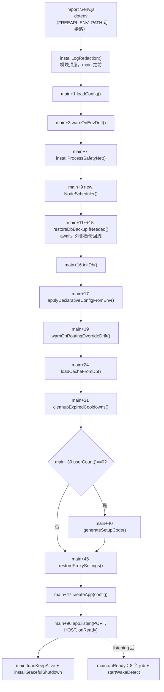
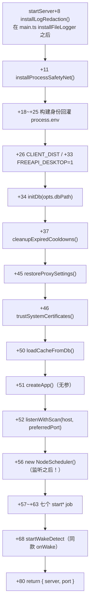
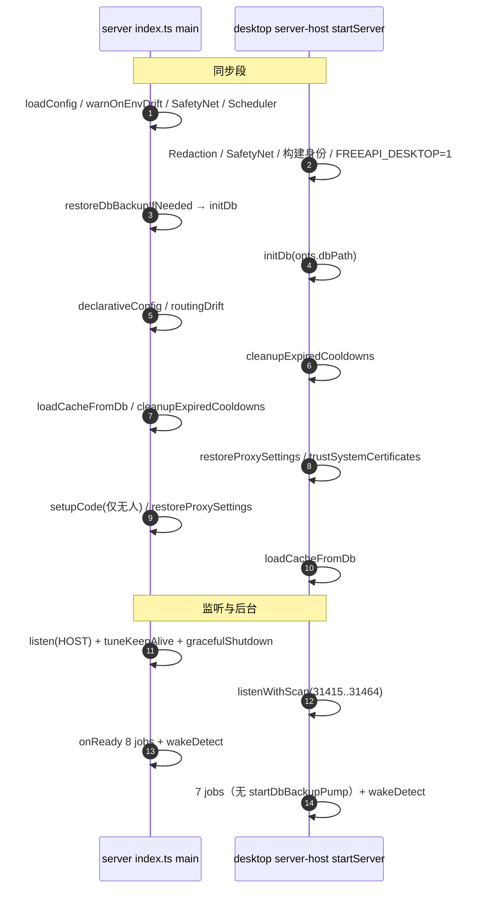

# 08 · 启动生命周期

> 基准提交：`3212ac11`（adrian）｜核对日期：2026-11-23｜范围：`server/src/index.ts`、`server/src/env.ts`、六个支撑 lib、`desktop/src/server-host.ts`、`desktop/src/main.ts`、`desktop/src/logger.ts`、boot 交叉比对测试。本篇只读源码，未启动任何实例、未向上游发探针。

一个进程从构建产物 `dist/index.js`（`node dist/index.js`）到「能接 /v1 请求」，中间每一步的顺序都是契约：先遮日志再落库、先配置再监听、先清账再开闸。而 desktop 版因为没有 `index.ts` 可跑，把这条序列**手抄了一遍**，并用一个测试盯着这份抄写不走样。本篇讲的就是这两份启动序列，以及围绕它们的六个「保活」机制。

---

## 0 人话定位：开店前的准备清单

把启动想象成一家店开门营业：

| 开店动作 | 对应代码 | 为什么不能乱序 |
|---|---|---|
| 先挂「禁止拍摄保险柜」的牌子 | `installLogRedaction` | 牌子挂晚了一秒，那一秒的日志就可能带着 provider key 进 stdout |
| 拉下电闸保险丝 | `installProcessSafetyNet` | 晚到的 socket 错误不能把整店炸了 |
| 开保险柜 | `initDb` | 后面所有步骤都要读写它 |
| 摆货架、贴价签 | `applyDeclarativeConfigFromEnv` / `restoreProxySettings` | 货架没摆好就开门，客人看到的是空店 |
| 清点昨天过期的库存 | `cleanupExpiredCooldowns` | 趁没人时扫，别在营业高峰扫 |
| 开门迎客 | `app.listen` | 只有这一步之后才接流量 |
| 雇夜班巡逻 | onReady 里的 8 个 `start*` job | 开门后才需要巡逻；巡逻员要吃同一个「排班表」（scheduler） |

**两份序列**：server 自己跑 `index.ts`；desktop 的 Electron 主进程不跑 `index.ts`，而是经 `desktop/src/server-host.ts` · `startServer+0` 直接调用 server 内部函数，把同样的步骤手抄一遍。抄写的一致性由 `desktop/src/__tests__/server-host-boot.test.ts` 盯着（§7）。

**本篇要回答的问题**：

| 问题 | 去哪节 |
|---|---|
| 第一行代码为什么是遮日志？ | §1 |
| server 主序列每步为什么在那个位置？ | §2 |
| 监听之后启动了哪些后台 job？ | §3 |
| keep-alive / IPv6 / 优雅退出 / fail-fast / 安全网各管什么？ | §4 |
| desktop 镜像抄了什么、故意不抄什么、多做了什么？ | §5 |
| Electron 主进程在镜像前后还做了什么？日志怎么落到磁盘？ | §6 |
| 那个盯抄写的测试到底能抓住什么、抓不住什么？ | §7 |
| 两份序列并排差在哪？ | §8 |

---

## 1 进程入口与第一行代码

### 1.1 env.ts：dotenv 与 FREEAPI_ENV_PATH

`server/src/index.ts` 的第 1 行是 import 语句 `import './env.js'`（运行期模块标识，源码即 env.ts）——ESM 的 import 先于一切语句执行，所以 dotenv 永远是第一个跑的业务代码。`server/src/env.ts` · `__dirname+0` 所在模块只做一件事：

```ts
dotenv.config({ path: process.env.FREEAPI_ENV_PATH ?? path.resolve(__dirname, '../../.env') });
```

- `FREEAPI_ENV_PATH` 让 embedder（desktop，其 `__dirname` 在 bundle 里）把 .env 指到任何地方，或者干脆不指。
- 文件不存在时 dotenv **静默 no-op**，不报错——这是 desktop 能完全不依赖 .env 的前提。

### 1.2 installLogRedaction：模块顶层，main 之前

`server/src/index.ts` 在**模块作用域**（第 30 行，`main` 定义之前）调用 `installLogRedaction()`。注释（27-29 行）写明理由：「先于任何其他语句运行，没有一个 provider key 能到达 stdout——用户会把服务器输出贴进 bug report」。放在模块作用域而非 `main` 内，是为了连启动期日志一起遮。

`server/src/lib/log-redaction.ts` · `installLogRedaction+0` 的行为：

| 步骤 | 锚点 | 行为 |
|---|---|---|
| 幂等守卫 | `installLogRedaction+1` | 已安装则返回 no-op restore，不二次包裹 |
| 包裹六个方法 | `installLogRedaction+6~+25` | `METHODS` = log/info/warn/error/debug/trace（`server/src/lib/log-redaction.ts` · `METHODS+0`） |
| 级别映射 | `server/src/lib/log-redaction.ts` · `LEVEL_FOR_METHOD+0` | log 与 info 共享 'info' 级；debug/trace 各自独立，仪表盘可单独滤掉 |
| 逐参数遮红 | `installLogRedaction+13` | `args.map(redactArg)`；`redactArg`（`server/src/lib/log-redaction.ts` · `redactArg+0`）对字符串走 `redactSecrets`，对象在字节预算内克隆后遮 |
| 仪表盘 tap | `installLogRedaction+14~+18` | `recordConsoleLine(level, redacted)` 在**遮红之后、写出之前**接入——进程里始终只有一层 console patch，缓冲区不可能持有终端没见过的凭证 |
| 失败兜底 | `installLogRedaction+20~+23` | 遮红自身抛错时退回 `original(...args)`——绝不让遮红吞掉一条日志 |
| 返回 restore | `installLogRedaction+27~+32` | 测试用，逐方法还原 |

> 这层 tap 同时是仪表盘 Logs 页的数据入口。desktop 上它还有第二个身份：文件日志的最外层（§6.3）。

---

## 2 server 主序列：main 的十四步



（骨架：`server/src/index.ts` · `main+0~+115`）

### 2.1 每步为什么在这个位置

| 步骤 | 锚点 | 顺序理由 |
|---|---|---|
| `installLogRedaction` | 模块顶层（`main` 之前） | 连启动期日志一起遮；见 §1.2 |
| `env.js` | `server/src/index.ts` · `main+0` 之前的 import | dotenv 必须先于任何读 env 的代码 |
| `loadConfig` | `server/src/index.ts` · `main+1` | 产出 port/host/dbPath 等，后续步骤的输入 |
| `warnOnEnvDrift` | `server/src/index.ts` · `main+3` | .env vs .env.example 只警告不阻断（06 篇） |
| `installProcessSafetyNet` | `server/src/index.ts` · `main+7` | 注释：先装，晚到的 undici socket reset 才炸不了代理；真 bug 仍 exit 1（§4.4） |
| `new NodeScheduler` | `server/src/index.ts` · `main+9` | 排班表先造好，onReady 的 job 才有得吃 |
| `restoreDbBackupIfNeeded` 在 `initDb` 前 | `server/src/index.ts` · `main+11~+15` | 它操作**文件**（把远端备份拉回本地路径），必须在任何人打开 DB 之前；仅 DB 不存在/空时拉取（07 篇 §7） |
| `initDb` | `server/src/index.ts` · `main+16` | 连接 + 迁移 + ENCRYPTION_KEY 校验 + 密钥自检（07 篇 §1/§4） |
| `applyDeclarativeConfigFromEnv` 在 `initDb` 后 | `server/src/index.ts` · `main+17` | 它写 DB；在 listener 前 ⇒ admin 段消除匿名 setup 窗口（06 篇） |
| `warnOnRoutingOverrideDrift` 在 `initDb` 后 | `server/src/index.ts` · `main+19` | 注释：unknown-model 那半边要读 catalog（models 表） |
| `loadCacheFromDb` | `server/src/index.ts` · `main+24` | 响应缓存跨重启复活（daily quota-reset 重跑模式）；best-effort，DB 挂了缓存就是空的 |
| `cleanupExpiredCooldowns` | `server/src/index.ts` · `main+31~+34` | 冷却行懒清，没人再问的路由永留表里拖慢 rollup ⇒ 趁 DB 安静启动时扫一次；清掉 >0 行才打日志 |
| `generateSetupCode` 仅 `userCount()==0` | `server/src/index.ts` · `main+39~+41` | 首启加固：loopback 浏览器可免码完成 setup，远程必须带码；每次重启重铸（§2.2） |
| `restoreProxySettings` | `server/src/index.ts` · `main+45` | settings 表就绪后才有得读；env `PROXY_URL` 若设置仍然赢 |
| `createApp(config)` | `server/src/index.ts` · `main+47` | 显式传 config；对比 desktop 无参调用（§5.4） |

### 2.2 setup code：一次性首启码

`server/src/lib/setup-code.ts` · `generateSetupCode+0` 在零用户时铸一个随机码并醒目打印。模块加载时 `_code = createOneTimeCode()`（`server/src/lib/setup-code.ts` · `_code+0`）已建好容器；`generateSetupCode` 调 `_code.generate()` 重铸。消费端：

- `server/src/lib/setup-code.ts` · `setupCodeMatches+0`：常量时间比较，无活动码或输入不匹配返回 false。
- `server/src/lib/setup-code.ts` · `clearSetupCode+0`：账号一旦建立就清码——调用点在 `server/src/routes/auth.ts:212` 与 `:238`（后者注释「one-time: the dashboard is now claimed」）。

server 默认绑所有接口，裸奔的新装可能被先到达的人认领；这个码就是「远程认领必须持码、本机浏览器免码」的闸门。desktop 不走这条路——它自己铸 machine user（§5.5）。

---

## 3 监听之后：onReady 的 8 个 job 与 wake 恢复

`app.listen` 的回调 `main.onReady`（`server/src/index.ts` · `main.onReady+0`）先打两行地址日志，然后启动后台 job。**现行代码是 8 个 `start*`，不是旧版文档写的 7 个**——旧版漏了 `startModelProbe`。

### 3.1 八个 job 一览

| # | job | 定义锚点 | 一句话职责 | 入参 |
|---|---|---|---|---|
| 1 | `startHealthChecker` | `server/src/services/health.ts` · `startHealthChecker+0` | 周期探活所有 key，维护健康状态 | scheduler |
| 2 | `startCatalogSync` | `server/src/services/catalog-sync.ts` · `startCatalogSync+0` | 拉 premium 目录，覆盖 models/quirks（07 篇 §5、topic） | scheduler |
| 3 | `startCooldownProbe` | `server/src/services/cooldown-probe.ts` · `startCooldownProbe+0` | 探冷却中的路由能否提前唤醒 | scheduler |
| 4 | `startModelProbe` | `server/src/services/model-probe.ts` · `startModelProbe+0` | 模型级探测（旧版文档遗漏的那个） | scheduler |
| 5 | `startDbBackupPump` | `server/src/lib/db-backup.ts` · `startDbBackupPump+0` | 整库加密外送到 HF/文件（07 篇 §7） | db, scheduler, dbPath |
| 6 | `startBackupScheduler` | `server/src/services/backups.ts` · `startBackupScheduler+0` | 每日本地 dump 排程（07 篇 §7） | scheduler |
| 7 | `startCustomModelSync` | `server/src/services/custom-model-sync.ts` · `startCustomModelSync+0` | 自定义端点的模型清单同步 | db, scheduler |
| 8 | `startBuiltinModelDiscovery` | `server/src/services/builtin-model-discovery.ts` · `startBuiltinModelDiscovery+0` | 内置 provider 的模型发现 | db, scheduler |

调用点集中在 `server/src/index.ts` · `main.onReady+4~+11`。全部吃同一个 `NodeScheduler`（`server/src/lib/scheduler.ts` · `NodeScheduler+0`）：`every`/`after` 只是 `setInterval`/`setTimeout` 的薄包装，返回停止函数（`server/src/lib/scheduler.ts` · `NodeScheduler.every+0`、`NodeScheduler.after+0`）。抽象的意义在于测试可以注入假排班表，不必真等定时器。各 job 的内部机制属 21 篇（后台探测与配额）范围，本篇只钉启动顺序。

### 3.2 wake 恢复：睡眠后的第一脚

`server/src/index.ts` · `main.onReady+19` 调 `startWakeDetect`，回调 `main.onReady.onWake`（`server/src/index.ts` · `main.onReady.onWake+0`）做两件事：`flushProxyCache()`（+3）清代理连接池，`checkAllKeys({ force: true })`（+7）强制重探所有 key——force 跳过新鲜度豁免与平台间隔，因为所有状态都早于睡眠。

检测机制在 `server/src/lib/wake-detect.ts`：

| 常量/函数 | 锚点 | 值/行为 |
|---|---|---|
| 心跳间隔 | `server/src/lib/wake-detect.ts` · `TICK_MS+0` | 5s |
| 漂移阈值 | `server/src/lib/wake-detect.ts` · `DRIFT_THRESHOLD_MS+0` | 30s |
| 去抖窗口 | `server/src/lib/wake-detect.ts` · `WAKE_DEBOUNCE_MS+0` | 15s——同一次唤醒的 drift tick 与信号不许叠加两次恢复 |
| 心跳判定 | `server/src/lib/wake-detect.ts` · `tick+3~+5` | `drift = now - lastTickAt - TICK_MS`，超阈值即判睡眠 |
| 信号入口 | `server/src/lib/wake-detect.ts` · `startWakeDetect+7~+8` | 只注册 **SIGCONT 与 SIGUSR2** |
| 钩子容错 | `server/src/lib/wake-detect.ts` · `invokeHooks+6~+11` | onWake 同步抛或异步 reject 都只记日志，绝不拖垮服务器 |
| 精确摘除 | `server/src/lib/wake-detect.ts` · `stopWakeDetect+7~+8` | 只 remove 本模块加的监听器；`removeAllListeners` 会误伤别家的 SIGUSR2（日志轮转、heap dump） |
| 不撑进程 | `server/src/lib/wake-detect.ts` · `tick+9~+11` | 心跳 timer `unref()`，不为心跳 alone 保活 |

> **勘误（注释 vs 代码）**：`server/src/index.ts` 第 97 行注释写「SIGCONT/SIGUSR1/2」，旧版文档照抄。实际代码只注册 SIGCONT/SIGUSR2；`server/src/lib/wake-detect.ts:9-11` 明说 **SIGUSR1 故意不用**——Node 把它保留给 inspector，发 SIGUSR1 会开调试端口，与加固背道而驰。以代码为准。

---

## 4 四个「活着」的机制

### 4.1 keep-alive 调参：空闲 socket 必须比前置代理活得久

`server/src/index.ts` · `main.tuneKeepAlive+0` 设 `keepAliveTimeout = 75_000`、`headersTimeout = 76_000`（+1~+2）。注释（116-122 行）讲的事故链：

```
Node 默认 keepAliveTimeout=5s
Caddy/nginx 复用空闲上游连接 30-60s
        ↓
代理把请求写进一个本机刚关闭的 socket
        ↓
用户看到 502 "connection reset by peer"
```

规则两条：空闲 socket 寿命必须长于任何前置代理的连接池寿命（75s  clears 两者默认）；`headersTimeout` 必须大于 `keepAliveTimeout`，否则下个请求的 header 还在飞就被掐。

### 4.2 IPv6 降级：仅默认绑定时重试

`server/src/index.ts` · `main+100~+114` 是 `server.on('error')` 处理器：

| 条件 | 行为 |
|---|---|
| 未显式设 `HOST` 且错误码 EAFNOSUPPORT/EADDRNOTAVAIL（`main+105`） | 警告后重试 `0.0.0.0`（`main+107`），新 server 同样 tuneKeepAlive 并加入 servers 数组 |
| 其它任何错误（EADDRINUSE、显式 HOST 绑不上） | 打印后 `process.exit(1)`，保持 fail-fast |

背景：默认 `'::'` 双栈 bind 在 `ipv6.disable=1` 的内核上抛 EAFNOSUPPORT。降级只救「用户没表态」的情况；用户显式指定的 HOST 绑不上就该死。

### 4.3 优雅退出：容器里 PID 1 没有默认动作

`server/src/index.ts` · `main+99` 装 `installGracefulShutdown`（`server/src/lib/graceful-shutdown.ts` · `installGracefulShutdown+0`）。注释（3-9 行）：容器里 server 是 PID 1，PID 1 对 SIGTERM **没有默认动作**——不装处理器，`docker stop` 和每次 Watchtower 自更新都会等满超时再 SIGKILL，写在半截。

| 步骤 | 锚点 | 行为 |
|---|---|---|
| 宽限上限 | `installGracefulShutdown+9` | `graceMs` 默认 8000ms |
| 防重入 | `installGracefulShutdown.shutdown+1` | `stopping` 标志，第二个信号直接返回 |
| 强制闸 | `installGracefulShutdown.shutdown+4~+7` | 8s 后仍忙则 `exit(1)`；timer `unref` |
| 关 idle 连接 | `installGracefulShutdown.shutdown+17` | `closeIdleConnections?.()`——否则空闲 keep-alive socket 会把 `close()` 拖满 75s |
| 收尾 | `installGracefulShutdown.shutdown.finish+0` | 全部 server 关完 → `closeDb()`（失败只记日志）→ 清 force timer → `exit(0)` |
| 信号 | `installGracefulShutdown+45~+46` | `once('SIGTERM')` / `once('SIGINT')` |

desktop **不装**这个（§5.3）：Electron 自己拥有进程生命周期，SIGTERM/SIGINT 处理器会与 quit/relaunch/updater 打架。

### 4.4 fail-fast 总闸与进程安全网

两处 exit 1 构成 fail-fast：`server.on('error')` 的非降级分支（`server/src/index.ts` · `main+112~+113`），以及模块顶层 `main().catch`（149-156 行）。后者注释写明：启动失败（典型：生产缺 ENCRYPTION_KEY）必须非零退出，而不是留一个「半初始化、永远不监听」的进程——那种静默状态在客户端表现为 "Can't reach the server"。

但「fail-fast」不等于「任何异常都死」。`server/src/lib/process-safety-net.ts` · `installProcessSafetyNet+0`（幂等，+1）装三层：

| 层 | 锚点 | 行为 |
|---|---|---|
| stdio 守护 | `server/src/lib/process-safety-net.ts` · `guardStdio+0` | 给 stdout/stderr 加 error 监听；EPIPE/EOF/ERR_STREAM_DESTROYED 丢弃，其它 rethrow 保持 fail-fast |
| 全局异常 | `installProcessSafetyNet+5~+6` | uncaughtException / unhandledRejection → `handleProcessError` |
| 分诊 | `server/src/lib/process-safety-net.ts` · `classifyProcessError+0` | 传输层错误 swallow，其余 fatal |

分诊依据是纯函数 `isTransportError`（`server/src/lib/process-safety-net.ts` · `isTransportError+0`）：沿 `err.cause` 链走最多 6 层（`walkErrorChain+4`，环安全），命中错误码白名单（`TRANSPORT_ERROR_CODES+0`：ECONNRESET、UND_ERR_SOCKET 等 15 个）或消息 hints（`TRANSPORT_MESSAGE_HINTS+0`：'fetch failed'、'socket hang up' 等 7 条）即判可恢复。设计注释（12-15 行）：只 swallow 紧白名单，其余保持 Node 默认 fail-fast，真 bug 仍要响亮地死。

`handleProcessError`（`server/src/lib/process-safety-net.ts` · `handleProcessError+0`）里有一条用事故换来的特例（+11）：**EPIPE 写失败 swallow 但不打日志**。注释（90-93 行）复盘：管道就是自己的 stdout/stderr 时，打日志等于往同一根死管道写，引发下一个 EPIPE，而每行又都持久化进 server_logs——这个循环曾以每秒数千行的速度跑。

---

## 5 desktop：手抄的镜像序列

### 5.1 bundle 边界：单例活在 bundle 里

desktop 不跑 `index.ts`——`desktop/scripts/bundle-server.mjs` 把 server 源码整个打进构建产物 `build/server.mjs`（ESM，仅 better-sqlite3 external）。`desktop/src/server-host.ts:1-8` 的头注释立下边界：**这是唯一允许触碰 server 内部的模块**。db 单例活在 bundle 里，所以任何有状态的东西（auth bootstrap、getDb）只能从 server-host 导出；主 bundle 若自己 import server/src，会拿到第二份空副本。`server-host.ts` 第 31 行据此 re-export `getDb` / `getUnifiedApiKey` / `isAutoUpdateCheckEnabled`。

### 5.2 startServer 全序列

`desktop/src/server-host.ts` · `startServer+0`（98-179 行）：



### 5.3 故意不镜像的清单

`server-host.ts:93-97` 注释列出四组，boot 测试的 `SKIPPED` 集合（测试 214 行）又多了两个：

| 不镜像 | 原因 | 出处 |
|---|---|---|
| `restoreDbBackupIfNeeded` / `startDbBackupPump` | 纯 env 驱动（`FREEAPI_DB_BACKUP_*`），打包应用不继承 shell 环境 | 注释 + SKIPPED |
| `applyDeclarativeConfigFromEnv` | 同上——没人给桌面 app 注 `FREEAPI_CONFIG_JSON` | 注释 |
| `warnOnEnvDrift` / `warnOnRoutingOverrideDrift` | 同上，且警告无人可看 | 注释 |
| `generateSetupCode` | desktop 自己铸 machine user（§5.5），setup 窗口不存在 | 注释 |
| `loadConfig`（主序列那次） | port/host/dbPath 经 `StartOptions` 传入，不从 env 读 | 测试 SKIPPED |
| `installGracefulShutdown` | 容器 PID 1 才需要；Electron 拥有进程生命周期，信号处理器会与 quit/relaunch/updater 打架 | 测试 SKIPPED + 注释 210-213 |

> **一个容易误读的细节**：测试把 `loadConfig` 列为跳过，但 `createApp()` 无参调用时内部仍会 `config ?? loadConfig()`（`server/src/app.ts:101`）。跳过的是**主序列里那次显式调用**，不是配置加载本身——desktop 的 app 仍会读 env 配置（trustProxy 等），只是 port/host/dbPath 不由它决定。

### 5.4 与 server 的顺序差异

镜像不是逐字复制，有几处有意或无意的顺序差：

| 项 | server | desktop | 说明 |
|---|---|---|---|
| scheduler 创建时机 | `initDb` 之前（`main+9`） | `listen` 之后（`startServer+56`） | desktop 注释（151-153 行）：抽象落地（4cbb571）后若漏传，两个 job 收到 undefined，首次 `scheduler.every()` 抛 "reading 'every'" |
| cache 与 cooldown 清理顺序 | 先 `loadCacheFromDb`（+24）后 `cleanupExpiredCooldowns`（+31） | 先 cleanup（+37）后 cache（+50） | 两者互不依赖，顺序差无功能影响 |
| `createApp` 参数 | `createApp(config)` | `createApp()` | 无参 → 内部 `loadConfig()`（§5.3 注） |
| job 数量 | 8 | 7 | 差一个 `startDbBackupPump`（env 驱动，不镜像） |
| 监听失败姿态 | 绑不上就死（fail-fast） | 绕着绑（端口扫描，§5.6） | 面向用户机器上不可控的端口占用 |

### 5.5 desktop 特有的五件事

1. **`FREEAPI_DESKTOP = '1'`**（`startServer+33`，注释 125-130，#786）：桌面版密码随机生成、永不显示，key 揭示/导出若要求重验密码会把用户锁死 ⇒ 服务端对**仅 loopback 来源**的这两个端点跳过重验；开 LAN 访问时绑 0.0.0.0，远程查看者仍须输密码。
2. **`trustSystemCertificates`**（`desktop/src/server-host.ts` · `trustSystemCertificates+0`，#1373）：杀毒软件/企业 TLS 巡检用系统商店里的根证书重签流量，Node 自带根列表不认，所有 provider 调用裸报 "fetch failed"（SELF_SIGNED_CERT_IN_CHAIN）。实现：API 不存在返回 0（+2，Node < 22.19 静默保持默认）；系统证书与默认根列表取并集去重（+5，`new Set`）后 `setDefaultCACertificates`（+6）；返回信任的系统证书数；任何异常只 warn 返回 0（+9~+12）。server 镜像维持 Node 默认，可用 `NODE_USE_SYSTEM_CA=1` 手动开启。
3. **构建身份回灌**（`startServer+18~+25`，注释 110-115）：esbuild `define` 只改写逐字的 `process.env.X` 成员表达式，而 `server/src/routes/update.ts` 经普通 env 对象引用读值 ⇒ 打包后更新检查拿到 `{sha: null, installation: 'unknown'}` 报 'unsupported'。`startServer` 把 define 内联的字面量（`FREELLMAPI_COMMIT_SHA` / `FREELLMAPI_INSTALL_METHOD`）再抄回真实 `process.env`。
4. **`CLIENT_DIST`**（`startServer+26`）：把 main.ts 算好的前端产物路径交给 server 静态托管。
5. **machine user**（`desktop/src/server-host.ts` · `ensureSessionToken+0` → `server/src/services/auth.ts` · `desktopSessionToken+0`）：仪表盘窗口以一个隐藏账号登录。`desktopSessionToken` 在零用户时 `createUser('desktop@localhost', crypto.randomBytes(24).toString('hex'))`（+1~+3，48 位 hex 随机密码），然后取 **id 最小的第一个用户**（+4）铸 session。`createSession`（`server/src/services/auth.ts` · `createSession+0`）只持久化 token 的 sha256 哈希，原始 token 经 IPC 交给窗口。注释（58-61 行）：同机浏览器也可经 `POST /api/auth/desktop-session` 拿到它。

> **边界细节**：`desktopSessionToken` 取的是「第一个用户」而非「desktop 用户」——若 DB 里已有账号（例如从 server 实例拷来），session 会铸给那个既有账号。正常桌面首启两者是同一人。

### 5.6 端口扫描：绕着绑

`desktop/src/server-host.ts` · `listenWithScan+0`：从 `preferredPort` 起扫 `attempts = 50` 个端口（+4），逐个 `tryListen`，成功即返回 `{server, port}`；全满抛 `No free port found in start–end`（+10）。

`tryListen`（`desktop/src/server-host.ts` · `tryListen+0`）用 once 监听 listening/error 把 `app.listen` 包成 Promise。错误分支（+4~+7）现行写法是：

```ts
if (err.code === 'EADDRINUSE') resolve(null);
else resolve(null);
```

两个分支**完全相同**——if/else 是 vestigial（残留区分）。后果：任何 bind 错误（包括 EACCES 权限类）都被当成「这个端口不行，换下一个」，扫满 50 个才报 no free port，掩盖真实原因（§9 P2）。

---

## 6 main.ts：镜像之前的准备与之后的收尾

旧版文档把「main.ts 何时调用 startServer、installFileLogger 完整链路」列为待补。本节闭环。

### 6.1 模块顶层：单实例与文件日志

`desktop/src/main.ts` 顶层（21-30 行）：`app.setName('FreeLLMAPI')`、`userData` 指到 `<appData>/FreeLLMAPI`；`requestSingleInstanceLock()` 失败即 `app.quit()`（24-25 行）；成功分支里**第一件事**是 `installFileLogger()`（30 行）。注释（27-29 行，#824）：打包应用没有_attached_ stdout，server 的 console 输出——包括 POST /api/auth/forgot-password 打印的一次性密码重置码——若无文件日志就写在任何用户读不到的地方，重置流程永远走不完。

### 6.2 whenReady：startServer 的输入从哪来

`app.whenReady()` 回调（`desktop/src/main.ts:254` 起）准备 `StartOptions` 并调用镜像：

| 步骤 | 锚点 | 行为 |
|---|---|---|
| DB 路径 | `desktop/src/main.ts` · `dbPath+0` | `<userData>/freeapi.db` |
| 前端产物 | `desktop/src/main.ts` · `clientDist+0` | 打包：`process.resourcesPath/client-dist`；开发：`repoRoot/client/dist`（`FREEAPI_REPO` 可指别的 checkout） |
| 绑定时机 | `desktop/src/main.ts` · `host+0` | `lanAccess ? '0.0.0.0' : '127.0.0.1'`（#442/#418）；bind host 在 listen 时固定，托盘开关持久化后**重启**生效 |
| 版本回灌 | main.ts:277 | `FREEAPI_VERSION = app.getVersion()`——bundle 跑在本进程，交 shell 自己的版本是最便宜也最权威的答案（#703） |
| 更新器 | main.ts:279-288 | `initUpdater` 注入 autoCheck/backupBeforeUpdate/outboundProxyUrl/getLocale |
| 目录同步兜底 | main.ts:293 | `setCatalogFallbackFetch(net.fetch)`：Node fetch 够不到 api.freellmapi.co 时（某些 Windows 报 HTTP 502）改走 Chromium 网络栈（系统证书 + 系统代理） |
| 启动镜像 | main.ts:296-301 | `await startServer({dbPath, clientDist, host, preferredPort: cfg.port ?? DEFAULT_PORT})`；`DEFAULT_PORT = 31415`（`desktop/src/main.ts` · `DEFAULT_PORT+0`） |

### 6.3 startServer 之后：端口落盘、session、托盘

| 步骤 | 锚点 | 行为 |
|---|---|---|
| 端口落盘 | main.ts:302-303 | `resolvedPort = port`；`saveConfig({...cfg, port})`——下次启动从上次成功的端口起扫 |
| 铸 session | main.ts:304 | `sessionToken = ensureSessionToken()`（§5.5） |
| 托盘容错 | `desktop/src/main.ts` · `tray+0` | `buildTray` 包在 try/catch 里：server 已经起来了，托盘建失败不能把 app 一起带倒，退回仪表盘窗口（#1353） |
| 隐藏托盘探针 | `desktop/src/main.ts` · `reportHiddenTray+0` | macOS 上托盘「构造成功但画不出来」只能靠看它落在哪发现（#807）；延时探针后弹窗给「Open Dashboard / Continue in Background」 |
| 首启开窗 | `desktop/src/main.ts` · `welcomedBefore+0` | `shouldOpenDashboardOnLaunch` 判定后 `openDashboard`，并持久化 `launchDashboardShown` |

### 6.4 文件日志器：双文件 1MB，同步写，永不抛

`desktop/src/logger.ts` · `installFileLogger+0`（#824）：

- 幂等守卫（+1）；sink 建失败直接 return（+4~+8），日志绝不成为启动失败的理由。
- 包裹 log/info/warn/error 四级（+9~+19）：先调 original（`npm run dev` 输出不变），再 `sink.write` 一行 `ISO时间 [级别] util.format(...)`；写失败吞掉。
- `process.on('exit')` 关 sink（+20）。

sink 本体 `createFileSink`（`desktop/src/logger.ts` · `createFileSink+0`）与 Electron 解耦以便测试：

| 特性 | 锚点 | 行为 |
|---|---|---|
| 双文件轮转 | `desktop/src/logger.ts` · `MAX_LOG_BYTES+0` | `freeapi.log` + `freeapi.log.1`，各 1MB |
| 写前轮转 | `desktop/src/logger.ts` · `createFileSink.write+4~+6` | 在**将超限的那次写之前**轮转；空文件绝不轮转——单行超长不能死循环 |
| 同步写 | `createFileSink.write+7` | `fs.writeSync`：退出前一刻打印的重置码必须已落盘 |
| 全包裹 | `createFileSink.write+9~+11` | 只读/满盘不值得崩溃，丢行 |

### 6.5 日志三层链：谁包谁

desktop 上 console 被包了两层，顺序是契约（`server-host.ts:99-105` 注释）：

```
调用方 console.log(key)
        ↓
installLogRedaction 的 wrapper（最外层，startServer+8 才装）
        ├─ redactArg → recordConsoleLine(level, redacted)  → 仪表盘 Logs 页（#993 唯一数据源）
        ↓ original = installFileLogger 的 wrapper
        ├─ 原始 console（终端/dev 输出）
        └─ sink.write（<userData>/logs/freeapi.log，已遮红）
```

`installLogRedaction` 必须在 `installFileLogger` **之后**跑，遮红笔才位于最外层、落盘日志也是洗过的。反过来包就会把原始密钥 tee 到磁盘。注释还强调：不能放在模块作用域——main.ts 在文件日志器装好之前就 import 了这个 bundle。server 侧没有文件日志层，redaction 直接在模块顶层装（§1.2），tap 同样喂仪表盘。

---

## 7 boot 测试：镜像的 watchdog

`desktop/src/__tests__/server-host-boot.test.ts` 的做法（头注释 6-14 行）：mock 整个 server 表面，把每次调用记进 `calls` 数组（`desktop/src/__tests__/server-host-boot.test.ts` · `calls+0`），`boot`  helper（`desktop/src/__tests__/server-host-boot.test.ts` · `boot+0`）用 `:memory:` DB 跑一遍 `startServer`，然后断言调用清单。

### 7.1 两半结构

| 半边 | 位置 | 断言形态 | 抓什么 |
|---|---|---|---|
| 字面量全序列 | 测试 171-188 行 | `expect(calls).toEqual([...16 项...])` | desktop 侧**任何一步挪位或缺失**（如 loadCacheFromDb 挪到 listen 后即红） |
| 源码派生 | 测试 196-226 行 | 读 index.ts 源码 → 剥注释 → 正则提步骤 → 逐条 `toContain` | index.ts 加了步骤而 desktop 没抄 |

派生半的细节：

- 剥注释（201-203 行）后正则 `\b((?:install|start|cleanup|restore|load)[A-Z]\w*)\(`（205 行）提调用名进 Set。
- `SKIPPED`（214 行）= restoreDbBackupIfNeeded / startDbBackupPump / loadConfig / installGracefulShutdown。
- 正则 sanity floor（216 行）：`steps.size >= 10`——index.ts 重构不能把这道测试静默掏空。
- 逐条 `toContain`（219-225 行），失败消息直接指路「add it to startServer()」。

另有三条针对 #949 的定点断言（152-167 行）：restoreProxySettings 必须被调、必须在 initDb 之后、必须在 createApp/listen 之前。

### 7.2 历史：这道测试为什么长这样

两段注释复盘了两次失败：

1. **#949 原始回归**（头注释 8-10 行）：缺的就是 `restoreProxySettings()` 一行，两侧仓库的测试都没 noticed——server 套件证明函数本身能跑，但没有任何测试证明这条 boot 路径**调用了它**。后果：settings 表里存的代理 URL 每次重启都被忽略，出站代理字段看起来是空的直到重存。
2. **字面量清单自己也漏过**（191-195 行注释）：清单最初为 #949 写了六步，随后**绿灯放过了八次后续遗漏**，其中包括 `startBackupScheduler`——Backups 页存了一个永远不会触发的排程。所以才加了「从 index.ts 源码派生」的那半边，不再相信任何人会同步更新两处。

### 7.3 能力边界（P1）

| 抓得住 | 抓不住 |
|---|---|
| desktop 侧任何一步挪位/缺失（字面量全序列） | **index.ts 单方面调整顺序**——派生半只做存在性 `toContain`，字面量钉的是 desktop 自己的顺序；两半都不会红 |
| index.ts 新增 `install\|start\|cleanup\|restore\|load` 前缀的步骤而 desktop 没抄 | 前缀正则罩不住的调用：`initDb`、`createApp`、`generateSetupCode`、`applyDeclarativeConfigFromEnv`、`warnOn*`——它们只活在字面量清单里 |
| 正则被重构掏空（sanity floor） | `SKIPPED` 是手写集合，新增 env-only 步骤要人工记得加 |
| #949 三步定点顺序 | 不被 mock 记录的步骤：`trustSystemCertificates`、构建身份回灌、env 标记设置都不进 `calls`，它们的缺失/挪位无测试覆盖 |

---

## 8 两份序列并排



差异归一成一句话：**desktop = server − 所有 env 驱动的部署机制 − graceful shutdown + 打包应用特有的四件事（端口扫描、machine user、系统证书、构建身份回灌）**。顺序差（scheduler 位置、cache/cleanup 先后）无功能影响，但没有任何测试钉住 server 侧的顺序——一致性仍靠人工同步（§7.3）。

---

## 9 风险与待补

| 级别 | 事项 | 锚点 |
|---|---|---|
| P1 | 镜像顺序一致性各靠一半：字面量钉 desktop 顺序，派生半只查存在性；index.ts 单方调序两半都不红 | 测试 171-188 / 196-226 |
| P2 | `tryListen` 对非 EADDRINUSE 错误也 `resolve(null)` 继续扫，且 if/else 两分支相同——bind 权限类错误表现为「扫满 50 端口后 no free port」，掩盖真因 | `desktop/src/server-host.ts` · `tryListen+4~+7` |
| P2 | `trustSystemCertificates`、构建身份回灌、env 标记不进 boot 测试的 `calls`，缺失/挪位无覆盖 | 测试 mock 清单 |
| P3 | index.ts:97 注释写 SIGUSR1/2，代码只注册 SIGCONT/SIGUSR2（SIGUSR1 留给 Node inspector）——注释漂移 | `server/src/lib/wake-detect.ts:9-11` |
| P3 | `desktopSessionToken` 取 id 最小用户而非 desktop 用户；DB 从别处拷来时 session 铸给既有账号 | `server/src/services/auth.ts` · `desktopSessionToken+4` |
| 待补 | 各 job 内部机制（健康/冷却/模型探测/目录同步/发现）→ 21 篇；updater/tray/窗口 → 15 篇 | §3.1 表 |

---

## 10 旧版勘误表

| 旧版说法 | 现行事实 | 证据 |
|---|---|---|
| onReady「7 个后台 job」 | **8 个**，旧版漏 `startModelProbe` | `server/src/index.ts` · `main.onReady+4~+11` |
| 「SIGCONT/SIGUSR1/2」触发 wake | 代码只注册 SIGCONT/SIGUSR2；SIGUSR1 故意不用（Node inspector 保留） | `server/src/lib/wake-detect.ts` · `startWakeDetect+7~+8`、头注释 9-11 |
| 全篇绝对行号（index.ts 26-29/31-47、server-host 89-93/121-127 等） | 行号已漂移；本篇全部转符号+偏移 | index.ts main 现 32 起；server-host startServer 现 98 起 |
| boot 测试「189-219 行派生 / 163-182 行字面量」 | 现行派生半 196-226、字面量 171-188 | 测试文件 |
| 派生半 SKIPPED 未列全 | 现行 SKIPPED 含 loadConfig、installGracefulShutdown（旧版只提 env 四组） | 测试 214 行 |
| 「startBackupScheduler 曾被漏掉（#949）」 | 更精确：#949 原始回归是 restoreProxySettings 缺失；startBackupScheduler 是字面量清单后来绿灯放过的八次遗漏之一 | 测试头注释 8-10、191-195 |
| 待补「main.ts 何时调 startServer、installFileLogger 链路」 | 本篇 §6 闭环 | main.ts:254-338、logger.ts |
| §4 风险表表格列数缺陷（旧版 L119，7 列 vs 表头 3 列） | 本篇重写，结构检查通过 | lint_structure |
| 未提 `createApp()` 无参仍内部 loadConfig | 已补（§5.3 注） | `server/src/app.ts:101` |
| 未提 EPIPE 不打日志的事故复盘 | 已补（§4.4） | `server/src/lib/process-safety-net.ts` · `handleProcessError+11` |

---

## 11 源码索引（符号 + 偏移，逐条配对）

- `server/src/env.ts` · `__dirname+0` — dotenv 路径基准
- `server/src/index.ts` · `main+0` — 主序列入口
- `server/src/index.ts` · `main+1` — loadConfig
- `server/src/index.ts` · `main+3` — warnOnEnvDrift
- `server/src/index.ts` · `main+7` — installProcessSafetyNet
- `server/src/index.ts` · `main+9` — new NodeScheduler
- `server/src/index.ts` · `main+11~+15` — restoreDbBackupIfNeeded
- `server/src/index.ts` · `main+16` — initDb
- `server/src/index.ts` · `main+17` — applyDeclarativeConfigFromEnv
- `server/src/index.ts` · `main+19` — warnOnRoutingOverrideDrift
- `server/src/index.ts` · `main+24` — loadCacheFromDb
- `server/src/index.ts` · `main+31~+34` — cleanupExpiredCooldowns + 日志
- `server/src/index.ts` · `main+39~+41` — userCount / generateSetupCode
- `server/src/index.ts` · `main+45` — restoreProxySettings
- `server/src/index.ts` · `main+47` — createApp(config)
- `server/src/index.ts` · `main.onReady+0` — listening 回调
- `server/src/index.ts` · `main.onReady+4~+11` — 8 个 start* job
- `server/src/index.ts` · `main.onReady+19` — startWakeDetect
- `server/src/index.ts` · `main.onReady.onWake+0` — 唤醒回调
- `server/src/index.ts` · `main.onReady.onWake+3` — flushProxyCache
- `server/src/index.ts` · `main.onReady.onWake+7` — checkAllKeys force
- `server/src/index.ts` · `main.tuneKeepAlive+0` — keep-alive 调参
- `server/src/index.ts` · `main.tuneKeepAlive+1~+2` — 75s/76s
- `server/src/index.ts` · `main+96` — app.listen
- `server/src/index.ts` · `main+99` — installGracefulShutdown
- `server/src/index.ts` · `main+100~+114` — server.on('error')
- `server/src/index.ts` · `main+105` — IPv6 降级条件
- `server/src/index.ts` · `main+107` — 0.0.0.0 重试
- `server/src/index.ts` · `main+112~+113` — 非降级 exit 1
- `server/src/lib/log-redaction.ts` · `installLogRedaction+0` — console 遮红
- `server/src/lib/log-redaction.ts` · `installLogRedaction+1` — 幂等守卫
- `server/src/lib/log-redaction.ts` · `installLogRedaction+14~+18` — recordConsoleLine tap
- `server/src/lib/log-redaction.ts` · `installLogRedaction+20~+23` — 遮红失败兜底
- `server/src/lib/log-redaction.ts` · `METHODS+0` — 六方法
- `server/src/lib/log-redaction.ts` · `LEVEL_FOR_METHOD+0` — 级别映射
- `server/src/lib/log-redaction.ts` · `redactArg+0` — 逐参数遮红
- `server/src/lib/setup-code.ts` · `_code+0` — 一次性码容器
- `server/src/lib/setup-code.ts` · `generateSetupCode+0` — 铸码并打印
- `server/src/lib/setup-code.ts` · `setupCodeMatches+0` — 常量时间比较
- `server/src/lib/setup-code.ts` · `clearSetupCode+0` — 认领后清码
- `server/src/lib/scheduler.ts` · `NodeScheduler+0` — 排班表实现
- `server/src/lib/scheduler.ts` · `NodeScheduler.every+0` — setInterval 包装
- `server/src/lib/scheduler.ts` · `NodeScheduler.after+0` — setTimeout 包装
- `server/src/services/health.ts` · `startHealthChecker+0` — job 1
- `server/src/services/catalog-sync.ts` · `startCatalogSync+0` — job 2
- `server/src/services/cooldown-probe.ts` · `startCooldownProbe+0` — job 3
- `server/src/services/model-probe.ts` · `startModelProbe+0` — job 4
- `server/src/lib/db-backup.ts` · `startDbBackupPump+0` — job 5
- `server/src/services/backups.ts` · `startBackupScheduler+0` — job 6
- `server/src/services/custom-model-sync.ts` · `startCustomModelSync+0` — job 7
- `server/src/services/builtin-model-discovery.ts` · `startBuiltinModelDiscovery+0` — job 8
- `server/src/lib/wake-detect.ts` · `TICK_MS+0` — 5s 心跳
- `server/src/lib/wake-detect.ts` · `DRIFT_THRESHOLD_MS+0` — 30s 阈值
- `server/src/lib/wake-detect.ts` · `WAKE_DEBOUNCE_MS+0` — 15s 去抖
- `server/src/lib/wake-detect.ts` · `tick+3~+5` — 漂移判定
- `server/src/lib/wake-detect.ts` · `tick+9~+11` — 重排 + unref
- `server/src/lib/wake-detect.ts` · `invokeHooks+6~+11` — 钩子容错
- `server/src/lib/wake-detect.ts` · `startWakeDetect+7~+8` — SIGCONT/SIGUSR2
- `server/src/lib/wake-detect.ts` · `stopWakeDetect+7~+8` — 精确摘除
- `server/src/lib/graceful-shutdown.ts` · `installGracefulShutdown+0` — 优雅退出
- `server/src/lib/graceful-shutdown.ts` · `installGracefulShutdown+9` — graceMs 8s
- `server/src/lib/graceful-shutdown.ts` · `installGracefulShutdown.shutdown+4~+7` — 强制闸
- `server/src/lib/graceful-shutdown.ts` · `installGracefulShutdown.shutdown+17` — closeIdleConnections
- `server/src/lib/graceful-shutdown.ts` · `installGracefulShutdown.shutdown.finish+0` — 收尾
- `server/src/lib/graceful-shutdown.ts` · `installGracefulShutdown+45~+46` — SIGTERM/SIGINT
- `server/src/lib/process-safety-net.ts` · `installProcessSafetyNet+0` — 安全网安装
- `server/src/lib/process-safety-net.ts` · `installProcessSafetyNet+5~+6` — 全局异常钩子
- `server/src/lib/process-safety-net.ts` · `guardStdio+0` — stdio 守护
- `server/src/lib/process-safety-net.ts` · `classifyProcessError+0` — 分诊
- `server/src/lib/process-safety-net.ts` · `isTransportError+0` — 传输错误判定
- `server/src/lib/process-safety-net.ts` · `walkErrorChain+4` — cause 链深度 6
- `server/src/lib/process-safety-net.ts` · `TRANSPORT_ERROR_CODES+0` — 错误码白名单
- `server/src/lib/process-safety-net.ts` · `TRANSPORT_MESSAGE_HINTS+0` — 消息 hints
- `server/src/lib/process-safety-net.ts` · `handleProcessError+0` — 决策与动作
- `server/src/lib/process-safety-net.ts` · `handleProcessError+11` — EPIPE 静默
- `server/src/app.ts` · `createApp+0` — config 可选，无参内部 loadConfig
- `desktop/src/server-host.ts` · `startServer+0` — 镜像序列
- `desktop/src/server-host.ts` · `startServer+8` — installLogRedaction
- `desktop/src/server-host.ts` · `startServer+11` — installProcessSafetyNet
- `desktop/src/server-host.ts` · `startServer+18~+25` — 构建身份回灌
- `desktop/src/server-host.ts` · `startServer+26` — CLIENT_DIST
- `desktop/src/server-host.ts` · `startServer+33` — FREEAPI_DESKTOP=1
- `desktop/src/server-host.ts` · `startServer+34` — initDb
- `desktop/src/server-host.ts` · `startServer+37` — cleanupExpiredCooldowns
- `desktop/src/server-host.ts` · `startServer+45` — restoreProxySettings
- `desktop/src/server-host.ts` · `startServer+46` — trustSystemCertificates
- `desktop/src/server-host.ts` · `startServer+50` — loadCacheFromDb
- `desktop/src/server-host.ts` · `startServer+51` — createApp()
- `desktop/src/server-host.ts` · `startServer+52` — listenWithScan
- `desktop/src/server-host.ts` · `startServer+56` — NodeScheduler（监听后）
- `desktop/src/server-host.ts` · `startServer+57~+63` — 7 个 job
- `desktop/src/server-host.ts` · `startServer+68` — startWakeDetect
- `desktop/src/server-host.ts` · `trustSystemCertificates+0` — 系统证书
- `desktop/src/server-host.ts` · `trustSystemCertificates+5` — 并集去重
- `desktop/src/server-host.ts` · `ensureSessionToken+0` — machine user session
- `desktop/src/server-host.ts` · `outboundProxyUrl+0` — 更新器出站代理
- `desktop/src/server-host.ts` · `backupBeforeUpdate+0` — 更新前 dump
- `desktop/src/server-host.ts` · `listenWithScan+0` — 端口扫描
- `desktop/src/server-host.ts` · `listenWithScan+4` — attempts=50
- `desktop/src/server-host.ts` · `listenWithScan+10` — 全满抛错
- `desktop/src/server-host.ts` · `tryListen+0` — listen 包 Promise
- `desktop/src/server-host.ts` · `tryListen+4~+7` — 冗余错误分支
- `desktop/src/server-host.ts` · `StartOptions+0` — 镜像入参契约
- `server/src/services/auth.ts` · `desktopSessionToken+0` — 铸 machine session
- `server/src/services/auth.ts` · `desktopSessionToken+4` — 取第一个用户
- `server/src/services/auth.ts` · `createSession+0` — 只存哈希
- `desktop/src/main.ts` · `DEFAULT_PORT+0` — 31415
- `desktop/src/main.ts` · `dbPath+0` — userData/freeapi.db
- `desktop/src/main.ts` · `clientDist+0` — 前端产物路径
- `desktop/src/main.ts` · `host+0` — lanAccess 绑定
- `desktop/src/main.ts` · `tray+0` — 托盘容错
- `desktop/src/main.ts` · `reportHiddenTray+0` — 隐藏托盘探针
- `desktop/src/main.ts` · `welcomedBefore+0` — 首启开窗
- `desktop/src/logger.ts` · `installFileLogger+0` — 文件日志安装
- `desktop/src/logger.ts` · `installFileLogger+1` — 幂等守卫
- `desktop/src/logger.ts` · `installFileLogger+9~+19` — 四级包裹
- `desktop/src/logger.ts` · `createFileSink+0` — sink 本体
- `desktop/src/logger.ts` · `createFileSink.write+4~+6` — 写前轮转
- `desktop/src/logger.ts` · `createFileSink.write+9~+11` — 写失败吞掉
- `desktop/src/logger.ts` · `MAX_LOG_BYTES+0` — 1MB
- `desktop/src/__tests__/server-host-boot.test.ts` · `calls+0` — 调用记录数组
- `desktop/src/__tests__/server-host-boot.test.ts` · `boot+0` — 测试 harness

绝对行号备查（模块顶层语句与测试断言，无函数符号）：

- `server/src/index.ts:30` — 模块顶层 installLogRedaction 调用
- `server/src/index.ts:149-156` — main().catch fail-fast
- `server/src/env.ts:10` — dotenv.config
- `server/src/routes/auth.ts:212` / `:238` — clearSetupCode 调用点
- `server/src/app.ts:101` — createApp 内部 config ?? loadConfig()
- `desktop/src/main.ts:24-30` — 单实例锁 + installFileLogger 调用
- `desktop/src/main.ts:254` — app.whenReady 回调起点
- `desktop/src/main.ts:277-301` — 版本回灌 / initUpdater / fallbackFetch / startServer
- `desktop/src/main.ts:302-338` — 端口落盘 / session / 托盘 / 首启开窗
- `desktop/src/__tests__/server-host-boot.test.ts:171-188` — 字面量全序列断言
- `desktop/src/__tests__/server-host-boot.test.ts:196-226` — 源码派生半
- `desktop/src/__tests__/server-host-boot.test.ts:214` — SKIPPED 集合
- `server/src/lib/wake-detect.ts:9-11` — SIGUSR1 故意不用的注释

---

## 12 导航

上一篇 → [07-状态存储与并发](./07-状态存储与并发.md) ｜ 下一篇 → [09-测试与部署](./09-测试与部署.md) ｜ [返回索引](./README.md)

相关专题：[model 调度算法](../topics/model调度算法.md)（路由如何使用启动期加载的状态）、[premium 目录同步](../topics/premium目录同步.md)（job 2 的内部机制）。

---

## 13 术语表

| 术语 | 人话解释 |
|---|---|
| 模块作用域（module scope） | 文件被 import 时就执行的代码，比任何函数调用都早 |
| dotenv | 把 .env 文件里的键值读进 process.env 的小库；文件不存在就什么都不做 |
| embedder | 把 server 当库嵌进自己进程的应用——这里指 Electron desktop |
| bundle | esbuild 把许多源文件打成的单个 .mjs；desktop 的 server 整个活在一个 bundle 里 |
| 单例（singleton） | 全进程只有一份的对象；db 句柄就是，import 两次会拿到两份空副本 |
| scheduler / 排班表 | 对 setInterval/setTimeout 的薄抽象，让测试能注入假时钟 |
| keep-alive | HTTP 连接复用：一个 socket 上跑多个请求，省握手 |
| keepAliveTimeout | 空闲 socket 多久后关；必须比前置代理的连接池寿命长 |
| headersTimeout | 等下一个请求 header 的超时；必须大于 keepAliveTimeout |
| fail-fast | 出错立刻非零退出，不留半死不活的进程 |
| PID 1 | 容器里的第一个进程；Node 默认不给它 SIGTERM 动作，必须自己装处理器 |
| graceful shutdown | 先停接新请求、等在途请求做完、关库、再退出 |
| closeIdleConnections | 主动关掉没有在途请求的 keep-alive socket，否则 close() 要等满 75s |
| unref | 告诉 Node「这个 timer 不算进程存活的理由」，没人等它时进程可以退 |
| undici | Node 内置 fetch 背后的 HTTP 客户端；它的晚到 socket 错误是安全网的主要假想敌 |
| EPIPE | 往读端已关闭的管道写；往自己的死 stdout 打日志会引发 EPIPE 循环 |
| swallow / fatal | 安全网分诊结果：传输错误吞掉继续跑，真 bug 退出 |
| wake / 唤醒恢复 | 主机睡眠后清死连接、重探 key，避免第一脚踩进睡眠前的旧状态 |
| 去抖（debounce） | 同一次唤醒的多个触发源只跑一次恢复 |
| SIGCONT / SIGUSR2 | 操作系统信号；这里用作「手动触发一次唤醒恢复」的入口 |
| SIGUSR1 | Node 保留给 inspector 的信号，发它会开调试端口，所以故意不用 |
| setup code | 零用户时铸的一次性码，远程认领仪表盘必须持它 |
| machine user | desktop 自动建的隐藏账号 desktop@localhost，密码随机永不显示 |
| loopback | 127.0.0.1 本机回环；「仅 loopback 跳过重验」即只信本机来源 |
| TLS 巡检 | 杀毒/企业网关用自签根证书重签 HTTPS 流量；Node 默认不认该根 |
| 系统证书商店 | OS 维护的受信根证书列表；desktop 把它并进 Node 默认根 |
| esbuild define | 构建时把 process.env.X 字面量内联进 bundle；只改逐字成员表达式 |
| 构建身份回灌 | 把 define 内联的值再抄回真实 process.env，救活经普通对象读 env 的代码 |
| vestigial 分支 | 进化残留：if/else 两分支做同一件事，区分已无意义 |
| watchdog 测试 | 不测功能本身、专盯「某条路径有没有调用它」的回归测试 |
| 字面量断言 | 把期望序列写成硬编码数组逐一比对；钉顺序但需人工维护 |
| 源码派生断言 | 从被镜像文件的源码正则提取步骤再比对；抓遗漏但只查存在性 |
| sanity floor | 给正则提取设的最小数量下限，防重构把测试静默掏空 |
| 轮转（rotate） | 日志写满就把当前文件改名成 .1、开新文件；双文件各 1MB |