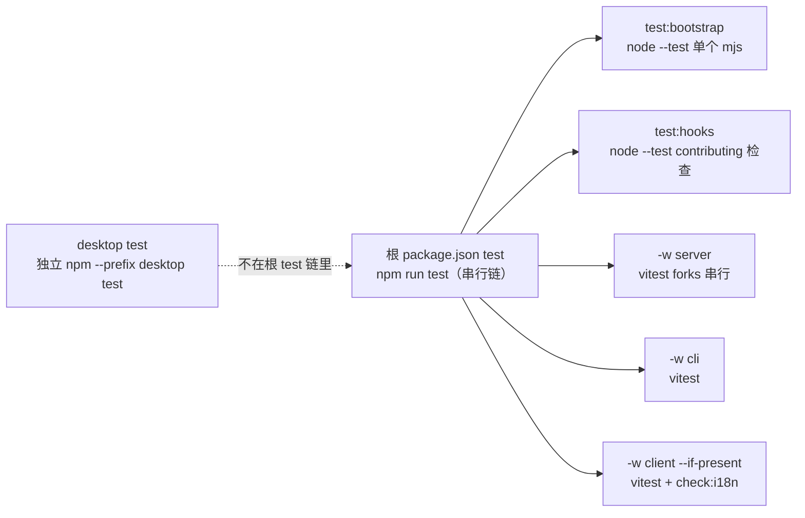
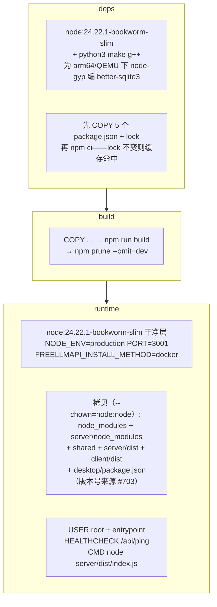

# 09 · 测试与部署

> 基准提交：`3212ac11`（adrian）｜核对日期：2026-11-23｜范围：根与四工作区 `package.json`、各 `vitest.config.ts`、`.github/workflows/`、`Dockerfile`、`docker-entrypoint.sh`、`docker-compose.yml`、`desktop/scripts/bundle-server.mjs`。测试文件数为 find/grep 实测（2026-11-23），**未实跑 vitest**；未构建镜像、未启动容器。

本篇覆盖两块「源码之外但由源码决定」的地图：四工作区 + desktop 各自的测试**怎么跑、为什么那样跑**；以及一份 Dockerfile / entrypoint / compose 如何把「单文件 SQLite 网关」部署到从 Raspberry Pi 到 Railway 的各种环境。这些文件里的注释密度不亚于 server 源码本身——大量注释直接记录了曾经的部署事故。

---

## 0 人话定位：两张地图

| 地图 | 回答什么 | 去哪节 |
|---|---|---|
| 测试拓扑 | 五个包各用什么 runner、为什么 server 必须串行、CI 在哪些 Node 版本上跑 | §1–§2 |
| 部署流水线 | 镜像怎么三段式构建、入口脚本怎么降权、compose 怎么默认关在门后、desktop 怎么打包 | §3–§6 |

一句话抓手：**测试拓扑是给「模块单例满天飞」的架构兜底；部署注释是给「踩过的坑」立碑。** 读这两块时，注释比配置值本身更值得看。

---

## 1 测试版图



### 1.1 五包计数与形态（实测 2026-11-09）

| 工作区 | 命令 | runner / 环境 | 规模与形态 |
|---|---|---|---|
| server | `vitest run --pool=forks --fileParallelism=false` | vitest，node 环境 | `src/__tests__/` 下 **431 个 .test.ts**（文件数非用例数），按 `db / fixtures / helpers / integration / lib / providers / routes / scripts / services` 九个子目录镜像源码结构 |
| client | `vitest run && npm run check:i18n` | vitest，**默认 node 环境**；33 个文件用 `@vitest-environment jsdom` docblock 逐文件覆盖 | **67 个测试文件**与组件同目录，命名 `组件名.切面.test.tsx`；`check:i18n`（实体 client/scripts/check-i18n.mjs）作为测试链一环 |
| cli | `vitest run` | vitest | **7 个 .test.ts** 与源码并排：models / index / keys / config-files / detect / tools / doctor |
| desktop | `vitest run` | vitest | `src/__tests__/` **18 个文件**，全是「打包/平台」切面（§1.4） |
| shared | 无测试 | — | 纯类型（01 篇），类型检查即它的「测试」 |
| 根 | `test:bootstrap` / `test:hooks` | **`node --test`**（不是 vitest） | 测部署脚本本身：`scripts/dev-bootstrap.test.mjs` 与 `.claude/hooks/contributing-check.test.mjs` |

> 计数测量命令：`find server/src -name '*.test.ts' | wc -l` 等；jsdom 数 `grep -rl '@vitest-environment jsdom' client/src | wc -l`。旧版文档的 347/6/13 先后漂移到 383/7/15，本轮（2026-11-23）再漂移到 431/7/18（client 67，jsdom 33）。

### 1.2 为什么 server 是 forks + 禁并行

`--pool=forks`：每个测试文件跑在**独立子进程**。根因是架构本身——server 重度使用**模块级单例**（db 单例、ratelimit 的 windows Map、proxy 内存配置、log redaction wrapper、cachedKey），worker 线程共享不了进程隔离的状态，fork 隔离则每文件拿到干净单例。`--fileParallelism=false` 再退一步：文件之间串行，杜绝并发写同一临时 DB / 同一 env 的干扰。**这是用测试拓扑给「模块单例满天飞」的架构兜底**——代价是 431 个文件的墙钟时间，换来每个文件里 `process.env.X = …` 随便改的自由。

`server/vitest.config.ts` 本体极薄：`include` 只认 `src/__tests__/**`；`environment: 'node'`；coverage 默认关（`COVERAGE=1` 开，v8 provider），且排除 `src/__tests__/**`、`src/db/migrate/**`、`src/scripts/**`、`src/index.ts` 等通配（均 server 工作区相对）——迁移器和启动入口被显式承认为「不适合单测的层」。`test:migrations` 单独跑一个文件 server/src/__tests__/db/migrate/roundtrip.test.ts（往返测试），CI 把它放在全量测试之前先跑（§2）。

### 1.3 client 的 jsdom：两条容易手滑 undo 的注释

`client/vitest.config.ts` 头注释（1-24 行）记录了两条刻意安排：

| 安排 | 原因 |
|---|---|
| jsdom 声明在**根** package.json，不在 client | vitest 自身提升到根 node_modules，它相对**自己的位置**解析环境包，从不看 client/node_modules；client 级 jsdom 一旦被 npm 嵌套，运行即死「Cannot find package 'jsdom'」 |
| jsdom pin 到 `^27` | jsdom 28+ 依赖 undici，undici 8 声明 `engines: >=22.19.0` 且无守卫地调 `worker_threads.markAsUncloneable`（Node 20 没有）；仓库支持 Node ≥20.18、CI 在 Node 20 跑，该组合会在 import 时死「webidl.util.markAsUncloneable is not a function」。jsdom 27 完全不依赖 undici |

另有两条配置细节：`setupFiles: ['./vitest.setup-storage.ts']`（vitest 运行期相对 client 解析，实体 client/vitest.setup-storage.ts）——jsdom 27 把 Storage 委托给 Node 实验性 webstorage，无 `--experimental-webstorage` 时 undefined，setup 文件只在原生缺失处装内存 Storage；`esbuild: { jsx: 'automatic' }`——esbuild 只读最近的 tsconfig，而那是 solution 文件（`files: []` + project references），`jsx: react-jsx` 永远到不了它，只能在这里明说。配置还复用 `@` → src 别名，让测试能像 app 一样 mount 组件。

### 1.4 测试即部署契约

desktop 的 15 个测试文件几乎全是「打包/平台」切面，而非业务行为：

```
after-sign-notarize        linux-chrome-sandbox-packaging   logger
merge-mac-update-metadata  notarization-network             refresh-mac-update-metadata
server-host-boot           system-certificates              tray-platform
tray-visibility            update-support                   updater-artifact-names
updater-check-timeout      version                          window-chrome
```

其中 `server-host-boot.test.ts` 定位最特殊：它不比行为，**比对文本与顺序**——把 `startServer` 的启动调用清单与 `server/src/index.ts` 源码交叉核对（08 篇 §7），使「server 加了启动步骤而 desktop 忘抄」直接红。同类思路还有 cli 的快照测试（agent 配置生成器的输出形状）和 client 的 `check:i18n` 声明式双端校验。

---

## 2 CI 工作流（旧版待补项闭环）

`.github/workflows/` 现有四个工作流：`ci.yml`、`docker.yml`、`cli-release.yml`、`desktop-release.yml`。

### 2.1 ci.yml：三版本矩阵

触发：push / PR 到 `main`。`test` job 跑在 `ubuntu-24.04`，`fail-fast: false`，矩阵 **Node 20 / 22 / 24**。矩阵注释写明三者分工：

| 版本 | 角色 |
|---|---|
| 20 | CI 基线，历史上抓出过「更新的本地 Node 掩盖的崩溃」 |
| 22 | 多数贡献者跑的 LTS |
| 24 | Docker 镜像自 Node 20 线 EOL 后交付的版本 |

步骤顺序（actions 均 pin 到 commit SHA）：

| 步 | 命令 | 说明 |
|---|---|---|
| 1 | `npm ci` | setup-node 带 npm 缓存 |
| 2 | `npm run test:migrations` | 迁移往返测试先于全量 |
| 3 | `npm test` | `COVERAGE` 仅在 Node 22 leg 设 '1'——在该 leg 内收集覆盖率而非再跑一遍；**只报告、无阈值、覆盖率永不使构建失败**；Node 20 leg 保持未插桩计时 |
| 4 | `npm run lint` | **只 server + cli**；注释明说 client 有自己的 ESLint 违规积压，另案处理 |
| 5 | `npm run build` | 三工作区构建 |

这闭环了旧版两条待补：CI 矩阵 = 20/22/24；`COVERAGE=1` 确实启用但**无阈值门禁**。

### 2.2 docker.yml 与发布矩阵

`docker.yml`：`build` job 按 `matrix.runner` 多架构构建，`merge` job 跑在 ubuntu-24.04 合并 manifest；权限 `contents: read` / `packages: write`（推 ghcr.io）。`cli-release.yml` / `desktop-release.yml` 分别转发根脚本的 `desktop:dist*` 矩阵（§6）与 cli 发布。release 工作流的签名/公证细节属 15 篇（桌面端）范围，本篇只钉它们存在与触发面。

---

## 3 Docker 镜像：三段式与每一段的理由



（`Dockerfile` 全文件；`ARG NODE_IMAGE` 默认 `node:24.22.1-bookworm-slim`——**旧版文档写 node:20 已漂移**。）

| 决策 | 注释里的原因 |
|---|---|
| deps 段装编译工具链 | slim 镜像上 arm64/QEMU 无 better-sqlite3 预编译二进制，必须 node-gyp 现编——工具链**只活在 build 段**，runtime 拿编好的 node_modules |
| 单独 COPY `server/node_modules` | npm 把某些生产依赖嵌在工作区而非提升（undici 在 `server/node_modules/undici`）；漏拷它的镜像里 **HTTP(S) 代理 dispatcher 加载失败、所有请求静默直连**（#550） |
| 拷贝 `desktop/package.json` | 仪表盘显示的 release 版本活在这里（server/package.json 跟 workspace 版本）——400 字节清单换「容器能报出自己的版本」（#703） |
| `ARG FREELLMAPI_COMMIT_SHA` 放最后一个 runtime 层 | SHA 每 commit 都变；放在 COPY 之上会让每次构建把所有缓存层全部失效 |
| **故意不声明 VOLUME** | 声明了会在每个未覆盖的容器上创建**匿名卷**：Railway/Render/Coolify/Dokploy/CapRover 要么拒收镜像、要么每次重部署静默发一个空卷（数据没了），且声明还会遮蔽同路径 bind mount。持久化是部署方的事：compose 映射命名卷 `freellmapi-data`，裸 `docker run` 自己 `-v` |
| HEALTHCHECK 打 `/api/ping` | `node -e fetch(...)`，interval 30s / timeout 5s / start-period 15s / retries 3 |
| 每个 COPY 带 `--chown=node:node` | 配合 entrypoint 降权；数据目录另在 55 行 `mkdir + chown -R` |

---

## 4 entrypoint：为 PaaS 的 root 属主卷而生的降权逻辑

`docker-entrypoint.sh` 的核心是 `ensure_owned()` 函数（12-30 行）加一个 root 分支（32-49 行）：以 root 进来时，对 `/app/server/data`（以及 `FREEAPI_DB_PATH` / `FREEAPI_DB_BACKUP_PATH` 的所在目录——单挂载 PaaS 会把它们指到外面）做 best-effort chown 到 node，然后 `exec setpriv --reuid=node --regid=node --init-groups -- "$@"`。

`ensure_owned` 逐行：

| 行 | 行为 |
|---|---|
| 14 | 目录名为空直接返回 |
| 16-18 | `mkdir -p` 失败只 stderr 提示「continuing」，不 abort |
| 19 | 目录不存在返回 |
| 23-25 | `stat -c %u` 已等于 `NODE_UID` 就跳过递归——大树上 `chown -R` 就是这个入口的全部启动成本 |
| 27-29 | `chown -R` 失败只提示「continuing」 |

四个细节全是防御：

- **chown 失败继续启动**：`--cap-drop=CHOWN` 或 CIFS/NFS 固定属主的挂载上 chown 合法地失败——「不能让入口脚本为一个 app 自己会报的写错误抢答」。
- **属主已是 node 就跳过递归**：省启动成本。
- **`setpriv` 而非 `su`/`gosu`**：util-linux 自带必在（注释点名 node:24-bookworm-slim），且 `exec` 保持 **node 是 PID 1**——信号（SIGTERM → graceful shutdown，08 篇 §4.3）能直达 server。
- 非 root 进来时原样 `exec "$@"`（51 行），脚本对 `docker exec` 场景零侵入。

镜像因此以 `USER root` 交付（Dockerfile 67-69 行注释言明）：权限收窄发生在 entrypoint，而不是镜像层——顺序反了 PaaS 就起不来。

---

## 5 compose：默认关在门后 + opt-in 自更新

`docker-compose.yml` 两个服务：

### 5.1 freellmapi

- `image: ghcr.io/tashfeenahmed/freellmapi:latest`，亦可用 `build:` 本地构建；`env_file: .env`。
- `ports: "${HOST_BIND:-127.0.0.1}:${PORT:-3001}:3001"`——**默认绑 localhost**，注释直白：「FreeLLMAPI 是单用户的，不许暴露到公网」；LAN 使用要显式 `HOST_BIND=0.0.0.0`。
- `extra_hosts: host.docker.internal:host-gateway`——Linux 纯 Docker 没有这条解析，文档推荐的 `PROXY_URL=http://host.docker.internal:7890`（让网关走宿主机代理）会直接 NXDOMAIN。
- 两个 watchtower label（enable + scope=freellmapi）：**双 label 才更新**，既躲开别的栈自己的 Watchtower，也让这个 Watchtower 碰不到别人的容器。
- `FREELLMAPI_SELF_UPDATE_URL=http://watchtower:8080` + `FREELLMAPI_SELF_UPDATE_TOKEN=${WATCHTOWER_TOKEN:-}`——仪表盘「Update now」的调用目标，仅当 autoupdate profile 运行且 token 设置时活跃。
- 命名卷 `freellmapi-data:/app/server/data`；healthcheck 与 Dockerfile 同款；`restart: unless-stopped`。

### 5.2 watchtower（profiles: autoupdate，默认不启动）

`image: nickfedor/watchtower:1.22.3`（maintained fork）。注释（48-55 行）：只开 token 保护的 HTTP update 端点（`WATCHTOWER_HTTP_API_ENDPOINTS: update`）、**无定时、无发布端口**、`WATCHTOWER_SCOPE: freellmapi` + `LABEL_ENABLE` 双约束、`CLEANUP: true`。需要 docker socket（`/var/run/docker.sock` 挂载），注释明说这是 **root-equivalent**，不接受就别开 profile。启用方式：`docker compose --profile autoupdate up -d` 且 .env 设 `WATCHTOWER_TOKEN`。点「Update now」→ 拉新镜像 → 以同卷同配置重建 freellmapi 容器。

---

## 6 desktop 打包链

`desktop/package.json`（version **0.16.16**，即 #703 的版本来源）scripts 定义的流水线：

| 脚本 | 干什么 |
|---|---|
| `bundle:server` | 跑 desktop/scripts/bundle-server.mjs，产出构建产物 build/server.mjs |
| `build:main` | esbuild desktop/src/main.ts → 构建产物 build/main.mjs（esm，external: electron / electron-updater / ./server.mjs） |
| `build:preload` | esbuild preload.ts + preload-popover.ts → **CJS**（.cjs）——preload 必须 cjs 格式 |
| `build:all` | bundle:server + build:main + build:preload |
| `stage:client` | 跑 desktop/scripts/stage-client.mjs，把 client/dist 复制进打包资源 |
| `dist` / `dist:mac:x64` / `dist:win` / `dist:linux` | build:all + stage:client + electron-builder，全部 `--publish never`；默认 dist 是 mac arm64 |
| `rebuild:native` | `electron-rebuild -f -w better-sqlite3`——Electron 的 ABI ≠ Node 的 ABI，这个原生模块每次 Electron 升级都要重编 |
| `dev` | `build:all && electron .`——desktop 没有热更新开发环，改 server 代码也要重新 bundle |
| `test` | `vitest run` |

### 6.1 bundle-server.mjs 的四个关键选择

`desktop/scripts/bundle-server.mjs`（入口 desktop/src/server-host.ts，透过它打包整个 server）：

| 选择 | 值 | 理由 |
|---|---|---|
| format / target | esm / node20 | 与 server 一致 |
| external | 仅 `better-sqlite3` | 原生模块，由 desktop/node_modules 里的 electron-rebuild 版本提供；esbuild 解析 server 的 `.js` 后缀 TS import 并展平 @freellmapi/shared workspace symlink |
| define | `FREELLMAPI_COMMIT_SHA` / `FREELLMAPI_INSTALL_METHOD` | 仅当 `GITHUB_SHA` 是合法 40 位 hex（`hasBuildIdentity`）才内联真值，否则内联空串——**构建身份只在 CI 里有**；打包后更新检查经普通 env 对象读值，故 startServer 还要回灌（08 篇 §5.5） |
| banner | `createRequire(import.meta.url)` | 某些内联 CJS 依赖（express 内部）运行期引用 `require`，给 ESM bundle 一个能用的 require |

CI/发布矩阵由根 scripts 转发：`desktop:dist`（mac arm64）/ `:mac:x64` / `:win` / `:linux`，每个都先 `npm run build -w client`。

---

## 7 根脚本总览

| 脚本 | 干什么 |
|---|---|
| `dev` / `dev:lan` | `concurrently --kill-others-on-fail` 起 server（`tsx watch`）+ client（`vite`）——**没有 docker 的开发路径**；lan 版给 client 加 `--host` |
| `build` | server → cli → client 三个 tsc/vite 构建（desktop 不在内，它是独立发布物） |
| `test` | bootstrap + hooks + server + cli + client(--if-present)，**串行** |
| `test:migrations` | 转发 server 的迁移往返测试 |
| `db:migration:up/down/fresh/status/create` | 迁移 CLI 的五路转发（`server/src/db/migrate/cli.ts`；旧版只列四路，create 已补） |
| `lint` | 只 lint server 与 cli——client/desktop 的静态检查挂在 tsc/vite 构建里 |
| `desktop:dev` / `desktop:dist*` | 先 build client 再转发 desktop 脚本 |

版本注脚：根 `engines.node` = `>=20.18.0 <25.0.0`；server 0.2.1 / cli 0.8.2 / client 0.0.0 / desktop 0.16.16。better-sqlite3 在 server 是 **optionalDependencies**（^12.10.0），对应 07 篇的 node:sqlite 兜底。

---

## 8 风险与待补

| 级别 | 事项 |
|---|---|
| P1 | server 测试串行是正确性换墙钟：CI 时长随 383 个文件线性涨，任何「提速并行化」尝试都会先撞上模块单例共享问题 |
| P2 | 镜像以 root 交付依赖 entrypoint 降权——绕过 entrypoint 直接 `docker run --entrypoint node` 就会以 root 跑（compose 无此覆盖，文档路径安全） |
| P2 | watchtower profile 需要 docker socket（root-equivalent）；profile 一旦手滑常开，风险面从「点 Update now 时」变成「always」 |
| P3 | Docker runtime 是 Node 24，CI 矩阵含 Node 20/22/24，而本机开发可能跑更高版本（engines 上限 <25）——三处 Node 版本不完全一致，jsdom pin ^27 正是为兜住 Node 20 |
| 待补 | release 工作流的签名/公证全链路 → 15 篇；`scripts/dev-bootstrap.sh/.ps1` 裸机引导内容；docker.yml 多架构 manifest 合并细节 |

---

## 9 旧版勘误表

| 旧版说法 | 现行事实 | 证据 |
|---|---|---|
| server 347 个测试文件 | **383** | find 实测 2026-11-09 |
| cli 6 个 / desktop 13 个 | **7 / 15** | find 实测 |
| Docker 基础镜像 node:20 | **node:24.22.1-bookworm-slim**（ARG NODE_IMAGE 默认） | Dockerfile:3 |
| boot 测试「163-182 行全序列」 | 现行 171-188（08 篇已纠） | server-host-boot.test.ts |
| 待补「CI 矩阵未读」 | 已补：Node 20/22/24，fail-fast false | ci.yml:15-20 |
| 待补「COVERAGE 是否启用/阈值」 | 已补：仅 Node 22 leg 启用，无阈值、永不失败 | ci.yml:35-42 |
| db:migration「四路」 | **五路**（含 create） | 根 package.json:25-29 |
| 未提 client jsdom 声明在根 / pin ^27 的原因 | 已补（§1.3） | client/vitest.config.ts:10-24 |
| 未提 bundle define 仅在合法 GITHUB_SHA 时内联 | 已补（§6.1） | bundle-server.mjs:10-23 |
| 未提 entrypoint ensure_owned 函数级细节 | 已补（§4） | docker-entrypoint.sh:12-30 |
| 全篇绝对行号 | 配置/shell/yml 保留绝对行号于索引（无函数符号）；TS 锚点转符号+偏移 | 本篇 §10 |

---

## 10 源码索引

TS 符号锚点（符号 + 偏移）：

- `desktop/src/server-host.ts` · `startServer+0` — boot 测试交叉比对的对象（08 篇）
- `desktop/src/__tests__/server-host-boot.test.ts` · `boot+0` — 测试 harness
- `desktop/src/__tests__/server-host-boot.test.ts` · `calls+0` — 调用记录数组

配置 / 脚本 / 工作流（绝对行号备查，无函数符号）：

- `package.json`（根）— 10-30 scripts；13 test 串行链；16 build；25-29 五路迁移；35-38 engines
- `server/package.json` — 10 test forks 串行；13 test:migrations 单文件；17-21 迁移 CLI；57-59 better-sqlite3 optional
- `server/vitest.config.ts` — 3-16 全配置；12 coverage 排除清单
- `client/package.json` — test = vitest run && check:i18n
- `client/vitest.config.ts` — 1-24 jsdom 两条事故注释；38 jsx automatic；44 setupFiles
- `cli/package.json` — test = vitest run
- `desktop/package.json` — 3 version 0.16.16；14-27 打包链；20 rebuild:native
- `desktop/scripts/bundle-server.mjs` — 10-11 hasBuildIdentity；13-30 build 选项（external/define/banner）
- `.github/workflows/ci.yml` — 15-20 矩阵；32-33 迁移先跑；35-42 COVERAGE 仅 22；44-47 lint 仅 server+cli
- `.github/workflows/docker.yml` — build 矩阵 runner + merge job；permissions packages:write
- `Dockerfile` — 3 NODE_IMAGE node:24.22.1；5-22 deps；24-30 build；32-53 runtime 拷贝（41-44 #550、48-51 #703）；62-65 SHA 层位；67-71 USER root + entrypoint；75-84 不声明 VOLUME + HEALTHCHECK；86 CMD
- `docker-entrypoint.sh` — 12-30 ensure_owned；32-49 root 分支 + setpriv；51 非 root exec
- `docker-compose.yml` — 2-46 freellmapi（22-25 HOST_BIND、28-33 extra_hosts、16-21 双 label）；56-69 watchtower；71-72 named volume
- `server/src/__tests__/` — 383 个 .test.ts，9 子目录；`desktop/src/__tests__/` — 15 个；`cli/src/*.test.ts` — 7 个；`client/src/**/*.test.ts*` — 56 个（22 jsdom）
- `scripts/dev-bootstrap.test.mjs` / `.claude/hooks/contributing-check.test.mjs` — node --test 的两个非 vitest 目标

---

## 11 导航

上一篇 → [08-启动生命周期](./08-启动生命周期.md) ｜ 下一篇 → [10-函数级走读-路由限流与回退](./10-函数级走读-路由限流与回退.md) ｜ [返回索引](./README.md)

---

## 12 术语表

| 术语 | 人话解释 |
|---|---|
| workspace | npm monorepo 里的一个子包；本仓库 shared/server/client/cli 四个，desktop 独立 |
| vitest | 测试 runner；server/client/cli/desktop 都用它 |
| node --test | Node 内置测试 runner；根脚本用它测部署脚本本身，不经 vitest |
| pool=forks | 每个测试文件跑在独立子进程，隔离模块单例 |
| fileParallelism=false | 测试文件之间串行，避免并发写同一临时 DB/env |
| 模块级单例 | 文件加载即创建、全进程共享一份的对象（db、windows Map 等） |
| jsdom | 在 Node 里模拟浏览器 DOM 的库；只有真要 mount 组件的测试才需要 |
| docblock 覆盖 | 文件顶部 `@vitest-environment jsdom` 注释，逐文件改测试环境 |
| coverage / v8 | 用 V8 引擎统计代码覆盖率；本仓库只报告不设阈值 |
| 快照测试 | 把输出形状存成快照，下次比对是否变化；cli 配置生成器用它 |
| CI 矩阵 | 同一套测试在多个 Node 版本/OS 上各跑一遍 |
| fail-fast: false | 矩阵里一个 leg 失败不取消其它 leg |
| pin 到 SHA | actions 用 commit SHA 而非标签引用，防供应链漂移 |
| 多阶段构建 | Dockerfile 分 deps/build/runtime 段，工具链只留在 build 段 |
| node-gyp | 编译 Node 原生模块（better-sqlite3）的工具，需 Python + C++ |
| QEMU | 在 x86 上模拟 arm64 的层；slim 镜像无预编译二进制时要现编 |
| hoist / nest | npm 把依赖提升到根 node_modules（hoist）或嵌在工作区（nest）；undici 被 nest |
| 匿名卷 | 声明 VOLUME 后未显式覆盖时 Docker 自动建的卷，重部署会换新空卷 |
| bind mount | 把宿主机目录直接挂进容器；VOLUME 声明会遮蔽同路径 bind mount |
| entrypoint | 容器启动时先跑的脚本，本镜像用它降权 |
| setpriv | util-linux 的降权工具，exec 它保持 node 是 PID 1 |
| PID 1 | 容器第一个进程；信号直达它，graceful shutdown 才生效 |
| chown | 改文件属主；PaaS 卷 root 属主时需先 chown 给 node |
| Watchtower | 自动拉新镜像重建容器的工具；本仓库 opt-in profile + 双 label 约束 |
| profile | compose 的可选服务组，默认不启动，--profile 才启用 |
| root-equivalent | 持有 docker socket 等于持有宿主机 root |
| electron-builder | 把 Electron 应用打成 mac/win/linux 安装包的工具 |
| preload | Electron 渲染进程与主进程之间的桥接脚本，必须 CJS 格式 |
| ABI | 二进制接口；Electron 的 ABI 不同于 Node，原生模块要 electron-rebuild |
| esbuild define | 构建时把 process.env.X 内联成字面量 |
| banner | esbuild 在 bundle 顶部注入的代码；这里注入 createRequire |
| manifest 合并 | 把多架构镜像合成一个多平台 manifest 推 registry |