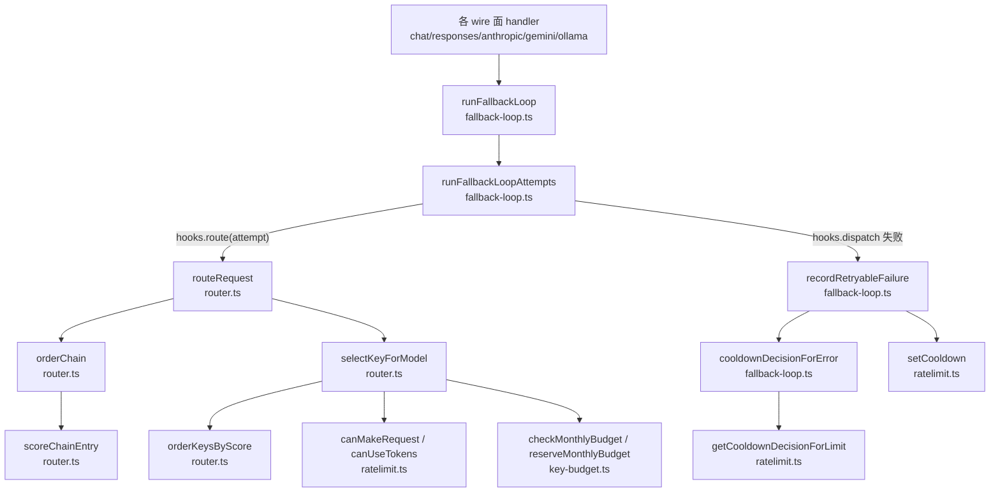

# 10 · 函数级走读：路由、限流与回退

> 基准提交 `3212ac11`（adrian 分支），核对日期 2026-11-23。本篇逐函数拆解主链路上 9 个核心函数，每个函数给出「解决什么 → 谁调用 → 输入输出 → 分步 → 正常/边界/错误 → 状态副作用 → 锚点」。函数选取标准：删除它整条链路就断。
>
> 定位记法：`完整路径` · `符号+N~+M`，`+0` 为声明起点，偏移相对符号本身；文末索引附绝对行号备查。仅符号/偏移通过不证明自然语言正确——本篇每条结论均已回源码逐行核对。

## 0 人话定位：一次请求怎样找到「此刻真能服务」的模型

把网关想象成一个**派单调度室**。客户端发来一个请求（可能带图、带工具、指定了模型），调度室要在几十上百个「平台 + 模型 + key」组合里，挑出一个**现在真有额度、真能看见这类输入**的组合，把请求派出去；派出去之前先把这把 key 的并发额度和月度预算**扣下来**（预留），用完再还。

这中间有三道工序，本篇就是按工序拆函数：

| 工序 | 通俗说法 | 核心函数 | 篇内小节 |
|---|---|---|---|
| 选模型 | 「这么多模型，先试谁？」 | `routeRequest` → `orderChain` → `scoreChainEntry` | §1 §2 §3 |
| 选 key + 扣额度 | 「这个模型用哪把钥匙？钥匙还有额度吗？」 | `selectKeyForModel` → `canMakeRequest`/`canUseTokens` | §4 §5 |
| 失败反馈 | 「派出去失败了，是谁的病？要不要拉黑、拉黑多久？」 | `runFallbackLoop` → `recordRetryableFailure` → `getCooldownDecisionForLimit` | §7 §8 §6 |

**一句话边界**：本篇讲的是「同步选路 + 单次请求内的回退循环」，**不是**后台健康探测（21 篇）、**不是**协议转换（16 篇）、**不是**打分公式的数学推导（04 篇 §打分公式）。本篇只把「函数怎么调、状态怎么变」讲透。

前向调用关系（每个节点都是真实函数）：



**问题索引**（带着问题读）：

- 为什么同一条链两次请求顺序不一样？→ §2 Thompson 采样。
- 为什么一个每请求必 429 的模型曾经永远钉在链首？→ §2 稠密重编号。
- 客户端点名的模型不在活动 profile 里怎么办？→ §1 pin 注入（含 #634 退役豁免）。
- 「37 条被检查」为什么是虚报？→ §1 无 key 平台预过滤聚合成一行。
- 一个 16k token 的 agent 轮为什么曾把整池小模型沉底？→ §8 无罪学习。
- 慢端点的宽限为什么会泄漏给后面的快端点？→ §7 每候选独立从 base 重算。

---

## 1 `routeRequest` — 路由总入口

`server/src/services/router.ts` · `routeRequest+0`（绝对行 2186–2420）。

**解决什么**：从活动链里选出一个「此刻真有 key 能服务」的 `RouteResult`；选不出就抛 `RouteError`(429)，并携带每个候选的处置记录。**返回即预留**——lease + monthly budget 已在内部扣下，调用方最终必须调 `route.release()` 归还。

**当前签名**（注意与旧版不同：新增末位 `strategyOverride`，且 `requireStructured`/`skipModels`/`prefetchedChain` 次序重排）：

```ts
export function routeRequest(
  estimatedTokens = 1000,          // 输入估算 + 封顶输出预留
  skipKeys?: Set<string>,          // "platform:modelId:keyId"，本次请求已失败的
  preferredModelDbId?: number,     // sticky session / 显式 pin
  requireVision = false, requireTools = false,
  skipModels?: Set<number>, prefetchedChain?: ChainRow[],
  requireStructured = false, skipPlatforms?: Set<string>,
  exactOutputReserve = 0,          // 客户端真实 max_tokens（区别于封顶预留）
  task?: 'code' | 'chat',
  strategyOverride?: PresetStrategy, // #1628：别名轴对本请求生效
): RouteResult
```

**输入输出**：入参是请求画像（估算 token、能力位、已判死集合、pin、策略覆盖）；出参是 `RouteResult`（含 provider/apiKey/proxyUrl/release 闭包）或抛 `RouteError`。

**内部分步**（偏移相对 `routeRequest+0`）：

| 步 | 锚点 | 内容 | 正常/边界 |
|---|---|---|---|
| 读策略 | `routeRequest+8~+9` | `strategy = strategyOverride ?? effectiveRoutingStrategy()`（#1628：`auto:smart`/`auto:fast` 别名的轴对本请求生效，否则用全局策略静默丢弃了别名诉求）；非 priority 才 `refreshStatsCache(db)`（60s TTL 统计聚合） | priority 模式不刷统计 |
| 取链排序 | `routeRequest+11~+13` | `(prefetchedChain ?? getActiveChain(db)).filter(enabled)` → `orderChain(..., sampled=true, task)` | sampled=true ⇒ 每次 Thompson 采样，同链两次可不同序 |
| 探索槽 | `routeRequest+31~+61` | 四重门（bandit + `getExploreEnabled` + `!isDegraded` + `Math.random()<EXPLORE_CHANCE`）后，从「样本数 < `EXPLORE_MIN_SAMPLES`」模型里均匀抽一个挪到链首 | 降级模式（#904）整个跳过 |
| 探索过滤镜像 | `routeRequest+36~+53` | 过滤镜像主循环全部闸门：skipModels/skipPlatforms/vision/tools/toolBenched/structured/context/tpm；被 `MODEL_ROUTING_OVERRIDES` 置 0 的模型永不当探针（+35：它赢不了任何 bandit 对决，否则成永久探测目标） | 否则探索位浪费在必被跳过的模型上 |
| pin/sticky | `routeRequest+65~+97` | preferred 在链里→挪链首；不在→从 models 表 SQL 注入链首（+76）。**新增 #634 退役豁免**（+94~+95）：上游已 EOL（`getCatalogModelTombstone(...).source==='upstream_eol'`）的模型不被 pin 重新注入；用户墓碑仍可 pin（用户点名是更新的意图） | 客户端点名必须履约，哪怕不在活动 profile |
| 无 key 平台预过滤 | `routeRequest+113~+126` | `usableKeyCountsByPlatform` 为 0 的平台整排摘掉（走主循环必产不出路由，纯开销且污染耗尽摘要）；聚合成**一行** `keylessLine`（+122），不进路由计数 | 修复「37 条被检查」虚报；pin 豁免 |
| 软降序而非剔除 | `routeRequest+145~+155` | context margin 不够（`marginDeferred`）与屡拒 tool（`toolDeferred`）的挪到**队尾**而非排除（#956/#1230：`/v1/models` 广告原始窗口，客户端贴上限打包合法，硬剔除会把「一个被处理过的上游 400」变成「零尝试的全池耗尽」） | pin 保持原位 |
| 主 walk | `routeRequest+157~+224` | 逐 entry 过 8 道闸门，每道被拒 `diag.push(带原因的行)`（见下表） | `selectKeyForModel` 返回非 null 即函数结束 |
| 耗尽 | `routeRequest+229~+233` | `summarizeExhaustion(diag, getSoonestCooldownExpiry(), now, keylessSkipped)` 打包归类 + 最近恢复时刻，抛 `RouteError(429)`，`diagnostics` 带全量 per-model 处置 | 同步「全耗尽」路径上唯一的失败原因记录 |

**主 walk 的 8 道闸门**（顺序即语义）：

| 闸门 | 锚点 | 拒因 diag 子串 |
|---|---|---|
| skipModels | `routeRequest+163` | `ruled out earlier this request` |
| skipPlatforms（#788） | `routeRequest+170` | `provider ruled out earlier this request` |
| vision（sticky 同样受限） | `routeRequest+174` | `no vision support` |
| tools（sticky 同样受限） | `routeRequest+181` | `no tool-calling support` |
| `platformDropsResponseFormat` | `routeRequest+189` | `platform drops response_format` |
| `fitsContextWindowStrict`（只比原始窗口） | `routeRequest+202` | `context … < estimated …`（`summarizeExhaustion` 按此归档 prompt overflow） |
| `tpm_limit < estimated` | `routeRequest+217` | `tpm_limit … < estimated …`（Groq 131k 上下文但 8k TPM 实例） |
| `selectKeyForModel` | `routeRequest+223~+224` | 返回非 null 即 return |

**调用方**：三个 wire 面的 `hooks.route` 闭包（§7）。

**坑**：`estimatedTokens` 与 `exactOutputReserve` 要成对传。预留封顶 `server/src/services/router.ts` · `routingReserveTokens+0`（`OUTPUT_RESERVE_CAP=2000`，#470「超预留会饿死路由」；客户端省略 max_tokens 时默认 1000）防大 max_tokens 排除所有模型；exact 值只用于 margin 精确判定。

---

## 2 `orderChain` — 链排序双模式

`server/src/services/router.ts` · `orderChain+0`（绝对行 1204–1272）。

**解决什么**：把活动链排成「先试谁」的顺序。两种模式：priority（手动序 + 罚分）与 bandit（打分序）。

**签名**：`orderChain(chain: ChainRow[], strategy: RoutingStrategy, sampled=true, task?: 'code'|'chat'): ChainRow[]`。

| 步 | 锚点 | 内容 |
|---|---|---|
| tier 外键 | `orderChain+4` | `tier = e.match_tier ?? 0`——唯一打分**不可覆盖**的排序输入（slug fallback 解析才非零），永远做外层排序键 |
| priority 分支 | `orderChain+6~+40` | `weightsFor(strategy)` 为 null（手动模式）走遗留路径：按 priority 排 → **稠密重编号 1..N** → 加 `getPenalty(model_db_id)` → 按 `(tier, eff, priority, 原序)` 排 |
| 稠密重编号理由 | `orderChain+10~+33`（长注释） | 原始 priority 间隔任意（10/20/30、1..N 挖洞），±10 罚分在间隔面前静默无效——一个每请求必 429 的模型可永远钉链首。重编号后「罚 1 位」才真是罚 1 位（`PENALTY_PER_429=3`、`PENALTY_PER_FAIL=1`、`MAX_PENALTY=10`） |
| task 偏置 | `orderChain+48~+50` | #1127：`taskAdjustedWeights` 把一轴的部分权重移到另一轴（code: speed→intelligence；chat 反向）；fastest/reliable/custom 豁免 |
| 可靠性地板 | `orderChain+54` | `applyReliabilityFloor`——低于运营地板的先摘（样本不足 `EXPLORE_MIN_SAMPLES` 保留；摘空则整个过滤作废，安全阀） |
| bandit 分支 | `orderChain+56~+67` | 全链 `intelligenceComposite` 先算 min/max（归一化域），`scoreChainEntry` 逐个打分，按 `(tier, -score, priority)` 排 |

**调用方**：`routeRequest+13`、`getOrderedFusionChain`（sampled=false，要稳定展示）。

**边界**：`applyReliabilityFloor`（`server/src/services/router.ts` · `applyReliabilityFloor+0`，绝对行 1167–1189）的安全阀在 `applyReliabilityFloor+21`：`kept.length>0 ? kept : chain`——宁可留一个可能不稳的模型，也不留空池。

---

## 3 `scoreChainEntry` — 单模型打分

`server/src/services/router.ts` · `scoreChainEntry+0`（绝对行 1091–1158）。

**解决什么**：给链上一个模型算一个综合分。每轴公式在 scoring.ts（04 篇 §打分公式已展开），本篇只讲「函数怎么组装各轴」。

**签名**：`scoreChainEntry(entry, weights, intelMin, intelMax, sampled, keyCounts, headroomCfg): ScoredEntry`。

| 轴 | 锚点 | 内容 |
|---|---|---|
| 可靠性 | `scoreChainEntry+15~+20` | `sampled ? sampleBeta(alpha,beta) : expectedReliability(...)`——**同一 posterior 两种读法**：路由抽签用采样（探索），仪表盘展示用期望（稳定）；community prior 折进 posterior（+13） |
| 速度 | `scoreChainEntry+22` | `speedScore(tokPerSec, avgTtfbMs)`，无样本回退乐观先验保证未测模型可被探索 |
| 智能 | `scoreChainEntry+23~+25` | `intelligenceScore(composite, intelMin, intelMax)`——**链内 min-max 归一**，intelMin/Max 由 orderChain 统一算好传入 |
| 月度余量 | `scoreChainEntry+30` | `parseBudget(monthly) * max(1, keyCounts[platform])`——per-key 预算按平台可用 key 数放大（#456 与池化 monthlyUsedTokens 对齐） |
| 月度护栏 | `scoreChainEntry+36` | `headroomFactor(monthlyUsedTokens, budget, headroomCfg)`；headroomCfg 由调用方**读一次传进来**（+43~+49 注释：getSetting 是无缓存 SELECT，每 entry 读 = 每请求每模型两次 SQLite 往返） |
| 窗口余量 | `scoreChainEntry+43~+49` | `rateWindowHeadroomFactor(modelWindowUsedFraction(...))`——rpm/rpd/tpm/tpd 实时利用率驱动同一护栏（#899），数据来自 ratelimit 侧 memo 快照 |
| 合成 | `scoreChainEntry+56` | **`Math.min(monthly, window)` 而非乘**：两把尺表达同一种「快烧完了」的意见，相乘会把两头都低的模型压到 floor²，突破运营地板 |
| 罚分 + 覆盖 | `scoreChainEntry+57~+65` | `rateLimitFactor(getPenalty(...))` 乘子（+57）；`applyModelWeightOverride` 最后缩放（+62~+65，#738：置 0 = 退出 bandit 但 priority 仍可选） |

**状态副作用**：纯函数，只读 `statsCache`/`keyStatsCache` 快照，不写状态。

---

## 4 `selectKeyForModel` — 模型内选 key

`server/src/services/router.ts` · `selectKeyForModel+0`（绝对行 1584–1728）。

**解决什么**：对该模型的 key 池逐闸门走一遍，返回第一个可用 key 的完整 `RouteResult`（含预留）；全不可用返回 null 并往 diag 记一行「N key(s) — cooldown:2, rpm/rpd-limit:1」式门因统计。

**签名**：`selectKeyForModel(entry: ChainRow, estimatedTokens: number, skipKeys?: Set<string>, diag?: string[]): RouteResult | null`。

| 步 | 锚点 | 内容 |
|---|---|---|
| provider + key 池 | `selectKeyForModel+4~+12` | `hasProvider` 检查 + 查询 `enabled=1 AND status IN ('healthy','unknown')`——**unknown（从未测过）可用**，error/invalid 不可用 |
| 模型作用域过滤 | `selectKeyForModel+22` | #657：`model_scope_json` 不含该模型的 key 拿掉（不占轮转位、不烧必 403 的尝试） |
| key 排序 | `selectKeyForModel+45~+59` | `refreshStatsCache` 后 `orderKeysByScore`（#580）；无数据回退 round-robin（游标 `roundRobinIndex`，键含 endpoint_scope——#651 两 relay 同 modelId 不共享游标，+48）；#919 剩余配额加权再排一层（+56~+59） |
| custom 端点锁 | `selectKeyForModel+65~+67` | custom 模型属恰好一个 endpoint（#212），可用 key = 同 base_url 全部 key |
| 每 key 十道闸门 | `selectKeyForModel+73~+95` | 顺序即语义，每道拒一把记 tally（见下表） |
| 解密 | `selectKeyForModel+99~+104` | `cachedDecrypt`；抛错⇒就地 `UPDATE status='error'` 并继续下一 key——坏密文行不能每请求重试 |
| custom provider 解析 | `selectKeyForModel+107~+110` | custom 走 `resolveProvider('custom', key.base_url)`，解析不出记 `no-resolved-provider` |
| 预留与产出 | `selectKeyForModel+112~+135` | 过全闸才推进游标（+112）、`decryptProxyUrl`（+115，#590）、`reserveMonthlyBudget`（+116，可能仍失败——并发写）、`acquireLease`（+118）；`release()` 闭包 = releaseLease + budget.release（+134） |
| 失败收尾 | `selectKeyForModel+140~+143` | 无可用 key 也 `roundRobinIndex.set(rrKey, idx)`——否则下次又从同一已耗尽 key 开始数 |

**十道闸门**（旧版误写「九道」，实为十道；`checkMonthlyBudget` #1158 是第十道）：

| # | 闸门 | 锚点 | tally 键 |
|---|---|---|---|
| 1 | custom-key-mismatch | `selectKeyForModel+73` | `custom-key-mismatch` |
| 2 | already-failed-this-request | `selectKeyForModel+76` | `already-failed-this-request` |
| 3 | isOnCooldown | `selectKeyForModel+78` | `cooldown` |
| 4 | canUseProvider（日请求帽） | `selectKeyForModel+79` | `provider-daily-cap` |
| 5 | canUseProviderMinute（账号级分钟帽） | `selectKeyForModel+83` | `provider-minute-cap` |
| 6 | canUseKeyConcurrency | `selectKeyForModel+87` | `key-concurrency` |
| 7 | canMakeRequest（rpm/rpd） | `selectKeyForModel+88` | `rpm/rpd-limit` |
| 8 | canUseTokens（tpm/tpd） | `selectKeyForModel+89` | `tpm/tpd-limit` |
| 9 | canUseProviderTokens | `selectKeyForModel+90` | `provider-daily-token-cap` |
| 10 | checkMonthlyBudget（#1158） | `selectKeyForModel+95` | `monthly-budget-cap` |

> 第 5 道分钟帽**先于** per-model 闸（+83 注释）：NULL rpm 的模型否则会溜过 per-model 闸、花掉兄弟共享的账号预算。lease 在「确定要返回这个 key」之后才拿（+118）——被拒候选不消耗并发额度。

### 4.1 key 级打分公式（闭环旧版「待补」）

`server/src/services/router.ts` · `orderKeysByScore+0`（绝对行 1498–1515）：

- `orderKeysByScore+1`：`keys.length<2 || !keyStatsCache` 或无任何 key 有数据 ⇒ 返回 null（回退轮转）。
- `orderKeysByScore+6`：community prior 是 **per-model** 的，循环外查一次。
- `orderKeysByScore+7~+13`：每 key 算 `KEY_SCORE_WEIGHTS.reliability * sampleBeta(alpha,beta) + KEY_SCORE_WEIGHTS.speed * speedScore(...)`——**只有两轴**（可靠性 + 速度），不是模型级的五轴。
- `orderKeysByScore+15`：按 `(-score, key.id)` 排。

`server/src/services/router.ts` · `orderKeysByRemainingQuota+0`（绝对行 1550–1557，#919）：

- 前置 `quotaWeightingApplies`（绝对行 1533–1536）：`getKeySelectionStrategy()==='least-remaining'` 且配额池**不是** `::account`（账号级池是一把预算，每 key 报同一数，重排只空转）。
- `orderKeysByRemainingQuota+5~+6`：未观测 key 给中性 `UNKNOWN_QUOTA_HEADROOM=0.5`；对调用方已排序列表做**稳定 sort**（roomiest first），平手保持原轮转/bandit 序——不是第二次 walk，闸门仍只在后面那一次 walk 里过。

`server/src/services/router.ts` · `cachedDecrypt+0`（绝对行 1576–1582）：`decryptCache` 按 keyId 缓存，命中需 `ct` 一致（+2）——key 轮换/更新会改 encrypted_key，旧条目永不命中，无需失效钩子。

---

## 5 `canMakeRequest` / `canUseTokens` — 限流硬闸

`server/src/services/ratelimit.ts` · `canMakeRequest+0`（绝对行 312–332）、`canUseTokens+0`（绝对行 334–356）。

**解决什么**：判定某 (platform,model,key) 此刻还能不能再发一个请求 / 再塞 estimatedTokens 个 token。两函数同构。

```ts
canMakeRequest(platform, modelId, keyId, limits:{rpm,rpd,tpm,tpd}) → boolean
canUseTokens(platform, modelId, keyId, estimatedTokens, limits:{tpm,tpd}) → boolean
```

`canMakeRequest` 四步即模板：

| 步 | 锚点 | 内容 |
|---|---|---|
| in-flight 预留 | `canMakeRequest+9` | `provisionalRequests`：租约代表「此刻正在发生」，属于这一分钟也属于今天（+7~+8 注释）。闭合「先查后改」竞态的半边（另半边是 selectKeyForModel 拿到 key 立刻 acquireLease） |
| 双源计数 | `canMakeRequest+12`/`+16` | `requestCount`（绝对行 286–297）**DB 优先、内存兜底**：`countPersistedRequests` 走复合索引点查；`withDb` 返回 undefined（无 DB）才落 `memoryRequestCount` 滑窗 |
| 比较 | `canMakeRequest+12` | `used + inFlight >= limit`（请求）；token 侧多减一个待发送估算量：`used + inFlight + estimated > limit`（`canUseTokens+13`） |
| NULL = 不限 | `canMakeRequest+11`/`+15` | 每道闸先判 `limits.xxx !== null`——目录没发布限额的模型不受此闸约束（由 provider 侧 429 + 冷却闭环接管） |

**调用方**：`selectKeyForModel`（路由期）、`hasOtherUsableKey`（429 降级判定）、cooldown-probe。

**状态副作用**：只读，不写窗口；写入由 `recordUsage`/`pushMemoryRequest` 在 dispatch 成功后做。

---

## 6 `getCooldownDecisionForLimit` — 冷却时长裁决

`server/src/services/ratelimit.ts` · `getCooldownDecisionForLimit+0`（绝对行 1113–1169）。

**解决什么**：返回「冷却时长 + 出处」。出处决定 cooldown-probe 能不能提前探测：`heuristic` 可探，`authoritative` 永不提前（provider 自己说了等多久就等多久）。

```ts
getCooldownDecisionForLimit(platform, modelId, keyId,
  limits:{rpd,tpd}, retryAfterMs?, opts?:{quotaSignal?})
  → { durationMs, source:'authoritative'|'heuristic' }
```

| 步 | 锚点 | 内容 |
|---|---|---|
| 本地端点短路 | `getCooldownDecisionForLimit+14~+15` | loopback/RFC1918 base_url 的 key——**没有配额这种东西**，429 只是「此刻忙」，固定 `LOCAL_ENDPOINT_COOLDOWN_MS` 几秒，忽略 Retry-After，不进升级梯，source=heuristic |
| 日额已尽 | `getCooldownDecisionForLimit+19~+22` | `rpdExhausted`/`tpdExhausted`（limits 非 null 且当日用量 ≥ 帽） |
| 无日额启发 | `getCooldownDecisionForLimit+30~+37` | `unknownLimits && quotaSignal` 时 `recordNullLimitHit`，1 小时内 ≥`NULL_LIMIT_HIT_THRESHOLD` 次真 429 视同日尽。`quotaSignal` 门是 #592 修复：过去 timeout/5xx 也喂计数器，两个慢生成就能把 null-limits 路由从 2m 一路升级——**只有 rate-limit 类错误才算配额证据** |
| 升级梯 + 封顶 | `getCooldownDecisionForLimit+39~+47` | 日尽或启发尽 ⇒ `getNextCooldownDuration`（2m→10m→…→24h 阶梯）；猜出来的（非真日尽）天花板 `UNKNOWN_LIMIT_MAX_COOLDOWN_MS` 封顶 |
| Retry-After 只当 floor | `getCooldownDecisionForLimit+52~+55` | `retryAfter > base` 才延长（封顶 DAY、标 authoritative）；比 base 短**不缩短也不转 authoritative**——超出 provider 明示的部分仍是我们的猜测 |

**调用方**：`cooldownDecisionForError`（fallback-loop 错误分类学）→ `recordRetryableFailure+95~+96` → `setCooldown`（内存 map + `persistCooldown` upsert）。

---

## 7 `runFallbackLoop` / `runFallbackLoopAttempts` — 回退主循环

`server/src/lib/fallback-loop.ts` · `runFallbackLoop+0`（绝对行 1365–1382）、`runFallbackLoopAttempts+0`（绝对行 1384–1677）。

**解决什么**：把归一化后的请求包成 hooks，在「选路→dispatch→失败反馈」之间循环，直到成功、客户断线、预算耗尽或池子空。

```ts
export async function runFallbackLoop(hooks: FallbackHooks): Promise<void>
// hooks 契约：route(attempt)→RouteResult | throw RouteError
//            dispatch(route, attempt, {disarmHedge}) → 'done'|'committed'
//            state  onExhausted / onRoutingExhausted / onFatal / logFailure
//            clientGone() abortInFlight() breakerLimit? maxRetries? timeBudgetMs?
```

**外壳**（`runFallbackLoop+11~+15`）：建 `RequestTrace`、`runWithRequestTrace`（AsyncLocalStorage）包住真循环，`finally` 里 `persistRequestAttempts(trace)` 一次性落 `request_attempts`——trace 在 dispatch 闭包深处由 `logRequest` 回填行 id，**任何 wire 面不用改一行代码**；flush 在响应结束后，不占客户延迟路径。

**循环体分步**（偏移相对 `runFallbackLoopAttempts+0`）：

| 步 | 锚点 | 内容 |
|---|---|---|
| 初始化 | `runFallbackLoopAttempts+1~+14` | `maxRetries`(默认 `FALLBACK_MAX_RETRIES`)、`baseBudgetMs`（三源优先级见 06 篇）、`keyOrdinal` 给每个 (platform,key) 编序号 |
| 熔断器 | `runFallbackLoopAttempts+23~+38` | 默认关；第 N 次连续上游失败直接 503 终止（成功即结束循环，故「一次请求内所有失败天然连续」）；auth 失败也计数——「一墙死 key」正是该早停的场景 |
| clientGone | `runFallbackLoopAttempts+40~+47` | 客户断线即 return——不烧配额、无 socket 可渲染；每个迭代头都查（attempt>0） |
| route 抛错 | `runFallbackLoopAttempts+49~+70` | 池子空：base 预算已耗尽则**保留原 timeout 诊断**（+55~+61）；零尝试时 `logRoutingExhaustion` 打印 routeRequest 攒的 per-model 处置行 |
| 预算检查在路由之后 | `runFallbackLoopAttempts+79~+90` | 先选端点，再按该端点历史 TTFB 加宽（`getEndpointTimeBudgetMs`，**每候选独立从 base 重算**——慢端点宽限不许泄漏给梯子后面的快端点）；attempt 0 与首次重试豁免（#751） |
| hedge timer | `runFallbackLoopAttempts+130~+144` | 预算将满时给**静默窗口**装 `abortInFlight` 定时器；dispatch 一证明活着（首字节/headers 已刷）就 `disarmHedge`——committed 的流杀了只会截断健康响应，慢≠卡死，只有卡死值得杀 |
| dispatch | `runFallbackLoopAttempts+152` | `withKeyProxy(route.proxyUrl, …)`——per-key 代理经 AsyncLocalStorage 传到 proxyFetch（#590），URL 已在路由期解好密 |

**六个失败/终止出口的语义**（整个函数的心脏；旧版只列五个，漏了 dispatch 契约违约）：

| 出口 | 锚点 | 语义 |
|---|---|---|
| client abort | `runFallbackLoopAttempts+160~+171` | 自家客户挂断——零 bench 零统计，但补一行 `status='canceled'` 的 requests 可见性行（#752：纯 abort 过去在仪表盘完全不留痕） |
| hedge abort | `runFallbackLoopAttempts+192~+207` | 预算耗尽的在飞中止——**只有本跳自己沉默了 ≥`HEDGE_BENCH_MIN_SILENT_FRACTION`（75%）全预算**才 bench 该路由；排在梯子末尾继承残羹的被杀是排程事故，不是路由病；然后渲染 timedOut 耗尽 |
| key auth | `runFallbackLoopAttempts+210~+218` | **KEY 致命不请求致命**——`recordAuthFailure` 轮换下一把 key 并即时重验证，continue |
| retryable | `runFallbackLoopAttempts+220~+253` | `recordRetryableFailure` 记账（§8）；迟到 ≥75% 预算的 in-band provider 错误（#1218 Gap 3：nvidia 沉默 140.7s 才报 overloaded）补 hedge-bench 同款处置（+233~+240）——晚到的错误和卡死一个待遇，早到的判决（Groq tool_use_failed 形态）不 bench |
| fatal | `runFallbackLoopAttempts+255~+257` | 非 retryable 的 4xx 等：`onFatal` 停链渲染 |
| dispatch 契约违约 | `runFallbackLoopAttempts+267~+276` | outcome 非 `'done'`/`'committed'`（适配器里一个 stray return 会静默吞请求）⇒ 大声失败。**刻意放在 try/catch 外**：违约消息嵌 route.modelId，含数字串如「2503」的 model id 会匹配 retryable 子串导致反复重派直到耗尽；直接 onFatal 渲染 502 不做 retryable 分类 |

**成功与收尾**：`runFallbackLoopAttempts+281~+282` 终态 trace（done→ok / committed）；`+283~+285` finally 清 hedgeTimer + `route.release?.()`（每个出口都过，无路径泄漏 lease）；`+289~+292` 循环跑满 maxRetries 仍无成功 ⇒ `onExhausted`。

**调用方**：chat/completions、responses、anthropic、gemini、ollama、messages/count_tokens 各面 handler 全部把归一化请求包成 hooks 交给这一个循环（05 篇「契约收敛」的实体）。

### 7.1 每次尝试的静默窗上限（upstream-watch，本轮新增 #1960）

hedge timer 之上，本轮给**每个流式尝试**加了一道独立的静默窗上限：上游流一旦打开却迟迟不来任何字节，就主动中止本跳、换下一跳，而不是干等整个预算烧完。这补的是「TTFB 预算只管首字节到达前，流打开之后的停顿没人管」的空档。

载体是 `server/src/lib/upstream-watch.ts`，用 `AsyncLocalStorage` 而非 options 字段穿参——约 40 个适配器都调 `readSseStream`，谁都不必为此多穿一个回调：

| 符号 | 定位 | 作用 |
|---|---|---|
| `runWithUpstreamWatch` | `upstream-watch.ts · runWithUpstreamWatch+0` | 回退循环把本次尝试的 watch 放进 AsyncLocalStorage 作用域 |
| `currentUpstreamWatch` | `upstream-watch.ts · currentUpstreamWatch+0` | provider 层真实 SSE 读取器取出当前 watch 上报 |
| `opened(patienceMs)` | `UpstreamStreamWatch.opened` | 上游返回了流式 body；参数是适配器为本次声明的首字节耐心值。**上限只在这里武装**——从阻塞调用假装修流的适配器永不报 opened，也就永不被封顶（它的沉默是生成中，不是卡死） |
| `activity()` | `UpstreamStreamWatch.activity` | 任意 body 字节到达（SSE keep-alive 注释、role-only chunk、reasoning delta、content 都算）即证明上游活着，撤销本次尝试的封顶 |

接线与武装条件（`fallback-loop.ts`）：循环把 dispatch 包进 `runWithUpstreamWatch`（`fallback-loop.ts · runFallbackLoopAttempts` 内 `+1698` 附近）；provider 侧 `BaseProvider.readSseStream`（`base.ts+536`）与自解析帧的 `google.ts+748` 调 `currentUpstreamWatch()` 上报。`opened` 里只在适配器声明的耐心值 `<= STANDARD_FIRST_BYTE_PATIENCE_MS` 且未超预算余量时才真正装定时器（`fallback-loop.ts+1663~+1687`）；定时器到点火则置 `silentCapFired`、`abortInFlight` 中止在飞请求，catch 据此走 failover 而非渲染耗尽（`+1738~+1746`）。

与 hedge timer 的关系：**预算定时器先到就赢**（封顶跳过，行为同旧版）。封顶对**每个**流式尝试生效，包括 #751 豁免的前两次重试——那里的卡死同样烧预算。

---

## 8 `recordRetryableFailure` — 失败分类学

`server/src/lib/fallback-loop.ts` · `recordRetryableFailure+0`（绝对行 453–634）。

**解决什么**：把一次失败翻译成对 skipModels / skipPlatforms / skipKeys / cooldown / penalty / learned-limits 六种状态的最小正确变更。**分类顺序即裁决逻辑**。

```ts
export function recordRetryableFailure(route, err, state: FallbackState, now=Date.now()): boolean
// true = 豁免 bench（消费了 skipBench 豁免），false = 正常处置
```

| 步 | 锚点 | 内容 | 状态变更 |
|---|---|---|---|
| 模型行为级 | `recordRetryableFailure+8~+9` | 404 removed / 403 forbidden / context-too-large / `skipModelForRequest`——兄弟 key 逐字复现 | `skipModels.add` |
| 目录级联（#1218） | `recordRetryableFailure+22~+28` | 同平台**不同模型** DISTINCT model_not_found ≥ `MODEL_NOT_FOUND_PLATFORM_LIMIT` ⇒ 整平台出局（NavyAI 一 session 24 模型 0 成）；`endpointScope` 非空的 custom relay 豁免（共享 platform id 'custom'，三 miss 跨三 relay 会一锅端） | `skipPlatforms.add` |
| gone 持久化（#634） | `recordRetryableFailure+35` | 模型级 404/410 过证据阈值后 `noteModelRetirementSignal`——退役模型否则永远占回退槽 | 持久化退役信号 |
| 请求尺寸学习（#507） | `recordRetryableFailure+47~+52` | 413/bad-request 解析真实 token 数 ⇒ `observedTotalTokens`/`observedInputTokens` **只增不减**（Math.max），下次 hooks.route 用它当估算 | 写 state 估算 |
| key 判死 | `recordRetryableFailure+54` | 本次请求这把 key 出局 | `skipKeys.add` |
| provider 级（#788） | `recordRetryableFailure+62` | 5xx/timeout/transport/502 ⇒ 整平台出局（病的是 provider 不是 key）；唯一跨请求状态仍是 per-key 冷却 | `skipPlatforms.add` |
| 无罪：context-too-large | `recordRetryableFailure+71~+75` | **请求的属性不是模型的病**——`learnLimitFromError` + `learnContextWindowFromError`、本请求跳过、**零 cooldown 零 penalty**，return false（一个 16k token agent 轮曾把所有小 TPM 模型沉底） | 学上限，不 bench |
| 无罪：max_tokens 超输出上限 | `recordRetryableFailure+84~+92` | 学到新上限（`learnOutputCapFromError`）⇒ 撤销本 key 的 skip 立刻复用；上限早已生效还被拒 ⇒ 模型出局，return false | 撤销 skip 或 skipModels |
| 豁免 → 冷却 | `recordRetryableFailure+94~+96` | 过完无罪层才轮到期：`consumeSkipBenchExemption`（格式被忽略等豁免，return true）→ `cooldownDecisionForError` → `setCooldown(decision.source)` | 内存 + 持久冷却 |
| cloudflare 账号连坐 | `recordRetryableFailure+99` | Workers AI 日 neurons 池是**账号级**：`benchCloudflareAccount` 用本路由时长/出处 bench 同账号每模型 | 账号级 bench |
| 截断流 streak | `recordRetryableFailure+106~+115` | 同 route 连续 ≥`TRUNCATION_STREAK_LIMIT` 次截断才 bench 一个冷却窗（一次不算病）；成功重置 streak | `truncationStreaks` |
| tool 拒绝学习（#1230） | `recordRetryableFailure+127~+133` | `wantsTools` 且分类为 `provider_bad_request` ⇒ `noteToolRejection`（per model+endpoint），几次后路由器把该模型在 tool 请求里排到最后 | tool-capability 台账 |
| 账号封禁连坐 | `recordRetryableFailure+144~+145` | `isAccountSuspendedError` ⇒ skipPlatforms + `benchKeyAcrossPlatform`（坏 key 在它平台每个模型上连坐——封号是 key/账号属性，与模型无关） | 平台出局 + 跨模型 bench |
| 402 余额连坐（#1239） | `recordRetryableFailure+147~+154` | `isPaymentRequiredError` ⇒ `benchKeyAcrossPlatform`，但**平台本身留在局中**（兄弟 key 是不同钱包可能有余额，只 THIS key 出局） | 跨模型 bench key |
| provider-moment 归因（#1347） | `recordRetryableFailure+161~+167` | 开启归因且 `isProviderMomentFailure`（429/5xx/timeout/transport）⇒ 仍经冷却 steer key，但**不动模型的账**（failure window/penalty），`noteModelFailure` 被 gate 掉——一个慢分钟不再把健康模型沉出路由 | 条件性 noteModelFailure |
| 模型级罚分 | `recordRetryableFailure+169~+177` | 非 providerMoment 且 `!hasOtherUsableKey`（无兄弟 key 能服务，#454）才罚：`isRateLimitSignal`→`recordRateLimitHit`（重降），否则 `recordModelFailure`（轻降，渐沉而非一次放逐） | penalty |
| 收尾 | `recordRetryableFailure+179~+180` | `learnLimitFromError`，return false | 学限额 |

> **勘误**：旧版称 `benchKeyAcrossPlatform` 在本函数里用于「auth 失败、解密失败」。核对当前源码：本函数里它由 **账号封禁**（+144）与 **402 余额**（+147）触发；auth 失败走的是 `runFallbackLoopAttempts+213` 的 `recordAuthFailure`（独立函数），解密失败走 `selectKeyForModel+101~+104` 的就地 `UPDATE status='error'`，均不在此函数调用 `benchKeyAcrossPlatform`。

---

## 9 `getWindow` 族 — 内存滑窗基元

`server/src/services/ratelimit.ts` · `getWindow+0`（绝对行 18–25）、`pruneTimestamps+0`（绝对行 27–30）。

```ts
getWindow(key) → Window { timestamps:number[], tokenCount:number, tokenTimestamps:{ts,tokens}[] }
pruneTimestamps(timestamps, windowMs, now) → number[]   // filter(ts > now-windowMs)
```

`windows` 是模块级 `Map<string,Window>`（绝对行 14，key 形如 `platform:modelId:keyId:rpm|rpd|tpm|tpd`）。`memoryRequestCount`（绝对行 274–278）= prune 后长度，`memoryTokenCount` = 窗口内求和。**它只在无 DB 时是真相**（§5 双源计数）；有 DB 时 `pushMemoryRequest/Tokens` 仍写入——两套计数器并行，读侧 DB 优先。

**设计不变量**：窗口以毫秒整数为准，UTC 日界用 `msSinceUtcMidnight`（绝对行 38–40，provider-account 日帽按日界重置而非滑动）；Pacific 重置的平台由 `msUntilNextPacificMidnight` 服务。`withDb`（绝对行 42）catch 后返回 undefined，正是「DB 故障兜底到内存」的开关。

> 旧版 getWindow 返回形状漏了 `tokenCount` 字段，当前 `Window` 接口（绝对行 7–11）含三字段。

---

## 10 月度预算闸（闭环旧版「待补」）

`server/src/services/key-budget.ts` · `checkMonthlyBudget+0`（绝对行 108–129）、`reserveMonthlyBudget+0`（绝对行 132–142）。旧版把这两函数挂在 ratelimit.ts 名下并标「待补」；实际它们在独立的 key-budget.ts。

**解决什么**：#1158 引入的 per-key **UTC 月度**请求/token 帽，是 selectKeyForModel 的第十道闸门。

| 步 | 锚点 | 内容 |
|---|---|---|
| 取帽 | `checkMonthlyBudget+5~+6` | `getMonthlyBudgetCaps(keyId)`；两帽都 ≤0 ⇒ unlimited，直接 allowed |
| 用量 + 在飞 | `checkMonthlyBudget+8~+13` | `getMonthlyUsage`（DB 当月成功用量）+ 遍历 `activeReservations()` 把**同 key 在飞预留**计入（并发请求互相看得见） |
| 请求帽 | `checkMonthlyBudget+14~+15` | `usage.requests >= requestCap` ⇒ `{allowed:false, reason:'monthly_request_cap', retryAfterSec:secondsUntilNextMonth}` |
| token 帽 | `checkMonthlyBudget+17~+18` | `usage.tokens >= tokenCap` 或 `usage.tokens + estimated > tokenCap` ⇒ `monthly_token_cap` |
| 预留 | `reserveMonthlyBudget+4~+9` | 先 `checkMonthlyBudget`，allowed 才往 `activeReservations` 加一条 `{keyId,tokens}`，返回 `release` 闭包删除它——这就是 §4 `release()` 里 `budget.release()` 的实体 |

**Retry-After**：`secondsUntilNextMonth`（绝对行 145–147）= 下一个 UTC 月界，最小 1 秒；经 fallback 耗尽路径surface，而非在闸里阻塞。

**状态副作用**：`activeReservations` 是进程内 Set（在飞预留），DB 侧 `key_monthly_usage` 记已成功用量；二者相加才是「这个月已花 + 正在花」。

---

## 11 风险与待补

| 级别 | 事项 | 锚点 |
|---|---|---|
| P2 | 探索块对主循环闸门的「镜像」是手工复制——主循环加新闸很容易忘同步探索过滤（源码无一致性测试，属可加测试点） | `routeRequest+36~+53` vs `+157~+224` |
| P2 | selectKeyForModel 十道闸门顺序有语义（分钟帽先于模型帽、并发先于计数），但无集中表驱动；改前逐条对读 §4 与源码 | `selectKeyForModel+73~+95` |
| P2 | `recordRetryableFailure` 已长到 181 行、十余个分支（#1218/#634/#507/#788/#1230/#1239/#1347），分支间 return 早退路径多，新增分类须确认落在无罪层之前还是之后 | `recordRetryableFailure+8~+180` |
| 设计特性 | provider-moment 归因（#1347）默认行为取决于 `isProviderMomentAttributionEnabled()` 开关；关闭时一个慢分钟仍会沉模型 | `recordRetryableFailure+161` |

---

## 12 旧版勘误表

| 旧版说法 | 当前核实 | 锚点 |
|---|---|---|
| routeRequest 签名末位是 task | 新增末位 `strategyOverride`（#1628），且 requireStructured/skipModels/prefetchedChain 次序重排 | `routeRequest+0`、`+8` |
| pin 注入无条件履约 | 上游 EOL 退役模型不被 pin 重新注入（#634），用户墓碑仍可 pin | `routeRequest+94~+95` |
| selectKeyForModel「九道闸门」 | 实为**十道**（checkMonthlyBudget #1158 是第十道） | `selectKeyForModel+73~+95` |
| scoreChainEntry 速度轴 +16、智能 +17~+19 | 当前速度 +22、智能 +23~+25（早期轴偏移整体后移） | `scoreChainEntry+22~+25` |
| benchKeyAcrossPlatform 在本函数用于 auth/解密失败 | 实由账号封禁（+144）与 402（+147）触发；auth 走 recordAuthFailure | `recordRetryableFailure+144~+154` |
| recordRetryableFailure 无 402/providerMoment/cloudflare/toolRejects 分支 | 均已存在（#1239/#1347/#1230 + cloudflare 账号） | `recordRetryableFailure+99`、`+127`、`+147`、`+161` |
| runFallbackLoopAttempts「五个失败出口」 | 实为**六个**（漏 dispatch 契约违约出口） | `runFallbackLoopAttempts+267~+276` |
| getWindow 返回 {timestamps, tokenTimestamps} | Window 含三字段（多 tokenCount） | ratelimit.ts 绝对行 7–11 |
| checkMonthlyBudget/reserveMonthlyBudget 在 ratelimit.ts（待补） | 在独立 key-budget.ts，本篇 §10 已展开 | `server/src/services/key-budget.ts` · `checkMonthlyBudget+0` |
| 源码索引绝对行号（routeRequest 2152–2381 等） | routeRequest 2186–2420、selectKeyForModel 1584–1728、recordRetryableFailure 453–634 等，见 §13 | §13 |

---

## 13 源码索引（符号 + 偏移；绝对行号备查，以 3212ac11 为准）

**server/src/services/router.ts**

- `server/src/services/router.ts` · `routingReserveTokens+0`（259–262；`OUTPUT_RESERVE_CAP=2000` 在 251）
- `server/src/services/router.ts` · `scoreChainEntry+0`（1091–1158）
- `server/src/services/router.ts` · `applyReliabilityFloor+0`（1167–1189）
- `server/src/services/router.ts` · `orderChain+0`（1204–1272）
- `server/src/services/router.ts` · `resolveRoutingChain+0`（1433–1482）
- `server/src/services/router.ts` · `orderKeysByScore+0`（1498–1515）
- `server/src/services/router.ts` · `quotaWeightingApplies+0`（1533–1536）
- `server/src/services/router.ts` · `orderKeysByRemainingQuota+0`（1550–1557）
- `server/src/services/router.ts` · `cachedDecrypt+0`（1576–1582）
- `server/src/services/router.ts` · `selectKeyForModel+0`（1584–1728）
- `server/src/services/router.ts` · `hasOtherUsableKey+0`（1745–1792）
- `server/src/services/router.ts` · `fitsContextWindowStrict+0`（1873–1876）
- `server/src/services/router.ts` · `routeRequest+0`（2186–2420）
- `server/src/services/router.ts` · `getRoutingScores+0`（2442–2520）

**server/src/services/ratelimit.ts**

- `server/src/services/ratelimit.ts` · `getWindow+0`（18–25）、`pruneTimestamps+0`（27–30）；`windows` Map 在 14、`msSinceUtcMidnight` 38–40、`withDb` 42
- `server/src/services/ratelimit.ts` · `provisionalRequests+0`（163–170）、`provisionalTokens+0`（172–179）
- `server/src/services/ratelimit.ts` · `requestCount+0`（286–297）、`tokenCount+0`（299–310）
- `server/src/services/ratelimit.ts` · `canMakeRequest+0`（312–332）、`canUseTokens+0`（334–356）
- `server/src/services/ratelimit.ts` · `getNextCooldownDuration+0`（931–939）、`recordNullLimitHit+0`（1005–1010）
- `server/src/services/ratelimit.ts` · `getCooldownDecisionForLimit+0`（1113–1169）
- `server/src/services/ratelimit.ts` · `setCooldown+0`（1242–1254）、`isOnCooldown+0`（1256–1277）
- `server/src/services/ratelimit.ts` · `learnLimitFromError+0`（1526–1537）

**server/src/lib/fallback-loop.ts**

- `server/src/lib/fallback-loop.ts` · `noteModelFailure+0`（96–118）、`benchKeyAcrossPlatform+0`（134–158）
- `server/src/lib/fallback-loop.ts` · `getFallbackTimeBudgetMs+0`（192–206）
- `server/src/lib/fallback-loop.ts` · `cooldownDecisionForError+0`（328–354）
- `server/src/lib/fallback-loop.ts` · `consumeSkipBenchExemption+0`（410–422）
- `server/src/lib/fallback-loop.ts` · `recordRetryableFailure+0`（453–634）
- `server/src/lib/fallback-loop.ts` · `recordAuthFailure+0`（668–672）
- `server/src/lib/fallback-loop.ts` · `runFallbackLoop+0`（1365–1382）、`runFallbackLoopAttempts+0`（1384–1677）

**server/src/services/key-budget.ts**

- `server/src/services/key-budget.ts` · `checkMonthlyBudget+0`（108–129）
- `server/src/services/key-budget.ts` · `reserveMonthlyBudget+0`（132–142）
- `server/src/services/key-budget.ts` · `secondsUntilNextMonth+0`（145–147）

**server/src/services/scoring.ts** — 各轴公式（04 篇 §打分公式已展开，本篇直接引用）。

---

## 14 导航

上一篇 → [09-测试与部署](./09-测试与部署.md) ｜ 下一篇 → [11-函数级走读-Provider与流式](./11-函数级走读-Provider与流式.md) ｜ [返回索引](./README.md)

---

## 15 术语表

| 术语 | 人话解释 |
|---|---|
| ChainRow | 活动 fallback 链里的一行，一个「平台+模型+key 作用域」候选，带 priority/能力位/限额等字段 |
| RouteResult | 选路成功的产物：provider、明文 apiKey、proxyUrl、release 归还闭包等 |
| RouteError | 选路失败抛出的错误，带 429 状态与 per-model 处置 diagnostics |
| Thompson 采样 | 从每个模型可靠性的 Beta 后验里抽一个随机值来排序，抽样的随机性就是「探索」 |
| posterior / prior | 后验/先验：把历史成败（successes/failures）与社区先验合成一个 Beta 分布 |
| bandit 策略 | 多臂老虎机式选路：在「用已知最好的」与「试试没测过的」之间权衡 |
| priority 模式 | 手动指定顺序 + 罚分的遗留选路模式，确定性、不采样 |
| 稠密重编号 | 把任意间隔的 priority 重排成 1..N，让「罚 1 位」真的等于挪后一位 |
| tier（match_tier） | slug fallback 解析出的匹配层级，打分不可覆盖的外层排序键 |
| lease / acquireLease | 并发租约：选中 key 后扣一个「在飞」额度，release 时归还 |
| 预留（reservation） | 请求还没成功就先扣下的额度（并发 lease + 月度预算），防先查后改竞态 |
| in-flight / provisional | 正在发生但还没落库的请求，计入当前窗口以免超发 |
| rpm/rpd/tpm/tpd | 每分钟/每日 请求数帽、每分钟/每日 token 数帽；NULL = 目录没发布、不受此闸约束 |
| 冷却（cooldown） | 一把 key 失败后暂时禁用一段时间；分 heuristic（可提前探）与 authoritative（provider 明示，永不提前） |
| 升级梯 | 日额耗尽时冷却时长逐级加长（2m→10m→…→24h） |
| Retry-After | 上游 429 附带的「请等多久」头，本系统只把它当冷却下限（floor） |
| quotaSignal | #592 的门：只有真 rate-limit 错误才算配额证据，timeout/5xx 不算 |
| bench | 把某路由/模型/key 暂时沉出路由（记冷却或罚分） |
| skipModels/skipPlatforms/skipKeys | 本次请求内已判死的模型/平台/key 集合，请求级生命周期 |
| 无罪学习 | context-too-large/max_tokens 超限是请求的形状不是模型的病：学上限、跳过、零冷却零罚分 |
| provider-moment 归因 | #1347：429/5xx/timeout 是 provider 的坏分钟，steer key 但不动模型的账 |
| hedge timer | 预算将满时给静默窗口装的中止定时器，首字节一到就 disarm |
| disarmHedge | dispatch 证明响应活着（首字节/headers 已刷）后撤销 hedge 定时器 |
| committed | dispatch 已刷出字节的流，杀了只会截断健康响应，故不再 failover |
| HEDGE_BENCH_MIN_SILENT_FRACTION | 本跳沉默占全预算的比例阈值（75%），达到才把 hedge-abort 当路由病 bench |
| streak | 同一 route 连续 N 次同类失败才 bench（截断流/空完成），一次不算病 |
| benchKeyAcrossPlatform | 把坏 key 在它平台每个模型上连坐 bench（封号/402 是账号属性） |
| RequestTrace / AsyncLocalStorage | 随请求贯穿调用链的轨迹对象，dispatch 深处回填行 id，循环结束一次性落 request_attempts |
| dispatch 契约 | dispatch 必须返回 'done' 或 'committed'，否则视为适配器 bug 大声失败 |
| UNKNOWN_QUOTA_HEADROOM | 未观测 key 的中性配额余量 0.5，排在耗尽键与新键之间 |
| ::account 池 | 账号级配额池：每 key 共享一把预算，按 key 重排无意义 |
| UTC 月界 | 月度预算的重置边界，retryAfterSec = 距下一个月界的秒数 |