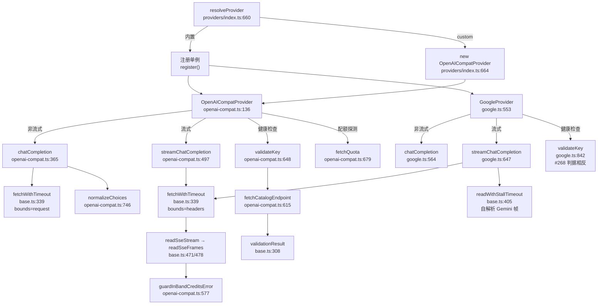

# 11 · 函数级走读：Provider 与流式

> 核对基准：本地 `adrian` HEAD `3212ac11`，核对日期 2026-11-23。本篇所有「符号+偏移」均回当前源码逐行核实；绝对行号只在文末索引备查。旧版 header/body 行号大体正确，但**索引整段过期**、chat/stream 的函数内偏移**系统性少 1**、两处注释绝对行号指错位置，且漏掉 `keyless`/`supportsKeyPolling`/`sessionHeaders`/rescue 的 schema 闸四个新成员——详见 §15 勘误表。

## 0. 人话定位：这一层是「翻译官 + 保险丝」

把上游几十家免费/付费 LLM 平台想成一群说话口音各异的外包工人。`router.ts`（10 篇）是派单调度室，它只决定「这一单交给哪个平台、哪把 key」；**真正拿起电话跟工人对话的是 provider 层**。它干两件事：

1. **翻译**：把网关内部统一的 `ChatMessage[]` 翻成各家听得懂的请求体（OpenAI 线格式 / Gemini 线格式），再把各家回话翻回统一的 `ChatCompletionResponse` / `ChatCompletionChunk`。
2. **保险丝**：给每通电话装超时、防卡死、防截断、防「请充值」被当成答案，并在工人耍花样（把 tool call 写进错误体、把推理塞进 content）时当场矫正。

| 工序 | 谁负责 | 一句话 |
|---|---|---|
| 造实例 | `resolveProvider`（`server/src/providers/index.ts`） | 内置平台取注册单例；custom 按 base URL 现造 |
| 抽象契约 | `BaseProvider`（base.ts） | 5 个抽象成员 + 4 个带默认实现的可选项 |
| 装超时 | `BaseProvider.fetchWithTimeout` | 双语义期限：整请求 / 仅响应头 |
| 防卡死 | `readWithStallTimeout` + `firstByteBudgetMs` | 每口 read 单独计时，首字节给宽限 |
| 读 SSE | `readSseStream` / `readSseFrames` | OpenAI 线格式共用，截断抛 retryable |
| 发非流式 | `OpenAICompatProvider.chatCompletion` | 组装→fetch→四个非平凡出口→normalize |
| 发流式 | `streamChatCompletion` + `guardInBandCreditsError` | 同构，headers 语义，首块查余额告 |
| 验 key | `validateKey` → `fetchCatalogEndpoint` → `validationResult` | 打 /models，401/403 才算坏 key |
| 探配额 | `fetchQuota` + `hasQuotaProbe` | 注册 spec 驱动，失败对 key 无话可说 |
| 矫正形状 | `normalizeChoices` | 数组 content 折叠、think 搬迁、reasoning 回填 |
| 非 OpenAI 线 | `GoogleProvider`（google.ts） | Gemini 自解析，复用保险丝，validateKey 判据相反 |



| 我想知道 | 去哪节 |
|---|---|
| 为什么没传超时的适配器吃到 env>15s？ | §2 的「坑」 |
| 流式中段挂死谁管？首字节慢谁管？ | §3、§4 |
| 响应「就是停了」为什么现在会重试？ | §4 第 5 步（#553） |
| tool call 时好时坏，哪条静默路径吞了失败？ | §7 出口 1（#264）、§14 |
| 「请充值」为什么没被当成答案？ | §7 出口 4、§8 guard |
| 200 非 JSON 为什么分两种文案？ | §7 出口 3（#430/#189） |
| Google 坏 key 为什么回 400 不是 401？ | §13（#268） |

调用位置回顾（03 篇）：`runFallbackLoop` 的 `hooks.dispatch` 内部调 `provider.chatCompletion / streamChatCompletion`——`server/src/routes/proxy.ts` 流式 2696 / 非流式 3092（另有 1624/1732 一对）、`server/src/routes/anthropic.ts` 流式 978 / 非流式 731、`server/src/routes/responses.ts` 流式 1342 / 非流式 1599。健康检查调 `validateKey`（`server/src/services/health.ts:291` 与 `:416`）、配额探测调 `fetchQuota`（`server/src/services/health.ts:230`）。

---

## 1. `BaseProvider` 的抽象契约（base.ts）

`server/src/providers/base.ts` · `BaseProvider+0`（类声明 229）。**五个抽象成员**（子类必须实现）：

| 成员 | 偏移 | 形状 |
|---|---|---|
| `platform` | `BaseProvider+1` | `abstract readonly platform: Platform` |
| `name` | `BaseProvider+2` | `abstract readonly name: string` |
| `chatCompletion` | `BaseProvider+9` | `(apiKey, messages, modelId, options?, quotaContext?) → Promise<ChatCompletionResponse>` |
| `streamChatCompletion` | `BaseProvider+17` | 同参 → `AsyncGenerator<ChatCompletionChunk>` |
| `validateKey` | `BaseProvider+25` | `(apiKey, quotaContext?) → Promise<KeyValidationResult>` |

**一个默认字段 + 四个带默认实现的可选项**（旧版漏了 `keyless` 与 `supportsKeyPolling`）：

| 成员 | 偏移 | 默认 | 语义 |
|---|---|---|---|
| `keyless` | `BaseProvider+7` | `false` | 免费档无需 key（Kilo 匿名网关）；true 时存哨兵 key 行、出站省略 Authorization |
| `fetchQuota` | `BaseProvider+37` | 不联网、`return false` | 配额探针默认无操作；实现必须 catch 传输错误返回 false，**永不向调用方抛**（#1403） |
| `hasQuotaProbe` | `BaseProvider+45` | getter `false` | 「有没有配额端点」——**不能拿 fetchQuota 是否被覆盖判断**，OpenAICompatProvider 对每个实例都覆盖了它 |
| `supportsKeyValidation` | `BaseProvider+56` | getter `true` | 健康检查可否探这把 key（#1459）；LLMTR 回 403「不支持自动验证」并封号 ⇒ false，改由首请求提升健康 |
| `supportsKeyPolling` | `BaseProvider+69` | getter `true` | 定时健康轮可否每隔几分钟复验（#1599）；Exa/Parallel/SerpSearch 的空查询探针看起来像脚本刷搜索 ⇒ false，只在从未查过时验一次 |

请求/响应形状**不在这一层定义**：`TokenUsage`、`ChatCompletionResponse`、`ChatCompletionChunk` 都出自 `shared/types.ts`（绝对行号 553/568/581，见索引）。这一层的注释几乎每条对应一个线上事故编号，走读时把「函数行为」和「它防的事故」一起记。

## 2. `BaseProvider.fetchWithTimeout`（base.ts）

`server/src/providers/base.ts` · `BaseProvider.fetchWithTimeout+0`（339）。

```ts
protected async fetchWithTimeout(
  url: string, init: RequestInit,
  timeoutMs = providerTimeoutMs(this.platform, 15000),   // +5：默认即 env 覆盖链
  fetchOpts?: ProviderFetchOptions,                       // {signal, timeoutBounds}
): Promise<Response>
```

**职责**：给一次 fetch 套上「可组合、双语义」的超时，并把错误信息标准化供 `requests.error` 列分诊。内部分步：

1. **signal 组装**（`+8~+9`）：调用方 signal（客户端断连）先进数组。
2. **`timeoutMs <= 0` = 无超时**（`+11~+12` 注释）：`PROVIDER_TIMEOUT_X=0` 的语义；`setTimeout(abort, 0)` 会在下一个宏任务杀光所有请求，必须显式跳过（`+14` 的 `if (timeoutMs > 0)`）。
3. **两种 bounds**（`+14~+31`）：
   - `timeoutBounds: 'request'`（`+18` 判定，`+19~+23` 注释）：**整请求期限**。timer 不清、只 `unref()`（`+24`）——200 之后 body 永远读不完也要杀（保 `res.json()` 不悬挂）；unref 保证花完的期限不留住进程。
   - 默认 headers-only（`+25` else，`+26~+29` 注释）：**响应头一到就 clearTimeout**（finally `+46~+48`）。SSE 必须用这个——流的合法寿命超过任何固定期限，中段挂死归 stall watchdog 管。
4. **signal 合成**（`+34~+40`）：`AbortSignal.any`；**客户端 signal 永不解除**——undici 把它绑到整个请求，断连会连 body 读取和流迭代一起 error，reason 是带标记的 `newClientAbortError`（回退循环靠它区分「自家客户挂了」与「上游卡死」，10 篇 §7）。
5. **错误文案**（`+43~+45`）：`proxyFetch(url, init, platform, 'chat', timeoutMs)` 使 AbortError 读作 `groq, chat, 15s`——从仪表盘错误列直接分诊。

**坑（超时优先级）**：`fetchWithTimeout` 的默认参数在**调用时**求值 `providerTimeoutMs(this.platform, 15000)`（`+5`），所以**没传超时**的适配器吃到的是 env > 15s。而 `OpenAICompatProvider` 的优先级不在这里落——构造函数（`OpenAICompatProvider.constructor+18`，openai-compat.ts:174）在实例化时就把 env 压在注册 spec 上（`this.timeoutMs = providerTimeoutMs(opts.platform, opts.timeoutMs ?? 60_000)`，#547），请求时再传 `options?.timeoutMs ?? this.timeoutMs` 做 per-call 覆盖。于是实际次序是 **env > per-call > 注册 spec > 60s**。env 只在构造时读一次，改值要重启（`server/src/lib/provider-timeout.ts` 头注释 5-6 行言明）。

## 3. stall 看门狗与首字节预算（base.ts）

`server/src/providers/base.ts` · `BaseProvider.readWithStallTimeout+0`（405）、`BaseProvider.firstByteBudgetMs+0`（435）、`BaseProvider.firstByteTimeoutMessage+0`（442）、`BaseProvider.makeId+0`（390）。

```ts
protected async readWithStallTimeout<T>(read: () => Promise<T>,
  inactivityTimeoutMs: number, timeoutMessage?: string): Promise<T>
protected firstByteBudgetMs(chatTimeoutMs: number, stallTimeoutMs: number): number
```

- `readWithStallTimeout` 是 `Promise.race([read(), setTimeout(reject)])`（`+7~+15`），`<=0` 直通（`+5`），finally `clearTimeout`（`+15`）；客户端 abort 的 rejection 原样穿过（undici 已用请求 signal 的 reason error 掉 body，这里不会误报 stall）。`timeoutMessage` 让首字节 read 报专属文案（#584）。
- `firstByteBudgetMs` 两行（`+1~+2`）：任一 `<=0` 则 0（无界），否则 `max(chat, stall)`。**存在理由**（头注释 base.ts:423-434）：chat 超时本意是「首 token 可以慢多久」，但在流式下它随响应头就被解除；NVIDIA NIM 这类「秒回 headers、prefill 几分钟」的 provider 会让第一口 read 无人看守。下限取 stall 预算，保证不会被改得比 #584 之前更严。
- `firstByteTimeoutMessage`（`+0~+2`）：首字节超时的专属文案「no first byte within Nms」，让 attempt-trace 的 error_summary 把「慢 prefill」与「死流」分开。
- `makeId`（`+0~+2`）：`chatcmpl-${Date.now()}-${random}`，rescue 伪造响应时用的 id 生成器。

## 4. `readSseStream` / `readSseFrames`（base.ts）

`server/src/providers/base.ts` · `BaseProvider.readSseStream+0`（471）、`BaseProvider.readSseFrames+0`（478）。

```ts
protected async *readSseStream(res, opts?): AsyncGenerator<ChatCompletionChunk>
// 实现（+4）= extractThinkTagsFromStream(this.readSseFrames(res, opts))
```

`readSseFrames` 是 **OpenAI 线格式**流式响应共用的 SSE 读取器。**口径可复跑**（本轮已复跑核实，数字未变）：

| grep | 结果 |
|---|---|
| `grep -rn 'this\.readSseStream(' server/src/providers/*.ts` | **5 处**：openai-compat.ts:563、cohere.ts:128、moondream.ts:115、cloudflare.ts:161、jamai.ts:100 |
| `grep -rln 'super.streamChatCompletion' server/src/providers/*.ts \| wc -l` | **19 个文件**（经继承落到 openai-compat 那条） |
| `grep -cE '^\s*register\(' server/src/providers/index.ts` | **94 个注册 provider**（2026-11-17 实测；上一版 83） |
| `grep -c 'new OpenAICompatProvider' server/src/providers/index.ts` | **35 次**（34 处注册 + 1 处 resolveProvider 现造 custom；上一版 34） |

按「注册行 → 实际流式实现」对齐：**94 个注册里流最终进 `readSseFrames` 的占多数**（OpenAI 线格式直注 + `super` 继承 + 自调 `this.readSseStream`）；其余不进——GoogleProvider 自解析 Gemini 线格式、KeylessDecisionProvider 两处注册不提供 chat 流，其余是搜索类与自写流式解析的平台。google.ts 不进 `readSseFrames`，但复用 §3 的 `readWithStallTimeout`（google.ts:722-723）与 `firstByteBudgetMs`（google.ts:716）。

### 本轮新增 provider（基准 823c496b → 3212ac11）

注册于 `server/src/providers/index.ts`，两轮合计 12 个新 provider 类/实例，把注册总数从 83 推到 98（其中 `823c496b → 1a64da55` 增 9 个到 94，`1a64da55 → 3212ac11` 再增 3 个到 98）：

| Provider | 文件 | 说明 |
|---|---|---|
| `ZroProvider` | `server/src/providers/zro.ts` | 新上游适配（继承 `OpenAICompatProvider`） |
| `FreeInferenceProvider` | `server/src/providers/freeinference.ts` | 新上游适配（继承 `OpenAICompatProvider`） |
| `FreeModelProvider` | `server/src/providers/freemodel.ts` | 新上游适配（继承 `OpenAICompatProvider`） |
| `VarosityProvider` | `server/src/providers/varosity.ts` | 多模态（图像/语音/视频），出站见 `server/src/services/media-varosity.ts` |
| `RimeProvider` | `server/src/providers/rime.ts` | 语音，出站见 `server/src/services/media-rime.ts` |
| `TypecastProvider` / `CartesiaProvider` | `server/src/providers/voice-gateways.ts` | 语音网关，出站见 `server/src/services/media-voice-gateways.ts` |
| `SilvrProvider` | `server/src/providers/silvr.ts` | 转写类（继承 `OpenAICompatProvider`） |
| `FreeTtsProvider` | `server/src/providers/freetts.ts` | TTS，出站见 `server/src/services/media-freetts.ts` |
| `OutcrawlProvider` | `server/src/providers/outcrawl.ts` | 搜索类（继承 `SearchOnlyProvider`） |
| `PuterProvider` | `server/src/providers/puter.ts` | 新上游适配（继承 `BaseProvider`，本轮新增） |
| `SpeechFlowProvider` | `server/src/providers/speechflow.ts` | 语音类（继承 `BaseProvider`，本轮新增） |
| `MeldportProvider` | `server/src/providers/meldport.ts` | 新上游适配（继承 `OpenAICompatProvider`，本轮新增） |

其中 Varosity/Rime/FreeTts/Typecast/Cartesia/Silvr 属**多模态出站**，其函数级拆解不在本篇，见 [17 搜索与多模态](17-搜索与多模态.md) §7；本篇仍只讲文本 chat 流式契约与这些 provider 的注册归属。

三个预算取值（`readSseFrames+13~+19`）：

```
inactivityTimeoutMs = opts?.stallTimeoutMs ?? streamStallTimeoutMs(platform)  // +13，默认 90s，0 关
chatTimeoutMs       = opts?.firstByteTimeoutMs ?? providerTimeoutMs(platform, 15000)  // +18
firstByteMs         = this.firstByteBudgetMs(chatTimeoutMs, inactivityTimeoutMs)      // +19
```

循环骨架（`readSseFrames+27~+58`）：

1. **第一口 read 用 firstByteMs，之后每次用 stall 预算**（`+28~+31`；`awaitingFirstByte` 在 `+24` 置位、`+31` 复位）——「慢」与「卡死」分治。
2. 增量解码（`+34~+42`）：`buffer.split('\n')`，残段留 buffer；只认 `data:` 行；`[DONE]` **return（正常结束）**（`+42`）。
3. 每帧 JSON.parse 成功才 yield（`+44~+46`）；**坏帧静默跳过**（`+47~+49` 的空 catch）；任一 choice 带非空 `finish_reason` ⇒ `sawFinishReason=true`（`+45`）。
4. `finally { reader.cancel() }`（`+52~+54`）——消费者提前 break（客户端断开）时释放上游。
5. **循环自然结束但 `!sawFinishReason` ⇒ 抛「stream ended unexpectedly」**（`+56~+58`）：EOF 前既无 `[DONE]` 又无 finish_reason 是**截断生成**，不是完成。修复前它被静默收尾、按成功记账（响应「就是停了」，#553）；抛出的文案被 `isRetryableError` 直接命中（`server/src/lib/error-classify.ts:94`），于是回退循环按 retryable 通道轮换下一跳。

外层 `readSseStream`（`+4`）再套 `extractThinkTagsFromStream`（`server/src/lib/think-tags.ts:163`）：DeepSeek 式把推理写进 `delta.content` 的 leading `<think>…</think>` 内联块被搬去 `delta.reasoning_content`——下游永远不把思考当答案渲染；无标签的流逐字节原样转发。

## 5. `BaseProvider.validationResult`（base.ts）

`server/src/providers/base.ts` · `BaseProvider.validationResult+0`（308）。

```ts
protected async validationResult(res: Response): Promise<KeyValidationResult>
// true | {valid:false, error:'…'} | throw
```

- 非 401/403 → `true`（`+1`）：**其他状态一律视为「key 有效」**——validate 打的是 models/catalog 端点，5xx 说明不了 key。
- `cf-mitigated: challenge` 头 → **throw**（`+2~+4` 注释，throw 在 `+5~+7`）：Cloudflare bot 挑战是对调用方 IP/UA 说话，不是对 key；抛错让健康服务记「无定论」，**永不自动禁用好 key**（#1298）。
- 401/403 → 从六种 body 形状（`error.message / errors[0].message / message / detail / title / statusText`，`+16~+23`）里找第一个非空字符串拼进 error（`+25~+28`）——把「invalid」升级成「invalid, because 上游说了 X」。

> ⚠️ 这条「非 401/403 即有效」的判据**只对 OpenAI 线格式成立**。Google 把坏 key 回成 400，判据正好相反，所以 `GoogleProvider.validateKey` 不走这里（§13，#268）。

## 6. `OpenAICompatProvider` 构造与请求塑形（openai-compat.ts）

`server/src/providers/openai-compat.ts` · `OpenAICompatProvider+0`（类声明 136）。构造函数 `OpenAICompatProvider.constructor+0`（156）把注册 spec 落成实例字段，关键三个：

- `this.timeoutMs = providerTimeoutMs(opts.platform, opts.timeoutMs ?? 60_000)`（`constructor+18`，#547：env 压注册默认）。
- `this.forwardsPartial = opts.platform === 'custom' && isMoonshotEndpoint(opts.baseUrl)`（`constructor+21`）：只有 Moonshot 自家 API 的 custom 端点才保留 assistant `partial` 预填标志（#1038）。
- `this.quotaProbe = opts.quotaProbe`（`constructor+22`）：可选配额端点 spec。

请求塑形函数（chat/stream 共用）：

| 函数 | 锚点 | 机制 |
|---|---|---|
| `sessionHeaders` | `OpenAICompatProvider.sessionHeaders+0`（194） | **新增（#1639）**：OpenCode 网关拒绝没有 `x-opencode-session` 的 chat 请求；按凭证生成稳定 UUID（`+1~+2`），其余端点返回 `{}` |
| `authHeader` | `OpenAICompatProvider.authHeader+0`（265） | 委托 `bearerAuthHeader`（`+1`）；keyless 哨兵 `no-key` 不发 Authorization，真 key 照发 bearer（#1331） |
| `resolveParallelToolCalls` | `OpenAICompatProvider.resolveParallelToolCalls+0`（185） | spec `forceSingleToolCall` 且带 tools → false（`+1`，NVIDIA NIM「only supports single tool-calls」，#255）；否则透传 |
| `samplingForModel` | `OpenAICompatProvider.samplingForModel+0`（272） | 只改写 Requesty 的 `mistral/leanstral-1-5` + `temperature=0`（`+4~+9`：该路由拒绝 greedy sampling）→ 去温度、补 `top_p ?? 1`；其余原样透传 |
| `messagesForPlatform` | `OpenAICompatProvider.messagesForPlatform+0`（298） | 见下 |

`messagesForPlatform` 三条路径：

1. **strict 平台**（`STRICT_PLATFORMS = {mistral, groq, cerebras}`，静态字段 openai-compat.ts:297；判定 `+1`）：按 key 白名单重建每条消息（`+4~+35`），`partial` 与 reasoning 扩展永远到不了这些平台——Mistral 对私有 replay 字段回 422，Groq/Cerebras 对 assistant `reasoning_content` 回 400（#1070）。
2. **partial 剥离**（`+44~+50`，#1038）：非 Moonshot 自家 API 一律剥掉 assistant `partial`（`forwardsPartial` 为 false 时）；strict 上游对未知 message key 回 400/422，其余上游反正忽略它。
3. **radeon system 合并**（`+56~+62`）：`radeon` 的 `Qwen3.8-Flash-Next` 只接受 index 0 的一条 system；profile 可能在客户 system 前再加网关 system，所以把全部 system 指令 coalesce 成一条再发。

## 7. `OpenAICompatProvider.chatCompletion`（openai-compat.ts）

`server/src/providers/openai-compat.ts` · `OpenAICompatProvider.chatCompletion+0`（365）。

```ts
async chatCompletion(apiKey, messages, modelId, options?, quotaContext?)
  → Promise<ChatCompletionResponse>
```

**请求组装**（`+7~+30`）：`samplingForModel` 在 `+7`；body 字段块 `+16~+27`——`messagesForPlatform`（`+18`）、`resolveMaxTokens`（`+20`，`server/src/lib/sampling-params.ts:387` 预算夹紧）、`resolveParallelToolCalls`（`+25`）、`...extendedBodyParams`（`+26`，`sampling-params.ts:336` reasoning 等私参透传）；headers 里 `sessionHeaders`（`+13`）。随后 `fetchWithTimeout(..., timeoutBounds: 'request')`（`+28~+30`：非流式必须连 body 读取一起 bounded）+ `recordQuotaObservationsFromResponse`（`+32~+39`，响应头配额观测顺手落库，永不影响返回值）。

**四个非平凡出口**：

1. **`!res.ok` + rescue**（`+41~+60`）：`rescueFailedGeneration`（`OpenAICompatProvider.rescueFailedGeneration+0`，209，#264）——某些 provider（Groq 尤其）以 **HTTP 错误 body** 返回已经生成的 tool call（`tool_use_failed` 形态，模型把调用写成了内联 DIALECT 文本）；解析成功就**当场伪造一个合法 tool_calls 响应返回**（`+46~+55`：`finish_reason: 'tool_calls'`、usage 全 0、照样带 `_routed_via`）。**新增 schema 闸**（`rescueFailedGeneration+19~+21`）：若开启 tool 参数校验且救回的参数不合 schema，**拒绝 rescue**（return null），让原始上游错误照常 failover——免得把 400 变成一个客户用不了的「成功」。救不回来先试 **pinned tool_choice 单次重试**（`+57~+58`，`pinnedToolChoiceRetryFor+0`=237：custom 端点对钉住某函数的 `tool_choice` 回 400 时，改 `"required"` + 把 tools 收窄到那个函数再发一次，#1548；重试请求本身不再满足条件，不可能连环重试）。两条都不成立才 `providerHttpError`（`+59`；保留 status + 上游原文，`upstreamErrorText+0`=249 按 `error.message / detail / title / statusText` 归一，NVIDIA 的 RFC7807 体靠它才不被压成 "Bad Request"，#522）。
2. **parse 抛错但属 abort**（`+64~+73`）：`isAbortLikeError`（`+70`）⇒ **原样 rethrow**——期限/断连不是「畸形 body」，不该被归进下面的兼容性诊断（否则 10 篇 §7 的 hedge/client-abort 分类全被打乱）。
3. **200 非 JSON 的一分为二**（`+74~+116`，#430 事故记录在 `+75~+92`）：
   - 截断特征（`looksTruncated`，`+102~+104`：`Unexpected end of JSON input`，或 position 错误 **且** Content-Type 声称 JSON 且不是 NDJSON）⇒「上游 CDN 在 600s 边缘空闲处掐了慢响应」，文案让运营**重试或换快模型**（`+105~+111`）；
   - 其余 ⇒「不是 OpenAI 兼容端点」，文案直接教 Ollama/llama.cpp/vLLM/LM Studio 的 `/v1` 路径（`+112~+115`，形状判定依据见 `+75~+92` 的 #189 注释）。
   - 不拆分时两种混报一种，运营到处找不存在的 base-URL 配置错误。
4. **in-band 余额告**（`+122~+127`）：200 + 正文是充值提示（Pollinations 形态）⇒ 拼成 `402: insufficient credit` 字符串抛出（`+125~+127`）——让 `isPaymentRequiredError` 按真 402 处理（failover + 长 bench），而不是把「请充值」当回答返回。判据是模块级 `inBandCreditsError`（openai-compat.ts:90-100）：把每条 choice 的 `message.content` 用 `contentToString` 拼起来送进去（`+122~+124`），**刻意收紧**——必须同时出现 credits 措辞（`enough credits`/`insufficient credit`）与 top-up/quest/Pollinations 标记，免得真在讨论额度的回答被误杀。

成功路径收尾：`normalizeChoices(data)`（`+117`）+ `data._routed_via = {platform, model}`（`+128`，诊断字段，05 篇）+ `return data`（`+129`）。

## 8. `streamChatCompletion` + `guardInBandCreditsError`（openai-compat.ts）

`server/src/providers/openai-compat.ts` · `OpenAICompatProvider.streamChatCompletion+0`（497）。与 §7 同构，三处不同：

1. body 加 `stream: true, stream_options`（`+27~+28`）。
2. `fetchWithTimeout` **不传 timeoutBounds**（`+32`）——默认 headers 语义（`+30~+31` 注释：headers 一到期限退场，之后流归 client signal + stall watchdog）。
3. 出口：`yield* this.guardInBandCreditsError(this.readSseStream(res, { firstByteTimeoutMs: options?.timeoutMs ?? this.timeoutMs }))`（`+65~+67`，readSseStream 调用在 `+66`；#584 的第一字节宽限从这条路传进 §4，`+62~+64` 是它的注释）。rescue 失败生成走三帧 yield（`+48~+52`：role → tool_calls → `finish_reason: 'tool_calls'`）；`pinnedToolChoiceRetryFor` 的重试在流式版是 `yield*` 递归再 `return`（`+54~+58`）。

`guardInBandCreditsError`（`OpenAICompatProvider.guardInBandCreditsError+0`，577）：只检查**第一个 content-bearing chunk**（`+6~+9` 把各 choice 的 `delta.content` 拼串喂 `inBandCreditsError`），余额告是单条固定文案；`sawContent` 一旦置位（`+11`），之后每帧原样 `yield`（`+18`），reasoning/role chunk 直接过（首 token 延迟不受影响）。命中就抛 402（`+13~+15`）。**抛出落在 proxy 的 commit point 之前**（函数头注释 openai-compat.ts:574-575 言明），回退循环还能轮换下一跳——反例是「SSE 头已冲出 = `committed`，之后无法回退」（`docs/topics/model调度算法.md` §5.1 的共同契约）。

## 9. `validateKey` / `fetchCatalogEndpoint` / `fetchModelCatalog`（openai-compat.ts）

`server/src/providers/openai-compat.ts` · `OpenAICompatProvider.validateKey+0`（648）。

```ts
validateKey(apiKey, quotaContext?)
  → fetchCatalogEndpoint(validateUrl ?? modelsUrl)   // +1
  → 默认 /models 还要验 JSON 形状（#1557）            // +7~+15
  → 否则落 §5 validationResult                       // +16
```

- `fetchCatalogEndpoint`（`OpenAICompatProvider.fetchCatalogEndpoint+0`，615）把这类 GET 的策略收在一处：**30s**（不是 10s）+ `timeoutBounds: 'request'`（`+14`；`+1~+5` 注释说明为什么不是 10s——高延迟区域取大 catalog 会超 10s，NVIDIA NIM 从印度实测 ~11.2s，把健康 key 误标成 `error`），响应头配额观测顺手落库（`+15~+21`）；传输错误照实上抛，health 记 `status='error'` 但**不**计 auto-disable 次数（函数头注释 611-613）。
- **#1557 分支**（`validateKey+7~+15`）：没配 provider 专属 `validateUrl` 且 200 时，body 必须 `JSON.parse` 得过（`+10`），否则抛 `providerHttpError`（`+12`）——已停摆/被停放的服务（retired GitHub Models）会对每个路径回 200 纯文本 "OK"，让所有 key 都看起来健康。带 `validateUrl` 的端点保留自己的形状，直接落到 §5（`+16`）。
- `fetchModelCatalog`（`OpenAICompatProvider.fetchModelCatalog+0`，644）：custom 端点模型发现（#488）专用，永远打 `/models`、不走 validateUrl，body 留给调用方读。`modelsUrl` getter（600）= `${baseUrl}/models`。

## 10. `fetchQuota` + `hasQuotaProbe`（openai-compat.ts）

`server/src/providers/openai-compat.ts` · `OpenAICompatProvider.fetchQuota+0`（679）。配额探测（#1403，注册 spec 驱动，如 openrouter 的 `GET https://openrouter.ai/api/v1/key`，`metric: 'credits'`，`limitFields`/`remainingFields`）：

- `fetchWithTimeout(spec.url, …, 10_000, {timeoutBounds:'request'})`（`+4~+10`）；spec 缺失 `return false`（`+2`）、非 2xx `return false`（`+11`）、传输/解析异常在 catch 里 `return false`（`+51~+54`）——「配额探针失败对 key 什么都不能说，调用方的健康判决必须只关于 key」（函数头注释 openai-compat.ts:672-673）。
- 取数：`data` 包裹层和顶层都查（`+13~+15`）；值接受**数字字符串**（SiliconFlow 把余额序列化成 `"88.88"`；`""`/null/散文不会 parse 成有限数，`+22~+24` 注释，判定在 `+25~+28`）。
- `limit` 与 `remaining` 全拿不到 ⇒ false（`+35`）；拿到就 `recordQuotaObservation(source:'quota_api', resetStrategy:'provider_reported')`（`+36~+49`），函数返回 `record !== null`（`+50`）。
- `hasQuotaProbe`（getter，openai-compat.ts:675，覆盖 `BaseProvider+45`）：**spec 存在与否**（`this.quotaProbe !== undefined`）才回答「有没有配额端点」——不能拿方法覆盖判断，base.ts:270-273 注释言明 OpenAICompatProvider 对每个实例都覆盖了 `fetchQuota`，spec or not。

## 11. `normalizeChoices`（openai-compat.ts）

`server/src/providers/openai-compat.ts` · `normalizeChoices+0`（模块级函数，746）。上游形状矫正的收口点，原地改 `data`，每条 choice 三步：

- `content` 是**文本段数组**（Mistral magistral）⇒ join 成字符串（`+8~+12`）。
- 内联 `<think>…</think>` 块（§4 那种 DeepSeek 写法）⇒ 搬到 `reasoning_content`（`+18`，`extractThinkFromMessage`=`server/src/lib/think-tags.ts:145`），**必须在折叠之前**：只有思考块、块后没有答案的消息才不会留下空 content。
- `content` 为空串/null **且没有 tool_calls**（`+24~+25`），且 `reasoning_content`（Z.ai glm-4.5-flash、Cloudflare DeepSeek-R1-distill）或 `reasoning`（Ollama）非空（`+26~+28`）⇒ 折进 content（`+29`）——OpenAI 兼容客户端不能看到空回答；有 tool_calls 时 `content=null` 才是正确形状，折叠会误骗按 content 分支的客户端。

## 12. 超时旋钮函数（provider-timeout.ts）

`server/src/lib/provider-timeout.ts`（文件共 75 行，本轮核实**无漂移**）：

| 函数 | 锚点 | 语义 |
|---|---|---|
| `parseTimeoutEnv` | `parseTimeoutEnv+0`（29） | 唯一的 env 读取口；坏值判据 `!Number.isInteger(parsed) \|\| parsed < 0`（`+4`，绝对 33）回落 default + `warnOnce`；`>0` 且 `<1000` 额外警告「是不是把秒当毫秒写了」（`+8~+10`，绝对 37-39） |
| `providerTimeoutEnvName` | `providerTimeoutEnvName+0`（43） | `'PROVIDER_TIMEOUT_' + 大写 + 非[A-Z0-9]→'_'` |
| `providerTimeoutMs` | `providerTimeoutMs+0`（51） | env 有效则用 env，否则 built-in default；返回 0 = 无超时 |
| `streamStallTimeoutEnvName` | `streamStallTimeoutEnvName+0`（57） | `'PROVIDER_STREAM_STALL_TIMEOUT_' + …` |
| `streamStallTimeoutMs` | `streamStallTimeoutMs+0`（66） | 平台级 > 全局 > 90s（`DEFAULT_STREAM_STALL_TIMEOUT_MS`，绝对 55），0 关；**每次调用重读**（头注释 61-62） |
| `warnOnce` | `warnOnce+0`（23） | 同名坏值只警告一次 |
| `resetTimeoutWarnings` | `resetTimeoutWarnings+0`（73） | 测试钩子，清空 warned 集 |

**`0` 全程是合法值**（禁用），所以判据是 `parsed < 0` 而非 falsy 拒绝。chat 超时在 provider **构造时**读一次（头注释 5-6，改 env 要重启），stall 看门狗则每次调用重读。这是 06 篇 §3 优先级链的读取端实现。

## 13. `GoogleProvider`：非 OpenAI 线格式（google.ts）

`server/src/providers/google.ts` · `GoogleProvider+0`（类声明 553）。旧版把这块列为「待补」，本轮补齐函数级。它**复用 §2/§3 的保险丝**（`fetchWithTimeout`、`readWithStallTimeout`、`firstByteBudgetMs`），但**帧解析与 validateKey 判据自写**。

| 函数 | 锚点 | 与 OpenAICompat 的差异 |
|---|---|---|
| `chatCompletion` | `GoogleProvider.chatCompletion+0`（564） | 打 Gemini 线格式 `${API_BASE}/models/${modelId}:generateContent`（绝对 591），非 `/chat/completions` |
| `streamChatCompletion` | `GoogleProvider.streamChatCompletion+0`（647） | 打 `:streamGenerateContent?alt=sse`（绝对 672）；**自解析 Gemini 帧**，不进 `readSseFrames` |
| `validateKey` | `GoogleProvider.validateKey+0`（842） | **判据与 §5 相反**（#268），见下 |

**流式自解析**（`streamChatCompletion` 内）： watchdog 与首字节宽限完全复用基类——`inactivityTimeoutMs = streamStallTimeoutMs(platform)`（绝对 715）、`firstByteMs = firstByteBudgetMs(...)`（绝对 716）、每口 read 走 `readWithStallTimeout`（绝对 722-723，注释 710-714 言明「与 readSseStream 同一套 #553/#584 语义」）。但帧体是 Gemini 的 `candidates[0].content.parts`（绝对 763-764），用 `extractText`/`extractReasoningContent`/`extractToolCalls`（绝对 766-773）拆成 OpenAI 形状；tool call 按 `seenToolCallKeys` 去重、`nextToolIndex` 编号。`[DONE]` 时若还没发 finish 就补一帧 `finish_reason: sawToolCalls ? 'tool_calls' : 'stop'`（绝对 736-751）；坏帧 `continue` 跳过（绝对 758-762）；EOF 无 finish 同样抛 `stream ended unexpectedly`（绝对 838，与 §4 第 5 步同一句、同样进 retryable）。

**validateKey 的相反判据**（`GoogleProvider.validateKey+0`，842，#268）：GET `${API_BASE}/models` 带 `x-goog-api-key`、10s request bounds（绝对 845-850），`res.ok → true`（绝对 859）。非 2xx 时**不套用 §5 的「非 401/403 即有效」**，因为 Google 的错误分类法正好相反（绝对 861-872 注释）：

| Google 返回 | 含义 | 判决 |
|---|---|---|
| HTTP 400 `INVALID_ARGUMENT` / reason `API_KEY_INVALID` | 坏/过期 key | `badCredentials`（绝对 882-885：401 \|\| API_KEY_INVALID \|\| message 正则）⇒ `return {valid:false}`（绝对 886-892，**计 auto-disable**） |
| HTTP 403 `PERMISSION_DENIED` / `SERVICE_DISABLED` | 项目没开 API、IP/referrer 限制 | **无定论** ⇒ throw（绝对 898-901，health 记 `status='error'` 但**不**禁用） |
| HTTP 400 `FAILED_PRECONDITION`「User location is not supported」 | 区域不支持 | 同上，无定论 throw |

旧判据（`status !== 401 && status !== 403`）把这套**完全判反**：真坏的 400 key 被标健康， merely 撞上权限/区域 403 的好 key 被自动禁用（它在别的网络仍能 generateContent）。所以只有**确认的坏凭证**才 return false，其余非 2xx 一律 throw 让 health 记 error 而不禁用。

## 14. 风险与待补

| 级别 | 事项 |
|---|---|
| P2 | §4 的截断检测依赖上游发过 `finish_reason` 或 `[DONE]`；两者都不发且完整结束的 provider 会被误判截断（目前未观察到，但 spec 上无法排除） |
| P2 | §7 出口 1 的 rescue 会**吞掉一次真实的上游失败**记账为成功——排查「tool call 时好时坏」时要记得有这条静默路径；新增的 schema 闸（`rescueFailedGeneration+19~+21`）只在开启 tool 参数校验时才拒绝不合 schema 的 rescue |
| 待补 | `samplingForModel` / `extendedBodyParams` / `messagesForPlatform` 的**完整平台矩阵**（本篇按机制描述：Requesty leanstral、strict 三家、radeon Qwen、Moonshot partial、OpenCode session；未逐平台枚举全部 83 个注册） |
| 待补 | 其余自写流式解析的适配器（cohere/moondream/cloudflare/jamai 自调 readSseStream，搜索类平台）的函数级拆解——本篇只对齐了「进不进 readSseFrames」的口径，未逐函数展开 |

## 15. 旧版勘误表（本轮纠正）

| # | 旧版写法 | 当前真相 | 性质 |
|---|---|---|---|
| 1 | 索引：base.ts `fetchWithTimeout` 326-375、`validationResult` 289-324、`readSseFrames` 465-524 | 339-388、308-337、478-537 | 索引整段过期（header/body 反而对） |
| 2 | 索引：openai-compat `inBandCreditsError` 47-66、class 102、`chatCompletion` 322-451、`normalizeChoices` 692-733 | 90-100、136、365-495、746-778 | 同上 |
| 3 | §5/§6 函数内偏移（如 `resolveMaxTokens+19`、stream `+26~+27`、出口 `+64~+66`） | 实际 `+20`、`+27~+28`、`+65~+67` | chat/stream 偏移系统性少 1，已逐行重算 |
| 4 | §6「commit point 之前（529-530 注释言明）」 | 注释在 `guardInBandCreditsError` 头 574-575 | 绝对行号指错位置 |
| 5 | §7「30s 依据 571-575 注释」 | 在 `fetchCatalogEndpoint+1~+5`（616-620） | 同上 |
| 6 | §7「配额探针注释 622-629 / 627-628」 | 在 `hasQuotaProbe` 头 667-674 / 672-673 | 同上 |
| 7 | §0 契约只列 fetchQuota/hasQuotaProbe/supportsKeyValidation | 漏 `keyless`（+7）、`supportsKeyPolling`（+69，#1599） | 新成员未补 |
| 8 | 无 `sessionHeaders` | 新增 `sessionHeaders+0`（194，#1639 OpenCode x-opencode-session） | 新函数未补 |
| 9 | rescue 只说「解析成功就伪造」 | 漏 schema 闸（`rescueFailedGeneration+19~+21`，不合 schema 则拒绝） | 新分支未补 |
| 10 | 索引：shared/types 531/546/559、index.ts resolveProvider 636-648、google.ts 截断 834 | 553/568/581、660-672、838 | 跨文件行号漂移 |
| 11 | §10 GoogleProvider 列「待补」 | 本轮 §13 补齐函数级（含 #268 相反判据） | 待补闭环 |
| 12 | 全篇无图、无术语表 | 补 §0 mermaid + §18 术语表 | 结构补齐 |

## 16. 源码索引（符号 + 绝对行号备查，以 3212ac11 为准）

- `server/src/providers/base.ts` — `BaseProvider` 229（`platform` 230、`name` 231、`keyless` 236、`chatCompletion` 238、`streamChatCompletion` 246、`validateKey` 254；`fetchQuota` 266-268、`hasQuotaProbe` 274-276、`supportsKeyValidation` 285-287、`supportsKeyPolling` 298-300）；`validationResult` 308-337；`fetchWithTimeout` 339-388；`makeId` 390-392；`readWithStallTimeout` 405-421；`firstByteBudgetMs` 435-438；`firstByteTimeoutMessage` 442-444；`readSseStream` 471-476；`readSseFrames` 478-537；类尾 538
- `server/src/providers/openai-compat.ts` — `inBandCreditsError` 90-100；`pinnedToolChoiceRetry` 110-116；`QuotaProbeSpec` 128-134；`OpenAICompatProvider` 136-735（`constructor` 156-179、`resolveParallelToolCalls` 185-188、`sessionHeaders` 194-197、`rescueFailedGeneration` 209-232、`pinnedToolChoiceRetryFor` 237-242、`upstreamErrorText` 249-255、`authHeader` 265-267、`samplingForModel` 272-284、`STRICT_PLATFORMS` 297、`messagesForPlatform` 298-363、`chatCompletion` 365-495、`streamChatCompletion` 497-565、`guardInBandCreditsError` 577-597、`modelsUrl` 600-602、`fetchCatalogEndpoint` 615-639、`fetchModelCatalog` 644-646、`validateKey` 648-665、`hasQuotaProbe` 675-677、`fetchQuota` 679-734）；`normalizeChoices` 746-778
- `server/src/providers/google.ts` — `GoogleProvider` 553；`chatCompletion` 564（generateContent URL 591）；`streamChatCompletion` 647（streamGenerateContent URL 672、watchdog 715-723、[DONE] finish 736-751、坏帧 skip 758-762、parts 解析 763-773、截断 throw 838）；`validateKey` 842-902（#268 注释 861-872、badCredentials 882-885、return false 886-892、inconclusive throw 898-901）；文件共 903 行
- `server/src/lib/provider-timeout.ts` — 头注释 1-19；`warnOnce` 23-27；`parseTimeoutEnv` 29-41；`providerTimeoutEnvName` 43-45；`providerTimeoutMs` 51-53；`DEFAULT_STREAM_STALL_TIMEOUT_MS` 55；`streamStallTimeoutEnvName` 57-59；`streamStallTimeoutMs` 66-70；`resetTimeoutWarnings` 73-75
- `shared/types.ts` — `TokenUsage` 553；`ChatCompletionResponse` 568；`ChatCompletionChunk` 581
- `server/src/providers/index.ts` — google 注册 63（`timeoutMs: 60_000`）；nvidia spec 189（`forceSingleToolCall` 192、`timeoutMs: 180_000` 193）；openrouter spec 205（`quotaProbe` 216）；`CUSTOM_PROVIDER_TIMEOUT_MS` 648（=120000）；`getProvider` 650；`resolveProvider` 660-672（custom 现造 664、timeoutMs 668）；`getAllProviders` 674；`hasProvider` 678
- `server/src/lib/think-tags.ts` — `extractThinkFromMessage` 145；`extractThinkTagsFromStream` 163
- `server/src/lib/error-classify.ts` — `isRetryableError` 6；`stream ended unexpectedly` 命中 94
- `server/src/lib/sampling-params.ts` — `extendedBodyParams` 336；`resolveMaxTokens` 387
- 调用点 — `server/src/routes/proxy.ts` 流式 2696 / 非流式 3092（另 1624/1732）；`server/src/routes/anthropic.ts` 流式 978 / 非流式 731；`server/src/routes/responses.ts` 流式 1342 / 非流式 1599；`server/src/services/health.ts` `fetchQuota` 230、`validateKey` 291/416

---

## 17. 导航

上一篇 → [10-函数级走读-路由限流与回退](./10-函数级走读-路由限流与回退.md) ｜ 下一篇 → [12-函数级走读-存储配置与请求入口](./12-函数级走读-存储配置与请求入口.md) ｜ [返回索引](./README.md)

相关专题 → [model调度算法](../topics/model调度算法.md)（§5.1 commit point 契约）

## 18. 术语表

| 术语 | 人话解释 |
|---|---|
| provider | 上游 LLM 平台的适配器；把统一请求翻译成各家 API、把各家响应翻回统一形状 |
| OpenAI 线格式 | `/chat/completions` 那套请求/响应/SSE 约定；多数免费平台兼容它 |
| Gemini 线格式 | Google 的 `:generateContent` / `:streamGenerateContent?alt=sse`，帧体是 `candidates[].content.parts` |
| SSE | Server-Sent Events，流式响应按 `data: {...}\n\n` 一帧帧推；`[DONE]` 表示正常结束 |
| chunk / frame | 流式里的一小段增量（`ChatCompletionChunk`）；frame 指一条 `data:` 行 |
| finish_reason | 上游告知「为什么停」：`stop`/`tool_calls`/`length` 等；缺它且无 `[DONE]` = 截断 |
| timeoutBounds | fetch 超时的两种语义：`request`=整请求（含 body 读取）期限；默认 headers-only=响应头一到就解除 |
| stall watchdog | 流式中段「多久没一个字节就放弃」的看门狗（`readWithStallTimeout`），默认 90s，0 关 |
| first-byte grace | 首字节宽限（#584）：headers 秒回但 prefill 几分钟的 provider，第一口 read 给 `max(chat, stall)` 预算 |
| unref | Node timer 的 `unref()`：不让这个定时器单独把进程留住 |
| AbortSignal.any | 把多个 abort 信号合成一个，任一触发即 abort；客户端断连信号永不解除 |
| keyless | 免费档无需 API key（Kilo 匿名网关）；存哨兵 key 行、出站省略 Authorization |
| 哨兵 key / no-key | keyless 平台占位用的假凭证；发 `Bearer no-key` 上游会当无效 key，所以必须省略 |
| quotaProbe | 注册 spec 描述的配额端点（URL + limit/remaining 字段名），`fetchQuota` 据此探余额 |
| headroom | 剩余配额比例；router 的 least-remaining 策略据此排序 key（10 篇） |
| in-band 余额告 | 上游回 HTTP 200 但正文其实是「请充值」；须当 402 failover，不能当答案返回 |
| rescue / failed_generation | provider 把已生成的 tool call 塞进 HTTP 错误体（`tool_use_failed`）；解析出来伪造成功响应（#264） |
| pinned tool_choice | 客户端钉死调用某个函数；custom 端点回 400 时改 `"required"` + 收窄 tools 重试一次（#1548） |
| RFC7807 | 一种错误体形状（`title`/`detail`）；NVIDIA NIM 用它，只读 `error.message` 会压成 "Bad Request"（#522） |
| strict 平台 | 对未知嵌套字段严格报错的平台（mistral/groq/cerebras）；按白名单重建消息 |
| partial | Moonshot 的 assistant 预填标志；只有 Moonshot 自家 API 保留，其余剥掉（#1038） |
| think 标签 | DeepSeek 式把推理写进 content 的 `<think>…</think>`；搬去 `reasoning_content`，不当答案渲染 |
| reasoning_content / reasoning | 推理字段；前者 Z.ai/Cloudflare，后者 Ollama；content 为空且无 tool_calls 时回填 |
| _routed_via | 响应里的诊断字段 `{platform, model}`，标明这一跳实际路由到谁（05 篇） |
| commit point | 流式已向客户端冲出字节的时刻；过了它就无法 failover（committed），之前还能轮换 |
| auto-disable | 健康检查确认坏 key 后自动禁用；只有 confirmed 401/403（Google 是 400 API_KEY_INVALID）才计数 |
| 无定论 / inconclusive | 探针失败说明不了 key 好坏（Cloudflare 挑战、传输错误、Google 权限/区域 403）；记 error 但不禁用 |
| Thompson 采样 / bandit | router 用 Beta 后验采样给 key 排序的探索-利用算法（10 篇），provider 层不参与 |