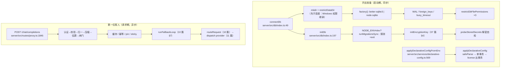

# 12 · 函数级走读：存储、配置与请求入口

> 「函数级走读」系列第三篇。三条链在本文接头：① DB 连接与初始化（`connectDb → initDb → initEncryptionKey`）；② 声明式配置落库（`applyDeclarativeConfig*`）；③ 整条代理链真正的入口 `POST /v1/chat/completions` 处理器。加密函数（`encrypt/decrypt/initEncryptionKey`）的函数级拆解见 [07 篇](./07-状态存储与并发.md) §4，本文只讲它们在初始化链上的挂点；路由与回退的函数级展开见 [10 篇](./10-函数级走读-路由限流与回退.md)，本文在 `routeRequest` 处与它接头。

---

## 0. 人话定位：这一篇在讲什么

把整个服务想成一家餐厅，本文讲三件事：

1. **开店前的准备**（§1–§4）：打开仓库门（`connectDb`）、决定仓库门锁多严（目录/文件权限硬化）、把账本翻到最新一页（迁移）、拿到保险箱钥匙（加密 key）。
2. **按订单备货**（§5）：老板用一份声明式配置（环境变量/JSON）一次性把「管理员账号、各家 provider 的 key、自定义模型、回退链、路由策略」写进库——这是一个**要么全成、要么全滚**的事务。
3. **第一位客人点单**（§6）：`POST /v1/chat/completions` 处理器是整条代理链的门口。它把客人的原始请求经过十二道工序（认证→校验→归一→压缩→估算→闸门→护栏→断连→缓存→pin/sticky→挂载回退循环），最后交给 `runFallbackLoop` 去真正找模型、发请求。

| 你关心的问题 | 去哪一节 |
|---|---|
| 数据库文件为什么不会被别的本地用户读走？ | §1、§3 |
| 生产启动会自动补迁移，dev 为什么不会？ | §2、§4 |
| 一份配置写库写到一半崩了会怎样？ | §5 |
| 带图片/带工具的请求为什么有时直接 422？ | §6 工序⑥ |
| 显式 `model` 和 sticky 会话谁优先？ | §6 工序⑪、§7 |
| 缓存命中/幂等重放为什么不花 provider 配额？ | §6 工序⑨⑩ |



---

## 1. `connectDb` — 打开文件之前先决定它的权限

`server/src/db/index.ts` · `connectDb+0`（签名 49 行，函数体 49–93）。

```ts
export function connectDb(dbPath?, opts?: { ensureDir?: boolean; factory?: DbFactory }): Db
```

分步（偏移以签名 49 行为 +0）：

1. **+10~+13 解析**：`resolvedPath = dbPath ?? getDefaultDbPath()`（即 `server/data/freeapi.db`）；`isMemory = resolvedPath === ':memory:'`；`ensureDir` 默认 true；`factory` 默认 `defaultDbFactory()`（按平台选 better-sqlite3 / node-sqlite——Android/Termux 走后者）。
2. **+19~+30 目录先行**（非内存库且 ensureDir）：不存在则 `mkdirSync(recursive)` 并记下 `created`；**`restrictDataDir`（+29）在建立连接之前跑**。注释（75–77 行）给出顺序理由：Windows 上权限是**继承**来的，先收紧目录，DB 文件「出生即受保护」，而不是先以父目录 ACL 存在几秒钟。
3. **+32~+38 pragmas**：先 `db = factory(resolvedPath)`（+32）建立连接，再 `journal_mode=WAL`（+33，内存库跳过）→ `foreign_keys=ON`（+34，默认关是 SQLite 的历史包袱，本项目 profiles→profile_models 的 CASCADE 全靠它）→ `busy_timeout=5000`（+38；注释 84–86 行：仪表盘与代理热路径并发写，无 busy_timeout 时写竞态的输家立刻 SQLITE_BUSY 请求失败；5s 远大于任何一次本地写）。
4. **+40 文件级 chmod**：`restrictDbFilePermissions(resolvedPath)`（主文件 + `-wal`/`-shm` 三目标，此时 sidecar 多半不存在，见 §3）。

**返回**：模块级单例 `db`；`getDb+0`（20 行）只是它的带断言 getter（未初始化即抛「先 initDb」）。

## 2. `initDb` — 迁移策略按 NODE_ENV 分叉，末尾多了一道解密自检

`server/src/db/index.ts` · `initDb+0`（签名 197 行，函数体 197–234）。

```ts
export function initDb(dbPath?, opts?): Db   // 内部: connectDb + 迁移 + 加密 key + 解密自检
```

1. **+4**：`const db = connectDb(dbPath, opts)`——§1 全链在这挂上。
2. **+6~+21 迁移分叉**：`process.env.NODE_ENV !== 'development'` ⇒ `runMigrationsSync(db, 'up')`（+7）——生产**自动补迁移**（迁移清单已编入 bundle，同步执行因为启动本来就是同步的）。development ⇒ **不跑迁移**，只探测 `sqlite_master` 里有没有 `migrations` 表；没有就打一段可直接照抄的指示（`npm run db:migration:up`）然后 `process.exit(1)`。理由（[07 篇](./07-状态存储与并发.md) §3）：dev 里新建迁移文件应经显式命令进入，防止「顺手改了个没验证的迁移」在每次重启静默生效。
3. **+23**：`if (!isEncryptionKeyInitialized()) initEncryptionKey(db)`——[07 篇](./07-状态存储与并发.md) §4 的四级 key 优先链在这挂上。**必须在迁移之后**：它读写 `settings` 表（legacy 分支），表得先存在。
4. **+25~+34 解密自检（旧版漏列）**：`keyStoreDecryptable = probeStoredSecrets(db)`（222 行）。若返回 false，打一段长错误日志：加载的加密 key 解不开库里的 provider keys，每个请求都会以「Unsupported state or unable to authenticate data」失败、什么都路由不了——DB 与 key 文件（`.encryption-key` 或 `ENCRYPTION_KEY`）来自不同安装，须恢复属于本库的 key 再重启。**这是 initDb 从旧版 223 行漂移到 234 行的原因**。

## 3. `shouldHardenDataDir` — 「ownership by construction」

`server/src/db/index.ts` · `shouldHardenDataDir+0`（签名 122 行，函数体 122–136；头注释 95–121 行是本节最该记住的一段）。

```ts
export function shouldHardenDataDir(dataDir: string, created: boolean, platform = process.platform): boolean
```

要解决的问题：WAL 的 `-wal`/`-shm` sidecar **首次写时才创建、干净关闭时删除**——启动时对它们 chmod 是徒劳，只能罩住整个目录；但目录是共享状态，`FREEAPI_DB_PATH=/tmp/freeapi.db` 绝不能 chmod 0700 `/tmp`。

判定三态（按序短路）：

1. **+5~+6**：`parseDirHardeningOverride()`（140 行）——env 三态（`FREEAPI_DB_DIR_HARDENING` 的 `1/0` 强制，未设/空串/非法值走策略）。
2. **+7**：`created === true` ⇒ 硬化——「一分钟前还不存在的目录里不可能有别人的东西」。
3. **+11~+13**：目录 === 内置默认 `server/data` ⇒ 硬化。**case 3 是给存量安装的**：老部署已有该目录，只认 case 2 会硬化所有新装、静默跳过所有升级。路径比较在 win32 上 `toLowerCase()`（+11~+12：大小写不敏感文件系统，否则 `C:\App\Data` 认不出是默认目录）。

**默认策略是「在对的地方默认开」而不是纯 flag**——注释原话：「需要有人记得申请才生效的加固，和没人注意到已经停止运行的加固是同一类失败」。

两个执行函数：

- `restrictDataDir+0`（153 行）：对「不硬化」的情形**只打印一次**（`console.log`，`warnedUnhardenedDataDir` 闩 151 行，测试频繁重连不会刷屏）；硬化失败只 warn 不阻断。
- `restrictDbFilePermissions+0`（187 行）：`restrictAllToOwner(['', '-wal', '-shm'])` 三目标 best-effort，失败只 warn 不阻断启动——但**必须说出来**（头注释 174–186 行：没人能看见失败的加固 = 没人知道它不存在）。它仍跑三目标，因为不受控目录里可能留着上次不干净关闭的 sidecar，且主文件在升级安装里先于目录硬化存在。

## 4. `runMigrationsSync` / `runPendingMigrationsSync` — 显式清单，不是目录扫描

`server/src/db/migrate/runner.ts` · `runMigrationsSync+0`（签名 64 行）。

```ts
runMigrationsSync(db, direction = 'up'): void
// 内部: initializeMigrationTracking → getDefaultMigrationRecords → runPendingMigrationsSync
```

- **+4** `initializeMigrationTracking+0`（98 行）→ `ensureMigrationsTable+0`（102 行）→ `db.exec(CREATE_MIGRATIONS_TABLE_SQL)`：`CREATE TABLE IF NOT EXISTS migrations(id, filename UNIQUE, applied_at)`。
- **+5** 记录集来自 `getDefaultMigrationRecords+0`（213 行）→ `DEFAULT_MIGRATIONS.map(...)`，而 `DEFAULT_MIGRATIONS` 是 `server/src/db/migrate/defaults.ts` 里的**47 条显式 import**（`legacyBaseline` … `keyLastHealthyAt`，本轮逐条点数）——不是 fs 扫描。生产 bundle 里没目录可扫，「编译进来的」即「全部的」。异步版 `getMigrationRecords+0`（207 行）才支持 `migrationsDir` 文件扫描（dev/CLI 用）。
- `runPendingMigrationsSync+0`（153 行）：pending 判定 = `getAppliedMigrations`（197 行，`SELECT filename ORDER BY filename ASC`）里没有的；逐条 `record.module.up(db)`，**每条用 `db.transaction` 包裹 up + INSERT 一行**（+10~+13），成功即 `applied.set`。无 module 的同步记录直接 throw（+8）。
- `direction='down'` 只回最后一条：`runLatestDownMigrationSync+0`（173 行，`ORDER BY id DESC LIMIT 1`）。

**调用点**：`initDb`（同步版）、`server/src/db/migrate/cli.ts`（异步版 + status）、测试 helpers。

## 5. `applyDeclarativeConfig` — 一个事务、事务内两类降级、license 出事务

`server/src/services/declarative-config.ts` · `applyDeclarativeConfig+0`（签名 466 行，函数体 466–537）。

```ts
export function applyDeclarativeConfig(input: unknown, source = 'inline'): DeclarativeConfigResult
```

分步（偏移以 466 为 +0）：

1. **+1~+4 fail-fast**：`declarativeConfigSchema.safeParse`（`.strict()`，[06 篇](./06-配置与数据流.md) §5.2）；失败 ⇒ 抛错**带全路径**（`keys.0.platform: …`），错误即部署文档。这一抛会经 `main().catch` 变成非零退出。
2. **+20 `db.transaction(() => {…})`**：六段全在**一个同步事务**里——better-sqlite3 的 transaction 是同步函数包裹，任何一段抛错整体回滚，不会留下「keys 进了一半」的启动。`apply()` 在 +60 真正执行。
3. 段内语义（事务内只有 `admin` 与 `keys` 两段会「降级不炸」，其余段抛错 ⇒ 整体回滚 ⇒ 非零退出）：

| 段 | 偏移 | 行为 | 降级还是抛错 |
|---|---|---|---|
| `admin` | +21~+30 | `userCount()===0` 才 `createUser`；否则 push warning + console.warn 并继续 | 降级（消除竞态窗口，06 篇 §5.3） |
| `keys` | +31~+40 | `missingKeyWarning`（176 行）只对「平台已注册、非 keyless、且没带 key」的条目降级成 warning + skip；其余放行后 `upsertApiKey`（内部走 07 篇 §4 encrypt） | 部分降级（#600：pollinations 转成需要 key 后，缺 key 的旧条目不得炸 main） |
| `customProviders` | +41~+43 | `registerCustomProvider`（256 行）返回模型数，累加 `customModels` | 抛错 |
| `models` | +44~+47 | `upsertModel`（378 行）对 catalog 管理的模型只写 override，不碰 catalog 真相 | 抛错 |
| `fallback` | +48~+50 | `applyFallback`（453 行）缺省 priority 用 `i+1`——**数组顺序就是链顺序** | 抛错 |
| `routing` | +51~+58 | `setCustomWeights`（+52）先于 `setRoutingStrategy`（+53）；`keySelectionStrategy` 省略即不动（+54~+56） | 抛错 |

4. **+66~+69 license 出事务**：`void activateConfiguredLicense(parsed.data.license)`——注释（528–531 行）明说「网络 I/O 没有资格出现在同步 DB apply 里」：慢的许可服务**不得拖启动**，fire-and-forget + 内部全捕获。

`activateConfiguredLicense+0`（545 行）的幂等分流：

- **+3**：与存库 key 相同（`getSetting(SETTING_LICENSE_KEY) === trimmed`）⇒ 触网前短路（548 行）。
- **+4~+12**：`validateLicenseKey` 服务不可达（null，+5~+8）或被拒（`result.valid=false`，+9~+12）⇒ 只 console.warn、key 不入库（与仪表盘 `POST /api/premium/key` 同一契约）。
- **+13~+17**：验证通过 ⇒ `setSetting`（+13）+ `refreshLicenseStatus`（+14）+ `void syncCatalog(true)`（+17，升级秒级可见，syncCatalog 自带 catch-all）；外层还有整段 try/catch（+19~+21）兜底。

`applyDeclarativeConfigFromEnv+0`（569 行）只是「`readConfigFromEnv`（+1）→ 调用（+5）→ 打一行统计日志」；无配置时返回 `applied:false` 的全零结果（+2~+4）——启动序列里这一步永远不会是障碍。

## 6. `POST /v1/chat/completions` 处理器 — 入口流水线十二工序

`server/src/routes/proxy.ts` · 匿名 handler（`proxyRouter.post('/chat/completions', async (req, res) => {…})`，**1845 行起**，跨度约 1510 行）。它是 [05 篇](./05-API与接口设计.md)「七个 wire 面共享 fallback-loop」中最大一面的函数级展开。匿名函数没有符号名，本节用**工序编号 + 绝对行号**定位（行号以当前 checkout 为准，备查见 §9 索引）；命名 helper 仍用符号 + 偏移。

```
① 认证  ② zod 校验  ③ 旋钮归一  ④ 消息归一  ⑤ 压缩+注入
⑥ 估算与闸门  ⑦ 预算护栏  ⑧ 断连/中止布线  ⑨ 响应缓存  ⑩ 幂等
⑪ pin/sticky 解析  ⑫ runFallbackLoop 挂载
```

| 工序 | 行号 | 关键调用 | 要点 |
|---|---|---|---|
| ① 认证 | 1854 | `requireInferenceAuth`（70 行） | 统一三种头（Bearer / x-api-key / x-goog-api-key）；**loopback 也要认证**（1850–1853 注释：浏览器能敲 localhost，socket 位置不是授权边界）；返回携带 client-profile 的 server-enforced systemPrompt（#411） |
| ② 校验 | 1858 | `chatCompletionSchema.safeParse` | 拒绝时把 zod issues 拼成**路径限定**摘要（`messages.1.content: Invalid input`，前 5 条）+ 服务端 warn（1860–1862 注释：这类 400 从不进 request log，#200 曾因此近乎不可调试）；响应带 `execution_id` |
| ③ 旋钮归一 | 1885–1901 | `pickSamplingParams`（1897） | `max_tokens<=0`→unset（多家客户端用它表示「不限」）；`max_completion_tokens` 别名；`tool_choice:'any'`→`'required'`；tools 的 `type` 缺省回填 `'function'`；扩展采样参数一次性打包，后续所有 dispatch（含 fusion fan-out）共用同一份 spread |
| ④ 消息归一 | 1903–1992 | `takeToolCallId`（1909） | 本 handler 最长一段，核心是**工具调用配对状态机**，见下 |
| ⑤ 压缩+注入 | 2004–2022 | `compressRequest`（2004）、`prependSystemPrompt`（2017）、`normalizeMessageImages`（2022） | 顺序契约不可重排，见下 |
| ⑥ 估算与闸门 | 2030–2075 | `estimateInputTokens`（2030）、vision 闸门（2038）、tools 闸门（2065） | 带图/带工具但无对应能力模型 ⇒ **422 前置拒绝**，见下 |
| ⑦ 预算护栏 | 2077–2090 | `request_max_tokens_budget` 设置项 | 把「未设 max_tokens」的钳到预算余量——与③的 `<=0→unset` 是一对 |
| ⑧ 断连双路 | 2092–2108 | `res.on('close')` + `clientAbort` | 旗标（循环下一次迭代前停）+ AbortController（在飞那次上游也取消）；controller 在 fusion 分支之前声明 |
| ⑨ 响应缓存 | 2241–2310 | `getCachedResponse`（2299）、流式缓存（2290） | opt-in 精确缓存，canonical key，流式也参与；命中 `X-Routed-Via: cache`，**不花 provider 配额**（2301–2303 注释：recordRequest/recordTokens 刻意跳过） |
| ⑩ 幂等 | 2312–2350 | `lookupIdempotencyReplay`（2336） | 仅非流式；只存 key 的 SHA-256；replay 零配额（2338–2339），同 key 不同内容 ⇒ 409 conflict；流式永远 bypass（2317–2319：流不能作为单元重放，开着的连接本身就是重试信号） |
| ⑪ pin/sticky | 2401–2493 | `getStickyModel`（274）、`resolveStickyPreference` | 四分支，见 §7 |
| ⑫ 挂载 | 2518 | `runFallbackLoop` | 把①–⑪产物包成 `FallbackHooks` 交给回退循环（[10 篇](./10-函数级走读-路由限流与回退.md) §7），见下 |

### 6.1 工序④：工具调用配对状态机 `takeToolCallId`

handler 内的 `takeToolCallId`（1909 行，匿名 handler 的嵌套箭头函数；`pendingToolCallIds` 队列 1907 行）。

- assistant 带 tool_calls ⇒ 每个 id（给定的或合成的 `call_auto_N`）入队 `pendingToolCallIds`；无 tool_calls 且 content 空 ⇒ 强转 `""`（严格上游不收 null-content 的 assistant 轮，#165）；`content:null` **与** tool_calls 同时存在是合法 OpenAI 形状，保留。
- tool 消息缺 `tool_call_id` ⇒ 按队列**顺序**认领最早未答的 id——匹配 Gemini 系 agent「一轮一调用」的现实输出（#200）。
- `role:'function'` 遗留形状 ⇒ 转 tool 消息同样顺序配对；`'developer'` ⇒ `'system'`。
- 思考痕迹原样回带（`reasoning_content`，#255：DeepSeek thinking 模型拒绝丢掉它的后续轮，别的 provider 忽略未知字段）；Moonshot `partial` 标志透传到 provider 层再决定剥不剥（#1038，见 [11 篇](./11-函数级走读-Provider与流式.md) §6）。

### 6.2 工序⑤：压缩与注入的顺序契约

`compressRequest`（2004，`x-freellm-compress` 头驱动，Anthropic 式 cache 断点感知——`cacheControlPrefixLength` 从最后一个含 `cache_control` 的块截断压缩）→ **`prependSystemPrompt`（2017）在压缩之后、列表最前**（2012–2016 注释：profile 强制提示「不会被压缩掉，且压过调用方自带的 system 让它盖不回来」；每 profile 恒定 ⇒ provider 侧缓存前缀稳定）→ `normalizeMessageImages`（2022）降尺度。

### 6.3 工序⑥：估算与两道前置闸门

- 图像先降尺度（`normalizeMessageImages` 2022，进估算**之前**——路由按降完的尺寸判断）。
- `estimateInputTokens`（2030，定义 `server/src/lib/content.ts:43`）~4char/token 启发式（2024–2029 注释；非流式事后用 provider 真 usage 对账，流式靠 `stream_options.include_usage` 末帧否则回落估算）。
- 带图 ⇒ `hasImage && !hasEnabledVisionModel()` **422 前置拒绝**（`no_vision_model`，2038–2048）而不是留给耗尽路径（#118/#125）；再按每图 `IMAGE_TOKEN_ESTIMATE=1000`（2049）补估算，`outputReserve`（2056，`routingReserveTokens` #470 封顶）单独传 router 不被上下文安全边际膨胀（#956）。
- 带 tools ⇒ 同款闸门 `wantsTools && !hasEnabledToolsModel()`（`no_tools_model`，2065–2075；2059–2063 注释：无真实 function-calling 的模型会把调用序列化进文本，请求「成功」但客户端工具循环看不到，比报错更糟）。
- 两条件再作为 `routeRequest` 的 `requireVision`/`requireTools` 参数过滤链（[10 篇](./10-函数级走读-路由限流与回退.md)）。

### 6.4 工序⑫：挂载 `runFallbackLoop`

`server/src/routes/proxy.ts` 2518 行 `await runFallbackLoop({...})`，hooks 字段：

| 字段 | 行号 | 内容 |
|---|---|---|
| `clientGone` | 2523 | `() => clientGone`（⑧的旗标） |
| `abortInFlight` | 2524 | `() => hedgeAbort.abort(newHedgeAbortError())`（`hedgeAbort` 2509 行，墙钟重试预算到期时取消在飞上游） |
| `route` | 2525–2538 | `() => routeRequest(...)`（2537 行调用；含 handoff padding、`resolveTaskType` #1127、`strategyOverride`） |
| `dispatch` | 2539 起 | `async (route, attempt, ctx) => {…}` 内调 provider（[11 篇](./11-函数级走读-Provider与流式.md)），含 context handoff 注入（2560）与 thinking trace 恢复（2571，#797） |

`FallbackHooks` 类型定义在 `server/src/lib/fallback-loop.ts:1270`。从这里开始，本篇与 [10 篇](./10-函数级走读-路由限流与回退.md) 在 `routeRequest` 处接头。

**为什么值得逐工序读**：⑤⑥⑦⑧⑨⑩⑪ 的顺序**不可重排**，每一处都有注释钉住（压缩↔注入、降尺度↔估算、controller 声明位、pin↔sticky 优先级、缓存/幂等零配额）。改这个函数的任何一步，先找到它头上的编号注释。

## 7. sticky 会话与 pin 的内存结构（闭环旧版待补）

旧版 §8 把 `getStickyModel/setStickyModel` 列为待补。本轮已读全，补齐如下。

`server/src/routes/proxy.ts` · 模块级 `stickySessionMap`（174 行，`Map<string, { modelDbId: number; lastUsed: number }>`）+ `STICKY_TTL_MS`（175 行，`30 * 60 * 1000` = 30 分钟）。

- `getSessionKey+0`（261 行）：有 `x-session-id` 头 ⇒ `hdr:<id>::<strategyKey>`（+1~+3）；否则取首条 user 消息文本（+5）做 `sha1`（+10），payload 拼上 strategyKey。**无 user 消息或空文本 ⇒ 返回空串**（不 sticky）。
- `getStickyModel+0`（274 行）：**先要求消息里有 assistant 轮**（+1~+2，纯首轮不 sticky）；取 key（+4）→ 查 map（+7）→ 超 TTL 即删并返回 undefined（+10~+13）→ 否则返回 `modelDbId`（+14）。
- `setStickyModel+0`（291 行）：写 map（+3）；**清理两级**（+6 起）：size>500 时先扫删过期项；若仍 >1000 则按 `lastUsed` 升序硬驱逐最旧到 1000（+13~+22）。

工序⑪的 pin/sticky 解析（2401–2493）是**四分支**，比旧版「pin 优先、sticky 兜底」一句话更细：

| 分支 | 行号 | 行为 |
|---|---|---|
| tier 别名链 | 2415–2421 | Claude tier 别名 ⇒ `groupChain` 严格池；sticky 仅当落在池内才作 preferred |
| auto 模型 | 2422–2423 | `resolveStickyPreference(getStickyModel(...), resolvedChain?.chain)` |
| 显式 model（unify ON） | 2424–2466 | 解析逻辑模型组 ⇒ 严格 `groupChain`；组内无可用 provider 区分 **503**（`no_providers_configured`，有 enabled 行但无 key）与 **404**（`model_not_found`，catalog disabled）；sticky 仅当是组成员才 prefer |
| 显式 model（unify OFF / 非 catalog） | 2467–2485 | legacy 单行 pin：enabled ⇒ preferred；否则 404（disabled / not in catalog） |
| 没发 model | 2486–2488 | sticky 兜底（同 auto） |

**核心契约**：显式 `model` 字段 pin 优先，sticky 只在没发 model（或 auto）时兜底；unify 组 pin 是**严格链**——只在组内 provider 间 failover，绝不跳到别的模型（#335）。

## 8. 风险与待补

| 级别 | 事项 |
|---|---|
| P1 | `applyDeclarativeConfig` 六段只在大事务里包 DB 写；`createUser`（bcrypt）与 `validateLicenseKey` 之外若再有段引入网络调用，会破坏「同步 apply」的启动时限契约——扩展 schema 时需保持 license 式「事务外 detached」形状 |
| P2 | dev 分支只探测 `migrations` 表**存在**，不比对 pending 清单——`npm run db:migration:up` 跑过一半崩掉，dev 启动不会提醒（CLI status 才有全貌） |
| P2 | `stickySessionMap` 是进程内存：多实例部署各存各的 sticky，重启即丢；硬 cap 1000 在高并发多会话下可能驱逐活跃会话（按 lastUsed，非 LRU 访问刷新只在 set 时发生） |
| 待补 | `compressRequest` 的压缩算法与 cache 断点语义（`server/src/services/compression/pipeline.ts:93`，本文只按调用契约描述；旧版误写 `lib/request-compression.ts`，该路径不存在） |

## 9. 旧版勘误表

| 旧版描述 | 当前事实 | 证据 |
|---|---|---|
| 源码索引「proxy.ts 1643 起 POST /chat/completions」 | handler 实际 **1845** 起；1643 整段过期 | `server/src/routes/proxy.ts:1845` |
| `initDb` 只到 initEncryptionKey | 末尾新增 `probeStoredSecrets` 解密自检（222–231），函数体 197–234 | `server/src/db/index.ts` · `initDb+25` |
| 索引「getSetting/setSetting 225–251」 | 实际 262–266 / 268–274 | `server/src/db/index.ts:262` |
| 索引「runner initializeMigrationTracking 35–41」 | 实际 98–100（→ ensureMigrationsTable 102） | `server/src/db/migrate/runner.ts:98` |
| §6 工序⑪「pin 优先 sticky 兜底」一句话 | 实为四分支（tier/auto/unify 组/legacy/没发），含 503 vs 404 区分 | `server/src/routes/proxy.ts:2401` |
| §8 待补「getStickyModel/setStickyModel 内存结构」 | 已闭环：§7（TTL 30min、两级清理、硬 cap 1000） | `server/src/routes/proxy.ts:174` |
| 工序⑤只提压缩+注入 | 新增 `normalizeMessageImages`（2022）降尺度，在估算之前 | `server/src/routes/proxy.ts:2022` |

## 10. 源码索引（符号 + 绝对行号，以当前 checkout 3212ac11 为准）

- `server/src/db/index.ts` — `getDb:20`；`getDefaultDbPath:27`；`defaultDbFactory:45`；`connectDb:49`；`shouldHardenDataDir:122`（头注释 95–121）；`parseDirHardeningOverride:140`；`warnedUnhardenedDataDir:151`；`restrictDataDir:153`；`restrictDbFilePermissions:187`（头注释 174–186）；`initDb:197`；`getSetting:262`；`setSetting:268`
- `server/src/db/migrate/runner.ts` — `runMigrationsSync:64`；`getMigrationStatuses:84`；`initializeMigrationTracking:98`；`ensureMigrationsTable:102`；`runPendingMigrationsSync:153`；`runLatestDownMigrationSync:173`；`getAppliedMigrations:197`；`getMigrationRecords:207`；`getDefaultMigrationRecords:213`
- `server/src/db/migrate/defaults.ts` — 47 条显式 import（`legacyBaseline` … `keyLastHealthyAt`）；`DEFAULT_MIGRATIONS`
- `server/src/services/declarative-config.ts` — `readConfigFromEnv:151`；`missingKeyWarning:176`；`upsertApiKey:185`；`registerCustomProvider:256`；`upsertModel:378`；`applyFallback:453`；`applyDeclarativeConfig:466`；`activateConfiguredLicense:545`；`applyDeclarativeConfigFromEnv:569`
- `server/src/routes/proxy.ts` — `requireInferenceAuth:70`；`extractApiToken:82`；`getRequestGroupId:106`；`stickySessionMap:174`；`STICKY_TTL_MS:175`；`getSessionKey:261`；`getStickyModel:274`；`setStickyModel:291`；handler `POST /chat/completions:1845`（`takeToolCallId:1909`、`compressRequest:2004`、`prependSystemPrompt:2017`、`normalizeMessageImages:2022`、`estimateInputTokens:2030`、vision 闸门 2038、tools 闸门 2065、`getCachedResponse:2299`、idempotency 2312、pin/sticky 2401、`hedgeAbort:2509`、`runFallbackLoop:2518`）
- `server/src/lib/content.ts` — `estimateInputTokens:43`
- `server/src/services/compression/pipeline.ts` — `compressRequest:93`（`server/src/routes/proxy.ts:42` import）
- `server/src/lib/fallback-loop.ts` — `FallbackHooks:1270`
- `server/src/lib/crypto.ts` — `initEncryptionKey`（[07 篇](./07-状态存储与并发.md) §4 已函数级展开）

---

## 11. 导航

上一篇 → [11-函数级走读-Provider与流式](./11-函数级走读-Provider与流式.md) ｜ [返回索引](./README.md) ｜ 接头 → [10-函数级走读-路由限流与回退](./10-函数级走读-路由限流与回退.md)

## 12. 术语表

| 术语 | 人话解释 |
|---|---|
| WAL（Write-Ahead Logging） | SQLite 的一种日志模式：改动先写日志再写主文件，允许读写并发；副作用是产生 `-wal`/`-shm` 两个临时文件 |
| sidecar | 主数据库文件旁边那两个 `-wal`/`-shm` 临时文件，首次写时生、干净关闭时删 |
| pragma | SQLite 的连接级开关命令（如 `journal_mode`、`foreign_keys`、`busy_timeout`） |
| busy_timeout | 写锁被占时最多等多久再报 SQLITE_BUSY；本项目设 5000ms |
| foreign_keys | SQLite 外键约束开关，默认关；本项目开，CASCADE 删除全靠它 |
| ownership by construction | 「靠构造方式判定归属」：只硬化自己刚建的目录或内置默认目录，不猜别人的目录安不安全 |
| 迁移（migration） | 一次性的数据库结构变更脚本，按文件名顺序执行，执行记录存 `migrations` 表 |
| pending 迁移 | 清单里有、但 `migrations` 表里没记录的迁移，即「还没跑的」 |
| 声明式配置 | 用一份 JSON/环境变量描述「想要的最终状态」，由 `applyDeclarativeConfig` 落库，而非逐步命令 |
| 事务（transaction） | 一组 DB 写要么全成要么全滚；better-sqlite3 的 transaction 是同步函数包裹 |
| detached / fire-and-forget | 「发出去就不等」：license 激活异步跑、内部全捕获，不拖慢同步启动 |
| 幂等（idempotent） | 同一操作重复做结果不变；这里指同 key 重放原响应、同 key 配置不重复触网 |
| Idempotency-Key | 客户端带的去重头：超时重试同 key 拿到原响应，不烧第二次免费额度；只存 SHA-256 |
| sticky 会话 | 同一会话的后续轮优先路由到上次成功的模型，减少上下文漂移；进程内存、TTL 30min |
| pin | 客户端显式发 `model` 字段把路由钉死在某模型/组；优先于 sticky |
| unify 组 | 同一逻辑模型在多家 provider 的多个行组成的组；pin 组时只在组内 failover（严格链） |
| failover | 当前模型/key 失败后自动切到链上下一个 |
| 回退链（fallback chain） | 按 priority 排好的候选模型序列，失败逐个往下试 |
| SSE（Server-Sent Events） | 服务端单向流式推送协议，`data:` 帧；流式响应的基础 |
| cache 断点（cache_control） | Anthropic 式提示缓存标记；压缩时从最后一个断点截断，保住可缓存前缀 |
| 降尺度（downscale） | 把超阈值的内联图片缩小后再估算/路由，省 token 与传输 |
| 启发式估算 | ~4 字符/token 的粗估，用于路由决策；非流式事后用 provider 真 usage 对账 |
| 前置闸门 | 在真正路由前就拒绝（422）缺能力模型的请求，避免落到「全部耗尽」的含糊错误 |
| loopback | 本机回环地址（127.0.0.1）；本项目认为它不是授权边界，照样要认证 |
| execution_id / X-Request-ID | 每请求的唯一标识，贯穿日志与响应，便于排障 |
| FallbackHooks | 交给 `runFallbackLoop` 的一组回调（route/dispatch/clientGone/abortInFlight），把入口产物接进回退循环 |
| hedgeAbort | 墙钟重试预算到期时取消在飞上游请求的 AbortController |
| context handoff | 会话切换模型时注入一条系统消息交接上下文（#797），仅 auto 路由适用 |