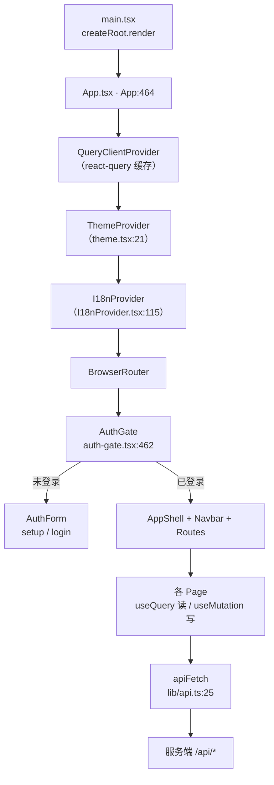

# 13 · 仪表盘：页面入口、请求、交互与状态

> 第四层补齐篇。讲清楚浏览器里那个管理界面（`client/`，React SPA）是怎么起来的：从 `main.tsx` 挂载根组件，到 `App.tsx` 的 Provider 栈与路由表，到每个页面共用的请求层 `apiFetch`、登录门 `AuthGate`，以及「读用 useQuery、写用 useMutation」的状态范式。后端 `/api/*` 的鉴权与路由见 [19 篇](./19-认证与安全.md)；本篇只到客户端发出请求为止。

---

## 0. 人话定位

把仪表盘想成一个「遥控器」：服务端是电视机，仪表盘只是把按钮画出来、把你的操作翻译成 HTTP 请求发过去。它自己**不存任何业务数据**——所有真相在服务端的 SQLite 里，仪表盘靠 react-query 把读到的东西缓存几十秒。

| 你关心的问题 | 去哪一节 |
|---|---|
| 界面从哪里开始执行？ | §1 |
|  URL 怎么对应到页面？ | §2 |
| 每个请求怎么带上登录凭证？ | §3 |
| 没登录时为什么跳到登录页？ | §4 |
| 改了东西界面怎么自动刷新？ | §5 |
| 主题/语言记在哪？ | §6 |



## 1. 入口：`main.tsx` → `App`

`client/src/main.tsx`（全文 11 行）：`createRoot(document.getElementById('root')!).render(<StrictMode><App /></StrictMode>)`。没有别的逻辑——整个应用从 `App` 组件展开。

`client/src/App.tsx` · `App+0`（464 行）是一棵 **Provider 洋葱**，由外到内（+2~+54）：

```
QueryClientProvider → ThemeProvider → I18nProvider → BrowserRouter → AuthGate
  → AppShell → Navbar + PageContainer → PageBoundary → Routes
```

每一层的职责：QueryClientProvider 提供全局查询缓存（§5）；ThemeProvider 管深浅色（§6）；I18nProvider 管语言（§6）；BrowserRouter 提供 URL 路由（§2）；AuthGate 把未登录者挡在门外（§4）；AppShell/PageContainer/PageBoundary 管布局与错误边界。`Toaster`/`CommandPalette`/`UpdateReminder`/`NewBuildPrompt` 是挂在壳上的全局浮层（509–512 行）。

## 2. 路由表：URL → 页面

`client/src/App.tsx` · `App` 内的 `<Routes>`（479–506 行）。这是一张**标准 react-router 路由表**（不是状态切换），核心映射：

| URL | 页面组件 | 说明 |
|---|---|---|
| `/`、`/models`、`/fallback` | `Navigate → /models/chat` | 三个旧入口都重定向到聊天模型链 |
| `/models/chat` | `FallbackPage` | 回退链管理（仪表盘主页） |
| `/models/chat/:id` | `ModelDetailPage` | 单模型详情 |
| `/models/fusion` | `FusionPage` | 融合虚拟模型 |
| `/models/embeddings`、`/image`、`/video`、`/audio`、`/search`、`/decision` | 各模态 Page | 详见 [17 篇](./17-搜索与多模态.md)、[18 篇](./18-模型与端点管理.md) |
| `/models/{image,video,audio}/:id`、`/models/transcription/:id` | `MediaDetailPage modality=…` | 同一组件按 modality 复用 |
| `/playground` | `PlaygroundPage` | 试用台 |
| `/keys` | `KeysPage` | API key 管理 |
| `/agents` | `AgentsPage` | client-profile |
| `/analytics`、`/logs`、`/premium` | 各 Page | 统计 / 日志 / 高级版 |
| `*` | `NotFoundPage` | 兜底 |

导航菜单数据在 `App+0` 上方的 `navItems`（72）/`modelItems`（84）/`analyticsItems`（97）/`navMenus`（106）；`Navbar+0`（241 行）渲染它们。`FULL_BLEED_ROUTES`（422 行）标记哪些路由占满全高（如 playground）。

## 3. 请求层：`apiFetch` — 每个请求怎么带凭证、怎么处理错误

`client/src/lib/api.ts` · `apiFetch+0`（25 行，全文 89 行的小模块是整个客户端的 HTTP 出口）。

```ts
export async function apiFetch<T>(path: string, options?: RequestInit): Promise<T>
```

分步（偏移以 25 为 +0）：

1. **+1~+9 装头**：`getToken()`（+1）从 localStorage 取会话 token；非 FormData 且未设 Content-Type 则补 `application/json`（+4~+6）；有 token 则设 `Authorization: Bearer <token>`（+7~+9）。
2. **+10~+16 发请求**：`fetch(BASE+path, {...options, headers})`——注释（36–38 行）强调 **headers 最后合并**，否则调用方的 `options.headers` 会盖掉这里设的 Content-Type 与 Authorization。
3. **+17~+39 非 2xx**：解析错误体；**关键判据（+25~+27）**：只有 `status===401 && body.error.type==='authentication_error'` 才 `clearToken()` + 派发 `UNAUTHORIZED_EVENT`。注释（44–49 行）：discover/probe 端点会**原样转发上游 provider 的 401**（「端点拒绝了这把 key」），那些不带 `authentication_error`，绝不能当成会话过期——否则 operator 每测一把坏 key 就被踢下线。错误对象挂上 `status`/`code`（+37~+38）供调用方分支；message 兼容 `{error:{message}}` 与 `{error:'字符串'}` 两种形状（+35）。
4. **+41**：204 ⇒ 返回 undefined。
5. **+48~+56 非 JSON 的 200**：先 `res.text()` 再 `JSON.parse`；失败则抛「API 不可达」明确错误（#257：反向代理把 `/api/*` 当成静态 index.html 返回时，裸 `res.json()` 只会抛opaque 的「Unexpected token '<'」）。

凭证三件套：`getToken+0`（6）/`setToken+0`（9）/`clearToken+0`（12），键 `TOKEN_KEY='freellmapi_dashboard_token'`（2 行），全部 try/catch 包裹（localStorage 不可用时静默）。`logout+0`（84）：POST `/api/auth/logout`（+1，失败忽略）→ clearToken（+2）→ 派发 UNAUTHORIZED_EVENT（+3）。

## 4. 登录门：`AuthGate`

`client/src/components/auth-gate.tsx` · `AuthGate+0`（462 行）。

1. **+3~+7**：`useQuery(['auth-status'], () => apiFetch('/api/auth/status'), {retry:false})`——问服务端「现在是什么认证状态」。
2. **+9~+13**：监听 `UNAUTHORIZED_EVENT` ⇒ refetch（§3 踢下线时这里重新问状态）。
3. **+18~+40 桌面版自修复**：`desktopSessionBridge()`（26 行）拿到桌面 shell 递来的会话；若 `needsSetup || !authenticated` 则尝试一次 `desktopSession()` 取 token → setToken → invalidateQueries → refetch（+22~+40）。**一次只试一遍**，shell 递回的 token 仍被服务端拒就 `setRepairFailed(true)` 显示错误而非死循环（477–479 注释）。
4. **+42~+46 `onAuthed`**：登录/注册成功后 `invalidateQueries()`（丢掉缓存的未认证数据）+ refetch。
5. **渲染分支**（+48 起）：isLoading → 转圈；isError/无 data → 「服务端不可达，跑 `npm run dev`」；desktopNeedsSession → 修复中/失败提示；`data.needsSetup` → `AuthForm mode="setup"`（+80）；`!data.authenticated` → `AuthForm mode="login"`（+81）；否则渲染 children（+83，放行到路由）。

`AuthForm+0`（60 行）按 mode 复用同一表单做注册/登录；`ForgotPasswordForm+0`（217）、`ChangeCredentialsModal+0`（352）是配套的找回/改密。服务端会话只认 `sessions.token_hash`（明文 token 不可恢复），见 [19 篇](./19-认证与安全.md)。

## 5. 状态范式：读用 useQuery，写用 useMutation

全局缓存配置在 `client/src/App.tsx` · `queryClient`（54 行）：

- `defaultOptions.queries.staleTime = 30_000`（63 行）——注释（55–62 行，#1047）：Models 页一次挂载约 13 个 query、好几个是不同组件打同一端点，staleTime 0 会让每次导航/窗口聚焦都重新打网；30s 比任何 poller 都短（refetchInterval 仍按自己的钟跑），mutation 显式 invalidate，所以用户可见的东西不会过期。
- `mutationCache.onError`（64–69 行）：每个失败的 mutation 默认弹错误 toast，**没有动作会静默失败**；页面已内联显示失败的可设 `meta:{silenceToast:true}`  opting out。

以 `client/src/pages/FallbackPage.tsx` · `FallbackPage+0`（99 行）为范式：

| 操作 | 锚点 | 模式 |
|---|---|---|
| 读活跃 profile | `FallbackPage+21`（120） | `useQuery(['profiles','active'], () => apiFetch('/api/profiles/active'))` |
| 读回退链 | `FallbackPage+27`（126） | `useQuery(['fallback','chain',activeProfileId], …)`，queryKey 带 profile id ⇒ 切 profile 自动重取 |
| 读路由策略 | `FallbackPage+54`（153） | `useQuery(['fallback','routing'], …, {refetchInterval:15_000})`——15s 轮询 |
| 保存链 | `FallbackPage+73`（172） | `useMutation(PUT /api/fallback)`，`onSuccess: invalidateQueries(['fallback'])`（+77）⇒ 所有 fallback 前缀的 query 重取 |

**范式口诀**：queryKey 是层级数组（`['fallback','chain',id]`），invalidate 按前缀匹配；读靠 useQuery 缓存 + 可选轮询，写靠 useMutation + onSuccess invalidate。这就是「改了东西界面自动刷新」的全部机制——没有事件总线，靠缓存失效。

## 6. 主题与语言：两个 localStorage Provider

- `client/src/theme.tsx` · `ThemeProvider+0`（21 行）：初值读 localStorage `'theme'`（12 行），无则看 `matchMedia('(prefers-color-scheme: dark)')`（18 行）；切换时写 localStorage（35 行）+ 设 `document.documentElement.dataset.themeChoice`（38）+ toggle `dark` class（42）+ `colorScheme`（43）。
- `client/src/i18n/I18nProvider.tsx` · `I18nProvider+0`（115 行）：初值读 localStorage `'freellmapi.locale'`（57 行），无则按 `navigator.languages`（61–63 行）协商；切换写 localStorage（122 行）。语言包在 `client/src/i18n/locales/`（en.json 等），`useI18n()` 暴露 `t(key)`。

两者都是「localStorage 持久化 + 系统偏好兜底」的同构设计。

## 7. 风险与待补

| 级别 | 事项 |
|---|---|
| P2 | 会话 token 存 localStorage（非 httpOnly cookie）：XSS 可窃取；本项目靠 CSP 与输入 sanitization 缓解（见 [19 篇](./19-认证与安全.md)），但 token 本身客户端可读 |
| P2 | staleTime 30s 内多组件共享缓存：一个组件 invalidate 前缀会连带重取同前缀所有 query，宽前缀（如 `['fallback']`）可能放大请求量 |
| 待补 | `CommandPalette`/`SettingsDialog`/`UpdatesDialog` 的交互细节（本篇只列挂点）；桌面版 `desktopSessionBridge` 与 shell 的 IPC 契约见 [15 篇](./15-桌面端.md) |

## 8. 源码索引（符号 + 绝对行号，以 823c496b 为准）

- `client/src/main.tsx` — createRoot.render（全文 11 行）
- `client/src/App.tsx` — `queryClient:54`（staleTime 63 / mutationCache 64）；`navItems:72`；`modelItems:84`；`analyticsItems:97`；`navMenus:106`；`NavItem:124`；`Navbar:241`；`PageBoundary:413`；`FULL_BLEED_ROUTES:422`；`PageContainer:439`；`AppShell:454`；`App:464`（Routes 479–506）
- `client/src/lib/api.ts` — `BASE:1`；`TOKEN_KEY:2`；`getToken:6`；`setToken:9`；`clearToken:12`；`UNAUTHORIZED_EVENT:16`；`ApiError:20`；`apiFetch:25`；`logout:84`
- `client/src/components/auth-gate.tsx` — `desktopSessionBridge:26`；`browserDesktopSession:38`；`AuthStatus:43`；`AuthForm:60`；`ForgotPasswordForm:217`；`ChangeCredentialsModal:352`；`AuthGate:462`
- `client/src/pages/FallbackPage.tsx` — `STRATEGIES:58`；`FallbackPage:99`（active query 120 / chain query 126 / routing query 153 / saveMutation 172）
- `client/src/theme.tsx` — `ThemeProvider:21`
- `client/src/i18n/I18nProvider.tsx` — `I18nProvider:115`

---

## 9. 导航

[返回索引](./README.md) ｜ 后端鉴权 → [19-认证与安全](./19-认证与安全.md) ｜ 桌面 shell → [15-桌面端](./15-桌面端.md) ｜ 模态页面 → [17-搜索与多模态](./17-搜索与多模态.md)

## 10. 术语表

| 术语 | 人话解释 |
|---|---|
| SPA（Single-Page Application） | 单页应用：只有一个 HTML 壳，页面切换靠 JS 路由而非整页刷新 |
| Provider 洋葱 | React 里一层套一层的 Context Provider，外层的值内层都能读到 |
| react-query / TanStack Query | 管理服务端状态缓存的库：useQuery 读、useMutation 写、自动缓存与失效 |
| queryKey | 缓存的层级标识数组（如 `['fallback','chain',id]`）；invalidate 按前缀匹配 |
| staleTime | 缓存「新鲜期」：期内不 background refetch；本项目 30s（#1047 去挂载风暴） |
| refetchInterval | 轮询周期：query 按自己的钟定时重取（如路由策略 15s） |
| invalidateQueries | 把匹配前缀的缓存标记失效，触发重取——「写了之后界面自动刷新」靠它 |
| mutation | 一次写操作（POST/PUT/DELETE）；onSuccess 常接 invalidate |
| Bearer token | `Authorization: Bearer <token>` 头；仪表盘会话凭证 |
| localStorage | 浏览器持久化键值存储；这里存会话 token、主题、语言 |
| UNAUTHORIZED_EVENT | 自定义浏览器事件：apiFetch 收到本方 401 时派发，AuthGate 监听后重查状态 |
| authentication_error | 服务端本方鉴权失败的 error.type；上游 provider 转发的 401 不带它，故不踢下线 |
| AuthGate | 登录门组件：未登录挡在 AuthForm 外，已登录放行到路由 |
| needsSetup | 服务端还没有任何账号时为真，AuthGate 渲染注册表单 |
| 桌面会话自修复 | 桌面版从 shell 取会话 token 自动登录；一次只试一遍，失败显示错误而非死循环 |
| ErrorBoundary / PageBoundary | React 错误边界：子树渲染抛错时兜底显示，不整页白屏 |
| full-bleed 路由 | 占满全高的路由（如 playground），不留导航边距 |
| CSP | 内容安全策略，缓解 XSS（token 存 localStorage 的主要防线） |
| modality | 模态：image/video/audio/transcription 等；MediaDetailPage 按它复用 |
| i18n | 国际化：t(key) 按当前语言取文案 |
| matchMedia | 浏览器查询系统偏好（如 prefers-color-scheme: dark）的 API |