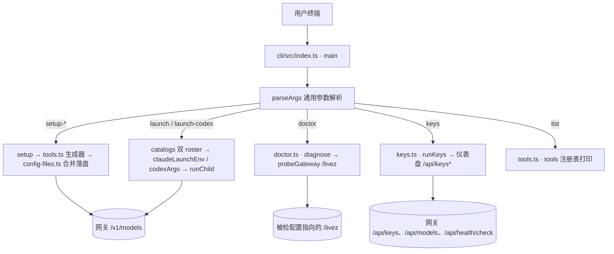

# 14 · CLI —— freellmapi 命令行：setup 配置生成、launch 子进程注入、doctor 体检、keys 密钥管理

> **层级**：第四层 · 源码补齐（模块篇）。**基准**：`adrian`@`ed38ed46`，核对日期 2026-11-23。
> **定位记法**：`完整路径` · `Symbol+N`，`+0` 为符号声明起点，偏移 = 目标行 − 声明行；文末索引只给「符号 → 文件」。
> **实测声明**：本篇全部为静态源码走读，**没有运行 CLI、没有向网关或上游发送任何请求**；涉及运行期行为处均为代码事实，不是实测结果。

---

## 0. 人话定位：网关的「装机工具箱」

网关本体（server）跑起来之后，用户手里的 Claude Code、Codex、Cline 等客户端**默认并不知道它的存在**。CLI（`cli/` 工作区，npm 包 bin 名 `freellmapi`）就是解决「最后一公里」的工具箱，四组命令各管一件事：

| 命令族 | 人话 | 动不动用户的配置文件 |
|---|---|---|
| `setup-<tool>`（21 个） | 「装修队」：把网关地址和 key **写进**各客户端自己的配置文件 | 动，但先备份、原子写、可 `--dry-run` 预览 |
| `launch` / `launch-codex` | 「临时工」：**不改任何文件**，把凭证注入子进程环境变量，用完即走 | 不动 |
| `doctor [tool…]` | 「验收员」：检查某客户端的请求**到底**发没发到这个网关 | 不动（只读配置 + 探测 `/livez`） |
| `keys add/list/remove/test` | 「库房管理员」：经仪表盘 API 管理 provider 密钥 | 不动本地文件，写远端数据库 |



**边界澄清**：CLI 不是网关的运行时组成部分——server 不 import cli；cli 只通过 HTTP 与网关对话（`/v1/models` 拉目录、`/api/*` 管密钥、`/livez` 做体检）。它与仪表盘（[13-仪表盘.md](13-仪表盘.md)）是**平行的两个前端**：一个写文件/起子进程，一个渲染页面。

---

## 1. 入口与命令分发

### 1.1 从 bin 到 main

- `cli/package.json` 的 `bin.freellmapi` 指向 `cli/dist/index.js`（esbuild 构建产物，不入库；源码为 `cli/src/index.ts`）。
- `cli/src/index.ts` · `isDirectExecution+3` 用 `fs.realpathSync` 比较 `process.argv[1]` 与模块自身路径，只有直接执行才跑 main——被 import 时不副作用启动。
- `cli/src/index.ts` · `unsupportedNodeVersion+5`：Node 主版本 < 20 直接给人话报错。注释写明原因：`AbortSignal.timeout`（17.3）、全局 `fetch`（18）、`node:readline/promises`（17.4），而 npm 对 `engines` 默认只警告（#1283）。

### 1.2 main：先互斥校验，后分发

`cli/src/index.ts` · `main+0` 的顺序本身就是一组规则：

| 步骤 | 锚点 | 规则 |
|---|---|---|
| 解析 | `main+1` | `parseArgs(argv)` 拆出 command 与 options |
| help | `main+2~+5` | 无命令 / `help` / `--help` / `-h` → 打印帮助；`keys --help` 走 `keysHelp()` |
| flag 互斥 | `main+6~+14` | `--token/--key/--id` **只有 keys 能用**；反过来 keys **不能用** `--api-key/--profile/--model` |
| keys 分发 | `main+15` | `runKeys(options, () => promptForKey(true))` |
| 多余位置参数 | `main+20~+22` | 除 doctor/keys 外一律拒绝——注释明说：放在 setup 分支之后检查会让 `setup-claude typo` 静默吞掉 stray word |
| list | `main+23~+28` | 打印 `tools` 注册表的 id/protocol/baseUrlSupport |
| setup-* | `main+29~+32` | 进 `setup()` |
| doctor / launch / launch-codex | `main+33~+35` | 三个 launcher/体检入口 |
| 未知命令 | `main+36` | 报错并附全文 help |

### 1.3 parseArgs：一个通用解析器

`cli/src/index.ts` · `parseArgs+0` 不认识具体命令，只认识 flag 语法：

- `parseArgs+1~+8`：默认值——`url` 取 `FREELLMAPI_URL` 否则 `http://localhost:3001`；`apiKey` 取 `FREELLMAPI_API_KEY`；`token` 取 `FREELLMAPI_DASHBOARD_TOKEN`；`profile='default'`；`dryRun=false`。
- `parseArgs+12~+14`：第一个非 `-` 开头的词当命令。
- `parseArgs+16~+21`：其余位置词**收集不报错**（注释：让解析器保持通用，由 dispatcher 拒绝——见 §1.2）。
- `parseArgs+27~+30`：支持 `--flag=value` 与 `--flag value` 两种形态。
- `parseArgs+31~+53`：认识的 flag 共 8 个：`--url --api-key --profile --model --timeout --token --key --id`；缺值或值是下一个 flag 时报「requires a value」。
- `parseArgs+46~+51`：`--id` 必须是正整数且 `Number.isSafeInteger`。
- `parseArgs+55`：不认识的 flag 直接 `Unknown option`。
- 两个小 validators：`validateProfile+0` 只允许字母数字点下划线连字符、禁 `.`/`..`（防路径穿越）；`parseTimeout+0` 拒绝 NaN/非正数——注释明说「拒绝而不是clamp」：`--timeout 5s` 静默变成默认值是这类命令最该免疫的 quiet no-op。

---

## 2. 目录拉取与模型解析：为什么拉两份 roster

### 2.1 「缺席的两义」问题

`/v1/models?available=true` 返回的列表里**没有**某个模型，有两种可能：它不存在，或者它存在但此刻配额耗尽。把后者报成「未知模型（拼写错误？）」会在 provider 限流的一瞬间冤枉一个健康的 pinned 模型。**只有未过滤的全量 roster 能区分这两者**——这就是 `cli/src/models.ts` 整个模块存在的理由（文件头注释）。

```text
catalog(url, key, availableOnly=true)   → available roster（此刻能服务的）
catalog(url, key, availableOnly=false)  → full roster（注册过的全部）
        │
        ▼
某 id 在 full 里、不在 available 里  ⇒  注册了但暂时不可服务（警告，仍可 launch）
某 id 两份都不在                    ⇒  真·未知模型（抛 UnknownModelError + 相近建议）
```

### 2.2 三个函数的分工

| 函数 | 锚点 | 干什么 | 关键细节 |
|---|---|---|---|
| `catalog` | `cli/src/index.ts` · `catalog+3` | fetch `/v1/models`，Bearer key，10s 超时（`catalog+5`） | 网络失败 unwrap `error.cause` 给人话（`catalog+7~+16`）；非 2xx 截 200 字符报错（`catalog+17~+20`）；空列表报错（`catalog+23`） |
| `catalogs` | `cli/src/index.ts` · `catalogs+1` | 先拉 available（必需），再拉 full（尽力而为） | full 拉失败时 `full=available` 并**记录** `degradedReason`（`catalogs+5~+9`）——降级可以，静默降级不行 |
| `resolvePinnedModel` | `cli/src/index.ts` · `resolvePinnedModel+5` | 没 pin 直接返回 undefined；pin 了才解析 | 有 `degradedReason` 先警告「本次判定用的是过滤 roster」（`+10~+16`）；解析后若 `unavailable` 再警告「注册但暂不可用，仍照常启动」（`+22~+27`）——路由器可能在会话中途恢复它 |

### 2.3 resolveLaunchModel：纯函数裁决

`cli/src/models.ts` · `resolveLaunchModel+0`：

1. `+5`：id = 显式请求 ?? `defaultModelId(available)`。
2. `+6`：先在 full 里找，找不到再在 available 里找。
3. `+10`：`auto` 由路由器本身服务、不需要出现在任何 roster，直接放行。
4. `+11~+19`：真找不到 → 从 full 里挑最多 5 个「互相包含」的相近 id 做 Did-you-mean，抛 `UnknownModelError`。
5. `+27`：`unavailable = known.available === false || 不在 available 里`。

两个配套小函数：

- `cli/src/models.ts` · `defaultModelId+1`：第一个「非 auto 且 available!==false」的具体模型，否则 `auto`。注释专门警告：**这与 setup 生成器的默认值刻意不同**——生成器 prefers `auto`（配置文件长寿，让路由器逐请求选择）；launch 把具体 id 钉进 `ANTHROPIC_MODEL`（会话可见、可复现）。统一两者会 silently 改变 `freellmapi launch` 的行为。
- `cli/src/models.ts` · `contextWindowOf+1`：`context_window ?? context_length ?? undefined`。**undefined 是事实**——目录没公布窗口不等于已知 128k，调用方不许编一个（§4.1 会用到这条纪律）。

---

## 3. setup：配置生成与安全落盘

### 3.1 主流程

`cli/src/index.ts` · `setup+0` 是一条直线：

```text
getTool(命令去掉 setup- 前缀)          setup+1   找不到 → Unknown setup command
→ apiKey = --api-key ?? promptForKey() setup+3   非 TTY 且无 key → 人话报错
→ catalogs(url, apiKey)                setup+4   双 roster（§2）
→ resolvePinnedModel(--model)          setup+9   校验并警告；id 穿进生成器
→ GenerateContext{url,apiKey,profile,  setup+10~+18
   models:available, homeDir,
   requestedModelId, detectedClient}
→ tool.generate(context)               setup+19  纯函数，产出 {files, notes}
→ files 为空（guide 类）→ 只打印 notes  setup+21~+24
→ applyGeneratedFiles(files, dryRun)   setup+26  两阶段落盘（§3.4）
→ dryRun 且有变化 → printDryRunDiff    setup+28~+29
→ 有变化 → Updated + Backup 路径       setup+32
```

注释（`setup+5~+8` 上方）记录了一个已修 bug：`--model` 曾经只解析不传递，生成器 silently 写自己偏好的模型；现在先对**未过滤**目录校验（配额耗尽≠拼写错误）再穿进 `GenerateContext.requestedModelId`。

### 3.2 生成器注册表：21 个客户端

`cli/src/tools.ts` · `metadata+0` 是 21 行元组，`tools+0` 映射成 `ToolDefinition[]`，`getTool+0` 按 id 查找。分布：

| 维度 | 取值 |
|---|---|
| configType | 19 个 `file`（真写文件）+ 2 个 `guide`（cursor、generic，只打印指引） |
| protocol | claude=Anthropic Messages；codex=OpenAI Responses；qwen=OpenAI or Gemini；其余 18 个=OpenAI Chat |
| baseUrlSupport | claude=`root`（不带 /v1）；其余全部=`/v1` |

`cli/src/types.ts` · `ToolDefinition+0` 约定每个生成器是 `generate(ctx) → {files, notes}` 的**纯函数**；`GenerateContext+0` 里的 `detectedClient` 由入口注入——注释明说：让 golden-output 测试的快照不依赖宿主机装了什么客户端。

### 3.3 生成器内部的公共启发式

- `cli/src/tools.ts` · `primaryModel+6`：显式 `--model` 最大——哪怕它不在 available roster（=注册但配额耗尽），也照钉不误，**绝不静默换成别的模型**。
- `primaryModel+10~+13`：无 pin 时依次找 `auto` → 非 fusion 且可用 → 非 fusion → 字面量 `{id:'auto', context_window:128_000}`。注释：默认 `auto` 是网关存在的意义，**绝不小心落到 `fusion`**（多模型扇出）。
- `cli/src/tools.ts` · `contextWindow+1`：`context_window ?? context_length ?? 128_000`——注意这里**允许**兜底 128k（写配置文件需要一个数），与 launch 路径的「不许编」（§2.3）是刻意的口径差。
- `cli/src/tools.ts` · `outputLimit+1`：`min(8192, contextWindow)`。

两个精读样例：

| 生成器 | 产物 | 要点 |
|---|---|---|
| `cli/src/tools.ts` · `claude+0` | `~/.claude/settings.json`（profile 非 default 时 `~/.claude/profiles/<name>/settings.json`，`claude+2~+4`），`sensitive:true` | env 块写 6 个变量：BASE_URL/AUTH_TOKEN/MODEL/OPUS/SONNET/HAIKU + `CLAUDE_CODE_AUTO_COMPACT_WINDOW` + 模型发现开关（`claude+11~+20`）；notes 推荐「零落盘凭证请用 freellmapi launch」（`claude+23~+28`） |
| `cli/src/tools.ts` · `codex+0` | `~/.codex/config.toml`，`# freellmapi:start/end` 标记块 | `codex+2`：auto-compact 阈值 = `max(16000, floor(window*0.9))`；注释（`codex+11~+13`）：Codex 只读这一个文件，named profile 是同文件里的 `[profiles.NAME]` 表，**分文件永远不会被读**；key 不写进文件，notes 要求 export `FREELLMAPI_API_KEY`（`codex+43~+50`） |

其余 19 个生成器（cline/continueDev/aider/opencode/goose/qwen/roo/kilo/crush/dsh/mimo/atomcode/openclaw/hermes/pi/reasonix/zcode/cursor/generic）本篇未逐行走读，符号位置见 §8 索引。

### 3.4 落盘：四种合并策略 + 两阶段提交

`cli/src/config-files.ts` · `renderFile+0` 按 format 分发：

| format | 合并函数 | 策略 | 保住什么 |
|---|---|---|---|
| json | `mergeJson+0` | JSONC 容错解析（`mergeJson+3~+6`），解析失败抛「cannot be parsed safely」（`+7~+9`）；嵌套对象递归、其余替换；数组可按点路径配规则（`+28~+31`） | 用户原有 formatting（jsonc-parser 的 modify/applyEdits 做最小编辑） |
| json 数组规则 | `mergeJsonArray+0` | `union`：保留现有 + 追加缺失（JSON.stringify 判重，`+1~+2`）；`ownedBy`：删掉字段全匹配的旧项再追加（`+4~+6`） | 其他 provider 的数组项 |
| yaml（结构化） | `mergeYamlDocument+0` | 在解析后的 Document 上 setIn/deleteIn（`+15~+18`：显式 undefined = 删键） | **注释、键序、 quoting**——头注释举例：dsh 的 settings.yaml 与其他 provider 共享，不能丢兄弟节点 |
| yaml/toml/env（标记块） | `mergeMarked+0` | 有旧 `freellmapi:start/end` 块 → 整段替换（`+5~+7`）；没有 → 追加（`+8~+9`） | 块外用户内容 |
| toml | `mergeToml+0` | 结构化去重：按 root key / table 名 / array entry 名剔除旧定义（`mergeToml+3` 起），生成块包标记后插回 | 其他 provider 的 table；array of tables 的子表随父 entry 一起drop（`mergeToml+23~+29`） |
| env | `mergeEnv+0` | 按 `KEY=` 逐行替换，未见过的 key 追加（`+20~+22`）；空文件不会产生空首行（`+9` 上方注释） | 无关键、注释行 |

**两阶段提交**（`applyGeneratedFiles+4~+6`）：先 `planGeneratedFile` 把**所有**目标文件读出来合并完（`planGeneratedFile+1~+3`），任何一个合并失败整批中止、不留半改状态；然后才逐个 `commitPlannedWrite`：

1. 无变化直接返回（`commitPlannedWrite+2`）。
2. `mkdir -p` 目录，mode 0700（`+3`）。
3. 已存在的文件先复制成 `<path>.backup-<ISO时间戳>`（`+5~+8`）。
4. 写临时文件 `<path>.freellmapi-<pid>.tmp`，sensitive 则 0600（`+9~+10`）。
5. `rename` 原子替换（`+11`），sensitive 再 chmod 0600 兜底（`+12`）。

`--dry-run` 在 plan 之后直接返回（`applyGeneratedFiles+5`），`printDryRunDiff+8` 找首个分歧行打 `@@ line N @@` 伪 diff。

---

## 4. launch：零落盘的子进程注入

### 4.1 launch → Claude Code

`cli/src/index.ts` · `launchClaude+0`：取 key（`+1`）→ 双 roster（`+2`）→ `resolvePinnedModel` 只为警告（`+7`）→ `claudeLaunchEnv` 构建环境（`+8~+10`）→ `runChild('claude', [], env)`（`+11`）。注释（`+3~+6`）解释为什么解析两次：两次都是同一对 roster 上的纯调用，不可能得出不同裁决；保住 `claudeLaunchEnv` 无副作用比省一次调用更值。

`cli/src/index.ts` · `claudeLaunchEnv+0` 是核心，规则逐条：

| 锚点 | 规则 | 人话 |
|---|---|---|
| `+8` | `resolveLaunchModel` 选出 id 与窗口 | 默认钉**具体模型**而非 auto（§2.3） |
| `+12~+13` | **删除** `ANTHROPIC_API_KEY` 与 `ANTHROPIC_AUTH_TOKEN` | 绝不把用户真实的 Anthropic 凭证泄露给网关 |
| `+14~+23` | profile 非 default → 要求 `~/.claude/profiles/<name>/` 已存在，否则报错并提示先跑 setup-claude；存在则设 `CLAUDE_CONFIG_DIR` | profile 是 setup 生成的目录，不是模型 id |
| `+24~+32` | 注入 BASE_URL/AUTH_TOKEN(=网关key)/MODEL/OPUS/SONNET/HAIKU 全钉同一 id + 模型发现开关 | 网关接管全部模型槽位 |
| `+39~+43` | 目录公布了窗口才设 `CLAUDE_CODE_AUTO_COMPACT_WINDOW`；没公布就**删掉**该变量 | 注释：旧的 `?? 128_000` 给每个没窗口的模型编了个数——太高则网关已拒绝才压缩，太低则还能装下就压缩；缺失时让 Claude Code 用自己的默认 |

### 4.2 launch-codex → Codex CLI

`cli/src/index.ts` · `launchCodex+0`：key（`+1`）→ roster（`+2`）→ selected = pin ?? 默认（`+3~+6`）→ env 只加 `FREELLMAPI_API_KEY`（`+7`）→ `codexArgs`（`+8`）→ `runChild('codex', args, env)`（`+9`）。

`cli/src/index.ts` · `codexArgs+1~+9` 用 7 个 `-c` 覆盖项把 provider 指到网关：`model_provider="freellmapi"`、`base_url=<root>/v1`、`wire_api="responses"`、`env_key="FREELLMAPI_API_KEY"`、`requires_openai_auth=false`。**key 走环境变量引用，不进命令行 argv**（argv 会被 `ps` 看到）。

### 4.3 runChild：信号与退出码

`cli/src/index.ts` · `runChild+0`：

- `+5`：`cross-spawn`，`stdio:'inherit'`——子进程直接接管终端。
- `+6~+9`：wrapper **忽略 SIGINT**（前台子进程自己从终端收到并决定怎么处理），**转发 SIGTERM**。
- `+15~+18`：子进程 error（如命令不存在）→ 清理监听器并 reject。
- `+19~+24`：exit 有 code → 原样返回；被信号杀 → `128 + 信号号`（`+22`）；都没有 → 1。

---

## 5. doctor：请求到底发没发到这个网关

### 5.1 判定链

`cli/src/doctor.ts` · `diagnose+0` 对每个工具走同一条链，**顺序即优先级**：

| 顺序 | 锚点 | verdict | 含义 |
|---|---|---|---|
| 1 | `+4~+11` | `unknown` | 不认识这个工具的配置解析方式（目前仅 claude/codex，见 `LAYER_RESOLVERS`） |
| 2 | `+16~+25` | `unknown` | 找到配置层但没写 base URL → 走厂商默认 |
| 3 | `+35~+44` | `unreachable` | 配置指向的地址没人应答 |
| 4 | `+46~+58` | `shadowed` | 低优先级层写了**别的** URL 但被高优先级层压住——「你改的那个文件没生效」 |
| 5 | `+63~+74` | `elsewhere` | 生效 URL 与 `--url` 不是同一网关（`sameGateway` 判定） |
| 6 | `+76~+87` | `elsewhere` | 地址有人应答但 `/livez` 不像本 gateway——同端口别的服务 |
| 7 | `+93~+105` | `degraded` | 路由正确、身份确认，但网关自报不能服务——注释：报成 routed 会让用户去翻已经正确的配置 |
| 8 | `+107~+114` | `routed` | 全对 |

层解析：`claudeLayers+0` / `codexLayers+0` 各自列出 env、managed settings、项目设置等层并标出哪层 effective；`diagnose+13~+14` 取第一个 effective 层。`exitCodeFor+1`：全部 routed 才 0，否则 1——可当脚本前置条件（`runDoctor` 注释）。

### 5.2 probeGateway：三字段指纹

`cli/src/doctor.ts` · `probeGateway+7~+9` GET `<url>/livez`（默认超时 `DEFAULT_PROBE_TIMEOUT_MS`，可用 `--timeout` 抬高）；`+31~+33`：**identified = body 同时有 string `status`、string `version`、number `uptime_s`**；`+37`：healthy 还要求 `status==='ok'` 且 HTTP 2xx。非 JSON 应答算 reachable 但不 identified（`+21~+29`）。这套「形状指纹」就是 §5.1 第 6 步区分「本网关」与「同端口路人」的依据。

---

## 6. keys：provider 密钥管理（走仪表盘 API）

`cli/src/keys.ts` · `runKeys+0` 是四个动作的共用入口，前置校验一长串（`+4~+24`）：动作必须 add/list/remove/test；位置参数个数按动作校验；**不支持 --dry-run**（`+11`，报错明说 no request was made）；`--key` 仅 add、`--id` 仅 remove/test；platform 必须匹配 `^[a-z][a-z0-9_-]*$`；必须有 dashboard token（`FREELLMAPI_DASHBOARD_TOKEN` 或 `--token`，`+18~+19`）；timeout 默认 30s、上限 2147483647ms。

内部三个嵌套 helper（非顶层符号，按行为描述）：

- **request**（`runKeys` 内 94–116 行）：Bearer dashboard token；`redirect:'error'`、`cache:'no-store'`；401/403 统一报「认证失败」；**绝不回显响应 body**——注释：provider 错误体可能含凭证，只报 HTTP 状态。
- **listKeys**（118–125 行）：GET `/api/keys` 并逐行校验 id/platform 形状。
- **check**（127–138 行）：POST `/api/health/check/:id` 后**再拉一次 listKeys 复核**——注释：传输失败时服务器保留旧状态，HTTP 200 + status=healthy  alone 不能证明本次检查成功；`lastHealthError` 非空且状态非 invalid → 报 `inconclusive`；只有 healthy 且非 inconclusive 才退出 0。

四个动作：

| 动作 | 锚点 | 行为 |
|---|---|---|
| add | `runKeys+72~+86` | 先 GET `/api/keys/providers` 确认 platform 存在；keyless provider 不提示输 key；POST 保存后**立即 check**——验证失败 key 仍保留、退出 1（help 里明说这条语义） |
| list | `runKeys+89~+101` | GET keys + `/api/models`，逐行打印 ID/PLATFORM/MODELS/ENABLED/STATUS；模型数口径见 `modelCount+2~+4`：enabled + 同 platform + modelScope 过滤 +（custom 看自定义 id 集合，否则看 keyId 归属） |
| remove | `runKeys+106~+111` | 同 platform 多把 key 时**必须 --id 指定**，否则报错让先 list |
| test | `runKeys+113~+115` | 对所有匹配 key 逐个 check，退出码取 max |

`gatewayRoot+3~+5` 比 index.ts 的同名函数更严：URL 不许带用户名/密码/query/fragment——dashboard token 不该跟着 URL 泄漏进日志。

---

## 7. 风险与待补

| 项 | 状态 | 说明 |
|---|---|---|
| 19 个生成器未逐行走读 | [源码未确认] | 本篇只精读 claude/codex 两个样例 + 公共启发式；其余生成器的文件路径与合并规则以 §8 索引为入口自行核对 |
| `detect.ts`（ChatGPT 客户端探测） | [源码未确认] | 仅确认 `detectChatGptClient` 被 setup/codex 调用；探测逻辑未走读 |
| `doctor.ts` 的 claudeLayers/codexLayers 层序细节 | [源码未确认] | 判定链与探针已走读；各层优先级顺序未逐行核对 |
| 运行期行为 | [待运行验证] | 未执行任何 CLI 命令；双 roster 降级、doctor 各 verdict、keys check 复核均为代码事实 |
| `mergeContinueYaml`（Continue 特例） | [源码未确认] | 符号存在于 `cli/src/config-files.ts`，为 Continue 的 YAML 数组合并特化，未走读 |

---

## 8. 源码索引（符号 → 文件，不给行号）

| 符号 | 文件 |
|---|---|
| main / parseArgs / setup / catalog / catalogs / resolvePinnedModel / promptForKey / runChild / claudeLaunchEnv / launchClaude / codexArgs / launchCodex / runDoctor / help / isDirectExecution / unsupportedNodeVersion / validateProfile / parseTimeout / rootUrl / CliOptions / Catalogs | `cli/src/index.ts` |
| resolveLaunchModel / defaultModelId / contextWindowOf / ResolvedModel / UnknownModelError | `cli/src/models.ts` |
| metadata / tools / getTool / primaryModel / catalogModels / contextWindow / outputLimit / claude / codex / cline / continueDev / aider / opencode / goose / qwen / roo / kilo / crush / dsh / mimo / atomcode / openclaw / hermes / pi / reasonix / zcode / cursor / generic | `cli/src/tools.ts` |
| renderFile / mergeJson / mergeJsonArray / mergeYamlDocument / mergeYaml / mergeContinueYaml / mergeMarked / markerPattern / mergeToml / mergeEnv / planGeneratedFile / commitPlannedWrite / applyGeneratedFiles / applyGeneratedFile / printDryRunDiff / ApplyResult | `cli/src/config-files.ts` |
| diagnose / probeGateway / claudeLayers / codexLayers / LAYER_RESOLVERS / DOCTOR_TOOLS / formatReport / exitCodeFor / sameGateway / normalizeUrl / DoctorOptions / ToolReport / GatewayProbe | `cli/src/doctor.ts` |
| runKeys / keysHelp / gatewayRoot / modelCount / statusOf / KeyCommandOptions / KeyRow / ModelRow | `cli/src/keys.ts` |
| detectChatGptClient / clientNotes / desktopAppPath / executableOnPath / DetectedClient | `cli/src/detect.ts` |
| CatalogModel / GeneratedFile / JsonArrayMerge / GenerateContext / Generation / ToolDefinition | `cli/src/types.ts` |

---

## 9. 导航

- 上级：[README](README.md)（四层学习路径）
- 上游：[12-函数级走读-存储配置与请求入口](12-函数级走读-存储配置与请求入口.md)（CLI 打的 `/v1/models`、`/api/keys` 在服务端怎么接）
- 平行前端：[13-仪表盘](13-仪表盘.md)
- 下游：[15-桌面端](15-桌面端.md)、[16-多协议入口](16-多协议入口.md)（CLI 生成的配置最终打到哪些协议端点）、[18-模型与端点管理](18-模型与端点管理.md)、[19-认证与安全](19-认证与安全.md)（unified key 与 dashboard token 的服务端校验）、[21-后台探测与配额](21-后台探测与配额.md)（keys test 触发的健康检查）

---

## 10. 术语表

| 术语 | 人话解释 |
|---|---|
| CLI | Command-Line Interface，命令行工具；这里指 npm 包装出的 `freellmapi` 命令 |
| bin | package.json 里声明的可执行入口，npm 安装时链接到 PATH |
| roster | 模型名册；available roster=此刻能服务的，full roster=注册过的全部 |
| degradedReason | 全量名册拉取失败时记录的降级原因；有它说明「未知模型」判定不再可靠 |
| pinned model / pin | 用 `--model` 显式钉死本次使用的模型 id |
| auto | 特殊模型 id，表示「让网关路由器逐请求挑最合适的模型」 |
| fusion | 特殊模型 id，多模型扇出聚合；生成器默认值刻意避开它 |
| GenerateContext | setup 传给生成器的上下文：url/key/profile/名册/homeDir/pinned id/探测到的客户端 |
| guide 类生成器 | 不写文件、只打印配置指引的生成器（cursor、generic） |
| JSONC | 允许注释和尾逗号的 JSON 方言；mergeJson 用 jsonc-parser 容错解析 |
| ownedBy / union | JSON 数组合并规则：前者删掉字段全匹配的旧项再追加，后者保留旧项只补缺失 |
| 标记块 | `# freellmapi:start` 到 `# freellmapi:end` 之间的生成内容，重跑 setup 时整段替换 |
| 两阶段提交 | 先把所有文件读完合并完（任一失败全批中止），再统一写入 |
| 原子写 | 先写临时文件再 rename 替换，读者不会看到半截文件 |
| dry-run | 只预览 diff 不真写盘 |
| stdio inherit | 子进程直接共用父进程的终端输入输出 |
| SIGINT / SIGTERM | Ctrl-C 信号 / 终止信号；wrapper 忽略前者、转发后者 |
| 128 + 信号号 | Unix 惯例：进程被信号杀死时 shell 看到的退出码 |
| /livez | 网关存活探针端点，返回 status/version/uptime_s |
| identified | doctor 探针术语：应答体三字段齐全，确认「是这个网关」而非同端口别的服务 |
| shadowed | doctor verdict：你改的配置层被更高优先级的层压住没生效 |
| degraded | doctor verdict：路由正确但网关自报不能服务 |
| dashboard token | 仪表盘会话令牌（`FREELLMAPI_DASHBOARD_TOKEN`），keys 命令用它调 /api |
| unified API key | 网关对外统一密钥（`FREELLMAPI_API_KEY`），CLI 拉目录和 launch 注入用它 |
| keyless provider | 不需要密钥的 provider（无鉴权网关），keys add 时不提示输入 |
| inconclusive | keys check 术语：服务器保留了旧状态且有 lastHealthError，本次检查结果不可信 |
| modelScope | 一把 provider key 被限定只服务哪些模型；list 的模型计数要尊重它 |
| TTY | 交互式终端；非 TTY 时 promptForKey 拒绝提示输入，要求显式传 key |
| cross-spawn | 跨平台 spawn 封装，Windows 上处理 pathext/引号差异 |