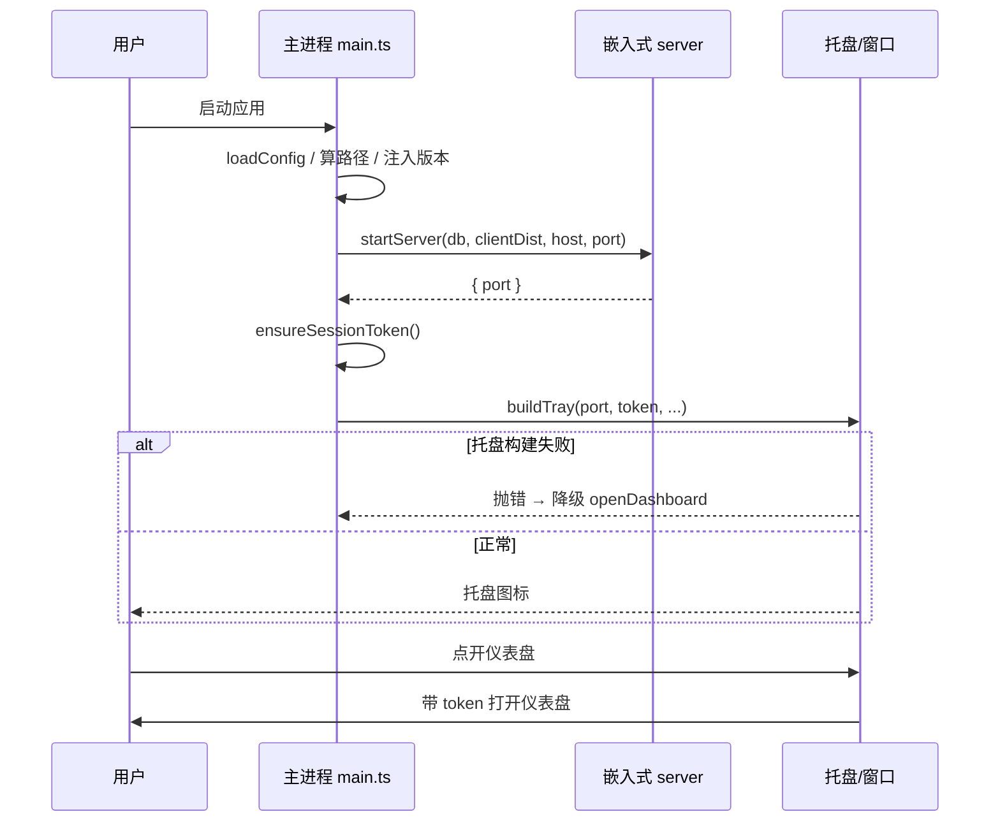
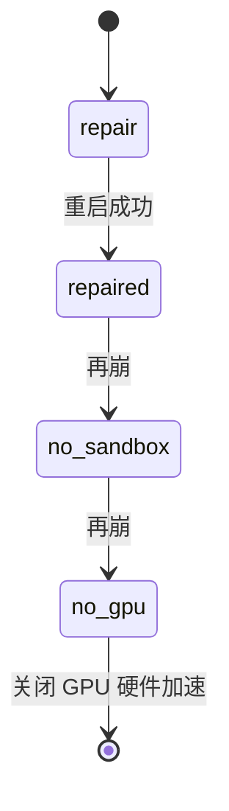

# 15 桌面端：Electron 外壳、嵌入式 server、托盘与自愈

> 基准提交：`ed38ed46`（本地 `adrian`）；核对日期：2026-11-27。范围：`desktop/src` 的主进程生命周期、嵌入式 server 托管、托盘与弹窗、GPU 崩溃自愈、编码工具一键接入、自动更新。不覆盖：渲染层仪表盘（见 [13 仪表盘](13-仪表盘.md)）、CLI（见 [14 CLI](14-CLI.md)）、server 内部路由（见 05/10/11/12）。关联：[09 测试与部署](09-测试与部署.md)。

## 需求视角

### 1 使用场景、目标与结果

面向不想碰命令行的用户：下载桌面应用、打开即得一个本机运行的 API 网关与仪表盘。完成后用户得到——一个常驻托盘图标、一个可打开的本地仪表盘页面、一个 `http://127.0.0.1:<port>` 的 OpenAI/Anthropic 兼容端点。目标是「零配置可用」：server 不作为独立进程由用户启动，而是嵌在应用进程内随应用起停。

### 2 参与者与业务前置条件

| 参与者 | 角色 | 前置条件 |
|---|---|---|
| 桌面用户 | 触发者 | 已安装应用；无需终端、无需 Node |
| Electron 主进程 | 承载者 | 应用启动完成（`whenReady`） |
| 嵌入式 server | 业务执行者 | 拿到 db 路径、client 静态目录、监听地址、端口 |
| 托盘 / 仪表盘窗口 / 弹窗 | 交互面 | server 已起、session token 已就绪 |
| 自动更新器 | 后台参与者 | 更新检查开关（可被关闭） |

前置条件不满足时：client 静态目录缺失（打包环境 `client-dist` 未随包）会使仪表盘无页面可开，但 server 仍可对外提供服务；db 目录不可写会让 `startServer` 失败，应用无法进入可用态。

### 3 业务调用层次

用户启动应用 → 主进程准备配置与路径 → 主进程在**本进程内**启动嵌入式 server（不开子进程）→ server 起来后生成会话令牌 → 构建托盘图标（失败则降级为直接开仪表盘窗口）→ 用户点托盘打开仪表盘或弹窗。更新检查与 GPU 崩溃自愈是两条横切的后台链路，不参与主请求路径。

### 4 业务数据流转

| 阶段 | 触发者 / 接收者 | 输入资料 | 业务处理 | 输出结果 | 条件不满足时 |
|---|---|---|---|---|---|
| 1 启动 | 用户 → 主进程 | 安装目录、用户配置 | 读配置、算 db/client 路径、决定监听地址 | 内部启动参数 | 配置缺失走默认值 |
| 2 起 server | 主进程 → 嵌入式 server | db 路径、client 目录、host、首选端口 | 在本进程内监听 | 实际端口 + server 句柄 | 端口被占则换端口；失败则应用不可用 |
| 3 出令牌 | 主进程 → 自身 | — | 生成/复用会话令牌 | session token | — |
| 4 建托盘 | 主进程 → 交互面 | 端口、令牌、语言、开关状态 | 构建托盘菜单 | 托盘图标 | 构建失败仅告警，降级开窗口 |
| 5 打开界面 | 用户 → 窗口/弹窗 | 端口 + 令牌 | 带 token 打开仪表盘 | 可用仪表盘 | — |

### 5 主流程、业务分支与异常结果

正常路径：启动 → server 就绪 → 托盘出现 → 点开仪表盘。

分支与异常：

- **LAN 访问开关**：默认只绑 `127.0.0.1`（仅本机）；用户在托盘打开「局域网访问」后绑 `0.0.0.0` 供 Tailscale/虚拟机/其它设备访问，且该开关**持久化并重启应用**才生效（监听地址在 `listen()` 时固定）。
- **托盘构建失败**：托盘建不出来不能拖垮应用——捕获后仅告警，改为直接打开仪表盘窗口。
- **托盘被 macOS 拒绝绘制**：托盘能干净构造但可能没真正显示，只能靠「看图标落在哪」来发现，因此 macOS 上延迟探测一次。
- **GPU 崩溃自愈**：渲染进程因 GPU/沙箱问题崩溃时，按「修复 → 已修复 → 关沙箱 → 关 GPU」的阶梯逐级降级重启，而不是直接白屏。
- **更新检查**：可被关闭；更新前先备份，且更新器走应用代理。

### 6 边界、非目标与验收表现

- 桌面端**不复刻** server 的任何业务逻辑，只负责托管与交互；理解请求路由仍要看 10/11/12。
- 本篇全部为静态走读，**未运行 Electron 应用、未发起任何真实请求、未连接运行实例**；启动时序与降级行为的运行表现均为 `[待运行验证]`。
- 更新的实际下载/安装、GPU 自愈的逐级触发属运行期行为，源码只能证明「有这条阶梯」，不能证明每级在所有机型都成功。

## 技术视角

### 7 实现地图：入口、注册点、核心源码与测试

入口 `desktop/src/main.ts`（`whenReady` 启动序列）。模块分组：

- **server 托管**：`server-host.ts`（`startServer`、`ensureSessionToken`、`backupBeforeUpdate`、`outboundProxyUrl`、`trustSystemCertificates`）
- **交互面**：`tray.ts`（`buildTray`）、`tray-platform.ts`（`trayPlatform`、`shouldOpenDashboardOnLaunch`）、`tray-visibility.ts`（`trayIsInMenuBar`）、`window.ts`（`openDashboard`）、`popover.ts`（`togglePopover`）、`window-chrome.ts`（`platformChrome`）
- **GPU 自愈**：`gpu-recovery.ts`（状态机与降级阶梯）、`gpu-recovery-host.ts`（`installGpuRecovery` 装到 app 事件）
- **更新**：`updater.ts`（`initUpdater`、`getUpdateState`）、`update-support.ts`（`updateSupport`、`updaterProxy`）
- **支撑**：`config.ts`（`loadConfig`/`saveConfig`）、`logger.ts`（`installFileLogger`、`openLogsFolder`、`openBackupsFolder`）、`stats.ts`（`todayStats`）、`base-urls.ts`（`gatewayBaseUrl`）、`i18n.ts`、`preload.ts` / `preload-popover.ts`（IPC 桥）

### 8 技术前置条件：配置、依赖、初始化、权限与数据

- 配置 `DesktopConfig`（`desktop/src/config.ts` · `loadConfig+0`）提供端口、`lanAccess`、`showInDock`、`launchDashboardShown` 等；落盘在用户数据目录。
- db 路径固定为 `<userData>/freeapi.db`（`main.ts:266`）；client 静态目录打包态取 `Resources/client-dist`、开发态取仓库 `client/dist`（`main.ts:271-273`）。
- `process.env.FREEAPI_VERSION` 在起 server 前注入应用自身版本（`main.ts:285`），保证仪表盘版本行与应用一致。
- LAN 关闭时 host=`127.0.0.1`，开启时 `0.0.0.0`（`main.ts:279`）。
- License 激活与 catalog 同步注册 Chromium 网络回退 `setCatalogFallbackFetch`（`main.ts:301`），绕开部分 Windows 上 Node fetch 的 502。

### 9 真实调用层次与关键源码定位

`desktop/src/main.ts` · `app.whenReady().then` `+0`（262）起的启动序列，按序：

1. `applyDockVisibility` → 决定是否显示 Dock 图标。
2. `loadConfig` → 取配置；算 `dbPath`、`clientDist`、`host`；注入 `FREEAPI_VERSION`。
3. `initUpdater` `+0`（`updater.ts:119`）→ 注册自动更新（自动检查开关、更新前备份、出站代理、语言）。
4. `setCatalogFallbackFetch` → catalog/License 网络回退。
5. `await startServer` `+0`（`server-host.ts:98`）→ **本进程内**起 server，返回 `{ port }`；回写端口到配置。
6. `ensureSessionToken` `+0`（`server-host.ts:183`）→ 生成/复用会话令牌。
7. `buildTray` `+0`（`tray.ts:21`）→ 建托盘；`try/catch` 包裹，失败降级。
8. macOS 上 `setTimeout(reportHiddenTray)` 探测托盘是否真被绘制。

调用关系：`main.ts` ↓ `server-host.startServer` ↓（嵌入式 server 对外服务）；`main.ts` ↓ `tray.buildTray` ↓ `window.openDashboard` / `popover.togglePopover`。

### 10 技术数据流程：字段、转换、状态与持久化

- 配置：`DesktopConfig`（端口/`lanAccess`/`showInDock`/`launchDashboardShown`）经 `loadConfig`/`saveConfig` 读写用户数据目录 JSON。
- 端口：`preferredPort` 进 `startServer`，实际 `port` 回写配置——**端口以 server 实际监听为准**，非配置写死。
- 令牌：`ensureSessionToken` 产出 session token，交给 `buildTray`/`openDashboard`，用于带鉴权打开仪表盘。
- 端点 URL：`desktop/src/base-urls.ts` · `gatewayBaseUrl+0`（12）按 `openai`/`anthropic` 两种 `BaseUrlKind` 拼出对外 base url。
- 更新状态：`desktop/src/update-support.ts` · `UpdateState` 类型 + `desktop/src/updater.ts` · `getUpdateState+0`（85）暴露给托盘文案（`desktop/src/tray.ts` · `updateLabel+0`）。

### 11 核心机制、分支、失败处理与不变量

**不变量**：server 与 UI 同进程、同生命周期；端口与令牌是「server 说了算」，UI 只消费。托盘失败不拖垮应用。

- **GPU 崩溃自愈阶梯**：`gpu-recovery.ts` 定义 `GpuRecoveryStep = 'repair' | 'repaired' | 'no-sandbox' | 'no-gpu'`（+33）、`GPU_SANDBOX_CRASH_EXIT_CODE = -2147483645`（+41）、`RESTRICTED_APP_PACKAGES_SID`（+44）。`isGpuCrash+0`（84）判是否 GPU 崩溃，`nextStepAfterCrash+0`（93）给下一级降级，`launchFlags+0`（68）按状态算重启启动参数，`aclGrantArgs+0`（114）处理 Windows 受限包的 ACL 授权。`desktop/src/gpu-recovery-host.ts` · `installGpuRecovery+0`（26）把它挂到 app 的子进程退出事件。
- **平台差异**：托盘是否提供弹窗由 `desktop/src/tray-platform.ts` · `trayMenuOffersPopover+0`（39）决定；启动是否直开仪表盘由 `shouldOpenDashboardOnLaunch+0`（48）决定；窗口装饰由 `desktop/src/window-chrome.ts` · `platformChrome+0`（23）决定；托盘是否在菜单栏由 `desktop/src/tray-visibility.ts` · `trayIsInMenuBar+0`（29）判断。
- **更新器**：`desktop/src/update-support.ts` · `updateSupport+0`（26）判定当前平台是否支持自动更新；`updaterProxy+0`（55）给更新下载配代理；更新前 `desktop/src/server-host.ts` · `backupBeforeUpdate+0`（42）先备份。
- **统计与日志**：`desktop/src/stats.ts` · `todayStats+0`（13）/`hourlyRequests+0`（39）/`successRateToday+0`（58）供弹窗展示今日用量；`desktop/src/logger.ts` · `installFileLogger+0`（91）装文件日志、`createFileSink+0`（39）做大小上限滚动。
- **编码工具一键接入（agent-setup，本轮新增）**：`desktop/src/agent-setup.ts` · `registerAgentSetup+0`（18）在 `main.ts:112` 注册一组 IPC，供仪表盘 `/agents` 页把网关写进 codex/goose/kilo/crush/mimo 这些终端编码工具的配置。`terminalAgents` 名单与 `SetupResult`/`SetupError` 契约放在 `shared/agent-setup.ts`（`+3`、`+11`），主进程与渲染层共用。安全边界写在 handler 开头（`agent-setup.ts+22~+27`）：请求必须来自本机仪表盘窗口的 `/agents` 主框架、origin 等于 `gatewayBaseUrl(port,'anthropic')`，否则抛错——防止其它来源借 IPC 改写用户工具配置。`config` 动作写配置文件并备份；`launch` 动作只对已配置的终端类 agent 生效。
- **终端拉起 agent（agent-terminal，本轮新增）**：`desktop/src/agent-terminal.ts` 负责找到可执行文件并在系统终端里启动：`findAgentExecutable+0`（9）在用户 home 下定位 agent 可执行文件；`launchMacTerminal+0`（44）在 macOS 用 AppleScript 开 Terminal/指定终端执行；`launchAgent+0`（82）按平台分发。找不到可执行文件返回 `missing`，非终端类 agent 或未配置返回 `config`，终端启动失败返回 `terminal`（对应 `SetupError` 各档）。仅 macOS/Windows 生效，其它平台 `registerAgentSetup` 直接 return（`agent-setup.ts+19`）。

### 12 详细图表

GPU 崩溃分支（stateDiagram）：

### 13 验证方式与可观察结果

- 静态：`desktop` 测试套件（见 [09 测试与部署](09-测试与部署.md)）；`gpu-recovery`/`base-urls`/`update-support` 等纯函数有单测覆盖状态机与 URL 拼装。
- 运行（本篇未执行，`[待运行验证]`）：启动应用观察托盘与仪表盘、开关 LAN 后确认绑 `0.0.0.0`、制造渲染进程崩溃观察降级阶梯、触发更新检查观察备份先行。

### 14 后续引用：调用方、依赖、测试、配置与关联文档

- 上游：无（桌面端是最终交付形态之一）；仪表盘渲染层见 [13 仪表盘](13-仪表盘.md)。
- 下游依赖：嵌入式 server 的全部能力（05/06/07/10/11/12）；更新与备份联动 [22 日志与备份](22-日志与备份.md)。
- 配置：`DesktopConfig`；server 侧配置见 [06 配置与数据流](06-配置与数据流.md)。
- 修改本主题时联动检查：`server-host.ts` 的启动参数变更会影响 `main.ts` 启动序列与 [08 启动生命周期](08-启动生命周期.md)；`gpu-recovery` 启动参数变更会影响打包脚本（`desktop/installer/installer.nsh`、`desktop/scripts/smoke-win-gpu-sandbox.ps1`）。

## 术语表

| 术语 | 含义 |
|---|---|
| 嵌入式 server | 与 Electron 主进程同进程运行的 API server，非独立子进程 |
| session token | 打开仪表盘时携带的会话令牌，由 `ensureSessionToken` 生成 |
| LAN 访问 | 绑 `0.0.0.0` 允许本机以外设备访问，默认关闭 |
| GPU 自愈阶梯 | 渲染进程 GPU 崩溃后「修复→关沙箱→关 GPU」的逐级降级重启 |
| tray | 系统托盘/菜单栏图标，桌面端主交互入口 |