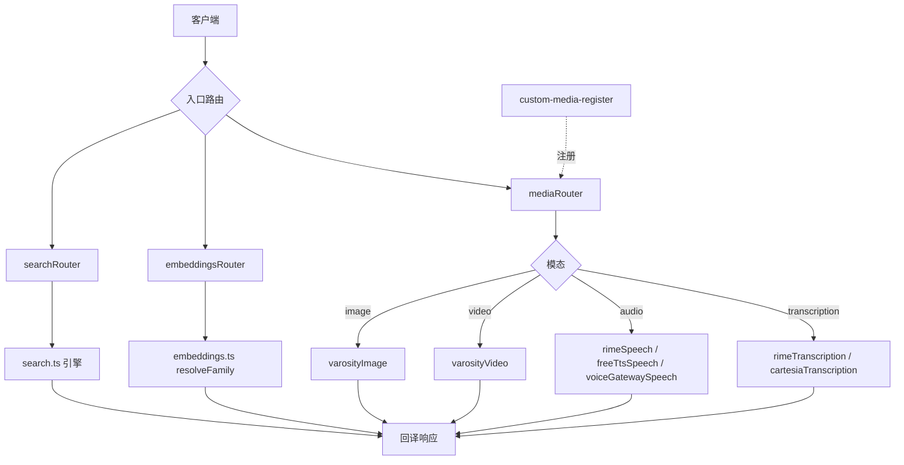

# 17 搜索与多模态：搜索、embedding、图像/视频/语音/转写

> 基准提交：`1a64da55`（本地 `adrian`）；核对日期：2026-11-17。范围：搜索（search）、向量嵌入（embeddings）、多模态生成与转写（图像/视频/语音/转写）、自定义媒体端点注册、客户端搜索就绪状态。不覆盖：纯文本对话的选路与回退（见 [10 路由限流与回退](10-函数级走读-路由限流与回退.md)）、Provider 出站翻译（见 [11 Provider 与流式](11-函数级走读-Provider与流式.md)）。关联：[05 API 与接口设计](05-API与接口设计.md)、[18 模型与端点管理](18-模型与端点管理.md)。

## 需求视角

### 1 使用场景、目标与结果

用户除了文本对话，还要让模型「看、听、说、画、查」：联网搜索拿实时信息、把文本变向量做检索、文生图/文生视频、语音合成、语音转文字。目标是把这些非文本能力也纳入同一网关与同一批免费上游 key 池，让客户端用统一接口调用。完成后：客户端可通过搜索接口取结果、通过 embedding 接口取向量、通过媒体接口产出图像/视频/音频/转写文本。

### 2 参与者与业务前置条件

| 参与者 | 角色 | 前置条件 |
|---|---|---|
| 客户端 | 触发者 | 按对应接口发请求 |
| 搜索/嵌入/媒体路由 | 承接者 | 已挂载、鉴权通过 |
| 平台适配服务 | 执行者 | 目标平台在该模态受支持、有可用 key |
| 自定义媒体端点 | 补充者 | 用户已注册自定义端点 |

前置条件不满足时：平台不支持该模态、无可用 key、模型不在已测路由内，都会在入口或适配层被拒（如 Varosity 图像模型不在已测清单内会直接 400）。

### 3 业务调用层次

客户端 → 搜索/嵌入/媒体路由 → 模态判别（该平台是否支持此模态）→ 平台适配服务出站 → 结果回译为该接口的响应形态。搜索与嵌入是独立的检索类能力；图像/视频/语音/转写共享「媒体」框架但各自有平台子集。

### 4 业务数据流转

| 阶段 | 触发者 / 接收者 | 输入资料 | 业务处理 | 输出结果 | 条件不满足时 |
|---|---|---|---|---|---|
| 1 进路由 | 客户端 → 路由 | 模态请求 | 鉴权、参数校验 | 归一化参数 | 参数非法→400 |
| 2 选平台 | 路由 → 适配服务 | 平台+模型+模态 | 查该平台是否支持此模态 | 选中适配器 | 不支持→报错 |
| 3 出站 | 适配服务 → 上游 | 归一化参数+key | 调上游、处理超时/中断 | 原始产物 | 失败→模态错误 |
| 4 回译 | 适配服务 → 客户端 | 原始产物 | 转成接口形态 | 图像 b64 / 音频 Buffer / 转写文本 / 向量 | — |

### 5 主流程、业务分支与异常结果

- **搜索**：按引擎能力（`SearchEngineFeatures`）执行，返回 `SearchHit` 列表。
- **嵌入**：按模型解析所属家族（`resolveFamily`），返回向量结果。
- **媒体**：模态分图像/视频/音频/转写（`MediaModality`）；每个模态有支持的平台子集（`MEDIA_PLATFORMS`/`VIDEO_PLATFORMS`/`TRANSCRIPTION_PLATFORMS`）。各平台适配器可能抛对应模态错误。
- **超时按模态区分**：图像 120s、音视频 300s（Varosity 适配器内），长任务不被短超时误杀。
- **自定义媒体端点**：用户可注册自定义模态端点（image/audio/transcription/search/decision），扩展内置平台之外的能力。

### 6 边界、非目标与验收表现

- 搜索/嵌入/媒体各自独立，不共享文本对话的回退链；失败以模态错误对外。
- 本篇为静态走读，**未发任何真实请求、未连上游**；各模态实际产出 `[待运行验证]`。

## 技术视角

### 7 实现地图：入口、注册点、核心源码与测试

- **搜索**：`server/src/routes/search.ts` · `searchRouter+0`（10）；`server/src/services/search.ts` · `SEARCH_MODALITY+0`（40）、`SearchHit+0`（60）、`SearchResponse+0`（67）、`SearchError+0`（77）、`SearchEngineFeatures+0`（103）。
- **嵌入**：`server/src/routes/embeddings.ts` · `embeddingsRouter+0`（17）；`server/src/services/embeddings.ts` · `listEmbeddingModels+0`（84）、`getDefaultFamily+0`（90）、`resolveFamily+0`（96）、`EmbeddingsError+0`（55）。
- **媒体框架**：`server/src/routes/media.ts` · `mediaRouter+0`（11）；`server/src/services/media.ts` · `MEDIA_PLATFORMS+0`（39）、`VIDEO_PLATFORMS+0`（44）、`TRANSCRIPTION_PLATFORMS+0`（52）、`MediaModality+0`（59）、`MediaError+0`（74）。
- **平台适配**：`media-varosity.ts`（`varosityImage` 110 / `varositySpeech` 141 / `varosityVideo` 173）、`media-rime.ts`（`rimeSpeech` 13 / `rimePcm` 52 / `rimeTranscription` 84）、`media-freetts.ts`（`freeTtsSpeech` 54）、`media-voice-gateways.ts`（`voiceGatewaySpeech` 66 / `cartesiaTranscription` 87、`CARTESIA_VERSION` 9）。
- **自定义媒体端点**：`server/src/services/custom-media-register.ts` · `registerCustomMediaModel+0`（38）、`CustomMediaModality+0`（17）。
- **客户端就绪状态**：`client/src/hooks/use-search-readiness.ts` · `useSearchReadiness+0`（7）；`client/src/components/search-readiness-notice.tsx` · `SearchReadinessNotice+0`（5）。

### 8 技术前置条件

- 三类路由在 `app.ts` 装配挂载；媒体能力依赖平台支持矩阵（`MEDIA_PLATFORMS` 等集合）。
- Varosity 图像只放行已测模型（`IMAGES` 集合：`flux-3-klein`、`flux-2-pro`、`qwen-image-3.0`、`gpt-image-2.5-flare`），未测模型直接 400，避免打到未知路由。
- 自定义端点注册后才会进入对应模态的可用集合。
- 客户端搜索就绪状态由 `useSearchReadiness` 拉取，决定是否展示就绪提示。

### 9 真实调用层次与关键源码定位

请求 → 对应 router → 服务层模态判别 → 平台适配器出站：
- 搜索：`searchRouter` → `search.ts` 引擎执行 → `SearchHit[]`。
- 嵌入：`embeddingsRouter` → `resolveFamily` 选家族 → 返回 `EmbeddingsResult`。
- 媒体：`mediaRouter` → 按模态分发到 `varosity*`/`rime*`/`freeTts*`/`voiceGateway*` → 回译为 b64/Buffer/文本。
自定义端点由 `registerCustomMediaModel` 注册进 `custom-media-register.ts` 的条目表，随后参与模态可用性判定。

### 10 技术数据流程

- 模态集合：`MEDIA_PLATFORMS`（20 平台）、`VIDEO_PLATFORMS`（4）、`TRANSCRIPTION_PLATFORMS`（12）界定每模态可用平台；`MediaModelRow` 描述单条媒体模型。
- Varosity 超时：`session()` 按模态设 image=120_000ms、audio/video=300_000ms；视频出站接收客户端 `AbortSignal` 以支持中断。
- Rime 音频：`rimePcm` 对返回音频做 PCM 处理；转写返回 `{text, language, duration}`。
- Cartesia：`CARTESIA_VERSION` 固定 API 版本头；转写返回 `{text, language?, duration?}`。
- 嵌入家族：`resolveFamily` 把模型名映射到家族，`getDefaultFamily` 给默认家族。

### 11 核心机制、分支、失败处理与不变量

**不变量**：每模态只在受支持平台集合内执行；未测/未注册的模型-模态组合被前置拒绝，不打到上游未知路由。

- 各适配器用独立错误类（`VarosityMediaError`/`RimeMediaError`/`FreeTtsMediaError`/`VoiceGatewayMediaError`）携带 HTTP 状态，路由层据此回译错误。
- 媒体超时按模态分级，长视频/音频不被短超时误杀；视频支持客户端中断（AbortSignal）。
- 搜索/嵌入失败以 `SearchError`/`EmbeddingsError` 对外，不进入文本对话回退链。

### 12 详细图表

### 13 验证方式与可观察结果

- 静态：搜索/嵌入/媒体相关测试（见 [09 测试与部署](09-测试与部署.md)）；Varosity 图像白名单、超时分级有对应断言。
- 运行（未执行，`[待运行验证]`）：各模态实际出图/出视频/出音频/转写、搜索取回、向量返回，需连上游实测。

### 14 后续引用

- 上下游：客户端 → 本篇路由 → 上游平台；模型可用性管理见 [18 模型与端点管理](18-模型与端点管理.md)。
- 关联：出站超时与 Provider 契约见 [11 Provider 与流式](11-函数级走读-Provider与流式.md)；接口形态见 [05 API 与接口设计](05-API与接口设计.md)。
- 修改联动：改 `MEDIA_PLATFORMS`/`VIDEO_PLATFORMS`/`TRANSCRIPTION_PLATFORMS` 须同步 `media.ts` 与各适配器测试；新增模态须扩 `MediaModality` 与 `CustomMediaModality`。

## 术语表

| 术语 | 含义 |
|---|---|
| 模态（modality） | image / video / audio / transcription / search / decision 等非纯文本能力类别 |
| 平台支持矩阵 | 每个模态下哪些上游平台可用的集合（`MEDIA_PLATFORMS` 等） |
| 嵌入家族 | embedding 模型所属的向量家族，用于选默认与解析 |
| 自定义媒体端点 | 用户注册的内置平台之外的媒体/搜索/决策端点 |
| 搜索就绪状态 | 客户端判断搜索能力是否可用并提示的机制 |