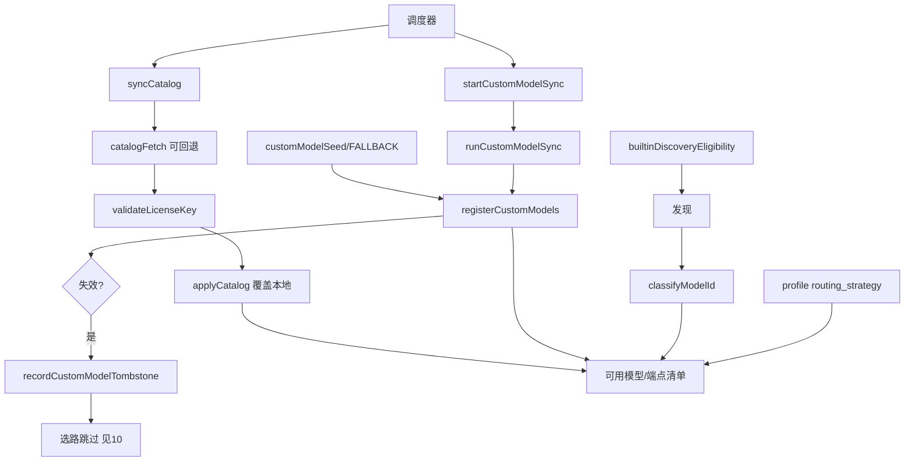

# 18 模型与端点管理：目录同步、自定义模型、发现、分组、退役与 profile

> 基准提交：`ed38ed46`（本地 `adrian`）；核对日期：2026-11-27。范围：模型目录（catalog）的同步与授权、自定义模型注册/种子/同步、模型发现（内置与通用）、端点分组与凭证、模型退役（墓碑）、per-profile 路由策略。不覆盖：单条请求如何按分数选路（见 [10 路由限流与回退](10-函数级走读-路由限流与回退.md) 与 [topics/model调度算法](../topics/model调度算法.md)）、多协议入口（见 [16 多协议入口](16-多协议入口.md)）。关联：[06 配置与数据流](06-配置与数据流.md)、[topics/premium目录同步](../topics/premium目录同步.md)。

## 需求视角

### 1 使用场景、目标与结果

网关要对上游说「我有哪些模型、用哪把 key、按什么策略排队」。模型与端点管理负责维护这份**可用模型 + 端点 + 策略**的清单：从官方目录同步、让用户加自定义模型/端点、自动发现上游模型、给端点分组、把失效模型退役。完成后：选路层（10）拿到一份准确、不过期、不含失效模型的候选清单。

### 2 参与者与业务前置条件

| 参与者 | 角色 | 前置条件 |
|---|---|---|
| 官方目录服务 | 上游数据源 | 网络可达；授权 key 有效（付费目录） |
| 用户 | 自定义者 | 在仪表盘添加自定义模型/端点 |
| 目录同步 / 自定义同步任务 | 执行者 | 调度器可用；目录版本不低于最低要求 |
| 发现机制 | 补充者 | 平台具备发现资格 |
| 选路层 | 消费者 | 清单已就绪 |

前置条件不满足时：目录版本过旧、授权失效、发现资格不满足，都会让对应能力降级或跳过，不阻塞其它模型可用。

### 3 业务调用层次

目录同步任务 → 拉取官方目录 → 校验授权 → 应用到本地（覆盖模型/端点表）。自定义链路：用户注册或种子 → 周期同步。发现链路：对具备资格的平台拉模型列表 → 分类入库。退役链路：失效模型打墓碑 → 选路跳过。profile 路由策略：每个 profile 可带自己的排序预设，未设置则继承全局。

### 4 业务数据流转

| 阶段 | 触发者 / 接收者 | 输入资料 | 业务处理 | 输出结果 | 条件不满足时 |
|---|---|---|---|---|---|
| 1 同步目录 | 调度 → 目录服务 | 目录 URL、授权 key | 拉取、校验版本/授权 | 目录数据 | 版本旧/授权失效→跳过或降级 |
| 2 应用目录 | 同步 → 本地库 | 目录数据 | 覆盖模型/端点/覆盖项 | 本地清单更新 | 应用失败保留旧清单 |
| 3 自定义 | 用户/种子 → 同步 | 自定义模型定义 | 注册、周期同步 | 自定义模型入库 | 模式不匹配→跳过 |
| 4 发现 | 调度 → 发现机制 | 平台凭证 | 拉模型列表、分类 | 发现模型入库 | 无资格→不发现 |
| 5 退役 | 检测 → 墓碑表 | 失效模型 | 打墓碑 | 选路跳过该模型 | — |

### 5 主流程、业务分支与异常结果

- **目录同步**：强制或按需触发；授权 key 先校验再应用；应用按计数返回结果。
- **自定义模型**：注册（聊天/通用）、按种子兜底、按免费模式周期同步；同步间隔可配。
- **发现**：内置发现仅对少数平台开放且需资格；通用发现受目录字节上限与发现数量上限约束。
- **退役（墓碑）**：记录、判定、清除三步；被打墓碑的模型不再参与选路。
- **profile 路由策略**：每 profile 可携带独立预设；为空表示继承全局策略。

### 6 边界、非目标与验收表现

- 本篇管「清单的维护」，不管「按清单怎么选」；选路评分见 10 与调度算法专题。
- 本篇为静态走读，**未连官方目录、未连上游、未改运行数据**；同步/发现的运行表现 `[待运行验证]`。

## 技术视角

### 7 实现地图：入口、注册点、核心源码与测试

- **目录同步与授权**：`server/src/services/catalog-sync.ts` · `syncCatalog+0`（1064）、`applyCatalog+0`（481）、`validateLicenseKey+0`（1155）、`catalogBaseUrl+0`（69）、`setCatalogFallbackFetch+0`（85）、`catalogFetch+0`（100）、`MIN_CATALOG_VERSION+0`（54）、`SETTING_LICENSE_KEY+0`（61）。
- **自定义模型**：`server/src/services/custom-model-register.ts` · `registerCustomModels+0`（60）、`registerCustomChatModels+0`（81）；`server/src/services/custom-model-seed.ts` · `customModelSeed+0`（60）、`FALLBACK_CUSTOM_SEED+0`（34）；`server/src/services/custom-model-sync.ts` · `runCustomModelSync+0`（74）、`startCustomModelSync+0`（142）、`customModelSyncIntervalMs+0`（31）、`customModelSyncFreePatterns+0`（43）。
- **退役**：`server/src/services/custom-model-tombstone.ts` · `recordCustomModelTombstone+0`（18）、`isCustomModelTombstoned+0`（31）、`clearCustomModelTombstone+0`（41）。
- **发现**：`server/src/services/model-discovery.ts` · `classifyModelId+0`（317）、`hasModelList+0`（382）、`MAX_CATALOG_BYTES+0`（22）、`MAX_DISCOVERED_MODELS+0`（25）、`ModelDiscoveryError+0`（57）；`server/src/services/builtin-model-discovery.ts` · `BUILTIN_DISCOVERY_PLATFORMS+0`（49）、`builtinDiscoveryMode+0`（60）、`builtinDiscoveryEligibility+0`（77）、`isBuiltinDiscoveryEligible+0`（90）。
- **端点分组与凭证**：`server/src/services/custom-endpoint.ts` · `setCustomEndpointGroup+0`（112）、`customEndpointGroup+0`（99）、`normalizeGroupLabel+0`（93）、`resolveCustomEndpointKey+0`（133）、`endpointHasCredential+0`（179）。
- **Codex 目录**：`server/src/services/codex-catalog.ts` · `buildCodexCatalog+0`（60）；基础指令 `server/src/services/codex-base-instructions.ts`。
- **profile 路由策略**：迁移 `server/src/db/migrations/20261111_000002_profile_routing_strategy.ts`（profiles 表加 `routing_strategy` 列，NULL 表示继承全局）。

### 8 技术前置条件

- 目录同步需要网络与（付费目录）有效 license；`MIN_CATALOG_VERSION` 卡最低版本。
- 自定义同步由调度器驱动（`startCustomModelSync` 返回停止函数），间隔由 `customModelSyncIntervalMs` 决定。
- 内置发现只对 `BUILTIN_DISCOVERY_PLATFORMS`（`longcat`、`siliconflow`）开放，且要过资格判定。
- `model_monthly_usage` 迁移（20261111_000001）提供按模型的月用量表，供配额/统计消费。

### 9 真实调用层次与关键源码定位

- 同步：`syncCatalog` → `catalogFetch`（可被 `setCatalogFallbackFetch` 换成 Chromium 回退，见 [15 桌面端](15-桌面端.md)）→ `validateLicenseKey` → `applyCatalog` 覆盖本地。
- 自定义：`startCustomModelSync` 定时 → `runCustomModelSync` → 按 `customModelSyncFreePatterns` 过滤 → 注册/更新；无种子时用 `FALLBACK_CUSTOM_SEED`。
- 发现：通用 `classifyModelId`/`hasModelList` 解析上游模型列表；内置走 `builtinDiscoveryEligibility` 判资格。
- 退役：检测失效 → `recordCustomModelTombstone` → 选路查询 `isCustomModelTombstoned` 跳过 → 必要时 `clearCustomModelTombstone`。
- 端点：`resolveCustomEndpointKey` 解析某端点用哪把 key；`endpointHasCredential` 判凭证是否存在；分组经 `setCustomEndpointGroup`。

### 10 技术数据流程

- 目录：`Catalog` 经 `applyCatalog` 写入模型/端点/覆盖项，返回各计数。
- 授权：`SETTING_LICENSE_KEY`/`SETTING_LICENSE_STATUS` 存 license 状态（JSON `LicenseStatus`）。
- 自定义模型：`CustomModelSeed`（含 fallback）→ 注册表；墓碑表独立记录失效模型。
- 发现上限：目录 ≤ 2MB、发现模型 ≤ 500，防超大目录拖垮。
- profile：`routing_strategy` 列携带每 profile 预设，NULL 继承全局。

### 11 核心机制、分支、失败处理与不变量

**不变量**：目录同步失败保留旧清单（不清空）；被打墓碑的模型不参与选路；内置发现必须过资格，不对所有平台开放。

- 目录应用是「覆盖式」但按计数返回，失败即整体保留，避免半应用。
- 退役用墓碑表而非直接删除，便于恢复与审计。
- 发现设字节/数量双重上限，防止异常目录打爆内存。
- Codex 目录（`buildCodexCatalog`）与基础指令独立于主目录，服务 Codex 协议入口（见 [16 多协议入口](16-多协议入口.md)）。

### 12 详细图表

### 13 验证方式与可观察结果

- 静态：目录同步/自定义/发现/退役相关测试（见 [09 测试与部署](09-测试与部署.md)）；`topics/premium目录同步.md` 记录了 applyCatalog/syncCatalog/validateLicenseKey/upsertModelOverrides 的锚点核对。
- 运行（未执行，`[待运行验证]`）：实际同步官方目录、加自定义模型、触发发现、退役失效模型，需连上游与目录服务。

### 14 后续引用

- 消费者：选路层（10）与调度算法专题；多协议入口（16）的 Codex 目录。
- 关联：授权与 license 见 [topics/premium目录同步](../topics/premium目录同步.md)；配置项见 [06 配置与数据流](06-配置与数据流.md)；桌面端 catalog 回退见 [15 桌面端](15-桌面端.md)。
- 修改联动：改 `applyCatalog` 覆盖逻辑须核对 `topics/premium目录同步.md`；改发现上限须同步 `server/src/services/model-discovery.ts` 测试；改 profile 策略须核对 `20261111_000002_profile_routing_strategy.ts` 与选路（10）。

## 术语表

| 术语 | 含义 |
|---|---|
| 目录（catalog） | 官方下发的可用模型/端点清单，同步后覆盖本地 |
| 自定义模型 | 用户或种子注册的、非官方目录下发的模型 |
| 发现（discovery） | 从上游拉取模型列表并分类入库 |
| 墓碑（tombstone） | 失效模型的退役标记，选路据此跳过 |
| profile 路由策略 | 每个 profile 可携带的独立排序预设，空则继承全局 |
| 内置发现资格 | 仅少数平台可用的内置模型发现门槛 |