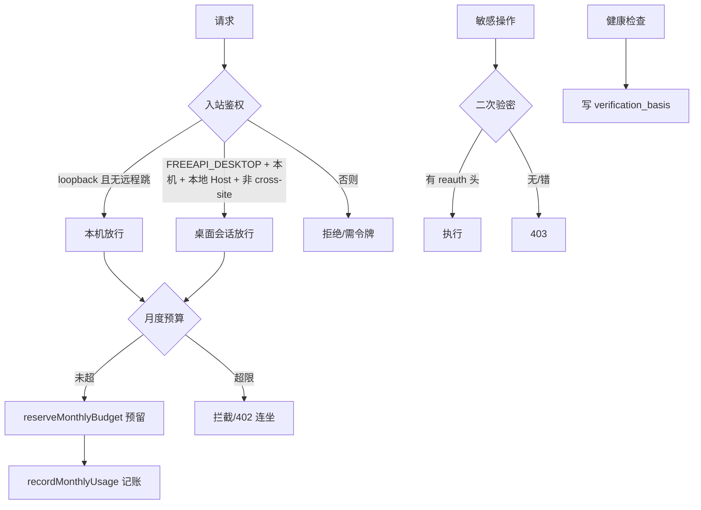
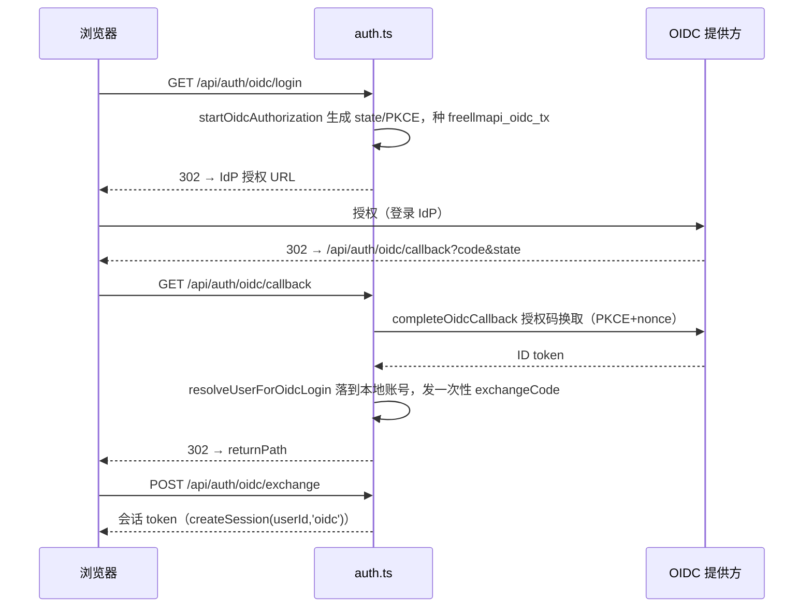

# 19 认证与安全：登录、密钥、权限边界、入站与出站

> 基准提交：`ed38ed46`（本地 `adrian`）；核对日期：2026-11-27。范围：入站鉴权（本机/桌面会话/令牌）、密钥的月度预算与二次验密、provider 凭证预留、密钥健康校验依据、`/v1` 与 loopback 判定的安全语义。不覆盖：协议入口的鉴权外形（见 [16 多协议入口](16-多协议入口.md)）、限流计数（见 [07 状态存储与并发](07-状态存储与并发.md)）。关联：[05 API 与接口设计](05-API与接口设计.md)。

## 需求视角

### 1 使用场景、目标与结果

网关握着一大把上游 key，必须保证「只有该用的人能用、用多少有账、敏感操作再验一次」。目标是：本机用户无感使用、局域网/远程访问受控、密钥的月度用量有预算闸门、导出/明文查看等高危操作要求二次验密。完成后：合法请求放行、越权与远程滥用被挡、超预算被拦、敏感操作需再输密码。

### 2 参与者与业务前置条件

| 参与者 | 角色 | 前置条件 |
|---|---|---|
| 本机用户 | 主触发者 | 请求来自 loopback |
| 桌面会话 | 触发者 | 满足桌面登录四条件 |
| 远程/LAN 客户端 | 潜在越权者 | 需通过令牌或被拒 |
| 密钥预算闸门 | 执行者 | 月度上限已配置 |
| 二次验密 | 执行者 | 用户设置过 reauth 密码 |

前置条件不满足时：非本机且无令牌→拒绝；超月度预算→拦下（402 连坐等）；高危操作缺 `x-reauth-password`→403。

### 3 业务调用层次

请求进入 → 入站鉴权判定（本机？桌面会话？带令牌？）→ 放行或拒绝。密钥使用时 → 月度预算闸门（查/预留/记录）→ 超限拦截。敏感操作 → 二次验密 → 执行。健康校验 → 记录校验依据（仅模型列表验证 vs 真实推理验证）。

### 4 业务数据流转

| 阶段 | 触发者 / 接收者 | 输入资料 | 业务处理 | 输出结果 | 条件不满足时 |
|---|---|---|---|---|---|
| 1 入站判定 | 客户端 → 鉴权 | 来源地址、转发头、Host、令牌 | 判本机/桌面会话/令牌 | 放行或拒绝 | 非本机无令牌→拒 |
| 2 预算闸门 | 选路 → 预算服务 | key、token 估算 | 查上限、预留、记录 | 放行或超限 | 超限→拦截 |
| 3 二次验密 | 用户 → keys 路由 | `x-reauth-password` | 校验凭证 | 执行敏感操作 | 缺头/错密码→403 |
| 4 校验依据 | 健康检查 → 密钥表 | 校验方式 | 记录 verification_basis | 标注可信度 | — |

### 5 主流程、业务分支与异常结果

- **本机放行**：socket 为 loopback 且转发头没有把远程请求「洗」成本机。
- **桌面会话**：`FREEAPI_DESKTOP=1` + 本机 + Host 在本地名单 + 非 cross-site，四条件缺一不可。
- **月度预算**：按 key 查上限、预留、记录用量；超预算拦下并可能连坐同账号。
- **二次验密**：仅当桌面态且 socket 为 loopback 才可能跳过；导出/明文查看必须带 reauth 头。
- **校验依据**：健康检查区分「仅模型列表验证」与「真实推理验证」，前者可信度更低，按依据标注。

### 6 边界、非目标与验收表现

- 鉴权只回答「放不放行」，不管「放行后走哪条路」（选路见 10）。
- 本篇为静态走读，**未发请求、未改运行数据、未连上游**；实际拦截/放行 `[待运行验证]`。

## 技术视角

### 7 实现地图：入口、注册点、核心源码与测试

- **鉴权路由**：`server/src/routes/auth.ts` · `authRouter+0`（24）、`desktopSignInAllowed+0`（163）、`isLoopbackRemote+0`（117，`isLoopbackRequest` 委托）、`LOCAL_HOSTNAMES+0`（136）。
- **本机判定**：`server/src/lib/loopback.ts` · `isLoopbackRequest+0`（35）、`isLoopbackAddress+0`（14）、`forwardedPeerAddress+0`（25）（语义见 [05 API 与接口设计](05-API与接口设计.md)）。
- **密钥月度预算**：`server/src/services/key-budget.ts` · `getMonthlyBudgetCaps+0`（53）、`setMonthlyBudgetCaps+0`（61）、`getMonthlyUsage+0`（80）、`recordMonthlyUsage+0`（93）、`checkMonthlyBudget+0`（108）、`reserveMonthlyBudget+0`（132）。
- **provider 凭证**：`server/src/services/provider-credential.ts` · `reserveProviderCredential+0`（29）。
- **二次验密 / 导出**：`server/src/routes/keys.ts` · `skipsReauth+0`、导出限流 `EXPORT_RATE_LIMIT_RPM`（见 [05 API 与接口设计](05-API与接口设计.md)）。
- **校验依据**：`server/src/services/health.ts` 写 `verification_basis`（`models_only`/`inference_verified`，313/319/478）；迁移 `server/src/db/migrations/20261105_000001_key_verification_basis.ts` 加该列。
- **`/v1` 规范化**：`server/src/middleware/doubled-v1.ts` · `collapseDoubledV1Prefix+0`（安全相关：避免歧义前缀）。

### 8 技术前置条件

- 桌面会话要求 `FREEAPI_DESKTOP=1` 环境标志；Host 必须在 `LOCAL_HOSTNAMES`（`localhost`/`127.0.0.1`/`[::1]`/`::1`）。
- 月度预算按 key 配置上限（`setMonthlyBudgetCaps`），用量按 UTC 月界统计。
- 二次验密要求用户设置过 reauth 密码；导出另有独立限流桶。
- `verification_basis` 列由迁移 20261105_000001 引入，健康检查据此写值。

### 9 真实调用层次与关键源码定位

- 入站：请求 → `authRouter` 中间件 → `desktopSignInAllowed`（桌面四条件）或 `isLoopbackRemote`（本机）判定 → 放行/拒绝。
- 预算：选路前 `checkMonthlyBudget` 查、`reserveMonthlyBudget` 预留、成功后 `recordMonthlyUsage` 记账；`getMonthlyUsage`/`getMonthlyBudgetCaps` 供查询。
- 凭证：出站前 `reserveProviderCredential` 预留 provider 凭证。
- 健康：`health.ts` 校验后按能否真实推理写 `verification_basis`（能推理→`inference_verified`，仅列表→`models_only`，失败→NULL）。

### 10 技术数据流程

- 本机判定：`isLoopbackRequest` 先看 socket 是否 loopback，再看 `x-forwarded-for` 最右跳（`forwardedPeerAddress`）为空或本身 loopback——转发跳只能撤销本地性、不能授予。
- 桌面四条件：`FREEAPI_DESKTOP=1` ∧ `isLoopbackRemote` ∧ Host∈`LOCAL_HOSTNAMES` ∧ 非 cross-site，任一不满足即不允许桌面登录。
- 预算：`MonthlyBudgetCaps`（上限）→ `MonthlyUsage`（已用）→ `checkMonthlyBudget` 判是否放行 → `reserveMonthlyBudget` 在飞预留 → `recordMonthlyUsage` 落账。
- 校验依据：`verification_basis` 取 `models_only`（仅列表）/`inference_verified`（真实推理）/NULL（未验证），用 `COALESCE` 保留已有值。

### 11 核心机制、分支、失败处理与不变量

**不变量**：本机性只能由 socket 决定，转发头不能授予只能撤销；桌面会话四条件缺一不可；敏感操作默认要二次验密。

- `isLoopbackRemote`（auth.ts）与 Ollama 的 `isLoopback` 同样检查转发首跳，口径一致；但 `keys.ts` 的 `skipsReauth` **不**再查转发头，两处判定口径不同（见 [05 API 与接口设计](05-API与接口设计.md)）。
- 超月度预算不仅拦当前请求，还会触发 402 余额连坐等分支（记录于重试失败归因，见 [10 路由限流与回退](10-函数级走读-路由限流与回退.md)）。
- 校验依据用 `COALESCE` 只在为空时写入，避免把更高的可信度降级覆盖。

### 12 详细图表

### 13 免密 provider 默认启用（keyless-defaults，本轮新增 #1870）

有一类 provider 无需账号即可用（Kilo、OVH、AI Horde 等，`provider.keyless === true`）。它们过去默认关闭，新装实例首屏是「No models configured」。`server/src/services/keyless-defaults.ts` 让新装实例在首次目录同步后**自动启用一次**这些免密 provider；存量实例不自行改动，只在 Keys 页给出「可启用 N 个」提示与「全部启用」/「不再提示」。

三条 settings 状态（`+25~+27`）：`keyless_defaults`（`pending`/`done`/`skip`，新库由 initDb 置 `pending`）、`keyless_notice_dismissed`（用户关掉提示的平台清单）、`catalog_applied_json`（最近一次应用的目录文档）。

核心函数与触发点：

| 函数 | 定位 | 作用 | 调用方 |
|---|---|---|---|
| `keylessPlatformsInCatalog` | `+51` | 数目录文档里覆盖到的免密平台（只数 `enabled !== false` 的行） | `applyKeylessDefaults`、`availableKeylessProviders` |
| `applyKeylessDefaults` | `+86` | 仅当状态为 `pending` 时，给目录里尚未有 key 行的免密平台补一条 `no-key` 哨兵 key，然后置 `done`；整段在一个事务里 | `catalog-sync.ts` 每次校验通过的目录拉取后 |
| `availableKeylessProviders` | `+115` | 存量实例 Keys 页提示的「可启用但未添加、未 dismiss」的免密平台 | `GET /api/keys/keyless-available` |
| `enableAvailableKeylessProviders` | `+127` | 「全部启用」：给所有 available 平台补哨兵 key | `POST /api/keys/keyless-available/enable` |
| `dismissAvailableKeylessProviders` | `+134` | 隐藏当前提示；之后新到的平台仍会再提示 | Keys 页 dismiss 动作 |

关键不变量：**自动步骤只跑一次**（状态从 `pending` 翻到 `done` 后 `applyKeylessDefaults` 直接返回 `[]`，`+87`），且「可启用」会跳过任何已有 key 行（无论启用与否）或被用户 dismiss 的平台（`+89`、`+122`）。用户主动移除或关掉的免密 provider 不会被自动步骤重新打开。

补的不是真 key，而是与 Keys 页「无 key 启用」完全相同的一条 `no-key` 哨兵行（`addSentinelKey+71`，加密存储、`status='unknown'`、`enabled=1`）；选路层视其为已配置，provider 层匿名调用。免费档 vs Premium 的差异不在本模块——它来自目录服务端按档下发（免费档的行要满 30 天才进目录），本模块只对「目录里已有」的免密平台生效。

### 14 视觉前置闸（vision-gate，本轮新增 #2061 #2062 #2115）

带图请求在没有「可路由的视觉模型」时，网关要给一句**明确**的拒绝，而不是放它进路由去吃一个误导性的 429。载体是 `server/src/lib/vision-gate.ts`，挂在 chat completions、Anthropic messages、Responses 三条门脸的路由之前。

| 符号 | 定位 | 作用 |
|---|---|---|
| `checkVisionCapacity` | `server/src/lib/vision-gate.ts` · `checkVisionCapacity+0` | 无图直接放行（返回 null）；有图才查 `visionModelAvailability()`，**只认有可用 key 的视觉模型**（`routable > 0` 才放行）——只看「启用了」会让免密默认安装漏过去 |
| `visionModelAvailability` | `server/src/services/router.ts` · `visionModelAvailability+0` | 返回链上启用的视觉模型数与其中真正可路由的数 |
| `imagePlacement` | `vision-gate.ts` · `imagePlacement` `server/src/lib/vision-gate.ts` · `imagePlacement+0` | 数出请求里的图与其位置，供拒绝文案指明哪一条消息带图 |
| `noVisionModelMessage` | `server/src/lib/vision-gate.ts` · `noVisionModelMessage+0` | 生成 422 文案 |
| `logVisionBlocked` | `server/src/lib/vision-gate.ts` · `logVisionBlocked+0` | 落一条 `422 no_vision_model` 的结构化日志（含 surface/stage/placement） |

调用点（三条门脸各一处）：`server/src/routes/proxy.ts` · `checkVisionCapacity`（`+2107` 附近，命中则 `res.status(422)` + `code: 'no_vision_model'`）、`server/src/routes/anthropic.ts`、`server/src/routes/responses.ts`。判据是「可路由数 > 0」而非「启用数 > 0」，这是本轮对旧版「只查启用」的修正。

### 15 可选系统日期注入（system-date，本轮新增 #1931）

给运营一个**开关**：在出站 system prompt 前注入一行当前日期，缓解模型不知道「今天几号」的问题。载体 `server/src/lib/system-date.ts`，开关经 `GET/PUT /api/settings/system-date`（`server/src/routes/settings.ts`）读写，前端 `client/src/components/settings-dialog.tsx` 暴露。

| 符号 | 定位 | 作用 |
|---|---|---|
| `SYSTEM_DATE_MODES` | `server/src/lib/system-date.ts` · `SYSTEM_DATE_MODES+0` | 三档：`off` / `web_search` / `always` |
| `getSystemDateMode` | `server/src/lib/system-date.ts` · `getSystemDateMode+0` | 读生效档位：默认 `off`，env 兜底，DB 设置优先 |
| `maybeInjectSystemDate` | `server/src/lib/system-date.ts` · `maybeInjectSystemDate+0` | 请求期注入点：`off` 原样返回；`web_search` 仅当请求带 web-search 工具/上下文（`hasWebSearchInRequest+0`）才注；`alreadyHasDateContext+0` 命中则不重复注；注入是在数组头部 unshift 一条 system，不改调用方原数组 |
| `formatSystemDatePrompt` | `server/src/lib/system-date.ts` · `formatSystemDatePrompt+0` | 文案固定 `Current date: YYYY-MM-DD (UTC).`——只到日、UTC，让上游 prompt 缓存全天有效 |

接线：五条 chat 门脸在压缩之后、服务端强制 system prompt 之前调 `maybeInjectSystemDate`——`server/src/routes/proxy.ts`、`anthropic.ts`、`responses.ts`、`gemini.ts`、`ollama.ts`。测试 `server/src/__tests__/lib/system-date.test.ts` 与 `server/src/__tests__/routes/system-date.test.ts`。

### 16 可选 OIDC 仪表盘登录（oidc，本轮新增 #2082）

运维可以把仪表盘指向一个外部 OIDC / 单点登录提供方（Authentik、Authelia、Pocket ID 等），用户用 IdP 账号登录仪表盘；配置了允许清单后还能把本地密码登录整条关掉。这是一条**纯可选**路径：只有 `issuerUrl` 和 `clientId` 都配了（环境变量或 `FREEAPI_CONFIG_JSON`）才会激活（`server/src/services/oidc.ts` · `getOidcConfig+2`，两者缺一即返回 `null`），没配 OIDC 的本机/桌面安装行为与过去完全一致。**它只改仪表盘登录，不改变推理 API key（`/v1/*` 的 bearer key）的鉴权方式。**

整个流程由**声明式配置**驱动：`server/src/services/oidc.ts` · `setDeclarativeOidcConfig+0` 由启动装配注入一份配置对象，`getOidcConfig+0` 逐字段用「环境变量优先、否则取声明配置、再否则取默认」的方式收敛成运行期 `OidcConfig`（scopes 默认 `openid email profile`、`providerName` 默认 `SSO`、`groupsClaim` 默认 `groups`、`requireVerifiedEmail` 默认 `true`）。运维想把本地密码登录关掉时，`disablePasswordLogin` 置真，`server/src/services/oidc.ts` · `isPasswordLoginDisabled+0` 据此让密码登录入口失效；对外状态由 `getPublicOidcStatus+0` 汇总成 `PublicOidcStatus`（含 `passwordLoginDisabled`/`autoRedirect`/`canAutoProvision`），随 `/api/auth/status` 下发。

登录链路分四段，核心函数如下：

| 函数 | 定位 | 作用 |
|---|---|---|
| `startOidcAuthorization` | `server/src/services/oidc.ts` · `startOidcAuthorization+0` | 生成 `state`/`nonce`/PKCE `codeVerifier` 与一次性 `cookieSecret`，登记进内存 `pendingTx`，返回 IdP 授权 URL + cookie 值 |
| `completeOidcCallback` | `server/src/services/oidc.ts` · `completeOidcCallback+0` | 校验 `state` + cookie 值 + TTL，做授权码换取（PKCE + nonce），解析身份并落到本地账号，登录场景另发一个一次性 `exchangeCode` |
| `consumeOidcExchangeCode` | `server/src/services/oidc.ts` · `consumeOidcExchangeCode+0` | 前端用回调带回的 `exchangeCode` 换真正的会话 token，取用即删 |
| `resolveUserForOidcLogin` | `server/src/services/oidc.ts` · `resolveUserForOidcLogin+0` | 允许清单前置 → 已绑定的 `(issuer, subject)` 优先 → 按已验证邮箱关联既有本地账号 → 否则按 `autoProvision` 决定是否新建免密账号 |

关键不变量：**fail-closed 的账号开通**。`getOidcConfig` 里只要既没配允许清单（`OIDC_ALLOWED_EMAILS`/`OIDC_ALLOWED_GROUPS`）、运维又没显式 `OIDC_ALLOW_ANY_USER=true`，就算请求了自动开通也会被拒掉并打一条 warn（`server/src/services/oidc.ts` · `getOidcConfig+44`）——因为每个仪表盘用户对所有 provider key 都有完整管理权，不能开世界可注册的管理员。回调侧的一次性凭证**用过即焚**：`pendingTx` 里的 state 取出即删、还要同时过 `cookieSecret` 常量时间比对与 TTL（`server/src/services/oidc.ts` · `completeOidcCallback+15`）。

CSRF / 事务态只靠**一枚 cookie** `freellmapi_oidc_tx`（`server/src/services/oidc.ts` · `OIDC_TX_COOKIE_NAME+0`），`Path=/api/auth/oidc`、`HttpOnly`、`SameSite=Lax`（`server/src/routes/auth.ts` · `formatOidcCookie+0`），回调时清空（`Max-Age=0`）。各段时限与上限：discovery 缓存 15 分钟、事务 5 分钟、exchange code 30 秒、待处理条目上限 200、reauth 要求 `max_age` ≤ 60 秒（`server/src/services/oidc.ts` · `startOidcAuthorization+31`、`completeOidcCallback+34`，常量集中在 `oidc.ts+82~+86`）。开放重定向由 `sanitizeRedirectUri` 把关（`server/src/services/oidc.ts` · `sanitizeRedirectUri+0`）：显式配了 `redirectUri` 就用它，否则用请求 origin 拼出 `/api/auth/oidc/callback`；`returnPath` 另有 `safeReturnPath` 只放行本地相对路径、`//` 协议相对一律打回 `/`（`oidc.ts+287`）。

修改联动：新表与列来自迁移 `server/src/db/migrations/20261124_000001_oidc_identities.ts` · `up+0`——新建 `user_oidc_identities`（`user_id`/`issuer`/`subject`/`email`，`UNIQUE(issuer,subject)`，`ON DELETE CASCADE`）并加 `users.has_local_password`、`sessions.auth_source`、`sessions.reauthenticated_at_ms`，`down+0` 可逆；表结构详见 [07 状态存储与并发](07-状态存储与并发.md)。行为覆盖在 `server/src/__tests__/routes/auth-oidc.test.ts`，前端单点登录门与 `#oidc_code`/`#oidc_error` 处理在 `client/src/components/auth-gate.tsx`（配套 `auth-gate.oidc.test.tsx`），明文密钥导出/复制触发的 OIDC 二次验密在 `client/src/components/keys/export-keys-dialog.tsx` 与 `copy-key-dialog.tsx`。改这段时要同步核对这些测试与 doc 07 的表清单。`[源码未确认]`：`client/src/components/settings-dialog.tsx` 经检索未发现 OIDC 状态相关代码，本轮前端暴露点以 `auth-gate.tsx` 为准。

### 17 验证方式与可观察结果

- 静态：鉴权/预算/健康相关测试（见 [09 测试与部署](09-测试与部署.md)）；`isLoopbackRequest` 对转发头、双栈 `::ffff:` 地址的处理有单测。
- 运行（未执行，`[待运行验证]`）：本机/远程放行差异、超预算拦截、导出二次验密、健康校验依据落值，需实测。

### 18 后续引用

- 上下游：鉴权 → 协议入口（16）/选路（10）；预算与配额联动 [21 后台探测与配额](21-后台探测与配额.md)。
- 关联：本机判定与二次验密细节见 [05 API 与接口设计](05-API与接口设计.md)；限流计数见 [07 状态存储与并发](07-状态存储与并发.md)。
- 修改联动：改本机判定须同步 `server/src/lib/loopback.ts` 测试并核对 `keys.ts`/`ollama.ts` 两处口径；改预算须核对 `key-budget.ts` 与迁移 `20261111_000001_model_monthly_usage.ts`。

## 术语表

| 术语 | 含义 |
|---|---|
| 本机性（loopback） | 请求是否来自本机，仅由 socket 决定 |
| 桌面会话 | 满足四条件的可信本地桌面登录态 |
| 月度预算闸门 | 按 key 的 UTC 月度 token 上限与预留 |
| 二次验密（reauth） | 导出/明文查看等高危操作的再次密码校验 |
| 校验依据（verification_basis） | 密钥健康的可信度标注（仅列表/真实推理/未验证） |