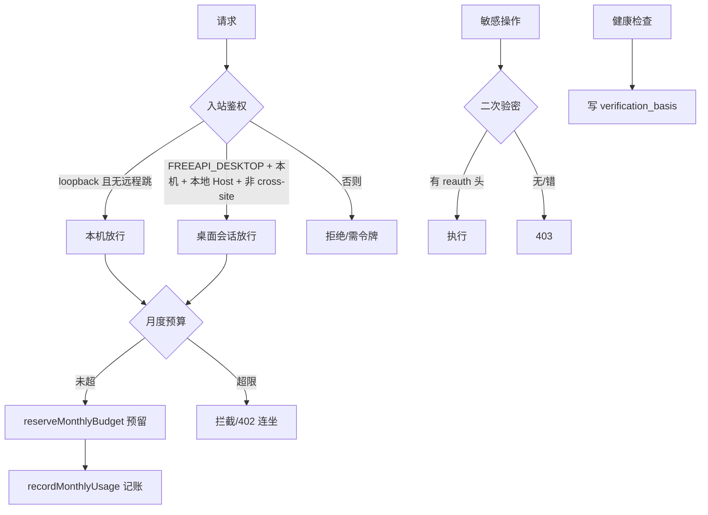

# 19 认证与安全：登录、密钥、权限边界、入站与出站

> 基准提交：`1a64da55`（本地 `adrian`）；核对日期：2026-11-17。范围：入站鉴权（本机/桌面会话/令牌）、密钥的月度预算与二次验密、provider 凭证预留、密钥健康校验依据、`/v1` 与 loopback 判定的安全语义。不覆盖：协议入口的鉴权外形（见 [16 多协议入口](16-多协议入口.md)）、限流计数（见 [07 状态存储与并发](07-状态存储与并发.md)）。关联：[05 API 与接口设计](05-API与接口设计.md)。

## 需求视角

### 1 使用场景、目标与结果

网关握着一大把上游 key，必须保证「只有该用的人能用、用多少有账、敏感操作再验一次」。目标是：本机用户无感使用、局域网/远程访问受控、密钥的月度用量有预算闸门、导出/明文查看等高危操作要求二次验密。完成后：合法请求放行、越权与远程滥用被挡、超预算被拦、敏感操作需再输密码。

### 2 参与者与业务前置条件

| 参与者 | 角色 | 前置条件 |
|---|---|---|
| 本机用户 | 主触发者 | 请求来自 loopback |
| 桌面会话 | 触发者 | 满足桌面登录四条件 |
| 远程/LAN 客户端 | 潜在越权者 | 需通过令牌或被拒 |
| 密钥预算闸门 | 执行者 | 月度上限已配置 |
| 二次验密 | 执行者 | 用户设置过 reauth 密码 |

前置条件不满足时：非本机且无令牌→拒绝；超月度预算→拦下（402 连坐等）；高危操作缺 `x-reauth-password`→403。

### 3 业务调用层次

请求进入 → 入站鉴权判定（本机？桌面会话？带令牌？）→ 放行或拒绝。密钥使用时 → 月度预算闸门（查/预留/记录）→ 超限拦截。敏感操作 → 二次验密 → 执行。健康校验 → 记录校验依据（仅模型列表验证 vs 真实推理验证）。

### 4 业务数据流转

| 阶段 | 触发者 / 接收者 | 输入资料 | 业务处理 | 输出结果 | 条件不满足时 |
|---|---|---|---|---|---|
| 1 入站判定 | 客户端 → 鉴权 | 来源地址、转发头、Host、令牌 | 判本机/桌面会话/令牌 | 放行或拒绝 | 非本机无令牌→拒 |
| 2 预算闸门 | 选路 → 预算服务 | key、token 估算 | 查上限、预留、记录 | 放行或超限 | 超限→拦截 |
| 3 二次验密 | 用户 → keys 路由 | `x-reauth-password` | 校验凭证 | 执行敏感操作 | 缺头/错密码→403 |
| 4 校验依据 | 健康检查 → 密钥表 | 校验方式 | 记录 verification_basis | 标注可信度 | — |

### 5 主流程、业务分支与异常结果

- **本机放行**：socket 为 loopback 且转发头没有把远程请求「洗」成本机。
- **桌面会话**：`FREEAPI_DESKTOP=1` + 本机 + Host 在本地名单 + 非 cross-site，四条件缺一不可。
- **月度预算**：按 key 查上限、预留、记录用量；超预算拦下并可能连坐同账号。
- **二次验密**：仅当桌面态且 socket 为 loopback 才可能跳过；导出/明文查看必须带 reauth 头。
- **校验依据**：健康检查区分「仅模型列表验证」与「真实推理验证」，前者可信度更低，按依据标注。

### 6 边界、非目标与验收表现

- 鉴权只回答「放不放行」，不管「放行后走哪条路」（选路见 10）。
- 本篇为静态走读，**未发请求、未改运行数据、未连上游**；实际拦截/放行 `[待运行验证]`。

## 技术视角

### 7 实现地图：入口、注册点、核心源码与测试

- **鉴权路由**：`server/src/routes/auth.ts` · `authRouter+0`（24）、`desktopSignInAllowed+0`（163）、`isLoopbackRemote+0`（117，`isLoopbackRequest` 委托）、`LOCAL_HOSTNAMES+0`（136）。
- **本机判定**：`server/src/lib/loopback.ts` · `isLoopbackRequest+0`（35）、`isLoopbackAddress+0`（14）、`forwardedPeerAddress+0`（25）（语义见 [05 API 与接口设计](05-API与接口设计.md)）。
- **密钥月度预算**：`server/src/services/key-budget.ts` · `getMonthlyBudgetCaps+0`（53）、`setMonthlyBudgetCaps+0`（61）、`getMonthlyUsage+0`（80）、`recordMonthlyUsage+0`（93）、`checkMonthlyBudget+0`（108）、`reserveMonthlyBudget+0`（132）。
- **provider 凭证**：`server/src/services/provider-credential.ts` · `reserveProviderCredential+0`（29）。
- **二次验密 / 导出**：`server/src/routes/keys.ts` · `skipsReauth+0`、导出限流 `EXPORT_RATE_LIMIT_RPM`（见 [05 API 与接口设计](05-API与接口设计.md)）。
- **校验依据**：`server/src/services/health.ts` 写 `verification_basis`（`models_only`/`inference_verified`，313/319/478）；迁移 `server/src/db/migrations/20261105_000001_key_verification_basis.ts` 加该列。
- **`/v1` 规范化**：`server/src/middleware/doubled-v1.ts` · `collapseDoubledV1Prefix+0`（安全相关：避免歧义前缀）。

### 8 技术前置条件

- 桌面会话要求 `FREEAPI_DESKTOP=1` 环境标志；Host 必须在 `LOCAL_HOSTNAMES`（`localhost`/`127.0.0.1`/`[::1]`/`::1`）。
- 月度预算按 key 配置上限（`setMonthlyBudgetCaps`），用量按 UTC 月界统计。
- 二次验密要求用户设置过 reauth 密码；导出另有独立限流桶。
- `verification_basis` 列由迁移 20261105_000001 引入，健康检查据此写值。

### 9 真实调用层次与关键源码定位

- 入站：请求 → `authRouter` 中间件 → `desktopSignInAllowed`（桌面四条件）或 `isLoopbackRemote`（本机）判定 → 放行/拒绝。
- 预算：选路前 `checkMonthlyBudget` 查、`reserveMonthlyBudget` 预留、成功后 `recordMonthlyUsage` 记账；`getMonthlyUsage`/`getMonthlyBudgetCaps` 供查询。
- 凭证：出站前 `reserveProviderCredential` 预留 provider 凭证。
- 健康：`health.ts` 校验后按能否真实推理写 `verification_basis`（能推理→`inference_verified`，仅列表→`models_only`，失败→NULL）。

### 10 技术数据流程

- 本机判定：`isLoopbackRequest` 先看 socket 是否 loopback，再看 `x-forwarded-for` 最右跳（`forwardedPeerAddress`）为空或本身 loopback——转发跳只能撤销本地性、不能授予。
- 桌面四条件：`FREEAPI_DESKTOP=1` ∧ `isLoopbackRemote` ∧ Host∈`LOCAL_HOSTNAMES` ∧ 非 cross-site，任一不满足即不允许桌面登录。
- 预算：`MonthlyBudgetCaps`（上限）→ `MonthlyUsage`（已用）→ `checkMonthlyBudget` 判是否放行 → `reserveMonthlyBudget` 在飞预留 → `recordMonthlyUsage` 落账。
- 校验依据：`verification_basis` 取 `models_only`（仅列表）/`inference_verified`（真实推理）/NULL（未验证），用 `COALESCE` 保留已有值。

### 11 核心机制、分支、失败处理与不变量

**不变量**：本机性只能由 socket 决定，转发头不能授予只能撤销；桌面会话四条件缺一不可；敏感操作默认要二次验密。

- `isLoopbackRemote`（auth.ts）与 Ollama 的 `isLoopback` 同样检查转发首跳，口径一致；但 `keys.ts` 的 `skipsReauth` **不**再查转发头，两处判定口径不同（见 [05 API 与接口设计](05-API与接口设计.md)）。
- 超月度预算不仅拦当前请求，还会触发 402 余额连坐等分支（记录于重试失败归因，见 [10 路由限流与回退](10-函数级走读-路由限流与回退.md)）。
- 校验依据用 `COALESCE` 只在为空时写入，避免把更高的可信度降级覆盖。

### 12 详细图表

### 13 验证方式与可观察结果

- 静态：鉴权/预算/健康相关测试（见 [09 测试与部署](09-测试与部署.md)）；`isLoopbackRequest` 对转发头、双栈 `::ffff:` 地址的处理有单测。
- 运行（未执行，`[待运行验证]`）：本机/远程放行差异、超预算拦截、导出二次验密、健康校验依据落值，需实测。

### 14 后续引用

- 上下游：鉴权 → 协议入口（16）/选路（10）；预算与配额联动 [21 后台探测与配额](21-后台探测与配额.md)。
- 关联：本机判定与二次验密细节见 [05 API 与接口设计](05-API与接口设计.md)；限流计数见 [07 状态存储与并发](07-状态存储与并发.md)。
- 修改联动：改本机判定须同步 `lib/loopback.ts` 测试并核对 `keys.ts`/`ollama.ts` 两处口径；改预算须核对 `key-budget.ts` 与迁移 `20261111_000001_model_monthly_usage.ts`。

## 术语表

| 术语 | 含义 |
|---|---|
| 本机性（loopback） | 请求是否来自本机，仅由 socket 决定 |
| 桌面会话 | 满足四条件的可信本地桌面登录态 |
| 月度预算闸门 | 按 key 的 UTC 月度 token 上限与预留 |
| 二次验密（reauth） | 导出/明文查看等高危操作的再次密码校验 |
| 校验依据（verification_basis） | 密钥健康的可信度标注（仅列表/真实推理/未验证） |