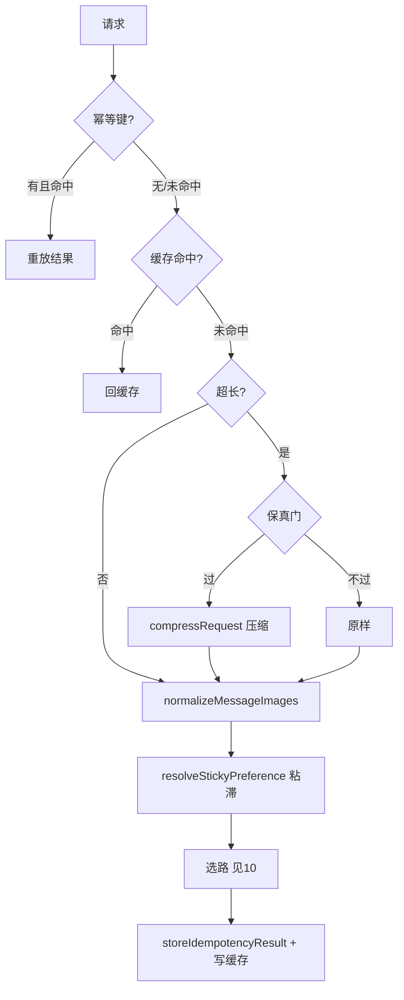

# 20 会话与内容处理：缓存、幂等、压缩、粘滞会话与图像归一

> 基准提交：`3212ac11`（本地 `adrian`）；核对日期：2026-11-23。范围：响应缓存、请求幂等（重放）、请求压缩管线、粘滞会话（sticky）、入站图像归一。不覆盖：缓存/幂等对配额的零计入契约（见 [07 状态存储与并发](07-状态存储与并发.md) 与 [12 存储配置与请求入口](12-函数级走读-存储配置与请求入口.md)）、选路粘滞在选路中的位置（见 [10 路由限流与回退](10-函数级走读-路由限流与回退.md)）。关联：[05 API 与接口设计](05-API与接口设计.md)。

## 需求视角

### 1 使用场景、目标与结果

同一问题被反复问、网络抖动导致重发、长对话撑爆上下文、多图请求图片过大——这些都会浪费稀缺的免费上游配额。目标是：能缓存的直接回缓存、重发的请求幂等返回同一结果、过长请求压缩到可发、同一会话尽量粘在同一 key、过大图片先降尺度。完成后：省配额、重发安全、长请求可发、会话体验稳定。

### 2 参与者与业务前置条件

| 参与者 | 角色 | 前置条件 |
|---|---|---|
| 客户端 | 触发者 | 按接口发请求，可带幂等键 |
| 缓存/幂等层 | 执行者 | 缓存开关开启、条目未过期 |
| 压缩管线 | 执行者 | 请求超阈值、压缩引擎可用 |
| 粘滞会话 | 执行者 | 存在粘滞偏好与候选链 |
| 图像归一 | 执行者 | 请求含图片、CPU 可跑图像处理 |

前置条件不满足时：缓存关/过期→回源；无幂等键→不重放；不超阈值→不压缩；无粘滞偏好→正常选路。

### 3 业务调用层次

请求进入 → 幂等查重（命中则重放）→ 缓存查（命中则回缓存）→ 压缩（超长才做）→ 图像归一 → 交选路（粘滞优先）。响应侧 → 写缓存、存幂等结果。各机制相互独立，按需叠加。

### 4 业务数据流转

| 阶段 | 触发者 / 接收者 | 输入资料 | 业务处理 | 输出结果 | 条件不满足时 |
|---|---|---|---|---|---|
| 1 幂等查重 | 客户端 → 幂等层 | 幂等键+指纹 | 查是否已处理 | 重放结果或继续 | 无键/过期→继续 |
| 2 缓存查 | 请求 → 缓存层 | 缓存键 | 查有效期/温度上限 | 缓存响应或回源 | 关闭/过期→回源 |
| 3 压缩 | 请求 → 压缩管线 | 超长消息 | 按引擎压缩+保真门 | 压缩后请求 | 不超阈值→原样 |
| 4 图像归一 | 请求 → 归一 | 多图 | 降尺度 | 归一后消息 | 无图/CPU 不可→原样 |
| 5 写回 | 响应 → 缓存/幂等 | 结果 | 存缓存、存幂等 | 供后续重放 | — |

### 5 主流程、业务分支与异常结果

- **缓存**：受开关、TTL、最大条目、温度上限约束；带缓存指令（directive）可控制行为；高温请求不可缓存。
- **幂等**：键哈希存储、指纹计算、命中重放、可清除；TTL 可配。
- **压缩**：超阈值触发，经保真门（fidelity gate）确保压缩不破坏语义，头部记录压缩信息。
- **粘滞会话**：解析粘滞偏好（DB 模型 id + 候选链），让同一会话优先粘同一模型。
- **图像归一**：入站多图降尺度，估算在压缩之前完成。

### 6 边界、非目标与验收表现

- 缓存与幂等都是「省配额」手段，命中时**不计入**上游配额（零配额契约，见 07/12）。
- 本篇为静态走读，**未发请求、未写运行缓存**；命中/压缩的运行表现 `[待运行验证]`。

## 技术视角

### 7 实现地图：入口、注册点、核心源码与测试

- **响应缓存**：`server/src/services/cache.ts` · `getCachedResponse+0`（449）、`isCacheEnabled+0`（75）、`cachePersistenceEnabled+0`（89）、`cacheTtlMs+0`（95）、`cacheMaxTemperature+0`（102）、`cacheMaxEntries+0`（108）、`isCacheableTemperature+0`（114）、`parseCacheDirective+0`（126）、`CACHE_ENABLED_SETTING+0`（68）。
- **幂等**：`server/src/services/idempotency.ts` · `idempotencyTtlMs+0`（40）、`hashIdempotencyKey+0`（46）、`computeIdempotencyFingerprint+0`（51）、`lookupIdempotencyReplay+0`（93）、`storeIdempotencyResult+0`（127）、`clearIdempotencyResult+0`（169）。
- **压缩**：`server/src/services/compression/pipeline.ts` · `compressRequest+0`（94）、`formatCompressionHeader+0`（263）；配套 `fidelity-gate.ts`、`preservation.ts`、`engines/`、`registry.ts`、`config.ts`、`stats.ts`。
- **粘滞会话**：`server/src/services/router.ts` · `resolveStickyPreference+0`（2574）；粘滞结构与 TTL 见 [12 存储配置与请求入口](12-函数级走读-存储配置与请求入口.md)。
- **图像归一**：`server/src/lib/image-normalize.ts` · `normalizeMessageImages+0`（282）、`cpuCanRunSharp`。

### 8 技术前置条件

- 缓存需 `response_cache_enabled` 开启；受 TTL/最大条目/温度上限约束；可持久化。
- 幂等需客户端带幂等键；TTL 由 `idempotencyTtlMs` 决定。
- 压缩需请求超阈值且压缩引擎注册可用；保真门不过则不压缩。
- 图像归一需 CPU 可跑 sharp（`cpuCanRunSharp`），否则跳过降尺度。

### 9 真实调用层次与关键源码定位

请求 → `lookupIdempotencyReplay`（命中重放）→ `getCachedResponse`（命中回缓存）→ `compressRequest`（超长压缩，`formatCompressionHeader` 记录）→ `normalizeMessageImages`（多图降尺度，先于压缩估算）→ 选路（`resolveStickyPreference` 粘滞优先，见 10）。响应 → `storeIdempotencyResult` + 写缓存。

### 10 技术数据流程

- 缓存键 → `CachedResponse`，受 `cacheTtlMs`/`cacheMaxEntries`/`isCacheableTemperature` 约束；`parseCacheDirective` 解析请求侧指令。
- 幂等：键经 `hashIdempotencyKey` 哈希、`computeIdempotencyFingerprint` 算指纹，`storeIdempotencyResult` 存、`lookupIdempotencyReplay` 查、`clearIdempotencyResult` 清。
- 压缩：`CompressionResult` 经 `formatCompressionHeader` 转为头部字符串；保真门决定是否放行压缩结果。
- 粘滞：`resolveStickyPreference` 由 DB 粘滞模型 id + 候选链解析出优先模型。
- 保留期：`request-retention.ts` 对 `idempotency_claims`/`response_cache`/`sessions` 三表做保留清理。

### 11 核心机制、分支、失败处理与不变量

**不变量**：缓存/幂等命中不计上游配额；高温请求不缓存；压缩必须过保真门；粘滞只是「优先」不是「强制」。

- 幂等键只做哈希存储，不落明文；重放返回与首次一致的结果。
- 压缩保真门不过则放弃压缩、按原请求发送，宁可不压也不破坏语义。
- 图像归一在压缩估算之前，避免按未降尺度的体积误判是否需要压缩。
- 请求保留期对三张表（幂等声明/响应缓存/会话）统一清理，防止无限膨胀。

### 12 详细图表

### 13 验证方式与可观察结果

- 静态：缓存/幂等/压缩相关测试（见 [09 测试与部署](09-测试与部署.md)）；压缩保真门、幂等指纹、缓存温度上限有断言。
- 运行（未执行，`[待运行验证]`）：重复请求命中缓存/幂等、超长请求被压缩、多图被降尺度，需实测并观察配额零计入。

### 14 后续引用

- 上下游：本篇机制前置/后置于选路（10）；零配额契约见 07/12。
- 关联：粘滞结构与 TTL 见 [12 存储配置与请求入口](12-函数级走读-存储配置与请求入口.md)；保留期体系见 [22 日志与备份](22-日志与备份.md)；图像归一能力见 [17 搜索与多模态](17-搜索与多模态.md)。
- 修改联动：改缓存契约须核对 `cache.ts` 与 07/12 的零配额描述；改压缩须核对 `fidelity-gate.ts` 与 `compression/` 测试；改粘滞须核对 `router.ts` 与 10。

## 术语表

| 术语 | 含义 |
|---|---|
| 响应缓存 | 相同请求直接返回上次结果，受 TTL/温度/条目约束 |
| 幂等（idempotency） | 同一幂等键重发返回同一结果，不重复计费 |
| 压缩保真门 | 压缩结果须过语义保真判定，否则放弃压缩 |
| 粘滞会话（sticky） | 同一会话优先粘在同一模型/key |
| 图像归一 | 入站多图降尺度，减少体积与配额消耗 |