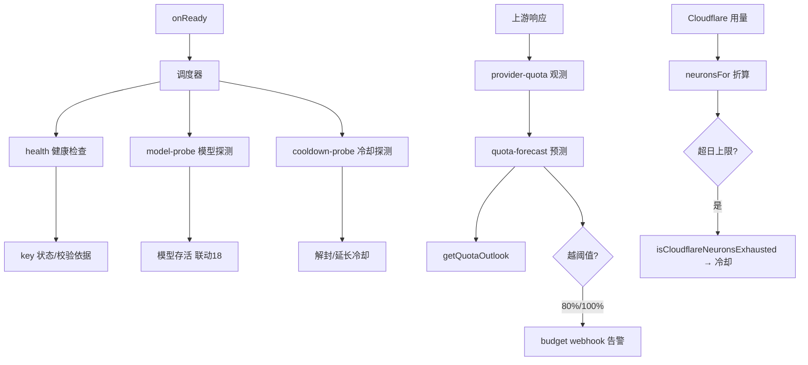

# 21 后台探测与配额：健康检查、模型探测、冷却探测、配额与预算

> 基准提交：`3212ac11`（本地 `adrian`）；核对日期：2026-11-23。范围：服务就绪后的后台任务（健康检查、模型探测、冷却探测）、provider 配额观测、配额预测与展望、密钥预算告警、Cloudflare neurons 日配额。不覆盖：单次请求的限流计数（见 [07 状态存储与并发](07-状态存储与并发.md)）、密钥月度预算闸门本身（见 [19 认证与安全](19-认证与安全.md)）、后台任务的启动注册（见 [08 启动生命周期](08-启动生命周期.md)）。关联：[10 路由限流与回退](10-函数级走读-路由限流与回退.md)、[18 模型与端点管理](18-模型与端点管理.md)。

## 需求视角

### 1 使用场景、目标与结果

免费上游的可用性和配额随时在变：某个 key 可能已被封、某模型可能下线、某平台今日额度可能耗尽。目标是让网关**在后台持续摸清现状**——哪些 key 健康、哪些模型还活着、哪些在冷却、今日还剩多少额度——从而让前台选路少踩坑。完成后：不健康的 key 被标记、失效模型被探测出来、冷却中的被跳过、临近额度耗尽提前告警。

### 2 参与者与业务前置条件

| 参与者 | 角色 | 前置条件 |
|---|---|---|
| 调度器 | 触发者 | 服务就绪后注册后台任务 |
| 健康检查 | 执行者 | 有待检 key、时间预算内 |
| 模型探测 | 执行者 | 有探测候选、间隔到期 |
| 冷却探测 | 执行者 | 有冷却中的 key |
| 配额观测/预测 | 执行者 | 有响应可解析、有观测窗口 |
| 预算告警 | 执行者 | 配置了告警阈值/webhook |

前置条件不满足时：无候选/未到期/无观测→本轮跳过，不阻塞服务。

### 3 业务调用层次

服务就绪 → 调度器注册多个后台任务 → 各任务按各自间隔独立运行 → 把结论写回（key 健康状态、模型存活、冷却、配额水位）→ 前台选路消费这些结论。配额告警是横切的旁路，越阈值时对外发通知。

### 4 业务数据流转

| 阶段 | 触发者 / 接收者 | 输入资料 | 业务处理 | 输出结果 | 条件不满足时 |
|---|---|---|---|---|---|
| 1 健康检查 | 调度 → 健康 | 待检 key | 探活、写状态与校验依据 | key 健康标记 | 近期检过→跳过 |
| 2 模型探测 | 调度 → 探测 | 候选模型 | 发探针、判存活 | 模型存活标记 | 无候选/未到期→跳过 |
| 3 冷却探测 | 调度 → 冷却 | 冷却中 key | 试探是否解封 | 解除或延长冷却 | 无冷却→跳过 |
| 4 配额观测 | 响应 → 观测 | 上游响应头/体 | 解析配额水位 | 池水位记录 | 无可解析→跳过 |
| 5 告警 | 水位 → 告警 | 阈值穿越 | 判越线、发 webhook | 告警通知 | 未越线/无 webhook→不发 |

### 5 主流程、业务分支与异常结果

- **健康检查**：按时间预算跑一批，近期检过的跳过；区分「仅模型列表验证」与「真实推理验证」（校验依据见 19）。
- **模型探测**：按间隔选候选、发探针判存活；刚服务过的跳过，避免浪费。
- **冷却探测**：对冷却中的 key 试探是否已解封，解封则恢复可用。
- **配额观测与预测**：从响应解析配额，按滑动窗口预测「还剩多少请求/多久耗尽」，低于阈值告警。
- **Cloudflare neurons**：按模型与用量折算 neuron 消耗，对齐每日免费额度与自设上限，耗尽时判并冷却。

### 6 边界、非目标与验收表现

- 后台探测是「旁路观测」，不直接处理用户请求；结论供选路消费。
- 本篇为静态走读，**未启动服务、未连上游、未改运行数据**；探测/告警的运行表现 `[待运行验证]`。

## 技术视角

### 7 实现地图：入口、注册点、核心源码与测试

- **注册入口**：`server/src/index.ts` · `main.onReady+0`（81）内 `startModelProbe(scheduler)`（88，注册见 [08 启动生命周期](08-启动生命周期.md)）。
- **健康检查**：`server/src/services/health.ts` · `HEALTH_CHECK_INTERVAL_MS+0`（37）、`RECENT_CHECK_SKIP_MS+0`（50）、`NO_POLL_ERROR_REPROBE_MS+0`（55）、`HEALTH_PASS_TIME_BUDGET_MS+0`（61）、`SUGGESTED_TRANSPORT_PARK_AFTER+0`（106）；写 `verification_basis` 见 19。
- **模型探测**：`server/src/services/model-probe.ts` · `MODEL_PROBE_INTERVAL_MS+0`（44）、`MODEL_PROBE_STALE_MS+0`（49）、`RECENT_SERVE_SKIP_MS+0`（55）、`selectProbeCandidates+0`（110）、`probeModel+0`（183）。
- **冷却探测**：`server/src/services/cooldown-probe.ts` · `runCooldownProbePass+0`（116）、`startCooldownProbe+0`（201）、`stopCooldownProbe+0`（217）、`resetCooldownProbeState+0`（225）。
- **配额观测**：`server/src/services/provider-quota.ts` · `inferPoolForPlatform+0`（101）、`inferQuotaPoolKey+0`（310）、`parseQuotaObservationsFromResponse+0`（314）、`recordQuotaObservation+0`（380）、`recordQuotaObservationsFromResponse+0`（478）。配额观测已无 AsyncLocalStorage 上下文包裹，由各 Provider 拿到上游响应后直接调 `recordQuotaObservationsFromResponse` 记账。
- **配额预测/展望**：`server/src/services/quota-forecast.ts` · `LOW_BALANCE_THRESHOLD+0`（18）、`LOW_BALANCE_ABSOLUTE+0`（19）、`RATE_OBSERVATION_WINDOW_MINUTES+0`（29）、`MIN_FORECAST_REQUESTS+0`（30）；`server/src/services/quota-outlook.ts` · `getQuotaOutlook+0`（26）。
- **预算告警**：`server/src/services/budget-alerts.ts` · `BUDGET_ALERT_THRESHOLDS+0`（35）、`budgetThresholdCrossings+0`（54）、`noteBudgetAlerts+0`（93）、`budgetAlertWebhookUrl+0`（140）、`budgetWebhookPayload+0`（152）。
- **Cloudflare neurons**：`server/src/services/cloudflare-neurons.ts` · `DEFAULT_CLOUDFLARE_DAILY_NEURON_CAP+0`（33）、`CLOUDFLARE_PRICES+0`（51）、`neuronsFor+0`（133）、`getCloudflareDailyNeuronCap+0`（157）；`server/src/services/cloudflare-daily-quota.ts` · `isCloudflareNeuronsExhausted+0`（26）、`benchCloudflareAccount+0`（36）。

### 8 技术前置条件

- 后台任务在 `onReady` 后由调度器驱动；各任务有独立间隔与时间预算。
- 健康检查每次有 `HEALTH_PASS_TIME_BUDGET_MS`（检查间隔的一半）预算，超预算本轮收尾。
- 模型探测默认 30 分钟间隔、6 小时视为过期；刚服务过 1 小时内的跳过。
- 配额预测需至少 `MIN_FORECAST_REQUESTS` 个观测、按 10 分钟滑动窗口估速率。
- Cloudflare neuron 上限可配，默认 9000（免费额度 10000/日）。

### 9 真实调用层次与关键源码定位

- 健康：调度 → `health.ts` 按 `selectProbe` 式选取 → 探活 → 写状态/校验依据；近期检过跳过。
- 模型探测：`startModelProbe` 注册 → 按间隔 `selectProbeCandidates` → `probeModel` 发探针 → 写存活。
- 冷却：`startCooldownProbe` 注册 → `runCooldownProbePass` 试探冷却中 key → 解封或延长。
- 配额：Provider 收到上游响应 → `recordQuotaObservationsFromResponse` 记账（内部用 `parseQuotaObservationsFromResponse` 解析）→ `inferQuotaPoolKey` 归池 → `quota-forecast` 预测 → `getQuotaOutlook` 供查询。
- 告警：`noteBudgetAlerts` 判 `budgetThresholdCrossings` → 越 80%/100% 阈值 → `budgetWebhookPayload` 经 `budgetAlertWebhookUrl` 发送。
- Cloudflare：`neuronsFor` 折算消耗 → 超 `getCloudflareDailyNeuronCap` → `isCloudflareNeuronsExhausted` 判并冷却（`benchCloudflareAccount` 记冷却）。

### 10 技术数据流程

- 健康：检查结果写 key 状态 + `last_checked_at`/`last_healthy_at`/`verification_basis`。
- 模型探测：`ProbeCandidateRow` → `ProbeOutcome`；探测结果影响模型可用性（联动 18）。
- 配额：`QuotaObservationContext` → 解析出的水位 → 按池（`inferPoolForPlatform`）聚合 → 预测剩余。
- 预算：阈值穿越 [0.8, 1.0]，payload 走 webhook。
- Cloudflare：`NeuronUsage` → `neuronsFor`（按 `CLOUDFLARE_PRICES` 折算）→ 与日上限比较。

### 11 核心机制、分支、失败处理与不变量

**不变量**：后台探测只观测不处理请求；每轮有时间和数量上限，超了就收尾，绝不无限跑；探测结论只影响后续选路，不改写历史。

- 健康检查「近期检过就跳过」（`RECENT_CHECK_SKIP_MS`）、探测「刚服务过就跳过」（`RECENT_SERVE_SKIP_MS`），避免重复浪费配额。
- 配额预测设最小观测数与窗口，观测不足不臆测趋势。
- 预算告警只在穿越阈值时发（80%/100%），不重复刷屏。
- Cloudflare neuron 折算按模型定价，日上限低于免费额度以留缓冲。

### 12 详细图表

### 13 月度预算的输入校验（budget-input，本轮新增 #2030）

预算的**运行时判定**在 `server/src/services/key-budget.ts`（月界、在飞预留、`reserveMonthlyBudget`/`recordMonthlyUsage`），选路侧的第十道闸见 [10 路由限流与回退](10-函数级走读-路由限流与回退.md) §10。本节只讲新增的一环：**操作员在创建路由里手填的月度预算字符串如何被校验成规范值**。

`server/src/lib/budget-input.ts` 只导出一个 Zod 字段 `budgetInputSchema`（`+7`）：接受最长 80 字符的字符串，交给 `budget.ts` 的 `normalizeBudgetInput` 归一；归不出合法值就用 `BUDGET_INPUT_ERROR`（`budget.ts+87`，提示形如 `30M`、`500K/day`、`30000000`）报自定义 issue。

它挂在三条 create 路由的请求体字段 `monthlyTokenBudget`（均 optional）：

| 路由 | 定位 |
|---|---|
| `POST /api/keys/custom` | `server/src/routes/keys.ts:932` 请求体字段 `monthlyTokenBudget: budgetInputSchema.optional()` |
| keys 另一条 create | `server/src/routes/keys.ts:957` 同名字段 |
| `POST /api/models` | `server/src/routes/models.ts:101` 请求体字段 `monthlyTokenBudget` |

为什么单独一个文件：`budget.ts` 必须保持「无值导入」纯净（`module-purity.test.ts` 锁死），而 Zod schema 是值导入，所以把字段拆到 `budget-input.ts`，`budget.ts` 只出 `normalizeBudgetInput` 与错误常量。改预算输入口径时，同时核对 `budget.ts` 的归一规则与这三处路由。

### 14 验证方式与可观察结果

- 静态：健康/探测/配额/预算相关测试（见 [09 测试与部署](09-测试与部署.md)）；候选选取、阈值穿越、neuron 折算有断言。
- 运行（未执行，`[待运行验证]`）：后台任务按间隔运行、告警触发 webhook、Cloudflare 耗尽冷却，需实测。

### 15 后续引用

- 消费者：选路（10）消费健康/冷却/配额结论；模型可用性联动 18。
- 关联：任务注册见 [08 启动生命周期](08-启动生命周期.md)；月度预算闸门见 [19 认证与安全](19-认证与安全.md)；限流计数见 [07 状态存储与并发](07-状态存储与并发.md)。
- 修改联动：改探测间隔/预算须核对 `health.ts`/`model-probe.ts` 测试；改配额归池须核对 `provider-quota.ts` 与调度算法专题；改 Cloudflare 折算须核对 `cloudflare-neurons.ts` 与迁移 `20261104_000001_cloudflare_neuron_usage.ts`。

## 术语表

| 术语 | 含义 |
|---|---|
| 健康检查（health） | 后台探活 key 并写状态与校验依据 |
| 模型探测（model probe） | 后台发探针判模型是否仍可用 |
| 冷却探测（cooldown probe） | 试探冷却中的 key 是否已解封 |
| 配额观测/预测 | 从响应解析配额水位并预测剩余 |
| neuron | Cloudflare 按模型定价折算的日额度单位 |
| 预算告警 | 密钥用量穿越阈值（80%/100%）时发 webhook |