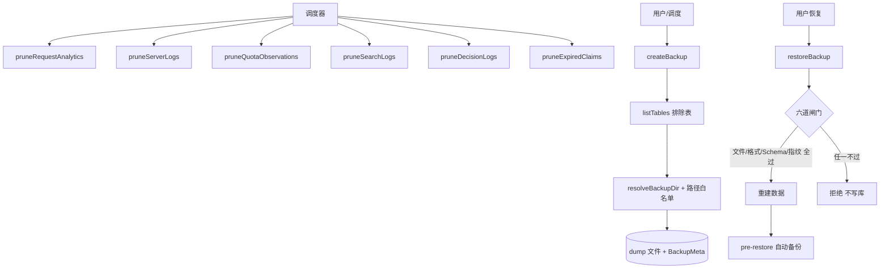

# 22 日志与备份：请求日志保留、统计、备份与恢复

> 基准提交：`3212ac11`（本地 `adrian`）；核对日期：2026-11-23。范围：多类请求/日志数据的保留期清理、请求分析统计、数据库备份（手动/定时/更新前/恢复前）与恢复（六道门）。不覆盖：后台探测与配额观测的产生（见 [21 后台探测与配额](21-后台探测与配额.md)）、密钥健康写入（见 [19 认证与安全](19-认证与安全.md)）、桌面端文件日志（见 [15 桌面端](15-桌面端.md)）。关联：[07 状态存储与并发](07-状态存储与并发.md)、[20 会话与内容处理](20-会话与内容处理.md)。

## 需求视角

### 1 使用场景、目标与结果

请求日志、配额观测、搜索/决策日志、幂等声明会无限增长，撑爆磁盘；同时用户需要能备份和还原整套数据（换机、更新前保护、误操作回滚）。目标是：各类数据按各自保留期自动清理、可手动/定时备份、恢复时有一整套安全闸门防止恢复错文件或坏数据。完成后：磁盘不膨胀、有可靠备份、恢复可控。

### 2 参与者与业务前置条件

| 参与者 | 角色 | 前置条件 |
|---|---|---|
| 调度器 / 清理任务 | 执行者 | 各类保留期配置可用 |
| 用户 | 触发备份/恢复 | 有备份目录写权限（备份）/有备份文件（恢复） |
| 备份服务 | 执行者 | 能枚举表、解析 dump 格式 |
| 恢复闸门 | 执行者 | 校验格式/Schema/密钥指纹 |

前置条件不满足时：恢复文件缺失→404；格式不符→409；Schema 不匹配或密钥指纹不符→拒绝恢复。

### 3 业务调用层次

调度 → 各类保留清理任务（请求分析/服务端日志/配额观测/搜索日志/决策日志/过期声明）独立运行 → 删除超期行。备份：手动或定时或更新前/恢复前触发 → 枚举表、写 dump。恢复：选备份 → 过六道闸门 → 重建数据。

### 4 业务数据流转

| 阶段 | 触发者 / 接收者 | 输入资料 | 业务处理 | 输出结果 | 条件不满足时 |
|---|---|---|---|---|---|
| 1 保留清理 | 调度 → 清理 | 各类表+保留期 | 删超期行 | 释放空间 | 无配置→用默认 |
| 2 统计 | 查询 → 分析 | 请求分析表 | 聚合 | 用量统计 | — |
| 3 备份 | 用户/调度 → 备份 | 表清单 | 写 dump 文件 | 备份文件+元数据 | 目录不允许→拒绝 |
| 4 恢复 | 用户 → 恢复 | 备份文件 | 过闸门、重建 | 还原数据 | 闸门不过→拒绝 |

### 5 主流程、业务分支与异常结果

- **保留清理**：请求分析、服务端日志、配额观测、搜索日志、决策日志各有独立保留期；过期幂等声明也被清理。
- **备份**：来源分手动/定时/恢复前/更新前；有排除表（不备份的表）、目录路径白名单、自动 dump 保留期。
- **恢复六道门**：文件存在→dump 格式匹配→Schema 版本匹配→密钥指纹匹配等，任一不过即拒绝，防止恢复错文件/坏数据/串到别处密钥。

### 6 边界、非目标与验收表现

- 备份/恢复管「数据整体」的搬运；运行期配置见 [06 配置与数据流](06-配置与数据流.md)。
- 本篇为静态走读，**未执行备份/恢复、未删任何运行数据**；清理/恢复的运行表现 `[待运行验证]`。

## 技术视角

### 7 实现地图：入口、注册点、核心源码与测试

- **保留期配置与清理**：`server/src/services/request-retention.ts` · `getRequestAnalyticsRetentionConfig+0`（66）、`getServerLogRetentionConfig+0`（80）、`getQuotaObservationRetentionConfig+0`（93）、`getSearchLogRetentionConfig+0`（106）、`getDecisionLogRetentionConfig+0`（119）、`pruneQuotaObservations+0`（148）、`pruneServerLogs+0`（215）、`pruneExpiredClaims+0`（271）、`pruneSearchLogs+0`（291）、`pruneDecisionLogs+0`（329）、`pruneRequestAnalytics+0`（358）。
- **备份与恢复**：`server/src/services/backups.ts` · `createBackup+0`（295）、`restoreBackup+0`（482）、`AUTO_DUMP_SOURCES+0`（22）、`getAutoDumpRetention+0`（24）、`BACKUP_SOURCES+0`（36）、`isExcludedTable+0`（90）、`listTables+0`（99）、`resolveBackupDir+0`（131）、`assertBackupPathAllowed+0`（158）、`readBackupSchedule+0`（167）。
- **关联**：三表保留（幂等声明/响应缓存/会话）见 [20 会话与内容处理](20-会话与内容处理.md)；密钥月度用量触发器见 [07 状态存储与并发](07-状态存储与并发.md)。

### 8 技术前置条件

- 各类保留期可配置，未配置走默认；清理任务由调度器驱动。
- 备份目录须经 `assertBackupPathAllowed` 白名单校验；`BACKUP_SOURCES` 区分来源；定时备份读 `BackupSchedule`。
- 恢复要求 dump 的格式（`DUMP_FORMAT`）、Schema 版本、密钥指纹与当前服务一致。

### 9 真实调用层次与关键源码定位

- 清理：调度 → `pruneRequestAnalytics`/`pruneServerLogs`/`pruneQuotaObservations`/`pruneSearchLogs`/`pruneDecisionLogs`/`pruneExpiredClaims` 各按保留期删超期行。
- 备份：`createBackup` → `listTables` 枚举（跳过 `isExcludedTable`）→ `resolveBackupDir` 定目录（`assertBackupPathAllowed` 校验）→ 写 dump + `BackupMeta`；定时读 `readBackupSchedule`；更新前/恢复前自动 dump 见 `AUTO_DUMP_SOURCES`。
- 恢复：`restoreBackup` → 六道闸门（文件存在→格式→Schema→密钥指纹…）→ 重建数据。

### 10 技术数据流程

- 保留配置：`RequestAnalyticsRetentionConfig`/`ServerLogRetentionConfig`/`QuotaObservationRetentionConfig`/`SearchLogRetentionConfig`/`DecisionLogRetentionConfig` 各带保留期。
- 备份元数据：`BackupMeta` 记录来源、Schema、密钥指纹、时间；`BACKUP_SOURCES = manual/scheduled/pre-restore/pre-update`。
- 恢复闸门：按 header 的 `format`/`schema`/`keyFingerprint` 逐项比对当前服务，不符即 409/403 拒绝。
- 自动 dump：`AUTO_DUMP_SOURCES`（scheduled/pre-update）受 `getAutoDumpRetention` 保留期管理。

### 11 核心机制、分支、失败处理与不变量

**不变量**：恢复前必有 pre-restore 自动备份；恢复闸门任一不过即整体拒绝，绝不部分恢复；备份目录走白名单，防任意路径写。

- 恢复是「全有或全无」：先做格式/Schema/指纹校验，任一不符直接抛错，不写库。
- 备份排除表（`isExcludedTable`）让临时/派生数据不进备份，减小体积。
- 各类日志独立保留期，互不影响；过期幂等声明清理防止重放表膨胀。
- 更新前自动 dump（pre-update）与恢复前自动 dump（pre-restore）是两条保护性备份路径。

### 12 详细图表

### 13 验证方式与可观察结果

- 静态：保留清理/备份恢复相关测试（见 [09 测试与部署](09-测试与部署.md)）；`restoreBackup` 六道门、排除表、路径白名单有断言。
- 运行（未执行，`[待运行验证]`）：清理释放空间、备份产出可恢复文件、坏备份被闸门拒绝，需实测。

### 14 后续引用

- 关联：三表保留（幂等/缓存/会话）见 [20 会话与内容处理](20-会话与内容处理.md)；密钥用量触发器见 [07 状态存储与并发](07-状态存储与并发.md)；桌面端文件日志与备份目录见 [15 桌面端](15-桌面端.md)。
- 修改联动：改保留期须核对 `request-retention.ts` 各 config；改恢复闸门须核对 `restoreBackup` 测试并保持「任一不过即整体拒绝」；改备份来源须同步 `BACKUP_SOURCES` 与调度。

## 术语表

| 术语 | 含义 |
|---|---|
| 保留期（retention） | 各类日志/观测数据的保存时长，超期自动清理 |
| 备份来源 | manual / scheduled / pre-restore / pre-update |
| 恢复六道门 | 恢复前逐项校验（文件/格式/Schema/密钥指纹等），任一不过即拒绝 |
| 排除表 | 不纳入备份的临时/派生表 |
| 自动 dump | 更新前/恢复前/定时自动生成的保护性备份 |