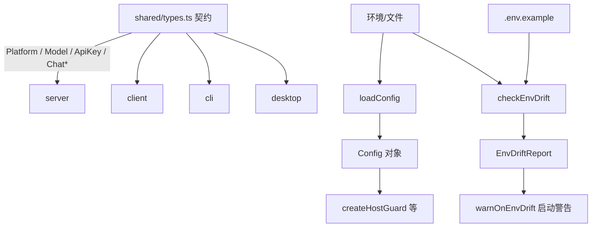

# 23 类型与配置契约：共享类型包、服务端配置与环境漂移

> 基准提交：`ed38ed46`（本地 `adrian`）；核对日期：2026-11-27。范围：跨端共享类型包 `@freellmapi/shared`（平台枚举、聊天契约、模型/密钥结构、搜索平台）、服务端 `Config` 加载、环境变量漂移检测。不覆盖：各篇目的业务语义（见对应篇）、运行期 settings 表（见 [06 配置与数据流](06-配置与数据流.md)）。关联：[05 API 与接口设计](05-API与接口设计.md)、[06 配置与数据流](06-配置与数据流.md)。

## 需求视角

### 1 使用场景、目标与结果

网关由 server / client / cli / desktop 多端组成，都要说同一套「名词」：什么是平台、什么是一次聊天请求/响应、模型和密钥长什么样。如果没有单一契约，各端会各写一套、逐渐走偏。目标是把这些跨端结构**集中定义一份**，各端按类型引用；同时把「环境变量该有哪些」也做成可校验的契约，避免部署时漏配/多配而不自知。完成后：各端结构一致、改契约一处生效、环境漂移能在启动时被警告。

### 2 参与者与业务前置条件

| 参与者 | 角色 | 前置条件 |
|---|---|---|
| 各端代码 | 消费者 | 引用共享类型包 |
| 共享类型包 | 定义者 | 随包发布、被各端依赖 |
| 服务端配置加载 | 执行者 | 启动时读环境/文件 |
| 环境漂移检测 | 执行者 | 有 `.env.example` 作基准 |

前置条件不满足时：类型不一致会在编译期暴露；环境漂移只在启动时警告，不阻断（除非上游要求）。

### 3 业务调用层次

共享类型包被 server / client / cli / desktop 各端 import → 各端用同一套结构编译。服务端启动 → `loadConfig` 读环境装配 `Config` → `warnOnEnvDrift` 用 `.env.example` 对照当前 env 报漂移。契约是横切的，不属任何单一业务流程。

### 4 业务数据流转

| 阶段 | 触发者 / 接收者 | 输入资料 | 业务处理 | 输出结果 | 条件不满足时 |
|---|---|---|---|---|---|
| 1 定义契约 | 共享包 | 平台/模型/密钥/聊天结构 | 集中类型定义 | 各端可引用 | — |
| 2 各端引用 | 各端 → 共享包 | 类型 import | 编译期对齐 | 结构一致 | 不一致→编译报错 |
| 3 装配配置 | 启动 → loadConfig | 环境/文件 | 解析、校验、默认 | `Config` 对象 | 缺项走默认或报错 |
| 4 漂移检测 | 启动 → 漂移检测 | 当前 env + example | 逐键比对 | 漂移报告 | 无 example→跳过 |

### 5 主流程、业务分支与异常结果

- **契约对齐**：平台枚举（`Platform`）、聊天请求/响应（`ChatMessage`/`ChatCompletionResponse`/`ChatCompletionChunk`）、模型（`Model`）、密钥（`ApiKey`/`KeyStatus`/`KeyVerificationBasis`）、搜索平台（`SEARCH_PLATFORMS`）都集中定义。
- **配置装配**：`Config` 含 `allowedHosts` 等 12 个字段，从环境/文件解析并给默认。
- **环境漂移**：解析 env 名（含注释项可选）、与 `.env.example` 比对，输出缺失/多余键的报告，可只在启动时警告。

### 6 边界、非目标与验收表现

- 契约只定义「结构长什么样」，不管「结构怎么被用」；业务语义在各篇。
- 环境漂移检测是静态对照，不验证值是否正确，只验证「键是否齐」。
- 本篇为静态走读，**未改配置、未启动服务**；漂移警告的运行表现 `[待运行验证]`。

## 技术视角

### 7 实现地图：入口、注册点、核心源码与测试

- **共享类型包**：`shared/types.ts`（797 行，包 `@freellmapi/shared`）· `Platform+0`（63）、`SEARCH_PLATFORMS+0`（312）、`SearchPlatform+0`（313）、`Model+0`（319）、`Quirk+0`（348）、`ModelListRow+0`（360）、`KeyStatus+0`（371）、`ApiKey+0`（395）、`KeyVerificationBasis+0`（393）、`ProxyMode+0`（5）、`ImportModelEntry+0`（10）、`PreviewKey+0`（16）等。
- **聊天契约**：`ChatMessage`/`ChatCompletionResponse`/`ChatCompletionChunk`（同在 `shared/types.ts`，被 `server/src/providers/base.ts`、`server/src/providers/logfare.ts`、`server/src/providers/freetts.ts`、`server/src/providers/voice-gateways.ts` 等 import）。
- **服务端配置**：`server/src/lib/config.ts` · `Config+0`（38）、`loadConfig+0`（78）、字段含 `allowedHosts`（75）、`parseAllowedHosts`（100）。
- **环境漂移**：`server/src/lib/env-drift.ts` · `defaultEnvDriftPaths+0`（38）、`parseEnvNames+0`（45）、`compareEnvText+0`（65）、`formatEnvDriftReport+0`（87）、`checkEnvDrift+0`（108）、`warnOnEnvDrift+0`（125）。
- **测试**：`env-drift` 有 `compareEnvText` 相关测试（见 [06 配置与数据流](06-配置与数据流.md) 的 drift 白名单与 [09 测试与部署](09-测试与部署.md)）。

### 8 技术前置条件

- 共享包以 `@freellmapi/shared/types.js` 被各端 import（类型-only import，编译期对齐；此为 npm 包名，非仓库文件路径）。
- `loadConfig` 在启动早期执行；`allowedHosts` 经 `parseAllowedHosts` 解析，供 host 守卫使用（见 [05 API 与接口设计](05-API与接口设计.md) 的 `createHostGuard`）。
- 环境漂移以 `.env.example` 为基准，`defaultEnvDriftPaths` 给默认路径。

### 9 真实调用层次与关键源码定位

- 契约：各端 `import type { ... } from '@freellmapi/shared/types.js'` → 编译期统一。Provider 层（`server/src/providers/base.ts` 等）大量引用聊天契约。
- 配置：启动 → `loadConfig` 解析环境装配 `Config` → 供 `createApp`/host 守卫等消费。
- 漂移：启动 → `warnOnEnvDrift` → `checkEnvDrift` → `compareEnvText` 比对 → `formatEnvDriftReport` 输出 → `console.warn`。

### 10 技术数据流程

- 平台：`Platform` 联合类型是全库平台标识的唯一来源；`SEARCH_PLATFORMS` 是搜索子集。
- 模型/密钥：`Model`/`ModelListRow`/`ApiKey`/`ApiKeyModel`/`ApiKeyCooldown`/`KeyStatus`/`KeyVerificationBasis` 描述模型与密钥结构（`KeyVerificationBasis` 与健康校验依据联动，见 19）。
- 配置：环境 → `parseAllowedHosts` 等解析器 → `Config` 字段。
- 漂移：env 文本 + example 文本 → `parseEnvNames` 抽键 → `compareEnvText` 出 `EnvDriftReport` → 格式化输出。

### 11 核心机制、分支、失败处理与不变量

**不变量**：跨端结构只在 `shared/types.ts` 定义一次；`Platform` 是平台标识唯一权威；环境漂移只报「键齐不齐」，不校验值。

- 类型是编译期契约，运行期不校验（运行期校验靠各处 zod schema，如 `anthropicModelMapSchema` 见 [16 多协议入口](16-多协议入口.md)）。
- 环境漂移默认只警告不阻断；`includeCommented` 可把 example 里注释掉的键也纳入对照。
- `allowedHosts` 解析失败或为空会影响 host 守卫，属安全相关配置。

### 12 详细图表

### 13 验证方式与可观察结果

- 静态：各端 `tsc` 编译即验证契约对齐；`env-drift` 的 `compareEnvText` 有单测（含白名单）。
- 运行（未执行，`[待运行验证]`）：启动时漂移警告输出、`allowedHosts` 生效，需实测。

### 14 后续引用

- 消费者：全库各端；Provider 契约见 [11 Provider 与流式](11-函数级走读-Provider与流式.md)；配置语义见 [06 配置与数据流](06-配置与数据流.md)。
- 关联：host 守卫与 `allowedHosts` 见 [05 API 与接口设计](05-API与接口设计.md)；`KeyVerificationBasis` 见 [19 认证与安全](19-认证与安全.md)。
- 修改联动：改 `Platform`/聊天契约须核对所有引用端编译；改 `Config` 字段须同步 `.env.example` 与 `env-drift` 基准；改搜索平台须同步 `SEARCH_PLATFORMS` 与 [17 搜索与多模态](17-搜索与多模态.md)。

## 术语表

| 术语 | 含义 |
|---|---|
| 共享类型包 | `@freellmapi/shared`，跨 server/client/cli/desktop 的唯一类型契约源 |
| 契约对齐 | 各端 import 同一类型定义，编译期保证结构一致 |
| 环境漂移（env drift） | 实际环境变量与 `.env.example` 基准的键差异 |
| host 守卫 | 基于 `allowedHosts` 的入站 Host 校验 |
| 类型-only import | 只引入类型、不引入运行时代码的 import 方式 |