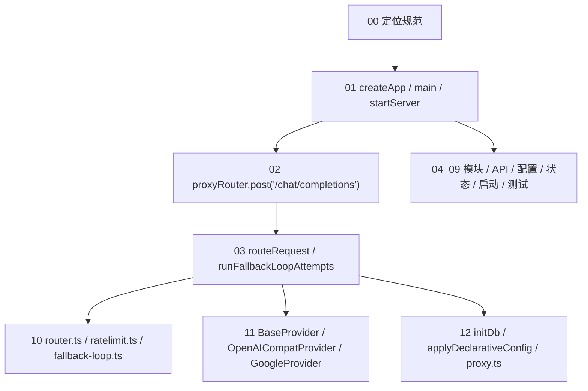

# FreeLLMAPI 源码阅读库

> 本轮源码基准：`1a64da55`（本地 `adrian`）；核对日期：2026-11-17。上一轮基准 `823c496b`，本轮跨 **85 commits** 增量同步（修既有篇漂移 + 补写 15–24 十篇）。
>
> 既有篇（00–14 + topics）已按本基准定点修正，但正文以「引用通过」为准，不代替语义核实。没有执行上游请求或连接运行实例，运行效果均为 `[待运行验证]`。

## 0 怎么读

先把系统看成三件事：客户端把请求交给网关，网关选出一条“模型 + key”路线，Provider 把内部消息翻译为上游协议。想理解一轮请求，按 01 → 02 → 03；想改某个函数，再查第四层。

- 第一层讲“由谁组成、边界在哪里”。
- 第二层只走一条最小成功路径，命令是操作模板，不是伪造的实测记录。
- 第三层展开输入、参数、状态、分支、错误和收尾。
- 第四层深入模块契约、函数实现和跨模块影响。
- 所有新稿使用完整源码路径与「符号 + 偏移」；定位和校验方法见 [00 规范](00-docs-style-guide.md)。

## 1 现有文档与核对状态

“引用通过”只表示新格式符号归属、偏移范围和链接检查通过，不代替语义核实，也不代表 Mermaid 已完成渲染验证。

| # | 文档 | 层 | 重点 | 本轮状态 |
|---|---|---|---|---|
| 00 | [规范与约定](00-docs-style-guide.md) | 规范 | 函数级八问、稳定引用、真实性与验证边界 | 已改写，引用通过 |
| 01 | [简单框架：系统骨架](01-简单框架-系统骨架.md) | 一 | 四个 workspace、独立 desktop、进程与状态边界 | 已核实改写，引用通过 |
| 02 | [简单例子：全路径走读](02-简单例子-全路径走读.md) | 二 | Chat 流式请求成功路径、OpenAI-compatible 出站与收尾 | 已核实改写，引用通过 |
| 03 | [详细逐步：主链路拆解](03-详细逐步说明-主链路拆解.md) | 三 | 十二参数选路、key 闸门、预留、回退、两种提交状态 | 已核实改写，引用通过 |
| 04 | [核心模块与类关系](04-核心模块与类关系.md) | 四 | 模块职责、Provider 契约、状态所有者 | 已核实改写，引用通过 |
| 05 | [API 与接口设计](05-API与接口设计.md) | 四 | 201 注册全景、六门脸认证矩阵、分协议错误包络 | 已核实改写，引用通过 |
| 06 | [配置与数据流](06-配置与数据流.md) | 四 | 四层来源、三种 env 读取时机、声明式降级分支、drift 白名单缺口 | 已核实改写，引用通过 |
| 07 | [状态存储与并发](07-状态存储与并发.md) | 四 | 三 pragma、34 表、DB 优先内存兜底、保留期修剪、备份六道门 | 已核实改写，引用通过 |
| 08 | [启动生命周期](08-启动生命周期.md) | 四 | 两份启动序列、8 job、wake/keep-alive/优雅退出、desktop 镜像与 boot 测试 | 已核实改写，引用通过 |
| 09 | [测试与部署](09-测试与部署.md) | 四 | 五工作区测试版图与计数、CI 矩阵、Docker 三段式、entrypoint、compose、desktop 打包链 | 已核实改写，引用通过 |
| 10 | [函数级：路由限流与回退](10-函数级走读-路由限流与回退.md) | 四 | 9 核心函数逐 step、十道选 key 闸、六出口回退、失败分类学、月度预算 | 已核实改写，引用通过 |
| 11 | [函数级：Provider 与流式](11-函数级走读-Provider与流式.md) | 四 | 请求契约、超时、SSE、验证与配额探针 | 已核实改写，引用通过 |
| 12 | [函数级：存储配置与入口](12-函数级走读-存储配置与请求入口.md) | 四 | 数据库硬化、迁移分叉、配置单事务、入口十二工序、sticky/pin | 已核实改写，引用通过 |
| 13 | [仪表盘](13-仪表盘.md) | 四 | 入口 Provider 栈、路由表、apiFetch 请求层、AuthGate、react-query 状态范式 | 已编写，符号/结构通过（前向链接待全库收尾） |
| 14 | [CLI](14-CLI.md) | 四 | 参数分发、双 roster 模型解析、21 生成器与四格式合并、两阶段落盘、launch 注入、doctor 判定链、keys | 已编写，符号/结构通过 |
| 15 | [桌面端](15-桌面端.md) | 四 | Electron 外壳、嵌入式 server、托盘/窗口/弹窗、GPU 崩溃自愈阶梯、自动更新 | 已编写，引用通过 |
| 16 | [多协议入口](16-多协议入口.md) | 四 | OpenAI/Anthropic/Ollama 三门脸、`/v1` 双前缀折叠、Claude 家族映射、Ollama 仿真模式 | 已编写，引用通过 |
| 17 | [搜索与多模态](17-搜索与多模态.md) | 四 | 搜索/嵌入/媒体路由、模态平台矩阵、图像视频语音转写适配、自定义媒体端点、搜索就绪 | 已编写，引用通过 |
| 18 | [模型与端点管理](18-模型与端点管理.md) | 四 | 目录同步与授权、自定义模型注册/种子/同步、发现、分组、退役墓碑、profile 路由策略 | 已编写，引用通过 |
| 19 | [认证与安全](19-认证与安全.md) | 四 | 入站鉴权（本机/桌面会话/令牌）、月度预算闸门、二次验密、密钥校验依据 | 已编写，引用通过 |
| 20 | [会话与内容处理](20-会话与内容处理.md) | 四 | 响应缓存、请求幂等、压缩保真门、粘滞会话、图像归一 | 已编写，引用通过 |
| 21 | [后台探测与配额](21-后台探测与配额.md) | 四 | 健康检查、模型探测、冷却探测、配额观测与预测、预算告警、Cloudflare neurons | 已编写，引用通过 |
| 22 | [日志与备份](22-日志与备份.md) | 四 | 五类请求日志保留期、备份来源、恢复六道门 | 已编写，引用通过 |
| 23 | [类型与配置契约](23-类型与配置契约.md) | 四 | `@freellmapi/shared` 契约包、服务端 `Config`、环境漂移检测 | 已编写，引用通过 |
| 24 | [函数覆盖总表](24-函数覆盖总表.md) | 索引 | 文件 → 符号 → 承载篇目对照，改函数先查此表 | 已编写，引用通过 |

## 2 已批准的补齐范围（本轮全部完成）

以下是上轮列出的待写篇目；**本轮（基准 `1a64da55`）15–24 十篇已全部落盘**，正式链接见 §1。

| # | 模块 | 必须讲清的函数链路 | 状态 |
|---|---|---|---|
| 13 | 仪表盘 | 页面入口 → 请求封装 → 交互 → 状态更新 | 已编写（见 §1） |
| 14 | CLI | 参数解析 → 配置生成 → 模型解析 → 子进程 | 已编写（见 §1） |
| 15 | 桌面端 | server 启动 → 窗口/托盘 → IPC → 更新 | 已编写（见 §1） |
| 16 | 多协议入口 | 协议解析 → 转换 → 复用核心 → 回写协议响应 | 已编写（见 §1） |
| 17 | 搜索与多模态 | 搜索、embedding、音频、图像、视频各自入口与适配 | 已编写（见 §1） |
| 18 | 模型与端点管理 | 自定义端点、发现、分组、profile、退役 | 已编写（见 §1） |
| 19 | 认证与安全 | 登录、key、权限边界、入站与出站限制 | 已编写（见 §1） |
| 20 | 会话与内容处理 | 压缩、响应缓存、幂等、工具修复与上下文交接 | 已编写（见 §1） |
| 21 | 后台探测与配额 | 健康、恢复、预算、预测与调度 | 已编写（见 §1） |
| 22 | 日志与备份 | 记录、统计、保留、备份与恢复 | 已编写（见 §1） |
| 23 | 类型与配置契约 | 共享字段、默认值、生产者与消费者 | 已编写（见 §1） |
| 24 | 函数覆盖总表 | 文件、符号、所属篇目、人工核实状态 | 已编写（见 §1） |

## 3 阅读路线与源码映射

图中 01–12 均已逐篇回源码核实；13–24 已编写并落盘（见 §1/§2），箭头表示阅读关系。

| 关注的问题 | 优先入口 |
|---|---|
| 为什么选中这个模型、这把 key？ | 03 §4–5；后续深入 10 与调度专题 |
| 为什么重试了、为什么没有继续重试？ | 03 §6、§8 |
| 为什么看见推理或保活后仍失败？ | 03 §8 的提交边界 |
| 流式和非流式的缓存、幂等、用量是否完全一样？ | 03 §3、§9 |
| 源码明明更新了，为何运行实例没变化？ | 00 的版本边界、01 的进程边界；后续深入 08–09 |

## 4 相关专题

| 专题 | 关注点 | 本轮状态 |
|---|---|---|
| [model 调度算法](../topics/model调度算法.md) | 链、评分、key 闸门、惩罚与回退的横切视角 | 已核实对齐当前代码，修机械引用并补术语表 |
| [Premium 目录同步](../topics/premium目录同步.md) | 目录载荷落地、字段与运行行为变化 | 已核实对齐当前代码，修机械引用并补术语表 |

## 5 核实与进度文件

- [统一规范](.progress/UPDATE-SPEC.md)：基准、范围、锚点与质量要求。
- [机器可读进度](.progress/state.json)：逐篇状态、运行验证边界与最终完成标志。
- [任务进度](.progress/tasks.json)：执行批次与依赖。
- [定位工具](.progress/sr_tools.py)：`locate`、`outline`、`offset`、`verify`。
- [工具测试](.progress/test_sr_tools.py)：包含错误偏移、错归属与断链负向验证。

## 6 术语解释

| 术语 | 人话解释 |
|---|---|
| workspace | 根 npm 项目一起管理的子包；这里是 server、client、cli、shared |
| Provider | 对接某类上游接口的适配器，不等于一个模型或一把 key |
| key | 访问接口的凭证；网关入站凭证和上游凭证不是一回事 |
| SSE | 服务端保持连接，分批推送文本事件的传输方式 |
| IPC | 桌面应用不同进程之间传消息，不是浏览器对 server 的普通 HTTP 请求 |
| 基准提交 | 本次读代码时所依据的 Git 版本，不保证与运行应用版本一致 |
| 符号 + 偏移 | 先找函数或声明，再向下数指定行数；比裸行号更容易随重构重新定位 |
| 人工核实 | 实际阅读函数和调用点，确认输入、分支、输出与副作用；自动列出名字不算完成 |
