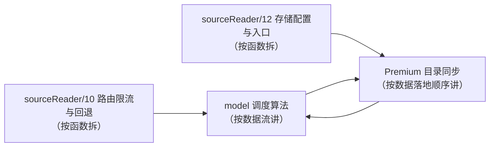

# 专题索引（topics）

> 单主题纵深文档，与 `../sourceReader/` 的四层骨架库互补：骨架库按「层」铺，专题按「一条机制讲透」。记法沿用 `../sourceReader/00-docs-style-guide.md`（符号 + 偏移）。model 调度专题已于 2026-11-17 按 `adrian`@`3ede61067c67da583693aac0e611f4d5ab94e1df` 重整为「生产视角 → 开发视角」；Premium 专题沿用其文内基准。

| 专题 | 一句话定位 | 状态 |
|---|---|---|
| [model 的调度算法](model调度算法.md) | 从客户端请求到答案返回：候选链、模型与 Provider 的选择、Key 顺序、策略优先级、失败换路、JSON/SSE 提交点和落账 | 已按 `3ede610` 同步，42 处符号引用与链接校验通过 |
| [Premium 目录同步](premium目录同步.md) | 「检查更新」按钮背后的一次签名目录同步：存在哪、什么结构、更新什么、对运行有何影响 | 已核实同步，引用通过 |

## 阅读关系

- **model 调度算法**：主角是「算法的输入」——线上排查卡住人的从来不是公式，而是「这个数从哪张表来、现在还是不是新的」。与 sourceReader/10（按函数）、`docs/en/architecture/01-routing-and-bandit-scoring.md`（按产品机制）分工。
- **Premium 目录同步**：主角是「数据落地的物理顺序」——一次 HTTP 往返 → 一行 settings → 七张表 → 运行时读取链。目录写完之后谁消费这些表，回到 model 调度算法。

## 速览

- **model 调度 = 候选记录排序 + 顺序扫描 + 记录内选 Key**：候选同时带 Provider、模型和端点，没有独立的 Provider 总评分。本次策略按「`auto:<方向>` → 链策略 → 全局/决策」裁决；priority 才以人工顺序为主，评分策略中人工 priority 只平分决胜。
- **返回 = 先验收再交付，提交后不再换路**：非流式先查空答案、工具和 JSON；流式在响应头或内容发出前可回退，发出后只能写 stream_error 并结束。原始窗口是硬闸，1.25 安全余量只是软后移；model_monthly_usage 供展示，评分月度余量仍读 requests。
- **目录同步三层存储**：①settings 整份验签 JSON（约 1.3 MB）②拆出的关系表 ③model_overrides/墓碑本地意志层。单事务落库，启动从缓存重放；生效靠各缓存自己过期（链 1s / 配额 5s / 打分 60s），无事件总线。`enabled` 由目录单向覆盖、启用方向不复活。