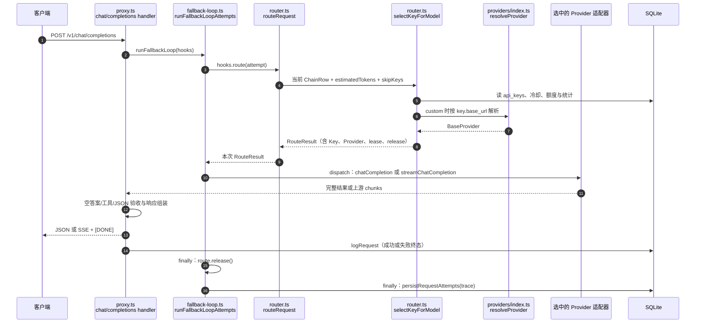
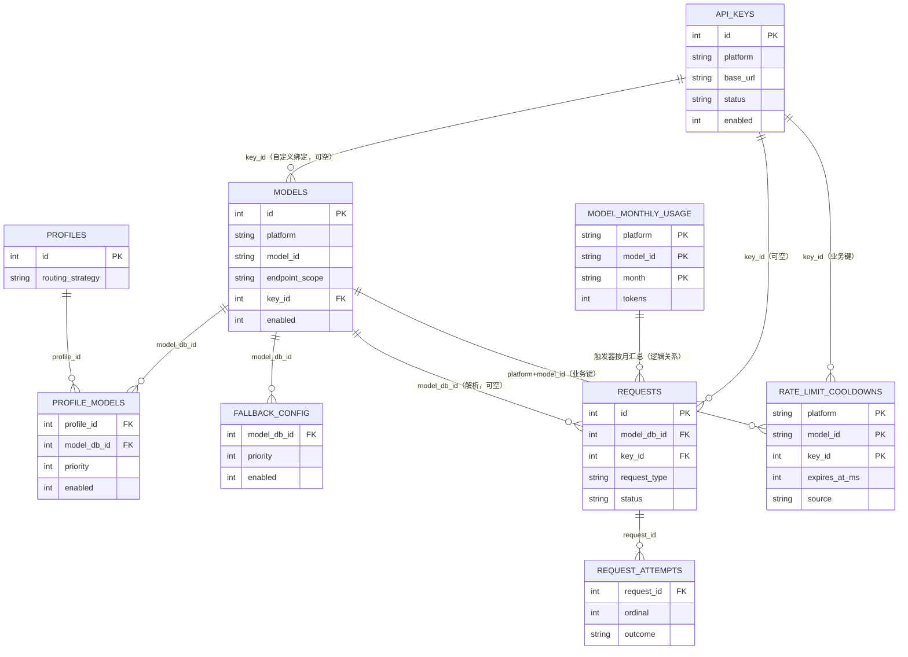

# 主题：model 调度算法——从客户端请求到答案返回

> **源码基准**：本地分支 `adrian` @ `3212ac11`（完整 `3212ac117dd9cf3cc2e987273a1b72b60d75f3f0`，2026-11-23，动笔前工作区干净，本篇涉及的应用源码无未提交或未跟踪改动）。旧专题基准为 `823c496b`，其后历经 `3ede6106`（2026-11-17），至本轮共相隔 111 个提交。
>
> **本篇范围**：以 `POST /v1/chat/completions` 为主线，完整说明请求进入、模型与 Provider 的选择、Key 的选择、失败换路、答案返回和请求落账；再补充 `/v1/messages`、`/v1/responses` 与旧版 `/v1/completions` 的共用关系。Fusion 是多模型合成，另列边界，不把它误写成普通的单模型排序。
>
> **证据边界**：正文描述当前源码，不沿用旧运行实例的版本结论。本轮未请求真实上游、未修改运行数据库、未重启服务。标注为“契约示例”的响应不是本轮实测结果。
>
> **阅读分工**：第一部分给生产、运营和排查人员；第二部分给需要改代码或复核细节的开发人员。相关函数级走读见 [10 路由限流与回退](../sourceReader/10-函数级走读-路由限流与回退.md)，Provider 与流式适配见 [11 Provider 与流式](../sourceReader/11-函数级走读-Provider与流式.md)。

## 目录

- [第一部分：生产视角——一次请求怎样得到答案](#production)
- [第二部分：开发视角——算法、数据与源码](#development)
- [本次同步的关键修正](#sync-changes)
- [验证方式与证据边界](#verification)
- [术语表](#glossary)

---

<a id="production"></a>
# 第一部分：生产视角——一次请求怎样得到答案

## 0. 结论速览

从当前代码可确认，客户端最终拿到的答案有四种来源：缓存、幂等重放、Fusion 合成，或普通单模型路由。普通路由的核心行为如下：

| 关键结论 | 实际结果 |
|---|---|
| 候选不是单独模型名 | 每条候选同时带 Provider、模型和端点；随后才在这条候选内部选 Key |
| 排序办法有三层来源 | `auto:<方向>` 优先于链自己的策略，链策略优先于全局或 decision 本次选择 |
| 人工 priority 不总是主排序键 | priority 策略看人工名次和罚位；评分策略先看匹配层级和分数，人工值只平分决胜 |
| 高分不等于必定服务 | 能力、原始上下文窗口、额度、冷却和 Key 检查都能让候选在发请求前出局 |
| 换 Key、换模型、换 Provider 是三种不同范围 | 401 主要换 Key；模型不匹配换模型；5xx、超时等 Provider 级故障换整个平台 |
| 返回答案前还有验收 | 空答案、坏工具调用和不合格 JSON 都可能换路；不是上游返回 200 就算成功 |
| 流式一旦提交就不能无痕迹换路 | 中途错误只能写 stream_error 并结束当前流；因此可能看到 HTTP 200 加错误帧 |

## 1. 先把四个对象分清

生产排查时，最容易把“模型、Provider、端点、Key”混成一个对象。它们在本系统里是四层：

| 对象 | 人话解释 | 实际作用 |
|---|---|---|
| **模型** | 要生成答案的那个模型，例如某个 GPT、GLM 或 Gemini 型号 | 决定能力、上下文大小，以及可靠性、速度、智能等评分输入 |
| **Provider** | 把模型服务出来的公司或网关，代码里常叫 `platform` | 决定使用哪套上游协议、地址、错误格式和账号限额 |
| **端点（endpoint）** | 某个具体的自建或中转地址 | 两个中转站即使写着同一个模型名，也分别评分、分别限流，不能共享成绩 |
| **Key** | 调这个 Provider 时使用的账号凭证 | 决定账号额度、权限、并发和冷却状态；同一模型可以有多把 Key |

**最重要的结论：系统不是先独立选一个 Provider，再在这个 Provider 里选模型。**

一条候选记录本身就包含：

```text
Provider + 模型 + 端点
```

自动路由先给这些候选记录排顺序，然后从头扫描。轮到某一条时，才在这条记录内部找一把能用的 Key。最终拿去发请求的是：

```text
Provider 适配器 + 上游模型 ID + 已解密 Key + 端点/代理信息
```

所以：

- 同一个模型由三家 Provider 提供时，是三条候选，不是一条模型外加一个“Provider 下拉框”。
- 没有一个独立于模型评分之外的“Provider 总分”。
- Provider 的先后主要来自候选记录的顺序；候选不可用时，扫描自然落到下一条。
- Provider 级故障和 Key 级故障的处理范围不同，后面会分开说明。

## 2. 一页看懂：客户端请求到答案返回

```text
客户端
  │
  │  HTTPS / OpenAI 兼容请求
  ▼
网关入口
  ├─ 1. 验客户端 Key、检查请求格式
  ├─ 2. 规整消息、压缩、处理图片、估算请求大小
  ├─ 3. 检查视觉/工具/单次 Token 预算等前置条件
  ├─ 4. Fusion 请求走多模型合成，普通请求继续
  ├─ 5. 缓存或幂等重放命中 → 直接返回，不选模型、不耗上游额度
  │
  ▼
确定本次允许使用的候选范围
  ├─ auto / 省略 model → 当前活动链
  ├─ auto:<链名> → 指定链
  ├─ auto:<方向> → 全目录中仍允许自动路由的候选
  ├─ 具体模型 → 点名模型；Unify 开启时可限在同一逻辑模型组内
  └─ 有会话粘住的成功模型 → 在允许范围内优先看它
  │
  ▼
确定排序办法
  ├─ 请求里的 auto:<方向> 优先
  ├─ 其次是这条链自己设置的策略
  ├─ 最后才用全局策略；全局 decision 会先选出本次权重
  │
  ▼
给“Provider + 模型 + 端点”候选排序并逐个检查
  ├─ 人工顺序或实时评分
  ├─ 探索、会话优先、点名优先
  ├─ 能力、上下文、本次已失败记录等检查
  └─ 轮到某候选后，在其内部按顺序找可用 Key
  │
  ▼
向选中的 Provider 发请求
  ├─ 失败且还没向客户端交付答案 → 记录排除范围，重新选下一跳
  ├─ 成功但未通过空答案/工具/JSON 检查 → 也算失败，可换下一跳
  └─ 已把响应头或内容交给客户端 → 不能再无痕迹换模型
  │
  ▼
返回答案
  ├─ 非流式：完整 JSON
  └─ 流式：连续 SSE 数据帧，最后 [DONE]
  │
  ▼
记录成功/失败、Token、每一跳轨迹；释放在途占用
```

这里的“排序”不等于“一定能用”。**第一名只是先看，不是已经承诺由它回答。** 能力不符、窗口太小、Key 冷却、额度不足等情况，都会让它在真正发请求前被跳过。

## 3. 请求进入后，系统依次做什么

### 3.1 先验证调用者，不急着选模型

网关先检查客户端带来的 API Key。无效时直接返回 `401 authentication_error`，不会进入模型路由，也不会消耗任何 Provider 额度。

请求体随后按接口格式检查。格式错误直接返回 `400 invalid_request_error`，错误里会带具体字段路径。此时也没有候选模型被调用。

### 3.2 规整请求，得到真正用于路由的内容

网关会先做这些实际加工：

1. 规整角色、工具调用、停止词和采样参数。
2. 在改写消息之前取出会话身份，避免压缩后认错会话。
3. 按请求设置压缩消息；如果客户端配置带有服务端强制系统提示，在压缩后再放到最前面。
4. 超过阈值的内联图片先缩小，再做请求大小估算和发送。
5. 估算输入 Token。文本使用约 4 个字符折 1 Token 的估计；每张图片另加固定估计值。
6. 为输出预留路由估算空间，但最多只按 2000 Token 计。客户端即使写很大的 `max_tokens`，也不会因此把整个免费池提前吓退。

这个估算用于“哪个模型装得下”和额度预检，不等于上游最终账单。答案返回时，如果上游给了真实 `usage`，优先使用真实值；否则使用估算值，并在响应里标 `estimated: true`。

### 3.3 能在本地拒绝的，不浪费上游请求

| 请求情况 | 本地结果 |
|---|---|
| 带图片，但没有任何已启用的视觉模型 | `422 no_vision_model` |
| 带工具，但没有任何已启用的工具调用模型 | `422 no_tools_model` |
| 超过运营设置的单次 Token 预算 | `413 request_token_budget` |
| 点名的模型不存在或已禁用 | 通常 `404 model_not_found` |
| 点名逻辑模型组，组有启用模型但没有可用 Provider/Key | `503 no_providers_configured` |
| 指定链不存在或链内没有启用模型 | 直接返回配置错误，不偷偷换到别的链 |

这些检查通过后，才进入缓存、路由和上游调用。

### 3.4 有两类请求不走普通的单模型路由

**第一类：Fusion。** 客户端明确使用 Fusion 时，系统会让多个模型回答，再由评判模型合成。这是另一条多模型流程，不能用“一次排序后选一名”概括。本篇后面的普通回退闭环不适用于它的每一次内部调用；内部子调用仍复用模型路由、额度和统计。

**第二类：缓存或幂等重放命中。**

- 响应缓存命中：直接返回以前保存的完整 JSON，或以前保存的整段 SSE 帧。
- 非流式请求带相同 `Idempotency-Key` 且请求内容一致：直接重放第一次的结果。
- 同一个幂等键却配了不同请求内容：返回 `409`，不会拿旧答案冒充新答案。
- 这些命中都不重新选择 Provider，也不消耗 Provider 额度。

响应头会标明 `X-Routed-Via: cache` 或 `X-Routed-Via: idempotency`。缓存命中另有 `X-FreeLLM-Cache: HIT`。

## 4. model 到底怎么选

### 4.1 先确定候选范围

客户端写的 `model` 决定“允许看谁”：

| 客户端写法 | 实际候选范围 | 关键点 |
|---|---|---|
| 不写 `model`，或写 `auto` | 当前活动链 | 有活动 Profile 时，只用它；不会因为它为空就退回全目录 |
| `auto:<链名>` | 指定 Profile 中的启用成员 | 链名不区分大小写；空链直接报错 |
| `auto:smart` / `auto:fast` / `auto:reliable` / `auto:balanced` | 全目录中仍允许自动路由的模型 | 忽略链的人工顺序，但不忽略目录开关和链开关 |
| `auto:cheap` | 全目录中仍允许自动路由的模型 | 当前仍使用 balanced 权重，不是单独的最低价算法；池内模型本就按免费目录管理 |
| 具体模型 ID | 点名模型 | Unify 开启且命中逻辑组时，只允许组内 Provider 接力，不跳到别的模型 |
| `fusion` | 多模型合成流程 | 不走普通单候选闭环 |

有两道独立启用开关：

1. **目录开关**：模型在整个目录里是否可用。关了，普通链查询就看不到它。
2. **链内开关**：模型是否参与这条自动链。关了，它仍可能被客户端明确点名，但不参与普通自动路由。

活动链有 1 秒缓存；切换活动 Profile 会立即换缓存键，链内容修改最迟按缓存过期生效。

### 4.2 再确定这条请求使用哪种排序策略

对普通自动路由，本次策略的优先顺序是：

| 优先级 | 来源 | 结果 |
|---|---|---|
| 1 | 请求里的 `auto:<方向>` | 强制使用对应预设；即使全局是 decision，也不再花一次决策调用 |
| 2 | 这条 Profile 自己配置的策略 | 覆盖全局策略；留空才继承全局 |
| 3 | 全局策略 | 使用 balanced、smartest、fastest、reliable、priority、custom 或 decision |

目前 Profile 管理接口允许每条链设置：`priority`、`balanced`、`smartest`、`fastest`、`reliable`，或留空继承。`custom` 和 `decision` 是全局策略能力，不是当前 Profile 管理接口暴露的选项。

**显式点名模型不属于这张自动策略优先级表。** 它会把点名对象提到候选前面，但仍要过能力、窗口、Key 和额度检查。

还有一个现行边界：入口是否调用 decision，看的是全局策略、是否点名/粘住模型、是否使用方向别名；这里不会先看链固定策略。因此，**全局 decision＋链固定策略**时，系统仍可能先得到一次 decision 结果，随后却被链固定策略覆盖。此时响应头可以报告 decision 的选择，但最终参与排序的是链固定策略，不能只看响应头判断实际权重。

### 4.3 七种策略分别做什么

| 策略 | 实际行为 | 适合什么生产需求 |
|---|---|---|
| `balanced` | 可靠性 50%、速度 25%、智能 25% | 默认综合使用 |
| `smartest` | 可靠性 35%、速度 10%、智能 55% | 更重视答案能力 |
| `fastest` | 可靠性 35%、速度 55%、智能 10% | 更重视响应速度 |
| `reliable` | 可靠性 70%、速度 15%、智能 15% | 更重视少失败 |
| `priority` | 不做三项加权评分，按人工链顺序加失败罚位 | 运营要固定先后 |
| `custom` | 使用运营自己配置的三项权重 | 全局自定义权衡 |
| `decision` | 先让决策模型从四个预设中选一个；若没有被方向别名或链固定策略覆盖，再按那个预设评分 | 希望按请求内容改变权衡，而不是直接点名模型 |

`decision` 需要特别说清楚：

- 它只选择本次使用哪组权重，**不会发明新候选，也不会绕过能力和额度检查**。
- 客户端点名模型、会话已经粘住某个模型、或使用 `auto:<方向>` 时，不做这次决策。
- 决策输入是系统提示开头最多 400 字，加最后一条用户消息最多 1600 字。
- 决策最长等 1.5 秒。超时、无可用模型或 Key、调用失败、答案无效、置信度低于阈值，都退回 `balanced`。
- 相同决策输入有 30 分钟内存缓存，最多 500 条；缓存键包含决策模型和置信度阈值。
- 只有真正执行了 decision 选择，才会通过 `X-FreeLLM-Routing-Strategy` 说明结果及是否回退。没有这个响应头，不能反推本次用了哪种策略。

### 4.4 人工 `priority` 和实时评分，谁的权力大

这是运营最容易改错的地方。

#### 使用 `priority` 策略

1. 先按链里的人工 `priority` 从小到大排。
2. 把保留下来的候选重新编号为第 1、2、3……名。
3. 每个模型再加上自己的失败罚位。
4. 罚位少的先扫；仍相同则看原始 `priority` 和原顺序。

重新编号是必须的。比如人工值是 10、100、900，直接给 10 加 3 个罚位仍是 13，永远超不过 100；先变成名次 1、2、3 后，加 3 位才会真实后移。

#### 使用评分策略

排序键依次是：

1. **直接匹配层级**：直接点名的成员优先于仅通过组别名推导出来的成员。
2. **本次评分**：高者优先。
3. **人工 `priority`**：只在评分持平时决胜。

所以在 `balanced` 下，把某模型从人工 100 改成 1，通常不会改变结果。**人工顺序不是评分权重。** 要固定人工顺序，应把本次有效策略设为 `priority`。

注意两个后置动作：

- 探索可能把合格的新模型临时提到队首。
- 点名或有效会话偏好随后也会把目标提到队首。

因此“直接匹配层级支配评分”只描述评分排序本身，不包括后面的显式点名或会话优先。

### 4.5 评分高也可能扫不到：硬检查和软后移

轮到每条候选时，系统会检查：

- 本请求是否已经排除了这个模型或整个 Provider。
- 是否有图片，模型是否支持视觉。
- 是否有工具，模型是否支持结构化工具调用。
- 是否要求 JSON/结构化输出，而 Provider 会丢掉这个参数。
- 原始上下文窗口是否装得下本次估算。
- 单次估算是否已经超过该模型每分钟 Token 上限。
- 是否能找到一把当前真正可用的 Key。

**原始窗口装不下是硬排除。** 但 `1.25` 安全余量只是软偏好：先扫更宽裕的模型；如果一个模型按原始窗口能装下、只是没达到安全余量，它会被后移，不会被直接淘汰。

经常拒绝工具请求的模型也会被移到工具请求的队尾，而不是让整个请求无路可走。显式点名的模型不享受“能力不符也能通过”的特权。

### 4.6 探索不是“唯一能让新模型上场”的开关

评分中的可靠性本身带随机抽样，新模型仍可能凭先验被抽中。开启探索后，系统另外提供一个保底机会：

- 当前不是 `priority`。
- 探索开关已打开。
- 系统不处于大面积故障的降级状态。
- 本次命中 10% 概率。
- 从样本少于 5 的模型中，挑一个确实能服务本次请求的放到队首。
- 被运营通过模型覆盖权重明确置 0 的模型，不拿这个探索位。

因此，**探索是新模型获得保底首试机会的开关，不是随机评分之外唯一的上场路径。**

## 5. Provider 到底怎么选，优先级在哪里体现

### 5.1 普通情况：Provider 随候选记录一起被选中

假设当前链是：

| 候选 | 人工 priority | 假设本次评分 | 扫描结果 |
|---|---:|---:|---|
| Provider 甲 / 模型 A | 10 | 0.81 | 先看它 |
| Provider 乙 / 模型 B | 1 | 0.79 | 第二看它 |
| Provider 丙 / 模型 C | 20 | 0.65 | 第三看它 |

在 `balanced` 下，先看甲，不是看乙的人工 1。若甲有合格 Key，请求就直接发给甲，不会再比较乙的 Key。

若甲没有任何能用的 Key，系统在同一轮扫描里转到乙。这个过程发生在真正向上游发请求之前，不计为一次上游失败尝试。

在 `priority` 下，顺序则先看乙，再看甲，最后看丙；失败罚位仍可能调整这个顺序。

### 5.2 Key 故障与 Provider 故障，换的范围不同

| 故障 | 本次请求怎么换 | 为什么 |
|---|---|---|
| Key 返回 401 | 跳过这把 Key，冷却该模型+Key 5 分钟并触发重验；还可试同模型其他 Key | 坏的是凭证，不是整个 Provider |
| 余额不足 402 | 这把 Key 在该 Provider 的可路由模型上都被冷却；仍允许另一把 Key 换钱包 | 一个账号没钱，不代表另一个账号也没钱 |
| 模型不存在、模型无权限、上下文过大、模型级过载 | 该模型在本次请求中出局，换下一候选 | 换同模型另一把 Key 通常会复刻结果 |
| Provider 返回 5xx、超时、传输中断或部署降级 | 该 Provider 在本次请求中整体出局，直接换其他 Provider | 这类错误按 Provider 级故障处理 |
| 适配器在发请求前明确说“我不支持这种请求/模型” | 本次请求跳过该模型，但不冷却健康 Key | 是请求或模型不匹配，不是服务故障 |
| 客户端主动断开 | 停止整个回退，不再试，也不惩罚模型 | 没人等答案，不能记成 Provider 失败 |

Provider 级排除只活在本请求内。下一请求会重新评估，不会因为一次 5xx 就把该平台永久拉黑。冷却和失败统计才是跨请求状态。

### 5.3 同名模型有多个 Provider 时，不能臆测固定先后

- **Unify 开启**：同一逻辑模型的多个 Provider 成员组成严格候选组，可以按当前策略排序和接力；直接匹配成员先于仅由组别名推导的成员。
- **Unify 关闭**：旧版单行点名只按模型 ID 找一条启用记录。该查询没有 Provider 排序，也没有 `ORDER BY`。所以同名多行时，**不能承诺固定选哪一家 Provider**。需要跨 Provider 明确调度时，应使用 Unify 组或配置清楚的自动链，不要依赖这条旧版查找顺序。

### 5.4 自定义 Provider 多一步“按端点生成适配器”

内置 Provider 使用代码里注册的固定适配器。自定义 Provider 则在 Key 通过检查后，根据这把 Key 所属的 `base_url` 创建 OpenAI 兼容适配器。

同一自定义端点可以有多把 Key；系统只在这个端点的 Key 池内轮换，不会拿另一个中转站的 Key 来请求当前端点。两个端点即使模型 ID 一模一样，也有各自的评分、冷却、输出上限学习和速度记录。

## 6. Key 到底怎么选，它的优先级是否跟模型一样

Key 选择是独立的一层，不沿用模型三项权重。

### 6.1 先删掉根本不可能用的 Key

在真正逐把检查前，系统先限定：

- Key 属于当前 Provider。
- Key 已启用，状态是 `healthy` 或 `unknown`。
- Key 的模型范围允许当前模型。
- 自定义模型时，Key 必须属于当前端点。

状态为 `error`、`invalid` 的 Key 不在候选池里。被模型范围排除的 Key 不占轮转位置。

### 6.2 再决定先看哪把 Key

| Key 策略 | 实际顺序 |
|---|---|
| `auto`（默认） | 至少两把 Key 且任意一把已有统计时，按 Key 自己的可靠性和速度排序；否则轮转 |
| `least-remaining` | 在上述顺序之上，再按观测剩余额度从高到低稳定排序；相同则保持刚才的顺序 |

`auto` 的 Key 评分是：

- 可靠性占 75%。
- 速度占 25%。
- 可靠性同样带随机抽样，没有数据的新 Key 也有机会。
- 没有足够统计时，不假装知道谁最好，直接轮转。

`least-remaining` 对“整个账号共享一份额度”的 Provider 不启用，因为同账号每把 Key 看到的都是同一份余量，重排没有意义。从未观测到额度的 Key 按中性的 0.5 处理，不会被当成满额，也不会被当成空额。

### 6.3 排序后还要逐把过闸

一把 Key 只有全部通过才会被返回用于发请求。检查包括：本次是否已失败、是否冷却、Provider 日/分钟/Token 限额、Key 并发、模型 RPM/RPD/TPM/TPD、Key 月度预算、能否解密、Cloudflare 神经元余额，以及能否为当前端点生成 Provider 适配器。

全部通过后，系统先预留月度预算和在途额度，再发请求。这样并发请求不会都看着同一份“尚未扣减”的余额一起冲过去。请求结束后，无论成功、失败还是客户端断开，都会释放这次占用。

## 7. 上游失败后，怎样得到下一个答案

### 7.1 每一次失败都会重新路由，不是简单拿静态列表加一

共享回退循环每轮都会重新执行候选排序和 Key 扫描。它带着三组仅属于本请求的排除记录：

| 排除集合 | 内容 | 效果 |
|---|---|---|
| `skipKeys` | 已失败的 Provider+模型+Key | 不再试这把 Key |
| `skipModels` | 已确定不适合本请求的模型 | 不再试这个模型的其他 Key |
| `skipPlatforms` | 已确定 Provider 级故障的平台 | 不再试该平台任何模型和 Key |

因此，重新评分不是把失败原样再来一遍；刚失败的对象会被过滤或排除。

### 7.2 次数和时间都有上限

- 默认最多 20 次实际上游尝试。
- 默认整体回退时间预算是 45 秒，从回退循环开始计算，不是每一跳各有 45 秒。
- 第一次尝试和第一次重试总会放行。
- 后续尝试在启动前检查预算；仍在等待首个可交付内容时，预算到期会取消当前上游请求。
- 有足够历史样本的慢端点可以有自己的预算，但每个候选单独计算，不会把慢端点的宽限继承给后面的快端点。
- 连续失败熔断默认关闭。运营设置阈值后，达到次数会提前以 503 停止。

### 7.3 不是什么失败都会惩罚模型

- 上下文太大：本次换模型，但不冷却、不罚模型；它仍能服务较小请求。
- 请求或模型被适配器主动拒绝：本次换模型，但不冷却健康 Key。
- 空答案、JSON 不合格：可以换路；部分情况带连续次数豁免，避免把正常但不适配的模型立即打入冷宫。
- 一把 Key 失败但还有兄弟 Key 可用：通常不增加整个模型的失败罚位。
- 开启 Provider 瞬时故障归因后，429、5xx、超时、传输类失败仍可冷却 Key，但不计入模型可靠性和模型罚位。
- 客户端断开：不冷却、不罚、不算模型失败。

## 8. 得到答案后，具体怎样返回

### 8.1 非流式：先验收，再返回完整 JSON

Provider 返回后，网关不是原样转发就结束，而是先检查：

1. 是否有正文或工具调用；空答案会进入回退。
2. 是否只是上游安全分类词，而不是用户要的答案；命中会进入回退。
3. 工具调用是否藏在文本私有意语法里；能识别就转换成标准工具调用，无法解析则换路。
4. 工具参数是否双重编码，能否按请求中的工具定义修复；开启严格校验时，修不好会换路。
5. 要求 JSON 时，结果是否真是 JSON；可修复的围栏或包裹文本会先修复，不合格则换路。
6. 对外模型名统一写实际路由的模型 ID，不直接相信上游返回的 `default` 等占位名。

验收通过后：

- 记录本次成功和 Token 用量，清除相应失败连击并降低模型罚位。
- 写入会话偏好，下一次同会话优先使用这次成功的模型。
- 设置 `X-Routed-Via`、`X-Fallback-Attempts`、`X-Fallback-Trail` 等响应头。
- 返回完整 JSON，正文额外带 `execution_id`，方便和尝试轨迹对应。
- 如果上游没给 `usage`，补估算用量并标 `estimated: true`。
- 满足条件时保存响应缓存或幂等结果；`finish_reason=length` 的截断答案不保存。

### 8.2 流式：边收边验收，最后明确结束

流式返回使用 SSE，也就是一连串 `data: ...` 帧。常见顺序是：

```text
角色/推理等前置帧
正文增量帧或完整工具调用帧
带 finish_reason 的结束帧
usage 帧（上游有就转发，没有就补估算并标 estimated:true）
data: [DONE]
```

工具调用的参数可能分散在多个上游帧里。网关会先收集，最后输出一件完整的工具调用，并保证有结束原因，避免客户端拿到“半个函数调用”。

**流式有一条不能跨越的分界线：已经向客户端发出响应头或实际内容后，就不能再无痕迹换模型。**

- 首个可交付内容之前出错：抛回共享回退循环，客户端通常只看到最终成功的那一家。
- 要求 JSON 时：正文会先全部留住，验证通过才发，避免把散文发给要求机器读取的客户端。
- 普通正文开始交付后出错：向当前流写一个 `stream_error` 错误帧，再写 `[DONE]` 并结束；HTTP 状态此时通常已经是 200，不能再改成 502。
- 长时间只有推理、没有正文时，可能通过保活注释或推理内容提前提交响应。此后即使还没有可见正文，也不能保证继续无痕迹换路。

所以生产上看到“HTTP 200，但流里有 Provider error / stream interrupted”，不是状态码矛盾，而是错误发生在响应已经提交之后。

### 8.3 成功返回之后还要完成哪些账

- 成功：写请求和 Token 用量，清失败连击，降低内存罚位，恢复 Key 健康状态，保存会话偏好和推理记忆。
- 每一跳：记录 Provider、模型、请求内 Key 序号、开始偏移、耗时、结果和脱敏错误摘要。
- 请求轨迹在响应结束后批量写入 `request_attempts`，不把这段写库放在客户端等待路径上。
- 每个出口都释放在途租约和月度预留。
- 仅被前置检查跳过、从未真正发请求的候选，不会产生 `request_attempts` 行。因此轨迹能证明“谁真的跑过”，不能单独还原完整评分顺序。

## 9. 没有答案时，客户端实际收到什么

### 9.1 常见终态

| 情况 | 状态与含义 |
|---|---|
| 所有已试 Key 都是认证失败 | 502，明确是上游 Provider Key 失败，不让客户端误以为自己 Key 错 |
| 所有已试候选都因上下文过大失败 | 413 |
| 所有已试候选都报告模型不存在 | 404 |
| 所有已试候选都以无效请求拒绝 | 400 |
| Provider 部署降级，或熔断器提前停止 | 503 |
| 每次失败都属于已知时间会恢复的限流/额度/余额/权限类 | 429，并尽量给重试时间 |
| 5xx、超时、传输、限流等混合失败 | 502，正文列出失败类别分布 |
| 一次都没发出去，且全是配置缺失 | 503 `no_providers_configured` |
| 一次都没发出去，且全是窗口/Token 装不下 | 413 |
| 一次都没发出去，且只是月度 Key 预算耗尽 | 429，重试时间指向下个 UTC 月 |
| APINex 需要每日网页签到 | 429 `provider_checkin_required`，文案带处理地址 |
| 不可重试的单次 Provider 错误 | 502 `provider_error` |

不能只看“最后一个错误是不是 429”。只有整段尝试都支持“等待会恢复”，才会给 429；混进超时或 5xx 时，最终通常是 502。

### 9.2 排查时先看哪些响应头

| 响应头 | 能回答什么 |
|---|---|
| `X-Request-ID` | 这次网关请求的统一标识 |
| `X-Routed-Via` | 实际由谁服务，或是否来自缓存/幂等重放 |
| `X-Fallback-Attempts` | 成功前有多少次失败尝试 |
| `X-Fallback-Trail` | 实际尝试过哪些 Provider/模型、请求内 Key 序号和错误类；最多展示 10 跳 |
| `X-Fallback-Detail` | 运营显式开启后，额外提供脱敏错误和耗时 |
| `Retry-After` | 可计算恢复时间时，建议多久后重试 |
| `X-FreeLLM-Routing-Strategy` | decision 真正执行时，选择了哪个预设，是否因超时等原因回退 |
| `X-FreeLLM-Cache` | 缓存命中、未命中但未写，或功能关闭 |

### 9.3 生产上最常见的六个误判

1. **“我把 priority 改成 1，为什么没先选？”** 先看本次有效策略是不是 `priority`，以及是否被 `auto:<方向>` 或链策略覆盖。
2. **“评分第一，为什么没调用？”** 它可能在能力、上下文、Key、冷却或额度检查时被跳过；跳过不等于上游失败。
3. **“同一模型为什么换 Provider？”** Unify 组内允许跨 Provider 接力；会话成功记录也会让某个 Provider 成员优先。
4. **“一把 Key 失效，为什么整个平台都没了？”** 若错误同时被分类为 Provider 级故障，平台会在本请求内整体排除；401 本身只做 Key 级处理。
5. **“为什么 HTTP 200 还报错？”** 流已经提交，错误发生在中途，不能再换状态码或换 Provider。
6. **“月度用量表已经有数，为什么评分余量不一样？”** 当前展示账和评分账不是同一查询来源，见开发部分第 15 章。

## 10. 可运行请求例子与预期结果

前置条件：网关已启动，把地址和客户端 Key 放进环境变量。下面的地址只是本机常见示例，请按实际部署替换。

```bash
export FREEAPI_BASE_URL='http://127.0.0.1:31415'
export FREEAPI_SHOT='替换为客户端统一 Key 或 client-profile Key'
```

### 10.1 非流式自动路由

```bash
curl -sS -D - "$FREEAPI_BASE_URL/v1/chat/completions" \
  -H "Authorization: Bearer $FREEAPI_SHOT" \
  -H 'Content-Type: application/json' \
  -d '{
    "model": "auto",
    "stream": false,
    "messages": [{"role":"user","content":"用一句话解释什么是回退。"}],
    "max_tokens": 128
  }'
```

**预期结果（契约示例，不是本轮真实响应）**：

- HTTP 成功时为 200。
- 响应头能看到 `X-Request-ID`、`X-Routed-Via`；发生换路时还能看到 `X-Fallback-Attempts` 和 `X-Fallback-Trail`。
- JSON 含 `execution_id`、`choices` 和 `model`；`model` 是实际服务模型，不是 `auto`。
- 上游没给用量时，`usage.estimated` 为 `true`。

### 10.2 流式自动路由

```bash
curl -N -sS -D - "$FREEAPI_BASE_URL/v1/chat/completions" \
  -H "Authorization: Bearer $FREEAPI_SHOT" \
  -H 'Content-Type: application/json' \
  -d '{
    "model": "auto",
    "stream": true,
    "messages": [{"role":"user","content":"分三点说明如何判断一个模型能否服务当前请求。"}],
    "max_tokens": 256
  }'
```

**预期结果（契约示例，不是本轮真实响应）**：看到连续 `data:` 帧，正文逐步增加，最后出现 `data: [DONE]`。如果开始交付后上游中断，可能先看到 200，再看到 `type: stream_error` 的帧和 `[DONE]`；这表示已不能换路，不是继续等待下一家。

## 11. 什么时候不该依赖自动调度

- **必须固定某一个模型行为**：直接点名模型，不要靠 balanced 的第一名。
- **必须固定人工灾备顺序**：使用 `priority`，不要只改链里的数字却仍跑 balanced。
- **必须让同一逻辑模型跨 Provider 接力**：启用并配置 Unify 组，不要依赖 Unify 关闭时的同名单行查询。
- **请求完全不能接受模型切换**：不要依赖普通自动回退；即使点名，也要核对分组和失败策略是否符合业务要求。
- **要复现一次评分顺序**：实时可靠性有随机抽样， dashboard 的期望值排序不等于每次实际路由顺序；应结合响应头和尝试轨迹，而不是只看面板分数。

---

<a id="development"></a>
# 第二部分：开发视角——算法、数据与源码

## 12. 实现地图：请求、路由、Provider、返回分别在哪里

| 环节 | 当前实现与锚点 | 责任 |
|---|---|---|
| OpenAI 聊天入口 | `server/src/routes/proxy.ts` · `proxyRouter.post('/chat/completions')+0` | 鉴权、请求规整、缓存、会话、调用回退、构造客户端响应 |
| 客户端 Key 鉴权 | `server/src/routes/proxy.ts` · `requireInferenceAuth+0~+7` | 统一 Key 与 client-profile Key；失败直接 401 |
| 候选链解析 | `server/src/services/router.ts` · `resolveRoutingChain+0~+49` | auto、指定链、全局方向别名 |
| 本次策略裁决 | `server/src/services/router.ts` · `routeRequest+4~+19` | 方向别名 > 链策略 > 全局/请求决策策略 |
| 模型排序 | `server/src/services/router.ts` · `orderChain+0~+68` | priority 人工序或三轴评分、地板、任务权重、排序键 |
| 单项评分 | `server/src/services/router.ts` · `scoreChainEntry+0~+67` | 取统计、三轴、两项余量/罚分乘数、模型覆盖权重 |
| 最终分数合成 | `server/src/services/scoring.ts` · `combineScore+0~+7` | 加权基础分乘两个护栏 |
| Provider+模型+端点记录 | `server/src/services/router.ts` · `ChainRow+0` | 一条路由候选的全部静态输入 |
| 本次可执行路由 | `server/src/services/router.ts` · `RouteResult+0` | Provider 实例、模型、明文 Key、端点、代理、释放函数 |
| Key 排序与闸门 | `server/src/services/router.ts` · `selectKeyForModel+0~+163` | 选 Key、解密、额度预检、预留与租约 |
| Provider 实例解析 | `server/src/providers/index.ts` · `resolveProvider+0~+12` | 内置单例；自定义端点按 base_url 创建 OpenAI 兼容实例 |
| 共享回退 | `server/src/lib/fallback-loop.ts` · `runFallbackLoop+0~+17`、`runFallbackLoopAttempts+0~+293` | 尝试次数、时间预算、错误分类、轨迹、释放 |
| 决策路由 | `server/src/services/routing-decision.ts` · `applyDecisionRouting+0~+13` | 决定是否调用决策模型并写请求级策略 |
| 成功记账 | `server/src/lib/fallback-loop.ts` · `recordUpstreamSuccess+0~+26` | 用量、罚位、连击、Key 健康、工具能力 |
| 请求与轨迹落库 | `server/src/lib/request-log.ts` · `logRequest+0~+90`、`persistRequestAttempts+0~+17` | 原始请求、聚合、逐跳轨迹 |

下面这张图只画缓存未命中后的普通单模型主链。提前拒绝、缓存命中和 Fusion 分流已经在生产部分单独说明；失败时由 `runFallbackLoopAttempts` 回到 `routeRequest`，直到成功、耗尽或响应已提交。



图中两个 `finally` 的职责不同：每次尝试结束都释放这一跳的租约和预留；整条回退结束后才批量写逐跳轨迹。流式已提交时，`dispatch` 返回 `committed`，循环不再回到路由。

`/v1/messages` 和 `/v1/responses` 也都先接入 decision，再调用同一个 `runFallbackLoop`；旧版 `/v1/completions` 同样使用该循环。差异主要在请求翻译、响应格式和提交点，不在模型评分公式。

## 13. 入口到 dispatch 的真实字段流

### 13.1 入口预处理

`server/src/routes/proxy.ts` · `proxyRouter.post('/chat/completions')+9~+30` 完成鉴权和格式校验。`+149~+215` 依次固定会话身份、压缩、补系统提示、处理图片、估算输入和输出预留。

路由估算的关系是：

```text
estimatedInputTokens = estimateInputTokens(messages, tools)
outputReserve        = min(客户端 max_tokens 或默认 1000, 2000)
estimatedTotal       = estimatedInputTokens + 图片数×1000 + outputReserve
```

定义见 `server/src/services/router.ts` · `routingReserveTokens+0~+3`，上限常量见 `OUTPUT_RESERVE_CAP+0`。安全余量只乘估算中的启发式部分，客户端明确给出的输出预留不重复放大，见 `fitsContextWindow+0~+8`。

### 13.2 提前返回分支

- Fusion 在 `proxyRouter.post('/chat/completions')+276` 附近分流。
- 响应缓存在 `+400` 附近计算并查命中；当前实现同时支持完整 JSON 与 SSE 帧重放。
- 非流式幂等在 `+471` 附近处理；流式不进入幂等重放。
- 自动链解析在 `+523` 附近，点名/分组/会话偏好在 `+560` 附近。
- decision 在 `+674` 附近执行，共享回退从 `+677` 开始装配。

因此，“每次请求都会跑模型评分”是错误说法：格式拒绝、前置能力拒绝、Fusion、缓存和幂等命中都可能提前结束。

### 13.3 点名与会话不是同一个来源

- 自动请求只把仍在当前链且启用的 sticky ID 交给路由器，见 `server/src/services/router.ts` · `resolveStickyPreference+0~+5`。
- 显式点名可以注入一条不在当前链、但目录仍启用的模型，见 `routeRequest+70~+107`。
- 上游已退役且有 `upstream_eol` 墓碑的模型不能通过注入复活；用户删除形成的其他墓碑不阻止新的显式点名。
- Unify 组使用严格 `groupChain`，不会把组外模型注入进来。
- 偏好只改扫描顺序，不跳过视觉、工具、结构化输出、窗口或 Key 闸门。

## 14. 链与策略优先级：代码里的确切顺序

`server/src/services/router.ts` · `routeRequest+4~+15` 的顺序不可颠倒：

```text
strategyOverride（auto:<方向> 带进来）
  ?? profile_strategy（profiles.routing_strategy）
  ?? effectiveRoutingStrategy()（全局设置；decision 时读本次选择）
```

链查询把 `profiles.routing_strategy AS profile_strategy` 与每条成员一起取出，见 `server/src/services/router.ts` · `getActiveChain+0~+35` 和 `getChainByProfileName+0~+17`。迁移只增加可空列，空值保持旧行为，见 `server/src/db/migrations/20261111_000002_profile_routing_strategy.ts` · `up+0`。

Profile 管理接口的白名单只有人工与四个固定预设，见 `server/src/routes/profiles.ts` · `updateSchema+0`。这与全局 `RoutingStrategy` 包含 `custom/decision` 不是同一层配置面。

`applyDecisionRouting` 的跳过条件只有“全局不是 decision、pin/sticky、方向别名”，见 `server/src/services/routing-decision.ts` · `applyDecisionRouting+0~+13`；它不接收 `profile_strategy`。所以链固定策略虽然在 `routeRequest` 中最终胜出，却不能阻止前面那次 decision 调用或响应头。这是当前实现顺序，不应把响应头误写成最终有效策略的证明。

`auto:cheap` 当前映射 balanced，见 `server/src/services/router.ts` · `GLOBAL_AXIS_STRATEGY+0`。不要仅凭名字写成“按价格打分”；该打分路径没有价格轴。

## 15. 模型评分：公式、数据和真正的排序键

### 15.1 三轴与两个乘数

`server/src/services/scoring.ts` · `combineScore+0~+7`：

```text
base = (
  w_reliability × reliability
  + w_speed × speed
  + w_intelligence × intelligence
) / (w_reliability + w_speed + w_intelligence)

score_before_override = base × headroom × rateLimit
score = applyModelWeightOverride(score_before_override, model_id)
```

预设值见 `server/src/services/scoring.ts` · `BANDIT_PRESETS+0~+10`。`priority` 直接返回人工分支，不计算这套分数。

高峰时段先调整权重，任务类型后调整；人工和 custom 不被高峰规则改写，任务调整也有策略豁免。实现入口是 `server/src/services/router.ts` · `orderChain+48~+54` 与 `weightsWithPeak+0~+7`。

### 15.2 reliability：有衰减的样本，再做随机抽样

统计窗口为 7 天，半衰期 2 天：

```text
weight(age_days) = 0.5^(age_days / 2)
alpha = 加权成功数 + 社区成功先验 + 1
beta  = 加权失败数 + 社区失败先验 + 1
```

定义见 `server/src/services/scoring.ts` · `reliabilityPosterior+0~+9`。真实路由使用 `sampleBeta`，所以相同数据在连续两次请求中可能得到不同顺序；面板使用 `expectedReliability`，更稳定。客户端主动断开的 `canceled` 行被统计 SQL 排除；开启 Provider 瞬时故障归因后，标记行也排除。

### 15.3 speed：吞吐和首 Token 时间，不读 speed_rank

`server/src/services/scoring.ts` · `speedScore+0~+6`：

```text
throughput = 1 - exp(-tokens_per_second / 60)
ttfb       = 300ms→1，5000ms→0 的线性分
speed      = 0.6×throughput + 0.4×ttfb
```

只有其中一项时就单用该项；两项都没有时给 0.6 先验。超时以最长 120 秒的挂钟时间、0 输出 Token 计入，避免“很少成功但每次都快”的模型掩盖长期挂起。

`models.speed_rank` 不参与这个公式。它是展示和人工“按速度排序”视图的数据，并可由观测结果定期回写；不能拿修改它来直接控制 bandit 分数。

### 15.4 intelligence：档位和链内相对名次

`server/src/services/scoring.ts` · `intelligenceComposite+0~+4`：

```text
composite = tierValue(size_label)×1000 - sqrt(max(1, intelligence_rank))×31
intelligence = (composite - 当前链最小值) / (当前链最大值 - 当前链最小值)
```

档位为 Frontier=4、Large=3、Medium=2、Small=1，未知为 0。归一化在当前链内计算，所以同一个模型换一条链，智能分可能不同；全链相同则返回 1。

### 15.5 headroom：月度与窗口余量取较差者

`server/src/services/router.ts` · `scoreChainEntry+30~+66`：

```text
headroom = min(monthlyHeadroom, windowHeadroom)
rateLimit = 1 - (min(penalty, 10) / 10)×0.6
```

- 月度预算按“单 Key 预算 × 当前平台可用 Key 数”估算。
- 窗口余量来自 RPM/RPD/TPM/TPD 的当前利用率。
- 未声明预算或窗口限额时，对应护栏不发表意见。
- 两项取最小值，不相乘，避免把运营配置的地板再平方一次。
- `MODEL_ROUTING_OVERRIDES` 最后缩放；置 0 的模型不会获得探索位，但人工 priority 仍可能选它。

### 15.6 可靠性地板和最终排序

评分策略在计算智能归一化范围之前先执行 `server/src/services/router.ts` · `applyReliabilityFloor+0~+22`：样本少于 5 的保留；样本足够且低于地板的删除；若会删空，则整次过滤作废。

最终评分排序见 `orderChain+62~+67`：

```text
match_tier 升序 → score 降序 → priority 升序
```

priority 分支见 `orderChain+5~+40`：

```text
先按 priority 稳定排序 → 密集名次 1..N → 名次 + penalty
→ match_tier → 有效名次 → 原 priority → 原索引
```

`match_tier` 只来自逻辑组解析的层级，不是 `size_label`，也不是模型智能档位。

## 16. 候选扫描、Key 顺序与所有闸门

### 16.1 排序后的加工顺序

`server/src/services/router.ts` · `routeRequest+21~+231` 的实际顺序：

1. 非 priority 且满足条件时执行探索。
2. 点名或有效 sticky 偏好提队首。
3. 预先剔除整个平台没有任何 enabled+healthy/unknown Key 的普通候选；显式 pin 保留以获得明确诊断。
4. 将工具能力差的候选和安全余量不足的候选软后移。
5. 主扫描依次应用请求级排除、视觉、工具、结构化参数、原始窗口和 TPM 硬闸。
6. 调 `selectKeyForModel`；返回 null 就继续下一候选。
7. 全部为空则抛带逐行诊断的 `RouteError`。

当前硬删使用 `fitsContextWindowStrict`；1.25 安全余量不足只进入单独的延后列表，不会被直接硬删。

### 16.2 Key 的两层排序

`server/src/services/router.ts` · `orderKeysByScore+0~+17`：

```text
keyScore = 0.75×sampleBeta(key 可靠性) + 0.25×speedScore(key 实测)
```

少于两把 Key，或这些 Key 都没有任何记录时返回 null，调用方走轮转。`least-remaining` 再由 `orderKeysByRemainingQuota+0~+7` 做稳定排序，未知余量为 0.5；账号共享额度池不重排。

### 16.3 selectKeyForModel 的检查顺序

`server/src/services/router.ts` · `selectKeyForModel+0~+163` 可以分为三组：

**进循环前：**

1. Provider 已注册。
2. Provider 支持 chat；仅搜索/语音等适配器不能被旧目录记录误用于聊天。
3. 至少有 enabled 且 healthy/unknown 的 Key。
4. Key 的 model scope 允许当前模型。
5. 生成 Key 的评分或轮转顺序；自定义端点确定同端点 Key 集合。

**逐把 Key 检查：**

| 顺序 | 检查 | 不通过时的诊断 |
|---:|---|---|
| 1 | 自定义 Key 属于当前端点 | `custom-key-mismatch` |
| 2 | 不在本请求 skipKeys | `already-failed-this-request` |
| 3 | 不在冷却中；APINex 签到单独标识 | `cooldown` / `checkin-required` |
| 4 | Provider 日请求额度 | `provider-daily-cap` |
| 5 | Provider 分钟请求额度 | `provider-minute-cap` |
| 6 | Key 并发上限 | `key-concurrency` |
| 7 | 模型 RPM/RPD | `rpm/rpd-limit` |
| 8 | 模型 TPM/TPD，含本次估算 | `tpm/tpd-limit` |
| 9 | Provider 日 Token 额度 | `provider-daily-token-cap` |
| 10 | Key 月度预算预检 | `monthly-budget-cap` |
| 11 | Key 能解密 | `decrypt-error`，同时把 Key 标为 error |
| 12 | Cloudflare 账号神经元仍可用 | `cloudflare-neuron-cap` |
| 13 | 能解析出 Provider；自定义必须有 base_url | `no-resolved-provider` |

**真正返回前：**

- 预留 Key 月度预算；再次失败则继续下一把。
- 获取在途租约，把本次请求数和估算 Token 立即计入并发预检。
- 返回 `RouteResult`，其中 `release()` 同时释放租约和月度预留。

### 16.4 租约不是固定两分钟清掉

`server/src/services/ratelimit.ts` · `leaseMaxAgeMs+0~+4` 当前按平台超时计算兜底寿命：

```text
平台 timeout = 0 → 不主动按年龄清理
否则 max(30 分钟, 2×平台 timeout + 2 分钟)
```

正常路径仍由回退循环的 `finally` 立即释放。这个年龄兜底用于防止异常泄漏，不能替代正常释放，也不能让长流在尚未记账时被第二个请求误判为“没有在途占用”。

## 17. 回退循环与失败优先级

### 17.1 每轮的真实结构

`server/src/lib/fallback-loop.ts` · `runFallbackLoopAttempts+40~+293`：

```text
for attempt = 0..maxRetries-1
  客户端已离开（重试阶段）→ 停止
  hooks.route() 重新选 RouteResult
    └─ 无候选 → 按路由诊断或已有尝试生成耗尽响应
  计算该候选时间预算；第 3 次尝试起检查
  安装静默期取消计时器
  hooks.dispatch() 调具体 Provider 并构造响应
    ├─ 抛客户端取消 → 停止，不惩罚
    ├─ 抛预算取消 → 生成 timedOut 耗尽
    ├─ 抛认证错误 → skipKey，继续
    ├─ 抛可重试错误 → 记录排除/冷却/罚位，继续
    └─ 抛其他错误 → onFatal，停止
  返回 done / committed → 记录最终轨迹并停止
  finally → 清计时器并 route.release()
自然耗尽 → onExhausted
```

`done` 表示响应完整完成；`committed` 表示已经向客户端提交，当前尝试只能结束，不能再换路。dispatch 若返回其他值，按适配器契约错误直接走 fatal，避免数字模型 ID 被错误文本规则误判成可重试。

### 17.2 recordRetryableFailure 的关键先后

`server/src/lib/fallback-loop.ts` · `recordRetryableFailure+0~+196`：

1. 先判断模型级错误并写 `skipModels`；当前包括模型不存在、模型无权限、上下文过大、模型级过载和显式 `skipModelForRequest`。
2. 同一 Provider 在本请求出现 3 个不同模型不存在时，写 `skipPlatforms`；自定义端点豁免，避免不同中转站被共同 platform 名连坐。
3. 记录可能的模型退役证据；达到跨请求证据门槛后才持久化退役。
4. 从错误正文学习本次真实请求大小，下一次路由只增不减。
5. 写当前 `skipKeys`；Provider 级错误再写 `skipPlatforms`。
6. 适配器主动拒绝 request/model：本次跳过模型并提前返回，不冷却。
7. 上下文过大：学习限额和窗口，提前返回，不冷却、不罚模型。
8. 学到新的输出上限：下一次可夹低 `max_tokens`，必要时把刚跳过的 Key 放回；已夹过仍失败则跳过模型。
9. 处理空答案豁免、冷却、流截断连击、工具拒绝、账号封禁、402 钱包、Provider 瞬时故障归因。
10. 只有没有其他可用兄弟 Key 时，才增加整个模型的 penalty；随后仍可从错误学习真实限额。

### 17.3 冷却写入的当前规则

`server/src/services/ratelimit.ts` · `setCooldown+0~+52` 与 `persistCooldown+0~+32`：

- 未过期的冷却不能被更短的新冷却缩短。
- 猜测型 `heuristic` 不能覆盖 Provider 明确告知的 `authoritative`、余额 `credit`、套餐权限 `tier`。
- 来源当前有五种：`heuristic`、`authoritative`、`credit`、`tier`、`checkin`。
- APINex `checkin` 有专门处理，不能因普通余额检查成功就擦掉真实签到要求。
- 数据库是冷却持久来源，内存用于运行读取和数据库异常时的兜底；启动会清理已过期条目。

## 18. 响应提交点与成功落账的代码边界

### 18.1 非流式

Provider 调用从 `server/src/routes/proxy.ts` · `proxyRouter.post('/chat/completions')+1251` 附近开始。之后依次做空答案、分类词、文本工具调用救援、JSON、工具参数和用量处理。

`recordUpstreamSuccess` 在返回 JSON 之前执行；随后设置路由/回退响应头、写缓存或幂等结果，`res.json({ execution_id, ...outboundBody })` 返回客户端，最后写成功请求行并返回 `done`。完整结束仍由共享循环记录轨迹并释放租约。

### 18.2 流式

流式 Provider 迭代从同一处理器的 `+855` 附近开始。`flushHeaders` 会设置 SSE 和路由头、写保留的前置帧，并调用 `disarmHedge`；保活回调也可能提前发送 SSE 头和注释。

成功尾段在 `+1111` 附近：发送 held 正文/完整工具调用、finish 帧、usage、`[DONE]`，`res.end()` 后再记录成功、缓存、sticky、推理记忆和请求行。

捕获错误时：

```text
client abort → 继续抛给共享循环，按客户端取消处理
headerSent 或 headersSentEarly → 写 stream_error + [DONE]，返回 committed
两者都没有 → 继续抛给共享循环，允许下一跳
```

这就是为什么“还没看到正文”并不总能证明“还没提交”：保活头或长推理提交可能已经发生。

### 18.3 逐跳轨迹与父请求

`runFallbackLoop` 用请求级 trace 包住整个循环，在 `finally` 调 `persistRequestAttempts`。`logRequest` 会把最后一条终止请求行 ID 回写给 trace；批量轨迹以它为 `request_id`。

每次 dispatch 恰好产生一条轨迹，包括成功的那一次。只在路由扫描时被跳过的候选没有轨迹。`X-Fallback-Trail` 是客户端安全的摘要，数据库里的 `request_attempts` 才保留完整时长和脱敏摘要。

## 19. 数据从哪里来，又被谁写回去

### 19.1 核心数据与生命周期

| 数据 | 当前来源 | 谁写入 | 生命周期/注意点 |
|---|---|---|---|
| 候选与人工顺序 | `profiles`、`profile_models`、`fallback_config` | 运营、链管理、目录默认维护 | 活动链缓存 1 秒；模型和链各有一道 enabled |
| 模型静态能力 | `models` | 目录、人工 override 物化、自定义注册、错误学习 | 路由读取物化后的 models，不直接 JOIN override JSON |
| 可靠性与速度 | `requests` 的 7 天聚合 | 每次成功/失败请求 | 60 秒 statsCache；2 天半衰；canceled 排除 |
| 模型月度评分余量 | 当前仍从 `requests` 本月 chat 行 SUM | 请求日志 | 不读新 `model_monthly_usage`；原始分析行保留策略会影响这个查询可见范围 |
| 月度预算展示 | `model_monthly_usage` | 迁移回填 + requests INSERT 触发器累计 | 原始 requests 清理后仍保留展示总数；按 platform+model+month，不含端点维度 |
| Key 统计 | `requests` 同一次聚合的 per-key 分桶 | 请求日志 | 与模型缓存一起刷新，供 Key auto 评分 |
| 模型 penalty | 进程内存 Map | 429 +3；402 和其他可重试失败通常 +1；成功 -1 | 上限 10，每 2 分钟惰性减 1；重启清零 |
| 冷却 | `rate_limit_cooldowns` + 内存兜底 | 失败分类、探测恢复、运营清除 | 五种来源；不得缩短未过期冷却 |
| 在途占用 | 内存 leases + Key 月预算预留 | 选中 Key 时获取，finally 释放 | 防止并发穿过尚未落账的额度 |
| 工具拒绝 | 进程内存 Map | 工具请求失败与成功反证 | 重启清零；工具请求中差候选软后移 |
| 输出上限学习 | 进程内存 Map，键含端点 | 上游 max_tokens 错误 | 重启清零；不同中转站不互用 |
| 窗口/上下文学习 | `models.*_limit`、`context_window` | 上游错误正文 | 只填空或调低；目录拥有行后续可能被目录覆盖 |
| 请求轨迹 | `request_attempts` | 共享循环结束后批量写 | 只记录真实 dispatch，不记录纯扫描跳过 |

这些数据的关系如下。`request_attempts.request_id` 有明确的父请求关系；冷却与月度汇总中的模型关联是业务键或触发器关系，不能把所有连线都理解成数据库外键。



需要特别记住：`MODEL_MONTHLY_USAGE` 的连线表示“很多请求行被触发器汇总到一个月度桶”，不是每个 requests 行保存一个月度表外键；`RATE_LIMIT_COOLDOWNS` 通过 platform、model_id、key_id 找业务对象，也没有代替路由层的 enabled 和 scope 检查。

### 19.2 priority 模式并非“整个请求都不刷新统计缓存”

`routeRequest` 在 priority 排序前确实跳过模型评分用的首次 `refreshStatsCache`，因为人工模型顺序不需要三项统计。

但 `selectKeyForModel` 为决定 Key 顺序仍会调用 `refreshStatsCache`。所以准确结论是：

```text
priority 不用统计来给模型排序；
统计缓存仍可能为 Key 选择和额度数据刷新。
```

因此，不能把 priority 简写成“整个请求完全不刷缓存”。

### 19.3 两张月度账不能混写

迁移 `server/src/db/migrations/20261111_000001_model_monthly_usage.ts` · `up+0` 做两件事：从已有 requests 回填，再在每次 chat 请求插入时累计 `model_monthly_usage`。

当前消费者是 `server/src/routes/fallback.ts` 的月度预算展示查询。模型评分的 `monthlyUsedTokens` 仍由 `server/src/services/router.ts` · `refreshStatsCache+84~+114` 直接从 requests 聚合。

因此：

- “新表保证展示在分析清理后仍有月度总量”是对的。
- “新表已经成为模型评分余量的数据源”是错的。
- 新表没有 `endpoint_scope`，不能把它直接当成分端点评分账。

### 19.4 成功和失败的反向写回

- 成功降低 penalty、清空答案/流截断连击、清模型失败窗口，并把 Key 从陈旧 error 状态恢复为可路由。
- 当前 `server/src/lib/error-classify.ts` · `isRateLimitSignal+0~+6` 只把结构化 429 或无限定状态时的限额文本归为强信号，因此 429 罚 3 位；带 402 状态的余额错误会走普通失败分支，罚 1 位。没有其他可用兄弟 Key 才罚整个模型。
- 输出速度样本足够且没有人工 speedRank override 时，观测速度可回写 `models.speed_rank`，但不反向参与 speed 公式。
- 上游错误可学习 RPM/RPD/TPM/TPD、上下文窗口和输出上限；三者的存储位置与重启行为不同，不能统称为“写进模型表”。

<a id="sync-changes"></a>
## 20. 本次按最新代码同步的关键修正

| 主题 | 本次确认后的当前结论 |
|---|---|
| 请求闭环 | 新增从客户端鉴权、缓存/幂等、路由、Provider 调用到 JSON/SSE 返回和落账的完整生产链 |
| Provider 优先级 | 明确没有独立于模型候选的 Provider 总排序；Provider 与模型、端点共同组成候选，Key 是下一层 |
| 每链策略 | 新增 `profiles.routing_strategy`：方向别名 > 链策略 > 全局/决策策略；空值继承 |
| 上下文余量 | 1.25 安全系数改为软后移；原始窗口才是硬闸，避免旧文把可服务请求写成零尝试耗尽 |
| 模型级过载 | 回退新增模型级过载排除，直接换模型，不连坐整个 Provider |
| Provider 请求前拒绝 | 适配器主动拒绝 request/model 会进入回退，但不冷却健康 Key |
| 失败罚位 | 以当前分类器为准：结构化 429 罚 3 位；带 402 状态的余额错误走普通失败分支，罚 1 位；没有其他可用兄弟 Key 才罚整个模型 |
| 冷却 | 未过期冷却不得缩短；heuristic 不覆盖权威/余额/套餐事实；补 APINex `checkin` 第五种来源 |
| 在途租约 | 兜底寿命按平台 timeout 计算，不再按固定两分钟误判长请求 |
| 决策端点 | 决策模型除内置平台外，新增自定义 `POST {base_url}/decide`；路由决策失败仍回 balanced |
| 月度账 | 新 `model_monthly_usage` 只用于展示；评分月度余量仍读 requests |
| 探索 | 10% 是额外保底，不是新模型唯一上场路径 |
| priority 缓存 | 模型不刷评分不代表整请求不刷；Key 选择仍会刷新统计 |
| 流式提交 | 补保活/长推理也可提前提交；提交后只能结束当前流，不能无痕迹换 Provider |
| 旧运行快照 | 删除“本机运行版本等于当前源码”的历史推断；本篇只以当前 HEAD 和可复核测试为基准 |

<a id="verification"></a>
## 21. 验证方式与证据边界

### 21.1 源码复核清单

- [x] 客户端鉴权、请求校验、压缩/图片、缓存/幂等提前返回。
- [x] auto、指定链、方向别名、显式点名、Unify 和 sticky 的候选范围。
- [x] 方向别名、链策略、全局/决策策略的优先级。
- [x] priority 与评分策略的排序键，以及探索/偏好发生的后置位置。
- [x] Provider 随候选确定，自定义 Provider 按端点解析，Key 独立排序。
- [x] 模型与 Key 的硬闸、软后移、月度预留、在途租约和释放。
- [x] 20 次尝试、45 秒预算、失败分类、排除范围和耗尽状态。
- [x] 非流式验收、流式提交点、成功/错误返回、请求与逐跳落账。
- [x] requests 与 model_monthly_usage 的不同消费者。
- [x] 本文统一格式源码锚点与文档链接校验。

### 21.2 可复核命令

以下命令只跑源码测试，不请求真实 Provider。本轮在 2026-11-17 使用 NVM Node `v24.14.1`（ABI 137，与现有 `better-sqlite3` 和 Rollup 原生模块匹配）实际执行，结果为 **6 个测试文件通过、45 项测试通过、0 项失败**。未重装或重编译依赖。

```bash
export PATH='/Users/vincent/.nvm/versions/node/v24.14.1/bin':"$PATH"
npm run test -w server -- \
  src/__tests__/services/profile-routing-strategy.test.ts \
  src/__tests__/lib/provider-rejection-no-bench.test.ts \
  src/__tests__/services/ratelimit-cooldown-no-shorten.test.ts \
  src/__tests__/lib/fallback-loop-lease.test.ts \
  src/__tests__/services/servable-context-window.test.ts \
  src/__tests__/routes/decisions-custom.test.ts
```

文档引用使用“文件 + 符号 + 偏移”，不再维护整段容易漂移的绝对行号索引。校验器能证明符号存在、归属正确、偏移未越界和链接可解析；它不能证明自然语言一定正确，所以主链结论仍需逐段回读源码。

### 21.3 本轮没有声称完成的事

- 没有用真实客户端跑一遍生产上游，因此不把契约示例写成实测结果。
- 没有连接或修改正在运行的数据库，也没有验证某个运行实例已经部署到当前 HEAD。
- 没有把 dashboard 的分数当作真实请求顺序；实时路由的可靠性会随机抽样。
- 没有逐个重读所有 Provider 的私有协议实现；本篇在共用 Provider 调用契约和 chat 主入口层说明返回链路。

## 22. 关联文档

- [10 函数级走读：路由、限流与回退](../sourceReader/10-函数级走读-路由限流与回退.md)
- [11 函数级走读：Provider 与流式](../sourceReader/11-函数级走读-Provider与流式.md)
- [12 函数级走读：存储配置与请求入口](../sourceReader/12-函数级走读-存储配置与请求入口.md)
- [20 会话与内容处理](../sourceReader/20-会话与内容处理.md)
- [路由与评分产品机制](../zh-cn/architecture/01-routing-and-bandit-scoring.md)
- [流式响应管线](../zh-cn/architecture/03-streaming-pipeline.md)
- [专题索引](README.md)

<a id="glossary"></a>
## 23. 术语表

| 术语 | 人话解释与本文边界 |
|---|---|
| chain / Profile | 一条允许自动路由的模型链；成员有独立 enabled 和 priority |
| Provider / platform | 提供上游模型服务的一方及其协议适配器；不是独立在模型之后再跑一次总评分 |
| endpoint | 自定义或中转服务地址；同名模型在不同端点分别记账 |
| 候选记录 | Provider+模型+端点的一条可评分、可扫描记录 |
| RouteResult | 某次真正可 dispatch 的路由，含 Provider、模型、Key、代理和释放函数 |
| bandit 评分 | 用历史表现打分，同时保留随机尝试机会；不是固定排行榜 |
| Thompson 抽样 | 根据成功/失败的不确定程度随机抽可靠性；数据越少，不确定性越大 |
| priority | 链成员的人工顺序；只有 priority 策略中它才是主要排序依据 |
| match_tier | 直接匹配与组别名推导成员的先后层级，不是智能 size_label |
| penalty | 失败给模型带来的内存罚位或评分折扣；重启清零 |
| headroom | 剩余额度形成的评分乘数，不是“上下文还剩多少”的同义词 |
| cooldown | 某模型+Key 暂时不可用的时段；持久来源与请求级 skip 不同 |
| skipKeys / skipModels / skipPlatforms | 当前请求内的三级排除记录，下一请求重新建立 |
| sticky | 同会话优先上次成功模型；只在仍合法、仍在允许范围内时生效 |
| pin | 客户端明确点名模型；能改顺序，不能绕过能力和 Key 检查 |
| Unify | 把同一逻辑模型的多个 Provider 成员放在严格组内接力 |
| decision | 先选本次四项权重之一，再走普通候选排序，不直接指定答案模型 |
| 探索 | 给低样本模型额外 10% 首试机会；不是随机评分之外唯一通道 |
| 租约 | 选中 Key 后立即登记的在途占用，防止并发请求重复透支，finally 释放 |
| dispatch | 用选好的 RouteResult 真正调用 Provider 并处理响应 |
| committed | 客户端响应已经提交，不能再无痕迹换路，只能完成或结束当前响应 |
| TTFB | 到首个推理或正文 Token 的时间；不是只算可见正文 |
| SSE | 流式响应的一系列 data 帧；正常结束有 `[DONE]` |
| request_attempts | 真实上游尝试轨迹；不包含只在扫描阶段被跳过的候选 |
| statsCache | requests 的 60 秒聚合缓存，供模型与 Key 评分；不是数据库表 |
| model_monthly_usage | 月度展示累计表；当前不是模型评分月度余量的数据源 |
